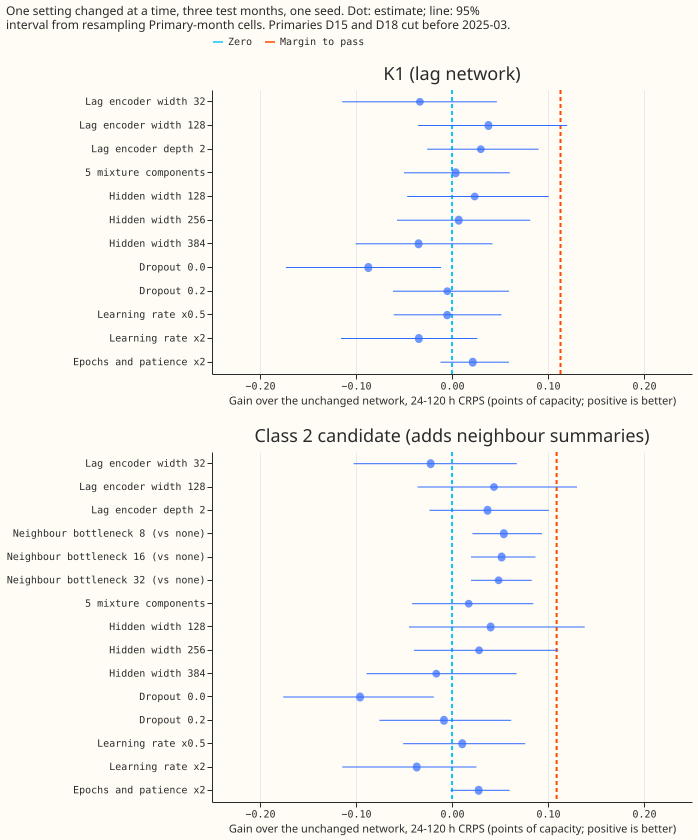
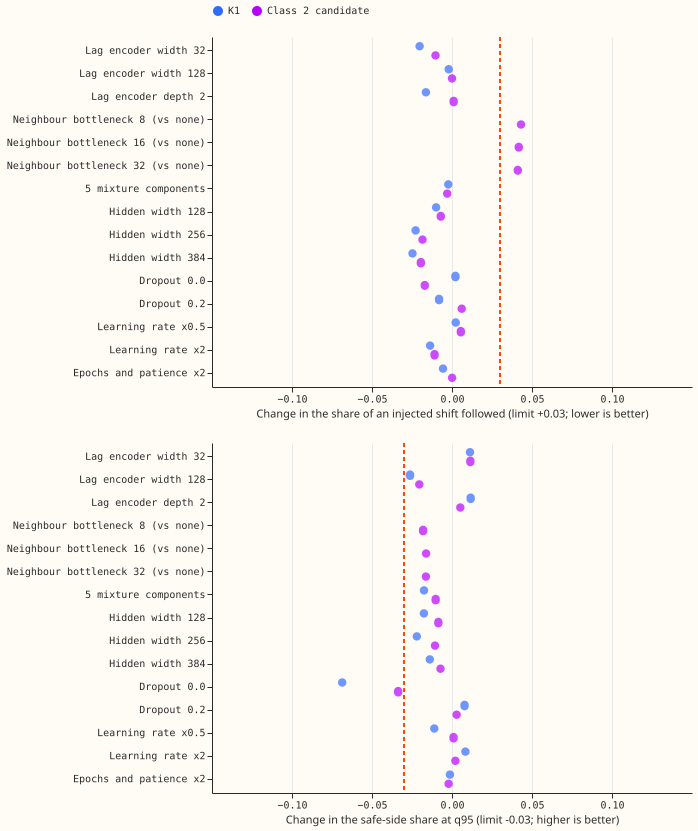
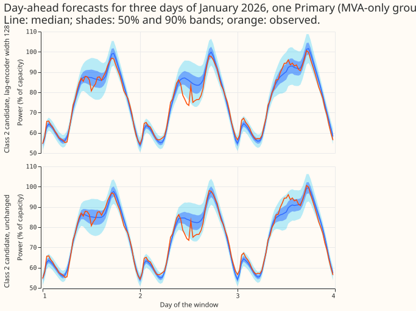
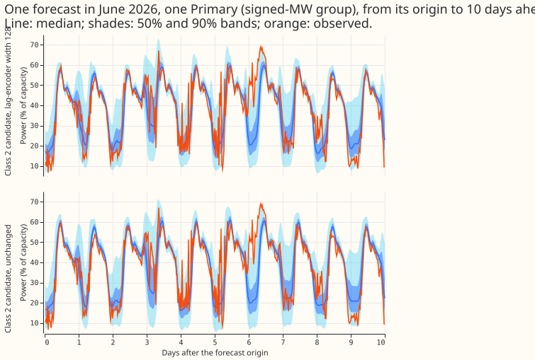

**Making two demand neural networks wider, deeper, or otherwise bigger did not lower their forecast
error by the amount we required, so their sizes and training settings stay as they are.** The
required gain was 0.11 points of capacity in the CRPS (a score of the full forecast distribution;
lower is better), the size of an effect that experiment 447 and the seed-to-seed spread of
experiment 613 say we could detect. Of the settings that pass the safety guards, the best gain is
0.04 points. That gain comes from one Primary substation, D15, which has a short history: without
D15 and D18 the same change is slightly negative. Adding a small neighbour-summary layer (a
bottleneck) gains more (0.05 points, interval above zero), but it makes the forecast follow an
injected load-shift more, which a guard forbids. The verdict is **not supported**: no change helped
enough to adopt. These scores cover forecasts 24 to 120 hours ahead, not the whole 1 to 10 day range
that NGED uses, and the lag-time weather is read from stored estimates of past weather, so the
scores are a ceiling for days whose weather does not exist at forecast time.

We asked whether larger or differently shaped parts of two demand neural networks lower their
forecast error. K1 is the neural network that reads the power 1 day and 1 week earlier; the class 2
candidate also reads summaries of its electrical neighbours' power. We changed one setting at a
time (15 settings in all), refitted the network, and scored the 24 to 120 hour forecasts for 3
test months (2025-10, 2026-01, 2026-06) on one seed, against the unchanged network refitted the same
way. The unchanged K1 reproduces [experiment
613](../00613-nra-roster-contrasts-with-intervals-five-seeds/result.md)'s seed 0 to four decimals.
The margin (0.113 points for K1, 0.109 for the candidate) is the larger of [experiment
447](../00447-demand-network-hyperparameter-sweep-on-the-s1-skeleton/result.md)'s margin scaled to
these networks and 1.96 x sqrt(2) x the seed standard deviation, fixed before any arm was scored.
Because no change passed, the plan's five-fold, three-seed step and the random search did not run.

## Figures

*Figure 1. Gain in 24-120 h CRPS over the unchanged network (points of capacity; positive is
better), 3 test months, one seed. The orange dashed line is the margin (0.113 for K1, 0.109 for the
candidate). Two candidate intervals reach past it, but every point estimate sits far below it, and
passing needs the point estimate to reach the margin.*

*Figure 2. The two guards on the injected load-shift bank (days 4 to the end): the change in the
share of a shift that the median forecast follows (top; the dashed line is the limit, +0.03) and in
the safe-side share at q95 (bottom; limit -0.03). The three neighbour-bottleneck arms fail the top
guard, and dropout 0.0 fails the bottom guard in both networks.*

*Figure 3. Three consecutive days of forecasts for one Primary (MVA-only group): the unchanged
candidate and the candidate with lag-encoder width 128. The two are close; they differ most in the
afternoon of day 3, where the wider network tracks the observed rise better.*

*Figure 4. One forecast of one Primary (signed-MW group) from its origin to 10 days ahead, for the
same two networks. The bands widen with horizon, in both networks.*

## Results

Gain is the unchanged network's CRPS minus the arm's (points of capacity, 24-120 h, all 16
Primaries, 3 months, seed 0). The unchanged networks score 3.088 (K1) and 3.145 (candidate).

| Change | K1 gain | Candidate gain (95% interval) | Candidate gain without D15 and D18 | Passes |
|---|---|---|---|---|
| Lag-encoder width 128 | +0.038 | +0.044 (-0.036, +0.130) | -0.009 | No |
| Hidden width 128 | +0.024 | +0.040 (-0.045, +0.138) | -0.013 | No |
| Lag-encoder depth 2 | +0.030 | +0.037 (-0.023, +0.101) | +0.013 | No |
| Hidden width 256 | +0.007 | +0.028 (-0.040, +0.111) | -0.029 | No |
| Epochs and patience x2 | +0.022 | +0.028 (-0.001, +0.060) | +0.024 | No |
| 5 mixture components | +0.004 | +0.017 (-0.042, +0.085) | -0.014 | No |
| Learning rate x0.5 | -0.005 | +0.011 (-0.051, +0.076) | +0.004 | No |
| Dropout 0.2 | -0.005 | -0.008 | -0.021 | No |
| Hidden width 384 | -0.035 | -0.016 | -0.054 | No |
| Lag-encoder width 32 | -0.033 | -0.022 | -0.030 | No |
| Learning rate x2 | -0.035 | -0.037 | +0.010 | No |
| Dropout 0.0 | -0.087 | -0.096 (-0.176, -0.019) | -0.098 | No |
| Neighbour bottleneck 8, 16, 32 (candidate only; reference has none) | - | +0.054, +0.052, +0.049 (all intervals exclude zero) | +0.053, +0.051, +0.048 | No: follow +0.04, q99 pinball +0.02 |

- **Architecture and arms.** K1 and the class 2 candidate of experiment 613 (arm `P7+D50`, the
  network's own quantiles with no G4 gate or band scaling), one setting changed per arm through
  `e00648_run.py`, which patches the module constants of experiments 545, 559, 560, 510, and 613
  before they run. Each arm repeats pre-training, step 2, and the daily fine-tune; the
  learning-rate scale does not reach the step-2 mixer's fixed 5e-4.
- **Departure from the plan.** The plan named the width-16 bottleneck arm as the reference for the
  other bottleneck widths. The page instead scores all three widths against the unchanged
  candidate, which has no bottleneck, so these arms add a component and change more than one
  factor. Widths 8 and 32 differ from width 16 by about +0.002 and -0.003 points.
- **Row set and data.** `experiment_470_intersection_v1`, 24-120 h, 3 test months, seed 0, cleaned
  data, D15 and D18 cut before 2025-03-01 (the cut is applied by the stored recipe). Rows scored
  per arm: 211,126 (24-120 h), 52,482 (0-24 h), and 252,441 (120-240 h). Weather at lag times is the
  source that experiments 612 and 613 use, unchanged, so the scores are a ceiling for the days
  whose lag-time weather does not exist at forecast time.
- **Reproduction.** The unchanged K1 matches experiment 613's seed 0 to four decimals (3.0882
  points). The unchanged candidate scores 3.145 here; experiment 613's candidate seed 0 was scored
  through the same script and arm folder (`c2_613`) as a reference.
- **Margin.** The seed standard deviation is 0.041 (K1) and 0.039 (candidate) points, estimated
  from experiment 613's seed sets 0 to 1 and 2 to 4, and rests on one noisy month (2025-10).
- **Where the gain comes from.** Lag-encoder width 128 in the candidate gains 0.74 points at D15 and
  0.14 at D18 but loses 0.31 at D10, 0.18 at D8, and 0.12 at D12 (24-120 h). By group, it gains
  0.32 to 0.60 points at D15 and D18, about -0.005 at the eight MVA Primaries, and -0.015 to -0.049
  at the six MW Primaries (three lead bands). Hidden width 128 shows the same pattern. The D15 and
  D18 group has the highest mean CRPS (6.3 points against 2.4 for the six MW and 3.0 for the eight
  MVA Primaries), but D15 alone causes that (9.8 points; D18 scores 2.0). D8 (7.6) and D12 (6.0)
  also score high yet lose with a wider lag encoder, so error level alone does not predict who
  gains.
- **Lead bands.** The 0-24 h and 120-240 h gains of the best arms follow the 24-120 h gains; the D15
  and D18 group gains at every lead band for lag-encoder width 128 (0.32 at 0-24 h, 0.60 at
  120-240 h).
- **Tails.** The unchanged candidate's event-free coverage is 0.860 of rows inside q05 to q95 at
  24-120 h (a calibrated forecast has 0.05 below q05 and 0.05 above q95; measured 0.053 below and 0.087
  above), and K1's
  is 0.871 (0.048 below, 0.080 above). No arm raises q05 or q95 pinball loss on event-free rows by
  more than 0.02 points except the learning-rate x2 and dropout 0.0 arms (both worse) and hidden
  width 384 (q95 +0.024). In the three bottleneck arms the bank
  q99 pinball loss rises by 0.02 points and the bank q95 pinball loss by 0.08 (limit 0.02). The bank
  q99 loss falls by 0.01 to 0.04 in most other arms.
- **Curtailment cost.** The scorer's cost at limit 0.9 (six MW Primaries, 12-36 h, 3 months) is 4,009
  for the unchanged candidate and 4,411 to 4,447 for the two best arms; only 5 of 15 cells are
  non-zero, so three months cannot rank the arms. At limit 0.75 lag-encoder width 128 lowers the
  cost from 103,813 to 89,178 and hidden width 128 raises it to 118,111. No significance test
  was run on
  these costs.
- **Load-shift events.** The guards in Figure 2 use the injected bank. This page does not score the
  real December 2025 load-shift events, so it carries no event plots. NGED's logs may miss
  events, so the clean-lag rows can hold events that no label covers.
- **Retraining.** Monthly refit with daily fine-tunes, as in experiment 613. No weekly check was run
  because no change passed the screen.

## Checks

- **Median error beside the quantile score.** The stored forecasts hold quantiles and no mean, so
  the median-minus-mean check cannot be run. The median's absolute error on the injected bank
  before each event (24-120 h) is 0.0444 for the unchanged K1 and 0.0448 for the unchanged
  candidate, in fractions of capacity.
- **Triggers.** Trigger 4 fired: leaving out D15 and D18 turns the positive pooled gain of
  lag-encoder width 128 and hidden width 128 (+0.04) negative (-0.01). The verdict does not depend
  on it, because no arm passes the margin with or without D15 and D18. Prediction P3 (a wider lag
  encoder raises the follow ratio by 0.01 to 0.05) failed: the change in follow was 0.000. That
  contradiction fires trigger 2. We did not investigate why the follow ratio did not move. The other
  triggers did not fire. The unchanged K1 reproduces experiment 613, so no control failed.
- **Reviews.** A fresh Sonnet agent reviewed the launcher before the first fit and all findings were
  accepted. A fresh Sonnet agent audited the results; it found the D18 explanation, the bottleneck
  contrast, and the tails wording wrong, and the page was corrected. A fresh Sonnet agent read the
  page as a newcomer; its accepted findings (opening, figure captions, headline consistency) are
  fixed. The page keeps the plan and the code-review triage, which that reviewer would have cut.

## What to try next

- The neighbour-summary bottleneck is the only change with an interval above zero. Test it with the
  loss that keeps the follow ratio down before judging it.
- Treat D15 and D18 as a separate question: the networks improve there with width, and nowhere
  else.
- Look for gains in the inputs rather than in the sizes, as experiment 447 advised.

## Plan (written before any fit)

**Question.** Experiment 447 changed one setting of the S1 demand network at a time and found no
gain above 0.064 points. K1 and the class 2 candidate are different networks (a shared lag encoder
with a lag ID, and neighbour summaries in the candidate), so this experiment repeats the screen on
them. It follows the advice of experiment 447 to look at inputs and the lag-trust design before
more tuning, and departs from it only because the maintainer asked for a new look after the lag
encoder gained neighbour summaries.

**Networks.** K1 is the lag network with the G4 gated band; the class 2 candidate is K2 plus
neighbour summaries and 50% signal dropout from
[experiment 610](../00610-nra-neighbour-summary-lag-encoder-inputs-iteration/result.md), scaled to
K1's band width ([experiment 613](../00613-nra-roster-contrasts-with-intervals-five-
seeds/result.md)).
Both are refitted from pre-training through step 2 and the daily fine-tune, with the changed setting
applied at every stage.

**One-factor arms (default in bold).** Each arm changes one module constant before the network is
built, through a wrapper around experiment 612's and 613's arm scripts.

| Factor | Levels | Applies to |
|---|---|---|
| Lag-encoder width (`LAG_HIDDEN`) | 32, **64**, 128 | K1, candidate |
| Lag-encoder depth (`layers`) | **1**, 2 | K1, candidate |
| Neighbour-summary bottleneck width (`BOTTLENECK_HIDDEN`; the candidate has none, so the reference is the width-16 bottleneck arm) | 8, **16**, 32 | candidate |
| Mixture components (`COMPONENTS`) | **3**, 5 | K1, candidate |
| Hidden width of the encoders and the mixer (`ENCODER_HIDDEN`, `MIXER_HIDDEN`) | **64**, 128, 256, 384 | K1, candidate |
| Dropout (`DROPOUT`) | 0.0, **0.1**, 0.2 | K1, candidate |
| Learning rate (pre-training, step 2 encoders and offsets, daily fine-tune; not the step-2 mixer's fixed 5e-4) | x0.5, **x1**, x2 | K1, candidate |
| Maximum epochs and patience | **current**, both x2 | K1, candidate |

That is 15 arms on the candidate and 13 on K1, each with 3 folds at seed 0. If one fold-seed fit
chain takes long enough that all 30 arms exceed the 8 GPU-hour ceiling, the arms are dropped in this
order until the projection fits: K1 arms for the neighbour-summary-free factors that the candidate
arm already covers least (dropout, maximum epochs), then the hidden width 384, then the learning-
rate
x2 arm. The projection is made from the measured time of the first arm and recorded before the
second arm starts.

**Standing practices followed.** Monthly refits with daily fine-tunes as in experiment 613, cleaned
data, the D15 and D18 cut before 2025-03-01, fitted weights saved in the private data folder,
stored experiment 612 and 613 forecasts reused only as a reproduction check, tail and cost
reporting, a draft pull request, and the example-forecast and event plots in the write-up. The
weather source at lag times is the one experiments 612 and 613 use, unchanged; the code review names
it in the PR body, and the write-up says whether it exists at forecast time.

**Process.** Plan commit and draft pull request; a fresh Sonnet code review before the first fit;
a free step-0 script that computes the margin from K1's stored seeds and commits it; the screen; a
fresh Sonnet agent that re-derives the headline numbers; the write-up; one Sonnet prose review.
Chat updates go to the manager only: plan pull request open, fits started, fits finished, pull
request merged.

## Margin (fixed before any arm is scored)

`e00648_margin.py` reads experiment 613's stored event-free cells for seed sets 0 to 1 and 2 to 4 on
the three screen months, 24-120 h, all Primaries. The seed standard deviation comes from the
disagreement of the two seed-set means.

- K1: CRPS 3.009 points of capacity, seed standard deviation 0.0407, minimum detectable effect for
  one seed against one seed 0.1129, experiment 447's margin scaled 0.0640. **Margin 0.113 points.**
- Class 2 candidate: CRPS 3.056 points, standard deviation 0.0393, minimum detectable effect 0.1089,
  scaled 0.0650. **Margin 0.109 points.**
- Caveat: the two seed sets differ by 0.064 in 2025-10 and by under 0.016 in the other two months, so
  the standard deviation rests on one noisy month. The margin is a lower bound on what a single seed
  can detect and is not tuned afterwards.

## Code review triage

A fresh Sonnet agent reviewed the launcher before the screen. Accepted: the bottleneck arms
contrast with the width-16 bottleneck arm, not the reference (above); the learning-rate scale does
not reach the step-2 mixer (above); the candidate's signal tables are experiment 598's and 610's
tables built from the stock width-64 K1, so every candidate arm reads the same signals (a caveat for
the write-up); the launcher now restricts commands, checks the tables exist, and records each chain's
settings; the driver takes a lock so one GPU process runs at a time. The patches reach every place
the constants are read, including the five-component output, which the agent checked by building the
networks.
