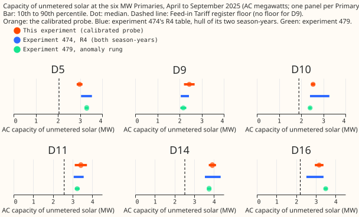

# Two separately fitted methods agree on the unmetered solar behind the six MW Primaries

**Take-home.** A neural-network probe estimates how much unmetered solar (small solar that NGED
does not measure, so it shows only as lower demand) sits behind each of the six primary substations
whose power is recorded in MW (D5, D9, D10, D11, D14, and D16). The probe is a trained
demand-forecasting neural network, asked how much a Primary's net demand falls for a given amount of
sunshine. Dividing its answer by the share of an added real solar farm that it finds again (0.68 of
the added megawatts) gives 2.4 to 3.9 MW of alternating-current (AC) capacity for April to
September 2025. The 80% intervals (10th to 90th percentile) overlap those of the regression table
of experiment 474, fitted separately, at all six Primaries, and the probe's medians lie 6% below to
14% above its medians. The estimates describe the summer as a whole and cannot show how capacity
changed between one year and the next. Experiment 644 found that adding an explicit solar term did
not improve the forecast, so this table is for explaining and cross-checking solar capacity.

**The probe's capacity is divided by the share of an injected farm that it finds again.**
Experiments 621, 634, and 638 trained neural networks that have no year
input, and probed how much each Primary's net demand falls for a given amount of sunshine. This
experiment reads the stored probe results and refits nothing. It divides the probe's capacity by the
share of an injected real farm that the probe finds again (0.68 of the injected megawatts), and
widens
the interval by the spread of that share across four farms.

**Figure 1. At every Primary the calibrated probe (orange) overlaps experiment 474's R4 interval
(blue), and the register floor (dashed) lies below the probe's 10th percentile.** The probe's 10th
percentile is above the floor at all 5 Primaries that have one.

## Table: AC capacity of unmetered solar, April to September 2025

The raw value is the probe's capacity before calibration. The calibrated value is the raw value
divided by 0.679. That is the mean, over four injected farms, of the share of a farm's added output
that the probe finds when that farm is left out of the calibration. The 2026-06 cutoff is the date
up to which the neural network was pretrained. Each row gives the 10th, 50th, and 90th percentiles
(p10, p50, p90) in MW. The probe is the version without a cloud-cover correction (a cloud template).

| Primary | Raw p10 | Raw p50 | Raw p90 | Calibrated p10 | Calibrated p50 | Calibrated p90 |
|---|---|---|---|---|---|---|
| D5 | 1.96 | 2.02 | 2.09 | 2.85 | 2.98 | 3.11 |
| D9 | 1.50 | 1.66 | 1.82 | 2.20 | 2.44 | 2.68 |
| D10 | 1.70 | 1.72 | 1.75 | 2.46 | 2.54 | 2.62 |
| D11 | 2.12 | 2.32 | 2.52 | 3.11 | 3.42 | 3.73 |
| D14 | 2.56 | 2.66 | 2.76 | 3.74 | 3.92 | 4.10 |
| D16 | 2.01 | 2.15 | 2.28 | 2.95 | 3.16 | 3.38 |

April to September 2024 (recovery factor 0.684), calibrated p10, p50, and p90: D5 2.84, 2.96, 3.08;
D9 2.16, 2.39, 2.63; D10 2.44, 2.51, 2.59; D11 3.09, 3.40, 3.72; D14 3.69, 3.86, 4.03; D16 2.92,
3.12, 3.32. The raw and calibrated values of every cutoff are in the private
`work/capacity_table.parquet`.

**Measured in energy, the capacity agrees with the megawatt basis to 1.0%.** Measured in energy, the
probe finds 0.88 (all daylight rows) or 0.78
(donor rows) of an injected farm's energy, against 0.68 in megawatts, because a real farm carries
less energy per unit of peak than a physics curve does. Dividing the raw value by the energy
recovery
gives the capacity of a physics-shaped plant carrying the same energy: at D5 2.29 MW (all daylight
rows) or 2.59 MW (donor rows), and at D14 3.01 or 3.40 MW. Dividing again by the farms' energy ratio
gives the AC capacity of a fleet shaped like the injected farms, which is 1.0% below the megawatt
basis at every Primary, so the energy basis and the megawatt basis agree.

## Comparison with the earlier estimates

The comparison interval for experiment 474 is the range spanning its two season-years that overlap
the
probe's half-year (July 2024 to June 2025 and July 2025 to June 2026, for April to September 2025).
Experiment 479's anomaly regression has one interval per Primary. "Share" is the overlap as a share
of the narrower interval, and a negative overlap is the size of the gap between the two intervals.

| Primary | Probe p50 / R4 p50 | Overlap with R4 (MW, share) | Probe p50 / 479 p50 | Overlap with 479 (MW, share) | Register floor (MW) | Experiment 474 status |
|---|---|---|---|---|---|---|
| D5 | 0.95 | 0.06, 0.24 | 0.90 | -0.11 (gap) | 2.05 | export limit flagged |
| D9 | 1.14 | 0.22, 0.61 | 1.13 | 0.11, 0.40 | none | pinned capacity flagged |
| D10 | 0.94 | 0.17, 1.00 | 1.06 | 0.01, 0.08 | 1.90 | none |
| D11 | 1.08 | 0.45, 0.89 | 1.06 | 0.24, 1.00 | 2.57 | none |
| D14 | 1.06 | 0.36, 1.00 | 1.04 | 0.12, 0.58 | 2.52 | none |
| D16 | 1.11 | 0.44, 1.00 | 0.90 | -0.02 (gap) | 2.20 | pinned capacity flagged |

- **Experiment 474 R4:** overlap at 6 of 6 Primaries for April to September 2025 and 5 of 6 for
  April
  to September 2024 (D16 has a 0.05 MW gap in 2024). The probe's median lies within 0.94 to 1.14
  times
  R4's.
- **Experiment 479:** overlap at 4 of 6 for both half-years. D5 and D16 are separated by a gap, and
  the
  probe is 10% below experiment 479's median at both.
- **Register floor:** the probe's 10th percentile is at or above the Feed-in Tariff register floor
  at
  all 5 Primaries that have a floor (experiment 267 has none for D9). The floor is a lower bound, so
  this check can fail but cannot confirm.

## The estimates describe a whole summer, not changes within it

**The values describe a summer half-year and cannot date a change inside it.** Experiment 638 showed
that a capacity step is followed at 0.82 to 0.88 only in an ordinary spring, and experiment 634
showed that a sunny spring is read as solar capacity. At the 2026-06 cutoff the two probe summers
differ by at most 0.07 MW at every Primary (0.05 MW at 2025-10 and 2026-03, and 0.23 MW at 2025-07),
and the four pretraining cutoffs differ by 2% to 9% (largest to smallest
median). Experiment 474's R4 table, in contrast, moves by up to 0.37 MW between season-years (D10,
2024 to 2025). The probe therefore agrees with experiment 474 on the level and says nothing about
the
trend.

## Checks

- **Median minus mean forecast, and mean-forecast error:** not applicable, because no forecast is
  scored.
- **Audit triggers (checks that call for a fresh audit):** none fired. No control or placebo is run
  here, no nested arm exists, and no
  later experiment depends on this result. Prediction (4) missed its range (see below).
- **Coverage:** the widened interval covers the truth in 0.81 of 96 leave-one-farm-out constant
  injections (0.75 to 0.92 per cutoff and half-year). Experiment 634 read 0.66 with a different
  widening (the standard deviation of the four leave-one-farm-out factors, against the standard
  deviation of the four farms' median recoveries here, and the factor is the mean over held-out
  farms of the median of the other three farms' medians), so the two coverage values are not
  comparable. A reviewer's variants of the construction give 0.78 to 0.91 overall, so the value is
  not pinned down to better than about 0.1. With 96 injections, 0.81 is consistent with the nominal
  0.80 and says nothing finer, so the extra widening that the plan allowed was not needed.
- **Predictions:** (1) held: overlap 6 of 6, and medians within 0.94 to 1.14 times R4's. (2) held:
  the
  calibrated median is 1.46 to 1.47 times the raw median. (3) held: 5 of 5. (4) missed on the high
  side, 0.81 against 0.60 to 0.80. (5) held: -1.0%.
- **Stop rules:** the seed standard deviation of the raw capacity is at most 0.17 MW (stop at more
  than
  0.5 MW at 3 Primaries); the cutoffs' medians differ by at most 9% (stop at 30% at 3 Primaries).
- **Reviews:** a fresh Sonnet agent reviewed the code before the first run, another re-derived the
  numbers, and another reviewed the prose; each review's findings were triaged and the valid ones
  applied.

## Caveats and next steps

- **Caveats:** the injected farms are four real metered farms that resemble each other, so the
  recovery factor, and therefore the table, may not transfer to an unmetered fleet of rooftop panels
  with other tilts. The farm spread is estimated from four farms. Experiment 474 flags its own table
  at
  D5, D9, and D16. The probe covers April to September, so winter capacity is unprobed. Nothing
  dated
  2026-07-01 or later is used. The raw rows, the table, and the figure source are in this
  experiment's private folder.
- **Next:** compare the table with NGED's connection records where NGED will share them, starting
  with D5, D9, and D16.

**Code:** `ml-experiments/00649-pv-capacity-table-season-year-from-stored-probes/e00649_table.py`
reads experiment 634's stored probes, experiment 634's `energy_recoveries.csv` (which holds
experiment 621's recoveries), and the stored tables of experiments 129, 474, and 479. It edits none
of them.
