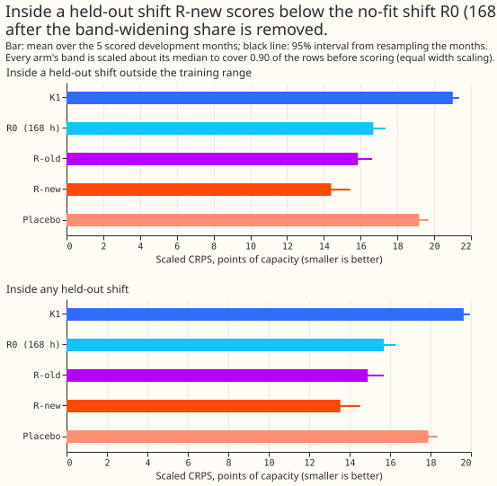
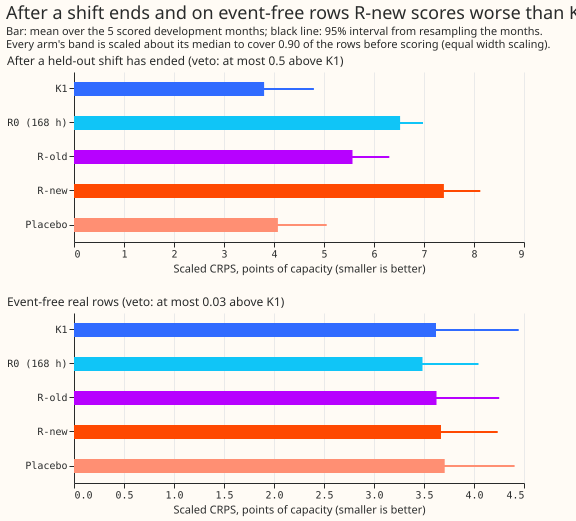
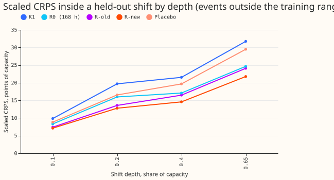
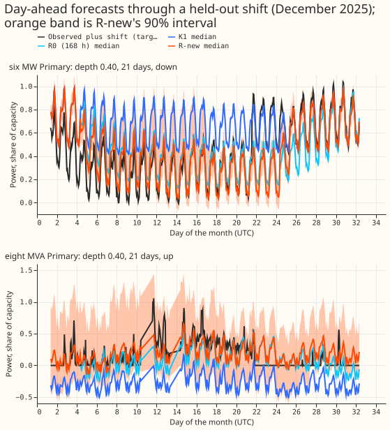
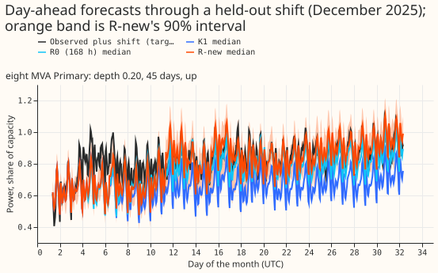
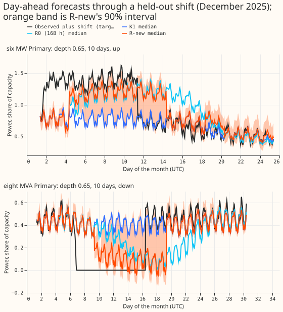
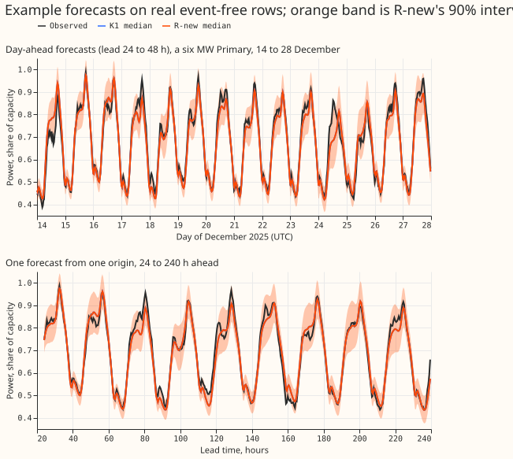

Experiment 650 asked whether the departure head of experiment 647 improves when it trains on a
richer set of injected load shifts. A load shift is a period when the network operator moves part of
a Primary's demand onto or off a neighbouring Primary. A Primary is a primary substation. K1 is the
neural network of experiments 612 and 613 that forecasts the normal running arrangement, the demand
with no load shift. The departure head is a small second neural network that reads K1's quantiles
and the gap signals (differences between recent power and a lag-free forecast), and shifts K1's
forecast towards the arrangement now in force. R0 (168 h) is the no-fit baseline: K1's quantiles
plus K1's own mean error over valid days 2 to 8 before the forecast, decayed by exp(-lead / 168 h).

**Take-home message.** All shifts here are synthetic: they are injected into real history, and only
one real episode (the verified pair, below) checks the result. Trained on shifts with random ends,
varied shapes, and depths from 3 to 50 points of capacity, the head beats R0 (168 h) by 2.29 points
of capacity inside shifts that lie outside the training range (R-new is the head trained on the
extended generator, R-old the head trained on the old bank), after every arm's band is scaled to the
same coverage. R0 (168 h) beats R-new on event-free rows and after a shift ends. After a shift ends,
however, the head scores 3.59 points worse than K1, and 1.83 points worse than the head trained on
the old bank. The head is therefore not ready for production. Verdict: partly supported.

## Figures

## Results

Scores are CRPS (twice the mean pinball loss over the 11 stored quantiles) in points of capacity,
where 1 point is 1% of a Primary's effective capacity. A negative difference favours the first arm.
Intervals are percentile bootstraps over the 5 development months (2025-10, 2025-12, 2026-01,
2026-03, 2026-06) of the mean of 2 seeds. Equal width scaling multiplies every arm's quantile spread
about its median by one factor per month and phase, chosen so that the q05-q95 band covers 0.90 of
the rows. The factor is fitted on the scored rows and knows which phase each row is in (before,
inside, or after the shift), so the scaling is an oracle that production cannot use. It applies to
K1 and R0 as well. Pinball loss is the asymmetric quantile loss; CRPS is the continuous ranked
probability score; MW and MVA Primaries are those metered in megawatts and in megavolt-amperes; NGED
is National Grid Electricity Distribution.

- **Inside a shift outside the training range, R-new beats every other arm (decision contrast).**
  Scaled CRPS: K1 21.01, R0 (168 h) 16.69, R-old 15.85, R-new 14.40, placebo 19.18. R-new minus R0
  is -2.29 [-2.63, -1.95]; minus R-old, -1.45 [-1.69, -1.22]; minus K1, -6.61 [-7.41, -5.79]; minus
  placebo, -4.78 [-5.72, -3.68]. Unscaled CRPS: K1 26.64, R0 18.10, R-old 15.81, R-new 13.13.
  Scaling cuts R-new's gain over R0 from 4.96 unscaled points to 2.29.
- **The gain holds on in-support events and at every depth.** Inside events within the training
  range, R-new scores 9.48 against R0's 10.90 (-1.42 [-1.90, -0.95]). By depth (0.10, 0.20, 0.40,
  0.65), R-new scores 7.12, 10.43, 14.57, and 21.75 against R0's 8.31, 12.34, 17.07, and 24.64. On
  the training family in the scored month (events the head never saw), R-new scores 6.65 against
  R0's 7.94.
- **Both vetoes fail or are not cleared.** After a held-out shift ends, scaled CRPS is K1 3.80, R0
  6.52, R-old 5.57, R-new 7.40, and the placebo 4.08. R-new minus K1 is +3.59 [+2.70, +4.41] against
  the 0.5 limit, and R-new minus R-old is +1.83 [+1.24, +2.53]. On event-free real rows, R-new minus
  K1 is +0.05 [-0.24, +0.31] scaled and +0.03 [-0.28, +0.31] unscaled against the 0.03 limit, so the
  experiment cannot tell whether the head scores worse there; at the point estimate the unscaled
  loss is 0.034 above K1, which misses the 0.03 limit. R-new is also worse than R0 after the end
  (+0.88 [+0.22, +1.55] scaled) and on event-free rows (+0.18 [+0.10, +0.27] scaled). R-new carries
  a shift for about 3 days past its end in the examples.
- **The placebo prediction failed.** The plan predicted the placebo within 0.05 of K1 after scaling.
  On the decision rows the placebo scores 19.18 against K1's 21.01 scaled (24.42 against 26.64
  unscaled). No table here explains the gap. R-new minus placebo is -4.78 [-5.72, -3.68].
- **On the verified D5 and D16 pair (descriptive, 13,000 rows, one episode),** unscaled CRPS is K1
  15.02, R0 13.25, R-old 9.76, R-new 9.57, and the placebo 14.12. R-new and R-old are equal there.
- **Tail calibration (unscaled).** Inside a shift, q05-q95 coverage is K1 0.23, R0 0.37, R-old 0.55,
  and R-new 0.59, against a nominal 0.90. Pinball loss at q01, q05, q95, and q99 is K1 6.91, 9.09,
  11.35, and 8.84; R0 4.25, 5.95, 7.31, and 5.28; R-old 2.56, 4.21, 5.33, and 3.25; R-new 2.59,
  4.08, 4.68, and 3.02. After a shift ends, coverage is K1 0.90, R0 0.62, R-old 0.88, and R-new
  0.81, and the q99 pinball loss is 0.26, 0.98, 0.33, and 0.84. On event-free rows coverage is 0.87
  for K1, 0.88 for R0, 0.89 for R-old, and 0.89 for R-new, and the q99 pinball loss is 0.275, 0.250,
  0.256, and 0.258.
- **Avoidable-curtailment cost** (experiment 601's function, in the units of its code, which labels
  them pounds per Primary-day without a check against a tariff, six MW Primaries, leads 12 to 36 h,
  limit 0.9 of the earlier peak, mean over the held-out rows; the range is the lowest and highest of
  the 5 months). Inside a shift: K1 549,533, R0 213,749, R-old 167,632, R-new 147,900 (range 70,859
  to 247,869), placebo 482,589. In the 7 days after the end: K1 541, R0 13,980, R-old 8,087, R-new
  10,512, placebo 1,967. Over all rows: K1 316,942, R0 126,244, R-old 97,594, R-new 87,208, placebo
  278,503. Every head cuts the cost inside a shift, and every head raises it after the end.
- **The head's median is a better forecast too.** Over all held-out rows inside a shift, the mean
  absolute error of the median is K1 30.59, R0 21.92, R-old 22.18, and R-new 17.42 points of
  capacity. R-new leads on both CRPS and median error, but R0 beats R-old on median error and loses
  to it on CRPS.

## Arms, data, and method

- **Arms.** R0 (168 h), K1 (stored), R-old (experiment 647's head recipe refitted on experiment
  647's constant-shift bank, because its stored weights were deleted to free disk), R-new (the same
  head on the extended generator), placebo (R-new with the shifts shuffled across the bank rows of
  the training fold). All heads read K1's 11 quantiles and experiment 647's inputs, one head per
  scored month (trained on the other 4 months), 2 seeds, with early stopping on origin days 21
  onward of the training months. Arm G (a head trained on generated bases instead of real ones) was
  not run, and neither was the realness classifier planned beside it.
- **Extended generator.** One shift per Primary per pass, 12 training passes per month. Constant or
  proportional shape (MVA Primaries constant only), step or 6 to 48 h ramp onset, depth log-uniform
  from 3 to 50 points, duration 3 to 14 or 28 to 112 days with onset from 10 days before the month
  to day 20, so ends fall before, inside, and after the 10-day horizon. The donor's loss reaches one
  or two real electrical neighbours at 0.5 to 1 times the loss (15% of shifts have none), kept out
  of MW-and-MVA sums by a power factor of 0.97.
- **Held-out family.** 4 passes per month, constant shape, depths 0.10, 0.20, 0.40, 0.65, durations
  5, 10, 21, 45 days, half the events with a 72 to 120 h ramp. Events with a long ramp, depth 0.65,
  or a duration of 15 to 27 days are outside the training range; the decision contrast pools them. A
  5-day event with a 120 h ramp never reaches its labelled depth.
- **K1 on the bank.** K1's five saved seeds ran on CPU on each shifted bank, then experiment 613's
  tail constants and G4 gate were rebuilt with this experiment's shifts. The rebuild reproduces
  experiment 647's stored K1 rows on its constant bank (0.4% of rows in one pass differ where the
  daily-mean gate differs from experiment 613's constant per-day step).
- **Rows and cleaning.** The development months only; no row on or after 2026-07-01 is read
  (asserted). Power comes from the stored clean stack, with flagged rows excluded from real-row
  training and scoring; the count of flagged half-hours per fold was not tabulated separately. Rows
  without R0 history are dropped from every arm: 14% to 26% of held-out rows per month, and 37% of
  the real rows in 2025-10 (`score5/dropped.csv`).
- **Cadence.** K1 is stored and not refitted. The heads are small and are fitted once per scored
  month, so no refit cadence applies.
- **Reused code.** Experiment 647 (data build, head, fit helpers, K1 rebuild pattern), experiment
  581's bank interface, experiment 591 and 613's K1 inference, experiment 613's scorer, and
  experiment 601's cost.

## Checks

- **Median minus mean forecast** (points of capacity, all held-out rows inside a shift): K1 -0.75,
  R0 -0.75, R-old -0.38, R-new -0.32. Event-free real rows: -0.61, -0.61, -0.53, -0.53.
- **Mean-forecast error beside the contrasts** (all held-out rows inside a shift, mean absolute
  error of the mean forecast): K1 30.59, R0 22.02, R-old 22.37, R-new 18.40. R-new leads on both
  measures; R0 beats R-old on this one only.
- **Triggers fired.** The placebo moved the decision rows by 2.2 unscaled points against K1 (placebo
  trigger), and the two vetoes missed their bars (bar trigger). The leave-one-Primary-out, sister
  experiment, and later-dependency triggers were not assessed.
- **Reviews.** A Sonnet agent reviewed the plan and another the code before the first scored run.
  The code review found a held-out family with no in-support cells, unbalanced signs, a reversed
  power-factor conversion, MVA Primaries given proportional shapes, and an events file overwritten
  per batch; all were fixed and the inference was rerun. The results review and the write-up review
  are listed in the pull request.

## Caveats

- The intervals use 5 month blocks, so every interval is coarse.
- NGED's event labels are incomplete, so event-free rows may hold unlogged shifts. The event-free
  cost is therefore optimistic and the number of real flagged events is a lower bound.
- The held-out shifts differ from the training family in a few attributes only, they are constant
  shapes, and an MVA Primary's target is clipped at zero.
- Equal width scaling is an oracle fitted on the scored rows. The scaling widens every under-covered
  arm: inside held-out shifts the factors are 6.5 for K1, 5.5 for R0, and 3.6 for R-new, and R-new's
  unscaled q05-q95 coverage is only 0.59. The scaled gain therefore depends on widening R-new's band
  by about 3.6 times.
- One episode (the verified pair) carries the real-row evidence; no real flagged day beyond it was
  scored.
- R-old is a refit on the same one-bank training months as R-new, not the stored head of experiment
  647.
- Arm G and the realness classifier were not run.
- The first-month-pair gate (2025-10 and 2025-12) passed: R-new minus R0 was -2.33 and -2.83.
  Fold-by-fold values for every contrast are in the `per_month` column of `score5/contrasts.csv`.

## What to try next

- Let the head end a shift from the gap signals: replace the fixed duration prior with a prior
  learned from the extended bank, and test it on shifts that end during the 10-day horizon.
- Re-test the decision contrast with a fixed width-scaling rule that targets pinball loss, not
  coverage.
- Run arm G once the head's after-shift loss is fixed.
