**A graph layer over the electrical neighbours did not help.** The class 2 candidate (C) is the
stored neural network of experiments 612 and 613. It follows an injected false load shift (a
synthetic step in its own recent power readings) less than the pretrained network without neighbours
(A1) does, but on ordinary days it has an extra forecast error at the six Primary substations that
report power in megawatts (MW). We asked whether a layer that lets each Primary read the hidden
states of its neighbouring Primaries, wired like the real electricity network, would keep the low
follow (the share of the injected shift that the forecast copies) and remove the extra error. We
added that layer in five forms to the candidate without its neighbour summaries (the control G0),
fitted each form on two development months (October and December 2025) with two seeds, and scored
each form against C. No form passed the gate fixed in advance. The graph layers made little use of
the neighbours, and a placebo wired at random scored the same as the real wiring. The six MW
Primaries' extra error is therefore not caused by missing neighbour information. Following the plan,
this page is the final answer: the confirmation experiment (G2) and the extension to substation
parents (G3) do not run.

The experiment follows the maintainer-approved design (Opus, 2026-11-08). It builds on the class 2
network of [experiment 612](../00612-nra-combined-networks-three-class-roster-completion/result.md)
and [experiment 613](../00613-nra-roster-contrasts-with-intervals-five-seeds/result.md), the
neighbour summaries of [experiment
610](../00610-nra-neighbour-summary-lag-encoder-inputs-iteration/result.md), the injected load
shifts of experiment 581, the pretrained shared lag encoder (A1) of experiment 591, and the E3 rows
of experiment 599. The graph layers are the graph convolution of [Kipf and Welling
(2017)](https://doi.org/10.48550/arXiv.1609.02907) and the graph attention of [Veličković et al.
(2018)](https://doi.org/10.48550/arXiv.1710.10903). Edges come from the 29 interconnections of
experiment 383.

## Verdict

- **Verdict: not supported.** No arm passes the gate (next section).
- **Take-home.** The extra error at the six MW Primaries (about 0.13 to 0.14 points of capacity over
  A1) is the same for G0, which has no neighbour inputs, and for C. The graph layers did not remove
  it.
- **The graph layers make little use of their neighbours.** Moving from bank M to bank X changes the
  median forecast by 0.19 points of capacity for GAT-E and 0.92 for C, against a mean injected shift
  of 31.7 points (FLOW-E: 0.25; GAT-R: 0.11).

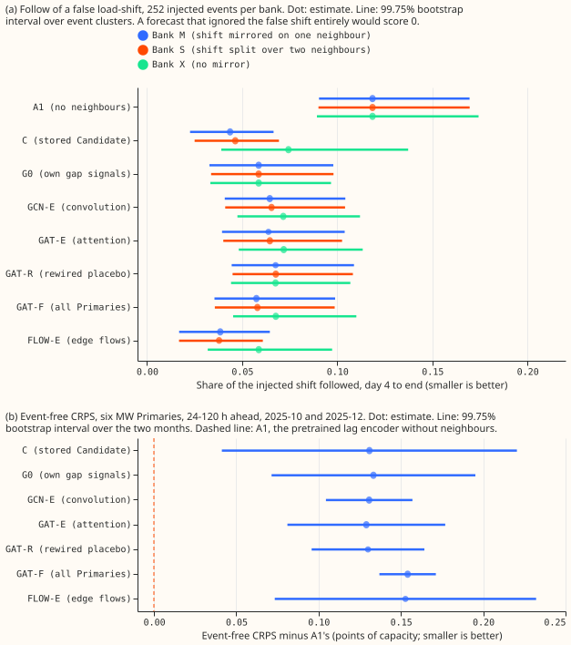

Panel (a): the share of a false shift that each forecast follows (lower is better; 0 ignores the
shift). Look at FLOW-E, the only arm below C on banks M and S, and at the three graph arms (GCN-E,
GAT-E, GAT-R) that sit above G0. Panel (b): six MW event-free CRPS minus A1's; every interval sits
above zero, and the intervals of C, G0, and the graph arms overlap almost entirely. The scorer
stores no paired contrast against C, so panel (b) shows A1 as the reference.

## Arms and the gate

All arms use experiment 613's recipe: E3 rows (7-day embargo, half weight on the next 7 days), the
D5 monthly offset, 50% signal dropout (D50), refits on days 0 and 14, seeds 0 and 1, the synthetic
lag-only load shifts of experiment 581, and monthly folds on 2025-10 and 2025-12. G0 drops the
neighbour summaries. A graph arm adds one layer, `h_i + U * aggregate_j(message_ij)`, with `U`
initialised to zero so every arm starts as G0, and with each neighbour's message hidden on half of
the training rows. GCN-E averages neighbour states with a degree-normalised sum. GAT-E attends over
neighbour states with two heads. GAT-R is GAT-E on a graph rewired at random with every node's
degree preserved (the placebo). GAT-F lets every Primary attend to every other Primary, with no
topology. FLOW-E sends an antisymmetric flow in megawatts along each edge and trains it with an
auxiliary loss on the known synthetic shift.

The injected banks are M (each shift mirrored on one neighbour, experiment 581), S (shift split
60/40 over two neighbours; the degree-1 Primary D9 loses 40% of its mirror, so it understates the
benefit for D9), and X (no mirror).

| Arm | Follow, bank M | Follow, bank S | Follow, bank X | Six MW CRPS, 24-120 h | Gate (i) | Gate (ii) | Gate (iii) | Passes |
|---|---|---|---|---|---|---|---|---|
| A1 | 0.119 | 0.119 | 0.119 | 2.320 | n/a | n/a | n/a | n/a |
| C | 0.044 | 0.046 | 0.074 | 2.458 | n/a | n/a | n/a | n/a |
| G0 | 0.059 | 0.059 | 0.059 | 2.458 | n/a | n/a | n/a | n/a |
| GCN-E | 0.065 | 0.065 | 0.072 | 2.452 | fail | fail | fail | no |
| GAT-E | 0.064 | 0.065 | 0.072 | 2.452 | fail | fail | fail | no |
| GAT-R | 0.068 | 0.068 | 0.068 | 2.452 | n/a | n/a | n/a | placebo |
| GAT-F | 0.057 | 0.058 | 0.068 | 2.475 | n/a | n/a | n/a | n/a |
| FLOW-E | 0.038 | 0.038 | 0.059 | 2.479 | pass | fail | moot | no |

The gate, checked by `e00651_gate.py` on the width-rescaled forecasts (the raw forecasts give the
same pass or fail result; the CRPS cells in the table above and the margins below are raw), requires
of GCN-E, GAT-E, or FLOW-E: (i) follow on bank M at most C's + 0.01 and on bank S at most C's; (ii)
six MW event-free CRPS below C's by at least 0.044, or follow on bank S below C's by at least 0.03;
and (iii) beating GAT-R by half the gate threshold on the measure that passed (ii), which is moot
when (ii) fails. The 0.044 threshold is a constant fixed in `e00651_gate.py` from experiment 610's
minimum detectable effect, not the per-arm interval half-width that the scorer prints. GCN-E and
GAT-E fail (i): they follow 0.020 to 0.021 more than C on bank M and 0.019 more on bank S. FLOW-E
passes (i), but its CRPS is 0.021 worse than C's and its follow is only 0.008 lower on bank S, so
(ii) fails.

## Results

- **Predictions.** Six predictions were written before any score.
    - P1 (GAT-E's follow within 0.01 of C's) failed although the author expected it to hold: 0.064
      against 0.044.
    - P2 (GAT-E's CRPS within 0.044 of G0's) holds in its letter (−0.005), but its purpose, removing
      the extra error, fails: G0 itself is 0.133 above A1 and every arm stays 0.129 to 0.154 above
      A1 (month-averaged). The pre-registered "+0.059" was a wording error: C and G0 have equal CRPS
      here.
    - P3 (GAT-R follows at least 0.01 more than GAT-E) failed, as expected: +0.004 on bank M and
      +0.003 on bank S.
    - P4 (GCN-E and GAT-E differ by less than the threshold) held.
    - P5 (GAT-F within 0.044 of G0) held: +0.017.
    - P6 (FLOW-E on bank X no worse than C by more than 0.01) held: 0.059 against 0.074, which is
      0.015 better.
- **G0 stands in for C on ordinary days.** On the six MW rows the median forecast of G0 correlates
  0.9998 with C's (mean absolute difference 0.18 points). On injected rows the median forecasts of
  G0 and C differ by 1.05 points, because C reads neighbour summaries. We did not refit one C cutoff
  to check the stored forecasts; the G0-versus-C comparison stands in for that check on ordinary
  rows only.
- **Tails.** At the six MW Primaries the graph arms match C: q99 pinball loss 0.182 for G0, GCN-E,
  GAT-E, and GAT-R against 0.188 for C and 0.158 for A1, and q05 to q95 coverage 0.859 to 0.873
  against 0.901 for A1. FLOW-E is worse in the upper tail (q99 0.196, q95 0.696 against C's 0.682),
  and GAT-F has the lowest coverage (0.859). At the eight MVA Primaries C has the lowest q95 and q99
  loss of the trained arms (0.786 and 0.258 against 0.794 to 0.818 and 0.260 to 0.282), and A1 is
  worse than C there (CRPS 2.883 against 2.876), so the extra-error finding applies to the six MW
  Primaries only.
- **Curtailment cost.** Not computed: no arm passed the gate, so none goes forward to a decision
  that needs it.

Tail table, six MW Primaries (24-120 h, pinball loss; coverage of the 90% band):

| Arm | q01 | q05 | q95 | q99 | Coverage |
|---|---|---|---|---|---|
| A1 | 0.140 | 0.519 | 0.613 | 0.158 | 0.901 |
| C | 0.142 | 0.535 | 0.682 | 0.188 | 0.873 |
| G0 | 0.142 | 0.536 | 0.678 | 0.182 | 0.872 |
| GCN-E | 0.141 | 0.536 | 0.681 | 0.182 | 0.869 |
| GAT-E | 0.142 | 0.535 | 0.678 | 0.182 | 0.871 |
| GAT-R | 0.141 | 0.535 | 0.677 | 0.182 | 0.871 |
| GAT-F | 0.141 | 0.536 | 0.688 | 0.185 | 0.859 |
| FLOW-E | 0.141 | 0.536 | 0.696 | 0.196 | 0.869 |

## Examples of forecasts

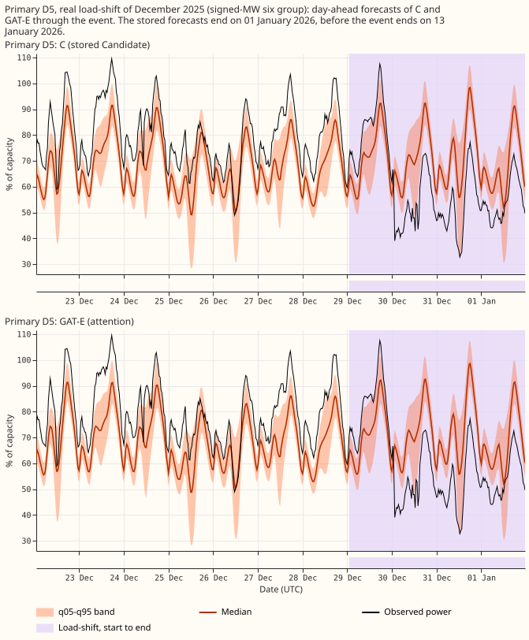

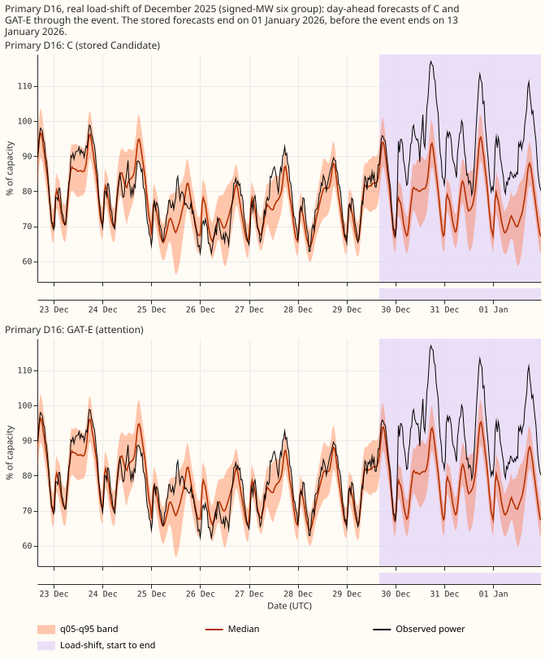

The two real load shifts in the two development months that experiment 580 verified, at D5 and D16
(both six MW Primaries). The stored forecasts end on 1 January 2026, before the events end on 13
January. The figures show the forecasts only; no score is attached to them.

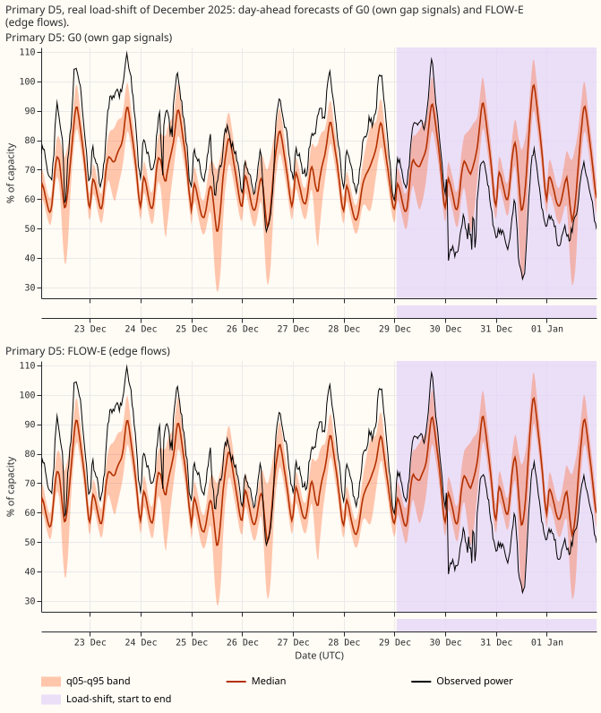

G0 and FLOW-E at D5, for comparison of the one arm that holds follow.

The six figures below show injected load shifts of 15% and 30% of capacity, up and down, at three
six MW Primaries (D5, D9, D10) and three MVA-only Primaries (D2, D3, D4), C above and GAT-E below.
The injected span is shaded and the shifted lag input is dashed. The six figures show the forecasts
of two arms through injected shifts; the follow scores are in the first table.

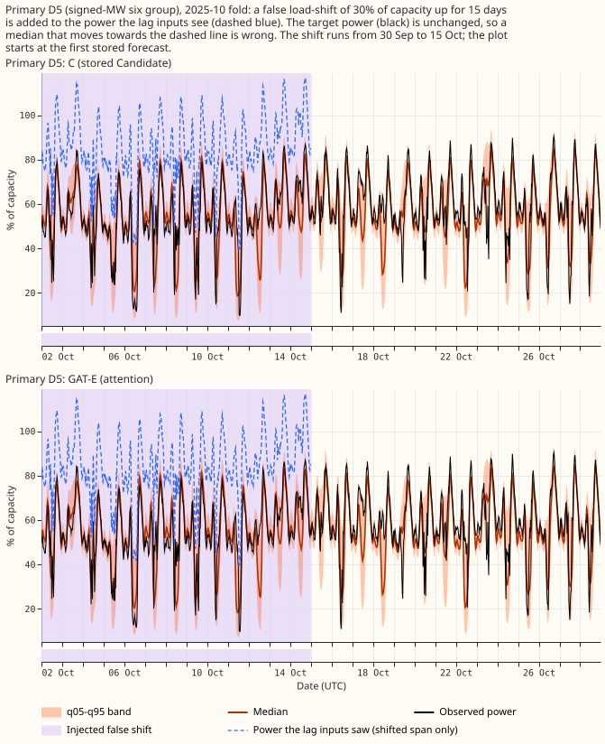

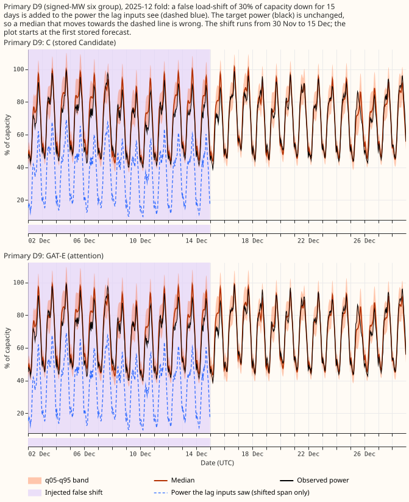

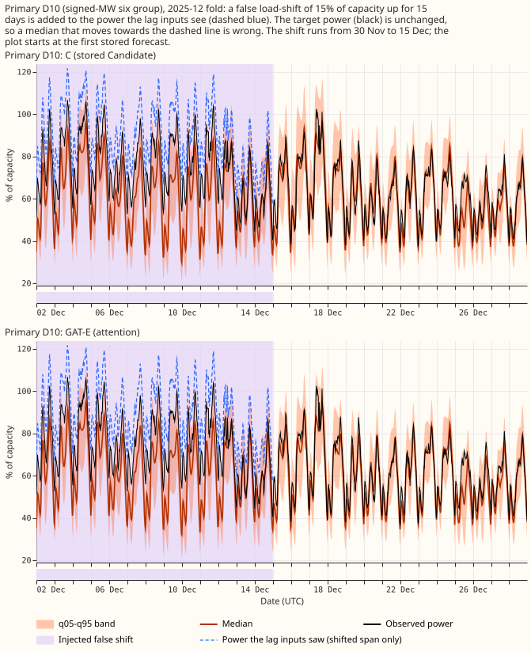

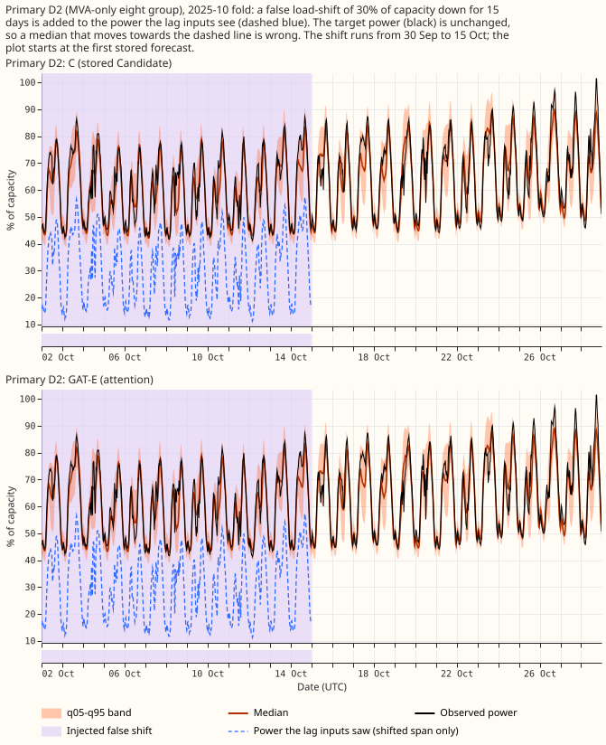

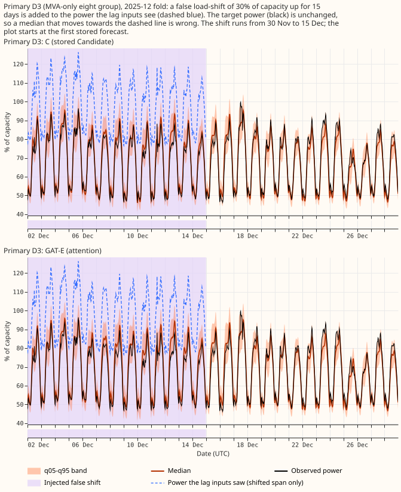

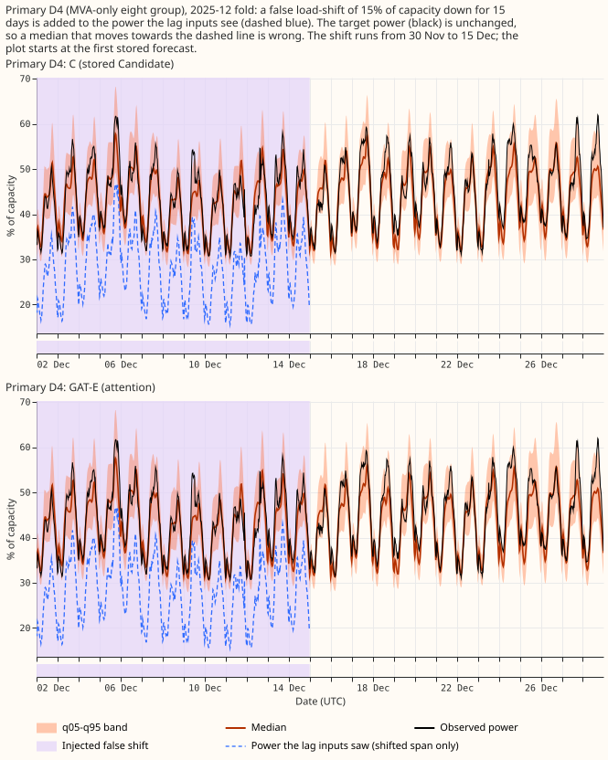

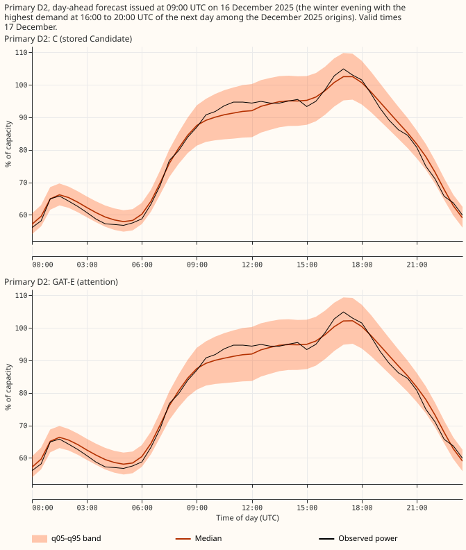

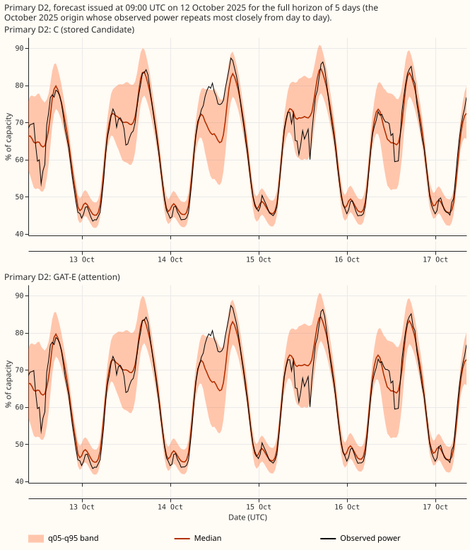

The stored forecasts reach 119.5 hours (5 days), so the full 14-day horizon is not drawn. For the
winter evening the median error is 1.91% of capacity (C) and 1.95% (GAT-E), with 0.933 and 0.946 of
the readings inside the 90% band. For the quiet week the errors are 2.26% and 2.29%, and both hold
0.979 of readings inside the band.

## Checks

- **Scorer reproduced.** A fresh audit recomputed six MW CRPS from the stored quantile forecasts and
  matched the scorer to 2e-7 on all 14 system levels and 26 contrasts.
- **Median and mean forecasts agree with CRPS.** The mean absolute error of the median forecast and
  of the mean forecast point the same way as every raw CRPS contrast against C; only the
  width-rescaled G0 minus C contrast flips (CRPS −0.003, median error +0.008). Median minus mean
  forecast is small at every six MW Primary (at most 0.062 points from C's gap). At D8 and D15,
  neither a six MW Primary, G0 and the graph arms differ from C's gap by up to 0.4 to 0.8 points,
  most for FLOW-E.
- **Triggers fired, none changing the verdict:** (a) seed noise exceeds every contrast except
  FLOW-E's: arm minus C changes sign between seed 0 and seed 1 for G0, GCN-E, GAT-E, GAT-R, and
  GAT-F, and between the two months; (b) leaving one Primary out flips the sign of 16 of 84 six MW
  CRPS contrasts, mostly by dropping D10, while no flip occurs for follow on bank M, and GAT-F and
  FLOW-E minus C never flip; (c) GAT-R sits inside GAT-E's interval (GAT-E minus GAT-R +0.0001,
  interval −0.006 to +0.007); (d) the graph layers make little use of the neighbours (above).
- **Not fired:** a failed control, a nested arm that beats the arm containing it (G0 does not beat
  C; GAT-F is worse than GAT-E), and a disagreement between the quantile score and the mean-forecast
  error on the raw contrasts.
- **Leak guard.** Replacing every neighbour reading after the origin minus 24 hours with noise
  leaves the inputs and forecasts bit-identical (`e00651_test_leak.py`; the positive control with a
  shortened guard window fails as it should).

## Caveats

- **Few months, few seeds.** Two development months and two seeds. The scorer's 99.75% interval over
  the two months spans both months' values, so panel (b) is wide; it excludes none of the contrasts
  that matter. No contrast among C, G0, GCN-E, GAT-E, and GAT-R is resolved. FLOW-E is worse than C
  and G0 (day-block 95% interval of FLOW-E minus C: +0.010 to +0.032).
- **Seen once.** G2 did not run, so no arm was confirmed on 2026-01, 2026-03, or 2026-06.
- **Unlogged events.** NGED's logs may miss load-shift events, so clean rows can hold unlabelled
  events; the injected-bank numbers are optimistic and the real-event slices undercount.
- **MVA nodes.** Eight of the 14 Primaries in the group tables (D15 and D18 are tabled separately)
  report MVA, which has no direction, so FLOW-E's conservation holds only approximately there.
- **Bank S.** The 60/40 split hides 40% of the mirror at the degree-1 Primary D9.

## What the next experiment should answer

The class 2 candidate and G0 both score 0.13 points worse than A1 at the six MW Primaries, with or
without neighbours. The next experiment should find which part of the recipe causes that excess (E3
rows, the D5 offset, or 50% signal dropout), for example by dropping each in turn on G0.

## Reproduction

Code is in
`ml-experiments/00651-graph-layer-over-electrical-neighbours-in-the-demand-network-part-1/`:
`e00651_arm.py` (fits, three banks), `e00651_score.py` (wraps experiment 613's scorer),
`e00651_gate.py`, `e00651_audit.py`, `e00651_figures.py`, and the two tests. The GPU cost was about
3.0 process-hours of fits and injections of the 5-hour ceiling.
