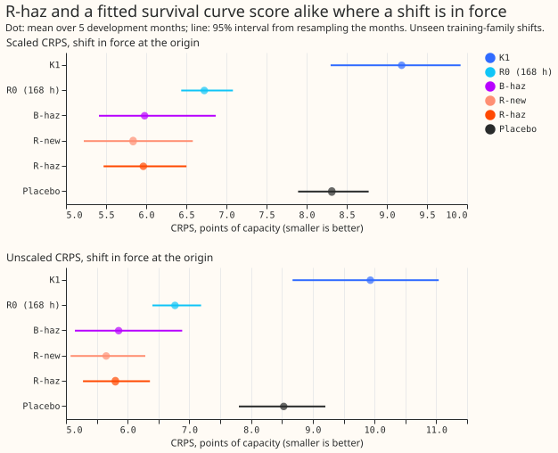
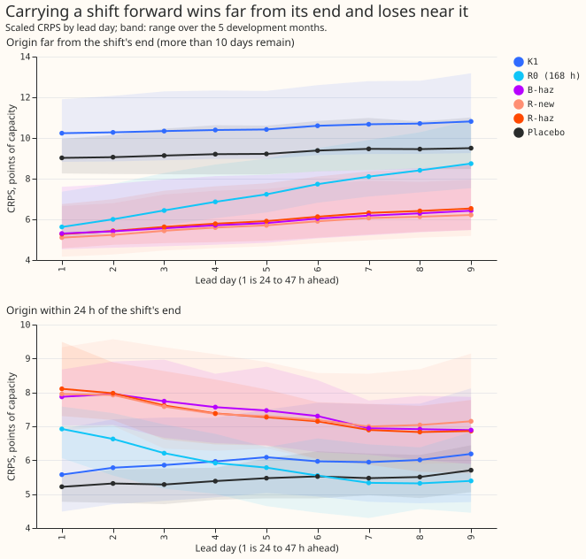
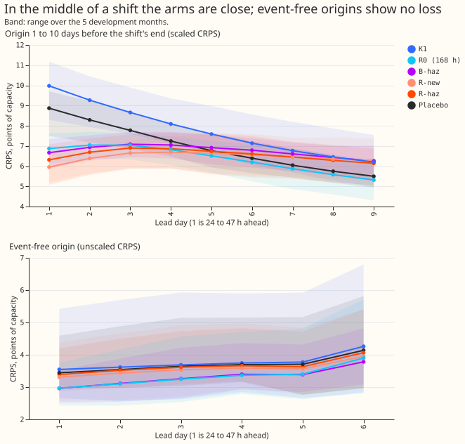
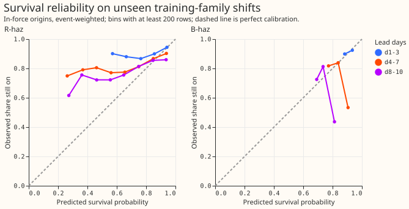
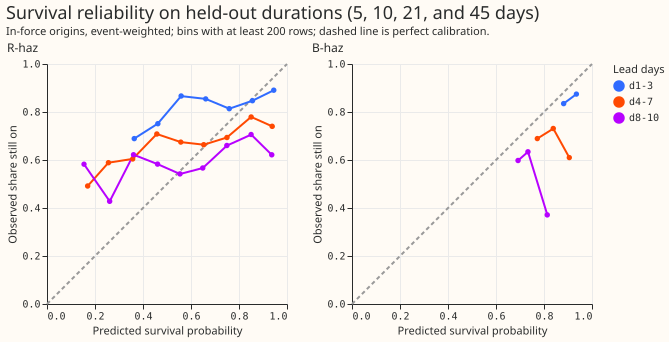
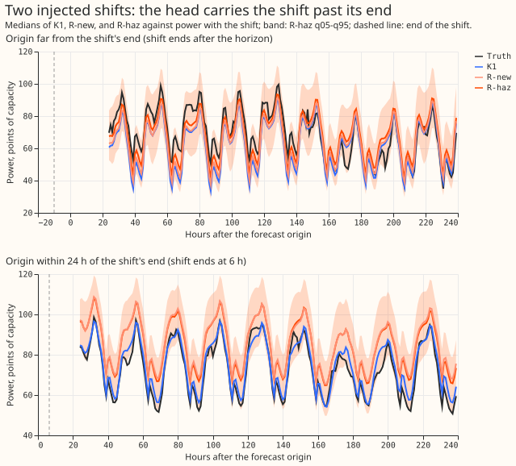

A load shift is a period when the network operator moves part of one Primary's demand onto or off
a neighbouring Primary. A Primary is a primary substation. K1 is the neural network of experiments
612 and 613 that forecasts the normal running arrangement (NRA), the demand with no load shift.
Experiment 652 defines two forecasts, scores each under its own rules, and asks whether a departure
head with a learned survival output beats a no-fit survival curve. Every shift here is injected
into real history; the real rows check only the event-free veto and one verified episode.

**Take-home message.** Where a shift is in force at the forecast origin, a prevailing forecast scores
5.8 points of capacity against K1's 9.9 (unscaled CRPS), but a single survival curve fitted to the
training durations scores 5.85, so the learned survival output adds nothing measurable (R-haz minus
B-haz -0.02 [-0.35, +0.24] scaled). In the last 24 hours before a shift ends, every arm that carries
the shift forward scores about 3.5 points worse than K1 (R-haz 7.44, B-haz 8.56, K1 3.98 unscaled);
that cost cannot be avoided without knowing the end. Verdict: not supported.

## Figures

## Two forecasts and their scoring rules

The two forecasts answer different questions, so each is scored on its own truth and its own rows.

- **The normal-running-arrangement (NRA) forecast ignores shifts.** Its target is the demand the
  Primary would draw with no shift. In the injected bank that truth is known exactly (the unshifted
  real power). On real rows it is scored only outside detected or labelled shifts. NGED's labels are
  a one-off, incomplete dump, so the counts of real shifts are lower bounds and clean real rows may
  hold unlabelled shifts. Scoring the NRA forecast on rows that contain a shift would blame it for
  riding through the shift, which is its job. The NRA output in this experiment is K1, unchanged.
- **The prevailing forecast continues the arrangement now in force.** Its target is the observed
  power, and it is scored on all rows. A prevailing forecast issued during a shift will carry the
  shift past its end, because shift ends are random and cannot be known at the origin. The only
  legitimate hedge is a survival probability that decays the shift over the forecast horizon. A bad
  score after a shift ends is therefore an expected cost, and the question is whether the forecast
  is worse than the best forecast with no knowledge of the end time.

## Scoring by the state at the forecast origin

The row is assigned to a stratum by the state of the shift at the origin, not at the valid time. The
strata, on the injected bank, are:

- **Event-free origin:** no shift in force at the origin, none ended in the previous 7 days, and
  none starting before the row's valid time.
- **Onset ahead:** the shift starts after the origin and before the valid time. No forecast can see
  an onset, so these rows are reported in their own stratum and kept out of the veto only because
  the veto is also reported with them in.
- **Far from the end:** a shift is in force and remains for more than 10 days.
- **Middle:** a shift is in force and remains for 1 to 10 days.
- **Near the end:** a shift is in force and remains for at most 24 hours.
- **Just ended (context):** the origin is within 7 days after the end.

An origin inside an onset ramp counts as in force. A shift whose end was clipped at the
2026-07-01 window edge has a false end, so its rows are excluded from the survival target and from
the far, middle, and near strata. The strata use the future end, so they are for scoring only: the
equal width scaling uses one factor per arm and month, fitted on all that month's scored rows pooled
across strata, so that scaling cannot absorb stratum-specific widening. Unscaled CRPS is reported
beside every scaled figure. The dropped rows (no R0 residual history) are tabulated per stratum,
and every arm is scored on the rows that all arms share.

Every table and figure reports the loss by lead day, 1 to 10. Real rows give the event-free veto and
a descriptive row for the verified D5 and D16 pair.

## Arms

All arms use the same rows, the same equal width scaling, and 2 seeds (the fitted ones). Age is the
age of the departure estimated from the lags (experiment 647's `departure_age`, from the gap
signals); R-haz reads it as an input, and B-haz uses the same estimate in S(age + lead) / S(age).
Neither arm sees the true onset.

- **K1:** the NRA output; context only for the prevailing scoring.
- **R0-168:** K1's quantiles shifted by K1's recent residual times exp(-lead/168 h). No fit.
- **B-haz:** the same residual decayed by S(age + lead) / S(age), where S is the best single
  parametric survival curve (exponential, Weibull, log-normal, or log-logistic, chosen by
  likelihood) fitted to the training shift durations. No neural network. Refitted under each
  duration mixture.
- **R-old and R-new:** experiment 650's heads (fixed duration prior) from its five-month fits,
  reused. Experiment 650 refitted R-old, because the weights of experiment 647 were deleted.
- **R-haz:** R-new plus an explicit survival output (a non-negative hazard per lead day, so that
  survival falls monotonically with lead) trained with a binary cross-entropy against the observed
  share of shifts still on, added to the pinball loss. Training rows are weighted so that the
  durations follow the stated mixture. The prevailing quantiles are the NRA quantiles plus the depth
  times the survival probability, in the mixture form of experiment 647, so the band widens with the
  uncertainty about whether the shift survives.
- **Placebo for R-haz:** the same head refitted with each bank training row's target, survival
  label, in-force label, and weight permuted among the bank rows of the same Primary, so that the
  target is real but unlinked to the inputs (the in-force flag is a label only, never an input). It
  keeps the Primary's marginal shift distribution, so it can still move the score; no threshold is
  set on it. The report gives R-haz minus placebo beside every contrast. A zero-input head is not
  run.

## Results

Scores are CRPS (twice the mean pinball loss over the 11 stored quantiles) in points of capacity,
where 1 point is 1% of a Primary's effective capacity. A negative difference favours the first arm.
Cells are the mean over lead days 1 to 9 (leads of 24 to 239 h; no row has a lead of 240 h) of the
event-weighted mean, seeds averaged, then the mean of the 5 development months (2025-10, 2025-12,
2026-01, 2026-03, 2026-06). Intervals are percentile bootstraps over the 5 months. All numbers are on
unseen training-family shifts of the scored month (the heads trained on the other 4 months) unless
stated. Equal width scaling multiplies each arm's quantile spread about its median by one factor per
arm, month, and seed, chosen so that the q05-q95 band covers 0.90 of the month's scored rows pooled
across strata. NRA is the normal running arrangement; MW and MVA Primaries are those metered in
megawatts and in megavolt-amperes.

- **Primary contrast: not met.** Where a shift is in force (far, middle, and near pooled), scaled
  CRPS is K1 9.18, R0 (168 h) 6.72, B-haz 5.98, R-new 5.84, R-haz 5.96, and the placebo 8.31. R-haz
  minus B-haz is -0.02 [-0.35, +0.24], against the pre-registered -0.05. R-haz minus R0 is -0.76
  [-1.01, -0.34], minus R-new +0.13 [-0.11, +0.43], minus the placebo -2.35 [-2.90, -1.49], and
  minus K1 -3.22 [-4.03, -1.97]. Unscaled: K1 9.93, R0 6.77, B-haz 5.85, R-new 5.65, R-haz 5.80,
  placebo 8.53.
- **Carrying a shift forward wins far from the end and loses near it.** Scaled CRPS far from the end
  (more than 10 days remain): K1 10.50, R0 7.24, B-haz 5.86, R-new 5.71, R-haz 5.94. Within 24 hours
  of the end (unscaled, because the scaling factors pool across strata): K1 3.98, R0 6.03, B-haz
  8.56, R-new 7.38, R-haz 7.44, placebo 4.50. R-haz minus K1 near the end is +1.41 [+0.42, +2.40]
  scaled; R-haz minus B-haz there is -0.06 [-0.71, +0.72], so R-haz is no worse than the no-fit
  hazard baseline, as the plan required. R0 (168 h) hedges better near the end and loses far from
  it: R-haz minus R0 is +1.45 [+0.76, +2.25] near and -1.30 [-1.38, -1.22] far. The strata use the
  future end, so far-end rows are shifts that did last and near-end rows are shifts that ended: the
  pooled in-force row is the fair summary.
- **Middle of a shift and just after the end.** Scaled R-haz minus B-haz is -0.19 [-0.50, +0.12] in
  the middle. Within 7 days after the end (unscaled), K1 3.70, R0 4.92, B-haz 5.25, R-new 4.56,
  R-haz 4.58.
- **The duration mixture matters for the contrast.** Under the short-heavy mixture (0.8 short),
  R-haz minus B-haz is +0.43 [+0.04, +0.80], so R-haz is worse than B-haz there. Under the long-
  heavy mixture (0.8 long) it is -0.06 [-0.35, +0.16]. R-haz minus R0 is +0.10 [-0.08, +0.40] and
  -1.13 [-1.49, -0.58]. The sign of the primary contrast does not hold across the mixtures.
- **The survival probabilities are not within 0.10 in every cell.** Averaged over in-force rows on
  training-family shifts, R-haz predicts survival 0.88, 0.76, and 0.68 at lead days 1 to 3, 4 to 7,
  and 8 to 10, against observed shares of 0.92, 0.83, and 0.78. B-haz predicts 0.92, 0.81, and 0.73.
  On the held-out durations (5, 10, 21, and 45 days) R-haz predicts 0.87, 0.75, and 0.67 against
  0.86, 0.71, and 0.61. Individual bins with at least 500 rows differ by up to 0.42 for R-haz (see
  the reliability figures). The prior of experiment 647 (0.5 short) is closest on the training-
  family shifts.
- **Held-out durations.** The same contrasts, scaled and in-force: R-haz minus B-haz -0.74 [-0.96,
  -0.51], minus R0 -1.46 [-1.89, -0.89], and minus R-new -0.13 [-0.27, -0.01]. The head and the
  fitted curve are no longer tied there.
- **Veto: not cleared.** On injected-bank event-free origins, R-haz minus K1 is -0.13 [-0.69, +0.36]
  unscaled, so the upper bound is above the 0.03 limit and the experiment cannot tell. On real
  event-free rows it is +0.00 [-0.33, +0.27] (descriptive). Unscaled CRPS on real event-free rows:
  K1 3.64, R0 3.49, B-haz 3.58, R-new 3.68, R-haz 3.65, placebo 3.72.
- **NRA forecast.** `K1_nra` is K1's own forecast scored against the unshifted base power, which is
  the NRA truth. Scored against the unshifted base, K1 scores 3.68 where a shift is in force;
  against the shifted truth it scores 9.93. The 6.3-point gap is the scoring's fault and not the
  forecast's. On event-free origins K1 scores 3.70 against the unshifted base and R-haz 3.65 against
  the observed power.
- **Placebo and nested-arm triggers.** Near the end of a shift the placebo scores 4.50 unscaled and
  K1 3.98, both below R-haz's 7.44, and R-haz minus the placebo there is +1.91 [+1.32, +2.58]
  scaled. The loss of the heads near the end is the cost of continuing a shift that has just ended;
  why the placebo carries the shift forward less was not tested. The plan's prediction that R-haz
  beats R0 at every in-force state therefore fails near the end (+1.45).
- **Placebo.** The placebo scores 8.53 unscaled where a shift is in force, 1.4 below K1, so a head
  unlinked to its inputs still gains by shifting and widening on average. R-haz minus placebo is
  -2.35 [-2.90, -1.49] scaled, which is the part of the gain attributable to the inputs. No
  threshold was set on the placebo.
- **Tail calibration (unscaled, where a shift is in force).** q05-q95 coverage is K1 0.49, R0 0.63,
  B-haz 0.73, R-new 0.82, R-haz 0.83, placebo 0.73, against 0.90. Pinball loss at q01, q05, q95, and
  q99: K1 2.19, 3.66, 3.59, and 2.04; R0 1.04, 2.12, 2.10, and 0.99; B-haz 0.81, 1.66, 1.73, and
  0.80; R-new 0.53, 1.43, 1.47, and 0.51; R-haz 0.53, 1.45, 1.51, and 0.52. On event-free origins
  R-haz's coverage is 0.89 and its q99 loss 0.24 (K1 0.87 and 0.29).
- **Rows dropped for no R0 history.** On training-family shifts, the share of rows kept is 35% for
  event-free rows, 83% for middle rows, 86% for near rows, 88% for far rows, and 91% for just-ended
  rows (`score/dropped.csv`). All arms are scored on the same kept rows.

## Arms, data, and method

- **Arms.** K1 (stored, the NRA output); R0 (168 h); B-haz (K1 plus the same residual times S(age +
  1 + lead / 24) / S(age + 1) for the best of an exponential, Weibull, log-normal, or log-logistic
  curve fitted to the training durations of the other 4 months; the best curve was log-normal, log-
  logistic, or Weibull, depending on month and mixture); R-old and R-new (experiment 650's five-
  month fits, reused; `ml-experiments/00650-*`); R-haz (the survival head below); and the placebo
  for R-haz. Reused code: experiment 647's head, inputs, and fit constants, experiment 650's banks,
  K1 rebuild, and scaling.
- **R-haz.** Experiment 647's mixture head with the survival probability read from 10 non-negative
  daily hazards (the survival probability falls with lead), a binary cross-entropy against the
  observed still-on label with weight 0.05, and the departure's age as an input. Rows are weighted
  so that each shift counts equally and the short-to-long mix is 0.5 (0.8 and 0.2 in the sensitivity
  runs). The placebo permutes each bank training row's target, label, and weight among the bank rows
  of the same Primary.
- **Rows and cleaning.** Development months only; no valid time on or after 2026-07-01 is read
  (asserted). Shifts whose end was clipped at that date are excluded from the survival label and
  from the far, middle, and near strata. Power comes from experiment 650's stored clean stack.
- **Cadence and compute.** One small head per scored month, trained on the other 4 months, 2 seeds,
  so no refit cadence applies. The 40 fits took about 6 minutes on CPU (8 processes); the GPU was
  not used. Fits are in `data/ml-experiments/00652-*/fits`.
- **Reuse.** R-old and R-new predictions come from experiment 650's `fits5`; K1 rows and banks from
  experiments 650 and 647.

## Checks

- **Median minus mean forecast** (in-force training-family rows, mean of the 11 quantiles as the
  mean, points of capacity): K1 -0.95, R-new -0.64, R-haz -0.51. Mean absolute error of the median:
  K1 14.53, R-new 9.81, R-haz 10.18.
- **Triggers fired.** The placebo gained 1.4 points against K1 (placebo trigger), the primary
  contrast missed its bar, and the reliability prediction failed. The leave-one-Primary-out, sister
  experiment, and later-dependency triggers were not assessed.
- **Reviews.** A Sonnet agent reviewed the plan (10 findings; all accepted, 9 changed the plan and 1
  was wording) and another reviewed the code before the first fit (12 findings; 1 to 6 and 9 fixed,
  the rest documented): the class of an event clipped at the window edge, a survival curve fitted to
  clipped durations, the survival loss on rows with no detected departure, the conditioning of B-haz
  on the origin, the loss normalisation, and per-event weights. A third agent re-derived the
  headline numbers (see the pull request).

## Caveats

- Every shift is injected. The strata that use the shift's future end (far, middle, near) select on
  the outcome, so equal width scaling fitted across strata cannot absorb stratum-specific widening,
  but it inflates K1's factor and makes scaled event-free numbers for K1 misleading; unscaled
  numbers are given where that matters.
- The duration mixture is an assumption (0.5 short, 3 to 14 days; 0.5 long, 28 to 112 days). The
  only measured durations are one verified 15-day pair and one unconfirmed step of about 16 weeks.
  Both heads learn that prior, and the survival curve of B-haz is fitted to it.
- The intervals use 5 month blocks, so every interval is coarse. The held-out family differs from
  the training family in a few attributes only.
- NGED's event labels are incomplete, so real event-free rows may hold unlogged shifts, and the
  real-row veto is optimistic.
- No real-row 14-day example forecast is shown; the example figure uses injected shifts.
- R-old is a refit on one training bank, not the stored head of experiment 647.
- The first-month-pair gate was not run as a separate step.

## What to try next

- Train the survival output on shifts whose end depends on observable signals (the gap signals
  falling back towards zero), because a duration prior alone gives no more than the fitted curve.
- Give the head a different loss near the end: score R-haz and B-haz with a pinball loss that
  targets the near-end rows, and test a fixed widening rule that is wider in the last day.
- Re-test with a measured duration mixture once NGED supplies one.
