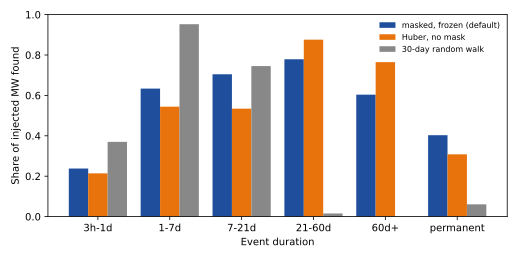
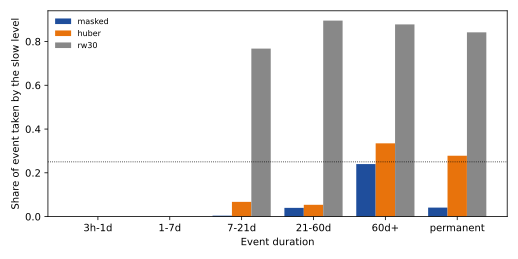
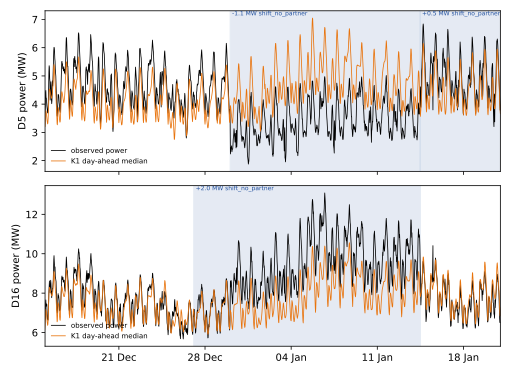

**At 15 Primary substations, penalised segmentation finds most injected load shifts but cannot pair a
shift with the neighbour that received the power.** We asked whether the residuals of 15 Primary
substations, read together, can produce a table of load-shift events: when each event starts and
ends, which Primaries it moves power between, and how many megawatts move. The residual is the
observed cleaned power minus a demand forecast that uses no lagged power. We added synthetic events
to that residual, and decoded the real record from 2024-01-01 to 2026-06-30. The verdict is *not
supported*: the table found 0.64 of the injected megawatts (95% interval 0.58 to 0.70) against a
predicted 0.70, paired the two ends of 0.18 of injected transfers (0.09 to 0.31), and found 8 of
the 77 logged shifts at the strict rule, against 19 for LR_b20. The pre-registered stop rule fires,
because a shuffled neighbour graph gave 2 edge events (90% range 0 to 4) where the real graph gave 4,
half as many. Four real edge events are too few to give that placebo much power. The injected
pairing recall of 0.18 is the stronger evidence.

## Figures

The second figure shows only the bands that the sparse long-event worlds contain, so it has no
bars below 7 days.

## Results

- **Recall of injected events of 4 noise units or more and 1 day or more (default arm, masked frozen
  slow level; 6 worlds, 227 events).** MW-weighted found 0.64 (0.58 to 0.70); unweighted 0.56.
  Edge transfers (109 events): paired correctly 0.18 MW-weighted (0.09 to 0.31); 0.17 unweighted.
  Prediction P1 asked for 0.70 and fails.
- **By duration band (found, MW-weighted, events of 4 units or more).** 3 hours to 1 day 0.24; 1 to 7
  days 0.63; 7 to 21 days 0.70; 21 to 60 days 0.78; over 60 days 0.60; permanent 0.40. Events
  shorter than the 6-hour block (all pulses of under 3 hours) were never found.
- **Timing (P2).** Counting misses as failures, the start is within 2 hours for 0.53 of events and the
  end is within 6 hours for 0.48. P2 asked for 0.70 and 0.50; the end result is just short and the
  start result fails.
- **Slow-level arms (sparse worlds, events with no other injected event within 30 days, median
  share of the event taken by the slow level).** Masked and frozen: 7 to 21 days 0.00, 21 to 60 days
  0.04, over 60 days 0.24, permanent 0.04. Huber with no mask: 0.07, 0.05, 0.33, 0.28. A 30-day
  random walk: 0.77, 0.90, 0.88, 0.84. P5's absorption targets (0.10 or less for the masked arm in
  the 21 to 60 day band, 0.30 or more for the random walk) hold. Recall in that band is 0.78
  (target 0.6 or more). Of the 147 found events that started 180 days or more before the record end, 2 were
  classed as the wrong kind (temporary or permanent), but only 2 of the 30 permanent events were found
  at all, so the temporary-against-permanent target says little.
- **False events from solar growth and seasonal bias, per injected Primary-year.** Solar growth 0.93
  (masked), 0.87 (Huber), 0.27 (random walk); seasonal bias 2.2, 2.3, and 0.04. P5 asked for 0.5 or
  fewer, and the masked arm fails both.
- **Hard negatives.** None of the injected routine steps (389), ramps (221), pulses (221), solo shifts
  (277), or placebo pairs (98) was classed as an edge transfer. Of the routine steps, 2 were
  classed as routine; 73 were called shifts without a partner.
- **Shape of the injected events.** Constant-megawatt events: found 0.66, paired 0.14. Events
  proportional to the donor's own power: found 0.56, paired 0.24. Short-heavy and long-heavy
  mixtures found 0.62 and 0.43. The stress arm (shares 0.2 to 1.8, starts up to 12 hours apart)
  found 0.65 and paired 0.07.
- **Real record (2024-01-01 to 2026-06-30, default arm).** 246 events, 6.6 per Primary-year: 211
  shifts without a partner, 27 ramps, 4 edge transfers, and 4 routine steps. D8 has 9.6 events per
  Primary-year against a median of 6.8, inside the factor of 2 the plan allows. There are 25 edges
  between the 15 Primaries. A 100-draw degree-preserving rewiring gave a median of 2 edge events
  (5th to 95th percentile 0 to 4), against 4 for the real graph, so P3 (a third or fewer) fails and
  the stop rule (half or more) fires.
- **Logged shifts (P4).** Of 77 logged shifts of more than 1 day that start on or after 2024-01-01,
  LR_b20's 78 alarms in those years (2.1 per Primary-year) match 19 at the strict rule and 24 at the
  loose rule. All 246 events of this table match 8 and 17. At the equal alarm rate (the 45 events with
  confidence of 0.99 or more) the table matches 5 and 8. P4 asked for 24 of 35 at LR_b20's rate and
  fails. The 77 and the 35 are different sets: the 35 span the whole record and the 77 are the
  scored years.
- **Event-free rows.** 27.6 Primary-years lie more than 14 days from every labelled or verified
  event. The masked arm decodes 5.4 events per Primary-year there, the Huber arm 6.2, and the
  random-walk arm 2.0. These are upper bounds on false events, because NGED's logs miss events.
- **Verified pair (P6).** D5 starts on 30 December 2025 01:00 (verified onset 29 December 01:00) and
  ends on 14 January 11:30 (verified 13 January 11:30), at -1.08 MW. D16 starts on 27 December 02:00,
  about 2.5 days before the verified onset, and ends on 14 January 12:00, at +2.05 MW. The two events
  were not paired, because the recipient-to-donor ratio is 1.9 and the pairing window ends at 1.5.
  The slow level moved by 0.4 points of capacity or less across both. P6 fails on timing and on class.
  The D3 and D22 transfer of October 2024 (a seen case, because it set the generator) is found in all
  three arms and paired only by the Huber arm. D10 and D12 of December 2025 are descriptive and are
  not shown.
- **Four scenarios (normalised MAE of the median forecast, per cent of effective capacity; 15
  Primaries, scored years; scenario membership by the decoded events).** The forecast is the
  lag-free demand model of experiment 130, not K1. "After table" removes the slow level and the
  decoded events, in hindsight.

| Scenario | Half-hours | Before the table | After the table |
|---|---|---|---|
| All rows | 631,470 | 6.31 | 5.29 |
| Outside events and 7 or more days after one | 374,405 | 5.28 | 5.01 |
| Inside events | 185,873 | 8.62 | 5.87 |
| The 7 days after an event ends | 71,192 | 5.69 | 5.30 |

  The events are decoded from the same residual, so the inside-event row falls by construction. The
  figure above shows the D5 and D16 case, 14 days before the start to 7 days after the end. It
  uses the K1 day-ahead median as the baseline. Examples for the other three scenarios are not drawn.

## Checks

- **Median minus mean forecast per site and tail calibration:** not applicable, because no forecast
  is produced, so these checks and the curtailment-cost score are not run.
- **Mean-forecast error beside each contrast:** the normalised MAE in the four scenarios above is the
  only forecast-error measure.
- **Audit triggers.** None fires. The plan's own predictions P1 to P6 fail rather than contradict an
  earlier finding. Experiment 580 found that 1 of 23 long labels is confirmed by telemetry; the low
  logged-shift match here is consistent with incomplete labels as well as with a weak method.
- **Not run:** the discriminator between injected and real windows, the recall-by-size match to real
  events, the wobble check, an ERA5-driven residual for D5, the grouping of two solo shifts into an
  unseen donor, MW-against-MVA handling of injected amplitudes, the pooled seasonal shape for D18
  (it has a one-harmonic seasonal fit instead), a log-uniform duration prior (the decoder has a flat
  per-block cost instead), and separate decoder states for ramps, routine steps, and permanent
  shifts (these classes are assigned after decoding). A staged-return arm was not run apart from the
  10% of injected events that carry one.

## Reviews and triage

- **Plan review (Sonnet).** Twelve findings, five high; all accepted and written into the plan before
  any code ran.
- **Code review (Sonnet).** Fifteen findings, two high: censored events could never match in the
  tuning worlds, and permanent events tapered to zero at the record end. Both were fixed, and
  tuning recall rose from 0.27 to 0.63. The placebo, the noise-unit mismatch with the plan
  (the code uses a block-level spread; the 3-day-step unit is printed only), the `found`
  definition, and the false-event bookkeeping were also fixed or restated. Not fixed: the missing
  decoder states (listed above) and the weak binding of the conservation cost, which the share
  window decides in practice.
- **Tuning.** Penalties were chosen on 2022 and 2023 injected worlds only (on cost 6, stay cost 0.05),
  as the highest injected recall with at most 6 decoded events per Primary-year on the real
  residual of those years. The plan's event-free stratum was not used, because defining it needs
  labels.
- **Lab shortcuts.** Injected events are added to the stored residual and not to the power before
  the demand model is refitted, so recall is a ceiling for events as large as real ones. The
  residual's demand model trained on all rows, so earlier real events leak into its baseline. The
  grid starts on 2022-01-01, not 2019, and has 15 Primaries.
- **Step 0.** The step widths measured on half-hourly power were 0 to 42 half-hours and are not
  trustworthy at this noise level. The fit of a proportional shape beat a constant by 4% to 10% of
  residual variance at the two Primaries of D3 and D22 and by 1% to 6% at D5 and D16, which is
  inconclusive, so both shapes were injected. The generator used edge widths of 0 to 4 half-hours.

## What the next experiment should answer

Does the table become useful if it keeps only per-Primary events and leaves out partners? The
segmentation found most events of 7 days or more; the weak parts are events under a day and the
pairing. A longer record with more Primaries, or a residual that already removes more of the daily
shape, would be the changes to try before any neural network.

## Method

**Architecture and algorithm.**

- **Input.** The residual is the observed cleaned power minus the forecast of the lag-free convex
  demand model of [experiment 130](../00130-ro-nc-detector-on-the-gam-k-residual/result.md), as
  stored by [experiment 327](../00327-lsc-label-free-detect-mask-train-pipeline/result.md) (arm C,
  trained on every half-hour that has a reading). Weather is ERA5 and CAMS estimates of past
  weather, so the table is a hindsight product and cannot be made live. Half-hours that the
  `substation_zero` rule flags are missing. D15 and D18 lose every row before 2025-03-01.
- **Noise unit.** For each Primary, one noise unit is the robust spread of the difference between
  successive 6-hour block means, computed with a 90-day moving window so that it follows the season.
- **Slow level (default arm).** A seasonal level per Primary, following the
  slow-level addendum of 9 November 2026 to the design answer
  (`data/ml-experiments/briefs/edge_state_slow_level_addendum.md`): 3 day-of-year harmonics shared
  by all years plus a linear spline with knots every 365 days, fitted with a Huber loss. The fit
  gives zero weight to any window whose 3-day mean residual exceeds 1.5 noise units, widened by 2
  days on each side. It refits three times and then freezes, so the segmentation cannot change it.
  D15 and D18 share the pooled seasonal shape and fit only its scale. A trend in unmetered solar
  panels multiplied by CAMS irradiance is left out of the default arm,
  and the page counts the false events that solar growth causes instead.
- **Slow level (comparison arms).** Arm S0 is a 30-day random walk with a penalty on its curvature.
  Arm S1 is the same seasonal fit with a Huber loss and no mask.
- **Segmentation.** Each Primary's residual, with the slow level removed, is cut into 6-hour block
  means. An exact dynamic programme (a Viterbi pass over a hidden semi-Markov chain) decodes the
  states below over the blocks, forwards and then backwards, which gives a posterior for each state
  and an interval for each start and end. The shift states have 12 amplitude levels, log-spaced from
  1 to 20 noise units, in both signs. Staying shifted costs a fixed amount per block, switching on
  costs an onset price, and the duration prior is log-uniform from 3 hours to 180 days. The
  penalties are tuned on the 2022 and 2023 injected worlds only. A final pass refines each start
  and end to the half-hour by maximising the step statistic within 12 hours of the block boundary,
  and reads the edge width (the number of half-hours the step takes to go from 10% to 90%).
- **States per Primary.** Normal, a temporary shift, a permanent shift, a routine step, and a ramp.
  A temporary shift returns to the earlier level. A permanent shift has no return within 180 days
  of hindsight. A routine step belongs to a Primary whose trailing 60 days hold many short solo
  steps (D8's gas engine). A ramp spreads the same change over 4 hours or more.
- **Classing an event.** Events at connected Primaries (the neighbour graph of experiment 383,
  `neighbours_nged.json`) are paired when their starts fall within 6 hours and their ends within
  12 hours, with opposite signs. The pairing minimises a loose conservation cost,
  `(Δdonor + Δrecipients)² / (σ² + (0.5·|Δdonor|)²)`, and the recipient's share of the donor's step
  is limited to 0.3 to 1.5 (experiment 459 and the generator ideas file). A paired event is an edge
  transfer. An unpaired temporary event is a shift without a partner. An event whose end lies beyond
  the record is an open shift, reported with a probability of being temporary. An event at a Primary
  with a high routine rate needs a partner larger than that Primary's noise unit to count.
- **Output.** One row per event: start and end with intervals, Primaries, direction, megawatts per
  Primary, class, duration band, and posterior confidence.

**Training regime.** There is nothing to train. The penalties and thresholds are tuned on the 2022
and 2023 injected worlds, and the 2024 to 2026 years are scored once. NGED's labels enter no
penalty, threshold, or mask.

- **Step 0, before the generator is fixed.** Measure, on each verified transfer, the width of each
  step in half-hours and whether the extra power during the event is a constant number of megawatts
  or a share of the donor's own daily shape. The share is the slope of the event-minus-baseline
  difference on the donor's baseline profile, set against a constant, and the better fit by
  residual variance decides. The generator is fixed from D3 and D22 (26 October to 22 November
  2024) alone. D5 and D16 (29 December 2025 to 13 January 2026) are measured too, but only to
  compare, so that they stay a hold-out for the pair check. If the two transfers disagree, both
  shapes are injected and scored as separate arms. Two transfers are only two episodes, and the
  page says so.
- **Generator.** Injected events follow the design answer's section 4 and the generator ideas file:
  a donor with 1, 2, or 3 recipients, or an unseen partner; a recipient share of 0.5 to 1.1;
  amounts from 1 to 20 noise units, half of the mass at 2 to 8; durations from 3 hours to 112 days
  (log-uniform) with short-heavy and long-heavy mixtures; start hours and weekdays drawn from the
  logged start times; mostly an exact return, some partial and staged returns; a slow drift inside
  an event; overlap at about 5% of each Primary's time. The addendum adds permanent shifts (an
  instant step, or a ramp over 1 to 8 weeks), permanent transfers, solar-panel growth of 0.2 to
  1 MW a year with an irradiance shape, and a seasonal bias that repeats every year. Hard negatives
  are routine steps that follow the daily shape, ramps of 2 to 12 hours, pulses under 3 hours, solo
  shifts, opposite-sign steps at two unconnected Primaries (the placebo pairs), and a smooth common
  mode shared by all Primaries. MW and MVA Primaries are kept apart; MVA Primaries receive
  `|MVA ± transfer|`.
- **Lab shortcut.** Events are added to the stored residual, not to the power before the demand
  model is refitted, as experiment 297 did with a frozen model. The injected events therefore
  escape the demand model's absorption, so recall is a ceiling for events as large as the real
  ones. Real events already in the residual stay in it as unlabelled noise, and the page marks an
  injected window that overlaps a logged or verified event.

**Measurement.**

- **Injected events, held-out years.** MW-weighted recall by duration band (3 hours to 1 day,
  1 to 7 days, 7 to 21 days, 21 to 60 days, permanent), by size in noise units, and by class. Start
  and end error. Absorption (the share of each event's megawatts taken by the slow level, by band).
  A confusion matrix of temporary against permanent for events whose end lies inside the record.
  False events from solar growth and seasonal bias per Primary-year. A shape check: constant
  against proportional events, and a cross-generator check that trains the penalties on one and
  scores the other (recall may drop by at most 0.05).
- **The verified pair.** D5 and D16 of December 2025 to January 2026 is the hold-out case. The
  ranges in P6 were read off this residual in the design answer before this plan, so P6 is not
  blind, and the page says so. D3 and D22 of 2024 lies in the scored years and fixed the generator,
  so it is a seen case. For both: dates, direction, amplitude, class, and the movement of the slow
  level across the event. K3 sat about 11 points of capacity above D5's demand before the event,
  so the check is repeated on the residual of an ERA5-driven model, in case the offset belongs to
  K3. The D10 episode of December 2025 and the unpaired D12 step of 8 December 2025 are descriptive
  tests.
- **The real record.** Edge events per Primary-year; the 35 logged shifts of more than 1 day found
  by experiment 254's strict and loose rules; the count of calls at D8 against the median Primary
  (it must stay within a factor of 2); the unconfirmed edge events per edge-year (an upper bound,
  because NGED's logs are an incomplete one-off dump, and clean rows may hold events nobody logged).
  The 27 transfers that experiment 580 found in the telemetry are a second reference, with the
  caveat that its detector and this one read the same residual.
- **Event time series.** Figures show the decoded edge events and flows from 14 days before to at
  least 7 days after a real event, beside the observed power and the baseline forecast (K1), with
  at most two panels per figure and any metered generator anonymised. The verified D5 and D16
  pair (2025-12-29 to 2026-01-13) is the main case. Labelled real events are few, so these figures
  are descriptive.
- **Event-free stratum.** Rows more than 14 days from any labelled or detected event are reported
  as their own stratum for each arm, beside the event rows.
- **Definitions fixed after the plan review.**
    - A *found* injected event has the right Primary and sign, a start within 12 hours, and (for an
      edge transfer) the right donor, with at least half the recipient megawatts matched. A missed
      event counts as infinite timing error in P2. Recall is printed both MW-weighted and
      unweighted, for the P1 subset (4 noise units or more, 1 day or more) and for all events, with
      a misclassification matrix of edge transfer, solo shift, routine step, and ramp.
    - A *found* logged shift is one that has at least one decoded event passing experiment 254's
      strict or loose rule; further events on the same shift count as false. The knob that equalises
      alarm rates is the posterior confidence threshold. Baselines count alarms per Primary-year and
      this method counts events per Primary-year. P4 counts only shifts starting on or after
      2024-01-01, for every method.
    - *Confirmed* means matched to a labelled or verified event under the loose rule. Unconfirmed
      edge events are an upper bound on false events, are not false events, and are printed per
      edge-year and per Primary-year with the number of edges that carry data (recomputed for the 15
      Primaries). The label-free false-event measures are the rate in the event-free stratum and the
      rewired-graph rate.
    - The noise unit is computed once from the uninjected residual, in 3-day-step terms to match the
      design answer, and frozen. The page prints each Primary's noise unit in megawatts and states
      P1's threshold in megawatts as well.
    - The slow level is refitted in every injected world (mask, three refits, freeze), and injected
      windows that overlap a logged or verified event are left out of recall and absorption.
    - Before segmentation, the median residual across all Primaries is removed (the common mode).
    - A stress arm injects recipient shares of 0.2 to 1.8 and start offsets of up to 12 hours, and
      reports edge recall there, because the pairing window and the generator share assumptions.
    - Penalties are tuned label-free: recall on the 2022 and 2023 injected worlds at a fixed rate of
      decoded events on the event-free stratum of those years.
    - Two solo shifts at Primaries that share an unmetered neighbour, with starts within 1 hour, are
      grouped as one unseen donor. Amplitudes at MVA Primaries use night-time rows.
    - The temporary-against-permanent matrix covers only events that start at least 180 days before
      the record ends; later ones are open. The generator draws durations to 180 days for this.
    - Outcome bands: a rewired-graph share between a third and a half is reported as a grey zone and
      the work proceeds to the neural stage; "matches LR_b20" means within 2 found shifts on the
      same subset. The wobble check (state changes per edge-year at most 3 times the logged rate),
      the rate check (within a factor of 2 of the median at 13 or more Primaries), the pair alarm of
      experiments 156 and 253 as a baseline, and the discriminator and recall-by-size checks are
      kept. The discriminator is reported only if time allows and is otherwise listed as not run.
- **Baselines and intervals.** RO-NC, LR_b20, the 24-hour residual detector with the neighbour
  filter, the label-free pipeline of experiment 327, and the edge-flow fit of experiment 131, each
  from its stored alarms where they exist. Intervals resample whole events and whole calendar
  months. A real-record claim from the D5 and D16 episode alone is one episode, and the page says
  so.
- **Checks that the method has not learnt the generator.** A rewired-graph run (neutral by
  construction, as the decision rule states), a rate check per Primary-year, and the cross-generator
  check above. The page also prints each score without the equal-rate matching.
- **Compute.** CPU only, 2 cores, no GPU, no fitted network. The residual panel already exists.

## Files

- `ml-experiments/00653-edge-state-event-table-penalised-segmentation/e00653_common.py`: loads the
  residual panel, the neighbour graph, and the half-hour grid.
- `e00653_slow.py`: the three slow-level arms (masked frozen seasonal, Huber, random walk).
- `e00653_segment.py`: the Viterbi and forward-backward decoder, event extraction, fragment merging,
  pairing, and class rules.
- `e00653_inject.py`: the synthetic event generator, hard negatives, and truth table.
- `e00653_core.py`: decoding of a world, matching to the truth, absorption.
- `e00653_step0.py`: edge width and shape on the verified transfers; writes `step0.json`.
- `e00653_run.py`: stages `tune`, `inject`, `isolated`, and `real`.
- `e00653_report.py`: prints every number on this page and draws the figures.
- `data/ml-experiments/00327-lsc-label-free-detect-mask-train-pipeline/forecast/C/` and `power/`:
  stored demand forecast and cleaned power per series (read only; from
  [experiment 327](../00327-lsc-label-free-detect-mask-train-pipeline/result.md)).
- `data/ml-experiments/00580-verified-load-shift-event-set-and-label-audit/work/`: verified
  transfers and labelled events (read only; from
  [experiment 580](../00580-verified-load-shift-event-set-and-label-audit/result.md)).
- `data/ml-experiments/00383-load-shift-xgboost-oracle-first-part-1/work/neighbours_nged.json`: the
  neighbour graph (read only).
- `data/ml-experiments/00254-lsc-alarm-precision-against-full-log-with-chance-base-rate/alarms_LR_b20.parquet`:
  LR_b20's alarms, the baseline (read only).
- `data/ml-experiments/backtest_export_roster_2026-11-07/K1_*.parquet`: the K1 median drawn in the
  example figure (read only).
- `data/ml-experiments/00653-edge-state-event-table-penalised-segmentation/`: `tuning.parquet`,
  `params.json`, `noise_units.json`, `step0.json`, `injected_truth_scored.parquet`,
  `isolated_truth_scored.parquet`, `growth_bias_false_events.parquet`, `real_events_<arm>.parquet`,
  `real_slow_<arm>.npz`, and `rewired.json` (written here, never committed).
