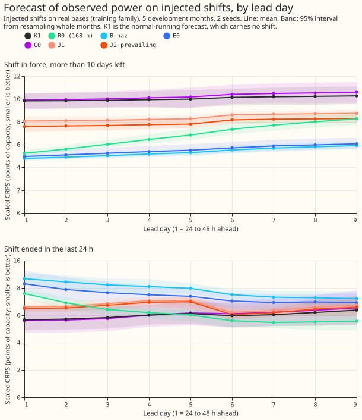

**Status: planned. The sections below are the plan; the finished page replaces them.**

A Primary is a primary substation. A load shift is a period when the electricity network operator
moves part of one Primary's demand onto, or off, a neighbouring Primary. K1 is the neural network of
experiments 612 and 613 that forecasts the normal running arrangement (NRA), the demand with no load
shift. [Experiment 652](../00652-two-output-forecast-with-explicit-rules-and-survival-hazard/result.md)
built a prevailing forecast (the arrangement now in force) as a small head on the frozen K1 and found
that a learned survival output ties a survival curve fitted to shift durations. This experiment asks
whether training one network end to end, with an NRA output and a prevailing output, and then adding
a learned detector for the end of a shift, does better than that frozen K1 plus head.

## Results so far

**Status: the development-month fits, the first final-test scoring, and a rough Step 0 are done.**
This experiment did not run the end detector (E1d, E2d, and the placebo), the final-fold fits and
window scoring of E0, or the staged-return arm. A follow-up experiment owns them.

Numbers are CRPS in points of capacity. K1 is the neural network of experiments 612 and 613 that
forecasts the normal running arrangement (NRA). E0 is the frozen K1 plus the survival-hazard head
R-haz of experiment 652. B-haz is K1 plus its residual decayed by the best single survival curve,
and R0 is the observed power one week earlier. "Scaled" CRPS multiplies each arm by one factor that
equalises the width of its quantile band across strata, months, and seeds.

"J1" is the end-to-end neural network whose prevailing loss does not reach the lag encoder
(stop-gradient). "J2" lets the prevailing loss reach the lag encoder. Both read only the lag-encoder
outputs: neither reads the hand-built G4 gate state or neighbour summaries, so J2 is the plan's E1
and E2 without those inputs. "C0" is the matched-compute control with no prevailing head.

**On the development months, the end-to-end networks lose to the frozen K1 plus R-haz (E0) while a
shift is in force.** J2 minus E0 is +1.74 scaled points over the in-force strata (month-block 95%
interval +1.00 to +2.47), so the predicted gain did not appear. J2 beats J1 by 0.32 points (interval
-0.54 to -0.05), and J1 and J2 both beat the matched-compute control C0 in the far stratum.

**The NRA veto fails on the development months for all three jointly fine-tuned arms.** The veto
asks for the upper bound of the 95% interval of each arm's NRA CRPS minus K1's NRA CRPS to stay
below 0.03. Unscaled, on injected rows scored against the unshifted base in the far stratum, the NRA
output scores 3.90 for J2, 3.91 for J1, and 3.91 for C0, against 3.76 for K1 (+0.14 to +0.15). On
event-free rows it scores 3.81, 3.82, and 3.81 against 3.70 (+0.11 to +0.12). Every point estimate
already exceeds 0.03. C0 has no prevailing head and fails by the same margin, so the most likely
cause is the joint fine-tune recipe (cuts at day 0 and day 14, synthetic shifts), which is weaker
than the daily fine-tune of the stored K1.

**J2 does better than E0 near and after the end of a shift.** In the "ended in the last 24 hours"
stratum J2 scores 6.52 and E0 scores 7.44 on the scaled measure, and J2 is lower on all 9 lead days
(by 1.81 on day 1 down to 0.33 on day 9). In the "near" stratum J2 scores 6.44 against 7.34.

| Stratum (origin state) | K1 | R0 (168 h) | B-haz | E0 | C0 | J1 | J2 NRA | J2 prevailing |
|---|---|---|---|---|---|---|---|---|
| Far from the end | 10.50 | 7.24 | 5.86 | 5.94 | 10.60 | 8.79 | 3.87 | 8.41 |
| Middle | 7.79 | 6.36 | 6.75 | 6.55 | 7.90 | 7.32 | 3.76 | 7.06 |
| Near the end (24 h) | 5.93 | 5.89 | 7.41 | 7.34 | 5.94 | 6.66 | 3.84 | 6.44 |
| Ended in the last 24 h | 5.95 | 6.08 | 7.83 | 7.44 | 5.99 | 6.69 | 3.85 | 6.52 |
| Event-free | 5.50 | 4.40 | 4.19 | 3.90 | 5.86 | 5.02 | 3.78 | 4.77 |

Table: scaled CRPS on the injected bank, training family, 5 development months, seeds averaged.
These are injected shifts on real bases, not real events. The J2 NRA column is scored against the
unshifted base, so it is not comparable with the other columns. The unscaled values and the
normalised mean absolute error of the median sit in `score/tables.json`.

### Injected shifts by lead day

Far from the end of a shift, the prevailing outputs of J1 and J2 are 2.2 to 3.1 points worse than E0
on every lead day. After the end of a shift, J2 beats E0 on every lead day, by 0.3 to 1.8 points.
K1, C0, and R0 are lower than J2 on most lead days, because K1 and C0 carry no shift. Scaled CRPS,
the same rows as the table above:

Far from the end (more than 10 days left):

| Arm | Day 1 | Day 2 | Day 3 | Day 4 | Day 5 | Day 6 | Day 7 | Day 8 | Day 9 |
|---|---|---|---|---|---|---|---|---|---|
| K1 | 9.83 | 9.85 | 9.88 | 9.94 | 9.98 | 10.14 | 10.20 | 10.23 | 10.27 |
| R0 (168 h) | 5.23 | 5.61 | 6.02 | 6.45 | 6.84 | 7.34 | 7.70 | 8.00 | 8.26 |
| B-haz | 4.78 | 4.89 | 5.02 | 5.17 | 5.29 | 5.52 | 5.69 | 5.81 | 5.91 |
| E0 | 4.95 | 5.09 | 5.24 | 5.38 | 5.51 | 5.71 | 5.88 | 5.98 | 6.07 |
| C0 | 9.90 | 9.94 | 10.00 | 10.10 | 10.18 | 10.41 | 10.48 | 10.53 | 10.59 |
| J1 | 8.07 | 8.10 | 8.13 | 8.21 | 8.26 | 8.60 | 8.66 | 8.70 | 8.74 |
| J2 prevailing | 7.58 | 7.63 | 7.68 | 7.75 | 7.80 | 8.16 | 8.23 | 8.26 | 8.27 |

Ended in the last 24 h:

| Arm | Day 1 | Day 2 | Day 3 | Day 4 | Day 5 | Day 6 | Day 7 | Day 8 | Day 9 |
|---|---|---|---|---|---|---|---|---|---|
| K1 | 5.67 | 5.72 | 5.83 | 6.02 | 6.13 | 5.97 | 6.04 | 6.21 | 6.38 |
| R0 (168 h) | 7.59 | 6.92 | 6.42 | 6.20 | 6.02 | 5.60 | 5.47 | 5.51 | 5.57 |
| B-haz | 8.68 | 8.44 | 8.23 | 8.10 | 7.98 | 7.50 | 7.32 | 7.28 | 7.22 |
| E0 | 8.31 | 7.89 | 7.66 | 7.50 | 7.39 | 7.04 | 6.93 | 6.97 | 6.93 |
| C0 | 5.61 | 5.65 | 5.76 | 6.01 | 6.17 | 6.11 | 6.22 | 6.37 | 6.54 |
| J1 | 6.62 | 6.65 | 6.85 | 7.07 | 7.07 | 6.22 | 6.35 | 6.61 | 6.74 |
| J2 prevailing | 6.50 | 6.54 | 6.73 | 6.96 | 6.99 | 6.05 | 6.20 | 6.45 | 6.60 |

**Half the injected events are long, so lagged power can help on them.** The injected-event
generator is experiment 650's, not the log-uniform draw the plan below describes. The training
family draws half its durations uniformly from 3 to 14
days and half uniformly from 28 to 112 days, so about a quarter of events last at most 8 days and
half last at least 28 days; the held-out family uses 5, 10, 21, and 45 days. All injected tables on this page use that earlier generator. The generator agreed later with the
graph-approach discussion (durations log-uniform from 1 to 112 days with random ends, plus a short
band down to 3 hours, and experiment 653's injector) was not used, so these tables are not
comparable with injected tables built on it. The follow-up experiment uses the later generator.
The file
`score/by_lead_day.csv` holds the 95% month-block interval of every cell. The manual heuristic and
climatology are not scored on the injected bank: both need the shifted observed power rebuilt at
each lag time, which is a separate piece of scoring code, so they appear on the final-test window
only.

### Step 0: edges of the verified transfers

A rough measurement, from the cleaned power at each Primary, of the largest jump within 2 days of
the stated start or end. Width is the number of half-hours between 10% and 90% of the step. Where a
daily-profile jump is larger than the transfer's own edge, the method picks the wrong jump, so the
D3 start (2024-10-28 instead of the 26th) is not usable. At the D16 start one half-hour holds 149%
of the step, so the width of 3 there is unreliable too.

| Transfer and Primary | Start width (half-hours) | End width (half-hours) |
|---|---|---|
| D5/D16, D5 (step about 0.4 of capacity) | 6 | 7 |
| D5/D16, D16 | 3 | 0 (one jump) |
| D3/D22, D3 | unusable | 0 (one jump) |
| D3/D22, D22 | 2 | 3 |

The donor's edge at D5 spreads over about 3 hours, so not every edge is within one half-hour. The
generator's training family already draws a ramp for half of its events and a single half-hour step
for the other half, so the plan's step-only rule was not applied and the staged-return arm was not
run. The numbers sit in `score/edges.json`.

### Final-test window, scored once for J2, J1, C0, K1, and the manual heuristic

The frozen candidates are in `final/freeze.json` (hashes included). The window has no labelled
events in the export, so "inside" means rows where the hand-built G4 gate is on: five spells, of
20 to 121 days (median 37 days), so these are long detected states, not injected events. The lead
range is 24 to 240 hours. The scoring script holds intervals blocked by origin month (4 months),
which are coarse, in `final/score/window.json`. A row counts as gate-on when the gate is on at the
forecast's target half-hour.

| Rows | Count | K1 | Manual heuristic | J2 NRA | J2 prevailing | J1 prevailing | C0 |
|---|---|---|---|---|---|---|---|
| All | 837,868 | 4.98 | 4.86 | 4.82 | 5.05 | 5.15 | 4.84 |
| Gate off, 7 or more days from a spell | 694,709 | 4.11 | 4.43 | 3.94 | 4.45 | 4.54 | 3.98 |
| Gate on | 137,676 | 9.40 | 6.97 | 9.30 | 8.11 | 8.29 | 9.20 |
| Gate off, under 7 days after a spell | 5,483 | 4.36 | 5.28 | 4.42 | 4.46 | 4.48 | 4.40 |

The "after a spell" row holds 5,483 rows from one month and one spell end, so it carries almost no
weight.

**Prevailing is not best on all rows, and for J2 the most likely reason is extra error from false
alarms on rows with no gate.** The next figures come from a second split, which counts a row as
gate-on when the gate flag stored on the row is on (119,050 rows, 14%) and gate-off otherwise
(718,818 rows, 86%), so they differ slightly from the table above. On the gate-off rows, J2's
prevailing output scores 4.54 against 4.05
for its NRA output. Its median differs from its NRA median by 2.75 points on average there, with a
mean survival probability of 0.15, so the head carries a shift that is not in force. On gate-on rows
that really depart from K1's median by 3 points or more, the prevailing output beats the NRA output
(8.97 against 10.56). On the 12% of gate-on rows that do not depart (1.68 against 1.41) it is
worse.

**The manual heuristic wins on gate-on rows because the shift outlasts its lags.** The heuristic is
the median-style quantile mix of the observed power 1 to 6 weeks and 49 to 55 weeks earlier. For
gate-on rows, 94% of the 1-week members and 76% of the 6-week members lie inside the same gate-on
spell, so the old lags already hold the shifted level. The spells last 20 to 121 days, which is
close to the long half of the injected durations (28 to 112 days). The other half of the injected
durations is 3 to 14 days, which a lag of 1 week or more cannot follow. On the window the old lags
help because the real spells are long, whereas many injected events are too short for them to help.

## Updates to the brief after reading the merged pages

- The maintainer approved opening the final-test window once for this candidate set on 2026-11-09
  (the brief records it). The freeze-first rule and the message to the manager still apply.
- Experiments 647, 650, and 652 are merged; the reference E0 is experiment 652's R-haz and its
  stored fits. The newest merged experiment, 651, does not change the design.
- The brief asks that the final-test window (2026-07-01 to 2026-10-31) be opened once. The
  `ml-experiment` skill still says no experiment scores a valid time on or after 2026-07-01, so the
  worker messages the manager, and waits for the maintainer's confirmation, before the window is
  touched.

## Feasibility finding that sets the design

K1 is not one network. It is a pre-trained network per held-out month and seed (five seeds), followed
by a daily fine-tune (d0 and d14 cut-offs), stored as `.pt` files under
`data/ml-experiments/00612-*/arms/k1_d5/work/models` (seeds 0 and 1) and
`data/ml-experiments/00613-*/chains/d5/work/` (seeds 2 to 4). Experiment 650 injects shifts by
replacing the lag block of the stored input matrix and running the saved networks. Retraining the
whole chain on injected shifts would repeat experiments 559, 574, 591, 612, and 613, which is not
affordable. The plan therefore **starts each end-to-end arm from the saved K1 weights of the fold and
seed, and fine-tunes jointly on input matrices with injected lags**, as one extra stage. Nothing stores
those matrices: experiment 591's `run_inject` rebuilds them per month (`_build_month_p5`,
`build_test`) and overwrites the lag block with the injected power, so this experiment adds a cache
of them on disk, built with the fold month's standardiser. Everything before that stage is K1
as stored. The cost is that the end-to-end arm differs from a network trained from scratch with the
prevailing loss; the page says so.

## Arms (matched rows, epochs, seeds, folds: leave one development month out, 2 seeds)

- **E0:** frozen K1 plus R-haz (experiment 652's stored fits; reference).
- **E1:** K1's body initialised from the frozen weights and fine-tuned jointly with a prevailing head
  that reads the lag-encoder outputs and the G4 gate state. First variant: stop-gradient from the
  prevailing loss into the NRA output. Second variant: the prevailing loss reaches the lag encoder.
- **E2:** as E1, with no gate and with neighbour summaries (experiment 610's class 2 recipe, 50%
  signal dropout). The gate is not an input and G4 is not applied.
- **E1d, E2d:** E1 and E2 plus the end detector.
- **Placebo for E2d:** E2d refitted with each training row's shift targets, labels, and weights
  permuted among the rows of the same Primary.
- **No-fit references:** R0 (168 h), B-haz, and K1 as context.

## The end detector

The detector takes the freshest half-hours up to the origin of the observed power minus the NRA
forecast, in noise units, with the slow seasonal level removed, the all-Primaries median residual
removed, and the same quantity at connected neighbours (29 edges of `neighbours_nged.json`). Two
extra inputs: the opposite-sign step at a connected neighbour (a score boost, never a requirement),
and a per-Primary routine-step rate from a 60-day context. Its output is the probability that the
shift has ended, multiplying the survival output. Placebo for the neighbour input: a
degree-preserving rewired copy of the edges. Prediction that could fail: below about 5 points of
capacity of depth, the detector does no better than the fitted survival curve. Cost to watch: false
alarms on event-free origins and on origins more than 14 days from any event, per Primary-month.

## Generator

Real unshifted bases; onsets and ends are instantaneous steps; duration log-uniform from 1 to 112
days; depth log-uniform from 3 to 50 points of capacity with constant-MW and proportional shapes;
donor and receiver, hard negatives, held-out family, and start times from logged starts, as in the
brief. **Step 0 measures the real edge width at D5/D16 and D3/D22 before any fit**; if every edge is
within one half-hour, the staged-return arm is dropped. Un-injected time is unlabelled, not negative.

## Strata, scoring, and final test

Strata, lead days 1 to 9, scaling across strata, and the single veto are those of experiment 652,
plus the strata "event-free and more than 14 days from any event" and "ended in the last 24 hours".
The final test freezes candidates in a file before the window is read, then scores E0, the best
end-to-end arm, and the manual heuristic once, in the four scenarios of the brief, with counts of
real events per scenario stated as lower bounds.

## Fold structure and leakage

- K1's weights are keyed by (held-out month, daily cut, seed). The joint fine-tune uses the other
  four development months for training and early stopping (origin days 0 to 17 train, 21 and later
  validate, as in experiment 650); the scored month's bank passes and rows never enter either.
  Fine-tuning from fold-month weights on later months is accepted, as in experiment 652's heads,
  and the page states it.
- K1's own daily fit uses month-m rows before its cut. The joint fine-tune trains on no month-m
  row, so no row has a valid time at or after an origin it was trained under.
- Equal-width scaling is pooled across strata, one factor per arm, month, and seed, as in 652.
- The end detector's "observed minus NRA forecast" for past half-hours comes from the NRA forecast
  issued at an earlier origin for that half-hour (a frozen K1 output), never from the network
  scoring its own training rows. Whether the freshest half-hours exist at the origin in production
  is stated on the page; the detector's gain is a ceiling if they do not.
- Detector training rows contain the hard negatives (D8-style routine steps, pulses under 3 hours,
  ramps, placebo pairs, common-mode perturbations) at 30% of injected rows, and detection is
  reported separately on them.
- Mirrored receiver shifts are not in K1's inputs, as in experiments 647 and 650.

## Staging and the fit count

The full design is about 5 months x 2 cuts x 2 seeds x 7 arms, roughly 140 joint fits. Stage 1
fits E2 and E2d only, at the d0 cut, one seed, on 2025-10 and 2025-12, and times them; the
head-only end detector is first fitted on the frozen body, as in experiment 652. Stage 2 adds E1
(both variants), the second seed, and the other months if E2 minus E0 passes the feasibility gate:
**E2 is no worse than E0 by more than 0.1 points and the veto bound holds on both months.** The
placebo runs only if E2d shows an effect. The d14 cut is added only if d0 results are not
cut-dependent in the stage 1 timing check. The manager is told the staging; the GPU-hour
estimate is restated from the timed fold against the fit count before 8 hours are crossed.

## Added controls and selection rules

- **Matched-compute control C0:** K1 fine-tuned the same way and for the same epochs with only the
  NRA loss and no prevailing head, so that E2 minus E0 is not read as a gain from extra epochs.
  E2 minus E1 is the clean read on dropping the gate; the neighbour-summary inputs are new to the
  pretrained body, and the page says so.
- **Second contrast bar:** E2d minus E2 counts as a gain in a stratum when its month-block 95%
  interval excludes zero and the point estimate is below -0.3 points there; elsewhere it is
  descriptive.
- **Best end-to-end arm for the final test:** the arm with the lowest pooled in-force scaled CRPS on
  development months among those that clear the veto, fixed before the window is read.
- The NRA prediction (within 0.03 of K1) is tested as the veto's interval bound, not as a point
  estimate.

## Deliverables

- Figures (at most two panels each): headline loss by lead day and stratum; the time series of
  observed power, K1, the NRA output, and the prevailing output from 14 days before to 7 days after
  the verified D5/D16 pair and a few injected events; survival reliability on training-family and
  held-out durations; the end-detector figure (delay by depth, false alarms); the Step 0 edge-width
  figure; the four final-test scenario plots; day-ahead and 14-day example forecasts.
- Sensitivity: short-heavy and long-heavy duration mixtures, with the sign of the primary contrast
  under each; results by shape; the in-event level drift on a share of events; the staged-return arm
  unless Step 0 finds pure steps.
- Release candidate: one parquet per arm under
  `data/ml-experiments/00654-*/release_candidate/` with the brief's columns, and a plain-words
  README in that folder.
- The Method section lists K1's body widths, read from experiments 545, 560, 591, and 612. The
  manual-heuristic forecasts for the final-test origins are looked up first and computed if absent.
- One line to the manager at: plan PR open, fits started, fits finished, final-test scored, PR
  merged.

## Priority and reporting (manager, 2026-11-09)

- The maintainer needs backtest forecasts on disk by the end of 2026-11-09, so the release-candidate
  parquet files and README come first. The first file is built from E0's stored outputs (experiment
  652's R-haz fits and K1's rebuilt quantiles on the real rows); each end-to-end arm adds its own
  file when its fits finish.
- Every metric table also reports the normalised MAE of the median forecast (MAE divided by the
  Primary's effective capacity, as the other tables do).

## Four scenarios on the development months too (skill, PR 314)

The ml-experiment skill (merged 2026-11-09) requires four scenarios for any experiment related to
load-shift events, whatever the testing period: all rows; rows outside events and at least 7 days
after one; rows inside events; and the 7 days after an event ends. The development-month tables
therefore report all four scenarios for each arm, on the injected bank (events known exactly) and,
descriptively, on the real labelled and detected events; the final test reports the same four. Each
scenario gets its metrics (CRPS, normalised MAE of the median, coverage, tails) and an example time
series from 14 days before to at least 7 days after an event.

## Compute and process

- One GPU process at a time. One fold is timed first. The estimate is 4 to 8 GPU-hours, unmeasured;
  the worker asks the manager before crossing 8.
- Standing practices followed: monthly refit, cleaned data, D15 and D18 cut before 2025-03-01, save
  every fitted network, reuse stored predictions (E0, K1, R0, B-haz), tails and avoidable-curtailment
  cost reported, example forecasts and event time series plotted, draft pull request.
- Reviews: one Sonnet plan review, one Sonnet code review before the first fit, one results review,
  one write-up review, one prose review.
