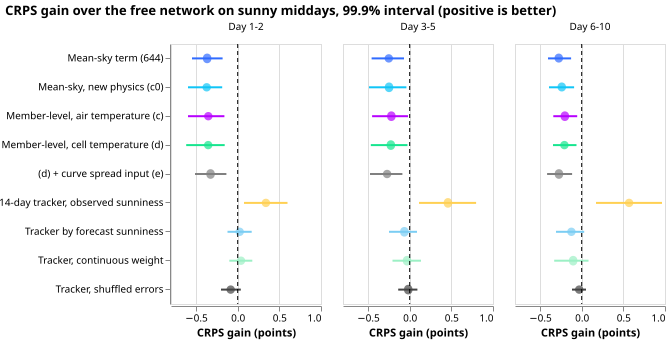
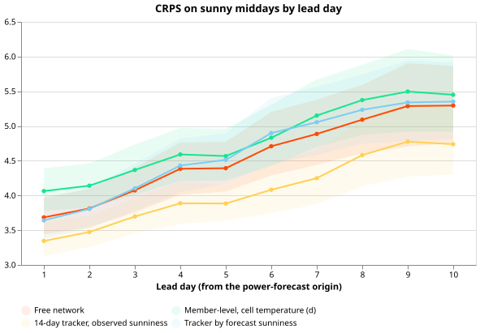
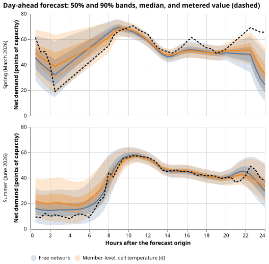
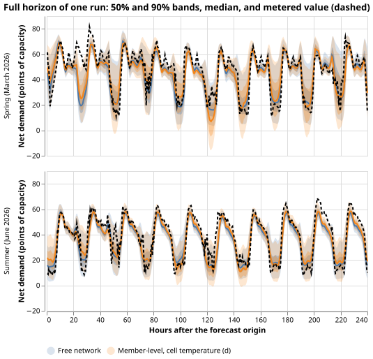

# A per-member solar curve with cell temperature does not help, and the tracker needed observed sunniness

**Giving the demand network a solar-output curve for each of the 51 ensemble members, with a panel
temperature, still makes its sunny-midday forecast worse than the free network (the same network
with no solar curve) (Part 1).** The error is 0.2 to 0.35 points, where a point is one percent of a
Primary substation's effective capacity, in continuous ranked probability score (CRPS; smaller is
better). An ensemble member is one of the 51 alternative weather forecasts that the European Centre
for Medium-Range Weather Forecasts issues for each run.

**The 14-day error correction gains almost nothing once it uses only the ensemble forecast's
sunniness (Part 2).** [Experiment 644](../00644-pv-explicit-term-with-ens-forecast-weather/result.md)
found that the free network, plus its own mean error over the previous 14 days, scored 0.3 to 0.6
points better than the free network alone. That experiment applied the correction on half-hours
observed to be sunny, and the explicit-solar curve there used the ensemble-mean sunshine. This
result gives no support for continuing the explicit-solar line or for the 14-day correction in its
experiment 644 form.

Part 1 computes the solar curve per ensemble member (plane-of-array irradiance, a Faiman-model cell
temperature, a 0.4% per kelvin derate, clipping at inverter capacity) and subtracts the member
average. Part 2 applies the 14-day correction on half-hours the ensemble-mean forecast calls sunny.
Both parts reuse experiment 644's rows, cutoffs, five seeds, and bars. "Sunny middays" are 10:00 to
15:00 UTC half-hours with an observed clear-sky index (observed over clear-sky irradiance) of at
least 0.7, in the 60 days after each of three cutoff dates (2025-07, 2026-03, and 2026-06).

## Results

**Arm key.** (a) free network; (b) experiment 644's explicit term on the ensemble-mean sky; (c0) the
same with this experiment's physics; (c) the curve averaged over members, air-temperature derate;
(d) as (c) with a cell temperature; (e) as (d) plus the spread of the curve over members as one
network input; (p) and (s) placebos on (d): capacities swapped across Primaries, and the curve of
another date.

*Each arm's CRPS gain over the free network, with 99.9% intervals; a negative gain means the arm
loses to the free network.*

| Sunny middays, CRPS (points) | Day 1-2 | Day 3-5 | Day 6-10 |
|---|---|---|---|
| Free network (a) | 3.75 | 4.28 | 5.05 |
| Mean-sky term of experiment 644 (b) | 4.11 | 4.53 | 5.33 |
| Mean-sky, new physics (c0) | 4.12 | 4.53 | 5.29 |
| Member-level, air temperature (c) | 4.10 | 4.50 | 5.25 |
| Member-level, cell temperature (d) | 4.10 | 4.51 | 5.26 |
| Member-level, cell temperature, plus spread input (e) | 4.07 | 4.55 | 5.32 |
| Capacity-permuted placebo on d | 4.22 | 4.67 | 5.45 |
| Shuffled-day placebo on d | 5.26 | 5.51 | 6.09 |
| 14-day tracker, observed sunniness (644's arm d) | 3.41 | 3.82 | 4.48 |
| 14-day tracker, forecast sunniness (binary) | 3.72 | 4.35 | 5.17 |
| 14-day tracker, forecast sunniness (continuous) | 3.71 | 4.31 | 5.15 |
| Shuffled-error placebo of the binary tracker | 3.83 | 4.30 | 5.08 |

- **Part 1 fails the decision rule.** The free network minus arm (d) is -0.35 [-0.62, -0.16],
  -0.23 [-0.47, -0.03], and -0.21 [-0.34, -0.06] (negative favours the free network; intervals are
  99.9% day-block bootstraps, Bonferroni over 40 contrasts). Over all half-hours the difference is
  -0.010 [-0.046, +0.025], inside the 0.02 limit, but arm (d) does not beat the free network.
- **Members and cell temperature each add almost nothing.** Mean-sky (c0) minus member-level (c) is
  +0.02 [-0.01, +0.05], +0.03 [0.00, +0.07], and +0.04 [-0.01, +0.09]. Air (c) minus cell
  temperature (d) is -0.002 [-0.024, +0.014], -0.006, and -0.005. The spread input (e) is 0.03
  better than (d) at day 1-2 [-0.06, +0.14] and worse at the other bands.
- **The placebos lose as they should.** The capacity-permuted placebo is 0.12 [+0.01, +0.23],
  0.16, and 0.19 worse than (d), above experiment 644's bars (0.084, 0.093, 0.123) but with lower
  interval ends under them at day 1-2. The shuffled-day placebo is 0.8 to 1.2 worse.
- **Part 2 fails the decision rule.** The free network minus the forecast-sunniness tracker is
  +0.03 [-0.12, +0.17] at day 1-2, and -0.06 and -0.12 at days 3-5 and 6-10, against the required
  +0.17, +0.23, and +0.285. The binary tracker beats its shuffled-error placebo by 0.11 [-0.05,
  +0.27] at day 1-2 and loses to it at the later bands. The observed-sunniness tracker beats the
  forecast-sunniness tracker by 0.32 [0.08, 0.57], 0.52, and 0.69.
- **The observed-sunniness gain is consistent with a selection on the outcome.** On the 3,657
  middays (day 1-2) where observed and forecast sunniness disagree, the free network minus the
  observed tracker is +0.33 [+0.11, +0.64] (0.41 at day 3-5 and day 6-10), and minus the forecast
  tracker -0.01 [-0.17, +0.17].

*CRPS on sunny middays by lead day for four arms; bands are 95% day-block intervals.*

*Net demand of one MW Primary, forecast of the free network and arm (d) against the metered
value (dashed), for one run in each of two seasons.*

*The same two runs over the full 240-hour horizon.*

## What the next experiment should answer

**Does any bias correction of the free network, built only from forecast-time information, beat the
plain network on sunny middays?** The 14-day tracker does not, and the explicit solar term does not.
The remaining sunny-midday error then needs a different input (for example a satellite cloud
product) rather than a correction.

## Checks

- **Median and mean forecast.** The median forecast minus the mean of the 11 quantiles averages
  -0.2 to -1.2 points per Primary for arm (a) and -0.2 to -0.9 for arm (d), so both forecasts are
  skewed in the same direction.
- **Mean-forecast error beside the quantile score.** The mean absolute error of the median forecast
  on sunny middays (points of capacity, mean over seeds) is 6.42 (a), 6.85 (b), 6.79 (d), 6.52
  (forecast-sunniness tracker), and 5.67 (observed-sunniness tracker), so it ranks the arms as CRPS
  does.
- **Tails on sunny middays.** Coverage of the 0.05 quantile is 11.1% (a) and 9.3% (d), and of the
  0.95 quantile 99.2% (a) and 98.9% (d), so the lower band is too narrow and the upper band is too
  wide for all arms. Pinball loss at q01, q05, q95, and q99: 0.174, 0.700, 1.071, 0.291 (a) and
  0.193, 0.752, 1.075, 0.287 (d).
- **Leave one Primary out.** The free-minus-(d) contrast stays negative at every band when any one
  of the six Primaries is left out (day 1-2 range -0.12 to -0.46).
- **Audit triggers.** The shuffled-error placebo does not lose to the tracker by the bar (trigger
  1), and the tracker result contradicts experiment 644 (trigger 2). The disagreement slice above
  tests the
  explanation for the contradiction. A results review found no error in the three headline
  contrasts.
- **Confound in the disagreement slice.** The observed-sunniness tracker corrects only
  observed-sunny rows and the forecast tracker only forecast-sunny rows, so the two are scored on
  different corrected rows within one slice, and the observed tracker's gate uses the scored row's
  own realised sunniness. A test that applies one tracker's history to the other's gate is not run.
  A results review re-derived the three headline contrasts (-0.354, +0.025, and +0.34) with its own
  code and matched them.
- **Fitted cell-temperature scale.** The farms' posterior mean is 0.65 (standard deviation 0.047) at
  the 2025-07 cutoff and 0.63 (0.024) at the other two, against a prior range of 0.61 to 1.65; the
  data pull the scale to the range's weak-heating end.

### Departures and caveats

- Real world only; experiment 644's step world is not repeated.
- The cell-temperature scale is one value per cutoff for all six farms, not per Primary, because
  the farms are not at the Primaries. Its air temperature is the ensemble-mean day-1 forecast (the
  farm frame has no temperature), and its wind is a fixed 3 m/s.
- Arms (c0) to (s) were fine-tuned from experiment 639's pretrained weights, which used the old
  curve; only arm (b) matches its pretraining. Contrasts (c) against (c0), (d) against (c0), and
  (d) against (c) are free of this mismatch, and they also show no gain.
- The continuous tracker multiplies the correction by its weight as well as using the weight to
  average the history.
- The scoring rows keep experiment 644's selection on observed sunniness, which favours any arm
  that knows the observed sunniness; this is why the tracker by observed sunniness is shown, not
  proposed.
- Per-seed mean absolute errors differ slightly from experiment 644's printed 6.33 for arm (a)
  because this page averages the error per seed instead of the seeds' mean median.
- Fewer than 3 dates of history give no correction to a tracker row.

## Method

### Architecture

- **Architecture, arm (d):** experiment 554's modular mixture-density network (a weather encoder, a
  date-time encoder, and a fresh fine-tuning mixer), with an embedding for each of the 16
  Primaries, outputs three mixture
  components, then 11 quantiles. The weather inputs are the cached ensemble mean and standard
  deviation of 7 variables (shortwave, longwave, 2 m temperature, dew point, surface pressure,
  precipitation, 10 m wind speed); there are no power lags.
- **The explicit term:** the network's target is the demand plus `C * u`, with `C` the Primary's
  calibrated capacity in MW (experiment 639's `cal` arm, offset learned within a 0.25 MW prior) and
  `u` the solar curve per MW divided by one constant per cutoff (the 99th percentile over
  daylight half-hours of the 24 months before the cutoff, pooled over the six Primaries). The
  same term is subtracted from every forecast quantile.
- **The curve, per ensemble member:** Erbs split of the member's shortwave irradiance, plane of
  array at tilt 20 degrees and azimuth 180 degrees, direct-current to alternating-current ratio
  1.15 clipped at 1, then a derate of 0.4% per kelvin above 25 degrees C on the cell temperature
  `T_air + s * G_poa / (25 + 6.84 * wind)`. The curve is averaged over the 51 members (a member
  with a missing value is left out of the mean).
- **Differences of the other arms:** (c0) uses the ensemble-mean sunshine, temperature, and wind
  and an air-temperature derate; (c) averages the per-member curve with an air-temperature derate;
  (e) adds one mixer input, the standard deviation over members of the curve, standardised; (p)
  swaps the capacities across Primaries (experiment 639's permutation) and (s) takes the curve of
  another date (same Primary, half-hour, and 21-day block of the year).

### Training regime

- **Training regime:** each network starts from experiment 639's pretrained weights (ERA5 and CAMS
  estimates of past weather), is fine-tuned on the 24 months of ensemble rows before the test
  month with a 90-day recency half-life (experiment 554's arm M0), monthly refits, five seeds
  (0 to 4), 150 fine-tunes in total, 0.49 GPU-hours on one GPU shared with another experiment.
  Cleaned power only; the six MW Primaries. Experiment 644's farm-gap rows are dropped.
- **Cell-temperature scale:** for each cutoff, the posterior mean over a grid of 81 values on
  a log-normal prior (standard deviation 0.25 in the logarithm, range 0.61 to 1.65), with the
  likelihood of the six farms' sunny-midday output (clear-sky index at least 0.7, 10:00 to 15:00
  UTC, before the cutoff) counted once per farm-day and a free amplitude per farm.

### Measurement

- **Measurement:** the 60 days after 2025-07, 2026-03, and 2026-06 (July 2025, August 2025, March
  2026, April 2026, and June 2026; nothing from 2026-07-01), every ensemble run at lead 0 to 240
  hours, 336,520 half-hours over all hours and six Primaries. CRPS from the 11 quantiles (levels
  0.01
  to 0.99), averaged over seeds; day-block bootstrap intervals (2,000 resamples) at 1 - 0.05/40;
  bars
  are experiment 644's. Row keys are asserted equal to experiment 644's.
- **Tracker:** the free network (a) plus the weighted mean error of its day-1 forecasts (lead below
  24 hours) over the 14 dates before the forecast's origin date, on midday half-hours whose
  ensemble-mean clear-sky index is at least 0.7 (binary) or ramps from 0.5 to 0.8 (continuous), and
  applied on the same half-hours. Shuffled placebos permute the correction across origin dates of
  the same Primary and cutoff.

## Files

- `e00655_extract.py` (CPU): writes `extract/run=<date>.npz`, the 51-member shortwave, temperature,
  and wind speed of each Primary for each daily run from the archive; checks three runs' member
  means against the cached summaries.
- `e00655_curves.py` (CPU): fits the cell-temperature scale, builds the curve tables
  (`curves/<cutoff>/p<index>.npz`: c0, c, d, and the spread) for each cutoff.
- `e00655_fit.py` (GPU): fine-tunes arms k (c0), c, d, e, p, and s and writes
  `fits/<cutoff>/<month>_real_<arm>_s<seed>.pt`, `.npz` (quantiles), and `.json`.
- `e00655_analyse.py`: scores every arm and tracker, the 40 contrasts, tails, and slices
  (`analysis/contrasts.json`).
- `e00655_report.py`: draws the figures and prints the quoted numbers.
- Data, all under
  `data/ml-experiments/00655-pv-member-level-cell-temperature-term-and-forecast-sunniness-
  tracker/work/`
  and never committed: `extract/` (1.4 GB, read from `data/NWP`), `curves/`, `fits/`, `analysis/`,
  `logs/`.
- Reused from earlier experiments:
  [experiment 644](../00644-pv-explicit-term-with-ens-forecast-weather/result.md) (rows, fits of arms
  a and b, tracker, scoring),
  [experiment 639](../00639-pv-explicit-hindcast-probe-set-capacity-step-world/result.md)
  (pretrained weights, capacities, placebo rules), and the modules of experiments 48, 87, 397, 405,
  428, 510, 554, 634, and 638.
