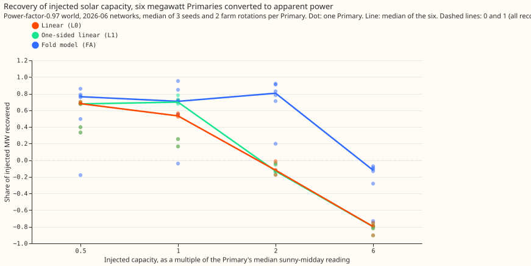
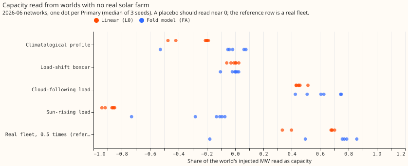
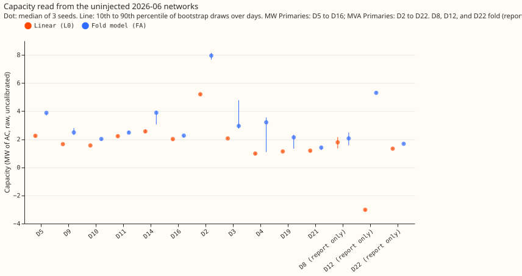
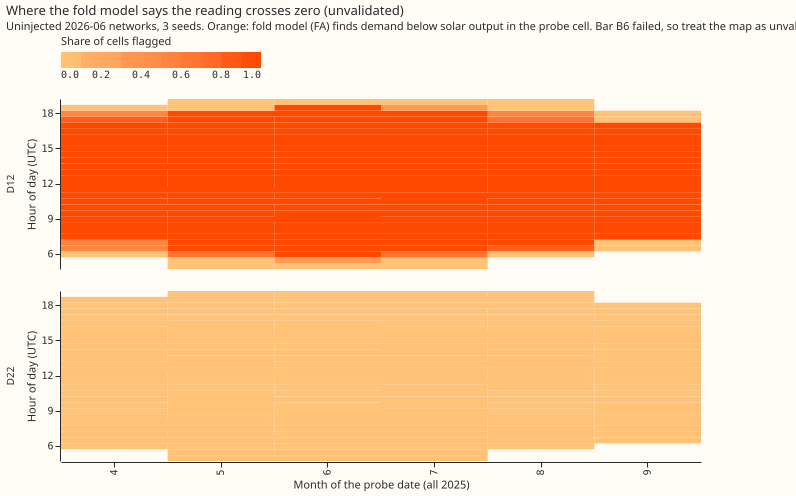

# Can the PV probe read capacity through the MVA fold at the eight MVA Primaries?

**Take-home: a fold-aware probe finds 0.7 to 0.9 of an injected solar farm's megawatts at every size we tried, where the linear probe fails once the farm's output can exceed the substation's demand. The pre-registered gate failed, so the run stopped after one cutoff and the verdict is inconclusive.** The stop came from bar A1, which the audit found compares two different injection levels. The failure at 6 times the midday reading came from the fold fit's start grid, not from the networks.

We asked whether the unmetered solar capacity behind a substation can be read when the meter reports apparent power (megavolt-amperes, which never goes negative) rather than signed megawatts. We converted the flow of the six substations that report signed megawatts into synthetic apparent power at power factor 0.97 and added a known solar fleet of a chosen size. Then we asked how much of the added fleet a probe of a trained neural network finds again. The probe is [experiment 621](../00621-pv-probe-injected-known-answer-and-placebo-test/result.md)'s donor-day probe; the fold model is new, and follows the observation model of the Opus design of 2026-11-09. Only the 2026-06 cutoff ran: 72 networks, 3 seeds each, 24 conditions, 23 s per GPU fit.

**Pre-registered bars, 2026-06 cutoff only** (as fixed in the plan commit; 4 of 11 pass):

| Bar | Result | Pass |
|---|---|---|
| A1 Fold-free loss (0.90 to 1.10 at 5 of 6, L0 and F4) | L0 ratios 0.56, 0.90, 0.44, 0.87, 0.88, 0.91 for D5, D9, D10, D11, D14, D16; F4 0.47 to 1.28 | fail |
| A2 Native worlds within ±0.12 of the six | native 0.73 to 0.83 against the six's 0.68; 5 of 5 | pass |
| A3 Placebos under 0.25 of the real L0.5 recovery | climatological 6 of 6 and 5 of 5; boxcar 5 of 6 and 5 of 5 | pass |
| A4 Calibration factor 0.55 to 0.95, spread under 0.15 | 0.677 to 0.683 at all six | pass |
| A5 Coverage at least 60% | 0.18 | fail |
| B1 Crossing worlds, 4 of 6 in 0.75 to 1.25 | PF L1 4 of 6, PF L2 5 of 6, floor L1 1 of 6, floor L2 5 of 6 | fail |
| B2 Export-dominated, 4 of 6 | 2 of 6 (0.55 to 6.78) | fail |
| B3 Fold beats truncation (gap at least 0.10) | median absolute error 0.152 against 0.234, gap 0.08 | fail |
| B4 Sign placebo | 6 of 6 under 0.25; crossing flags 0.0% | pass |
| B5 Coverage at least 60% | 0.17 (L1), 0.14 (L2) | fail |
| B6 Crossing map | balanced accuracy 0.73 (L1), 0.94 (L2); false crossings 7.6% | fail |

- **A1's denominator is a design flaw.** No signed world at 0.5 times was trained, so the code divides by the signed world at 1 times. The linear probe's recovery falls from 0.68 to 0.54 between those levels in the apparent-power world and stays near 0.76 to 0.80 in the signed world, so A1 mixes levels. At the same level (1 times), the fold-loss ratio is 0.69 for the linear probe, 0.89 for the one-sided probe, and 1.09 for the fold model with a night prior.
- **D5 and D10 drag several bars.** Their median sunny-midday readings are 0.89 and 1.2 MW, so a 0.5 times injection is 0.4 and 0.6 MW, close to the seed spread.
- **Intervals are narrow.** A5 and B5 fail because the bootstrap (40 draws over days) carries no network-to-network bias, which the leave-one-Primary-out factor spread (0.01) does not widen.

## Post hoc: the 6-times failure is the start grid

The audit found that the fold fit, started at 0.25, 1, and 3 times the midday reading, sits on its zero-capacity bound at every Primary in the 6-times worlds (a true capacity of 6 times lies beyond every start). Starting also at 6 and 8 times, post hoc and without retraining, gives:

| Condition (median of the six) | FA | F4 | F1 |
|---|---|---|---|
| Fleet 0.5 times | 0.74 | 0.67 | 0.70 |
| Fleet 1 times | 0.70 | 0.64 | 0.72 |
| Fleet 2 times | 0.80 | 0.78 | 0.71 |
| Fleet 6 times | 0.88 | 0.83 | 0.72 |
| Physics mixture 6 times | 0.94 | 0.87 | 0.78 |
| Sun-rising load (placebo) | -0.11 | -0.13 | -0.09 |

FA at 6 times reads 0.99 at D11 and 0.63 at D5, and the five native Primaries read 0.91. These rows are not scored against the bars. FA is the fold model with the night prior; F4 has the four unit curves; F1 has the standard unit curve only.

## Real-data capacity (uninjected 2026-06 networks, raw)

The linear probe's raw capacity, divided by the 0.68 factor of A4 and assuming power factor 0.97, gives the calibrated column for the five Primaries that do not fold. The fold-model column is raw (pre-registered starts).

| Primary | Linear raw (MW) | Linear / 0.68 (MW) | Fold model FA raw (MW) |
|---|---|---|---|
| D2 | 5.2 | 7.6 | 8.0 |
| D3 | 2.1 | 3.0 | 3.0 (up to 4.8) |
| D4 | 1.0 | 1.4 | 3.2 (1.1 to 3.6) |
| D19 | 1.1 | 1.7 | 2.1 |
| D21 | 1.2 | 1.8 | 1.4 |
| D8 (report only) | 1.8 | 2.6 | 2.1 |
| D12 (report only) | -3.0 | n/a | 5.3 |
| D22 (report only) | 1.3 | 2.0 | 1.7 |

D12 is the only Primary whose curve rises with sun (S(u) class "rising"); the linear probe reads -3.0 MW there, as [experiment 479](../00479-pv-capacity-anomaly-regression-rung/result.md) did on the raw reading, and the fold model reads +5.3 MW. The crossing map is unvalidated because B6 failed.

## Deviations from the plan

- **Fold fit.** Three starting capacities (0.25, 1, 3 times) in place of a profile over 121 capacities; 40 bootstrap draws in place of 200; 40 donor rows per probe cell. Post hoc starts at 6 and 8 times are labelled above.
- **A1.** Compared against the signed arm at 1 times, as above. Stop rule 3 fired as pre-registered.
- **Fleet.** The physics half of the fleet is driven by the Primary's own sky, with no one-cell pixel offset. The boxcar placebo is capped at the Primary's median sunny-midday reading per event, because an event sized to the L2 fleet's daily energy exceeded the load.
- **L1 probe.** The floor estimate in the one-sided probe's threshold is capped at half the midday reading.
- **Native worlds** apply only in the power-factor arm.
- **Not run.** The 2026-03 cutoff, the signed-world energy conversion, and example curves S(u) beyond their class (falling at 13 Primaries, rising at D12).

## Caveats

- Real meters' reactive power is unknown; the power factor 0.97 is an assumption.
- NGED's event labels are incomplete, so the clean rows may hold unlabelled events.
- D8's regime changed in 2025 and the network has no year input.
- The fold model reads a cloud-following load at 0.62 of its size (report only), so it does not separate solar from cloud-following demand.
- One cutoff and one set of farms: nothing here is replicated.

## Checks

- **Median minus mean forecast, quantile-score contrast beside the error of the mean:** not applicable; the experiment scores no forecast.
- **Audit triggers fired:** 1 (a control fails: A1), 2 (the result contradicts its prediction for Tier B at 6 times, explained after the audit), and 7 (a follow-up would depend on the 0.78 at 2 times, not replicated). Triggers 4 and 5 did not fire. The audit is in the private briefs folder (`e656_audit.md`). Triage: accepted its finding 1 (post hoc table), accepted finding 3 (A1 caveat), and rejected its advice to rerun the stop rule, because the plan fixes the rule.
- **Code review (Sonnet):** accepted the boxcar cap, the sun-rising-load scaling, the arm-specific night reading, the basis-curve normalisation, and native worlds in the power-factor arm only; rejected the profile-likelihood deviation as a defect (listed above).

## What the next experiment should answer

Does the fold model with night prior keep its 0.7 to 0.9 recovery at a second cutoff and a second set of farms, with signed twins at every level, a start grid out to 8 times, and an injection sized by something larger than D5's midday reading, and does it still pass the sun-rising-load placebo and the cloud-following placebo?
