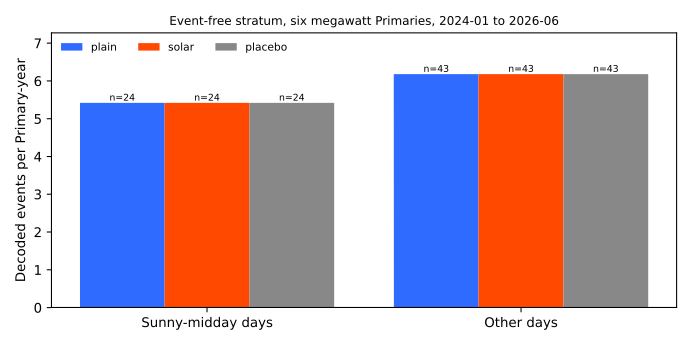
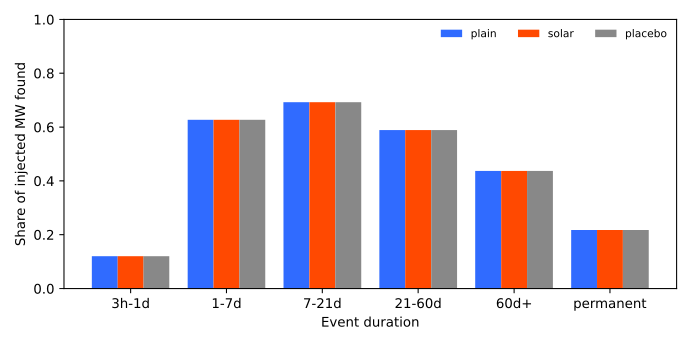
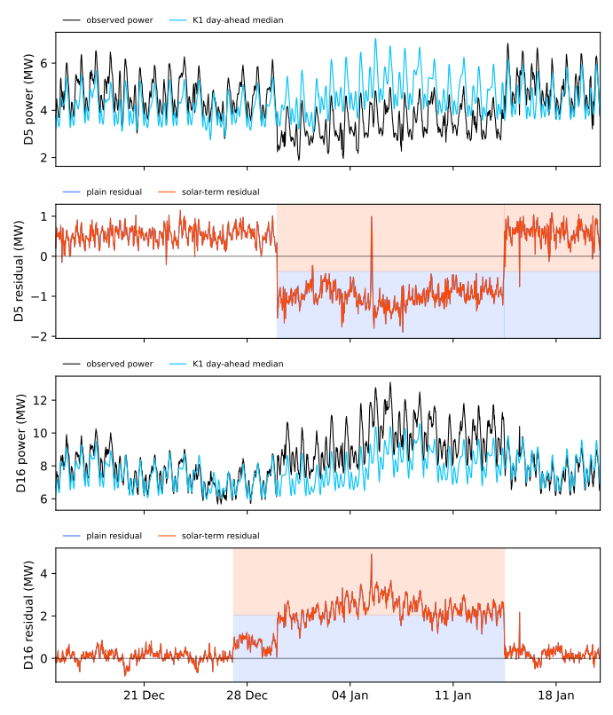

---
**An explicit solar term does nothing here, because the demand forecast already removes the solar
dip.** Experiment 653 decoded 5.4 false events per Primary-year in rows far from any logged event.
We asked whether unmetered solar at the six Primary substations metered in megawatts (D5, D9, D10,
D11, D14, and D16) explains some of them. We subtracted a physics solar curve, scaled by the
capacity of [experiment 649](../00649-pv-capacity-table-season-year-from-stored-probes/result.md),
from each Primary's residual, and ran the decoder of
[experiment 653](../00653-edge-state-event-table-penalised-segmentation/result.md) again with
nothing retuned. The fitted gain is 0.003, against a gate of 0.05, so the solar arm is the plain
arm: it decodes the same 246 events, finds the same injected megawatts, and changes the error on
sunny middays by 0.01%. The verdict is *not supported*, and the page reports the contrasts as null
rather than as passes.

## Figures

**In the third figure the shading marks decoded events: the lower half is the plain arm and the upper
half is the solar arm.** The two residual lines coincide, and so do the two sets of events.

## Terms used below

- **Plain, solar, and placebo arms:** the residual of experiment 653; that residual minus the solar
  term; and the same with each Primary given another Primary's capacity (the placebo, neutral by
  construction because it leaves the decoder and the nine other Primaries unchanged).
- **Event-free stratum:** rows more than 14 days from any labelled or verified event. A
  **Primary-year** is one Primary observed for one year. A **sunny-midday day** has 70% or more of its
  half-hours from 10:00 to 15:00 UTC with a clearness index (ERA5 shortwave irradiance divided by the
  Haurwitz clear-sky value) of at least 0.7.
- **K1:** the leaderboard's day-ahead median forecast. **D5, D16, and the like:** anonymised Primary
  names.

## Results

- **Gain and P5 (the gate).** The pooled Huber slope of the negated residual on `C·u(t)` is g =
  0.0031 over 50,115 half-hours (ordinary least squares 0.0013), under the gate of 0.05. The
  normalised mean absolute error of the residual on sunny-midday half-hours at the six Primaries moves
  by +0.11% in the tuning years and +0.01% in the scored years, against a planned fall of 3%. The
  placebo moves it by +0.07% and -0.02%. P5 fails.
- **P1, sunny-midday false events (event-free stratum, six MW Primaries, scored years).** 24 events
  over 4.43 Primary-years, 5.42 per Primary-year, in all three arms. The change is +0.0% (month
  bootstrap interval +0.0 to +0.0). P1 asked for a fall of 20% or more and fails. The sunny-day
  definition uses the same irradiance as the solar term, so P1 would have been partly mechanical.
- **P3, other days.** 43 events over 6.95 Primary-years, 6.18 per Primary-year, in all three arms.
  The change is +0.0%, which meets P3's limit of under 10%.
- **P2, injected recall at the six Primaries (events of 4 noise units or more that last 1 day or
  more; 87 events in 6 worlds).** MW-weighted recall is 0.579 in every arm, and the paired
  difference is +0.0000. P2 holds, but trivially.
- **P4, placebo.** The solar arm's fall in the sunny-midday rate is zero, so the ratio of the
  placebo's fall to the solar arm's is undefined. P4 cannot be scored.
- **Equal width.** The arms have 104 events each at the six Primaries, so no thinning is needed.
- **Logged shifts.** Of the 77 logged shifts that last more than 1 day, every arm matches 8 under the
  strict rule and 17 under the loose rule (2 and 5 of 30 at the six Primaries).
- **Event-free stratum per arm (15 Primaries).** 148 events over 27.5 Primary-years, 5.39 per
  Primary-year, in every arm (6.57 over all scored rows).
- **Plain arm against experiment 653.** The plain arm reproduces experiment 653's 246 real events.
- **Four scenarios (normalised MAE of the median forecast, in per cent of effective capacity;
  scored years; the forecast is the lag-free demand model of experiment 130, not K1).** "After the
  table" subtracts the slow level and the decoded events, in hindsight.

    | Scenario | Half-hours | Plain before | Plain after | Solar before | Solar after |
    |---|---|---|---|---|---|
    | All rows, 15 Primaries | 631,470 | 6.31 | 5.29 | 6.31 | 5.29 |
    | Quiet rows, 15 Primaries | 374,405 | 5.28 | 5.01 | 5.28 | 5.00 |
    | Inside events, 15 Primaries | 185,873 | 8.62 | 5.87 | 8.62 | 5.87 |
    | The 7 days after an event, 15 Primaries | 71,192 | 5.69 | 5.30 | 5.69 | 5.30 |
    | All rows, six MW Primaries | 262,438 | 5.05 | 3.95 | 5.05 | 3.95 |

    **The solar arm differs from the plain arm in the second decimal at most.** The solar arm's
    quiet-row and inside-event half-hour counts differ slightly from the plain arm's (374,426 and
    185,852), because the term shifts the residual that marks an event's edge. The figure above draws
    the D5 and D16 case, 14 days before the start to 7 days after the end. The other scenarios are
    scored but not drawn, because the lines would coincide.

## Checks

- **Median minus mean forecast per site, tail calibration, and the curtailment-cost score:** not
  applicable, because the table produces no forecast.
- **Mean-forecast error beside each contrast:** the normalised MAE in the four scenarios above.
- **Audit triggers.** Trigger 1 (a control or known-answer test failed) did not fire: the plain arm
  reproduces experiment 653 exactly. Trigger 2 (a result contradicts its prediction) fired, because
  P1 and P5 fail and P4 cannot be scored. A fresh Sonnet reviewer tested whether the null is a bug
  (see the next section) and found that it is not, so no further audit was run.
- **Not run:** a forecast-weather version of the solar term (experiment 644 found that ensemble
  weather removed the gain of an explicit term), a month-class gain, and an injection before the solar
  term.

## Reviews and triage

- **Plan review (Sonnet).** 12 findings. Accepted: the pooled gain with the placebo reusing it (a
  per-Primary gain would cancel the capacity), the sign convention, the stop gate, frozen noise
  units, a single capacity vintage, the paired interval for recall, counting an event by its start
  day, and the feature-table facts. Rejected: an injection-before-the-term sensitivity run, and the
  simpler per-Primary regression (the design already is one).
- **Code review (Sonnet).** 10 findings. The reviewer re-derived the null and found it real: the
  series mapping is right; shifting the curve by up to 4 half-hours leaves g between 0.0023 and
  0.0034; the sign is right; and the median residual on sunny middays at the six Primaries lies
  within 0.27 MW of zero. Before the common mode of all Primaries is removed, g is 0.075 in the tuning
  years and 0.024 in the scored years, still too small to matter. The reviewer did not re-run the
  decoder; the plain arm matching experiment 653's 246 events covers that.
- **Lab shortcuts.** The capacity table comes from probes pretrained to 2026-06, so it carries
  information from the scored years. The solar term is hindsight irradiance and cannot be made live.

## What the next experiment should answer

**The next experiment should look at the 24 sunny-midday false events directly.** The solar term does
not explain them, so the experiment can list what each one is: a step in one Primary's residual, a
step in the common mode of the Primaries, or a missing-data edge.

## Method

**Architecture and algorithm.**

- **Solar curve.** For each of the six megawatt Primaries, `u(t)` is the ERA5 surface shortwave
  irradiance (the `shortwave` column of the feature table of
  [experiment 6](../00006-stage1a-demand-input-feature-sweep/result.md), half-hourly), divided by its
  99th percentile over daylight half-hours of 2022 and 2023 at that Primary. The code checks that the
  column carries no forecast-origin, lead, or ensemble column, no duplicate rows, zero irradiance at
  night, and a clearness index of at most 1.10.
- **Capacity.** `C` is the calibrated 50th-percentile AC capacity of experiment 649 (probe cutoff
  2026-06, April to September 2025): 2.98, 2.44, 2.54, 3.42, 3.92, and 3.16 MW at D5, D9, D10, D11,
  D14, and D16.
- **Gain.** One pooled gain `g` is the slope of a Huber regression of the negated residual on
  `C·u(t)`, over daylight half-hours from April to September of 2022 and 2023 at the six Primaries,
  with half-hours inside logged or verified events left out, clipped to 0 to 1.5. The solar arm's
  residual is the plain residual (after the common mode of all Primaries is removed) plus `g·C·u(t)`.
  The placebo gives each Primary another Primary's `C` in a fixed cycle, with the same `g`.
- **Decoder.** The decoder, penalties, and slow level of experiment 653, with that experiment's
  frozen noise units; the slow level is refitted on each arm's residual.

**Training regime.**

- **Fitting.** Only the gain is fitted, on 2022 and 2023. Nothing else is tuned, and the 2024 to 2026
  years are scored once. NGED's labels enter only the exclusion of event rows from the gain fit.
- **Compute.** CPU only, one core, under 2 minutes for all stages. No fitted neural network.

**Measurement.**

- **Injected worlds.** The six worlds of experiment 653 with the same seeds. Events are added to
  each arm's residual, and truth is identical across arms.
- **Real record.** Events per Primary-year in the event-free stratum, split by whether the day of the
  event's start is a sunny-midday day, with month-bootstrap intervals; recall of injected events by
  duration band, with a paired world bootstrap; logged shifts matched at the strict and loose rules;
  the four-scenario normalised MAE; and the D5 and D16 time series.

## Files

- `ml-experiments/00657-event-table-with-explicit-solar-term-against-plain-arm/e00657_solar.py`: the
  solar curve, the capacity, the gain, and the three arms' residuals.
- `ml-experiments/00657-event-table-with-explicit-solar-term-against-plain-arm/e00657_run.py`:
  stages `inject` and `real`.
- `ml-experiments/00657-event-table-with-explicit-solar-term-against-plain-arm/e00657_report.py`:
  prints every number on this page and draws the figures.
- Imported code, read only: the folder of
  [experiment 653](../00653-edge-state-event-table-penalised-segmentation/result.md) (decoder,
  generator, matching, panel).
- `data/ml-experiments/00006-stage1a-demand-input-feature-sweep/inputs/features.parquet`: the ERA5
  `shortwave` column (read only).
- `data/ml-experiments/00649-pv-capacity-table-season-year-from-stored-probes/work/capacity_table.parquet`:
  the capacity table (read only).
- `data/ml-experiments/00653-edge-state-event-table-penalised-segmentation/`: the frozen noise units
  and parameters (read only).
- `data/ml-experiments/00657-event-table-with-explicit-solar-term-against-plain-arm/`: the truth and
  event tables written here (never committed).
