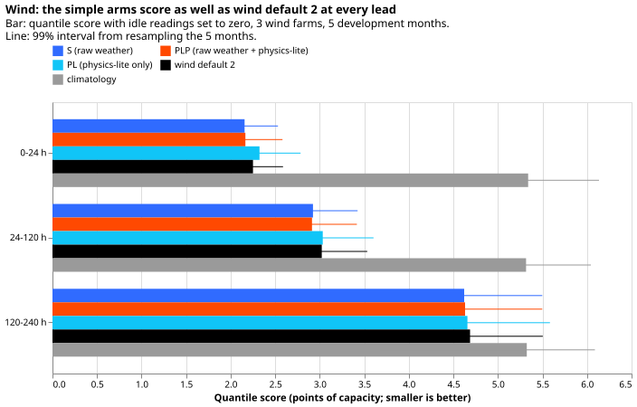
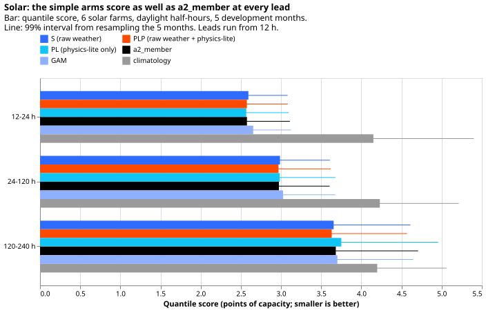
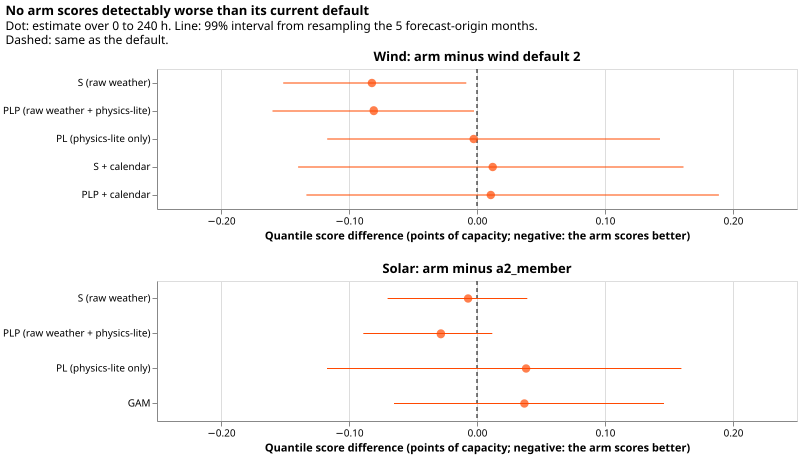
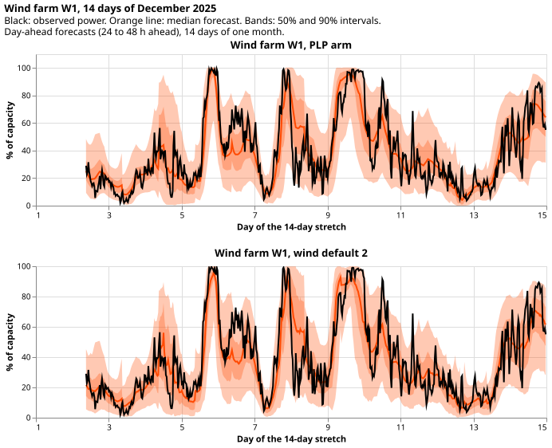
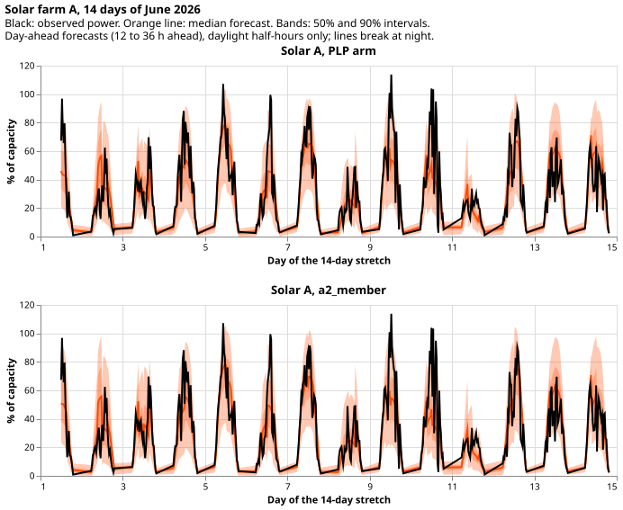

**A small network that sees only the average and spread of the weather forecasts predicts the 3 wind
farms and 6 solar farms as well as the current defaults, and a hand-written power curve as an extra
input adds little.** We asked whether the physics plant and the elaborate network of the two current
defaults are needed. We trained one small neural network per technology, shared by all the farms of
that technology, on summaries across the 51 ensemble weather forecasts, and scored it on the 5
development months (forecast origins in 2025-10, 2025-12, 2026-01, 2026-03, and 2026-06). The final
test (valid times from 2026-07-01) was never read. Nothing here is adopted for production. Forecasts
are stored in the private folder `backtest_export_simple_shared_wind_solar_2026-11-09/`, and the
generators appear only as W1 to W3 and Solar A to Solar F.

**Terms.** The quantile score is the mean pinball loss over the 11 quantile levels, in points of
capacity (smaller is better). The normalised mean absolute error of the median forecast is in the
tables beside it. Arms: **S** reads the mean and spread of the raw weather. **PLP** reads S plus the
mean and spread of a fixed physics-lite power (a power curve for wind, an irradiance and cell
temperature formula for solar), computed from each of the 51 forecasts separately. **PL** reads the
physics-lite power only. Intervals resample the 5 forecast-origin months, so they are wide. Rows are
leads of 0 to 240 h; wind scores treat idle readings (the idle mask of experiment 210) as zero.

## Results

*Look at the S and PLP bars sitting at or below the black wind default 2 bar in every lead band, and
`climatology` far above all of them.*

| Wind arm (idle readings as zero) | Quantile score | Median MAE (% of capacity) | q05-q95 coverage | Above q99 | Below q01 |
|---|---|---|---|---|---|
| S | 3.684 | 13.64 | 0.911 | 0.0175 | 0.0050 |
| PLP | 3.685 | 13.66 | 0.903 | 0.0162 | 0.0056 |
| PL | 3.764 | 13.97 | 0.923 | 0.0147 | 0.0051 |
| S plus calendar | 3.778 | 14.00 | 0.894 | 0.0239 | 0.0055 |
| PLP plus calendar | 3.777 | 13.95 | 0.889 | 0.0215 | 0.0061 |
| Wind default 2 | 3.766 | 13.90 | 0.835 | 0.0106 | 0.0226 |
| Wind default 2, 730-day capacity | 3.766 | 13.90 | 0.835 | 0.0111 | 0.0225 |
| `climatology` | 5.322 | 20.15 | 0.929 | 0.0167 | 0.0021 |

**Wind S beats wind default 2 by 0.082 points (99% interval -0.151 to -0.008, minimum detectable
effect 0.103), and PLP by 0.081 (-0.160 to -0.002).** PL is level with the default (-0.003, -0.117 to
0.143). The default's band is too narrow once idle readings count as zero: its q05-q95 coverage is
0.835, and 0.0226 of observations fall below its q01. On the rows with idle readings dropped, S and the
default score 3.865 and 3.846, so the gain is on the idle rows, not on the active ones.
Scores on all rows are within 0.01 of the cleaned-zero scores for every arm, so the cleaning did not
lower any score. The idle mask missed 51% to 69% of idle periods out of sample (experiment 210), so
some idle noise stays in the "zero" rows.

*Look at the S, PLP, PL, and `a2_member` bars being almost equal in every lead band, with the GAM
slightly higher and `climatology` far higher.*

| Solar arm | Quantile score | Median MAE (% of capacity) | q05-q95 coverage | Above q99 | Below q01 |
|---|---|---|---|---|---|
| S | 3.301 | 12.51 | 0.881 | 0.0140 | 0.0092 |
| PLP | 3.279 | 12.42 | 0.888 | 0.0136 | 0.0101 |
| PL | 3.346 | 12.70 | 0.892 | 0.0120 | 0.0063 |
| `a2_member`, quarterly refit | 3.308 | 12.55 | 0.886 | 0.0154 | 0.0111 |
| `a2_member`, 730-day capacity | 3.305 | 12.51 | 0.887 | 0.0153 | 0.0087 |
| GAM | 3.345 | 12.49 | 0.895 | 0.0132 | 0.0106 |
| `climatology` | 4.208 | 16.24 | 0.950 | 0.0013 | 0.0148 |

**Solar PLP scores 0.028 points better than `a2_member` (-0.089 to 0.012) and 0.021 better than S
(-0.044 to -0.004, minimum detectable effect 0.026).** S is level with `a2_member` (-0.007, -0.070 to
0.039). PL is 0.038 worse than `a2_member` (-0.117 to 0.160).

*Look at every interval including zero or lying below it, except that no arm is detectably worse.*

**Calendar columns hurt wind.** S plus calendar scores 0.094 points worse than S (0.012 to 0.180),
and its upper tail is worse (0.024 of observations above q99, against a target of 0.01).

**Capacity.** Recomputing capacity as the 99.9th percentile of the previous 730 days changes wind
default 2 by -0.001 points and `a2_member` by -0.002 (interval -0.045 to 0.028). The 730-day wind capacity was 2% to 9% above the old capacity at the refits, and solar farm E had about 455 days of history at the first refit.

**Tails.** Very sunny days are still the weak point: on 27 farm-days reaching 90% of the farm's own
monthly 95th percentile on at least half their half-hours (2,086 rows, a proxy built from observed
power), 10.6% to 12.7% of observations exceed q99 for every simple arm and 12.2% for `a2_member`
(coverage 0.66 to 0.70). On the 44 high-wind days (at least 2 of 3 farms above 80% of capacity),
coverage is 0.82 for S and 0.83 for wind default 2, and 4.4% to 5.2% of observations exceed q99.
Coverage in 2026-01 and 2026-03 is 0.88 to 0.89 for S, against 0.855 and 0.867 for the default.
Two-constant tail widening (experiment 499's rule, fitted on earlier months) did not improve any
arm: scores moved by at most 0.013 points, and it left more observations below q01 because exact
zeros fall below a lifted q01 (see Checks).

*Look at the PLP median following the black observation about as closely as wind default 2's.*

*Look at the observed peaks of days 9 and 10 poking above the 90% band for both arms.*

## Checks

- **Median minus mean forecast, per site:** not computed, because the mixture mean is not stored
  with the quantiles. Treat this as a gap.
- **Error of the median forecast beside each contrast:** it points the same way as the quantile
  score for wind S against the default (-0.257 points of MAE, interval -0.541 to 0.066; score -0.082),
  and for solar PLP against `a2_member` (-0.130, -0.420 to 0.051; score -0.028). The MAE intervals
  include zero, so the median alone does not separate the arms from the defaults. Trigger 3 did not
  fire.
- **Triggers:** trigger 2 fired. P2 (PLP better than S by 0.05 points) failed for wind (+0.001) and
  solar (-0.021), and P4 (cleaning lowers scores by 0.1 points) failed, with no tested explanation
  beyond the suggestion that the network learns the power curve from the mean and spread of wind
  speed. No audit has been run. Triggers 1, 4, 5, 6, and 7 did not fire: no control failed, no
  leave-one-site-out check was run, no nested arm beat its container (PLP minus S is +0.001 for wind),
  no sister experiment has an interval to compare, and no later design depends on this result yet.
- **Gate:** experiment 347's own head reproduced to 0.00000, and `a2_member` seed 0 for the 2026-06
  refit reproduced experiment 430's stored forecast to a maximum absolute difference of 0.0 on q01,
  q50, and q99.
- **Widening artefact:** the widened rule shrinks q01 towards the median on rows where the
  median is near zero, so exact-zero observations fall below q01. The widened scores
  (`scores/*_tails.csv`) are therefore not a fair tail comparison.
- **Reviews:** a fresh Sonnet agent reviewed the wind and the solar scripts before the first quoted
  score; it found no blocking bug, and its four wind findings (capacity columns in the table, a valid
  time limit, a null check, and a `weights_only` problem) were fixed. The write-up and prose reviews
  have not run yet.

## Method

**Architecture**

- Each arm is a pooled network of two hidden layers of 64 units with a three-component Gaussian
  mixture over power as a fraction of capacity, from [experiment 310](https://openclimatefix.github.io/nged-ml-research/ml-experiments/00310-metered-farm-long-lead-scoring/result/)'s `MixtureHead`, with 11 quantiles read from the mixture and capped at capacity.
- Wind inputs: mean and standard deviation across the 51 members of 10 m and 100 m wind speed, the
  sine and cosine of the 100 m direction, and air temperature, plus the lead (sine and cosine of
  its hour of day, and hundreds of hours) and a one-hot wind-farm column.
- Solar inputs: mean and standard deviation of shortwave, air temperature, and 10 m wind speed, the
  ensemble means of relative humidity, longwave radiation, precipitation, and surface pressure, the
  sun's elevation, the sine and cosine of its azimuth, and the lead. There is no farm column, as
  in `a2_member`, and no calendar column.
- The mixture's centre is the mean physics-lite power for PL and PLP and the training mean of the
  target for S, so S has no physics-lite input anywhere.
- Physics-lite wind: a cubic rise of 100 m wind speed from cut-in 3 m/s to rated 12 m/s, flat to cut-out
  25 m/s, zero above, with unit capacity. Physics-lite solar: irradiance over 1000 W/m2 times
  (1 - 0.004 per kelvin times (cell temperature - 25 C)), clipped to 0 to 1, with the Faiman cell
  temperature `T_air + G / (25 + 6.84 times wind speed)`. Both are applied to each member before the
  mean and spread. The solar arms also read the mean and spread of the cell temperature.

**Training regime**

- Weather is the ECMWF 51-member ensemble forecast (an issued forecast, available at forecast time).
  Wind trains on the daily 00 UTC runs from 2024-04 and solar on the stored runs of experiment 430.
- Wind refits on day 0 and day 14 of each development month (10 refits), training on runs before 62 days
  earlier and stopping early on the last 62 days, 40 epochs. Solar refits at 2025-09, 2025-12, 2026-03,
  and 2026-06 (as in experiment 430), 20 epochs, stopping on the last 61 days.
- Capacity is the 99.9th percentile of the farm's power over the 730 days before each refit. Wind idle
  readings are set to zero in training and scoring. Three seeds per arm, averaged quantile by quantile.
- AdamW, learning rate 0.002, batch 2048, weight decay 0.0001. Each fit took about 30 to 40 s on the
  GPU: about 2.6 GPU-hours for all arms and the re-score (wind 150 fits, solar 36, and 32 re-score fits). A
  final-test refit of one arm per technology would take about 10 minutes.

**Measurement**

- Scores are on the rows of experiment 615 (daylight half-hours for solar), leads up to 240 h, in points
  of the same scoring capacity as experiment 615. Wind default 2 is the stored refits of experiment 615
  (old capacity rule) and `a2_member` is experiment 430's stored quarterly forecast, seeds averaged.
- Intervals are 99% intervals from 10,000 resamples of the 5 forecast-origin months; the minimum
  detectable effect is 3.418 times the bootstrap standard error. No Bonferroni correction is applied
  to the 99% level beyond that choice, and the contrasts are descriptive.
- Experiment C refits wind default 2 (seeds 0 and 1) and `a2_member` (seeds 0 to 2) with the 730-day capacity,
  keeping scoring capacity fixed.
- Not done: the lower-priority wind refit schedule arm, the one-cell estimate of cost in money, and the
  Opus review the brief allows.

## Files

- `ml-experiments/00659-*/e00659_wind_features.py`: builds each wind case's member summaries into
  `data/ml-experiments/00659-*/wind_features/`.
- `e00659_solar_wind.py`: rebuilds the solar member arrays with 10 m wind speed into `solar_wind/`.
- `e00659_wind_fit.py` and `e00659_solar_fit.py`: fit the arms and write `wind_fits/`, `solar_fits/`, and
  `models/` (state files).
- `e00659_defaults_730.py`: the gates and Experiment C refits, into `wind_default2_730/` and
  `solar_a2_member_730/`.
- `e00659_assemble.py`, `e00659_score.py`, `e00659_figures.py`, `e00659_export.py`: tables, `scores/*.csv`,
  the figures beside this page, and `backtest_export_simple_shared_wind_solar_2026-11-09/`.
- Read, not written: experiment 615's `wind_members/`, `wind_inputs/`, `wind_default2/`, `tables/`
  ([experiment 615](https://openclimatefix.github.io/nged-ml-research/ml-experiments/00615-bakeoff-wind-and-solar-development-month-backtests/result/)),
  experiment 430's `member_arrays/` and stored forecasts, and `00453-*/work/series.parquet`.
