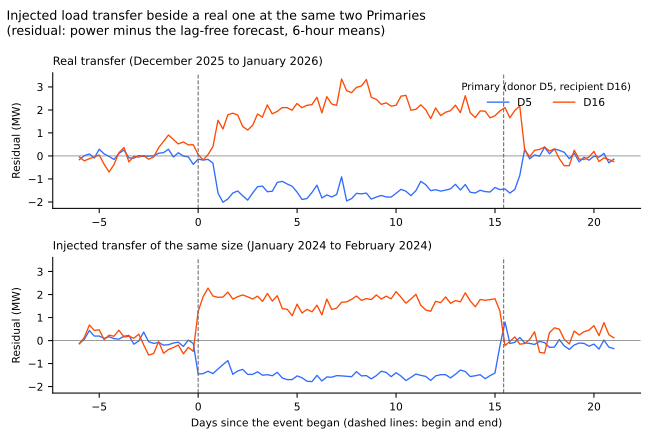
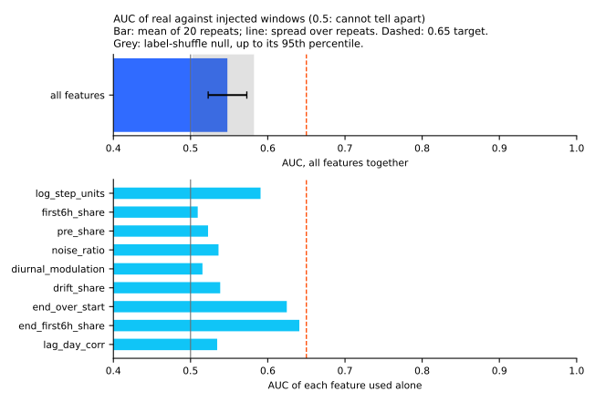
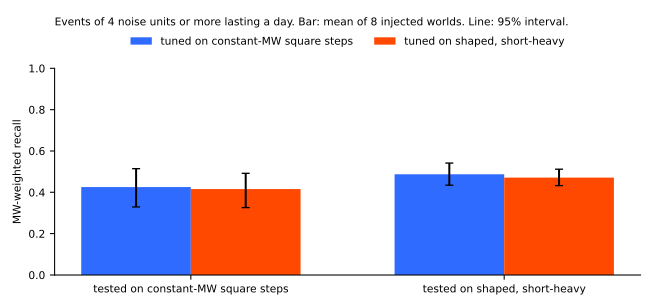
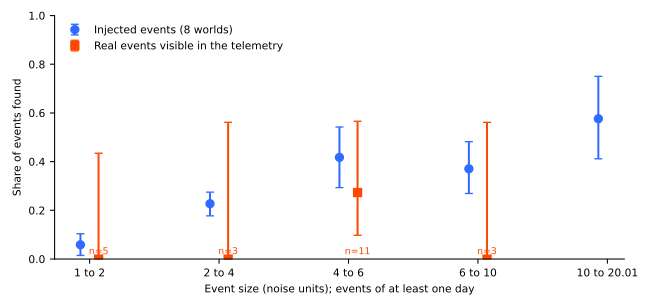
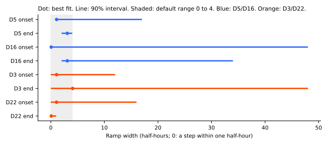
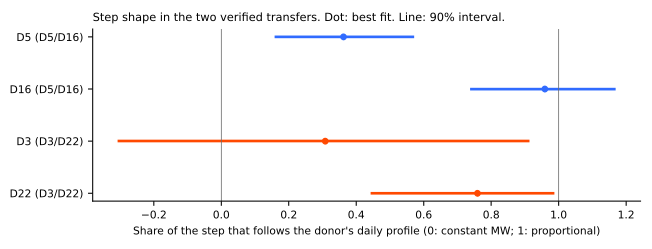

**A shared generator of fake load transfers looks real enough to train and test detectors on, as far
as 49 real windows and 2 verified transfers can tell.** A load transfer happens when an operator
switches a circuit from one Primary substation (the substation that steps electricity down to the
local distribution network) to a neighbour, so one Primary loses demand and the other gains it. We
built one tested module that adds such transfers, and the other kinds of step and ramp that
detectors must not mistake for them, to real half-hourly power history. We then asked four
questions of the module: how fast and in what shape the real steps change, whether a classifier can
tell
injected windows from real ones, whether a detector tuned on one configuration still works on
another, and whether the detector finds injected events as often as real ones.

The classifier could not tell injected windows from real ones (area under the curve 0.55, where 0.5
is chance). A detector
tuned on constant-MW square steps lost 0.01 of its recall on shaped transfers, and the reverse lost
none (−0.02). Both pre-registered tests pass, so the verdict is *supported*. The real evidence is
thin, and every number below says how thin. The module sits in this experiment's folder.

The code is the module `e00660_generator.py`, its tests, and the evidence scripts, all in
`ml-experiments/00660-shared-generator-of-injected-load-transfer-events/`. This page documents the
module: the assumption table, the traps and their guards, a usage example, and the four evidence
checks.

## Figures



**Figure 1 shows an injected transfer beside a real one.** Both panels show the residual (power
minus the forecast of the lag-free demand forecast of experiment 327's arm C), averaged over 6-hour
blocks. The
real transfer is a verified one; the injected transfer uses the module's default shape and ramp.



**Figure 2 shows that the classifier does little better than shuffled labels.** The bar is the mean
over 20 repeats of 5-fold cross-validation, and the grey band runs from the mean to the 95th
percentile of the same procedure on shuffled labels. The lower panel gives each feature used alone.
The two end-of-event features score highest (0.62 and 0.64), still under the 0.65 target.



**Figure 3 shows that the detector's recall depends on the test configuration, not on the
configuration it was tuned on.** The detector found 0.42 to 0.49 of the megawatts moved by events of
at least 4 noise units that last a day or more.



**Figure 4 compares the detector's recall by event size on injected events and on real events.** The
real events are those visible in the telemetry (22 of at least a day in the scored years), and the
detector found 3 of them. Bins with 3 or fewer real events cannot support a comparison.



**Figure 5 shows the fitted ramp width at each end of the two verified transfers.** Every best fit
is 4 half-hours or fewer. Only 2 of 8 intervals lie inside the default range, because a small step
beside the residual's noise fixes a ramp width poorly.



**Figure 6 shows how much of each step follows the donor's daily profile.** The four estimates run
from 0.31 to 0.96, so every step follows the profile in part.

## Assumptions, defaults, and evidence

**Each row of the table names one assumption of the generator, its default, the evidence behind it,
and how to vary it.** "Measured" means a number from real data of this project, "literature" means
a finding from an earlier experiment that this page does not re-measure, and "unmeasured guess"
means nothing in the project tests the value. A noise unit is the robust spread of one Primary's
6-hour block means of the residual, from [experiment
653](../00653-edge-state-event-table-penalised-segmentation/result.md).

| Assumption | Default | Evidence | Status | Sensitivity |
|---|---|---|---|---|
| Event rate | 1.2 events per Primary-year | The rate used by [experiment 653](../00653-edge-state-event-table-penalised-segmentation/result.md); NGED's logs are incomplete, so no count of logged events is a rate | Unmeasured guess | `events_per_primary_year` |
| Class mix | 55% edge transfer with a metered recipient, 10% unseen donor, 15% unseen recipient, 10% temporary shift, 10% permanent shift | 52% of headline-band transfers have no metered receiver ([experiment 43](../00043-sw2-1-detector-scoreboard/result.md)); the split among the other classes is a guess | Measured for the unpaired share; the rest is a guess | `class_probs` |
| Recipients of one donor | 1, 2, or 3 recipients | None | Unmeasured guess | `recipient_count_probs` |
| Size | Log-uniform from 1 to 20 noise units, half the events from 2 to 8 | The 22 real visible events of at least a day sit mostly at 4 to 6 units (figure 4) | Measured on a thin sample | `units_range`, `core_units_range`, `core_mass` |
| Receiver share | Recipients receive 0.5 to 1.1 of the donor's change | The second step over the first has median 1.09, quartiles 0.75 and 1.30 ([experiment 37](../00037-switching-first-look/result.md)); this page's two transfers give 1.39 and 0.78 | Measured; the default's median sits below the measured median | `share_range`, for example (0.75, 1.30) |
| Duration | Log-uniform from 3 hours to 112 days | Logged durations of the 184 events at the Primaries span under 6 hours to more than 7 days; the two verified transfers last 15 and 27 days ([experiment 580](../00580-verified-load-shift-event-set-and-label-audit/result.md)) | Measured (logs incomplete) | `duration_bands`; `short_heavy()` and `long_heavy()` |
| Start hour and weekday | Drawn from the logged onsets | [Experiment 580](../00580-verified-load-shift-event-set-and-label-audit/result.md) | Measured | `start_times=None` draws uniformly |
| Ramp at each end | 0 to 4 half-hours | The ramp allowance of [experiment 514](../00514-load-shift-probability-detector-and-calibration/result.md); this page's best fits are 0 to 4 half-hours at all 8 edges, with only 2 intervals inside that range | Measured on 2 events | `ramp_hh` |
| Recipient starts after the donor | 0 to 36 half-hours | The recipient began 29 and 30 half-hours after the donor at the two verified transfers; the ends were 0 and 37 half-hours apart | Measured on 2 events | `recipient_start_offset_hh` |
| Step shape | Every event follows the donor's daily profile for a share drawn from 0.3 to 1.0, and is constant MW for the rest | The shares are 0.31 to 0.96 at four steps (figure 6); [experiment 186](../00186-switching-d8-gas-peaker-spark-spread-and-triads/result.md) finds that none of 28 gas-engine drops passes its flat-block cutoff | Measured on 2 events | `proportional_prob`, `proportional_share_range`; `constant_mw_square()` |
| Drift inside an event | Linear, plus or minus 20% across the event | [Experiment 37](../00037-switching-first-look/result.md) finds second-half steps that differ from the first by more than a factor of 2 in some closures; the default understates that | Measured; default is mild | `drift_range` |
| Return to the earlier level | 85% exact, 10% settle at 0.2 to 0.8 of the event's level, 5% have a second step halfway | [Experiment 148](../00148-switching-end-rule-lookahead-ro-nc/result.md) says returns can ramp or arrive in stages and gives no shape | Unmeasured guess | `partial_return_prob`, `mid_step_prob` |
| Staged return | Off; the last fifth of the event at half level when on | The same passage of experiment 148 | Unmeasured guess | `staged_return_prob`; `shaped_transfers()` sets 0.5 |
| Overlap and chains | 10% of events start inside an earlier event at the same Primary, and 10% start at a recipient of an earlier event | None | Unmeasured guess | `overlap_prob`, `chain_prob` |
| Routine generator steps (hard negative) | 3 or 4 Primaries per world, 12 steps per year each, in 0.5, 1, 1.5, or 2 MW, following the Primary's daily profile | The daily-profile shape follows [experiment 186](../00186-switching-d8-gas-peaker-spark-spread-and-triads/result.md); the rate and sizes are not measured | Shape from an earlier experiment; rate and sizes unmeasured | `routine_primaries`, `routine_steps_per_year`, `routine_steps` |
| Ramps, pulses, placebo pairs, common mode (hard negatives) | Ramps over 2 to 12 hours, pulses of 0.5 to 2.5 hours, 0.3 placebo pairs per Primary-year, a 0.8-noise-unit weather-like swing | None | Unmeasured guess | `ramp_hours`, `pulse_hh`, `placebo_pairs_per_primary_year`, `common_mode_gain` |
| MW and MVA | An MVA Primary holds the magnitude of its base plus the change; the two units are never summed | [Experiment 650](../00650-extended-shift-departure-head-against-decayed-recent-error/result.md) converts MW-and-MVA sums with a power factor of 0.97, a conversion the module does not apply | Unmeasured; a large loss can fold through zero | `PowerPanel.is_mva` |
| Unseen donor | A Primary on the panel stands in for the hidden donor, and its own series is not changed | None | Limitation | none |
| Un-injected time | Unlabelled, never a negative example | [Experiment 580](../00580-verified-load-shift-event-set-and-label-audit/result.md) finds label gaps: real transfers sit at dates the label table misses | Measured | none |

## Traps from earlier experiments and the guard for each

| Trap | Guard the module provides |
|---|---|
| Real events in training months taught as negatives ([experiment 302](../00302-lsc-learned-score-without-nged-labels/result.md)) | The table lists injected events only, so there is no negative row; `event_windows` gives the mask of injected time, and everything else stays unlabelled |
| A placebo that is not neutral: a head trained on shuffled shifts still gained ([experiment 650](../00650-extended-shift-departure-head-against-decayed-recent-error/result.md)) | `shuffled_placebo` keeps sizes, durations, donors, and recipients and moves each group to a random start |
| Band widening mistaken for signal (60% to 68% of the head's gain in [experiment 647](../00647-two-output-forecast-departure-head-on-frozen-k1/result.md)) | None: scoring after equal width scaling belongs to the experiment that uses the module |
| A duration prior meeting a different bank | `duration_bands`, `short_heavy()`, and `long_heavy()` change the law, and check 3 tests one such change |
| One verified episode counted as several independent months | `group_id` ties each donor to its recipients, so a consumer can cluster its intervals by event; the module generates no real events |
| Strata defined by the future end select on the outcome | None: the table's `end` column is for scoring only, and the page of an experiment that stratifies by it should say so |
| Neighbour inputs flattering the model (unconfirmed) | None |

## How to use it

**Put the folder on the import path, load a panel, and inject.** The module takes a real power panel
(`PowerPanel`: one series per Primary, MW and MVA kept apart by `is_mva`, one noise unit per series,
the edge list, and the time of index 0), a configuration, and a seed. It returns the injected panel
and a table with one row per participant of each event.

```python
import sys
from dataclasses import replace

sys.path.insert(0, "ml-experiments/00660-shared-generator-of-injected-load-transfer-events")
import e00660_data as data  # loads the 15-Primary panel of experiment 653
import e00660_generator as gen

panel = data.load_panel()
config = replace(gen.default_config(), events_per_primary_year=2.0)  # or gen.short_heavy()
world = gen.inject(panel=panel, config=config, seed=1, start_times=data.logged_start_times())
world.power  # injected series (NaN stays NaN)
world.events  # one row per participant: start, end, role, delta in MW or MVA, ...
placebo = gen.shuffled_placebo(panel=panel, events=world.events, seed=2)
```

The injected series can be rebuilt from the table alone with `gen.apply_events`.

**The table has these columns.** `event_id` and `group_id` (a donor and its recipients share a
group), `site`, `role`, `event_class` (the three edge classes, the two shift classes, and the
hard-negative classes), `label` (edge_transfer, shift, or hard_negative), `start` and `end`
(half-hour indices), `residual_frac` (level left after the end), `delta` (signed peak change),
`units` (size in noise units), `shape`, `prop_share`, `shape_source`, `ramp_in_hh`, `ramp_out_hh`,
`drift`, `mid_factor`, `staged_hh`, `share` (receiver share), `period_hh` and `phase` (common mode
only), `partners`, and `chain_parent`.

**The configuration is `GeneratorConfig`.** Every range in the assumption table is a field. The
sensitivity constructors are `short_heavy()`, `long_heavy()`, `constant_mw_square()` (no ramp, no
drift, no second step, no staged or partial return), and `shaped_transfers()` (follows the donor's
profile, ramps, stages the return, short-heavy). The generator refuses a panel with a reading on or
after 2026-07-01, and clamps the configuration's `cutoff` to that date.

## Results of the four evidence checks

**Check 1: the real ramp is 4 half-hours or shorter at best fit, and the recipient starts about 15
hours after the donor.** For each of the four Primaries and each end of its event, we fitted the
residual in a window of 4 days either side with a level, a trend, and one step ramping over `w`
half-hours (the generator's own ramp), and read the best `w` off a grid. Intervals come from
resampling whole days. The best `w` is 0 to 4 at all 8 edges (figure 5), but only 2 intervals lie
inside 0 to 4 (D5's end, 2 to 4; D22's end, 0 to 1), so a step of this size beside the residual's
noise cannot fix a width. The recipient started 14.5 and 15 hours after the donor. Prediction P4
holds for the best fits and is not established by the intervals.

**Check 1 also finds that every step follows the donor's daily profile in part.** The share is 0.36
(90% interval 0.16 to 0.57) at D5, 0.96 (0.74 to 1.17) at D16, 0.76 (0.44 to 0.99) at D22, and 0.31
(−0.31 to 0.91) at D3 (figure 6). The module's default draws that share from 0.3 to 1.0. The sample
is two events.

**Check 2: the classifier's area under the curve is 0.55, under the 0.65 target.** The real windows
are 49 events visible in the telemetry (verified transfers and unpaired steps of at least a day,
from experiment 580). The injected windows are 358 events from default worlds, sampled so that
the injected windows' size histogram matches the real one. The mean over 20 repeats is 0.548 (spread
over repeats
0.025), against 0.503 for shuffled labels (95th percentile 0.581). With 49 real windows the
shuffled-label spread is wide, so the check excludes only a large gap. Used alone, the share of the
end step that arrives in the first 6 hours scores 0.64, the size of the end step over the onset
step 0.62, and the size of the onset step 0.59.

**Check 2 failed on its first run, for a reason unrelated to the generator.** At the logged onset
time the area under the curve was 0.69 (spread 0.03), because the features read the timing noise of
NGED's logged onsets and ends. The final run snaps both real and injected onset and end times to
the largest local step within a day. The snapping is a post hoc change, applied to both classes, and
the
first-run numbers are stored beside the final ones.

**Check 3: the cross-injector recall drop is 0.01 and −0.02, under the 0.05 target.** The detector
is [experiment 653's](../00653-edge-state-event-table-penalised-segmentation/result.md) penalised
segmentation, and "tuning" means choosing its two penalties on injected worlds under experiment
653's cap of 6 real alarms per Primary-year. Configuration A is constant-MW square steps;
configuration B is shaped transfers with ramps, staged returns, and a short-heavy duration law.
Tested on A, a detector tuned on B lost 0.010 of MW-weighted recall (95% interval −0.002 to 0.027).
Tested on B, a detector tuned on A lost −0.016 (−0.033 to 0.002). The tuning surface is nearly flat
for B
(recall differs by 0.02 or less across the nine penalty pairs) and spans about 0.10 for A, mostly
at on-cost 4, which breaks the alarm cap. The check shows that the
generator's configurations do not break this detector, and says little about a detector with more
freedom.

| Tuned on | Tested on | Recall of events of at least 4 noise units and a day (95% interval) |
|---|---|---|
| A, constant-MW square | A | 0.43 (0.33 to 0.51) |
| B, shaped, short-heavy | A | 0.42 (0.33 to 0.49) |
| A, constant-MW square | B | 0.49 (0.44 to 0.54) |
| B, shaped, short-heavy | B | 0.47 (0.43 to 0.51) |

**Check 4: injected recall by size rises with size, and the real sample is too small for more.**
Injected recall is 0.06 (0.01 to 0.10) at 1 to 2 noise units, 0.23 (0.18 to 0.27) at 2 to 4, 0.42
(0.29 to 0.54) at 4 to 6, 0.37 (0.27 to 0.48) at 6 to 10, and 0.58 (0.41 to 0.75) at 10 to 20. Real
events visible in the telemetry were found 0 of 5 times at 1 to 2 units (95% Wilson interval 0 to
0.43), 0 of 3 at 2 to 4, 3 of 11 at 4 to 6 (0.10 to 0.57), and 0 of 3 at 6 to 10. In the two bins
with at least 5 real events, the injected value falls inside the real interval. The real set was
chosen by a step detector, which flatters any step detector's recall.

## What remains unmeasured

- **The real rate, class mix, number of recipients, overlap, chaining, return behaviour, and hard
  negative rates.** Rows marked "unmeasured guess" in the assumption table have no test.
- **Whether real steps differ from injected ones in ways the nine features miss.** With 49 real
  windows the classifier cannot exclude a small gap in area under the curve.
- **The ramp width of a small step, and the end-time offsets of the recipient.** Two events fix
  neither.
- **The conversion between MW and MVA Primaries,** which carries no power-factor conversion.
- **Detectors other than one penalised segmentation with two penalties.** A neural detector may
  separate the configurations more easily.

## Checks

- **Median minus mean forecast, per site:** not applicable, because this experiment scores no
  forecast.
- **Error of the mean or median forecast beside each quantile-score contrast:** not applicable, for
  the same reason.
- **Audit triggers:** the first realness run exceeded its target; the explanation (real onset times
  are off by hours) was tested by snapping both classes and is recorded above. The generator's
  defaults for the recipient lag and the share of proportional steps were changed after check 1,
  and checks 2 to 4 were run again with the final defaults.
- **Reviews:** a fresh Sonnet agent reviewed the code before the final runs, and its findings were
  fixed (the cutoff could be overridden, hard negatives could land where a Primary has no data, and
  some tests were weak). A fresh Sonnet agent then reviewed the numbers and the prose.

## Method

**Architecture (the generator).**

- **Inputs:** a `PowerPanel` of one half-hourly series per Primary (15 Primaries, 2022-01-01 to
  2026-06-30, cleaned power from experiment 327, with D18's rows before 2025-03-01 removed),
  `is_mva` per series (eight MVA-only Primaries), one noise unit per series, and the edge list.
- **Event draw:** a Poisson number of events per Primary-year, a class from the mix above, a start
  at
  a logged hour and weekday where the Primary has data, a duration from the bands, and a size from
  the two log-uniform ranges.
- **Profile:** each change is `delta` times a profile with a linear ramp at each end, a linear
  drift, an optional second step, an optional staged return, a level left after the end, and a
  blend of constant MW with the donor's normalised daily profile.
- **Panel:** the injected series is the base plus the changes at a signed-MW Primary, and the
  magnitude of the base plus the changes at an MVA Primary, wherever the change is non-zero and the
  base has a reading.
- **Hard negatives** have their own `event_class` and the label `hard_negative`.

**Training regime.**

- **Detector tuning (checks 3 and 4):** the nine combinations of on-cost and stay-cost of experiment
  653's detector, on 4 injected worlds per configuration in 2022 and 2023, picking the best recall
  under the real-alarm cap.
- **Classifier (check 2):** a gradient-boosted classifier with shallow trees, balanced by weights,
  20 repeats of stratified 5-fold cross-validation grouped by event.
- **Compute:** CPU only, at most 2 cores. The runs use no GPU.

**Measurement.**

- **Rows scored:** injected events that start in 2024-01-01 to 2026-06-30 for checks 3 and 4, in 8
  worlds per configuration. Real events for check 2 from the whole panel and for check 4 from 2024.
- **Recall:** the matching of experiment 653. Check 3 is MW-weighted on events of at least 4 noise
  units that last a day or longer. Check 4 counts events of at least a day.
- **Intervals:** resampling whole worlds for injected recall, Wilson intervals for real recall,
  resampling days for the step shape and the ramp width.
- **Residual:** observed power minus the lag-free forecast of experiment 327's arm C, as in
  experiment 653. The weather behind that forecast is estimates of past weather, so the checks
  describe the lab setting and not live service.
- **Final-test window:** never read. The module and the loaders stop before 2026-07-01.

## Files

- `ml-experiments/00660-shared-generator-of-injected-load-transfer-events/e00660_generator.py`:
  the module (`PowerPanel`, `GeneratorConfig` and its constructors, `inject`, `apply_events`,
  `event_windows`, `shuffled_placebo`).
- `.../e00660_data.py`: loads the panel, the forecasts, the edge list, and the logged onsets.
- `.../test_e00660_generator.py`: 20 tests (determinism, the table rebuilding the panel, no change
  outside event windows, conservation at the stated share, MVA magnitude, the cutoff guard, class
  topology, start times, profile shapes, and the placebo).
- `.../e00660_ev1_real_edges.py`: check 1, the ramp width and the step shape of the two verified
  transfers.
- `.../e00660_ev2_realness.py`: check 2, the realness classifier.
- `.../e00660_ev34_detector.py`: checks 3 and 4, importing experiment 653's folder by path
  insertion.
- `.../e00660_figures.py`: draws the six figures of this page from the stored tables.
- `data/ml-experiments/00660-shared-generator-of-injected-load-transfer-events/`: the evidence
  tables (private, not committed).
- **To import the module from another experiment,** put its folder on the path and write `import
  e00660_generator as gen`. Moving it to a shared package would need the maintainer's review.
