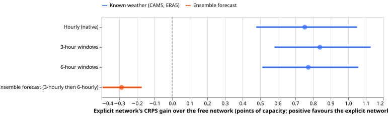
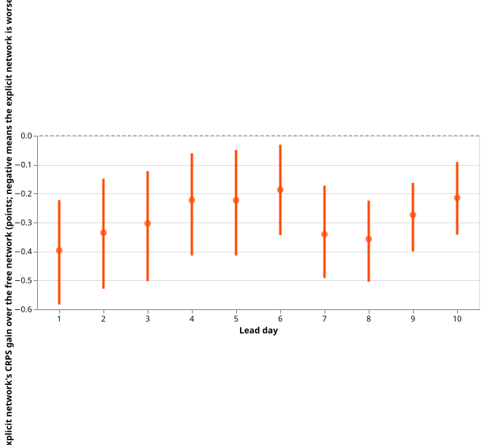
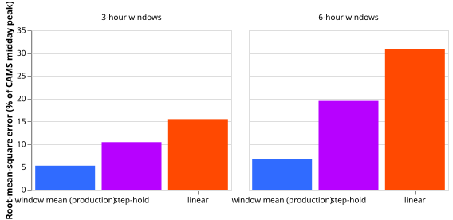
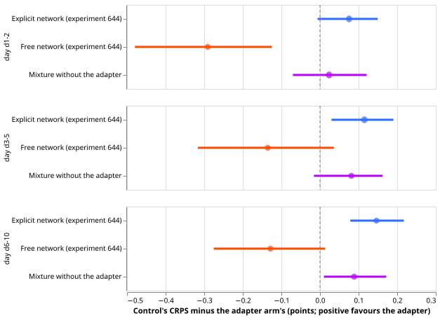

# The ensemble's time step is not why the explicit solar term loses

**The explicit solar term (telling the demand neural network each Primary substation's solar
capacity, so that it subtracts a computed solar output) helps by about 0.8 points of capacity when
weather is real, and hurts by about 0.3 points when weather is an ensemble forecast. We tested
whether the ensemble's coarse time step is the reason, and the time step is not the reason.** We
averaged real weather (CAMS and ERA5 estimates of past weather) into 3-hour and 6-hour windows,
rebuilt half-hourly values with production's window-mean resampler, and retrained the neural
networks. The explicit gain did not fall. The audit found nothing wrong with how ensemble shortwave
becomes half-hourly values, and a small neural adapter in front of the solar curve did not rescue the
term. The most likely cause that remains is the ensemble's forecast cloud error, which this
experiment did not test directly.

This page follows [experiment 639](../00639-pv-explicit-hindcast-probe-set-capacity-step-world/result.md)
(real weather, gain 0.75), [experiment 644](../00644-pv-explicit-term-with-ens-forecast-weather/result.md)
and [experiment 655](../00655-pv-member-level-cell-temperature-term-and-forecast-sunniness-tracker/result.md)
(ensemble weather, loss 0.25 to 0.37). Scores are the continuous ranked probability score (CRPS) in
percent of each Primary's effective capacity ("points"), on sunny middays (10:00 to 15:00 UTC,
clear-sky index at least 0.7), at the six MW Primaries. Smaller is better. The free network learns each
Primary's solar response from the data alone; the explicit network is told the capacity. A positive
contrast (free minus explicit) favours the explicit network.

- **Averaging real weather into 3-hour or 6-hour windows did not reduce the explicit gain.** Free minus explicit CRPS is
  0.753 [0.478, 1.050] at hourly resolution, 0.839 [0.581, 1.127] with 3-hour windows, and 0.773
  [0.512, 1.058] with 6-hour windows (three cutoffs, five seeds, 99.6% day-block intervals). The
  3-hour gain exceeds the hourly gain by 0.086 [0.016, 0.162]; the 6-hour gain by 0.020 [-0.084,
  0.120]. The decision rule (a fall of at least half) is not met. The gain is concentrated: Primary 6
  carries about 3 points, and the other five Primaries together gain 0.27 [0.07, 0.49] at hourly
  resolution, with 3-hour minus hourly still positive at 0.113 [0.053, 0.176].
- **The ensemble loss is the same at both step widths.** Free minus explicit is -0.281 [-0.426,
  -0.147] at 3-hourly ensemble leads (up to 144 hours) and -0.297 [-0.413, -0.182] at 6-hourly
  leads. The two groups also differ in lead, so the comparison is a weak test on its own.

## Interpolation audit (Part 1)

- **The pipeline is production's resampler.** Stored summary tables, the half-hourly rows of
  experiment 48, and a fresh call of `ml_core` agree to 0.0 W/m2 on 15 runs between 2024-06 and
  2026-06. Production's code is the same file as the version the experiments imported.
- **No time-stamp shift.** The ensemble's window-mean shortwave correlates best with CAMS (hourly
  values stamped at the end of the hour) at a shift of zero at all six Primaries (r 0.966 to 0.986).
  The other CAMS convention gives a shift of two half-hours and r of 0.878 to 0.914 at zero shift.
- **Production's method is the best of the three methods tested (window mean, linear flux, step-holding).** Rebuilding known weather from 3-hour windows leaves
  a root-mean-square error of 5.3% of the CAMS midday peak (peak bias -2.5%); linear flux gives 15.5% and step-holding
  10.4%. With 6-hour windows the errors are 6.6%, 30.8%, and 19.5%.

## Bias adapter (Part 3)

| Sunny middays, ensemble rows of experiment 644 | Day 1-2 | Day 3-5 | Day 6-10 |
|---|---|---|---|
| Free network (644 arm a) | 3.75 | 4.28 | 5.05 |
| Explicit network (644 arm b) | 4.11 | 4.53 | 5.33 |
| Adapter arm (A) | 4.04 | 4.42 | 5.18 |

- **The adapter arm is not kept.** Free minus A is -0.291 [-0.479, -0.124], -0.135 [-0.316, 0.036],
  and -0.129 [-0.275, 0.013]; the bar was a gain of 0.084 at day 1-2. A beats the explicit network by
  0.075 [-0.006, 0.150], 0.115 [0.030, 0.190], and 0.146 [0.079, 0.217], and the 14-day tracker beats
  A by 0.63, 0.60, and 0.70.
- **The mixture without the adapter scored about the same as the adapter arm at day 1-2.** The
  mixture-only arm (A0) is 0.024 [-0.070, 0.121] behind the adapter arm (A) there, and 0.081 and
  0.089 behind at day 3-5 and day 6-10.
- **The learned fleet shape stayed uniform.** The mixture weights ended near equal across the three
  tilts and five DC-to-AC ratios at every Primary, so the Dirichlet prior dominated and no ratio was
  learned. The fleet shape is reported and not gated.

## Checks

- **Audit trigger that fired:** the Part 2 result contradicts the prediction of a 20% to 45%
  fall. The explanation, forecast cloud error, rests on experiments 644 and 655 and was not tested
  here. A fresh Sonnet agent re-derived the step 5 contrasts from the stored quantiles.
- **The checks of median against mean, per-site contrasts, and the error beside each contrast**
  were not run for step 5, because its arms share the pretraining and scoring code of experiment
  639.
  For Part 3, the mean absolute error of the median on sunny middays is 6.49 (A), 6.63 (A0), 6.33
  (free), and 6.67 (explicit), in the same order as the CRPS contrasts.
- **Tails (Part 3, sunny middays):** coverage of the 5% to 95% interval is 88.4% (A), 89.4% (A0),
  88.0% (free), and 89.2% (explicit). The 0.01 and 0.99 quantiles cover 2.7% and 99.8% of outcomes
  for A.
- **Caveats:** each day is its own trajectory in the degradation, so interpolation never crosses
  midnight (the 6-hour window that holds sunrise is affected in summer); only shortwave is degraded;
  capacities are experiment 639's, calibrated on undegraded weather; no example-forecast figure is
  shown; the Part 2 gain is measured on real-weather rows (the figure's blue rows)  and the ensemble loss on ensemble rows, so
  the two are not paired.

## Method

- **Architecture.** The networks are experiment 639's modular mixture-density network (free, and
  calibrated explicit with the term `C * inc * u` subtracted from every quantile). Arm A replaces
  `u` with a differentiable curve: a 6-input adapter (ensemble-mean clear-sky index, ensemble
  standard deviation over clear-sky irradiance, lead, hour of day as sine and cosine, temperature;
  16 and 16 tanh units; zero-initialised output) gives `kt' = kt + 0.25 tanh(output)`, clipped to
  0 to 1.4; plane-of-array irradiance is tabulated at 16 clear-sky indices for tilts of 20, 35, and
  50 degrees and interpolated; a per-Primary softmax mixture over 15 components (three tilts times
  DC-to-AC ratios 1.0, 1.15, 1.3, 1.5, 1.7) applies the cell-temperature derating and a smooth clip
  `z / (1 + z^8)^(1/8)`, under a Dirichlet prior of concentration 2.
- **Training regime.** Step 5 pretrains the free and calibrated-explicit networks on CAMS and ERA5
  rows of experiment 418 with shortwave replaced by 3-hour or 6-hour window means rebuilt by
  `ml_core`'s resampler (three cutoffs, five seeds, real world). Part 3 fine-tunes from experiment
  639's calibrated pretraining on 24 months of ensemble rows with experiment 644's recipe (90-day
  recency half-life, fresh mixer, monthly refits, five seeds). The adapter learning rate is 0.002.
  About 0.6 GPU-hours for step 5 and 0.5 for Part 3.
- **Measurement.** Part 1 compares with CAMS on sunny days (daily CAMS energy at least 80% of clear
  sky) in 2025-07, 2026-03, and 2026-06. Steps 5 and 6 and Part 3 score the rows, cutoffs, and
  sunny-midday mask of experiments 639 and 644, with 99.6% day-block bootstraps (Bonferroni over 12
  contrasts) and 644's bars (0.080, 0.090, and 0.118). Nothing from 2026-07-01 is scored.

## Files

- `e00661_audit.py`: Part 1 (`identity`, `lag`, `score`); writes `work/audit/*.json` and `*.csv`.
- `e00661_step6.py`: the ensemble contrast by step width and lead day, from experiment 644's stored
  quantiles; writes `work/audit/step6.json`.
- `e00661_degrade.py`: degrades CAMS shortwave and writes raw matrices to `work/raw/w3` and `w6`.
- `e00661_fit5.py` and `e00661_analyse5.py`: step 5 fits (weights and quantiles under `work/step5`)
  and contrasts (`work/analysis/step5_*.json`).
- `e00661_adapter.py` and `e00661_analyse3.py`: Part 3 fits (`work/adapter/fits`) and contrasts
  (`work/adapter/analysis/part3.json`).
- `e00661_report.py`: prints every number on this page and draws the figures.
- Read from earlier experiments: 639 (pretraining, probes, stored predictions), 644 (rows and
  stored quantiles), 418 (dense weather), 48 and 397 (summaries). Paths are under `data/ml-experiments/`.
