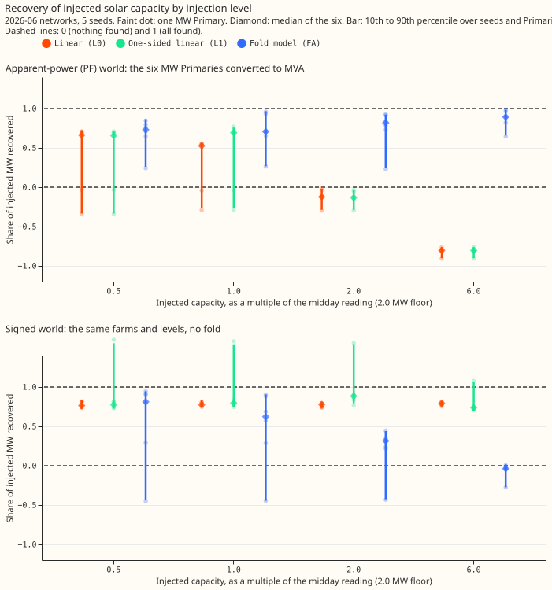
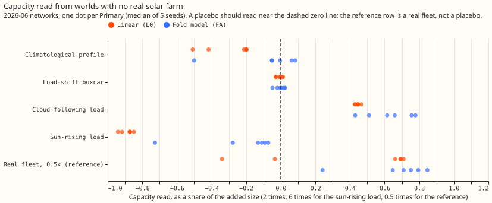
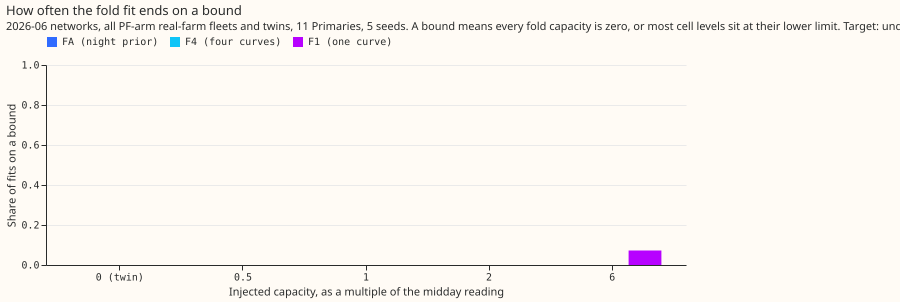
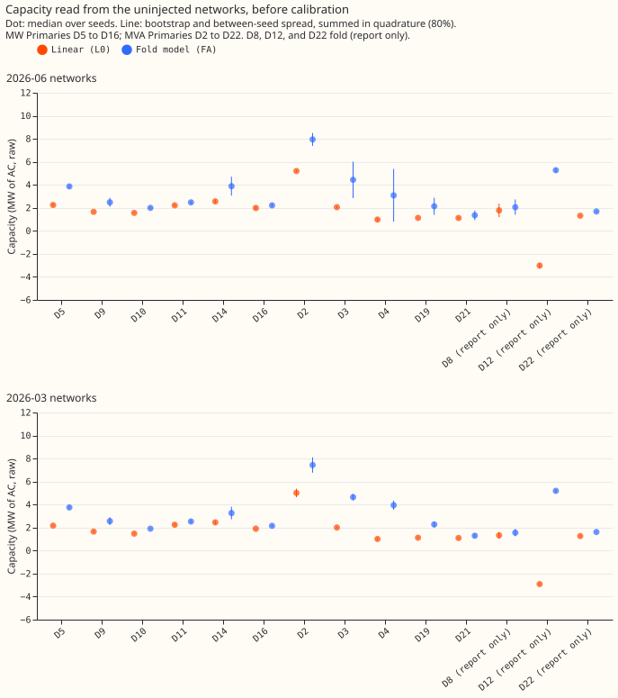
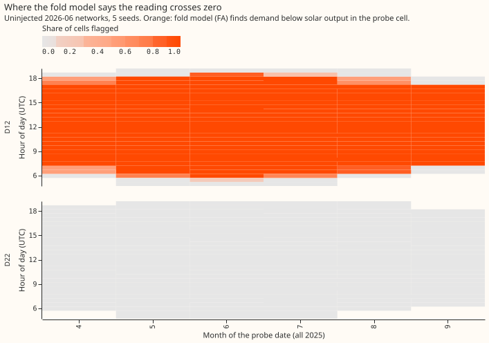

# Can the solar-capacity probe read through the apparent-power fold, with a fair test?

**The run is partly supported: a fold model reads 0.7 to 0.9 of an added solar fleet at every
level, where the linear probes fail from 2 times upward, but the pre-registered gate failed and two
Primaries, D5 and D10, decide several bars.** At 2026-06, 6 of 12 bars passed, and the matched-level
bar A1 failed, so only the four uninjected networks ran at 2026-03. The fold fit now ends on a bound
in 0% of fits, which removes the fault that sank experiment 656's 6-times worlds.

We asked whether the unmetered solar capacity behind a substation can be read when the meter reports
apparent power (megavolt-amperes, which never goes negative) rather than signed megawatts. Six
Primary substations report signed megawatts. We converted their flow to synthetic apparent power,
added a solar fleet of known size, and trained a neural network on the result. The probe holds the
calendar inputs of that neural network fixed, feeds it the weather of other days, and regresses its
output on a solar-output curve. The slope is the capacity it reads, in megawatts of alternating
current (AC). We compare the capacity read from a network trained with the fleet against its twin
trained without it. This page covers 130 networks at 2026-06 (26 conditions, 5 seeds each) and 12
uninjected twins at 2026-03.

**Terms used below.**

- **MW Primaries and MVA Primaries.** The six MW Primaries (D5, D9, D10, D11, D14, D16) are metered
  in signed megawatts. The eight MVA Primaries are metered in apparent power: D2, D3, D4, D19, and
  D21 never come near zero flow on a sunny midday, and D8, D12, and D22 do (they "fold").
- **The fold.** Apparent power is the length of a real-power part and a reactive-power part. When
  solar output exceeds demand, the reading falls to the reactive floor and then rises again, so a
  linear fit reads the wrong sign.
- **Midday reading.** A Primary's median flow over sunny half-hours from 10:00 to 15:00 UTC in April
  to August, in MW. D5's is 0.88 MW and D10's is 1.2 MW.
- **Injection level.** The AC capacity of the added fleet is the larger of the level times the midday
  reading and 2.0 MW. The floor makes the 0.5-, 1-, and 2-times worlds at D5 all 2.0 MW, and D10's
  0.5- and 1-times worlds 2.0 MW.
- **Recovery.** The capacity read from the network trained with the fleet, minus the capacity read
  from its twin, divided by the fleet's AC capacity.
- **Probes.** L0 is the linear probe of experiment 621. L1 is L0 on rows well above the reactive
  floor. FA is the fold model with four solar-output curves and a prior on each probe cell's demand
  from the night reading. F4 is FA without the prior, and F1 is F4 with one curve.
- **Worlds.** The PF world has reactive power 0.25 times the median real power of that half-hour of
  the week (power factor 0.97). The signed world keeps the signed target. The floor and zero-reactive
  worlds change the reactive power only.

**Figure: in the upper panel the linear probes fall below zero at 2 times, and the fold model does
not.** The signed panel shows the same farms with no fold. Linear recovery stays at 0.76 to 0.88
there. The fold model falls from 0.81 to -0.04 as the level rises, because a model that can only
add a fold fits a target that never folds badly (see the audit section).

**At 2026-06, 6 of 12 pre-registered bars passed.** The bars are as fixed in the plan commit.

| Bar | Result | Pass |
|---|---|---|
| A1 Matched-level fold-free loss: PF over signed recovery of the same farm in 0.90 to 1.10 at 5 of 6, for L0, L1, and FA at 0.5, 1, and 2 times | no cell of the nine reaches 5 of 6; the best is 3 of 6 (FA at 1 times) | fail |
| A2 Native worlds within ±0.12 of the six's median (0.68) at 4 of 5 | 4 of 5 (D3 at 0.82 is outside) | pass |
| A3 Two-sided placebos under 0.25 of the real 0.5-times read | climatological 0 of 6 and 0 of 5; boxcar 4 of 6 and 5 of 5 | fail |
| A4 Leave-one-Primary-out factor in 0.55 to 0.95, spread under 0.15 | 0.661 to 0.692 at all six | pass |
| A5 Interval coverage at least 60% | 0.36 | fail |
| B1 FA calibrated recovery in 0.75 to 1.25 at 4 of 6 in four worlds (PF and floor, 1 and 2 times) | 3, 5, 3, and 4 of 6 | fail |
| B2 PF 6 times: FA calibrated recovery in 0.75 to 1.25 at 4 of 6 | 5 of 6 (D5 is 0.72) | pass |
| B3 At PF 2 times, FA's median absolute error from 1 at least 0.10 below L1's | 0.15 against 0.37 | pass |
| B4 Sun-rising-load placebo: FA under 0.25 of the 6-times read at 5 of 6, and no crossing flags | 4 of 6; flags on 0.0% of cells | fail |
| B5 Interval coverage at least 60% at PF 1 and 2 times | 0.50 and 0.42 | fail |
| B6 Crossing map: balanced accuracy at least 0.80 at 1 and 2 times, false crossings at most 10% | 0.84 and 0.94; 3.1% | pass |
| C1 Under 10% of FA fits end on a bound | 0.0% | pass |

**Two changes from experiment 656 worked.** The fold fit's five starting capacities (0.25 to 8 times
the midday reading) remove the 6-times failure: FA reads 0.89 and 0.90 there, against -0.11 in
experiment 656. Intervals that add the between-seed spread raise coverage from 0.14 to 0.18 to 0.36
to 0.50.

| Median recovery over the six MW Primaries | 0.5 times | 1 times | 2 times | 6 times |
|---|---|---|---|---|
| PF world, L0 | 0.66 | 0.53 | -0.12 | -0.81 |
| PF world, L1 | 0.66 | 0.68 | -0.13 | -0.81 |
| PF world, FA | 0.73 | 0.73 | 0.80 | 0.89 |
| Signed world, L0 | 0.76 | 0.77 | 0.78 | 0.79 |
| Signed world, FA | 0.81 | 0.62 | 0.32 | -0.04 |

## Audit of the failures

An independent Sonnet audit (private file `briefs/e662_audit_brief.md` and its report) reproduced
every bar and found these explanations. No bar is re-scored.

- **A1 fails on the four Primaries that the floor does not touch as well.** At D9, D11, D14, and
  D16 the linear probes read -0.01 to -0.18 at 2 times, so the fold itself, not only D5 and D10,
  breaks them. At D5 and D10 the floor injects 2.26 and 1.66 times the midday reading even at the
  0.5-times level, so both sit past the fold at every level, and L0 reads them at -0.34 to -0.02.
- **The fold model is not a fair A1 denominator.** On the signed target, which never folds, FA sets
  its reactive terms to zero in 100% of fits and flags crossings on 40 to 72% of cells at 2 and 6
  times. A square-root output cannot match a target that goes negative. A1's FA ratios (2.1 to 3.8
  at 2 times) come from this collapsed denominator.
- **A3 fails because it is two-sided.** The linear probe reads the climatological placebo at -0.2 to
  -0.5, and experiment 656's one-sided bar would have passed it at 11 of 11 sites. FA reads it at
  -0.05 to 0.08 except at D5 (-0.50). The placebo is sized at 2 times and compared with the
  0.5-times read, a level mismatch in the bar. At D5 and D10 the real 0.5-times read is itself near
  zero or negative, so the bar cannot pass there.
- **B4 and B5 depend on D5 and D10.** The sun-rising load reads 1.13 and 0.34 of the real read at D5
  and D10, and 0.07 to 0.15 elsewhere. Without D5 and D10, B5 reads 0.875 at both levels. The same
  exclusion fails A4 (only four Primaries) and B6 (balanced accuracy 0.71 at 1 time), so the
  verdicts rest on the two small-reading Primaries in both directions. B1 fails with or without
  them, because D11 and D16 overshoot to 1.3 at 1 times.
- **Coverage is set by the seed spread alone.** The bootstrap half-width is 0.01 to 0.07 MW and the
  seed term 0.04 to 0.71 MW. The leave-one-Primary-out factors barely differ (0.66 to 0.69), so
  the intervals carry no uncertainty about the factor. Native Primaries are scored with the six
  Primaries' factor and miss at all five.
- **The FA prior is stronger in the injected fit than in the twin fit.** The prior's weight scales
  with the median within-cell spread of the probed reading, which is 0.9 to 2.4 times the twin's at
  0.5 and 2 times and up to 12 times at 6 times, so some of FA's capacity difference is a change of
  regularisation. We did not refit to measure it.
- **C1 measures capacity collapse only.** The reactive terms sit at zero in 33 to 47% of PF FA fits
  and 100% of signed FA fits, and a flag on those would not have passed.

**Figure: the cloud-following load is read as solar by both probes.** The fold model reads it at 0.64
of the real fleet's read at 2 times and the linear probe at 0.44, so neither separates solar output
from demand that follows the clouds, as in experiment 656.

**Figure: the only fits on a bound are one-curve fits at 6 times (5 to 13%).** Fits with the night prior
never end on a bound.

## Real-data capacity (uninjected neural networks, both cutoffs)

The calibrated columns divide the linear probe by 0.68 (bar A4's factor) and the fold model by 0.70
(its PF 1-times factor on the six MW Primaries), so they assume power factor 0.97 and the six
Primaries' response. The ranges are 80% intervals from the bootstrap and the seed spread.

| Primary | Linear raw, 2026-06 / 2026-03 (MW) | Linear calibrated, 2026-06 (MW) | Fold model raw, 2026-06 / 2026-03 (MW) | Fold model calibrated, 2026-06 (MW) |
|---|---|---|---|---|
| D2 | 5.2 / 5.0 | 7.7 | 7.9 / 7.4 | 11.3 (10.4 to 12.1) |
| D3 | 2.1 / 2.0 | 3.0 | 4.4 / 4.6 | 6.3 (4.0 to 8.6) |
| D4 | 1.0 / 1.0 | 1.4 | 3.1 / 4.0 | 4.4 (1.1 to 7.7) |
| D19 | 1.1 / 1.1 | 1.7 | 2.1 / 2.3 | 3.0 (2.0 to 4.1) |
| D21 | 1.1 / 1.1 | 1.7 | 1.4 / 1.3 | 1.9 (1.3 to 2.5) |
| D8 (report only) | 1.8 / 1.3 | 2.6 | 2.1 / 1.6 | 2.9 (2.0 to 3.9) |
| D12 (report only) | -3.0 / -2.9 | not defined | 5.3 / 5.2 | 7.5 (7.2 to 7.8) |
| D22 (report only) | 1.3 / 1.3 | 1.9 | 1.7 / 1.6 | 2.4 (2.3 to 2.5) |

**Figure: the two cutoffs' intervals overlap at all 14 Primaries, for both probes.** The fold model's
medians differ most at D4 (3.1 and 4.0 MW), D8 (2.1 and 1.6 MW), and D2 (7.9 and 7.4 MW). D12 is the
Primary whose linear read is negative at both cutoffs while the fold model reads +5 MW. The
capacities are raw and uncalibrated.

**Figure: D12 is flagged at midday in most months and D22 is not flagged.** The map passed bar B6 on
injected worlds, which relied on D5 and D10 (see the audit section).

## Deviations from the plan

- **Fold fit.** 40 bootstrap draws in place of 200, 40 donor rows per probe cell, and the bootstrap
  only on the PF twin and the PF real-farm fleets.
- **2026-03.** Stop rule 2 fired when A1 failed, so only the four twins ran at that cutoff. The
  calibration at 2026-03 reuses the 2026-06 factors.
- **B4.** Coded two-sided (the absolute read) after the code review; the plan table now states this.
- **Boxcar placebo.** Its height stays capped at the midday reading, so at D5 and D10 it carries less
  than the 2.0 MW floor's energy.
- **Not run.** The signed-world energy conversion and the 2026-03 injected worlds.

## Caveats

- The reactive power of the real meters is unknown, and power factor 0.97 is an assumption.
- NGED's event labels are incomplete, so the clean rows may hold unlabelled events.
- D5 and D10 have midday readings of about 1 MW, so a 2.0 MW floor puts them past the fold in every
  injected world.
- One set of farms and one network architecture.

## Checks

- **Forecast checks:** the experiment scores no forecast, so the median-minus-mean and
  quantile-score checks do not apply.
- **Audit triggers that fired:** a control failed (A1, A3), a leave-two-out flip (A4, B5, B6 with D5
  and D10 removed), and a nested-arm result (FA on signed worlds). The audit report is in the private
  briefs folder.
- **Code review (Sonnet):** accepted the per-cutoff grouping in the coverage bar, the two-sided B4,
  the 0.05 guard on A1's denominator, and the relative bound threshold. Rejected a change to the
  boxcar cap, which stays because a load transfer cannot remove more than the load.
- **Audit triage:** all findings are recorded above; none changes a pre-registered bar.

## What the next experiment should answer

Does a fold model with a night prior hold 0.7 to 0.9 recovery when the injection is sized past the
fold at every Primary by construction, the signed denominator is a plain linear probe, and the
intervals include the site-to-site variation of the calibration factor? And what separates solar
output from the cloud-following load that both probes misread?
