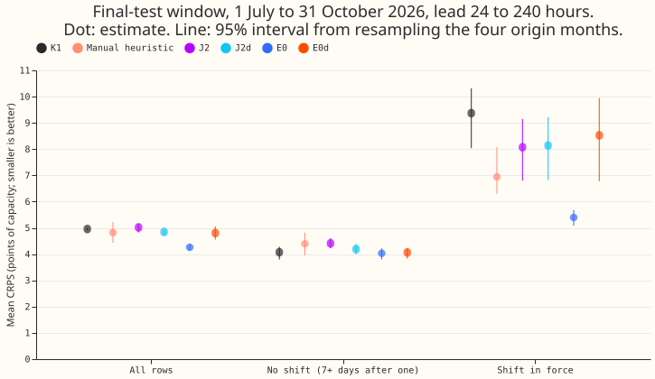
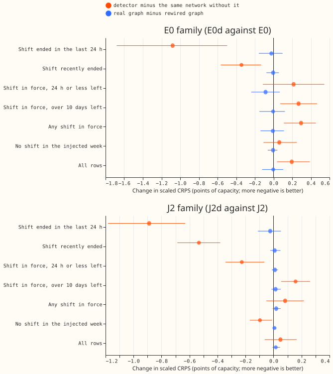
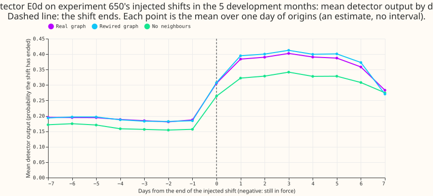
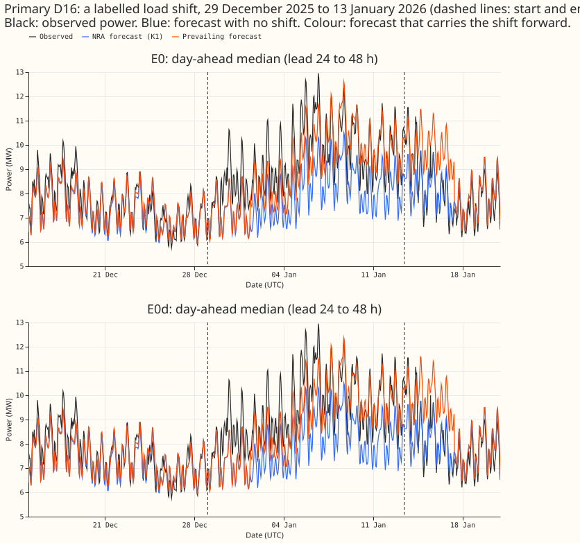

**This experiment tests whether a learned end detector improves the prevailing forecast of
experiment 654.** A Primary is a primary substation. A load shift is a period when the electricity
network operator moves part of one Primary's demand onto, or off, a neighbouring Primary. K1 is the
neural network of experiments 612 and 613 that forecasts the normal running arrangement (NRA), the
demand with no load shift. The prevailing forecast is the demand under the arrangement now in force.
[Experiment 654](../00654-two-output-network-end-to-end-with-end-detector/result.md) built two bases
for it: E0 (frozen K1 plus the survival-hazard head R-haz of experiment 652) and J2 (one network
fine-tuned end to end). This experiment adds an end detector to each: a two-layer neural neural
network that reads the freshest 48 hours of observed power minus K1's day-ahead forecast, at the
Primary and at its electrical neighbours, and outputs the probability that the shift has ended
(`q_end`). **The detector multiplies each base arm's probability that the shift is still in force by
one minus the detector output.** The probability becomes `p_base * (1 - q_end)`. E0d is E0 with the
detector and J2d is J2 with the detector. Scaled continuous ranked probability score (CRPS) is the
CRPS in points of capacity after multiplying each arm's quantile widths about the median by one
factor per arm, month, and seed, chosen so that the q05-q95 band covers 90% of the month's scored
rows.

**Take-home message.** On injected shifts, the detector lowers the error in the 24 hours after a
shift ends, by 1.08 scaled points for E0d and 0.89 for J2d, and the detector raises the error while
a shift is in force, by 0.30 for E0d. The neighbours add no gain that this experiment could measure:
the same detector on a randomly rewired graph scores the same as on the real graph. On the real
final-test window, the detector made E0 worse (4.81 points against 4.26) and J2 better (4.85 against
5.02), and plain E0 scored lowest of the arms on the window. Verdict: not supported.

## Figures

On the final-test window, E0 scores 4.26 over all rows and 5.40 where the G4 gate (experiment 620's
hand-built rule for marking half-hours inside a load shift) marks a shift in force. E0d scores 4.81
and 8.52. J2d improves J2 (4.85 against 5.02) and stays above E0.

On the five development months, orange dots are the detector's change against its own base. Blue
dots are the real graph minus the rewired graph; the interval includes zero in every stratum for
rewiring 0 (rewiring 1 is +0.14 [+0.06, +0.23] in the "ended in the last 24 hours" stratum for E0d),
so the gain does not come from the neighbours that this experiment could measure. The "middle"
stratum is omitted from the figure.

The detector output (`q_end`) is 0.19 on average in the week before an injected shift ends and 0.39
in the days after. The detector output never reaches 0.5 on average, and the real graph, the rewired
graph, and the no-neighbour variant rise alike.

The false-alarm share is the share of rows with no shift in force on which the median of the
prevailing forecast departs from the median of the NRA forecast by 3 points of capacity or more.

D5 and D16 are the verified pair of labelled shifts (29 December 2025 to 13 January 2026). Both
prevailing forecasts follow the drop only partly (on D5 the forecast stays near 4 to 5 MW for
several days while the observed power falls to 2 to 3 MW), and the E0 and E0d forecasts look alike:
the detector changes them little. The figures are not drawn for J2d, and they do not show `q_end`.
Each line is the day-ahead median (lead 24 to 48 hours) at hourly means.

The window starts on 1 July, so the figure shows 7 days before the run starts, not 14. D14 holds the
longest run of days with the gate on in the window (from 8 July to the window's end, a run that
continues past it). E0 stays within about 1 MW of the observed power in August and September; E0d
forecasts several megawatts above the observed power from late August. The cause is not diagnosed.

## What the detector reads

For each Primary and origin the detector reads 16 three-hour block means of the residual over the
freshest 48 hours, 8 daily means before that, the same summaries averaged over the Primary's
electrical neighbours, 4 flags for missing blocks, the opposite-sign neighbour step (a boost, never
a requirement), and the routine-step rate over the previous 60 days (the count of daily-mean changes
larger than 3 noise units, per day). The residual is observed power minus K1's day-ahead median,
with the median across the 16 Primaries at each half-hour removed, and every input ends at the
origin.

## Results

**All numbers below are scaled CRPS in points of capacity over lead days 1 to 9, averaged over seeds
and then over the 5 development months.** They are measured over lead days 1 to 9 on experiment
650's injected bank (training family), averaged over seeds, then over the 5 development months.
Intervals are percentile bootstraps over the 5 months. "Pooled" means the "ended in the last 24
hours" and "near" strata together.

- **Both detectors gain after an ending (decision-rule contrast 1 is met).** Pooled, E0d minus E0 is
  -0.46 [-0.92, -0.03] and J2d minus J2 is -0.57 [-0.78, -0.37], against the bar of -0.3 with an
  interval excluding zero. In the "ended in the last 24 hours" stratum alone, E0d minus E0 and J2d
  minus J2 are -1.08 [-1.68, -0.50] and -0.89 [-1.18, -0.63]. For E0d the gain is confined to events
  of 3 to 14 days (-0.48 [-0.90, -0.06]). For events of 28 to 112 days the pooled contrast is +1.14
  [-1.12, +4.35]. For J2d both duration bands gain (-0.60 for 3 to 14 days and -0.15 for 28 to 112
  days).
- **E0d loses while a shift is in force, and J2d loses only in the "far" stratum.** E0d minus E0 is
  +0.27 [+0.07, +0.47] in the "far" stratum and +0.30 [+0.11, +0.45] over all in-force strata. J2d
  minus J2 is +0.16 [+0.05, +0.26] in "far" and -0.23 [-0.34, -0.07] in "near". The prediction P1
  fails: the "near" stratum does not reach -0.3 for E0d (+0.22 [-0.11, +0.54]) or for J2d (-0.23),
  and the detector moves the "far" stratum by more than 0.1 points for both arms (E0d +0.27, J2d
  +0.16) and the "middle" stratum for E0d (+0.13).
- **Placebo (contrast 2): the gain is not specific to the real graph.** Pooled, real graph minus
  rewired graph is -0.05 [-0.17, +0.04], +0.08 [+0.02, +0.14], and +0.05 [-0.03, +0.17] for E0d
  (rewirings 0, 1, and 2) and -0.01 [-0.04, +0.03], +0.01 [-0.02, +0.04], and 0.00 [-0.03, +0.04]
  for J2d. The real graph minus the no-neighbour arm is -0.11 [-0.40, +0.14] for E0d and -0.01
  [-0.04, +0.03] for J2d. Against a pooled gain of -0.46 (E0d) and -0.57 (J2d), rewiring 0 recovers
  about 89% and 98% of the gain, and the other two rewirings recover all of it or more, so the
  prediction that the rewired graph recovers at most half of the gain (P3) fails. For E0d the
  no-neighbour interval is wide enough to hide a gain beyond the bar, so "adds no consistent gain"
  is as much as 5 months support. The three rewirings keep 3, 2, and 3 of the 29 pairs of electrical
  neighbours.
- **False alarms.** On real development-month rows with no labelled shift, the share of rows on
  which the prevailing median departs from the NRA median by 3 points or more is 10.4% for E0, 11.5%
  for E0d, 16.8% for J2, and 12.1% for J2d. J2d cuts J2's share by 28% (an estimate; J2's interval
  is 10.7% to 23.1%), which meets the prediction (P4); E0d raises the share relative to E0 (10.4% to
  11.5%), which does not meet the prediction. On the final-test window rows outside the gate's
  events the shares are 13.2% (E0), 15.1% (E0d), 11.7% (J2), and 9.8% (J2d). On injected rows with
  no shift the departure share of E0d minus E0 is -1.1 [-1.8, -0.4] percentage points, so E0d
  departs less there.
- **CRPS added by the departures.** The CRPS of the prevailing forecast minus the CRPS of the NRA
  forecast on the departure rows, averaged over all real event-free rows, is +0.009 for E0, +0.046
  for E0d, +0.265 for J2, and +0.012 for J2d (points of capacity, development months; figure 4,
  lower panel). J2's departures cost far more than the others'.

- **Veto on event-free rows: not met for E0d; J2d passes by its interval but not in every month.**
  On injected bank rows with no shift, the unscaled CRPS of E0d minus E0 is +0.01 [-0.19, +0.21],
  and the upper bound of that interval exceeds 0.03. J2d minus J2 is -0.11 [-0.25, -0.01], so the
  interval passes the bar of 0.03, but the 2026-03 month is +0.06, above 0.03, and the plan's strict
  reading of the veto asks that every month stay below it. On real event-free rows E0d minus E0 is
  +0.04 [+0.01, +0.09].
- **No arm is best in every stratum.** E0 is best far from the end and with no shift, K1 is best
  near the end, and J2d is best in the 24 hours after an ending. Scaled CRPS, normalised mean
  absolute error of the median (as a fraction of capacity), and unscaled CRPS, all lead days 1 to 9:

| Stratum | K1 | E0 | E0d | J2 | J2d |
|---|---|---|---|---|---|
| Far from the end, scaled CRPS | 10.49 | 5.93 | 6.20 | 8.41 | 8.56 |
| Near the end, scaled CRPS | 5.93 | 7.35 | 7.57 | 6.45 | 6.22 |
| Ended in the last 24 h, scaled CRPS | 5.95 | 7.45 | 6.37 | 6.53 | 5.64 |
| No shift, scaled CRPS | 5.24 | 3.75 | 3.81 | 4.53 | 4.43 |
| All rows, scaled CRPS | 9.15 | 6.15 | 6.35 | 7.66 | 7.71 |
| All rows, normalised MAE | 0.14 | 0.10 | 0.10 | 0.12 | 0.12 |
| All rows, unscaled CRPS | 9.75 | 6.03 | 6.23 | 7.54 | 7.53 |

Table: five development months, experiment 650's injected bank; the arms are scored on the same rows
as in experiment 654. B-haz and R0 (168 h) score, in the order far, near, ended in the last 24 h, no
shift, all rows (scaled CRPS): 5.86, 7.42, 7.84, 3.97, 6.13 and 7.22, 5.92, 6.11, 4.16, 6.89. The
matched-compute control C0 of experiment 654 is not rescored here.

## Final-test window (2026-07-01 to 2026-10-31)

The window was opened once, for the frozen candidates. `final/freeze2.json` holds the hashes of 26
files and was written before any window score. K1, the manual heuristic, and J2 are experiment 654's
forecasts, not rescored. E0 is refitted on all five development months; E0d and J2d train on the
same months. Scenarios come from the G4 gate of experiment 620, because NGED's labels end before the
window and the window export holds no labelled or verified event. The gate marks 16.6% of scored
rows as inside a shift, and the count is a lower bound. The table gives unscaled CRPS point
estimates; the intervals, bootstrapped over the 4 origin months, are in `final/score/window.json`.

| Scenario | Rows | K1 | Manual heuristic | J2 | E0 | E0d | J2d |
|---|---|---|---|---|---|---|---|
| All rows | 820,893 | 4.96 | 4.82 | 5.02 | 4.26 | 4.81 | 4.85 |
| No shift in force, 7 days or more after | 678,832 | 4.07 | 4.39 | 4.41 | 4.03 | 4.06 | 4.19 |
| Shift in force | 136,578 | 9.37 | 6.94 | 8.07 | 5.40 | 8.52 | 8.14 |
| No shift in force, under 7 days after | 5,483 | 4.36 | 5.28 | 4.46 | 4.34 | 4.39 | 4.44 |

Table: unscaled CRPS in points of capacity. The 5,483 rows of the last scenario come from too few
origin months for an interval.

- **E0 has the lowest CRPS over all rows and inside shifts, and the lowest mean absolute error of
  the median.** On the avoidable-curtailment cost E0 (186) is above K1 (178) and the manual
  heuristic (165). The mean absolute error of the median over all rows, in points of capacity, is
  7.66 for E0, 8.55 for E0d, 8.61 for J2d, 8.90 for J2, 8.34 for K1, and 8.46 for the manual
  heuristic.
- **The detector made E0 worse.** E0d minus E0 is +0.54 over all rows and +3.13 inside shifts. The
  avoidable-curtailment cost, with the curtailment threshold at 90% of each Primary's peak demand
  and in pounds per day averaged over the six MW Primaries, is 186 for E0, 309 for E0d, 187 for J2,
  187 for J2d, 178 for K1, and 165 for the manual heuristic.
- **The detector made J2 slightly better.** J2d minus J2 is -0.17 over all rows, and J2d still
  scores worse (a higher CRPS) than E0 and the manual heuristic over all rows.

## What was not done

- **A second duration law, and a statement of the length distribution.** The brief asked for the 653
  injector's length distribution (log-uniform 1 to 112 days plus a short band); this experiment
  instead used experiment 650's bank, so its events last 3 to 14 days or 28 to 112 days, with none
  of 1 to 3 or 14 to 28 days, which is a deviation from the brief. The detector alone on a second
  duration law: The plan also scored the detector on injected shifts that follow experiment 653's
  duration law (log-uniform 1 to 112 days plus a short band). It was not run. The figures above use
  experiment 650's bank only, whose events last 3 to 14 days or 28 to 112 days. Experiment 660's
  shared injector draws its durations from a different law, so scoring on that injector would change
  the delay and false-alarm figures. The detector-delay figure shows the mean detector output by
  day, not a delay in days.
- **Real events on the development months as a scenario table.** The window scenarios use the G4
  gate. The four load-shift scenarios on the development months' labelled events are not tabulated.
- **A "no shift within 14 days" stratum.** It holds no rows in the injected bank (the cause was not
  checked), so the false-alarm share is measured on real event-free rows.
- **Shallow shifts (P2), day-ahead and 14-day example forecasts, and detection delay per
  Primary-month** were not run.
- **The window segmenter** (experiment 653's) was not run, so the window events are the gate's.
- **Event time-series figures for J2d** are not drawn.

## Checks

- **E0 refit reproduces experiment 652.** The maximum absolute difference between the refitted E0
  head's quantiles and the stored E0 quantiles is 0.0.
- **The J2 forward pass matches experiment 654 for 2025-10 and for the window forecasts.** The
  stored J2 quantiles are matched for 2025-10, and the window forward pass of the frozen J2 networks
  has a maximum difference of 0.0 from experiment 654's window forecasts.
- **No look-ahead.** A test perturbs observed power after the origin; no detector input changes
  (maximum difference 0.0). The noise unit and constants use the four training months only.
- **Detector training.** The detectors add a cross-entropy against "the shift has ended" (weight
  0.5). Without that loss `q_end` barely moves, and the apparent gain is a constant shrink of the
  survival.
- **Reviews.** The plan and the code were each reviewed by one Sonnet agent before the first fit.
  The pull request holds the results, write-up, and prose reviews.

## Caveats

- Every development-month shift is injected, and the strata use the shift's future end. Scaled
  numbers are pooled across strata, so unscaled CRPS sits beside them in `score/tables.json`.
- The intervals use 5 development months (4 window months), so every interval is coarse.
- NGED's event labels are an incomplete one-off dump. Rows counted as event-free can hold unlabelled
  shifts, so false-alarm shares are upper bounds on false alarms. Window scenario counts are lower
  bounds.
- The G4 gate, not a human label, defines the window's "inside" scenario, so a gate error shifts
  rows between scenarios for every arm alike.
- Telemetry up to the origin is assumed available at forecast time. If it is not, the detector's
  gain after an ending is a ceiling.
- The window failure of E0d (Primary D14) is not diagnosed.

## What to try next

- Check why E0d departs upward on D14 from late August to the end of the window (a change in the
  detector inputs, or a refit artefact), before any further detector work.
- Train the detector only on the "ended" label with the survival untouched, and score it as a
  classifier (delay and false alarms per Primary-month) before using it to scale the survival.
- If a detector is wanted, leave out the neighbour feed: the placebo shows it is not what helps.

## Files

All code is in `ml-experiments/00663-end-detector-for-the-prevailing-forecast-followup-to-654/`; run
scripts through `e00663_run.sh`. Data (fits, scores, figures, `final/freeze2.json`, and the
release-candidate parquet files with a README) is in
`data/ml-experiments/00663-end-detector-for-the-prevailing-forecast-followup-to-654/`.

- `e00663_panel.py`, `e00663_features.py`, `e00663_checks.py`: residual panel, detector inputs,
  leakage tests.
- `e00663_fit_e0.py`, `e00663_j2_base.py`, `e00663_fit_j2d.py`, `e00663_j2_final.py`: the E0 and
  detector fits, the stored J2 forward passes, and the J2 window forward pass.
- `e00663_score.py`, `e00663_report.py`, `e00663_window_data.py`, `e00663_freeze.py`,
  `e00663_window_score.py`, `e00663_figures.py`, `e00663_release_candidate.py`: scoring, window
  steps, figures, and the parquet export.
