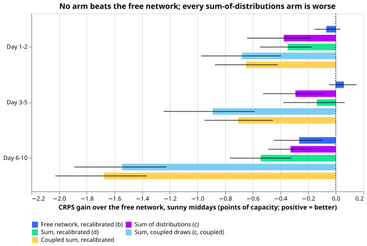
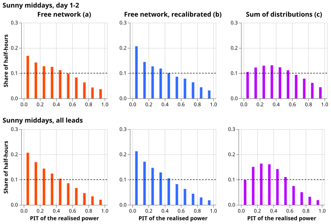
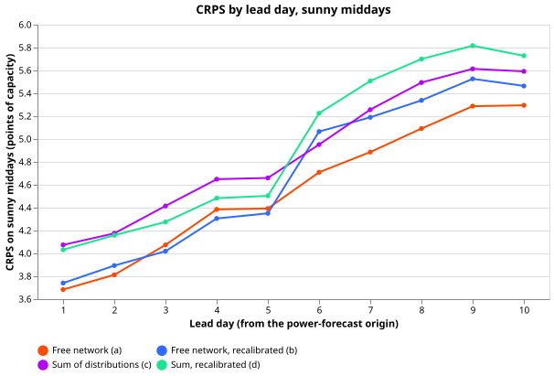
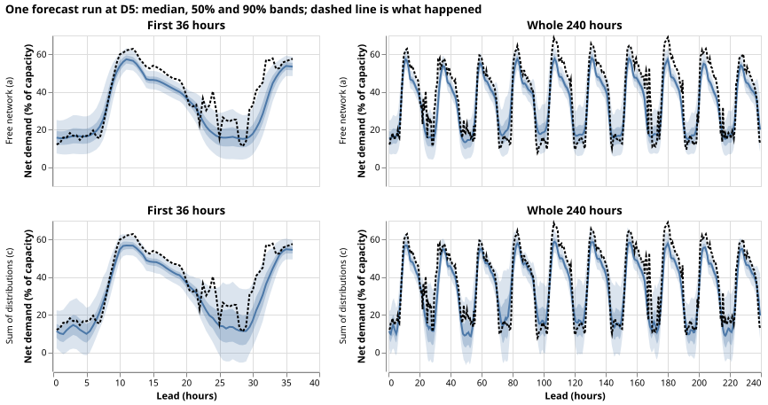

# Neither a spread recalibration nor a sum of distributions beats the free network

**We asked whether the explicit solar curve helps mainly by getting the width of the net-demand
forecast right, rather than by moving its centre.** Net demand is the power a substation draws after
rooftop solar has been subtracted. We tested two ways to fix the width: widen or narrow the free
network's forecast bands with a map fitted on earlier rows, and build the forecast as the network's
gross-demand forecast minus the solar output of one randomly chosen ensemble member. An ensemble
member is one of the 51 alternative weather forecasts that the European Centre for Medium-Range
Weather Forecasts issues for each run. Neither way beat the free network, which is the same network
without any solar curve.

**The free network is miscalibrated on sunny middays, but as a one-sided bias, not a wrong width.**
On the 5% quantile of the free network, the realised power falls below the forecast 9.3% of the time
at day 1-2, and above its 95% quantile only 1.9% of the time. Experiment 655 had already found that
four explicit-solar forms lost to the free network. This result adds that the loss is not explained
by the spread being missing.

Scores are CRPS in points, where a point is one percent of a Primary substation's effective capacity
(continuous ranked probability score; smaller is better), on "sunny middays" (10:00 to 15:00 UTC
half-hours with an observed clear-sky index of at least 0.7) in the 60 days after each of three
cutoffs (2025-07, 2026-03, and 2026-06), pooled over the six MW Primaries and five seeds.

## Results

*Each arm's CRPS gain over the free network on sunny middays, with 99.9% day-block intervals (a
negative gain means the arm is worse). Arm (b) is the recalibrated free network, (c) the sum of
distributions with independent draws, (d) arm (c) recalibrated, and the last two are the coupled
version and its recalibration.*

*Probability integral transform (PIT) of the realised power in each forecast's distribution: flat
at 0.1 would be perfectly calibrated. The free network (a) piles up near 0, meaning the realised
power is often below the forecast; recalibrating it (b) does not flatten it on the test months, and
the sum of distributions (c) flattens the lowest bin and leaves the same slope.*

*One forecast run at D5 in the 2026-06 test month, from the free network (top) and the sum of
distributions (bottom). The sum of distributions has the wider upper band around the day-time peak
and the lower band that dips below zero at night.*

## Checks

- **Decision rule:** neither (b) nor (c) beats (a) by the bar, so the rule says to stop. The
  contrasts below are the control's CRPS minus the arm's, in points, with the Bonferroni interval
  over 36 contrasts (12 per band, three bands); a negative number favours the control.
- **Planned contrasts, sunny middays (bar 0.084, 0.093, 0.123 at day 1-2, 3-5, 6-10):**
    - free minus recalibrated free (a minus b): -0.07 [-0.15, +0.03], +0.06 [-0.05, +0.15], -0.26
      [-0.45, -0.10];
    - free minus sum of distributions (a minus c): -0.38 [-0.64, -0.18], -0.29 [-0.53, -0.09], -0.33
      [-0.49, -0.17];
    - recalibrated free minus sum (b minus c): -0.31 [-0.62, -0.07], -0.35 [-0.62, -0.12], -0.06
      [-0.32, +0.19];
    - recalibrated free minus recalibrated sum (b minus d): -0.28 [-0.50, -0.09], -0.20 [-0.42,
      0.00], -0.28 [-0.44, -0.11].
- **Coupled draws (same quantile level for both) are worse still:** a minus the coupled sum is
  -0.68,
  -0.89, and -1.54, with 5%-95% coverage of 63%, 43%, and 19%. On the fine-tuning rows the
  correlation between the member-average solar curve and the position of the realised gross demand
  in its forecast distribution is 0.09 (range -0.04 to 0.17 over the 25 month-and-seed runs), so the
  independence assumption is close and the coupling is unsupported.
- **Placebos pass:** the sum of distributions beats the capacity-of-another-Primary version by 1.84,
  1.48, and 0.97 points and the other-date version by 2.54, 2.02, and 1.05 points (intervals exclude
  zero), so the member solar curve carries real information about the centre.
- **What the member draw adds:** against subtracting the member-average curve from the same gross
  draws, the random member costs 0.02 [-0.01, +0.04], 0.06 [+0.02, +0.12], and 0.12 [+0.02, +0.21]
  points: the interval widens (coverage 93.1% against 90.0% at day 1-2) without a better score.
- **Coverage on sunny middays (5% to 95%, nominal 90%):** free network 88.8%, 88.2%, 87.6% at the
  three bands; recalibrated 86.6%, 85.1%, 90.3%; sum 93.1%, 94.9%, 96.5%; recalibrated sum 89.6%,
  88.0%, 93.5%. Mean 5%-95% width, free network: 23.8, 26.8, and 31.2 points; sum: 27.9, 33.5,
  and 41.1.
- **Tail calibration, sunny middays, all leads (free network / sum):** coverage below the 0.01
  quantile 2.5% / 0.6%, below 0.05 11.1% / 3.9%, below 0.95 99.2% / 99.2%, below 0.99 99.8% / 99.8%;
  pinball loss at 0.01, 0.05, 0.95, and 0.99 is 0.174 / 0.190, 0.700 / 0.716, 1.071 / 1.222, and
  0.291 / 0.330 points. Both arms are far too wide at the upper tail.
- **PIT distance from uniform (total variation, sunny middays day 1-2):** free network 0.176,
  recalibrated 0.198, sum 0.125, recalibrated sum 0.144. The sum is closer to uniform and still
  scores worse, because CRPS also rewards a sharp centre.
- **Error of the median beside the score:** the mean absolute error of the median on sunny middays
  is 6.42 points for the free network, 6.58 for (b), and 6.84 for (c), so the median and CRPS point
  the same way (trigger 3 does not fire). The median minus the mean of the 11 quantiles over all
  half-hours is -0.67 points (free network) and -0.55 (sum).
- **Per Primary (CRPS, sunny middays, free network / sum):** D5 4.32 / 5.65, D9 4.27 / 4.34, D10
  5.61 /
  5.83, D11 3.79 / 4.06, D14 3.79 / 4.00, D16 5.33 / 5.19. The sum wins only at D16 (by 0.14); D5
  accounts for most of the pooled loss, but leaving D5 out still leaves the sum behind the free
  network at the other five Primaries on average.
- **All half-hours:** free minus sum is -0.02 [-0.06, +0.03] and free minus recalibrated free is
  -0.09 [-0.13, -0.06], so the recalibration also hurts overall.
- **Audit triggers:** the prediction (a 0.05 to 0.15 point gain at day 1-2) was contradicted
  (trigger
  2), and the explanation (the explicit curves already lost in experiment 655; the member draw adds
  width without information; the bias is one-sided) was tested here with the `c0`, placebo, and
  PIT checks. No placebo failed, the median and CRPS agree, leaving D5 out does not flip the sign,
  No audit was run. The free
  network's 3.75, 4.28, and 5.05 CRPS reproduce experiment 655's values exactly.
- **Reviews:** a fresh Sonnet agent reviewed the code before the first full run. It found no bug
  that
  biases the comparison; two findings were applied (clip the recalibrated levels to [0.001, 0.999],
  assert the fine-tuning leads lie in 0 to 360 hours), and one was accepted as a caveat (below).
- **Caveats:** arms using draws (c, d, and the coupled and placebo arms) rest on 2,000 draws per
  row,
  so their 0.01 and 0.99 quantiles use about 20 draws each and carry sampling noise that arms (a)
  and
  (b), computed from the exact mixture, do not; the median check against experiment 655's stored arm
  d
  differs by 0.13 points on average, consistent with that noise. The recalibration cells use the
  ensemble forecast's clear-sky index, pool the six Primaries, and use at least 2,733 held-out
  fine-tuning rows each; none fell back to a pooled cell.

## Method

- **Architecture:**
    - Arm (a) is experiment 644's free network, a modular mixture-density network (three Gaussian
      components) whose fresh fine-tuning mixer reads the ensemble-mean weather, date-time, and
      ensemble-spread columns and the lead time; it is read from its stored weights.
    - Arms (c) onward use experiment 655's arm d network, trained on gross demand (the target
      plus capacity times the member-average cell-temperature solar curve, with the calibrated
      season-year probe capacity of experiment 644's arm b), from its stored weights.
    - The sum of distributions (c) draws 2,000 gross-demand values from arm d's mixture per row and
      subtracts the solar curve of an independently drawn ensemble member (curve per member,
      cell temperature, 655's physics); (c, coupled) sorts both sets of draws and pairs them.
- **Training regime:** nothing is trained. Both networks come from experiments 644 and 655 (monthly
  fine-tuning on the 24 months before each test month, five seeds); the
  per-member curves are recomputed from the 51-member extract of experiment 655 and match its
  member-average table. GPU time for this experiment is under 0.2 hours.
- **Measurement:**
    - Rows, cutoffs, and the five seeds are experiment 644's (the code asserts the row keys), with
      cleaned power and the six MW Primaries; weather is the ensemble forecast, available at
      forecast time.
    - The recalibration maps level `tau` to the `tau`-quantile of the held-out fine-tuning rows'
      PITs in each of six cells (lead band by forecast sunny call), applied to the arm's own
      distribution. It uses fine-tuning rows only.
    - CRPS comes from the 11 quantiles; intervals are day-block bootstraps at the Bonferroni level
      for 36 contrasts; the bars are experiment 644's.
    - Placebos are applied at forecast time only (the network is not refitted).

## Files

- `ml-experiments/00664-pv-sum-of-distributions-spread-and-recalibration/`: `e00664_members.py`
  (member
  curves), `e00664_run.py` (arms and recalibration), `e00664_analyse.py` (scores and contrasts),
  `e00664_report.py` (figures), `run.sh`.
- Stored predictions:
  `data/ml-experiments/00664-pv-sum-of-distributions-spread-and-recalibration/work/preds/`.
