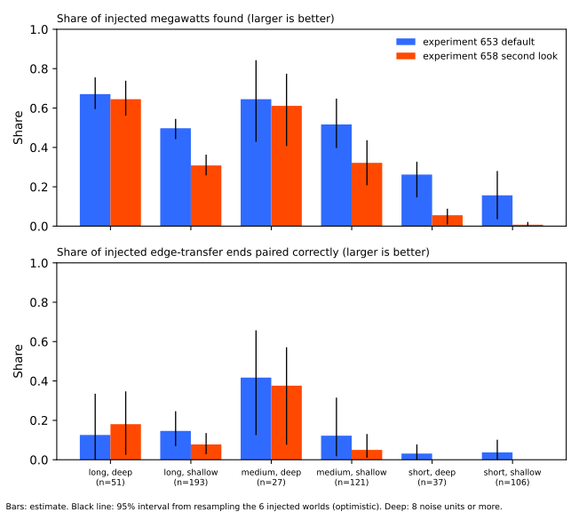
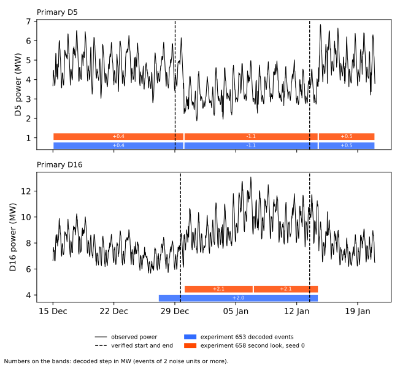
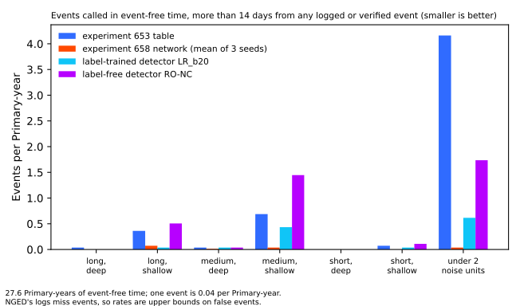

**Where an injected (synthetic) load shift lasts more than 7 days and steps 8 noise units or more,
the event table of experiment 653 finds events carrying 0.67 of the injected megawatts and the
neural network of experiment 658 finds 0.65. Shallower and shorter shifts are found much less
often.** A *Primary substation* steps electricity down to a local distribution network, and the
project forecasts the demand at each Primary. A *load shift* is the switching of part of a circuit
from one Primary to a neighbour, which moves demand between the two. The *residual* is the observed
cleaned power minus a demand forecast that uses no lagged power, so a load shift shows as a step in
the residual. A *noise unit* is a Primary's typical difference between successive 6-hour block
means, which is between 0.16 and 1.02 MW depending on the Primary.

[Experiment 653](../00653-edge-state-event-table-penalised-segmentation/result.md) built an *event
table* of load shifts by splitting each Primary's residual into segments with a penalised
segmentation method.
[Experiment 658](../00658-edge-state-event-table-neural-network/result.md) did the same with a
recurrent neural network. Each page reported one recall: 0.64 for the event table and 0.52 for the
neural network, where recall is the share of the injected megawatts that belong to an event the
method found. This page re-scores their stored outputs on six types of injected event (three
lengths times two depths). No XGBoost model was fitted and no neural network was trained.

The event table found 0.67 (95% interval 0.60 to 0.76) of the megawatts in the long and deep type,
and the neural network found 0.65 (0.56 to 0.74). Neither method linked the two ends of an injected
transfer well in any type: 0.42 was the best, from only 14 transfer ends. On the real record the
long and deep type is almost empty. The verdict is *partly supported*: 3 of the 6 predictions held
(P1b, P2, and P5), and P1a, P3, and P4 failed. The hypothesis was only half right: shallow shifts
of more than a day are found at 0.50 to 0.52 (event table) and 0.31 to 0.32 (neural network), well
above the quarter the hypothesis allowed.

## Terms

- **Type, or cell.** One of six groups of injected events. *Long* is more than 7 days (including
  events with no end), *medium* is more than 1 day up to 7 days, and *short* is 1 day or less. *Deep*
  is 8 noise units or more and *shallow* is 2 to under 8.
- **Injected event, world.** A synthetic load shift added to the real residual by experiment 653's
  injector. A *world* is one copy of the residual panel with injected events; there are 6.
- **Found.** An injected event is found when the method has an event at the right Primary and sign
  with a start within 12 hours (and, for a transfer, the right donor).
- **Edge transfer, end, paired.** An injected *edge transfer* moves demand from a donor Primary to a
  recipient Primary, so it makes a step down at one and a step up at the other. Each step is an
  *end* of the transfer. An end is *paired* when the method links it to the other end of its
  transfer.
- **MW-weighted share.** The share of the injected megawatts (absolute value) in events that are
  found, or in transfer ends that are paired.
- **Primary-year.** One Primary observed for one year. There are 36.0 Primary-years with a reading
  in the scored years (2024-01-01 to 2026-06-30, 15 Primaries).
- **Stored units and panel depth.** The event table and the neural network store each real event's
  size in noise units (*stored units*). For logged shifts and detector alarms, this experiment
  measures the size in the residual instead (*panel depth*, defined in Method).
- **Real record.** NGED's measured half-hourly power at the 15 Primaries and its log of load shifts
  (NGED is National Grid Electricity Distribution, the network operator). The logs miss events.
- **LR_b20, RO-NC.** The label-trained and label-free detectors of
  [experiment 254](../00254-lsc-alarm-precision-against-full-log-with-chance-base-rate/result.md):
  a logistic-regression detector trained on NGED's labels, and the refit-offset neighbour-count
  detector. Their output is a list of alarms.
- **D5, D16, and similar.** Anonymised Primary names. A *seed* is one random start of neural-network
  training; there are 3.

## Figures

**The first figure shows that both methods find more in the deep cells than in the shallow ones,
and that the neural network falls away fastest for short shifts.**

**The second figure shows the verified D5 and D16 transfer: both methods decode D5 as a step of
-1.1 MW and D16 as +2.0 to +2.1 MW, but their starts differ from the verified starts and neither
method pairs the two Primaries.**

**The third figure shows the events each method calls in time that is more than 14 days from any
logged or verified event, which is mostly small steps of under 2 noise units.**

## Results

- **Injected events: the long and deep type is found best.** The table gives the MW-weighted share
  found, with a 95% interval from resampling the 6 worlds (optimistic with so few worlds). The count
  is of injected events, with injected edge-transfer ends in brackets.

    | Type | Events (ends) | Experiment 653 event table | Experiment 658 neural network |
    |---|---|---|---|
    | Long, deep | 51 (24) | 0.67 (0.60 to 0.76) | 0.65 (0.56 to 0.74) |
    | Long, shallow | 193 (96) | 0.50 (0.44 to 0.55) | 0.31 (0.26 to 0.36) |
    | Medium, deep | 27 (14) | 0.65 (0.43 to 0.84) | 0.61 (0.41 to 0.77) |
    | Medium, shallow | 121 (59) | 0.52 (0.40 to 0.65) | 0.32 (0.21 to 0.44) |
    | Short, deep | 37 (20) | 0.26 (0.15 to 0.33) | 0.06 (0.01 to 0.09) |
    | Short, shallow | 106 (42) | 0.16 (0.04 to 0.28) | 0.01 (0.00 to 0.02) |

    Neural network figures are means of 3 seeds. In the long and deep type the seeds give 0.72, 0.66,
    and 0.56. Counting each event equally instead of weighting by megawatts, the long and deep share
    is 0.55 for the event table and 0.57 for the neural network.
- **Two headline recalls are made of these cells.** The reproduction rows (events of 4 noise units
  or more lasting at least 1 day) hold no short event. The event table's 0.64 is close to its long
  and deep 0.67. The neural network's 0.52 is lowered by its 0.31 and 0.32 in the shallow long and
  medium cells.
- **Paired share of injected edge-transfer ends: low in every type.** The best is 0.42, from 14
  ends.

    | Type | Ends | Experiment 653 event table | Experiment 658 neural network |
    |---|---|---|---|
    | Long, deep | 24 | 0.13 (0.00 to 0.34) | 0.18 (0.03 to 0.35) |
    | Long, shallow | 96 | 0.15 (0.07 to 0.25) | 0.08 (0.03 to 0.14) |
    | Medium, deep | 14 | 0.42 (0.13 to 0.66) | 0.38 (0.08 to 0.57) |
    | Medium, shallow | 59 | 0.12 (0.02 to 0.32) | 0.05 (0.01 to 0.13) |
    | Short, deep | 20 | 0.03 (0.00 to 0.08) | 0.00 |
    | Short, shallow | 42 | 0.04 (0.00 to 0.10) | 0.00 |

    No type has fewer than 20 events or 10 ends, so none is marked too few to read. The medium and
    deep type, with 27 events and 14 ends, has intervals about 0.4 wide.
- **Timing in the long and deep type: about half of the events start within 2 hours.** A miss
  counts as a failure. The event table starts within 2 hours for 0.55 of events and the neural
  network for 0.54, and both end within 6 hours for 0.52. Among found events the median error is
  0.0 to 0.5 hours for both methods.
- **Timing in the long and shallow type: the neural network ends events late.** Its end is within 6
  hours for 0.16 of events against 0.29 for the event table. Its median end error is 7.3 hours (the
  mean of per-seed medians of 16, 4, and 2 hours, so noisy), against 1.0 hour for the event table.
  The median end error leaves out the found events that have no end or a missing end error: 11
  events for the event table across the long types, and 7 or 8 per seed for the neural network.
- **Neither method finds an injected pulse.** There are 221 injected pulses of 30 minutes to 2.5
  hours and 2 noise units or more, and both methods find 0.00 of their megawatts.
- **Three of the six predictions held.** P1a fails: 0.67 against 0.70 or more, with an interval
  that reaches 0.76. P1b holds: 0.65 against 0.60 or more. P2 holds in direction for the event
  table at all 3 lengths (0.67 against 0.50, 0.65 against 0.52, and 0.26 against 0.16), though the
  intervals of the medium types overlap. P3 fails: the event table finds 0.26 in the short and deep
  type, against less than 0.25. P4 fails in the medium and deep type (0.42 and 0.38). P5 holds: of
  the event table's 62 real events that fall in a type by stored units, 56 (90%) are in a shallow
  type and 1 is in the long and deep type.
- **On the real record, both methods call few events in the long and deep type.** The next table
  gives events (or alarms) per Primary-year in each type, among the 36.0 Primary-years with a
  reading in 2024-01-01 to 2026-06-30. The event table and the neural network use their stored
  units. LR_b20 and RO-NC use panel depth. Alarms and events are different kinds of output of
  different methods, so the rates are not like for like.

    | Method | Long, deep | Long, shallow | Medium, deep | Medium, shallow | Short, deep | Short, shallow |
    |---|---|---|---|---|---|---|
    | Experiment 653 event table (246 events) | 0.03 | 0.58 | 0.11 | 0.86 | 0.03 | 0.11 |
    | Experiment 658 neural network, seed 0 (18 events) | 0.00 | 0.28 | 0.06 | 0.08 | 0.00 | 0.00 |
    | LR_b20 (78 alarms) | 0.08 | 0.25 | 0.25 | 0.69 | 0.06 | 0.06 |
    | RO-NC (189 alarms) | 0.08 | 0.94 | 0.25 | 1.89 | 0.11 | 0.14 |

    Seeds 1 and 2 of the neural network give 0.19 and 0.33 long and shallow events per Primary-year,
    and 0.14 and 0.08 medium and deep events.
- **Most real events fall in no type.** By stored units 184 of the event table's 246 events are under
  2 noise units. By panel depth 181 are. With panel depth the event table has 3, 22, 4, 35, 0, and
  1 events in the six types (in the table's column order), so the cell counts depend on how depth is
  measured.
- **None of the 77 logged shifts of more than 1 day is in the long and deep type.** By panel
  depth, 7 are long and shallow, 7 are medium and deep, 19 are medium and shallow, 43 are under 2
  noise units, and 1 is unmeasured. The next table counts how many each method matched with a start
  within 2 hours (strict; the loose count, within 24 hours, is in the stored file).

    | Method | Long, shallow (7) | Medium, deep (7) | Medium, shallow (19) |
    |---|---|---|---|
    | Experiment 653 event table | 1 | 3 | 2 |
    | Experiment 658 neural network, seeds 0, 1, 2 | 2, 0, 2 | 2, 4, 3 | 0, 0, 0 |
    | LR_b20 | 3 | 6 | 7 |
    | RO-NC | 3 | 6 | 5 |

    LR_b20 and RO-NC match more logged medium shifts than either of the other two methods, and
    LR_b20 was trained on the labels.
- **Event-free time: the event table and RO-NC call far more events than the neural network.** The
  event-free time is 27.6 Primary-years. In the long and deep type the event table calls 0.04
  events per Primary-year and the other three methods 0.00. In the medium and shallow type the
  event table calls 0.69, the neural network 0.00 to 0.07 across seeds, LR_b20 0.43, and RO-NC 1.45.
  The event table calls 5.1 events per Primary-year of under 2 noise units. Because NGED's logs
  miss events, these rates are upper bounds on false calls, since an event called where no log
  entry exists may be real.
- **Both methods decode D5 and D16 but neither pairs them.** The verified transfer lasts 15 days. D5
  is 6.6 noise units and D16 is 7.3 (event table) or 7.6 (neural network), just under the deep cut
  of 8. Both methods decode D5 as -1.1 MW from 30 December 2025 to 14 January 2026, which is 24
  hours late at both ends, and D16 as +2.0 to +2.1 MW to 14 January 2026. The event table starts D16
  2.6 days early. The neural network starts D16 9.5 hours late in two seeds and 36 hours late in the
  third. Neither method pairs D5 with D16.

## Checks

- **Not applicable:** median minus mean forecast, tail calibration, curtailment cost, the
  normalised MAE of the median forecast, and the four scenarios, because no forecast is scored.
- **Audit triggers.** Trigger 1 (a control fails): the reproduction gates passed. Trigger 2 (a
  result contradicts its prediction) fired for P1a, P3, and P4. P1a missed by 0.03 with an interval
  that reaches 0.76, P3 missed by 0.01, and P4's miss rests on 14 edge-transfer ends with an
  interval of 0.13 to 0.66. These misses are consistent with small cells and do not show a method
  error. Triggers 3 to 7 do not apply, because the experiment has no forecast contrast, no nested
  arm, no sister experiment on the same rows, and no later design that rests on it. The numbers
  review (a fresh Sonnet agent) re-derived the injected-cell, real-record, event-free, and D5 and
  D16 figures from the raw stored files.
- **Unlogged events.** NGED's event logs are an incomplete one-off dump, so clean rows may hold
  events that no label covers. Matched-shift counts are lower bounds.
- **Lab shortcuts.** The injected events are added to the stored residual and not to the power
  before the demand model is refitted, so injected recall probably overstates recall on real
  events. The demand model trained on every row, so earlier real events leak into the residual's
  baseline.

## Reviews and triage

- **Plan review (Sonnet).** It made 15 findings, 4 of them high: the sign and weight of the
  injected shares, the coding of permanent events, the reproduction gate's row filter, and the
  exclusion of pulses. All 15 were accepted and written into the plan before the scoring.
- **Code review (Sonnet).** It made 8 findings, and none changed an injected-world number. The code
  review ran after the first scoring run, not before it, as the plan said it would. Accepted and
  fixed: the per-Primary-year denominator, the split of rows in no type into under 2 noise units
  and unmeasured depth, the extra measurement of the event table's depth in the residual panel, and
  a check that event-free spans end after they start. Accepted as page text: the missing end
  errors and the first-seed counts. Not changed: the cosmetic `type: ignore` comments.
- **Numbers review (Sonnet).** It made 8 findings, 1 high. Accepted and fixed: the per-cell rates
  used the nominal 37.45 Primary-years instead of 36.0 (a bug in the script, fixed and re-run);
  the claim that short events pull the headline recalls down (the headline rows hold no short
  event); the count of events missing an end error; the pairing advice item; the deep-minus-shallow
  range; the short-event wording; the event-free range; and the 184 and 181 counts. All figures in
  Results match the stored files after the fixes.
- **Prose review (Sonnet).** It made 59 findings. Accepted: the opening and the Terms section
  (moved ahead of the figures), the take-home message, the bare "network" and "table", the
  placeholder in this section, the tables for pairing and matched shifts, the topic-label leads,
  and the full sentences in Method. Rejected: a rewrite of the next-experiment section into a bare
  description (it states a proposal, which the plan page owns); the hypothesis text, which stays as
  pre-registered.
- **Figure review (Sonnet).** It made 22 findings. Accepted: the event counts and pair counts on
  the axis, larger text, the band-height note, the experiment 580 label on the verified lines, the
  "under 2 noise units" group and sample-size note in the third figure, and plain method names in
  its legend.

## What the next experiment should answer

**The next experiment should test whether the shallow events of more than a day can be found more
often.** Both methods find about two thirds of the long and deep megawatts, but the real record
holds few such events. Most real events the event table calls are shallow, and in those types the
event table finds about half of the injected megawatts and the neural network about a third.
LR_b20 and RO-NC also match more of the logged medium shifts than either method.

## Method

**Architecture and algorithm.**

- **The event table of experiment 653 (arm `masked`, spec `default`).** The input is the observed
  cleaned power minus the forecast of the lag-free convex demand model of
  [experiment 130](../00130-ro-nc-detector-on-the-gam-k-residual/result.md), as stored by
  [experiment 327](../00327-lsc-label-free-detect-mask-train-pipeline/result.md). It covers 15
  Primaries on a half-hourly grid from 2022-01-01 to 2026-06-30, with the median across Primaries
  removed. A seasonal slow level per Primary is fitted with candidate events masked and then frozen.
  A dynamic programme ([Viterbi, 1967](https://doi.org/10.1109/TIT.1967.1054010)) decodes 6-hour
  blocks into 25 states (no shift, and 12 log-spaced amplitudes of 1 to 20 noise units in each
  sign) with a Student-t emission. Events at neighbouring Primaries are paired by sign, start, end,
  and share. The page of experiment 653 has the full description.
- **The neural network of experiment 658 (second look, arm `net`).** A bidirectional recurrent
  neural network reads all 15 Primaries' residuals and their neighbour links. It has 32 hidden
  units, dropout 0.3, weight decay 0.01, and Gaussian noise on the inputs. It is trained on
  experiment 653's injector over 300 worlds of 2022-01-01 to 2023-06-30. Its decoder is tuned on
  validation worlds of 2023 (boost 10, cut-off 0.5, onset cost 0.5). The page of experiment 658 has
  the full description.
- **This experiment.** It fits nothing. It assigns each stored injected event, logged shift, event,
  and alarm to a type by its length and depth, and recomputes the scores per type.

**Training regime.**

- **No training happens here.** Experiment 653 trains nothing, and experiment 658 trained a neural
  network from 3 random starts. This experiment reads their stored outputs and ran on 1 CPU core
  in a few minutes, with no GPU.

**Measurement.**

- **The injected events are the 6 worlds of experiment 653's injector** in its default spec,
  scored over 2024-01-01 to 2026-06-30. The rows are events of kind `edge` (a transfer between two
  Primaries), `solo` (a shift with no partner), `permanent_transfer`, or `permanent_shift`, of 2
  noise units or more, in both signs, weighted by absolute megawatts. The hard negatives (ramps,
  routine steps, and placebo pairs) are excluded, and pulses are reported apart.
- **A type is set by the injected length and depth.** The length comes from the injected `days`,
  where -1 means no end and counts as long. The depth comes from the injected `units`. The cut
  points are 1 day, 7 days, and 8 noise units.
- **Found, paired, and timing are scored as the decision rule states.** The intervals are 2000
  resamples of whole worlds, with the 3 seeds averaged in each draw.
- **The real-record events are the stored events of the scored years,** with the type taken from
  stored units. The LR_b20 and RO-NC alarms of experiment 254 (duplicates removed) and the logged
  shifts of experiment 580 get a panel depth. The panel depth is the absolute difference between
  the median residual over the 3 days after the onset (or to the end if that comes sooner) and the
  median over the 3 days before, in noise units, and it needs 48 readings in each window. A logged
  shift is matched when a method's start at the same Primary lies within 4 half-hours (strict) or 48
  half-hours (loose) of the logged onset.
- **Event-free time is the set of half-hours with a reading** that lie more than 14 days from every
  labelled or verified event of experiment 580 at the same Primary. A decoded event counts as
  event-free when none of its half-hours lies in the excluded time.
- **The standing practices hold.** The data are cleaned, D15 and D18 lose every row before
  2025-03-01, and no row from 2026-07-01 onward is read (the script asserts it).

## Files

- `ml-experiments/00665-event-table-recall-by-length-and-depth/e00665_score.py`: stage `injected`
  scores the six types for both methods, runs the reproduction gates, and writes
  `injected_by_cell.json`. Stage `real` scores the real record and the event-free time and writes
  `real_by_cell.json`.
- `ml-experiments/00665-event-table-recall-by-length-and-depth/e00665_figures.py`: draws the three
  figures from the two JSON files, the residual panel, and the stored events.
- Imported code, read only: the folder of
  [experiment 653](../00653-edge-state-event-table-penalised-segmentation/result.md)
  (`e00653_common.py` for the panel and grid, and `e00653_inject.py` for the 2019 offset).
- `data/ml-experiments/00665-event-table-recall-by-length-and-depth/`: `injected_by_cell.json`
  (per type and method: counts, shares, intervals, and timing, plus the pulse row) and
  `real_by_cell.json` (events per Primary-year, logged shifts matched, and event-free rates),
  written here and never committed.
- `data/ml-experiments/00653-edge-state-event-table-penalised-segmentation/`:
  `injected_truth_scored.parquet` (one row per injected event and arm, with `found`, `right_class`,
  `start_err_hh`, `end_err_hh`, `units`, and `days`), `real_events_masked.parquet`, and
  `noise_units.json` (read only).
- `data/ml-experiments/00658-edge-state-event-table-neural-network/`:
  `injected_v2main_seed{0,1,2}.parquet`, `costs_v2main_seed{0,1,2}.json`, and
  `real_events_v2main_seed{0,1,2}.parquet` (read only).
- `data/ml-experiments/00254-lsc-alarm-precision-against-full-log-with-chance-base-rate/`:
  `alarms_LR_b20.parquet` and `alarms_RO_b80.parquet` (onset, end, and series; read only).
- `data/ml-experiments/00580-verified-load-shift-event-set-and-label-audit/work/`:
  `events_labelled_status.parquet` and `events_verified.parquet` (read only).
- `data/ml-experiments/00327-lsc-label-free-detect-mask-train-pipeline/`: the stored power and
  forecast arrays behind the residual panel (read only).
