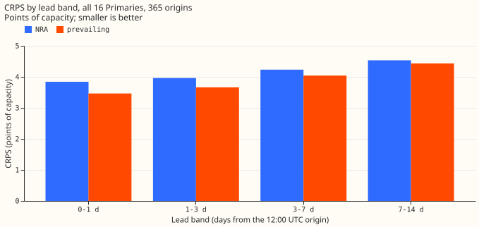
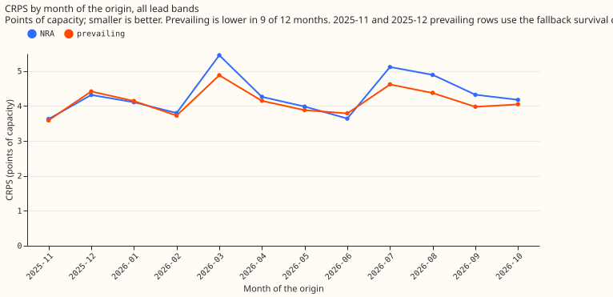
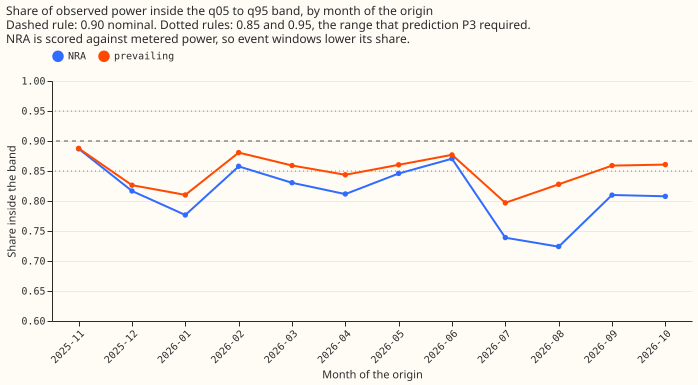
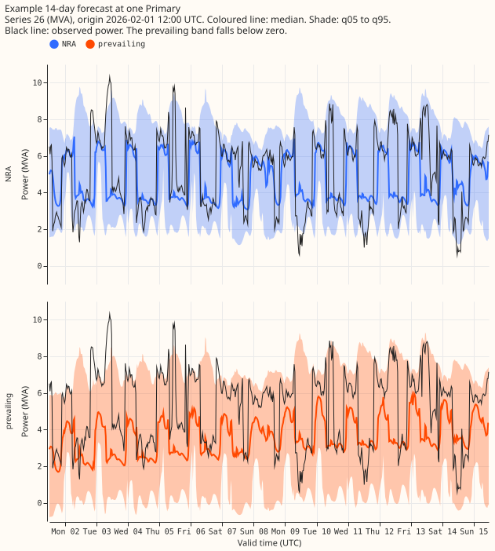

**A one-year backtest of the Candidate demand neural network at the 16 Primaries scored a CRPS of
4.14 points of capacity for the prevailing output and 4.32 for the NRA output.** The year runs from
2025-11-01 to 2026-10-31, with one forecast origin per day at 12:00 UTC and 672 half-hours (14
days) per origin. The backtest is descriptive, not a ranking: the year overlaps the
development months and the final-test window, nothing was tuned on it, and nothing is adopted for
production. A Primary is a primary substation, metered in MW or MVA (megavolt-amperes, apparent power).
The Candidate is the neural network that experiment 612 chose from three classes of demand
network design: it reads lagged power, power summaries from neighbouring Primaries, and the
ECMWF ensemble weather forecast (ENS, 51 members). It outputs 11 quantiles per half-hour.

**The two outputs differ in how they treat a load shift.** A load shift is a transfer of load
between Primaries, usually for days to weeks and not labelled in NGED's data. The NRA output
(normal running arrangement) is the Candidate's 11 quantiles, which forecast power as if no
load shift were in force. The prevailing output mixes those 11 quantiles with a copy of them
shifted by a learned depth, weighted by the probability that a load shift is still in force
(the survival probability, read from a small neural-network output called the survival head,
which predicts a hazard for each of 14 days). In November and December 2025 the survival
probability comes from a fixed log-normal curve (the fallback), because no earlier month had
yet produced training data for the survival head.

**The score rises with lead time by 28% (prevailing) and 18% (NRA).** The prevailing output's CRPS
rises from 3.46 points of capacity at days 0 to 1 to 4.43 at days 7 to 14.

| Lead band | NRA CRPS | NRA median error | Prevailing CRPS | Prevailing median error |
|---|---|---|---|---|
| 0 to 1 days | 3.84 | 6.70 | 3.46 | 6.12 |
| 1 to 3 days | 3.96 | 6.92 | 3.66 | 6.48 |
| 3 to 7 days | 4.23 | 7.43 | 4.04 | 7.19 |
| 7 to 14 days | 4.53 | 8.00 | 4.43 | 7.94 |
| All | 4.32 | 7.59 | 4.14 | 7.39 |

**CRPS is twice the mean pinball loss, and median error is the normalised mean absolute error of
the median.** All values are points of capacity. "Median error" is the normalised mean absolute error of the
median (q50): 100 times the absolute error divided by the Primary's capacity, averaged over
scored half-hours. CRPS is twice the mean pinball loss over the 11 quantile levels, divided by
capacity, times 100. The pooled value weights each half-hour equally, so a Primary with a large
spread counts once per half-hour, not once per Primary.

**By month of the origin, the prevailing output has the lower CRPS in 9 of 12 months, but the two
outputs are not scored like for like.** The NRA
output is lower in 2025-12 (the second fold that uses the fallback survival curve), 2026-01, and
2026-06.

| Month of origin | NRA CRPS | NRA median error | Prevailing CRPS | Prevailing median error |
|---|---|---|---|---|
| 2025-11 | 3.63 | 6.45 | 3.59 | 6.39 |
| 2025-12 | 4.32 | 7.42 | 4.42 | 7.56 |
| 2026-01 | 4.11 | 7.06 | 4.14 | 7.46 |
| 2026-02 | 3.80 | 6.98 | 3.73 | 6.83 |
| 2026-03 | 5.45 | 9.73 | 4.88 | 8.95 |
| 2026-04 | 4.26 | 7.78 | 4.15 | 7.39 |
| 2026-05 | 3.98 | 7.27 | 3.88 | 7.03 |
| 2026-06 | 3.64 | 6.45 | 3.79 | 6.76 |
| 2026-07 | 5.12 | 8.50 | 4.62 | 8.09 |
| 2026-08 | 4.89 | 8.18 | 4.38 | 7.86 |
| 2026-09 | 4.32 | 7.76 | 3.98 | 7.18 |
| 2026-10 | 4.18 | 7.33 | 4.05 | 7.06 |

**The month is the month of the forecast origin.** An origin on 31 October scores valid times
until 14 November under 2026-10. The NRA output deliberately excludes load shifts that the
metered power contains, so a lower prevailing CRPS partly reflects that the prevailing output may
move with them.

**Both outputs are too narrow, and the pre-registered coverage prediction P3 failed.** P3 said that
the q05 to q95 coverage of the NRA output would lie within 0.05 of 0.90 in every month. The NRA
coverage lies within 0.05 of 0.90 in 3 of 12 months (2025-11, 2026-02, 2026-06). The NRA coverage runs from 0.72 (August) to 0.89
(November), the prevailing coverage from 0.80 (July) to 0.89 (November).

| Lead band | NRA q05 to q95 | NRA q25 to q75 | Prevailing q05 to q95 | Prevailing q25 to q75 |
|---|---|---|---|---|
| 0 to 1 days | 0.826 | 0.425 | 0.872 | 0.465 |
| 1 to 3 days | 0.821 | 0.418 | 0.864 | 0.456 |
| 3 to 7 days | 0.815 | 0.408 | 0.851 | 0.440 |
| 7 to 14 days | 0.810 | 0.403 | 0.839 | 0.426 |

**Part of the NRA output's coverage shortfall is built in.** The NRA output is a counterfactual
target, scored here against metered power, so event windows fall outside its band by construction.
Part of the coverage gap between the two outputs comes from that effect and not from a fault in
the NRA band. The band was not rescaled in this experiment.

**The example shows a Primary where the two outputs differ visibly.** It is series 26 (metered in
MVA) from the origin of 2026-02-01 12:00 UTC, one of the three origins at that Primary where the
prevailing median differs most from the NRA median. The prevailing output moves often at this
Primary and does not beat the NRA output there, and its q05 falls below zero MVA (see Caveats).

**Predictions P1 and P2 were not tested.** P1 compared the Candidate's score at days 0 to 10
after the extension to 14 days with experiment 620's stored Candidate on the same months. No
matched run was made, so P1 is unevaluated. P2 asked whether the survival output stays
calibrated at days 10 to 14, and the page has no measurement of it. The survival probability at
days 10 to 14 is read from the generator, not checked against observed events (see Caveats).

## Method

- **Base neural network:** the Candidate (arm `P7+D50`: neighbour power summaries, 50% signal dropout, no
  explicit gate) of [experiment
  612](../00612-nra-combined-networks-three-class-roster-completion/result.md) and [experiment
  613](../00613-nra-roster-contrasts-with-intervals-five-seeds/result.md), as set up by [experiment
  610](../00610-nra-neighbour-summary-lag-encoder-inputs-iteration/result.md), [experiment
  620](../00620-bakeoff-final-test-demand-networks-at-primaries/result.md), and the encoder
  pre-training of experiments 559, 565, and 574. The Candidate's seed-mean 11 quantiles are the NRA
  output. The horizon limit is raised from 240 to 339 hours; ENS summaries reach about 351 hours.
- **Origins and weather:** the weather is the ECMWF ENS 00Z run of the origin day (51 members),
  which the Candidate treats as available at 09:00 UTC. The forecast is made at that native 09:00
  UTC origin and relabelled to the contract's 12:00 UTC origin by adding 3 hours. Valid times
  before 12:00 UTC are dropped, leaving 672 half-hours per origin. `nwp_init_time` is 00:00 UTC of
  the origin day.
- **Lags and the 6-hour cut:** the Candidate's lags and neighbour summaries read power observed at
  least 24 hours before its native origin, so the newest power read is from 09:00 UTC on the day
  before, 27 hours before the contract's 12:00 UTC origin. The contract's rule (nothing newer than
  origin minus 6 hours) therefore needed no change to the recipe. A check asserts that every lag
  time is at least 24 hours before the native origin.
- **Folds and training:** 12 monthly refits, with test months 2025-11 to 2026-10. Each fold trains
  on cleaned power and weather available before its month, with the embargoes of experiment 613
  (3 days at the mixer step, 7 days at the daily fine-tune), 2 seeds with seed-mean-then-sort
  quantiles, and the 90-day recency half-life. Lag, weather, and date-time encoders are
  pre-trained on ERA5 and CAMS, a fresh mixer is trained on the whole ENS history (starting
  2024-04-01, so the early folds have less ENS data), then the daily fine-tune runs. The cleaned
  power drops the `substation_zero` rows, and the D15 and D18 histories are cut before
  2025-03-01.
- **Prevailing output:** the 11 quantiles of the mixture `(1 - p) NRA + p (NRA shifted by a
  learned depth d, with spread sigma)`, with the shifted part as 3 Gauss-Hermite components at
  `d + g sigma` and the quantiles read from the mixture's cumulative distribution (experiment
  647's `mixture_quantiles`). `p = exp(-cumulative hazard)`, where the head outputs 14 daily
  hazards, so `p` keeps falling to day 14. The head of [experiment
  652](../00652-two-output-forecast-with-explicit-rules-and-survival-hazard/result.md) (R-haz)
  sits on the Candidate and not on K1, with its gate-state input removed.
- **Training the head:** the head trains on banks of injected shifts (the generator of experiment
  650), one bank per earlier month, built from the real history of that month with synthetic
  shifts and forecast by that month's Candidate chain (inference only). Fold M's head trains only
  on banks of months before M and on rows whose valid time is before the start of M. Two seeds are
  averaged.
- **Fallback in the first two folds:** with fewer than 2 earlier banks (folds 2025-11 and
  2025-12), the prevailing rows use B-haz instead: the Candidate plus its own recent residual
  times a log-normal survival curve fitted on synthetic durations (no fit on observed power). The
  prevailing rows equal the NRA rows exactly on 74% of November origins and 65% of December
  origins (where the residual is missing), and on no origin from 2026-01 onward.
- **Full-row test matrices:** inputs are built for every valid time from 12:00 UTC to 14 days
  later for every origin, including half-hours with no observed power, so that no input gap
  follows the stored matrices' gaps after 2026-10-17. Scoring is restricted to half-hours with
  observed, unflagged power.
- **Units:** quantiles are scaled by each Primary's capacity and stored in MW for series 7, 8, 10,
  12, 13, 16, 17, and 18, and in MVA for series 3, 9, 11, 14, 15, 24, 25, and 26.
- **Scoring:** against `ground_truth_primaries.parquet` (cleaned power, outside the file), divided
  by `series_capacity.parquet`, as defined under the first table.
- **Compute:** about 0.5 GPU-hours per fold for the Candidate chains, inside the 10 GPU-hour
  ceiling.

## Checks

- Row count: 7,848,960 = 16 series x 365 origins x 672 half-hours x 2 outputs; 672 rows per
  series-origin-output.
- No duplicate keys; no null or non-finite quantile; no crossing in any of the 10 adjacent quantile
  pairs; all times are UTC.
- Timing: the file's NRA rows for a 12:00 UTC origin equal the native 09:00 UTC fit's seed-mean
  quantiles times capacity exactly (maximum difference 0.0), so the 3-hour offset is applied once.
- Leakage, fold logic: reviews by a Sonnet reviewer for leakage, a Sonnet reviewer for the
  contract, and an Opus reviewer of the fold logic found no leak into any fold's training data.
- Leakage, prevailing head: no automatic flag mask computed from the scored month is applied to the
  head's training rows, and fold M's head trains only on banks of months before M. A Sonnet review
  of the head's code checked both.
- File and scores: a Sonnet audit of the file, with a from-scratch re-run of one fold, passed. An
  Opus review of the file and the scores reproduced every score to 3 decimals and found no unit,
  timing, or scaling error.
- No observed power is stored in the file.

## Caveats

- **The survival probability beyond day 10 reflects the bank generator's duration prior.** The
  generator draws short events of 3 to 14 days and long events of 28 to 112 days, none of 15 to 27
  days, so hazards for days 11 to 14 are not estimated from observed events.
- **The prevailing output has no floor at zero for MVA-only series.** Series 26, 14, and 15
  produce more negative `q01` rows than the NRA output (the lowest prevailing `q01` is -2.26 MVA at
  series 26, against -1.21 for NRA). Neither arm is clamped.
- **Series 12 exports power** (observed power runs from -0.92 MW to 1.28 MW, against a capacity of 3.0 MW), so
  its CRPS (13.0 to 13.6 points) is about three times the pooled value and adds about 0.6 points to
  it.
- **The prevailing output loses to the NRA output at series 14 and 26** (CRPS 7.16 against 6.90 at
  series 14, 7.41 against 7.37 at series 26), and its median at series 26 differs from the NRA
  median by more than 5 points of capacity, at some lead, on 52% of origins.
- **The first row of each origin covers the half-hour ending at the origin** (11:30 to 12:00 UTC):
  `valid_time` is the end of the half-hour, and lead 0 is that row.
- **The bank's injected lags use the month's later power for proportional shifts,** which stays
  within the months before the fold being scored.

## Files

- `data/ml-experiments/backtest_year_2025-11_to_2026-10/primaries.parquet` (private): 7,848,960
  rows. Columns in order: `time_series_id` (Int8, original id), `valid_time`, `nwp_init_time`,
  `power_fcst_init_time` (UTC), `q01`, `q05`, `q10`, `q25`, `q40`, `q50`, `q60`, `q75`, `q90`,
  `q95`, `q99` (Float32, MW or MVA as listed in Method), `NRA_or_prevailing` (`"NRA"` or
  `"prevailing"`).
- Code: `ml-experiments/00667-one-year-backtest-of-the-two-output-demand-network-at-primaries/`
  (folds, export, merge, scoring, figures, and the `prevailing/` folder for the head).
- Scores: `score/*_by_band_month.csv` and `score/*_by_band_primary.csv` in the experiment's data
  folder, with columns for CRPS, median error, and the two coverages.
- Reviews: `reviews/` in the experiment's data folder (the briefs and the answers).
