This page documents the five Parquet files of the one-year backtest in
`data/ml-experiments/backtest_year_2025-11_to_2026-10/`. It has two readers: the colleague at NGED
who receives the files, and an engineer who must re-implement one of the five models behind them.
A Primary is a primary substation, a BSP is a bulk supply point, and a GSP is a grid supply point.
CRPS is the continuous ranked probability score, and MAE is the mean absolute error. Both are in
points of capacity, and smaller is better.

**Take-home message.** The five backtest files hold forecasts that are better than climatology at
every lead band for the demand types and for solar, and better for wind out to day 10. The CRPS
gain over climatology falls with lead time: for Primaries it falls from 35.3% at days 0 to 1 to
26.9% at days 10 to 14 (normal running), and for BSPs from 41.0% to 12.5%. The wind network has a
CRPS 1.8% worse than climatology at days 10 to 14 (interval -3.3 to -0.4). On the common rows of the
six MW Primaries the backtest outputs and research default 3 are close, and the backtest outputs are
better at the seven MVA-only Primaries. The prevailing output scores better than the normal-running
output overall, and worse in the 7 days after the one verified load shift. The files describe one
year that overlaps the development months, so the scores are not a ranking.

## Figures

The five figures below show the normalised MAE of the median by forecast horizon, one per forecast
type, beside the baselines. The y-axis does not start at zero.

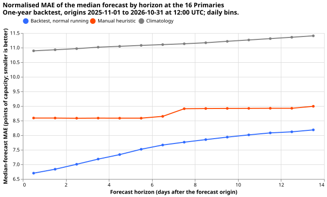

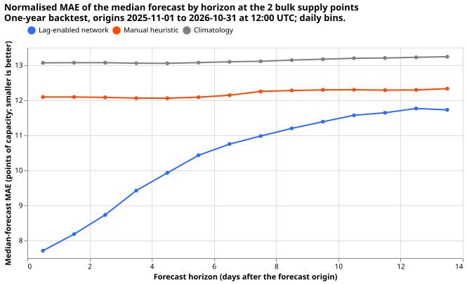

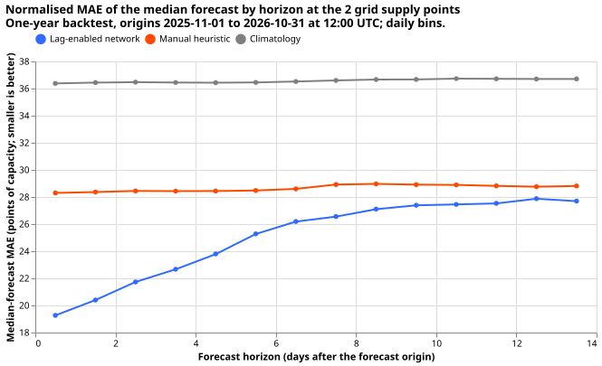

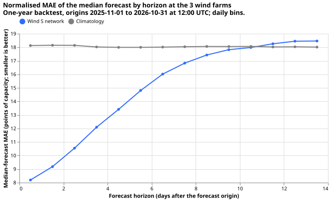

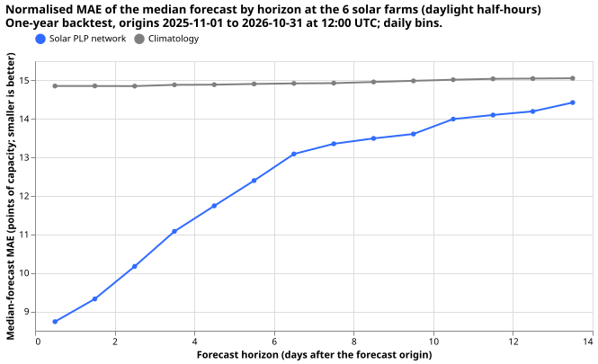

## The files

The files are private. They hold forecasts and no observed power. The year overlaps the
development months and the final-test months of earlier experiments, so the scores are a
description of one year and not a ranking.

- **Period.** One forecast origin per day at 12:00 UTC, from 2025-11-01 to 2026-10-31 (365
  origins, no gaps).
- **Horizon.** Valid times run half-hourly from 12:00 UTC on the origin day to 11:30 UTC 14 days
  later: 672 half-hours per origin. The valid times of the last origin reach 2026-11-14.
- **Weather.** The 00Z run of the ECMWF ensemble (51 members) of the origin day, treated as
  available at 09:00 UTC. The ensemble's lead from 00Z is 12 to 348 hours, inside the 360 hours
  that the run provides. Where the ensemble steps are 3 hours or 6 hours, the half-hourly values
  come from the production resampler ([experiment
  661](../00661-pv-ens-time-resolution-shortwave-interpolation-audit-and-bias-adapter/result.md)).
- **Power delay.** At 12:00 UTC the observed power is available only up to 06:00 UTC of the same
  day. No input of any model reads newer power. Wind and solar read no power lag, so the delay
  moves only the training cut-off of each refit.
- **Files and series.**

| File | Series | Units | Rows (series x 365 origins x 672 half-hours) |
|---|---|---|---|
| `primaries.parquet` | 16 Primaries | MW; MVA for the eight MVA-only Primaries | 7,848,960 (two rows per key) |
| `bsps.parquet` | 2 BSPs (D13 Skegness, D17 Boston) | MW | 490,560 |
| `gsps.parquet` | 2 GSPs (D6 Walpole, D1 Bicker Fen) | MW | 490,560 |
| `wind.parquet` | 3 wind farms | MW for one farm; MVA for the other two | 735,840 |
| `solar.parquet` | 6 solar farms | MW | 1,471,680 |

- **Columns, in this order.**
    - `time_series_id`: the series' original identifier from the metadata table, as an 8-bit
      integer.
    - `valid_time`: the half-hour the forecast is for, a UTC timestamp.
    - `nwp_init_time`: the 00Z ensemble run used, a UTC timestamp.
    - `power_fcst_init_time`: the forecast origin, 12:00 UTC.
    - `q01`, `q05`, `q10`, `q25`, `q40`, `q50`, `q60`, `q75`, `q90`, `q95`, `q99`: the forecast
      quantiles, sorted within the row, in the series' own units. `q50` is the median forecast.
      Each quantile is the value that the observed power falls below with that probability, so
      `q05` to `q95` is a 90% band.
    - `NRA_or_prevailing` (`primaries.parquet` only): `"NRA"` or `"prevailing"`.
- **What `NRA_or_prevailing` means.** The normal running arrangement (NRA) rows forecast the demand
  the Primary would draw if the electricity network operator had made no load shift. The
  prevailing rows forecast the demand under the arrangement in force at the forecast origin,
  carrying a shift that is already running forward and widening the band with the probability
  that the shift ends. Each key (series, valid time, origin) has one row of each kind.
- **Checks.** Each file is checked for the row count above, no duplicate key, no null or
  non-finite quantile, no crossing quantiles, and UTC time-zone. Each experiment's page states the
  results and a spot check that no input is newer than the limits above.
- **Clamps applied after the models ran.** Two files are post-processed, and only the quantile
  values change. In `solar.parquet`, every quantile is zero on the half-hours where the sun is not
  above the horizon at the middle of the half-hour (the rule that the scores use for daylight). The
  clamp changes 271,808 of 1,471,680 rows (18.5%), and the largest change is 6.1% of capacity. The
  daylight rows are bit-identical to the unclamped file. In `primaries.parquet`, every quantile of
  the eight MVA-only Primaries is at least zero, because apparent power cannot be negative. That
  clamp changes 206,487 of 7,848,960 rows (2.6%), in D12, D22, and D8 only, and the largest change
  is 2.80 MVA. Both clamps are monotone, so no quantile crosses. The wind file is not clamped.
  The Primaries measured in MW keep their negative lower quantiles; the observed power of D10 and
  D15 is also negative at times.
- **Effect of the clamps on the scores.** The solar scores are unchanged, because the scores use
  daylight half-hours only. The Primaries tables and figures on this page score the clamped
  `primaries.parquet`. The other tables and figures use the unclamped files.

## The ground-truth files

Five more private files hold the observed power, so a reader can score the forecast files without
the NGED data store: `ground_truth_primaries.parquet`, `ground_truth_bsps.parquet`,
`ground_truth_gsps.parquet`, `ground_truth_wind.parquet`, and `ground_truth_solar.parquet`. The
forecast files never hold observed power. The script is
`ml-experiments/00668-documentation-of-the-one-year-backtest-files-models-training-and-performance/e00668_ground_truth.py`.

- **Rows.** One row per series per half-hour, from 2025-11-01 00:00 UTC to 2026-11-09 08:00 UTC,
  the last half-hour in the data store when the files were written. Every series has the full
  time grid, and a missing reading is an explicit null row. No row exists after 2026-11-09 08:00
  UTC, so the last origins of the forecast files have no observed power for their later valid
  times, and a join from a forecast file gives no match there.
- **Columns, in this order.**
    - `time_series_id`: the series' original identifier, an 8-bit integer. The data store and the
      metadata table hold it as a 32-bit integer, so a join to them needs a cast.
    - `valid_time`: the half-hour, a UTC timestamp, with the same name and meaning as in the forecast
      files so that the two join on `(time_series_id, valid_time)`. The stamp is the source `time`
      column, which the power contract defines as the end of the observation period.
    - `power`: the cleaned reading as a 32-bit float, null where the production cleaning flagged the
      half-hour. The value is `power_raw` wherever `drop_reason` is null.
    - `power_raw`: the reading as delivered, a 32-bit float, read from the raw power table, and null
      where no reading exists.
    - `drop_reason`: a nullable string, the production cleaning rule that flagged the half-hour.
      The only rule in the cleaning code when the files were written is `substation_zero`, an
      exact zero from a Primary, BSP, or GSP.
    - `research_flag`: a nullable string, null in every file but the wind file. In the wind file it
      holds the rule name of the idle mask of experiment 210 (`low_wind_idle` or
      `outage_suspected`). The mask is a research tool and not part of the production cleaning.
      It does not null `power`, and it ends at 2026-09-13 17:30 UTC, so a wind row after that
      carries no flag whether or not the farm was idle.
    - `power_unit`: `"MW"` or `"MVA"` for each series, never implicit. Some Primaries and two wind
      farms are MVA series.
- **How to read the nulls.** A null `power` means no usable reading and is not zero. Solar nulls
  are frequent at night, because the feed omits many night readings, so solar scores use daylight
  half-hours. Earlier experiments scored the half-hours that the wind idle mask flags as zero, by
  setting the target to 0; a scorer that reproduces those numbers does the same, and a scorer
  that drops them gets different numbers.
- **Capacity.** A private `series_capacity.parquet` in the same folder holds the capacity that the
  scores divide by, one row per series. The rule is the production effective-capacity table, which
  has one value per series. It is not the capacity that the wind and solar networks train with (the
  99.9th percentile of the 730 days before each refit). This page lists no generator capacity or
  identifier.
- **Baselines.** The manual heuristic and climatology need power from before 2025-11-01, which these
  files do not hold. They read the cleaned power table of the data store.
- **Checks.** The row count equals the series count times the half-hours in the grid for every
  file, no key repeats, the time-zone is UTC, and the series are 16 Primaries, 2 BSPs, 2 GSPs,
  3 wind farms, and 6 solar farms. A fresh audit re-read all five files against the raw and
  cleaned tables for every series and found no mismatch.

## Primaries

Primaries are forecast by the Candidate demand network ([experiment
620](../00620-bakeoff-final-test-demand-networks-at-primaries/result.md)), which gives the NRA
rows, with the survival-hazard prevailing head R-haz ([experiment
652](../00652-two-output-forecast-with-explicit-rules-and-survival-hazard/result.md)), which gives
the prevailing rows. The backtest itself is [experiment
667](../00667-one-year-backtest-of-the-two-output-demand-network-at-primaries/result.md). Its page
fixes the choices that the earlier experiments left open, and this section restates both.

### Method

- **Inputs of the Candidate.** One row per (Primary, ensemble run, valid half-hour); the network
  runs once per ensemble run, on summaries of the 51 members.
    - Weather: the mean over the 51 members of 7 variables (shortwave and longwave radiation,
      2 m temperature, 2 m dew point, surface pressure, precipitation after `log1p` of the value
      clipped at zero, and 10 m wind speed), and the standard deviation (`ddof=0`) of the same 7.
      The 7 means (with `log1p` precipitation) and the 7 standard deviations are z-scored with the
      training rows' mean and standard deviation and clipped at plus or minus 5. Each series reads
      the
      weather of the H3 resolution-5 cell that holds it.
    - Calendar and sun: 21 columns: solar zenith cosine, azimuth sine and cosine, the sine and
      cosine of the local hour at periods of 24 h and 12 h (Europe/London), a one-hot day of week,
      a COVID flag, three Christmas columns, and three bank-holiday columns.
    - Lead: the lead in hours divided by 336, and its square root.
    - Power lags: for each of a day lag and a week lag, the latest same-half-hour reading at least
      a minimum age before the network's origin, as a z-scored value, a missing flag, and an age
      code. The network's own origin is 09:00 UTC (the 00Z run plus 9 hours), and the lag cap counts
      back from that origin. The Candidate in the backtest
      keeps the stored cap of 24 hours, so the newest lag is the 09:00 reading of the day before the
      origin day.
    - Thermal-lag and solar-gain columns (14): trailing temperature means (3, 6, and 24 hours),
      temperature changes (3 and 6 hours), the day's minimum and maximum, the count of cold-snap
      days, trailing shortwave means (3, 6, and 24 hours), the 3-hour change in the clear-sky
      index, and two columns from the previous day's CAMS irradiance.
    - Neighbour and gap signals (60 columns, read only by the lag encoder): for each lag, the gap
      between the observed power and a lag-free forecast table (the median of the lags-masked
      network of the same seed at its freshest earlier origin with a lead of at most 24 hours),
      exponentially weighted means of that gap with
      half-lives of 1, 3, and 7 days, and, over the electrical neighbours of the Primary,
      the sum, mean, minimum, and maximum of those quantities scaled by capacity ratio, the
      own-plus-neighbour sum, a neighbour count, and a flag for no neighbour. The neighbours are the
      Primaries that NGED's "Primary Substation Interconnections" list links to the Primary. During
      fine-tuning,
      all signal columns of a random 50% of rows are set to no information (the "D50" dropout).
    - Series identity: an 8-dimensional embedding of the Primary.
    - Target: cleaned power divided by effective capacity, then z-scored per Primary.
- **Architecture of the Candidate.** The weather encoder (7 means, an 8-wide embedding, and 14
  thermal-lag and solar-gain columns, so 29 inputs) and the datetime encoder (21 columns and the
  embedding, 29 inputs) each map to 64 hidden GELU units and then 32 outputs. One shared lag
  encoder runs twice, on the day lag and then the week lag. Its 143 inputs are the lag's 3 columns,
  the 32-wide embeddings that the weather and datetime encoders give for the weather expected at
  the lag's own time, the 8-wide embedding of the Primary, an 8-wide embedding of the lag's
  identity, and the 60 signal columns; it maps to 64 and then 32, and the two outputs are
  concatenated. The mixer takes 145 inputs (the weather and datetime outputs of 32 each, the 64
  lag outputs, the embedding, the 7 spread columns, and the 2 lead columns), has two hidden layers
  of 64 units, and outputs 9 numbers: the logits, means, and log standard deviations of a
  3-component Gaussian mixture. Each hidden layer has 10% dropout.
- **Offset.** A per-Primary piecewise-linear function of time with one knot for each month start
  from 2019-09 (a slow drift term) is added to the three component means. Fine-tuning trains
  only the newest knot, and a penalty of 10 times the mean squared difference between neighbouring
  knots keeps the function smooth.
- **Quantiles.** The 11 quantiles come from the mixture's cumulative distribution by 40 bisection
  steps on a range of plus or minus 40 standard deviations. The mixture weights are a log-softmax
  and each standard deviation is `exp` of the raw output clamped to plus or minus 3. The values are
  then rescaled to power and sorted within the row. The final test of experiment 620 averaged 5
  seeds quantile by quantile, sorted again, and widened the band about the median by a factor of
  1.0934, which experiment 613 fixed before that test. The backtest averages 2 seeds and applies no
  widening.
- **Loss.** The negative log-likelihood of the mixture on the standardised target, weighted, plus
  the knot penalty.
- **Training, in three steps.**
    - Pre-training uses ERA5 and CAMS (shortwave) as stand-in weather, in pseudo-runs every 2 days
      from 2019-09-01 at 09:00 UTC with leads of 0.5 to 351 hours (about 8.1 million rows for the
      2026-07 fold). Five Primaries start later (D11 2019-09-17, D10 2019-12-01, D5 2020-02-01, D14
      2020-07-01, D16 2021-02-01). ERA5 has no ensemble, so the 7 spread columns hold the fold's
      median ensemble spread for each 24-hour lead band. All weights train: AdamW, learning rate
      5e-4, weight decay 1e-3, batch 8,192,
      20% of the rows per epoch, up to 60 epochs, patience 8, gradient-norm clip 1.0.
    - Step 2 loads the pre-trained weights except the mixer, draws a fresh mixer with seed 12345,
      freezes the weather and datetime encoders, and trains on the whole 730-day history with
      uniform weights and a 3-day embargo. Learning rate 2e-4, and 5e-4 for the fresh mixer.
    - The fine-tune starts from the step-2 weights with the same frozen encoders, learning rate
      2e-4 throughout, and weights of 0.5 to the power of age in days over 90 (a 90-day
      half-life). The refit rule drops rows with valid times in the newest 7 days before the
      cut-off and halves the weight of rows 7 to 14 days old.
    - Early stopping holds out one week in every 12 weeks of origin days, with 15 days purged
      before and 9 days after each held week, and uses at most 200,000 held rows.
- **Missing and delayed inputs.** A flagged or absent lag reads as value 0, a missing flag, and the
  maximum age code. In training, 30% of origin days mask both lags and, of those, 15% mask only
  the day lag. Absent signal columns read as 0 with a missing flag. Neighbour-signal columns whose
  training spread is under 80% of their spread in the last development month receive matching
  Gaussian noise during training. All weather columns must be finite.
- **Injected load shifts in training.** Each Primary receives random synthetic shifts, added to the
  lag inputs only, until they cover 5% of its row span: depth 15%, 30%, or 50% of capacity, length
  3, 7, 15, or 30 days, random sign. Each shift on a Primary is subtracted, scaled by the capacity
  ratio, from one electrical neighbour, so the neighbour summaries see the transfer.
- **R-haz, the prevailing head.** Experiment 652 fitted it on top of the frozen K1 network of
  experiments 612 and 613, and the backtest puts it on the Candidate. It is a small
  network that reads 58 origin
  features (the gap and neighbour signals above, built from lags), 4 age columns (the log of the
  departure's age in days, the age over 30, the gate flag, and the age of the freshest lag), and
  3 row inputs (the lead over 240 hours and the lower and upper half-widths of the Candidate's
  band). The gate flag is kept as a column and set to zero, so these columns number 65. The backtest
  head appends 28 more columns, the extra lagged power inputs described next, so it has 93 inputs.
  It has two hidden layers of 64 ReLU units and 12 outputs: a signed depth (0.5 times the
  hyperbolic tangent of the first output, so up to half of capacity), a spread, and daily hazards.
  Each hazard is `softplus(output - 3)`, and the survival probability `p` is the exponential of
  minus the hazards accumulated over the days before the lead. The probability is 0 when the
  departure is younger than half a day.
- **How the prevailing quantiles are formed.** The Candidate's 11 quantiles define a
  piecewise-linear
  cumulative distribution with two tail knots 1.5 times the outer spacing beyond the 1% and 99%
  quantiles. The prevailing distribution is the mixture `(1 - p)` times the Candidate's
  distribution plus `p` times the Candidate's distribution shifted by the depth, with the depth
  uncertain at three Gauss-Hermite points. The 11 prevailing quantiles are read off that mixture
  and are monotone by construction. When `p` is 0, the prevailing rows equal the NRA rows.
- **Extra lagged power inputs of R-haz.** The head reads 14 lagged inputs of the Primary's own
  cleaned power, each as a residual plus a missing flag (28 columns), appended after the 65 columns
  above. [Experiment
  681](../00681-extra-lagged-power-inputs-for-the-prevailing-forecast/result.md) chose them. Every
  time below is measured back from the network origin, and every residual is the cleaned power
  minus the Candidate's lag-free median at that time, as a fraction of capacity. The 14 inputs are
  the residuals at 6, 9, 12, 18, 24, 36, 48, and 72 hours; the means of the residuals over the last
  6, 12, and 24 hours, each window ending 6 hours before the origin; and the three differences
  between consecutive trailing 24-hour means (the 24 hours ending 6 hours before the origin minus
  the 24 hours before that, and the next two pairs). A mean is missing when under half of its
  window holds a reading. The newest reading any input uses is 6 hours old, and a test perturbs
  every later half-hour and checks that no input moves. Each of the 12 monthly refits trains on
  the banks of earlier months only, and the lag inputs of an injected shift are built from the same
  shifted power as its target. 2025-11 and 2025-12 use the fallback head, which has no inputs to
  widen, so those two months carry no extra lagged inputs.
- **Loss and training of R-haz.** The loss is the pinball loss over the 11 levels plus 0.05 times
  the binary cross-entropy of `p` against the observed state of an injected shift. The training rows
  mix real rows with injected shifts, with durations drawn half from 3 to 14 days and half from 28
  to
  112 days (an assumed mixture) and each injected shift counted equally. Adam, learning rate 0.003,
  weight decay 1e-4, batch 4096, up to 30 epochs, patience 4, 2 seeds averaged by mean quantile.
  The head of experiment 652 has 9,164 parameters (12 outputs) and no dropout. The backtest head has
  14 daily hazards (16 outputs) and 93 inputs, which gives 11,216 parameters.
- **B-haz, the fallback prevailing head (2025-11 and 2025-12).** B-haz fits a survival curve to
  the durations of the injected shifts. It multiplies that curve by the residual of the Candidate's
  day-ahead median over the days 2 to 8 before the origin, and adds the product to the normal-running
  quantiles. R-haz replaces it from 2026-01.
- **Training set of R-haz in the backtest.** A "bank" is the set of injected-shift training rows
  built from one earlier test month. Each monthly fit of R-haz trains on the banks of all earlier
  months. Each fit samples 60,000 real rows and 6,000 bank rows. Origin days 0 to 17 of an injected
  shift train the head and origin days from 21 onward validate it.
- **Refits and embargo in the backtest.** Twelve monthly refits (test months 2025-11 to 2026-10),
  each trained on data before the first of the month with the 7-day embargo of the refit rule.
  The ensemble history starts 2024-04-01, so the early folds fine-tune on less ensemble history
  than the later folds. The D15 and D18 rows before 2025-03-01 are cut, as in every recent
  experiment. The Candidate and R-haz each average 2 seeds.
- **Where each piece came from.** The modular network and its widths: experiment 545. Frozen
  encoders and the three-step schedule: 559. ERA5 and CAMS pre-training: 418. The offset: 565 and
  572. The thermal-lag columns: 437 and 569. The embargoed schedule: 574. The shared lag encoder:
  586 and 591. The signal columns: 598 and 606. The signal dropout: 610. The refit rule: 599. The
  list of series and the width factor: 612 and 613. The prevailing head: 647, 650, and 652.

### Performance

**Both outputs beat the manual heuristic and climatology at every lead band, and the prevailing
output scores better than the normal-running output overall but worse in the 7 days after the one
verified load shift ends.** Every number is a normalised error in points of capacity (percent of
capacity; smaller is better) over all 16 Primaries, pooled. For the MVA-only Primaries the
denominator is the capacity in MVA, so the numbers mix real and apparent power. Of the 3,924,480
rows of each output, 3,895,784 are scored: the rest have no observed power, the cleaning flagged the
half-hour, or a baseline is missing. The manual heuristic and climatology are described under
[Comparison baselines](#comparison-baselines-slices-and-summary-figures). Gains are those of the
output over the baseline, with a 95% day-block bootstrap interval from 2,000 resamples of origin
days.

Over all rows, the CRPS is 4.31 for normal running and 4.09 for prevailing, and the normalised MAE
of the median is 7.58 and 7.30. The
[experiment 667 page](../00667-one-year-backtest-of-the-two-output-demand-network-at-primaries/result.md)
scores the prevailing head without the extra lagged inputs, so its prevailing numbers are higher
(4.14 for CRPS and 7.39 for the normalised MAE); its normal-running numbers (4.32 and 7.59) agree
with this page to within 0.01. This page scores the 3,895,784 half-hour rows that have cleaned
observed power, and the 667 page scores the full ground truth.

**From 2026-01, when the prevailing head has its trained weights and the extra lagged inputs, the
prevailing output scores lower than the normal-running output, and its margin is larger from 2026-07
than before.** The table splits the pooled scores by the months of the forecast origin. The months
from 2026-07 form the final-test window, so no choice rests on them.

| Origin months | Half-hours | CRPS, normal running | CRPS, prevailing | MAE, normal running | MAE, prevailing | q05 to q95 coverage, prevailing |
|---|---:|---:|---:|---:|---:|---:|
| 2025-11 to 2025-12 (fallback head) | 650,457 | 3.95 | 3.98 | 6.92 | 6.95 | 85.6% |
| 2026-01 to 2026-06 | 1,940,242 | 4.22 | 4.05 | 7.56 | 7.31 | 85.7% |
| 2026-07 to 2026-10 (final-test window) | 1,305,085 | 4.63 | 4.21 | 7.94 | 7.47 | 83.9% |
| All months | 3,895,784 | 4.31 | 4.09 | 7.58 | 7.30 | 85.1% |

The two outputs of `NRA_or_prevailing` were scored separately. 2025-11 and 2025-12 use the B-haz
fallback head and 2026-01 to 2026-10 use R-haz trained on all earlier months' banks, so the
prevailing output of the first two months comes from a different head. Every Primaries number on
this page comes from the version of `primaries.parquet` whose SHA-256 digest starts with
`9450ba70a286ff030a99`.

#### Normal running (`NRA`)

Normalised MAE of the median:

| Group | Half-hours | Model | Manual heuristic | Climatology | Gain over heuristic (%) | Gain over climatology (%) |
|---|---:|---:|---:|---:|---|---|
| days 0 to 1 | 279,369 | 6.70 | 8.59 | 10.89 | 22.0 (20.5 to 23.5) | 38.5 (37.2 to 39.6) |
| days 1 to 3 | 558,598 | 6.92 | 8.59 | 10.95 | 19.4 (17.9 to 20.8) | 36.8 (35.6 to 37.9) |
| days 3 to 7 | 1,115,942 | 7.43 | 8.60 | 11.06 | 13.7 (12.3 to 15.0) | 32.9 (31.8 to 33.9) |
| days 7 to 10 | 836,087 | 7.85 | 8.91 | 11.17 | 12.0 (10.4 to 13.4) | 29.7 (28.5 to 31.0) |
| days 10 to 14 | 1,105,788 | 8.09 | 8.94 | 11.33 | 9.4 (8.0 to 10.7) | 28.5 (27.3 to 29.7) |

CRPS (2 × mean pinball loss over the 11 levels):

| Group | Half-hours | Model | Manual heuristic | Climatology | Gain over heuristic (%) | Gain over climatology (%) |
|---|---:|---:|---:|---:|---|---|
| days 0 to 1 | 279,369 | 3.84 | 4.89 | 5.94 | 21.5 (19.9 to 23.2) | 35.3 (34.1 to 36.5) |
| days 1 to 3 | 558,598 | 3.96 | 4.89 | 5.98 | 19.0 (17.4 to 20.6) | 33.8 (32.6 to 34.8) |
| days 3 to 7 | 1,115,942 | 4.23 | 4.90 | 6.07 | 13.8 (12.4 to 15.2) | 30.3 (29.2 to 31.3) |
| days 7 to 10 | 836,087 | 4.45 | 5.11 | 6.16 | 12.9 (11.4 to 14.4) | 27.8 (26.6 to 29.0) |
| days 10 to 14 | 1,105,788 | 4.59 | 5.12 | 6.27 | 10.4 (8.9 to 11.7) | 26.9 (25.7 to 28.0) |

#### Prevailing (`prevailing`)

Normalised MAE of the median:

| Group | Half-hours | Model | Manual heuristic | Climatology | Gain over heuristic (%) | Gain over climatology (%) |
|---|---:|---:|---:|---:|---|---|
| days 0 to 1 | 279,369 | 5.97 | 8.59 | 10.89 | 30.5 (28.8 to 32.2) | 45.2 (43.9 to 46.4) |
| days 1 to 3 | 558,598 | 6.37 | 8.59 | 10.95 | 25.9 (24.2 to 27.6) | 41.9 (40.6 to 43.1) |
| days 3 to 7 | 1,115,942 | 7.12 | 8.60 | 11.06 | 17.2 (15.7 to 18.8) | 35.7 (34.4 to 36.9) |
| days 7 to 10 | 836,087 | 7.69 | 8.91 | 11.17 | 13.7 (12.1 to 15.4) | 31.2 (29.7 to 32.6) |
| days 10 to 14 | 1,105,788 | 8.01 | 8.94 | 11.33 | 10.4 (8.9 to 11.9) | 29.3 (27.8 to 30.6) |

CRPS:

| Group | Half-hours | Model | Manual heuristic | Climatology | Gain over heuristic (%) | Gain over climatology (%) |
|---|---:|---:|---:|---:|---|---|
| days 0 to 1 | 279,369 | 3.37 | 4.89 | 5.94 | 31.1 (29.5 to 32.7) | 43.2 (42.0 to 44.4) |
| days 1 to 3 | 558,598 | 3.60 | 4.89 | 5.98 | 26.5 (24.7 to 28.2) | 39.9 (38.6 to 41.1) |
| days 3 to 7 | 1,115,942 | 4.00 | 4.90 | 6.07 | 18.5 (17.1 to 20.0) | 34.1 (32.9 to 35.3) |
| days 7 to 10 | 836,087 | 4.30 | 5.11 | 6.16 | 15.8 (14.4 to 17.3) | 30.2 (28.8 to 31.5) |
| days 10 to 14 | 1,105,788 | 4.47 | 5.12 | 6.27 | 12.8 (11.5 to 14.0) | 28.8 (27.5 to 30.0) |

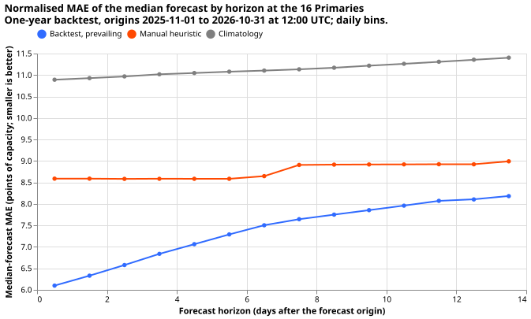

#### By season and by month

Seasons are meteorological and refer to the season of the forecast origin. Autumn is split into the
first month (2025-11) and the last two months (2026-09 and 2026-10) of the backtest.

Normalised MAE of the median, normal running:

| Group | Half-hours | Model | Manual heuristic | Climatology | Gain over heuristic (%) | Gain over climatology (%) |
|---|---:|---:|---:|---:|---|---|
| autumn (Nov 2025) | 317,846 | 6.39 | 8.49 | 9.73 | 24.7 (21.7 to 27.4) | 34.4 (30.4 to 38.3) |
| winter | 966,838 | 7.16 | 8.31 | 10.48 | 13.9 (11.3 to 16.3) | 31.7 (29.4 to 34.0) |
| spring | 984,705 | 8.27 | 9.75 | 12.38 | 15.1 (13.8 to 16.5) | 33.2 (31.7 to 34.5) |
| summer | 981,805 | 7.72 | 8.62 | 11.75 | 10.4 (8.4 to 12.5) | 34.3 (32.8 to 35.9) |
| autumn (Sep to Oct 2026) | 644,590 | 7.54 | 8.27 | 9.95 | 8.9 (6.2 to 11.6) | 24.3 (23.1 to 25.4) |

CRPS, normal running:

| Group | Half-hours | Model | Manual heuristic | Climatology | Gain over heuristic (%) | Gain over climatology (%) |
|---|---:|---:|---:|---:|---|---|
| autumn (Nov 2025) | 317,846 | 3.57 | 4.83 | 5.61 | 26.1 (23.7 to 28.3) | 36.4 (32.5 to 40.2) |
| winter | 966,838 | 4.08 | 4.97 | 5.95 | 17.9 (15.7 to 20.0) | 31.4 (29.8 to 32.9) |
| spring | 984,705 | 4.57 | 5.40 | 6.67 | 15.4 (13.9 to 16.9) | 31.5 (30.1 to 32.7) |
| summer | 981,805 | 4.56 | 4.88 | 6.32 | 6.7 (4.2 to 9.3) | 28.0 (26.2 to 29.8) |
| autumn (Sep to Oct 2026) | 644,590 | 4.25 | 4.72 | 5.49 | 10.0 (7.7 to 12.1) | 22.7 (21.3 to 24.0) |

CRPS, prevailing:

| Group | Half-hours | Model | Manual heuristic | Climatology | Gain over heuristic (%) | Gain over climatology (%) |
|---|---:|---:|---:|---:|---|---|
| autumn (Nov 2025) | 317,846 | 3.53 | 4.83 | 5.61 | 26.9 (24.7 to 28.8) | 37.1 (33.5 to 40.8) |
| winter | 966,838 | 4.06 | 4.97 | 5.95 | 18.3 (15.7 to 20.8) | 31.7 (29.7 to 33.7) |
| spring | 984,705 | 4.25 | 5.40 | 6.67 | 21.3 (19.6 to 23.0) | 36.2 (34.6 to 37.8) |
| summer | 981,805 | 4.19 | 4.88 | 6.32 | 14.1 (12.3 to 15.9) | 33.7 (32.2 to 35.1) |
| autumn (Sep to Oct 2026) | 644,590 | 4.02 | 4.72 | 5.49 | 14.9 (12.6 to 16.9) | 26.9 (25.1 to 28.5) |

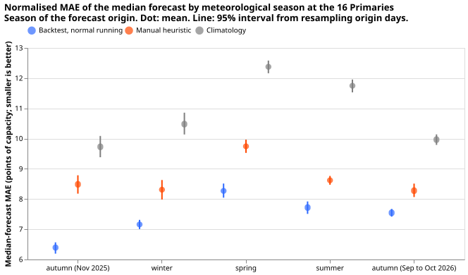

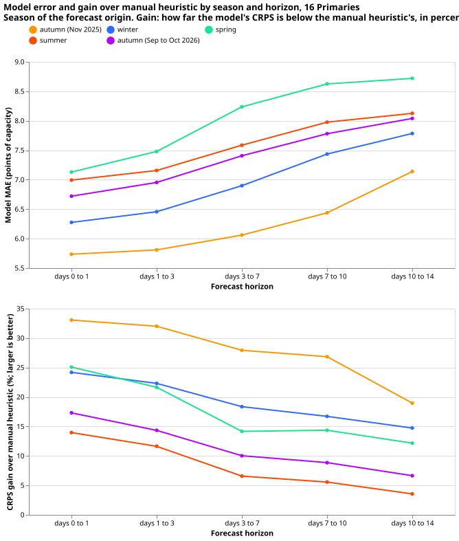

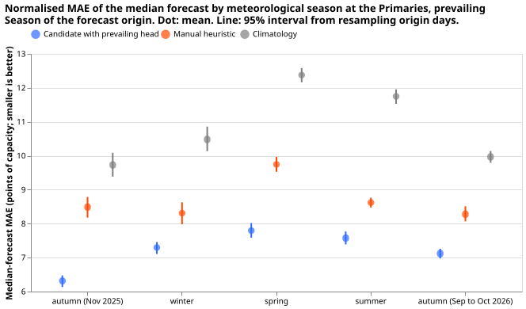

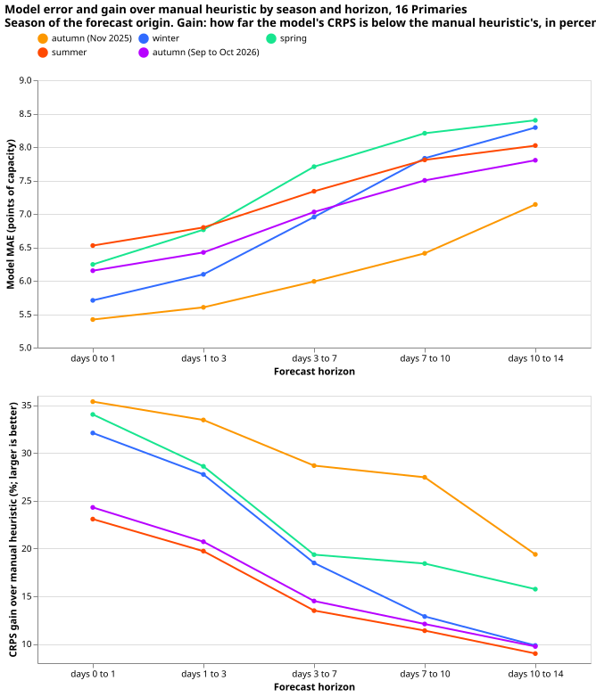

CRPS by month of the forecast origin, normal running:

| Group | Half-hours | Model | Manual heuristic | Climatology | Gain over heuristic (%) | Gain over climatology (%) |
|---|---:|---:|---:|---:|---|---|
| 2025-11 | 317,846 | 3.57 | 4.83 | 5.61 | 26.1 (23.7 to 28.3) | 36.4 (32.5 to 40.2) |
| 2025-12 | 332,611 | 4.32 | 5.44 | 6.50 | 20.6 (16.4 to 24.3) | 33.6 (30.8 to 36.0) |
| 2026-01 | 333,312 | 4.11 | 4.87 | 5.76 | 15.6 (11.7 to 19.2) | 28.7 (25.7 to 31.6) |
| 2026-02 | 300,915 | 3.80 | 4.58 | 5.56 | 17.0 (15.2 to 18.8) | 31.6 (29.8 to 33.6) |
| 2026-03 | 333,065 | 5.45 | 6.07 | 7.31 | 10.1 (8.2 to 12.1) | 25.4 (24.1 to 26.8) |
| 2026-04 | 321,245 | 4.26 | 5.14 | 6.56 | 17.1 (14.7 to 19.4) | 35.1 (33.9 to 36.2) |
| 2026-05 | 330,395 | 3.98 | 5.00 | 6.13 | 20.3 (18.5 to 21.9) | 35.0 (32.9 to 37.1) |
| 2026-06 | 321,310 | 3.64 | 4.61 | 5.94 | 21.1 (19.1 to 22.9) | 38.8 (37.1 to 40.5) |
| 2026-07 | 330,096 | 5.12 | 5.48 | 7.09 | 6.7 (3.8 to 9.2) | 27.8 (26.5 to 29.0) |
| 2026-08 | 330,399 | 4.89 | 4.55 | 5.94 | -7.4 (-8.9 to -6.0) | 17.6 (16.7 to 18.5) |
| 2026-09 | 322,539 | 4.32 | 4.42 | 5.70 | 2.3 (-0.3 to 4.7) | 24.2 (23.3 to 25.1) |
| 2026-10 | 322,051 | 4.17 | 5.01 | 5.29 | 16.8 (15.7 to 17.8) | 21.1 (18.7 to 23.7) |

CRPS by month of the forecast origin, prevailing:

| Group | Half-hours | Model | Manual heuristic | Climatology | Gain over heuristic (%) | Gain over climatology (%) |
|---|---:|---:|---:|---:|---|---|
| 2025-11 | 317,846 | 3.53 | 4.83 | 5.61 | 26.9 (24.7 to 28.8) | 37.1 (33.5 to 40.8) |
| 2025-12 | 332,611 | 4.42 | 5.44 | 6.50 | 18.8 (15.5 to 21.5) | 32.1 (30.1 to 33.7) |
| 2026-01 | 333,312 | 4.04 | 4.87 | 5.76 | 17.1 (10.5 to 23.3) | 29.9 (24.4 to 34.8) |
| 2026-02 | 300,915 | 3.71 | 4.58 | 5.56 | 19.1 (17.4 to 20.8) | 33.3 (31.6 to 35.2) |
| 2026-03 | 333,065 | 4.76 | 6.07 | 7.31 | 21.6 (19.5 to 23.5) | 34.9 (31.9 to 37.6) |
| 2026-04 | 321,245 | 4.09 | 5.14 | 6.56 | 20.4 (16.2 to 24.4) | 37.6 (35.5 to 39.8) |
| 2026-05 | 330,395 | 3.90 | 5.00 | 6.13 | 22.0 (19.2 to 24.7) | 36.4 (33.5 to 39.3) |
| 2026-06 | 321,310 | 3.77 | 4.61 | 5.94 | 18.2 (15.6 to 20.8) | 36.5 (34.2 to 38.9) |
| 2026-07 | 330,096 | 4.51 | 5.48 | 7.09 | 17.7 (15.7 to 19.8) | 36.3 (34.5 to 38.1) |
| 2026-08 | 330,399 | 4.29 | 4.55 | 5.94 | 5.8 (2.5 to 8.7) | 27.7 (25.4 to 29.8) |
| 2026-09 | 322,539 | 4.05 | 4.42 | 5.70 | 8.5 (5.3 to 11.3) | 29.0 (27.5 to 30.2) |
| 2026-10 | 322,051 | 3.99 | 5.01 | 5.29 | 20.5 (18.9 to 21.9) | 24.6 (21.4 to 27.7) |

#### By Primary

Normalised MAE of the median, normal running, by Primary:

| Group | Half-hours | Model | Manual heuristic | Climatology | Gain over heuristic (%) | Gain over climatology (%) |
|---|---:|---:|---:|---:|---|---|
| D3 | 244,396 | 2.70 | 3.58 | 4.99 | 24.6 (21.7 to 27.2) | 45.9 (44.3 to 47.3) |
| D9 | 244,242 | 4.40 | 5.20 | 5.64 | 15.4 (13.4 to 17.4) | 22.0 (20.3 to 23.7) |
| D11 | 244,172 | 5.11 | 6.31 | 7.25 | 19.0 (14.8 to 23.4) | 29.5 (26.2 to 33.0) |
| D19 | 244,368 | 5.58 | 6.90 | 8.59 | 19.1 (17.4 to 20.8) | 35.0 (32.8 to 37.1) |
| D10 | 244,354 | 6.90 | 8.68 | 9.18 | 20.5 (18.7 to 22.3) | 24.8 (22.0 to 27.5) |
| D4 | 244,536 | 3.92 | 5.04 | 5.41 | 22.1 (19.8 to 24.4) | 27.5 (25.4 to 29.6) |
| D15 | 236,746 | 24.70 | 27.76 | 36.89 | 11.0 (8.0 to 14.1) | 33.1 (30.2 to 35.9) |
| D18 | 242,576 | 8.92 | 10.70 | 14.36 | 16.6 (14.8 to 18.4) | 37.9 (33.8 to 41.8) |
| D12 | 242,870 | 12.56 | 14.64 | 14.09 | 14.2 (12.4 to 16.1) | 10.9 (9.7 to 12.1) |
| D22 | 244,494 | 7.64 | 7.99 | 8.41 | 4.4 (2.1 to 6.8) | 9.2 (6.2 to 11.9) |
| D14 | 244,564 | 5.13 | 5.83 | 7.34 | 12.0 (8.2 to 15.4) | 30.1 (27.4 to 32.6) |
| D5 | 241,764 | 6.91 | 7.81 | 8.86 | 11.5 (8.7 to 14.0) | 22.0 (18.9 to 24.8) |
| D16 | 244,256 | 5.59 | 6.10 | 8.64 | 8.3 (6.2 to 10.4) | 35.3 (33.2 to 37.2) |
| D21 | 243,556 | 4.16 | 4.94 | 6.14 | 15.7 (13.7 to 17.8) | 32.3 (30.9 to 33.6) |
| D2 | 244,536 | 4.07 | 5.09 | 5.68 | 20.2 (17.8 to 22.5) | 28.4 (26.5 to 30.2) |
| D8 | 244,354 | 13.57 | 14.21 | 27.44 | 4.5 (3.4 to 5.7) | 50.6 (49.0 to 52.1) |

Normalised MAE of the median, prevailing, by Primary:

| Group | Half-hours | Model | Manual heuristic | Climatology | Gain over heuristic (%) | Gain over climatology (%) |
|---|---:|---:|---:|---:|---|---|
| D3 | 244,396 | 2.69 | 3.58 | 4.99 | 24.9 (22.1 to 27.5) | 46.1 (44.5 to 47.6) |
| D9 | 244,242 | 4.42 | 5.20 | 5.64 | 15.1 (13.1 to 17.1) | 21.7 (20.0 to 23.5) |
| D11 | 244,172 | 4.82 | 6.31 | 7.25 | 23.6 (19.6 to 27.7) | 33.5 (30.4 to 36.7) |
| D19 | 244,368 | 5.53 | 6.90 | 8.59 | 19.9 (18.0 to 21.6) | 35.6 (33.5 to 37.6) |
| D10 | 244,354 | 6.89 | 8.68 | 9.18 | 20.7 (17.8 to 23.4) | 24.9 (21.9 to 27.7) |
| D4 | 244,536 | 3.87 | 5.04 | 5.41 | 23.1 (20.7 to 25.5) | 28.4 (26.3 to 30.5) |
| D15 | 236,746 | 22.67 | 27.76 | 36.89 | 18.3 (14.3 to 22.4) | 38.6 (35.0 to 42.0) |
| D18 | 242,576 | 7.09 | 10.70 | 14.36 | 33.7 (30.4 to 36.9) | 50.6 (46.8 to 54.0) |
| D12 | 242,870 | 13.05 | 14.64 | 14.09 | 10.9 (9.0 to 12.9) | 7.4 (5.7 to 9.1) |
| D22 | 244,494 | 7.33 | 7.99 | 8.41 | 8.3 (5.9 to 10.6) | 12.8 (10.3 to 15.2) |
| D14 | 244,564 | 4.46 | 5.83 | 7.34 | 23.5 (21.1 to 25.8) | 39.2 (36.6 to 41.7) |
| D5 | 241,764 | 6.97 | 7.81 | 8.86 | 10.8 (7.2 to 14.3) | 21.4 (17.7 to 25.0) |
| D16 | 244,256 | 5.63 | 6.10 | 8.64 | 7.7 (3.3 to 11.9) | 34.9 (31.7 to 37.8) |
| D21 | 243,556 | 4.17 | 4.94 | 6.14 | 15.6 (13.6 to 17.6) | 32.2 (30.8 to 33.5) |
| D2 | 244,536 | 4.06 | 5.09 | 5.68 | 20.3 (17.9 to 22.6) | 28.5 (26.6 to 30.3) |
| D8 | 244,354 | 13.71 | 14.21 | 27.44 | 3.5 (2.1 to 4.8) | 50.0 (48.4 to 51.6) |

#### The load shift at D5 and D16

**The December 2025 transfer of load between D5 and D16 is the one verified load shift in the
backtest year, and the prevailing output took 61 hours (D5) and 52 hours (D16) to move.** The
transfer is experiment 580's transfer 23: a fitted -1.47 MW at D5 and +1.37 MW at D16, 15 days from
2025-12-29. The step found in the observed power is at 2025-12-29 23:00 UTC and ends at 2026-01-14
11:30 UTC at D5, and starts at 2025-12-30 08:30 UTC and ends at 2026-01-14 19:30 UTC at D16. These
times are the largest change of the 12-hour mean of the observed power within 3 days of the dates of
experiment 580.

From the file, the first daily origin at which the mean of the prevailing median over the next 24
hours differs from the normal-running median by at least half of the fitted transfer is 61.0 hours
after the start at D5 and 51.5 hours at D16. After the end, the first origin at which the two
outputs agree to within half of the transfer again is 24.5 hours after the end at D5 and 40.5 hours
at D16. Origins are daily, so each figure has a resolution of one day. This is one descriptive event
at two Primaries, so it supports no general statement about the delay.

The prevailing output of December 2025 comes from the B-haz fallback head, and the end of the shift
in January 2026 from R-haz, so the two ends of the event are forecast by different heads. The D5
step starts on 2025-12-29, in a fallback month, so the first origin with a trained head is
2026-01-01 12:00 UTC, which is 61 hours after the step start: 61 hours is the earliest reaction
that the D5 start allows.

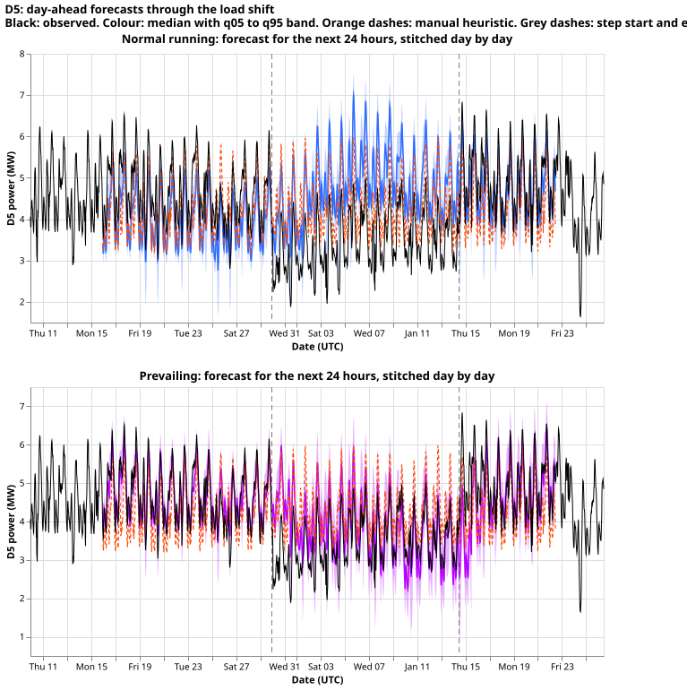

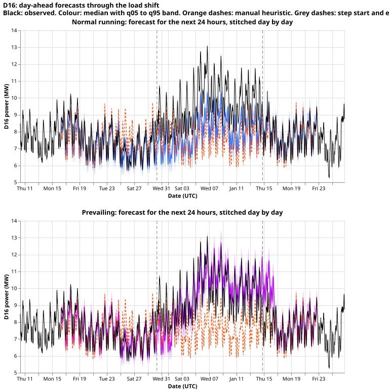

The 14-day forecasts from five origins follow, for D5 and then D16. Each figure holds the
normal-running output above and the prevailing output below.

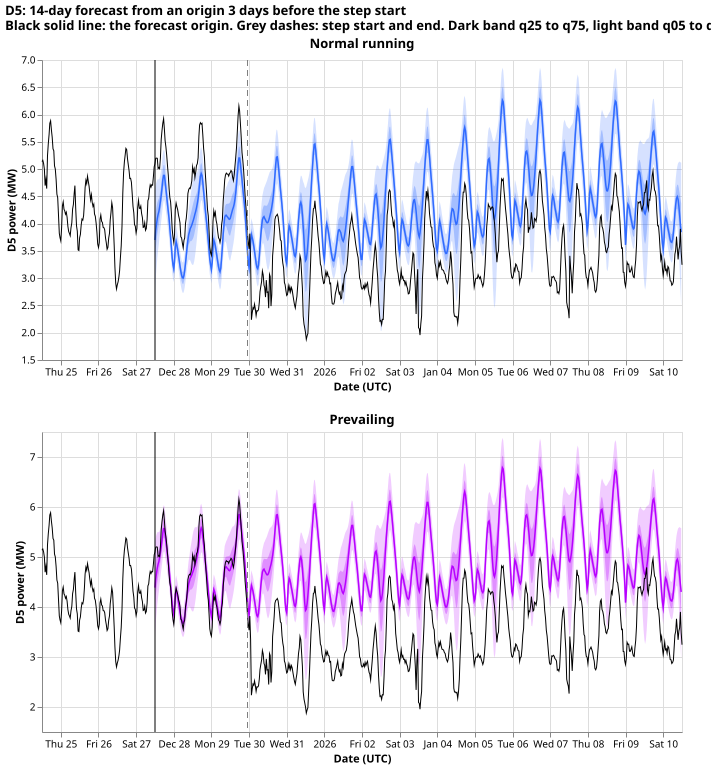

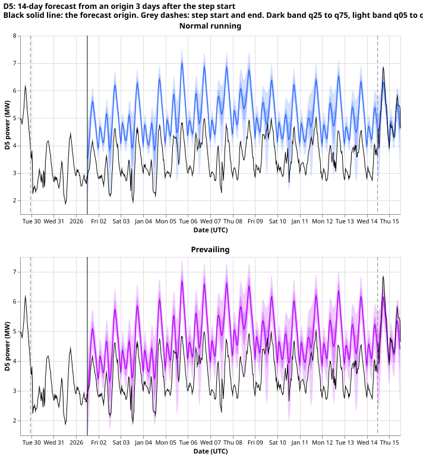

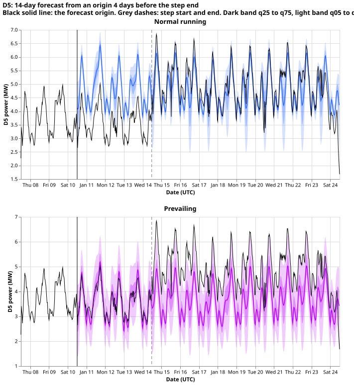

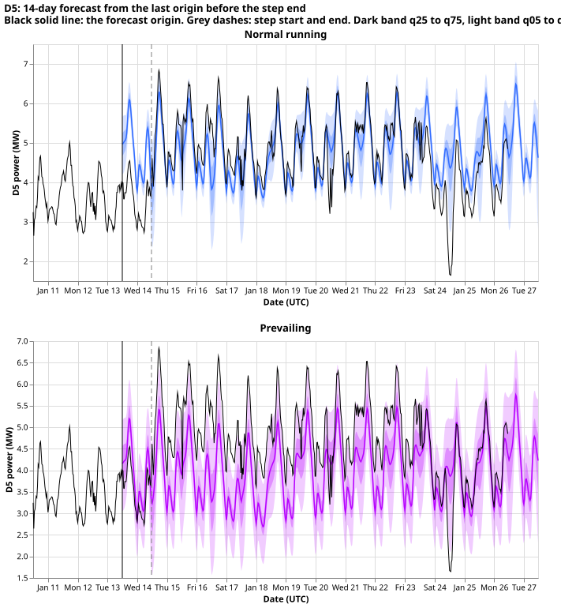

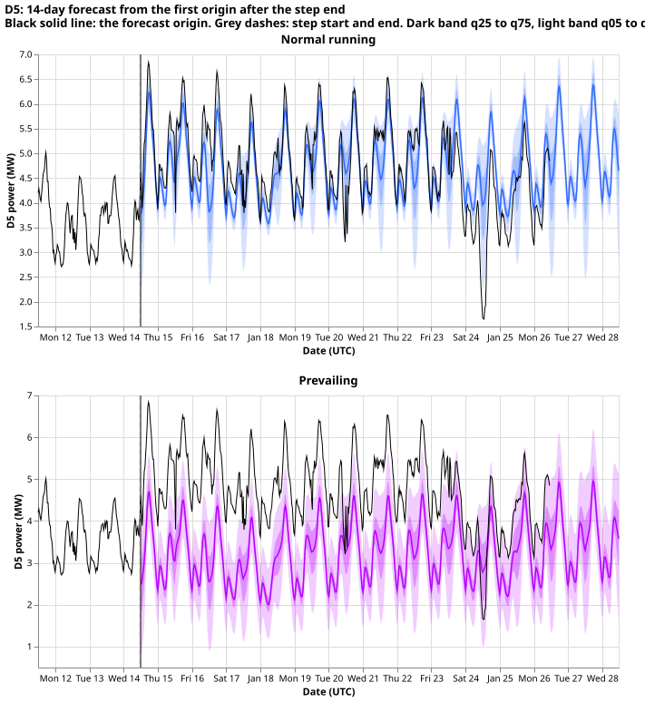

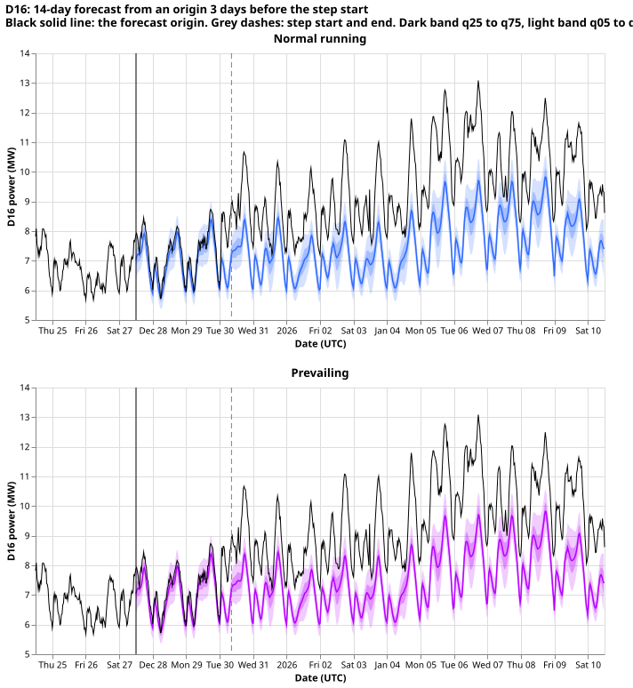

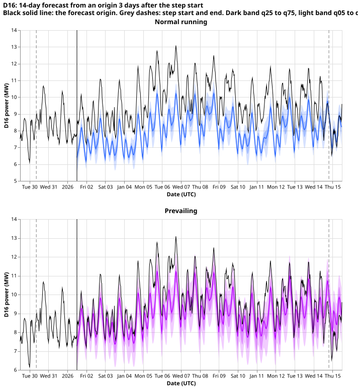

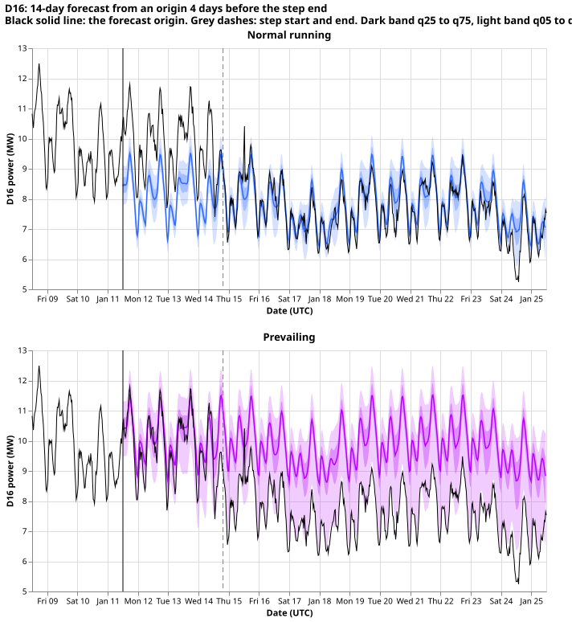

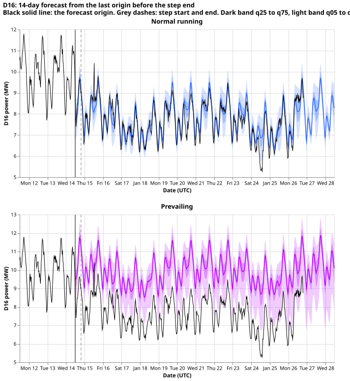

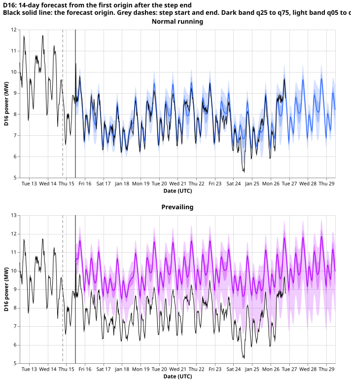

## BSPs and GSPs

The two BSPs and two GSPs are forecast by the lag-enabled network of [experiment
633](../00633-bakeoff-final-test-bg2-and-lag-enabled-bsp-gsp-network/result.md), which is
experiment 622's arm `lagged_b1`. The backtest is [experiment
669](../00669-one-year-backtest-of-the-lag-network-at-bulk-and-grid-supply-points/result.md). The
network has no neighbour inputs and no model of load-shift events. Its readings are net of embedded
generation, which no input models.

### Method

- **Inputs.** The same 37 lag-free columns, 8 lag columns, knot position, expected-weather table
  for the lag encoder (the weather and calendar columns of the freshest run issued at or before the
  lag's own time, passed through the same encoders), and 14 thermal-lag and solar-gain columns as
  the Candidate network above, at the 4 series, with one embedding of
  the series (2 entries per group), and no signal columns and no neighbour inputs. The 51-member
  means and standard deviations are taken at the series' H3 resolution-5 cell.
- **Lags.** The stored network read lags at least 24 hours old. The backtest retrains it with the
  3.5-hour cap of experiment 572 (7 half-hours before the 09:00 origin), so the newest power is the
  05:30 reading, 6.5 hours before the 12:00 origin.
- **Architecture.** The same encoders and mixer as the Candidate with a lag encoder of 83 inputs
  (3 lag columns, the two 32-wide expected-weather and expected-datetime embeddings, and the
  embeddings of the series and the lag), and a mixer with 145 inputs. One network is fitted per
  group
  (the two BSPs together, the two GSPs together), so the weights are shared across the 2 series of a
  group except for the series embedding and the offset.
- **Offset, loss, and quantiles.** The offset, loss, quantile bisection, and sorting are those of
  the Candidate, with no width factor.
- **Targets.** Power divided by effective capacity (D13 55.3 MW, D17 47.6 MW, D6 384.3 MW, D1
  170.9 MW), z-scored per series. The series are signed MW series.
- **Training.** The same three steps as the Candidate (ERA5 and CAMS pre-training, a step 2 with a
  fresh mixer of seed 12345 and frozen encoders, and a fine-tune with a 90-day half-life), the same
  optimiser settings, and a 3-day embargo. Fine-tuning rows span 730 days before the cut-off, with
  targets ending 3.5 hours before it. Lag block dropout is 30% of days (both lags), of which 15%
  mask
  the day lag only. Two seeds are averaged quantile by quantile and sorted.
- **Origin.** The network runs at its own origin of 09:00 UTC, the 00Z run plus 9 hours, and its
  output is relabelled with 12:00 UTC. Every input that the network reads at 09:00 was available at
  12:00.
- **Refits.** Twelve monthly refits, one per test month 2025-11 to 2026-10, with the
  3-day embargo of the schedule. The final-test network of experiment 633 was one fit at 2026-07-01.
- **Where each piece came from.** As for the Candidate; the node harness and pooling: 564 and 611;
  the lag network at the nodes: 619; the matched rematch: 622; the final test: 633.

### Performance

#### 2 bulk supply points: all rows and by lead band

**The network beats both baselines at every lead band, and the margin shrinks with the lead.** The
tables give normalised error in points of capacity (percent of capacity; smaller is better), as the
mean over scored half-hours, and the gain of the network over each baseline with a 95% day-block
bootstrap interval from 2,000 resamples of origin days. The manual heuristic is the lagged-power
rule and climatology is the month, half-hour, and weekend-flag quantiles, both described under
[Comparison baselines](#comparison-baselines-slices-and-summary-figures). Days 10 to 14 are reported
separately because they lie beyond the 10-day horizon of the earlier stored backtests.

Normalised MAE of the median:

| Group | Half-hours | Model | Manual heuristic | Climatology | Gain over heuristic (%) | Gain over climatology (%) |
|---|---:|---:|---:|---:|---|---|
| days 0 to 1 | 35,014 | 7.71 | 12.09 | 13.07 | 36.3 (34.0 to 38.4) | 41.0 (38.9 to 43.2) |
| days 1 to 3 | 70,028 | 8.46 | 12.09 | 13.07 | 30.0 (28.0 to 31.9) | 35.3 (33.3 to 37.2) |
| days 3 to 7 | 139,970 | 10.13 | 12.09 | 13.07 | 16.2 (14.5 to 17.8) | 22.5 (20.8 to 24.0) |
| days 7 to 10 | 104,846 | 11.19 | 12.28 | 13.14 | 8.9 (6.9 to 10.8) | 14.9 (13.2 to 16.5) |
| days 10 to 14 | 138,560 | 11.68 | 12.30 | 13.22 | 5.1 (3.5 to 6.7) | 11.7 (10.1 to 13.0) |

CRPS (2 × mean pinball loss over the 11 levels):

| Group | Half-hours | Model | Manual heuristic | Climatology | Gain over heuristic (%) | Gain over climatology (%) |
|---|---:|---:|---:|---:|---|---|
| days 0 to 1 | 35,014 | 4.27 | 6.83 | 7.23 | 37.5 (35.3 to 39.7) | 41.0 (39.0 to 43.1) |
| days 1 to 3 | 70,028 | 4.67 | 6.83 | 7.24 | 31.5 (29.4 to 33.5) | 35.4 (33.5 to 37.3) |
| days 3 to 7 | 139,970 | 5.55 | 6.82 | 7.24 | 18.7 (17.0 to 20.4) | 23.4 (21.7 to 24.9) |
| days 7 to 10 | 104,846 | 6.13 | 6.98 | 7.28 | 12.3 (10.3 to 14.2) | 15.8 (14.2 to 17.4) |
| days 10 to 14 | 138,560 | 6.41 | 7.00 | 7.32 | 8.5 (6.9 to 10.1) | 12.5 (10.9 to 13.9) |

#### 2 bulk supply points: by season

Seasons are meteorological and refer to the season of the forecast origin. Autumn is split into the
months at the start of the backtest (2025-11) and at its end (2026-09 and 2026-10), because the
backtest year does not contain a full autumn.

Normalised MAE of the median:

| Group | Half-hours | Model | Manual heuristic | Climatology | Gain over heuristic (%) | Gain over climatology (%) |
|---|---:|---:|---:|---:|---|---|
| autumn (Nov 2025) | 40,320 | 9.18 | 12.04 | 10.96 | 23.7 (21.7 to 25.8) | 16.2 (13.7 to 18.5) |
| winter | 120,960 | 9.50 | 11.42 | 12.13 | 16.8 (14.5 to 19.0) | 21.7 (18.8 to 24.3) |
| spring | 123,620 | 11.63 | 13.36 | 15.19 | 12.9 (11.5 to 14.4) | 23.4 (21.6 to 25.3) |
| summer | 123,312 | 10.79 | 12.08 | 13.24 | 10.7 (9.4 to 12.1) | 18.5 (16.8 to 20.3) |
| autumn (Sep to Oct 2026) | 80,206 | 9.78 | 11.80 | 12.38 | 17.1 (13.2 to 21.3) | 21.0 (18.7 to 23.0) |

CRPS:

| Group | Half-hours | Model | Manual heuristic | Climatology | Gain over heuristic (%) | Gain over climatology (%) |
|---|---:|---:|---:|---:|---|---|
| autumn (Nov 2025) | 40,320 | 5.06 | 6.95 | 6.09 | 27.2 (24.9 to 29.5) | 16.9 (14.7 to 19.0) |
| winter | 120,960 | 5.21 | 6.53 | 6.64 | 20.3 (17.7 to 22.7) | 21.6 (18.7 to 24.3) |
| spring | 123,620 | 6.35 | 7.54 | 8.21 | 15.7 (14.3 to 17.1) | 22.6 (20.8 to 24.5) |
| summer | 123,312 | 5.90 | 6.83 | 7.50 | 13.6 (12.2 to 15.1) | 21.4 (19.7 to 23.2) |
| autumn (Sep to Oct 2026) | 80,206 | 5.45 | 6.61 | 7.00 | 17.6 (13.7 to 21.9) | 22.2 (19.6 to 24.5) |

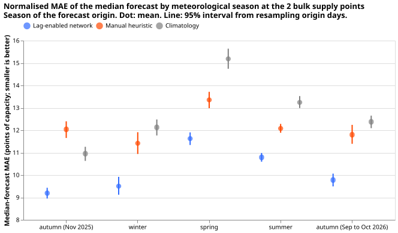

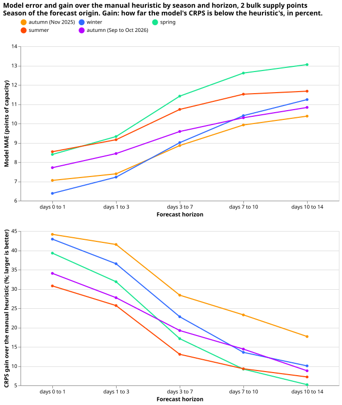

#### 2 bulk supply points: by calendar month

Normalised MAE of the median, by month of the forecast origin:

| Group | Half-hours | Model | Manual heuristic | Climatology | Gain over heuristic (%) | Gain over climatology (%) |
|---|---:|---:|---:|---:|---|---|
| 2025-11 | 40,320 | 9.18 | 12.04 | 10.96 | 23.7 (21.7 to 25.8) | 16.2 (13.7 to 18.5) |
| 2025-12 | 41,664 | 8.12 | 10.45 | 10.64 | 22.3 (19.1 to 25.4) | 23.7 (20.3 to 27.0) |
| 2026-01 | 41,664 | 9.26 | 10.51 | 12.33 | 11.9 (7.7 to 16.5) | 24.9 (20.3 to 29.3) |
| 2026-02 | 37,632 | 11.31 | 13.50 | 13.55 | 16.2 (13.3 to 19.2) | 16.6 (12.0 to 21.2) |
| 2026-03 | 41,636 | 12.85 | 14.84 | 16.16 | 13.4 (11.4 to 15.8) | 20.5 (18.4 to 22.9) |
| 2026-04 | 40,320 | 11.51 | 13.72 | 16.36 | 16.1 (13.6 to 18.6) | 29.6 (26.8 to 32.3) |
| 2026-05 | 41,664 | 10.52 | 11.51 | 13.08 | 8.6 (6.6 to 10.5) | 19.6 (17.6 to 21.6) |
| 2026-06 | 40,320 | 10.21 | 11.87 | 13.61 | 14.0 (12.4 to 15.5) | 24.9 (22.1 to 27.6) |
| 2026-07 | 41,664 | 10.92 | 11.77 | 12.74 | 7.2 (5.2 to 9.0) | 14.3 (12.1 to 16.3) |
| 2026-08 | 41,328 | 11.21 | 12.60 | 13.39 | 11.0 (8.0 to 14.0) | 16.3 (13.2 to 19.2) |
| 2026-09 | 40,320 | 9.52 | 10.97 | 12.44 | 13.2 (10.3 to 15.7) | 23.4 (20.6 to 26.1) |
| 2026-10 | 39,886 | 10.03 | 12.64 | 12.31 | 20.6 (13.6 to 27.4) | 18.5 (15.3 to 21.8) |

**Scored rows.** Of the 490,560 rows, 488,418 are scored. The rest have no observed power: the
ground-truth files end at 2026-11-09 08:00 UTC, so the last origins of 2026-10 cannot be scored in
full at long leads, and a few half-hours inside the year are missing or flagged by the cleaning.

#### 2 grid supply points: all rows and by lead band

**The network beats both baselines at every lead band, and the margin shrinks with the lead.** The
tables give normalised error in points of capacity (percent of capacity; smaller is better), as the
mean over scored half-hours, and the gain of the network over each baseline with a 95% day-block
bootstrap interval from 2,000 resamples of origin days. The manual heuristic is the lagged-power
rule and climatology is the month, half-hour, and weekend-flag quantiles, both described under
[Comparison baselines](#comparison-baselines-slices-and-summary-figures). Days 10 to 14 are reported
separately because they lie beyond the 10-day horizon of the earlier stored backtests.

Normalised MAE of the median:

| Group | Half-hours | Model | Manual heuristic | Climatology | Gain over heuristic (%) | Gain over climatology (%) |
|---|---:|---:|---:|---:|---|---|
| days 0 to 1 | 35,036 | 19.27 | 28.30 | 36.38 | 31.9 (28.5 to 35.0) | 47.0 (43.9 to 49.9) |
| days 1 to 3 | 70,072 | 21.06 | 28.41 | 36.46 | 25.8 (22.8 to 28.7) | 42.2 (39.4 to 45.0) |
| days 3 to 7 | 140,058 | 24.48 | 28.49 | 36.46 | 14.1 (11.8 to 16.3) | 32.9 (30.2 to 35.5) |
| days 7 to 10 | 104,912 | 27.02 | 28.93 | 36.65 | 6.6 (4.6 to 8.7) | 26.3 (23.5 to 29.1) |
| days 10 to 14 | 138,648 | 27.64 | 28.82 | 36.72 | 4.1 (2.5 to 5.7) | 24.7 (21.9 to 27.4) |

CRPS (2 × mean pinball loss over the 11 levels):

| Group | Half-hours | Model | Manual heuristic | Climatology | Gain over heuristic (%) | Gain over climatology (%) |
|---|---:|---:|---:|---:|---|---|
| days 0 to 1 | 35,036 | 10.52 | 15.60 | 18.69 | 32.6 (29.4 to 35.4) | 43.7 (40.7 to 46.4) |
| days 1 to 3 | 70,072 | 11.44 | 15.66 | 18.74 | 27.0 (24.3 to 29.5) | 39.0 (36.3 to 41.6) |
| days 3 to 7 | 140,058 | 13.18 | 15.69 | 18.75 | 16.0 (14.1 to 17.9) | 29.7 (27.5 to 32.1) |
| days 7 to 10 | 104,912 | 14.52 | 16.07 | 18.83 | 9.7 (7.8 to 11.6) | 22.9 (20.3 to 25.5) |
| days 10 to 14 | 138,648 | 14.78 | 16.03 | 18.87 | 7.8 (6.3 to 9.4) | 21.7 (19.1 to 24.2) |

#### 2 grid supply points: by season

Seasons are meteorological and refer to the season of the forecast origin. Autumn is split into the
months at the start of the backtest (2025-11) and at its end (2026-09 and 2026-10), because the
backtest year does not contain a full autumn.

Normalised MAE of the median:

| Group | Half-hours | Model | Manual heuristic | Climatology | Gain over heuristic (%) | Gain over climatology (%) |
|---|---:|---:|---:|---:|---|---|
| autumn (Nov 2025) | 40,320 | 35.48 | 38.76 | 40.75 | 8.5 (5.6 to 10.9) | 12.9 (11.3 to 14.6) |
| winter | 120,960 | 31.93 | 38.59 | 37.44 | 17.3 (14.9 to 19.7) | 14.7 (11.4 to 18.0) |
| spring | 123,620 | 23.00 | 25.98 | 37.93 | 11.5 (9.1 to 13.7) | 39.4 (38.1 to 40.7) |
| summer | 123,620 | 16.28 | 18.50 | 34.17 | 12.0 (9.6 to 14.3) | 52.4 (51.0 to 53.6) |
| autumn (Sep to Oct 2026) | 80,206 | 26.16 | 28.35 | 34.74 | 7.7 (2.3 to 13.1) | 24.7 (14.8 to 33.3) |

CRPS:

| Group | Half-hours | Model | Manual heuristic | Climatology | Gain over heuristic (%) | Gain over climatology (%) |
|---|---:|---:|---:|---:|---|---|
| autumn (Nov 2025) | 40,320 | 18.10 | 19.99 | 20.08 | 9.5 (6.3 to 12.3) | 9.9 (8.1 to 11.7) |
| winter | 120,960 | 16.55 | 19.88 | 19.05 | 16.7 (14.8 to 18.8) | 13.1 (10.4 to 15.8) |
| spring | 123,620 | 12.80 | 14.78 | 19.82 | 13.4 (11.3 to 15.3) | 35.4 (34.0 to 36.8) |
| summer | 123,620 | 9.20 | 11.32 | 17.39 | 18.7 (15.9 to 21.5) | 47.1 (45.5 to 48.5) |
| autumn (Sep to Oct 2026) | 80,206 | 14.17 | 16.37 | 18.36 | 13.5 (8.7 to 18.3) | 22.9 (14.5 to 30.3) |

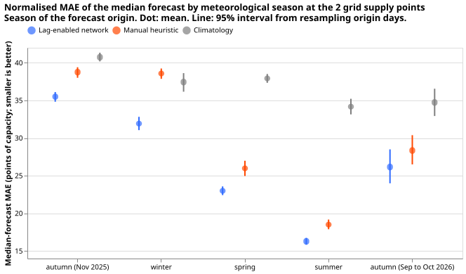

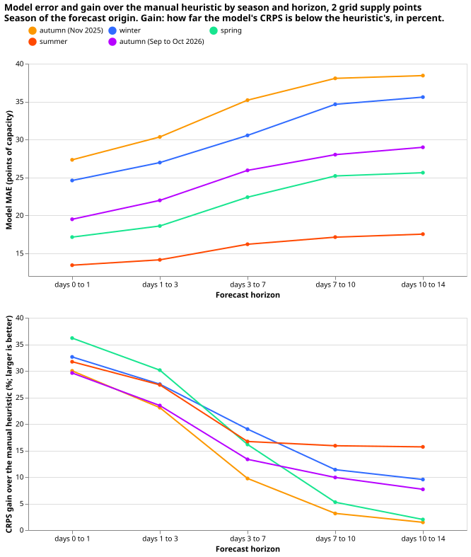

#### 2 grid supply points: by calendar month

Normalised MAE of the median, by month of the forecast origin:

| Group | Half-hours | Model | Manual heuristic | Climatology | Gain over heuristic (%) | Gain over climatology (%) |
|---|---:|---:|---:|---:|---|---|
| 2025-11 | 40,320 | 35.48 | 38.76 | 40.75 | 8.5 (5.6 to 10.9) | 12.9 (11.3 to 14.6) |
| 2025-12 | 41,664 | 31.36 | 40.46 | 43.11 | 22.5 (17.8 to 27.0) | 27.3 (24.5 to 30.1) |
| 2026-01 | 41,664 | 32.44 | 37.27 | 32.82 | 12.9 (10.4 to 15.5) | 1.1 (-2.6 to 5.0) |
| 2026-02 | 37,632 | 31.99 | 37.98 | 36.29 | 15.8 (11.8 to 19.5) | 11.8 (5.8 to 17.1) |
| 2026-03 | 41,636 | 25.41 | 32.09 | 40.29 | 20.8 (18.7 to 22.9) | 36.9 (34.8 to 38.9) |
| 2026-04 | 40,320 | 21.40 | 23.13 | 34.83 | 7.5 (4.0 to 10.8) | 38.6 (35.8 to 41.3) |
| 2026-05 | 41,664 | 22.14 | 22.64 | 38.57 | 2.2 (0.9 to 3.5) | 42.6 (41.3 to 44.0) |
| 2026-06 | 40,320 | 15.99 | 18.81 | 34.75 | 15.0 (13.3 to 16.7) | 54.0 (53.0 to 54.9) |
| 2026-07 | 41,664 | 15.93 | 15.40 | 28.77 | -3.5 (-6.7 to -0.5) | 44.6 (42.6 to 46.5) |
| 2026-08 | 41,636 | 16.92 | 21.32 | 39.03 | 20.7 (18.1 to 23.2) | 56.7 (54.7 to 58.6) |
| 2026-09 | 40,320 | 20.07 | 25.77 | 41.34 | 22.1 (19.6 to 24.6) | 51.5 (49.4 to 53.4) |
| 2026-10 | 39,886 | 32.33 | 30.97 | 28.06 | -4.4 (-12.4 to 3.6) | -15.2 (-27.5 to -4.0) |

**Scored rows.** Of the 490,560 rows, 488,726 are scored. The rest have no observed power: the
ground-truth files end at 2026-11-09 08:00 UTC, so the last origins of 2026-10 cannot be scored in
full at long leads, and a few half-hours inside the year are missing or flagged by the cleaning.

## Wind

Wind farms are forecast by the simple network S of [experiment
659](../00659-simple-shared-network-with-fixed-physics-lite-power-wind-and-solar/result.md). The
backtest is [experiment
666](../00666-one-year-backtest-of-simple-wind-and-solar-networks/result.md).

### Method

- **Inputs.** The mean and standard deviation over the 51 members of 10 m and 100 m wind speed,
  the sine and cosine of the 100 m wind direction, and 2 m air temperature, plus the lead (the
  sine and cosine of the lead in hours modulo 24, and the lead in hundreds of hours) and a one-hot
  wind-farm
  column. There is no power lag, no calendar column, and no physics-lite input in network S.
- **Architecture.** Two hidden layers of 64 units feeding a three-component Gaussian mixture over
  power as a fraction of capacity, centred on the training mean of the target. The 11 quantiles are
  read from the mixture and clamped to the range 0 to 1 of capacity. Inputs are standardised with
  the
  fit rows' mean and standard deviation.
- **Training.** AdamW, learning rate 0.002, batch 2048, weight decay 0.0001, 40 epochs, and the
  epoch with the lowest negative log-likelihood on the last 62 days is kept. Idle readings
  (experiment 210's idle mask) are set to zero in training
  and scoring. Three seeds are averaged quantile by quantile.
- **Capacity.** The 99.9th percentile of the farm's power over the 730 days before each refit.
- **Refits.** Wind refits on day 0 of each month (12 refits), training on runs before 62
  days earlier. No ERA5 or CAMS pre-training. Experiment 659 refitted twice a month.
- **Missing inputs.** The network reads only the ensemble weather. The end date of the idle mask
  is read at run time, and the performance section states it.

### Performance

**The network beats climatology at short leads and the margin shrinks with the lead
time.** All numbers are normalised error in points of capacity (percent of capacity; smaller is
better), averaged over 709,776 half-hours with observed power (of 735,840 rows). The only baseline
is climatology: the quantiles of the farm's own cleaned power in the same month, half-hour, and
neighbouring cells, trained before the first day of the origin's month. No manual heuristic exists
for wind farms, so none is shown. Gains are those of the network over climatology, with a 95%
day-block bootstrap interval from 2,000 resamples of origin days. The observed power of half-hours
inside experiment 210's idle mask, which ends in September of the backtest year, is set to zero, as
it was when the network was fitted. Excluding those half-hours instead scores 655,288 half-hours
(709,776 with the idle half-hours as zero), and the network's CRPS gain over climatology changes
from 16.2% to 15.0%. The 26,064 rows with no observed power are not scored.

#### By lead band

Normalised MAE of the median:

| Group | Half-hours | Model | Climatology | Gain over climatology (%) |
|---|---:|---:|---:|---|
| days 0 to 1 | 50,974 | 8.19 | 18.13 | 54.8 (52.5 to 57.1) |
| days 1 to 3 | 101,918 | 9.86 | 18.14 | 45.6 (43.2 to 48.1) |
| days 3 to 7 | 203,588 | 14.08 | 18.01 | 21.8 (19.6 to 24.1) |
| days 7 to 10 | 152,020 | 17.36 | 18.05 | 3.8 (1.8 to 5.8) |
| days 10 to 14 | 201,276 | 18.29 | 18.03 | -1.4 (-2.6 to -0.3) |

CRPS (2 × mean pinball loss over the 11 levels):

| Group | Half-hours | Model | Climatology | Gain over climatology (%) |
|---|---:|---:|---:|---|
| days 0 to 1 | 50,974 | 4.58 | 9.72 | 52.9 (50.5 to 55.2) |
| days 1 to 3 | 101,918 | 5.47 | 9.73 | 43.8 (41.4 to 46.2) |
| days 3 to 7 | 203,588 | 7.68 | 9.67 | 20.6 (18.4 to 22.8) |
| days 7 to 10 | 152,020 | 9.36 | 9.69 | 3.4 (1.3 to 5.4) |
| days 10 to 14 | 201,276 | 9.86 | 9.68 | -1.8 (-3.3 to -0.4) |

#### By season

Seasons are meteorological and refer to the season of the forecast origin. The backtest year
contains no complete autumn, so autumn is reported as its first month and its last two months. Dates
are not given for generator series.

Normalised MAE of the median:

| Group | Half-hours | Model | Climatology | Gain over climatology (%) |
|---|---:|---:|---:|---|
| autumn (first month) | 58,226 | 20.33 | 22.59 | 10.0 (8.2 to 11.8) |
| winter | 181,440 | 17.99 | 21.53 | 16.4 (14.4 to 18.4) |
| spring | 180,678 | 14.63 | 18.44 | 20.7 (18.7 to 22.5) |
| summer | 176,840 | 10.07 | 11.85 | 15.0 (13.0 to 16.7) |
| autumn (last two months) | 112,592 | 15.45 | 19.24 | 19.7 (16.1 to 23.4) |

CRPS:

| Group | Half-hours | Model | Climatology | Gain over climatology (%) |
|---|---:|---:|---:|---|
| autumn (first month) | 58,226 | 11.04 | 11.86 | 6.9 (5.2 to 8.6) |
| winter | 181,440 | 9.68 | 11.40 | 15.1 (13.4 to 16.9) |
| spring | 180,678 | 7.92 | 9.84 | 19.6 (17.8 to 21.3) |
| summer | 176,840 | 5.60 | 6.69 | 16.3 (14.7 to 17.8) |
| autumn (last two months) | 112,592 | 8.38 | 10.29 | 18.6 (14.6 to 22.5) |

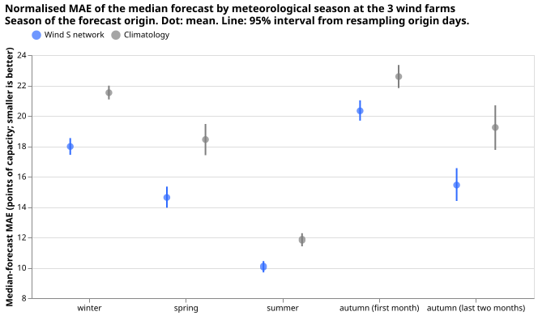

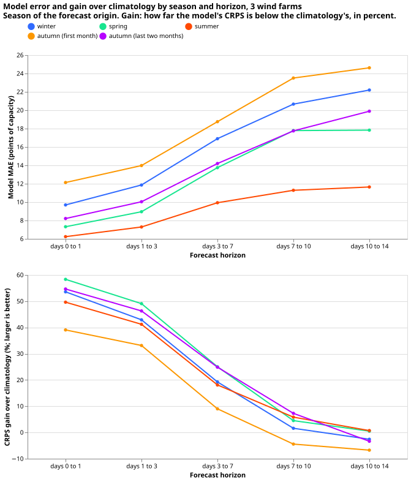

#### By month and by farm

Normalised MAE of the median by month of the forecast origin (month number, 1 for January):

| Group | Half-hours | Model | Climatology | Gain over climatology (%) |
|---|---:|---:|---:|---|
| 01 | 62,496 | 18.91 | 21.62 | 12.5 (8.5 to 16.2) |
| 02 | 56,448 | 17.61 | 21.11 | 16.6 (13.7 to 19.4) |
| 03 | 62,046 | 17.89 | 24.05 | 25.6 (22.7 to 28.6) |
| 04 | 58,456 | 14.31 | 17.14 | 16.5 (13.7 to 19.0) |
| 05 | 60,176 | 11.57 | 13.92 | 16.8 (14.9 to 18.8) |
| 06 | 58,501 | 10.71 | 12.65 | 15.3 (12.4 to 18.3) |
| 07 | 59,726 | 9.54 | 11.63 | 18.0 (15.4 to 20.5) |
| 08 | 58,613 | 9.98 | 11.26 | 11.4 (8.3 to 14.6) |
| 09 | 57,492 | 12.79 | 14.59 | 12.4 (9.0 to 15.8) |
| 10 | 55,100 | 18.22 | 24.08 | 24.3 (19.4 to 29.7) |
| 11 | 58,226 | 20.33 | 22.59 | 10.0 (8.2 to 11.8) |
| 12 | 62,496 | 17.40 | 21.81 | 20.2 (17.3 to 23.1) |

Normalised MAE of the median by farm. The labels A to C are in the order of the
farms' identifiers and are not the labels of earlier pages:

| Group | Half-hours | Model | Climatology | Gain over climatology (%) |
|---|---:|---:|---:|---|
| Wind A | 239,594 | 16.75 | 20.40 | 17.9 (16.6 to 19.2) |
| Wind B | 235,881 | 13.40 | 15.71 | 14.7 (13.1 to 16.3) |
| Wind C | 234,301 | 14.67 | 18.01 | 18.6 (17.4 to 19.8) |

## Solar

Solar farms are forecast by the simple network PLP of experiment 659. The backtest is
experiment 666.

### Method

- **Inputs.** The mean and standard deviation over the 51 members of shortwave radiation, air
  temperature, and 10 m wind speed; the ensemble means of relative humidity, longwave radiation,
  precipitation, and surface pressure; the sun's elevation and the sine and cosine of its azimuth;
  the lead; and the mean and standard deviation of a physics-lite power and of the cell
  temperature. There is no farm column and no calendar column.
- **Physics-lite power.** Irradiance over 1000 W per square metre, times one minus 0.004 per kelvin
  times the cell temperature minus 25 degrees Celsius, clipped to the range 0 to 1, with the Faiman
  cell temperature `T_air + G / (25 + 6.84 x wind speed)`. The formula runs on each of the 51
  members
  separately, and the network reads the mean and standard deviation. The mixture is centred on the
  mean physics-lite power.
- **Architecture, loss, and optimiser.** As for wind, with 20 epochs, the epoch with the lowest
  negative log-likelihood on the last 61 days kept, and a lead range extended to 336 hours
  (experiments 430 and 659 stopped at 251.5 hours). Solar has no idle mask, and the target is the
  raw output.
- **Night rows.** The network forecasts only the half-hours where the mean cosine of the solar
  zenith angle over the ensemble step is above zero, and the network sets the quantiles of the other
  half-hours to 0. That gate is not the daylight rule that the scores use, which takes the zenith at
  the middle of the half-hour, so a coarse ensemble step that contains a sunrise or a sunset leaves
  small non-zero quantiles on the neighbouring night half-hours. The file is clamped afterwards (see
  "The files"): every quantile is 0 wherever the zenith at the middle of the half-hour is 90 degrees
  or more.
- **Refits.** Quarterly: 2025-11-01, 2026-02-01, 2026-05-01, and 2026-08-01, each scoring
  the next
  three months, 3 seeds each, with no pre-training.
- **Capacity.** As for wind.
- **Missing inputs.** The network reads only the ensemble weather.

### Performance

**The network beats climatology at short leads and the margin shrinks with the lead
time.** All numbers are normalised error in points of capacity (percent of capacity; smaller is
better), averaged over 685,472 daylight half-hours with observed power (of 1,471,680 rows, which
include night half-hours). The only baseline is climatology: the quantiles of the farm's own cleaned
power in the same month, half-hour, and neighbouring cells, trained before the first day of the
origin's month. No manual heuristic exists for solar farms, so none is shown. Gains are those of the
network over climatology, with a 95% day-block bootstrap interval from 2,000 resamples of origin
days. Only daylight half-hours are scored: those where the sun is above the horizon at the middle of
the half-hour. 64,772 daylight half-hours have no observed power and are not scored, mostly in the
warmer months (up to 14,010 in one month).

#### By lead band

Normalised MAE of the median:

| Group | Half-hours | Model | Climatology | Gain over climatology (%) |
|---|---:|---:|---:|---|
| days 0 to 1 | 49,221 | 8.74 | 14.85 | 41.2 (38.1 to 44.1) |
| days 1 to 3 | 98,409 | 9.75 | 14.85 | 34.4 (31.5 to 37.0) |
| days 3 to 7 | 196,358 | 12.08 | 14.90 | 18.9 (16.4 to 21.4) |
| days 7 to 10 | 146,927 | 13.48 | 14.96 | 9.9 (7.0 to 12.6) |
| days 10 to 14 | 194,557 | 14.18 | 15.04 | 5.7 (3.4 to 7.9) |

CRPS (2 × mean pinball loss over the 11 levels):

| Group | Half-hours | Model | Climatology | Gain over climatology (%) |
|---|---:|---:|---:|---|
| days 0 to 1 | 49,221 | 4.83 | 7.68 | 37.1 (34.6 to 39.6) |
| days 1 to 3 | 98,409 | 5.33 | 7.69 | 30.7 (28.4 to 33.0) |
| days 3 to 7 | 196,358 | 6.35 | 7.71 | 17.6 (15.7 to 19.6) |
| days 7 to 10 | 146,927 | 6.89 | 7.73 | 10.8 (8.8 to 12.7) |
| days 10 to 14 | 194,557 | 7.18 | 7.76 | 7.6 (6.0 to 9.0) |

#### By season

Seasons are meteorological and refer to the season of the forecast origin. The backtest year
contains no complete autumn, so autumn is reported as its first month and its last two months. Dates
are not given for generator series.

Normalised MAE of the median:

| Group | Half-hours | Model | Climatology | Gain over climatology (%) |
|---|---:|---:|---:|---|
| autumn (first month) | 40,712 | 8.81 | 9.70 | 9.3 (6.4 to 11.8) |
| winter | 130,001 | 10.75 | 11.07 | 2.9 (-0.3 to 6.1) |
| spring | 203,122 | 13.59 | 17.12 | 20.6 (17.5 to 23.6) |
| summer | 215,329 | 11.98 | 15.42 | 22.3 (20.1 to 24.6) |
| autumn (last two months) | 96,308 | 14.60 | 16.73 | 12.7 (9.9 to 15.4) |

CRPS:

| Group | Half-hours | Model | Climatology | Gain over climatology (%) |
|---|---:|---:|---:|---|
| autumn (first month) | 40,712 | 4.57 | 5.33 | 14.1 (11.6 to 16.5) |
| winter | 130,001 | 5.45 | 6.04 | 9.7 (7.2 to 12.2) |
| spring | 203,122 | 7.13 | 8.77 | 18.8 (16.6 to 20.9) |
| summer | 215,329 | 6.32 | 7.85 | 19.4 (17.7 to 21.2) |
| autumn (last two months) | 96,308 | 7.41 | 8.52 | 13.0 (10.9 to 15.1) |

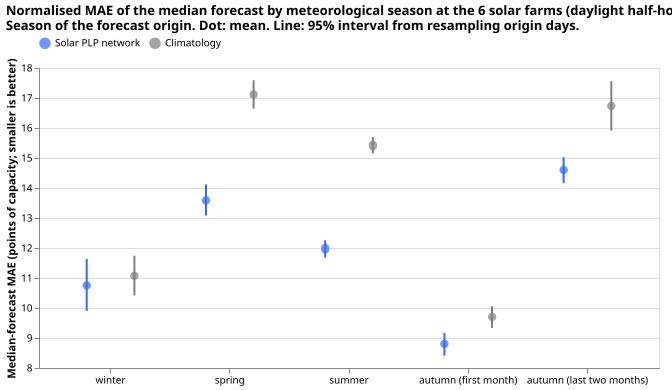

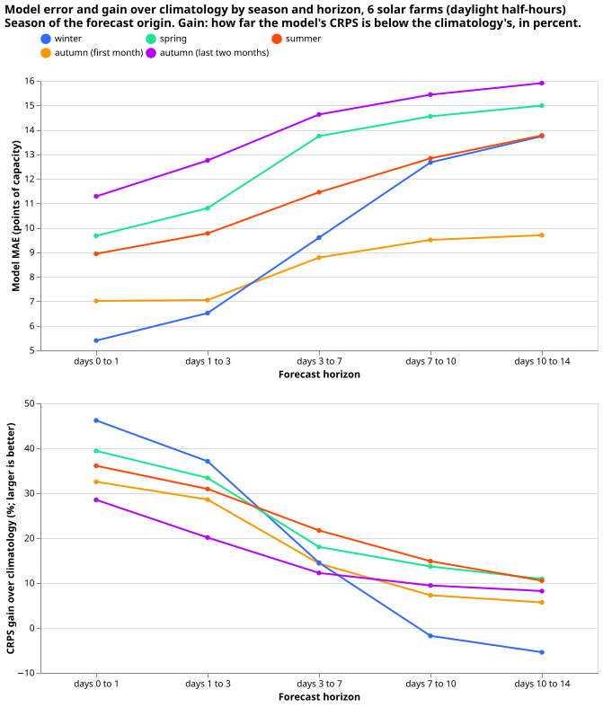

#### By month and by farm

Normalised MAE of the median by month of the forecast origin (month number, 1 for January):

| Group | Half-hours | Model | Climatology | Gain over climatology (%) |
|---|---:|---:|---:|---|
| 01 | 43,485 | 9.38 | 9.87 | 5.0 (1.5 to 8.3) |
| 02 | 47,779 | 14.78 | 14.34 | -3.1 (-8.1 to 2.0) |
| 03 | 60,031 | 16.63 | 18.38 | 9.5 (5.8 to 13.2) |
| 04 | 66,162 | 13.10 | 18.23 | 28.2 (23.5 to 32.2) |
| 05 | 76,929 | 11.63 | 15.17 | 23.4 (18.7 to 28.0) |
| 06 | 77,465 | 11.49 | 14.58 | 21.2 (17.0 to 25.5) |
| 07 | 69,141 | 12.42 | 16.40 | 24.2 (22.0 to 26.4) |
| 08 | 68,723 | 12.07 | 15.37 | 21.5 (16.5 to 26.5) |
| 09 | 55,978 | 15.17 | 17.79 | 14.7 (11.1 to 18.3) |
| 10 | 40,330 | 13.81 | 15.27 | 9.5 (5.6 to 13.3) |
| 11 | 40,712 | 8.81 | 9.70 | 9.3 (6.4 to 11.8) |
| 12 | 38,737 | 7.34 | 8.40 | 12.6 (10.3 to 14.8) |

Normalised MAE of the median by farm. The labels A to F are in the order of the
farms' identifiers and are not the labels of earlier pages:

| Group | Half-hours | Model | Climatology | Gain over climatology (%) |
|---|---:|---:|---:|---|
| Solar A | 120,463 | 11.79 | 14.23 | 17.2 (15.6 to 18.7) |
| Solar B | 122,261 | 12.10 | 15.11 | 19.9 (18.0 to 21.7) |
| Solar C | 98,671 | 12.62 | 15.84 | 20.3 (17.8 to 22.6) |
| Solar D | 102,085 | 14.40 | 17.08 | 15.7 (14.0 to 17.4) |
| Solar E | 123,904 | 11.50 | 13.64 | 15.7 (14.2 to 17.3) |
| Solar F | 118,088 | 12.37 | 14.26 | 13.3 (11.5 to 14.9) |

## Performance by season

**The CRPS gain over climatology is positive in all five seasons for all five types, and the season
with the largest gain differs by type.** The GSPs gain most in summer (47.1%), the Primaries in the
first autumn month (36.4%), wind in spring, and solar in summer. The seasons are the meteorological
seasons: winter (December to February), spring (March to May), summer (June to August), and autumn
(September to November). The backtest year runs from 2025-11 to 2026-10, so autumn is split into its
first month and its last two months. Generator series carry season labels and no calendar dates. Each
cell is the gain of the model's CRPS over the baseline, with a 95% day-block bootstrap interval from
2,000 resamples of origin days.

Gain in CRPS over climatology (%):

| Type | autumn (first month) | winter | spring | summer | autumn (last two months) |
|---|---:|---:|---:|---:|---:|
| Primaries (normal running) | 36.4 (32.5 to 40.2) | 31.4 (29.8 to 32.9) | 31.5 (30.1 to 32.7) | 28.0 (26.2 to 29.8) | 22.7 (21.4 to 24.0) |
| BSPs | 16.9 (14.7 to 19.0) | 21.6 (18.7 to 24.3) | 22.6 (20.8 to 24.5) | 21.4 (19.7 to 23.2) | 22.2 (19.6 to 24.5) |
| GSPs | 9.9 (8.1 to 11.7) | 13.1 (10.4 to 15.8) | 35.4 (34.0 to 36.8) | 47.1 (45.5 to 48.5) | 22.9 (14.5 to 30.3) |
| Wind | 6.9 (5.2 to 8.6) | 15.1 (13.4 to 16.9) | 19.6 (17.8 to 21.3) | 16.3 (14.7 to 17.8) | 18.6 (14.6 to 22.5) |
| Solar | 14.1 (11.6 to 16.5) | 9.7 (7.2 to 12.2) | 18.8 (16.6 to 20.9) | 19.4 (17.7 to 21.2) | 13.0 (10.9 to 15.1) |

Gain in CRPS over the manual heuristic (%); wind and solar have no manual heuristic:

| Type | autumn (first month) | winter | spring | summer | autumn (last two months) |
|---|---:|---:|---:|---:|---:|
| Primaries (normal running) | 26.1 (23.7 to 28.3) | 17.9 (15.7 to 20.0) | 15.4 (13.9 to 16.9) | 6.7 (4.2 to 9.3) | 9.9 (7.7 to 12.1) |
| BSPs | 27.2 (24.9 to 29.5) | 20.3 (17.7 to 22.7) | 15.7 (14.3 to 17.1) | 13.6 (12.2 to 15.1) | 17.6 (13.7 to 21.9) |
| GSPs | 9.5 (6.3 to 12.3) | 16.7 (14.8 to 18.8) | 13.4 (11.3 to 15.3) | 18.7 (15.9 to 21.5) | 13.5 (8.7 to 18.3) |

The per-season tables of the normalised MAE and the CRPS, with the figure for each type, are in the
section of each type: [Primaries](#primaries), [BSPs and GSPs](#bsps-and-gsps), [Wind](#wind), and
[Solar](#solar). The tables read as a description of one year; the seasons are not replicated.

## Comparison baselines, slices, and summary figures

**The backtest outputs have lower error than the manual heuristic and climatology on the all-days
row of every table in this section, and the comparison with research default 3 and BG2 is limited to
stored rows.** The section gives the baselines, the load-shift slices, the horizon and dot plots,
and the comparison with two earlier forecasts.

### Baselines beside every model

- **Manual heuristic.** The median of the observed power at the valid time minus 1 to 6 weeks (168
    to 1,008 hours) and minus 49 to 55 weeks, as in the production baseline code. A lag of h hours
    is used only if h is at least the lead plus 6 hours, because observed power reaches the
    forecaster only up to 6 hours before the origin. The 1-week lag therefore drops out beyond a
    lead of 162 hours, and the longer lags remain. The heuristic has the 11 quantiles of the same
    lags.
- **Climatology.** The quantiles of the series' cleaned power in the same cell of the Europe/London
    month, half-hour, and weekend flag, pooled over the 9 neighbouring cells (months and
    half-hours), and trained on the power before the first day of the origin's month. For wind and
    solar the weekend flag is left out.
- **Not in the files.** Both baselines are computed for the same origins and valid times and are not
    written into the Parquet files. Wind and solar have no manual heuristic.

### Load-shift slices of the Primaries

**The set of load shifts that are longer than 7 days and 8 noise units or more is empty in the
backtest year.** The rule is the one of [experiment
665](../00665-event-table-recall-by-length-and-depth/result.md): long means more than 7 days and
deep means 8 noise units or more, a noise unit being a Primary's typical difference between
successive 6-hour block means. The event source is the stored real event table of [experiment
653](../00653-edge-state-event-table-penalised-segmentation/result.md), which covers 2024-01-01 to
2026-06-30. It holds one such event, at D9 in January 2024, outside the backtest year. Because that
set is empty, the page reports three further sets, each shown on its own and never mixed with
another.

- **Event table, over 7 days, 2 noise units or more.** The events of the same table that last more
    than 7 days at 2 noise units or more. This is a descriptive proxy for the empty set.
- **Verified transfer.** The verified D5 and D16 transfer of experiment 580, 2025-12-29 to
    2026-01-13.
- **Gate-on origin days.** The origin days on which the G4 gate of [experiment
    592](../00592-nra-snap-back-gate-faster-onset-and-snap-back-trigger/result.md) is on, stored
    only for the fold months of that experiment that fall in the backtest year (December 2025,
    January 2026, March 2026, and June 2026), beside the gate-off origin days of the same months.

Each slice is scored on the subset of the 3,895,784 scored rows that fits it. A row is "inside" if
its valid time falls within an event of its own Primary, "7 days after" if it falls in the 7 days
after the end, and "outside" otherwise, for the same Primaries. Counts of events: the long and deep
set has 0 events, the event-table proxy has 10 events at 7 Primaries inside the year, and the
verified set has 2 events.

CRPS by slice:

**Long and deep (empty).**

| Slice | Half-hours | Origin days | Normal running | Prevailing | Manual heuristic | Climatology |
|---|---:|---:|---:|---:|---:|---:|
| inside | 0 | 0 | n/a | n/a | n/a | n/a |
| 7 days after | 0 | 0 | n/a | n/a | n/a | n/a |
| outside (same Primaries) | 0 | 0 | n/a | n/a | n/a | n/a |

**Event table, over 7 days, 2 noise units or more** (10 events at 7 Primaries).

| Slice | Half-hours | Origin days | Normal running | Prevailing | Manual heuristic | Climatology |
|---|---:|---:|---:|---:|---:|---:|
| inside | 111,894 | 129 | 7.30 | 6.45 | 8.04 | 10.69 |
| 7 days after | 34,706 | 102 | 3.26 | 5.07 | 4.78 | 5.96 |
| outside (same Primaries) | 1,558,040 | 365 | 3.52 | 3.30 | 4.16 | 4.69 |

**Verified transfer, D5 and D16** (2 events).

| Slice | Half-hours | Origin days | Normal running | Prevailing | Manual heuristic | Climatology |
|---|---:|---:|---:|---:|---:|---:|
| inside | 21,504 | 30 | 14.98 | 11.95 | 13.61 | 13.43 |
| 7 days after | 9,408 | 21 | 3.31 | 9.36 | 5.11 | 7.03 |
| outside (same Primaries) | 455,108 | 356 | 3.19 | 3.12 | 3.64 | 4.46 |

**Gate-on origin days** (the G4 gate, fold months with stored gate states).

| Slice | Half-hours | Origin days | Normal running | Prevailing | Manual heuristic | Climatology |
|---|---:|---:|---:|---:|---:|---:|
| gate-on origin days | 29,564 | 24 | 8.24 | 7.45 | 8.22 | 9.60 |
| gate-off origin days | 1,286,150 | 123 | 4.27 | 4.14 | 5.16 | 6.30 |

Normalised MAE of the median by slice (the event-table proxy and the verified transfer; the gate-on
set has no inside or outside rows):

| Slice | Normal running | Prevailing | Manual heuristic | Climatology |
|---|---:|---:|---:|---:|
| inside | 11.11 | 10.26 | 11.67 | 17.04 |
| 7 days after | 5.85 | 9.22 | 7.54 | 11.02 |
| outside (same Primaries) | 6.10 | 5.88 | 7.28 | 8.21 |

| Slice | Normal running | Prevailing | Manual heuristic | Climatology |
|---|---:|---:|---:|---:|
| inside | 19.58 | 16.14 | 18.08 | 19.06 |
| 7 days after | 5.33 | 17.36 | 8.33 | 12.31 |
| outside (same Primaries) | 5.64 | 5.60 | 6.40 | 8.19 |

**After the one verified load shift ended, the prevailing output scored worse than the
normal-running output.** In the 7 days after the verified transfer ends, the CRPS of the prevailing
output is 9.36 against 3.31 for the normal-running output; inside the transfer it is 11.95 against
14.98. The time-series figures of the verified transfer are under [The load shift at D5 and
D16](#the-load-shift-at-d5-and-d16).

### Error by horizon and by condition

**The tables and dot plots use the code of `studies.eval_protocol` unchanged.** The error measures
are the normalised MAE of the median, the CRPS (twice the mean pinball loss over the 11 levels), and
the twCRPS, which clips the observation and every quantile at a threshold, the 95th percentile of
the series' power in the earlier months, before taking the quantile score. The conditions are those
of `slices.py`: winter (December to February), winter nights (winter and the sun more than 5 degrees
below the horizon), cold nights (the sun more than 5 degrees below the horizon and the ERA5
temperature at 3 degrees Celsius or below), Economy 7 step hours (local half-hours 1 to 6 of the
day, starting 00:30 to 03:00, whatever the lead), Christmas (24 December to 1 January), bank
holidays, and sunny half-hours (the unit solar shape at or above the series' own two-thirds quantile
of daylight rows). Each lead band includes its lower edge and excludes its upper edge, so a day
holds 48 half-hours. Units are points of capacity (percent of the Primary's effective capacity in
MW, or in MVA for the MVA-only Primaries).

**The manual heuristic and climatology in the comparison tables are the stored arms of experiment
87, not the baselines described above.** Their means differ from the baselines of this page by at
most 0.003 points (heuristic) and 0.13 points (climatology) on the common rows, but their per-row
errors differ.

The comparison covers the common rows of the six forecasts: the backtest outputs, research default
3, BG2, the manual heuristic, and climatology. The stored forecasts of default 3 (experiment 378)
and BG2 (experiment 87) have 09:00 UTC origins and end on 2026-06-30. Each is relabelled with the
12:00 UTC origin of the same day and a lead 3 hours shorter, and joined to the backtest on series
and valid time. The common rows are the valid times from 2025-11-01 12:00 UTC to 2026-06-30 inside
the protocol's rows, which exclude half-hours inside the hand-filtered load-shift events. The stored
default 3 omits every fifth origin day, so the common rows hold about four fifths of the origin
days. The protocol's holdout begins on 2026-07-01. Default 3 and BG2 are stored to 10 days and reach
no further. Default 3 below 168 hours equals research default 1. The comparison has no BSPs or GSPs
because neither forecast exists for them.

For the six Primaries that report signed real power (MW) the common rows hold 537,136 half-hours for
the all-days row, and for the seven MVA-only Primaries 628,272.
Of the 8 MW Primaries, 6 are in the comparison (D15 and D18 are not). Of the 8 MVA-only
Primaries, 7 are in the comparison (D8 is not). The comparison does not score those three Primaries.

**Six MW Primaries, MAE of the median:**

| Slice | Half-hours | Backtest, normal running | Backtest, prevailing | Default 3 | BG2 | Manual heuristic | Climatology |
|---|---:|---:|---:|---:|---:|---:|---:|
| Day 1 | 55,417 | 4.73 | 4.23 | 4.23 | 4.65 | 6.92 | 7.56 |
| Day 2 | 55,240 | 4.84 | 4.53 | 4.64 | 4.92 | 6.86 | 7.53 |
| Days 3 to 4 | 109,575 | 5.16 | 4.94 | 5.06 | 5.31 | 6.84 | 7.48 |
| Days 5 to 7 | 162,977 | 5.61 | 5.60 | 5.66 | 5.82 | 6.90 | 7.56 |
| Days 8 to 10 | 153,927 | 5.82 | 5.97 | 5.94 | 6.23 | 6.87 | 7.42 |
| All days | 537,136 | 5.41 | 5.32 | 5.36 | 5.62 | 6.88 | 7.50 |
| Winter (Dec to Feb) | 204,768 | 6.25 | 5.88 | 5.67 | 6.24 | 7.91 | 8.63 |
| Winter nights | 123,688 | 5.68 | 5.27 | 4.90 | 5.27 | 6.96 | 7.45 |
| Cold nights (3 °C or below) | 35,496 | 6.94 | 6.07 | 6.24 | 6.93 | 10.00 | 10.77 |
| Economy 7 step hours | 67,768 | 4.04 | 3.88 | 3.66 | 3.85 | 5.04 | 6.56 |
| Christmas (24 Dec to 1 Jan) | 20,448 | 6.22 | 5.85 | 6.94 | 6.11 | 10.71 | 11.01 |
| Bank holidays | 36,360 | 6.07 | 5.92 | 6.68 | 6.60 | 9.70 | 10.07 |
| Sunny half-hours | 79,885 | 7.45 | 7.62 | 8.04 | 7.34 | 9.29 | 8.42 |

**Six MW Primaries, CRPS:**

| Slice | Half-hours | Backtest, normal running | Backtest, prevailing | Default 3 | BG2 | Manual heuristic | Climatology |
|---|---:|---:|---:|---:|---:|---:|---:|
| Day 1 | 55,417 | 2.79 | 2.40 | 2.42 | 2.71 | 3.99 | 4.27 |
| Day 2 | 55,240 | 2.85 | 2.57 | 2.68 | 2.87 | 3.96 | 4.24 |
| Days 3 to 4 | 109,575 | 3.02 | 2.81 | 2.93 | 3.09 | 3.93 | 4.22 |
| Days 5 to 7 | 162,977 | 3.25 | 3.18 | 3.29 | 3.39 | 3.98 | 4.26 |
| Days 8 to 10 | 153,927 | 3.33 | 3.38 | 3.46 | 3.62 | 4.00 | 4.19 |
| All days | 537,136 | 3.14 | 3.02 | 3.11 | 3.27 | 3.97 | 4.23 |
| Winter (Dec to Feb) | 204,768 | 3.80 | 3.43 | 3.45 | 3.77 | 4.69 | 5.01 |
| Winter nights | 123,688 | 3.58 | 3.14 | 3.12 | 3.25 | 4.15 | 4.41 |
| Cold nights (3 °C or below) | 35,496 | 4.73 | 3.92 | 4.18 | 4.55 | 6.28 | 6.57 |
| Economy 7 step hours | 67,768 | 2.48 | 2.30 | 2.24 | 2.34 | 2.97 | 3.77 |
| Christmas (24 Dec to 1 Jan) | 20,448 | 3.88 | 3.78 | 4.38 | 3.71 | 5.85 | 5.84 |
| Bank holidays | 36,360 | 3.66 | 3.66 | 4.11 | 3.95 | 5.41 | 5.41 |
| Sunny half-hours | 79,885 | 4.14 | 4.23 | 4.43 | 4.13 | 5.09 | 4.63 |

**Six MW Primaries, twCRPS:**

| Slice | Half-hours | Backtest, normal running | Backtest, prevailing | Default 3 | BG2 | Manual heuristic | Climatology |
|---|---:|---:|---:|---:|---:|---:|---:|
| Day 1 | 55,417 | 0.49 | 0.34 | 0.35 | 0.44 | 0.61 | 0.64 |
| Day 2 | 55,240 | 0.49 | 0.37 | 0.40 | 0.46 | 0.60 | 0.62 |
| Days 3 to 4 | 109,575 | 0.50 | 0.39 | 0.43 | 0.49 | 0.60 | 0.62 |
| Days 5 to 7 | 162,977 | 0.51 | 0.48 | 0.51 | 0.54 | 0.61 | 0.63 |
| Days 8 to 10 | 153,927 | 0.51 | 0.53 | 0.56 | 0.58 | 0.63 | 0.62 |
| All days | 537,136 | 0.51 | 0.45 | 0.48 | 0.52 | 0.61 | 0.63 |
| Winter (Dec to Feb) | 204,768 | 1.14 | 0.98 | 1.05 | 1.14 | 1.32 | 1.37 |
| Winter nights | 123,688 | 0.89 | 0.75 | 0.83 | 0.86 | 0.96 | 1.01 |
| Cold nights (3 °C or below) | 35,496 | 1.40 | 1.01 | 1.20 | 1.37 | 1.67 | 1.66 |
| Economy 7 step hours | 67,768 | 0.13 | 0.09 | 0.11 | 0.13 | 0.14 | 0.14 |
| Christmas (24 Dec to 1 Jan) | 20,448 | 0.52 | 0.50 | 0.72 | 0.53 | 0.65 | 0.58 |
| Bank holidays | 36,360 | 0.44 | 0.44 | 0.56 | 0.46 | 0.52 | 0.48 |
| Sunny half-hours | 79,885 | 0.03 | 0.04 | 0.05 | 0.04 | 0.06 | 0.04 |

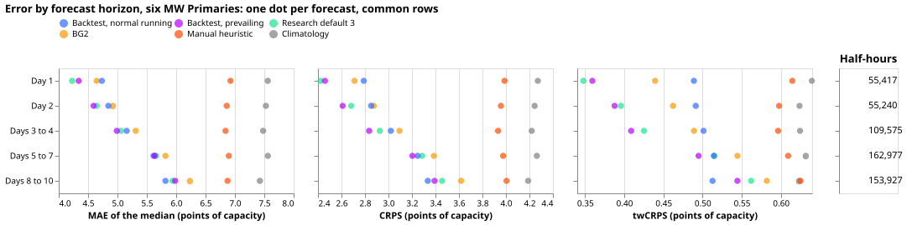

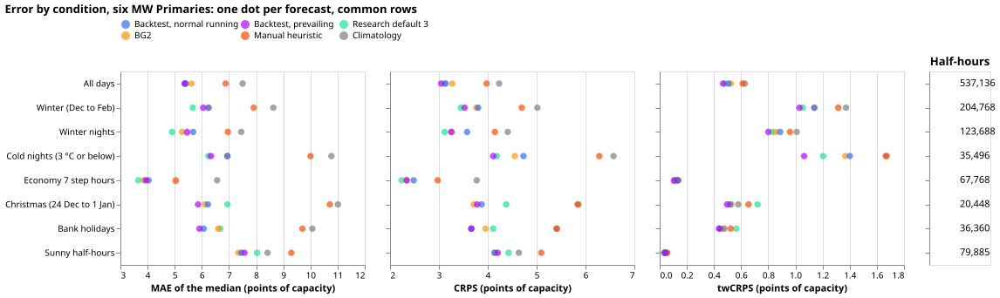

**Seven MVA-only Primaries, MAE of the median:**

| Slice | Half-hours | Backtest, normal running | Backtest, prevailing | Default 3 | BG2 | Manual heuristic | Climatology |
|---|---:|---:|---:|---:|---:|---:|---:|
| Day 1 | 64,805 | 4.86 | 4.76 | 5.59 | 4.95 | 7.10 | 7.85 |
| Day 2 | 64,609 | 4.96 | 4.90 | 5.76 | 5.23 | 7.01 | 7.76 |
| Days 3 to 4 | 128,185 | 5.30 | 5.29 | 6.00 | 5.66 | 7.03 | 7.76 |
| Days 5 to 7 | 190,613 | 5.81 | 5.83 | 6.16 | 6.10 | 7.05 | 7.76 |
| Days 8 to 10 | 180,060 | 6.15 | 6.17 | 6.35 | 6.52 | 7.00 | 7.56 |
| All days | 628,272 | 5.62 | 5.61 | 6.08 | 5.92 | 7.03 | 7.71 |
| Winter (Dec to Feb) | 238,896 | 5.11 | 5.17 | 5.28 | 5.41 | 6.28 | 6.93 |
| Winter nights | 144,320 | 4.27 | 4.30 | 4.14 | 4.40 | 5.23 | 5.83 |
| Cold nights (3 °C or below) | 31,760 | 4.67 | 4.60 | 4.11 | 5.13 | 7.58 | 8.47 |
| Economy 7 step hours | 79,264 | 4.05 | 4.00 | 3.86 | 4.15 | 4.93 | 5.84 |
| Christmas (24 Dec to 1 Jan) | 23,856 | 4.51 | 5.10 | 4.95 | 5.83 | 7.90 | 8.08 |
| Bank holidays | 42,420 | 5.80 | 6.05 | 6.79 | 6.99 | 8.56 | 9.69 |
| Sunny half-hours | 93,512 | 8.47 | 8.58 | 10.03 | 8.65 | 10.44 | 10.04 |

**Seven MVA-only Primaries, CRPS:**

| Slice | Half-hours | Backtest, normal running | Backtest, prevailing | Default 3 | BG2 | Manual heuristic | Climatology |
|---|---:|---:|---:|---:|---:|---:|---:|
| Day 1 | 64,805 | 2.74 | 2.68 | 3.18 | 2.86 | 4.02 | 4.44 |
| Day 2 | 64,609 | 2.80 | 2.76 | 3.30 | 3.02 | 3.98 | 4.40 |
| Days 3 to 4 | 128,185 | 2.98 | 2.96 | 3.44 | 3.22 | 3.98 | 4.38 |
| Days 5 to 7 | 190,613 | 3.24 | 3.24 | 3.54 | 3.43 | 4.00 | 4.39 |
| Days 8 to 10 | 180,060 | 3.41 | 3.42 | 3.66 | 3.65 | 3.99 | 4.28 |
| All days | 628,272 | 3.14 | 3.12 | 3.49 | 3.35 | 3.99 | 4.36 |
| Winter (Dec to Feb) | 238,896 | 2.85 | 2.88 | 3.06 | 3.11 | 3.59 | 3.99 |
| Winter nights | 144,320 | 2.39 | 2.42 | 2.45 | 2.58 | 2.98 | 3.39 |
| Cold nights (3 °C or below) | 31,760 | 2.63 | 2.61 | 2.41 | 2.93 | 4.51 | 4.86 |
| Economy 7 step hours | 79,264 | 2.33 | 2.29 | 2.25 | 2.40 | 2.87 | 3.35 |
| Christmas (24 Dec to 1 Jan) | 23,856 | 2.47 | 2.81 | 2.86 | 3.34 | 4.27 | 4.84 |
| Bank holidays | 42,420 | 3.25 | 3.37 | 3.97 | 3.99 | 4.93 | 5.68 |
| Sunny half-hours | 93,512 | 4.67 | 4.72 | 5.58 | 4.79 | 5.75 | 5.57 |

**Seven MVA-only Primaries, twCRPS:**

| Slice | Half-hours | Backtest, normal running | Backtest, prevailing | Default 3 | BG2 | Manual heuristic | Climatology |
|---|---:|---:|---:|---:|---:|---:|---:|
| Day 1 | 64,805 | 0.22 | 0.23 | 0.25 | 0.25 | 0.36 | 0.36 |
| Day 2 | 64,609 | 0.22 | 0.23 | 0.26 | 0.26 | 0.34 | 0.35 |
| Days 3 to 4 | 128,185 | 0.23 | 0.23 | 0.26 | 0.26 | 0.33 | 0.34 |
| Days 5 to 7 | 190,613 | 0.26 | 0.26 | 0.28 | 0.29 | 0.35 | 0.36 |
| Days 8 to 10 | 180,060 | 0.27 | 0.27 | 0.30 | 0.30 | 0.34 | 0.34 |
| All days | 628,272 | 0.25 | 0.25 | 0.28 | 0.28 | 0.34 | 0.35 |
| Winter (Dec to Feb) | 238,896 | 0.37 | 0.37 | 0.40 | 0.39 | 0.48 | 0.50 |
| Winter nights | 144,320 | 0.22 | 0.21 | 0.24 | 0.22 | 0.28 | 0.29 |
| Cold nights (3 °C or below) | 31,760 | 0.28 | 0.31 | 0.30 | 0.37 | 0.57 | 0.56 |
| Economy 7 step hours | 79,264 | 0.03 | 0.03 | 0.04 | 0.04 | 0.04 | 0.04 |
| Christmas (24 Dec to 1 Jan) | 23,856 | 0.13 | 0.14 | 0.27 | 0.15 | 0.24 | 0.24 |
| Bank holidays | 42,420 | 0.44 | 0.42 | 0.48 | 0.54 | 0.67 | 0.69 |
| Sunny half-hours | 93,512 | 0.25 | 0.25 | 0.29 | 0.25 | 0.30 | 0.28 |

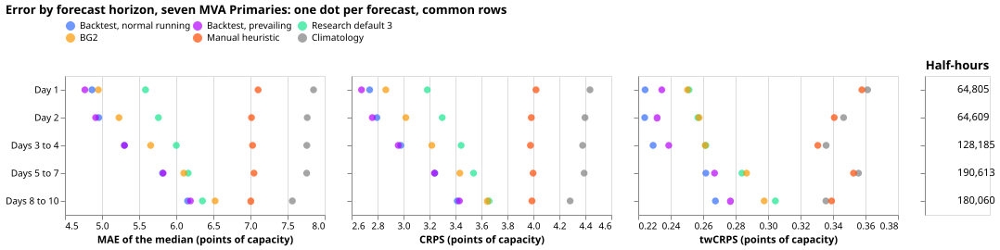

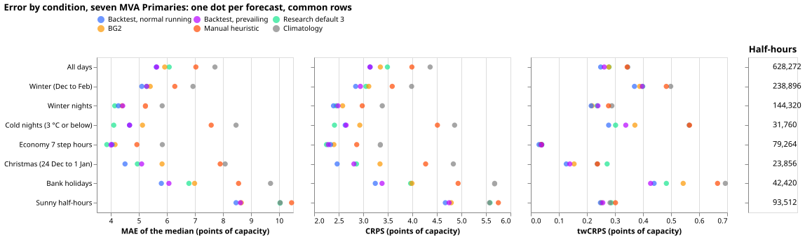

### Why research default 3 can look better on another chart

Four differences between row sets can make research default 3 look better than the backtest outputs
on an earlier chart: the season the rows cover, whether rows inside load-shift events are included,
whether the chart covers 6 or 16 Primaries, and which lead gaps the stored forecast leaves. The
tables above restrict every forecast to the same rows, so none of the four differences affects them.
The gaps in the stored default 3 and BG2 are stated plainly here:

- Every fifth origin day is missing.
- The rows inside hand-filtered load-shift events are missing.
- Nothing is stored after 2026-06-30.
- The stored origins are at 09:00 UTC, so the comparison joins on valid time and subtracts 3 hours
    from the lead.

## Caveats

- **A descriptive year, not a ranking.** The year overlaps the development months and the final-test
    window.
- **Less ensemble history early.** The ensemble history starts 2024-04-01, so early folds train on
    less ensemble data.
- **Days 10 to 14 are reported separately.** The files hold 14 days, and the scores for days 10 to
    14 are in their own lead band, so a reader can discount them.
- **Solar's upper band fails on very sunny days.** About 11% of observations exceed `q99` on the
    sunniest days in experiment 659.
- **The shift labels are an incomplete dump.** NGED has said that load-shift events may be missing
    from its logs, so clean rows can hold unlabelled shifts.
- **Default 3 and BG2 comparisons use stored rows only.** Every fifth origin day is missing, the
    hand-filtered load-shift rows are missing, nothing is stored after 2026-06-30, and the 09:00
    origins are joined on valid time with 3 hours subtracted from the lead. BSPs and GSPs have no
    such comparison.
- **The Primaries heads change in January 2026.** 2025-11 and 2025-12 use the B-haz fallback head,
    and 2026-01 to 2026-10 use R-haz trained on all earlier months' banks. Only R-haz reads the extra
    lagged power inputs.
- **Time-series figures of the load shift other than the day-ahead ones.** The 14-day forecast
    figures from five origins (`event_D5_fan_*.svg` and `event_D16_fan_*.svg`) were drawn before the
    extra lagged inputs, so their prevailing panels show the earlier head.
- **The prevailing output over-persists after a load shift ends.** One verified load shift, at D5
    and D16, is the only example, so the size of the effect is not estimated.
- **Quantiles exceed table capacity in the files.** The highest quantile reaches 2.1 times
    the capacity table's value for D15 and 2.2 times for GSP D1 (observed maxima 1.28 and 1.34 times),
    1.4 times for GSP D6, and 1.35 to 1.7 times for five more Primaries (D5, D12, D16, D18, and D22;
    observed maxima 1.2 to 1.55 times). Capacity is therefore not a ceiling for the demand series.
    The wind and solar files exceed it by up to 12%.
- **The q05 to q95 band covers less than 90% of observations.** Coverage is 81.4% for the Primaries
    in normal running and 85.1% for the prevailing output, 86.7% for the BSPs, 87.7% for the GSPs,
    91.3% for wind, and 89.3% for solar on daylight half-hours.
- **Band widths step at some refits.** D4 narrows by about a third at the refit that starts May 2026;
    D18 widens by about half at the refit that starts September 2026; six Primaries widen by
    1.2 to 1.5 times at the refit that starts February 2026.
- **Two Primaries miss for two months.** The normal-running band of D18 and D14 covers about 22%
    to 28% of observations in July and August 2026, probably because of a load shift
    that normal running deliberately ignores; the cause has not been checked against the event
    table.
- **Numbers are provisional until the pages of experiments 667, 669, and 666 merge.** Those pages
    own the models behind the files.
- **The last origins cannot be fully scored.** Observed power ends on 2026-11-09 and the wind idle
    mask ends on 2026-09-13.

## Anonymisation

Wind farms appear as Wind A to Wind C and solar farms as Solar A to Solar F, with no
coordinates, no calendar dates on any generator's series, and no generator identifiers. Substations
carry their names and dates.
