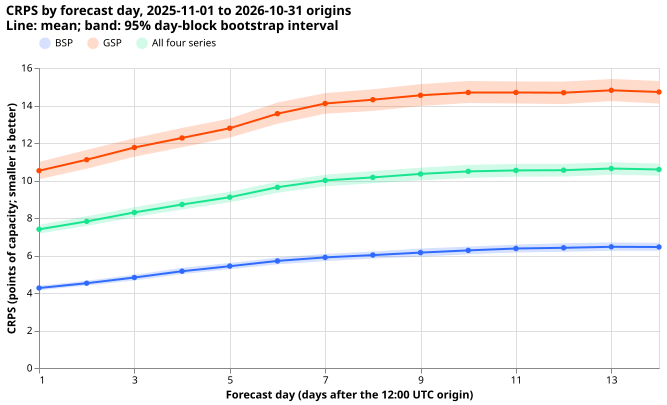
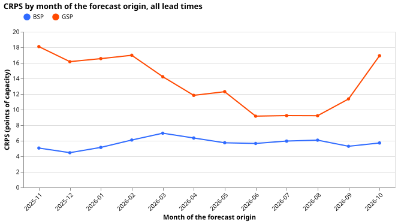
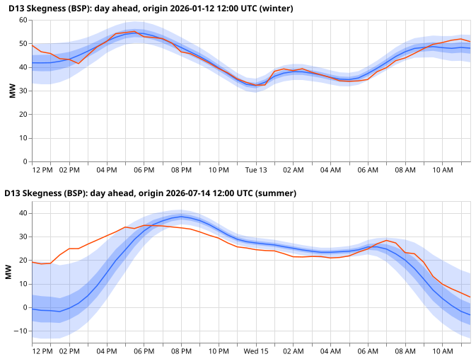
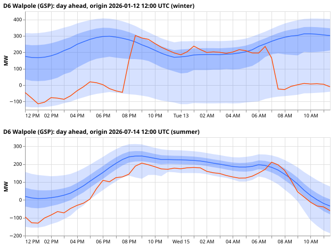
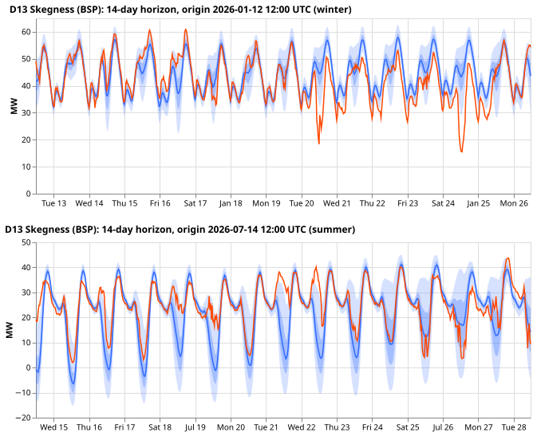
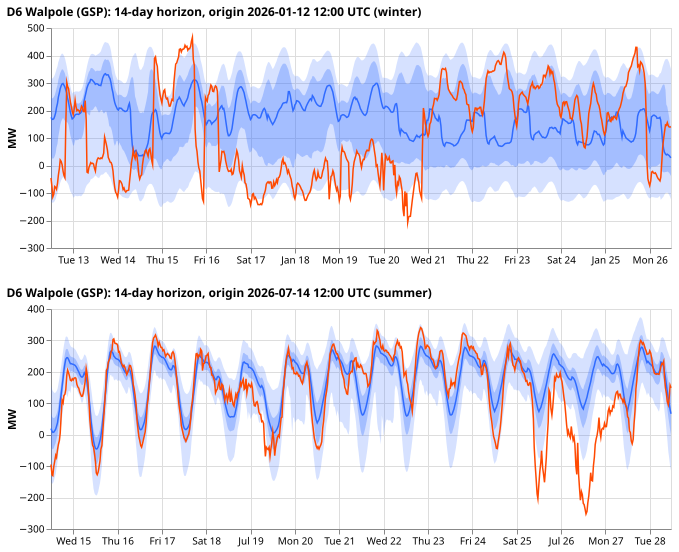
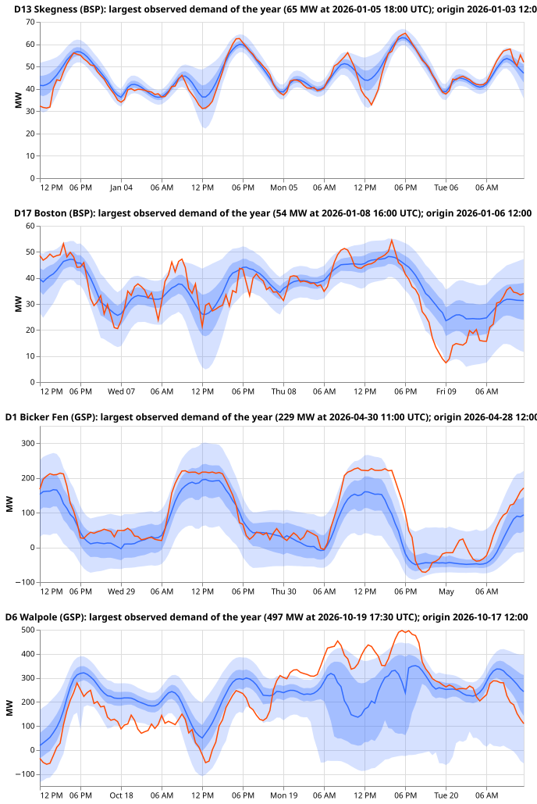

**The lag-enabled network forecasts the 2 bulk supply points (BSPs) and 2 grid supply points (GSPs)
at a CRPS of 7.4 points of capacity on day 0, and its error rises to about 10.5 by day 7 and stays
near that to day 14.** CRPS is the continuous ranked probability score, here in percent of effective
capacity, so smaller is better. The BSPs score 4.3 (day 0) to 6.3 (days 7 to 14) and the GSPs 10.5
to 14.6. This is a descriptive backtest of 365 daily origins from 2025-11-01 to 2026-10-31. It
overlaps the development months and the held-out months of experiment 633, so no number here is a
held-out score and nothing is ranked.

A bulk supply point is a substation that takes power from the transmission network. A grid supply
point is a substation where the distribution network meets the transmission network. The 4 series
are D13 Skegness and D17 Boston (BSPs) and D1 Bicker Fen and D6 Walpole (GSPs). Substations may be
named, so the names stay.

## Figures

*Figure 1. CRPS rises over the first 7 forecast days and then flattens, in both groups. Forecast day
n covers leads of (n - 1) x 24 to n x 24 hours.*

*Figure 2. CRPS by month: highest in November to March and in October, lowest in June to August.*

In Figures 3 to 5, the blue line is the median, the dark band is the 50% interval, the light band is
the 90% interval, and the red line is the observed power.

*Figure 3. Day-ahead forecasts (first 24 hours of one forecast), one winter and one summer origin.*

*Figure 4. The full 14-day horizon of one forecast. The bands widen with lead time.*

*Figure 5. The largest observed demand of the year at each of the 4 series, with the forecast issued
two days before the day (3 days shown).* At Walpole (bottom panel), the observation sits about 100
MW below the median in the daytime of 2026-10-18. From about 01:00 to 21:00 on 2026-10-19 it holds
between 300 and 497 MW, while the median falls to about 140 MW at midday and the 90% band lies below
the observation for most of the daytime. This is a level step consistent with a load transfer, which
is not confirmed in NGED's logs, and the network has no model of load shifts. At Bicker Fen, a
plateau of 220 to 229 MW lasting about 6 hours sits above the 50% band. At Skegness (top), the
median and the 90% band track the observed peak.

## Results

- **Pooled CRPS by lead band** (points of capacity; day-block bootstrap 95% intervals over origin
  days; all 4 series, 973,440 scored half-hours):

| Lead band | CRPS | Normalised MAE of the median | q05-q95 coverage | q01-q99 coverage |
|---|---|---|---|---|
| Days 0 to 1 | 7.40 (7.16 to 7.63) | 13.49 | 0.883 | 0.974 |
| Days 1 to 3 | 8.06 (7.84 to 8.30) | 14.76 | 0.877 | 0.973 |
| Days 3 to 7 | 9.37 (9.16 to 9.58) | 17.32 | 0.869 | 0.972 |
| Days 7 to 14 | 10.47 (10.25 to 10.70) | 19.40 | 0.870 | 0.973 |

*Table 1. Normalised MAE is the mean absolute error of the median, in points of capacity.*

| Group and lead band | CRPS | Normalised MAE of the median | q05-q95 coverage |
|---|---|---|---|
| BSPs, days 0 to 1 | 4.27 (4.15 to 4.38) | 7.71 | 0.88 |
| BSPs, days 1 to 3 | 4.67 (4.55 to 4.81) | 8.46 | 0.87 |
| BSPs, days 3 to 7 | 5.55 (5.44 to 5.68) | 10.14 | 0.86 |
| BSPs, days 7 to 14 | 6.31 (6.18 to 6.42) | 11.51 | 0.87 |
| GSPs, days 0 to 1 | 10.52 (10.05 to 10.96) | 19.27 | 0.89 |
| GSPs, days 1 to 3 | 11.44 (11.01 to 11.88) | 21.06 | 0.88 |
| GSPs, days 3 to 7 | 13.18 (12.80 to 13.62) | 24.49 | 0.88 |
| GSPs, days 7 to 14 | 14.64 (14.17 to 15.09) | 27.30 | 0.87 |

*Table 2. Scores by group and lead band.*

- **Tails** (pooled, points of capacity): the 0.01 and 0.99 pinball losses are 0.50 and 0.43 at days
  0 to 1 and 0.60 and 0.54 at days 7 to 14. At days 0 to 1, 1.1% of readings fall below q01 and 1.4%
  above q99, against 1% nominal. At days 7 to 14, 6.8% fall below q05 and 6.2% above q95, against 5%
  nominal. Pooled over lead, the misses change side by month: the grid supply points have 1.4% below
  q05 and 8.7% above q95 in December, 1.3% and 10.0% in September, and 12.4% and 5.9% in October,
  and the bulk supply points 11.1% and 3.8% in January and 12.0% and 3.8% in October. The q05-q95
  coverage of the bulk supply points is 0.81 in July and 0.82 in August, and of the grid supply
  points 0.82 in October. A level drift at D1 is part of the cause: its median is 1.9 points of
  capacity too low on day 0 and 11.3 too low on lead day 13 (mean of forecast minus observed). A wider
  band would not remove such a shift.

- **Months:** pooled CRPS is 11.6 (November), 10.3, 10.8, 11.5, 10.6, 9.1, 9.0, 7.4, 7.6, 7.7, 8.3,
  and 11.3 (October). The normalised MAE of the median by month is 22.3, 19.7, 20.9, 21.7, 19.1,
  16.5, 16.3, 13.1, 13.4, 14.1, 14.8, and 21.2. The q05-q95 coverage lies between 0.83 (October) and
  0.92 (April) pooled, and between 0.81 and 0.95 by group and month.

- **Series:** at days 0 to 1 the CRPS is 3.5 at D13, 5.0 at D17, 10.7 at D1, and 10.3 at D6.
- **Predictions.** P1 holds: on the July to October origins at hours 0 to 72, this experiment scores
  7.24 against 7.54 for experiment 633's 24-hour lags re-scored on the same rows (experiment 633
  reports 7.45 on its own rows), well inside the 0.5-point tolerance. P2 holds: days 11 to 14
  average 10.59 against 10.33 at days 7 to 10, a rise of 0.26 points, inside 1.0. P3 holds: pooled
  coverage lies between 0.80 and 0.95 in all 12 months, but the group-level figures in the Tails
  bullet show shorter exceptions.

- **Comparison with the 24-hour-lag network** (experiment 633's stored forecasts, fitted once at
  2026-07-01, scored on the same series, origin days, and valid times, July to October 2026
  origins). Both networks run at the native 09:00 origin, so the origin does not differ. At hours 0
  to 72 the 3.5-hour-lag forecasts score 7.24 against 7.54, and at hours 72 to 240 8.77 against
  8.84. By month the gain at hours 0 to 72 is 0.16 (July), 0.21, 0.30, and 0.51 points (October),
  and at hours 72 to 240 0.07, 0.13, 0.28, and -0.20. July is the only month in which both networks
  were trained to about 2026-07-01, so the lag cut is worth about 0.16 points of the 0.30, and the
  rest comes from the monthly refits. The comparison has no interval on the difference, and the
  training leads differ (351 hours here against 240 hours). By series at hours 0 to 72 the 3.5-hour
  lags score lower at all 4 (D13 4.01 against 4.05, D17 5.64 against 6.17, D1 11.80 against 12.07,
  D6 7.51 against 7.85).

## Method

- **Network:** [experiment
  633's](../00633-bakeoff-final-test-bg2-and-lag-enabled-bsp-gsp-network/result.md) lag-enabled
  network, which is [experiment
  622's](../00622-bsp-gsp-lagged-against-lag-free-matched-d5-thermal-lag-rematch/result.md) arm
  `lagged_b1`: the pooled group-of-2 mixture density network of experiment 619, one network per
  group (BSPs, GSPs), with the D5 output offset of experiment 565, the thermal-lag and solar-gain
  columns of experiment 569, the shared lag encoder of experiment 591, frozen encoders in
  fine-tuning, and the three-step schedule of experiment 574 (arm P5). No neighbour inputs, no gate,
  and no model of load shifts. Two seeds, with the quantiles averaged and sorted within the row.
- **Pre-training and weather:** the encoders pre-train on ERA5 and CAMS rows (experiment 564's
  matrices, which end on 2026-07-31, so the folds from 2026-08 share the same pre-training rows);
  the mixer and fine-tune use the 00Z ECMWF ENS run of each day (ensemble mean and spread) from
  2024-04-01. The fine-tuning rows of each fold are given below.
- **Why 3.5-hour lags, not experiment 633's 24-hour lags:** the stored network reads power at least
  24 hours before its origin and needs no retraining to meet the contract, but the maintainer wants
  the fresher lags that a 6-hour power delay allows. This network uses experiment 572's `3.5h` cap:
  the newest power is the 05:30 reading on the origin day, which is 6.5 hours before the 12:00
  label.
- **Origin:** the network runs at its own origin, 09:00 UTC (the 00Z run plus 9 hours). The file
  relabels it as 12:00 UTC and keeps valid times from 12:00 to 11:30 on day 14, so lead 0 is a
  forecast made 3 hours before the label, and lead bands count from the 12:00 label. Every input the
  network read at 09:00 was available at 12:00.
- **Training regime:** 12 monthly refits (test months 2025-11 to 2026-10). Each trains on data
  before the first of the month with the recipe's 3-day embargo (the contract's 7 days does not
  apply to this recipe), forecasts every origin of the month, and may read in-month power only from
  3.5 hours before the 09:00 origin. The early-stopping weeks of experiment 422 are purged by 9
  days, shorter than the 14-day leads, so a held-out week's targets can sit in training rows of
  later origins (inside the training period).
- **Fine-tuning rows per fold** (BSP group; GSP group 2% to 3% fewer): 570,000 (2025-11), rising to
  735,000 (2026-10). The ENS history starts on 2024-04-01, so the 2025-11 fold has 19 months of it.
- **Leads and test rows:** the training matrices hold leads of 0.5 to 351 hours, so the network
  needs no retraining for 14 days. The stored test matrices drop half-hours without an observed
  reading, so this experiment rebuilds them with experiment 633's code and no filter
  (`e00669_testrows.py`).
- **Weather at lag times:** the thermal-lag and solar-gain columns of [experiment
  437](../00437-neural-demand-thermal-lag-solar-gain-and-tariff-feature-bundles/result.md) use,
  before the origin, the analysis proxy built from the first day of the previous 00Z run, which
  exists at forecast time. They never read ERA5 or power. ERA5 arrives about 5 days late, so the
  last roughly 5 days of the ERA5 and CAMS pre-training rows could not be read at a real cutoff;
  they are estimates of past weather from before the cutoff, so nothing from after the cutoff
  enters.
- **Set-ups reused** (each restated above): the network and its schedule follow experiments
  [619](../00619-bsp-gsp-lag-enabled-network-for-the-bake-off/result.md),
  [565](../00565-drift-embedding-variants-six-designs/result.md),
  [569](../00569-modular-network-inputs-through-matching-encoders-in-pretraining-and-fine-tuning-run-1/result.md),
  [591](../00591-shared-lag-encoder-auxiliary-shift-depth-loss/result.md),
  [574](../00574-part-d-primaries-only-modular-recipe-lag-encoder-offset-and-add-one-arms/result.md),
  and [572](../00572-two-offset-part-1-lags-versus-the-slow-output-offset/result.md); the
  pre-training matrices follow [experiment
  564](../00564-pooled-primary-bsp-gsp-m2-reduced/result.md) and the cleaning flags [experiment
  398](../00398-cleaning-flags/result.md).
- **Cleaning:** flagged half-hours come from the cleaned power of experiment 398's flag file, which
  holds no flags for these series after 2025-09, so no half-hour is dropped in the test year; the
  scores skip the 7,680 of 981,120 half-hours with no observed reading.
- **Scoring:** against observed power outside the file (the cleaned power), in points of capacity
  (effective capacity from `series_table`). CRPS is twice the mean pinball loss over the 11 levels,
  so it is an approximation from 11 quantiles. Intervals are day-block bootstrap intervals (1,000
  resamples) over origin days. No spread factor is applied.
- **Load shifts:** the network assumes no load shifts, so a transfer between substations reads as a
  level change in its lags. NGED's event labels are incomplete and none were applied here.
- **Reviews:** a Sonnet plan review (7 findings: 6 applied, 1 left), two Sonnet code reviews (2 and
  4 findings: all applied), an Opus leakage review (5 findings; the 2026-07 BSP fold was refitted
  with the final code; a perturbation test found no leak), a Sonnet file audit with a from-scratch
  re-run of one fold, and an Opus review of the file and scores. The Sonnet and Opus audit findings
  are summarised in the pull request.
- **Compute:** about 2 GPU-hours on one process, 1 core.
- **Standing practices:** cleaned data, monthly refits, saved weights (`.pt`, in the data folder),
  and tail plots. The D15 and D18 cut does not apply.

## Files

- `data/ml-experiments/backtest_year_2025-11_to_2026-10/bsps.parquet` (D13 id 2, D17 id 1) and
  `gsps.parquet` (D1 id 28, D6 id 27), private. Each holds 490,560 rows (2 series x 365 origins x
  672 half-hours): `time_series_id` (Int8), `valid_time`, `nwp_init_time` (the 00Z run),
  `power_fcst_init_time` (12:00 UTC), and the 11 quantiles `q01` to `q99` in MW (Float64). All 4
  series are MW series.
- The code is in
  `ml-experiments/00669-one-year-backtest-of-the-lag-network-at-bulk-and-grid-supply-points/`
  (`e00669_fit.py`, `e00669_fold.py`, `e00669_testrows.py`, `e00669_export.py`, `e00669_score.py`,
  `e00669_compare633.py`, `e00669_figures.py`). The scores are in
  `data/ml-experiments/00669-*/score/` and the fitted networks in
  `data/ml-experiments/00669-*/work/{bsp,gsp}/models/`.
- **Checks passed by the export:** the row count equals 4 series x 365 x 672 in total, there is no
  duplicate key, no null or non-finite quantile, no crossing, the time zone is UTC, `time_series_id`
  fits Int8, and no lag index is newer than 05:30 on the origin day.
- **Reading the values:** a negative quantile is net export. The q01 is below zero in 94% of the D6
  rows and 99.6% of the D1 rows. Effective capacity is a normalising constant, not a limit: observed
  power reaches 1.34 times it at D1, and q99 sits above it in 33% of the D6 rows. The lead counted
  from the 12:00 label is 3 hours shorter than the true lead from the 09:00 forecast origin.
- **Unscored half-hours:** 7,260 of the 7,680 half-hours with no observed reading are October
  origins past the last reading (2026-11-06). The remaining 420 are gaps inside the year.
- **Weather spot check:** the weather columns at lag times were read from the analysis proxy of the
  previous 00Z run, never from data newer than the origin day's 00Z run.
- **Not reported:** the curtailment cost against the manual heuristic, because neither BSPs nor GSPs
  have a manual heuristic baseline here. The 24-hour-lag network was not used for the file, since it
  would read power the production service already has at 3.5 hours.
- **Leakage caveats from the Opus review:** the embargo of 9 days is shorter than the 14-day leads,
  and the `Extras` table is built with the grid end from before the redirect. Neither changed a
  result.
