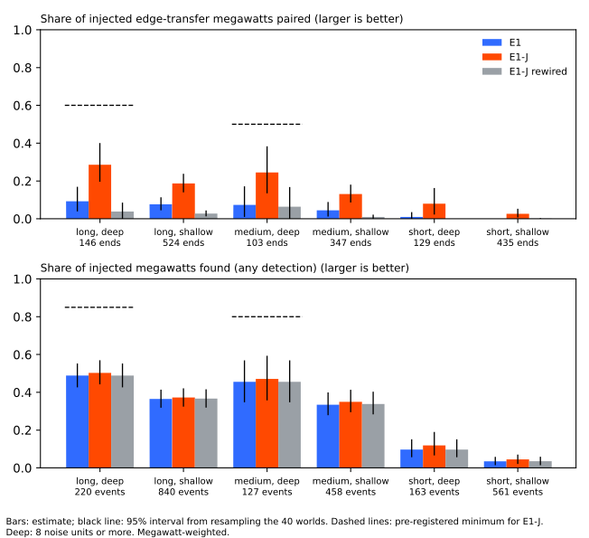
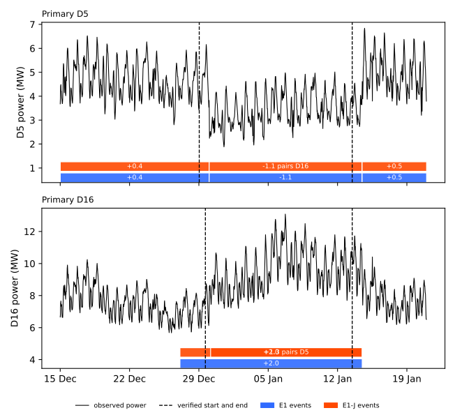
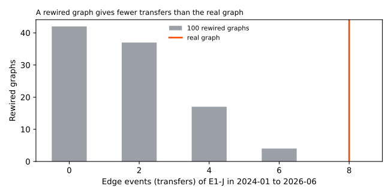

**A search at the neighbouring Primaries for the recipient of each large downward step lets the
event table pair 0.29 of the injected transfer megawatts in the longest and deepest transfers,
against 0.09 without the search, but not the 0.60 that adopting it required.** A *Primary
substation* steps electricity down to a local distribution network. A *load shift* moves part of
the demand from one Primary (the *donor*) to a neighbour (the *recipient*), so the donor's power
steps down and the recipient's steps up. The *residual* is the observed cleaned power minus a demand
forecast that uses no lagged power. A *noise unit* is a Primary's typical difference between
successive 6-hour block means, between 0.16 and 1.02 MW.

[Experiment 653](../00653-edge-state-event-table-penalised-segmentation/result.md) built an *event
table* (E1) of load shifts by splitting each Primary's residual into segments, and E1 paired few
transfers. This experiment adds a search (E1-J). For each downward step of 4 noise units or more
that E1 left unpaired, E1-J looks at each connected Primary for an upward step of 2 noise units or
more that starts within a few hours of the donor, and accepts it when the steps conserve the
donor's step. We scored both on 40 synthetic worlds from
[experiment 660's generator](../00660-shared-generator-of-injected-load-transfer-events/result.md),
in the six cells of event length and depth of
[experiment 665](../00665-event-table-recall-by-length-and-depth/result.md), and decoded the real
record. The verdict is *not supported*: 1 of the 15 predictions held (the rewired graph), and the
stop rule gives branch (b) by a narrow margin that leaving out one world or one Primary can reverse,
so the result does
not show that pairing is unidentifiable.

## Terms

- **Cell.** One of six groups of injected events: *long* is over 7 days (or no end), *medium* is
  over 1 day up to 7 days, *short* is 1 day or less; *deep* is 8 noise units or more, *shallow* is 2
  to under 8.
- **Found, paired.** An injected event is *found* when the method has an event at the right
  Primary and sign with a start within 12 hours. An end of an injected transfer is *paired* when the
  method links it to the right other end. Shares are weighted by absolute megawatts.
- **World.** One copy of the real power panel with injected events; there are 40 default worlds.
  Intervals resample whole worlds.
- **E1-J rewired.** The same method on a connection graph with the links rearranged at random
  (each Primary keeps its number of links). The rewired graph is the placebo.
- **Donor found.** The share of injected edge-transfer megawatts at the donor end that E1 finds.

## Figures

**The first figure shows that E1-J pairs about three times as much as E1 in every deep cell, that
the rewired graph removes the gain, and that the search leaves the share found almost unchanged.**

**The second figure shows the verified D5 to D16 transfer: E1-J pairs the two Primaries in the
right direction, but its starts are late, and E1 leaves both unpaired.** The E1-J band at D16 shows
two overlapping events: an unpaired +2.0 MW step that starts 5 days early and the paired +1.3 MW
event.

**The third figure shows that the real graph gives 8 transfers where 100 rewired graphs give 0 to
4.**

## Results

- **Paired shares in the default worlds: E1-J adds 0.03 to 0.19 in every cell, and falls short of
  every prediction.** MW-weighted, with 95% intervals; `n` is injected events and edge-transfer
  ends.

    | Cell | Events (ends) | E1 paired | E1-J paired | Predicted | E1-J minus E1 | E1-J rewired |
    |---|---|---|---|---|---|---|
    | Long, deep | 220 (146) | 0.09 (0.04 to 0.17) | 0.29 (0.20 to 0.40) | 0.60 | +0.19 (0.12 to 0.29) | 0.04 |
    | Medium, deep | 127 (103) | 0.07 (0.01 to 0.17) | 0.25 (0.14 to 0.38) | 0.50 | +0.17 (0.09 to 0.28) | 0.06 |
    | Long, shallow | 840 (524) | 0.08 (0.05 to 0.11) | 0.19 (0.14 to 0.24) | 0.30 | +0.11 | 0.03 |
    | Medium, shallow | 458 (347) | 0.05 (0.01 to 0.09) | 0.13 (0.09 to 0.18) | 0.20 | +0.09 | 0.01 |
    | Short, deep | 163 (129) | 0.01 (0.00 to 0.04) | 0.08 (0.02 to 0.16) | 0.20 | +0.07 | 0.00 |
    | Short, shallow | 561 (435) | 0.00 | 0.03 (0.01 to 0.05) | none | +0.03 | 0.00 |

    No cell is too small to read. Differences are computed before rounding.
- **Found shares barely change, and all miss their predictions.** E1-J finds 0.50 (0.44 to 0.57) in
  the long and deep cell (predicted 0.85) and 0.47 in the medium and deep cell (predicted 0.80); E1
  finds 0.49 and 0.46. In the other cells E1-J finds 0.37, 0.35, 0.12, and 0.04, against predictions
  of 0.55, 0.45, 0.40, and 0.15.
- **Both ends pair less than they find, the donor end because of missed donors and the recipient end
  for untested reasons.** In the long and deep cell E1 finds 0.44 of the donor megawatts, and E1-J
  pairs 0.36 of
  them (about four fifths of the donors found). At the recipient end E1-J finds 0.73 of the
  megawatts but pairs only 0.22, so the search loses about 70% of the recipient megawatts it finds.
  The medium and deep cell shows the same split (donors found 0.40 and paired 0.30, recipients
  found 0.58 and paired 0.19). Candidate causes are splits over more than 3 recipients, the start
  window, and the share bounds; none is tested here. Averaging the two ends gives the paired share
  of 0.29.
- **E1-J's decoded transfers are less often correct.** In the default worlds E1 decodes 198
  transfers, of which 113 (57%)
  match no injected end; E1-J decodes 788, of which 544 (69%) match none; E1-J on a rewired graph
  decodes 442. Correct pair ends per decoded transfer fall from 0.41 (81 of 198) to 0.28 (220 of
  788). The 12 injected solo shifts that E1-J decodes as transfers (E1: 2) fall outside the paired
  share. Event-free time on the real record shows no false transfer, so these false transfers occur
  near injected events or in the injected worlds' extra structure.
- **Pairing is scored per end, not per mutual pair.** In the long and deep cell, 10 of the 20
  injected transfers with a correct recipient end have a donor end that is not correct, and E1 has
  5 of 10. The donor test accepts a decoded partner list that covers at least half of the true
  recipients' megawatts, whatever else it holds.
- **The share varies a lot between Primaries.** E1-J's long and deep paired share runs from 0 (D9,
  7 ends) to about 0.8 (D4 and D16). Leaving out one world gives 0.26 to 0.31, and leaving out one
  Primary gives 0.26 to 0.31.
- **The sensitivity worlds agree.** E1-J's long and deep paired share is 0.28 (0.19 to 0.39) in the
  10 long-heavy worlds, 0.22 (0.06 to 0.55) in the 10 short-heavy worlds, and 0.28 (0.08 to 0.52)
  in the 10 constant-megawatt square worlds, all under 0.30. The medium and deep cell is too small
  in those worlds (13 to 30 ends). The donor-found share in the long and deep cell is 0.47, 0.24,
  and 0.46.
- **Timing is that of E1.** In the long and deep cell E1-J starts within 2 hours for 0.49 of
  events (E1: 0.48) and ends within 6 hours for 0.44 (E1: 0.43), with median errors of 0.5 and 1.0
  hours.
- **Real record: E1-J calls 8 transfers in 36.0 Primary-years, E1 calls 4, and the rewired graph
  gives a median of 2 (range 0 to 4).** The rewired graphs keep 16% of the real links on average,
  so the placebo is not fully clean. None of the 8 transfers is in the long and deep or medium and
  deep cell: 5 are long and shallow, 1 is medium and shallow, and 2 are under 2 noise units. E1
  and E1-J both call 246 and 247 events, 6.8 per Primary-year.
- **Real record: logged shifts matched are unchanged.** Of the 77 logged shifts of more than 1 day,
  E1 matches 8 within 2 hours and 17 within 24 hours, and E1-J matches 8 and 18. For long and
  shallow shifts (7 logged) E1-J matches 1 and 5, E1 1 and 4. LR_b20 (the label-trained detector of
  [experiment 254](../00254-lsc-alarm-precision-against-full-log-with-chance-base-rate/result.md))
  matches 3 of those 7 within 2 hours, 6 of 7 medium and deep shifts, and 7 of 19 medium and
  shallow ones, from [experiment 665](../00665-event-table-recall-by-length-and-depth/result.md).
- **Real record: event-free time gives no transfer.** In the 27.6 Primary-years more than 14 days
  from any logged or verified event, all three methods call 148 events and none is a transfer.
- **Real record: E1-J pairs D5 and D16 in the right direction, but the prediction fails.** E1-J
  decodes D5 as -1.08 MW and D16 as +1.28 MW. The starts are 24 and 12.5 hours after the verified
  starts and both ends are 24 hours late, against the 12 hours predicted. E1 leaves D5 unpaired and
  decodes D16 as an unpaired +2.05 MW step that starts 5 days early.
- **One of 15 predictions held.** None of the 6 found predictions and none of the 5 paired
  predictions held, nor the two differences over E1 (+0.19 and +0.17 against +0.25) or the D5 and
  D16
  prediction. The rewired-graph prediction held (a median of 2 against 8 edge events).
- **The stop rule gives branch (b) by point estimate, and the data cannot tell 0.286 from 0.30.**
  E1-J's long and deep paired share is 0.286 (interval 0.20 to 0.40; about 39% of world resamples
  reach 0.30 or more), and the medium and deep share is 0.25 (0.14 to 0.38). Because both ends lose
  megawatts for reasons a better method could fix, the finding is not "pairing is unidentifiable at
  15 Primaries". The decision for the next step, and whether to run the graph model (X2), is left
  to the maintainer. X2 was not started.

## Checks

- **Not applicable:** median minus mean forecast, tail calibration, curtailment cost, the normalised
  MAE of the median forecast, and the four scenarios, because no forecast is scored.
- **Reproduction gates passed.** Gate 1: E1 on seeds 900 to 907 reproduces experiment 660's recall
  by
  size to three decimals in every bin. Gate 2: E1 calls 246 events in the scored years on the real
  record, as experiment 653 stored.
- **Audit triggers.** Trigger 2 (a result contradicts its prediction) fired for 14 of 15
  predictions. The donor-found share (0.44) caps the donor end; the recipient end's loss is
  untested.
  Trigger 7 (a later design, X2, rests on this result) fired, and the sensitivity worlds replicate
  the long and deep share (0.22 to 0.28). A fresh Sonnet agent audited the headline numbers (see
  Reviews and triage). Triggers 1, 3, 4, 5, and 6 did not fire: E1-J contains E1 and never pairs
  less.
- **Unlogged events.** NGED's event logs are an incomplete one-off dump, so clean rows may hold
  events no label covers, and matched counts are lower bounds.
- **Lab shortcuts.** The injected events are added to the power and the residual uses a lag-free
  forecast that trained on every row, so earlier real events leak into the residual's baseline. The
  real record's noise units use the whole record (as in experiment 653); the injected worlds use
  the tuning years (as in experiment 660). A classifier that tells injected events from verified
  real ones scored 0.55 on experiment 660's generator (0.5 is chance); this experiment did not rerun
  it.

## Reviews and triage

- **Plan and code review (Sonnet).** The reviewer made 27 findings, 1 high: E1-J cannot find a donor
  that E1
  missed. Accepted: reporting the donor-found share beside every cell, a false-pairing measure, the
  verdict and stop rule coded in the report, the gate against experiment 660 printed, the
  event-free stratum, the retained-links share of the rewired graph, and the clarifications in the
  plan. Not changed: the search window of -6 to +42 half-hours, which the plan states.
- **Second code review (Sonnet).** The reviewer found no high bug. Accepted: skip a recipient
  already paired,
  take the nearest event to reuse, and draw 30 rewirings and keep the one with the fewest real links
  . Not changed: the 15-prediction count is tallied by hand,
  because two predictions are on the real record.
- **Results audit (Sonnet).** The auditor re-derived every headline number from the stored files
  with its
  own code, and they agreed exactly, as did gate 1. It made 5 findings. Accepted and written into
  Results: the branch (b) result is not robust (leave-one-out 0.26 to 0.31); the donor cap explains
  only the donor end, and the recipient end loses half again; E1-J adds many false transfers (69%
  match no injected end); pairing is scored per end; Primaries differ widely. The take-home,
  headline,
  lessons, advice, and next-experiment sections were rewritten to match. Not changed: the donor test
  that accepts extra partners, which is experiment 653's rule and is kept for comparability.
- **Write-up and prose review (Sonnet).** The reviewer made about 60 findings. Accepted: the
  inverted D5 and D16 delays, the recipient-loss figure (0.22 of 0.73 is a loss of about 70%), the
  scope of the rewiring, placebo, and event-free statements, the pronouns, the check wording, and
  the rounding note. Not changed: the hypothesis text, which stays as pre-registered, including its
  0.18 (experiment 653's headline for events of 4 noise units or more lasting a day) and its window
  of 36 half-hours (the plan and Method give the window searched, -6 to +42 half-hours).

## What the next experiment should answer

**The next experiment should find out why the search pairs only 0.22 of the 0.73 recipient megawatts
it finds,
and what raises the 0.44 donor share.** In the long and deep cell the donor end pairs 0.36 of 0.44
found, and the recipient end 0.22 of 0.73 found. A graph model that decodes donors and recipients
together (X2) could raise both, and its margin over E1-J has to be measured against these two
ends and against the false transfers.

## Method

**Architecture and algorithm.**

- **E1** is the default arm of experiment 653: the residual of the lag-free convex demand model of
  [experiment 130](../00130-ro-nc-detector-on-the-gam-k-residual/result.md), with the median across
  Primaries removed, a seasonal slow level per Primary fitted with candidate events masked, a
  Viterbi decoder ([Viterbi, 1967](https://doi.org/10.1109/TIT.1967.1054010)) over 6-hour blocks
  with 25 states and a Student-t emission, and a pairing of events across neighbours by sign, start,
  end, and share. Its penalties are experiment 653's tuned values (onset and offset 6, stay 0.05).
- **E1-J** keeps E1's events and, for each downward event of 4 noise units or more that E1 left
  unpaired, searches each connected Primary for the upward step of largest size that starts from 6
  half-hours before to 42 half-hours after the donor's start. The step size is the median of the
  residual (slow level removed) after the start, for up to 3 days or the donor's end, minus the
  median over the 3 days before. A candidate needs 2 noise units, and at most 3 recipients are taken
  together when the share of the donor's step is 0.3 to 2.0 and the conservation cost is at most
  2.5, with a loose conservation allowance of 0.5 of the donor's step. A recipient that E1 already
  decoded near the found start is reused; otherwise a new event is added with the donor's end.
- **E1-J rewired** re-runs E1's own pairing and the search on a degree-preserving rewired graph
  (the draw with the fewest real links of 30).

**Training regime.**

- **Nothing is trained.** The penalties are experiment 653's. The injected worlds come from
  experiment 660's generator in its default configuration (seeds 900 to 939) and in its
  `long_heavy`, `short_heavy`, and `constant_mw_square` configurations (seeds 1000 to 1009 each),
  injected into the power with the real start-time distribution of NGED's logged shifts. The
  residual
  panel is experiment 653's (from 2022), not the 2019-onward panel, which would help only a trained
  model. It ran on 2 CPU cores in about 6 seconds per world, with no GPU.

**Measurement.**

- **Rows and cells** are experiment 665's: injected events of 2 noise units or more of kind edge,
  solo, permanent_transfer, or permanent_shift, in the scored years 2024-01-01 to 2026-06-30, found
  and paired as defined above, weighted by absolute megawatts. Intervals are 2000 resamples of whole
  worlds; the difference E1-J minus E1 is resampled on the same draws.
- **Real record.** Events are the table's events in the scored years, with cells from stored size.
  Logged shifts are the 77 of more than 1 day in experiment 580's labels, matched within 2 hours or
  24 hours, with panel depth as in experiment 665. The event-free time lies more than 14 days from
  any logged or verified event. The standing practices hold: clean data, D18 cut before 2025-03-01,
  and no row from 2026-07-01 onward.

## Files

- `ml-experiments/00670-event-table-recipient-search-on-six-cell-grid/e00670_search.py`: E1-J's
  recipient search (`search_recipients`).
- `ml-experiments/00670-event-table-recipient-search-on-six-cell-grid/e00670_run.py`: stage
  `injected` scores the three methods on worlds of one configuration, stage `real` decodes the real
  record and writes the real-record tables.
- `ml-experiments/00670-event-table-recipient-search-on-six-cell-grid/e00670_report.py`: aggregates
  the cells, the intervals, gate 1, and the stop rule.
- `ml-experiments/00670-event-table-recipient-search-on-six-cell-grid/e00670_figures.py`: draws the
  three figures.
- Imported, read only: the folders of
  [experiment 653](../00653-edge-state-event-table-penalised-segmentation/result.md),
  [experiment 660](../00660-shared-generator-of-injected-load-transfer-events/result.md), and
  [experiment 665](../00665-event-table-recall-by-length-and-depth/result.md).
- `data/ml-experiments/00670-event-table-recipient-search-on-six-cell-grid/`:
  `injected_<config>_<first seed>.parquet` (one row per scored injected event and method, with
  `found`, `right_class`, timing errors, and per-world edge-event counts), `injected_by_cell.json`,
  `real.json`, and `real_events_<method>.parquet`, written here and never committed.
