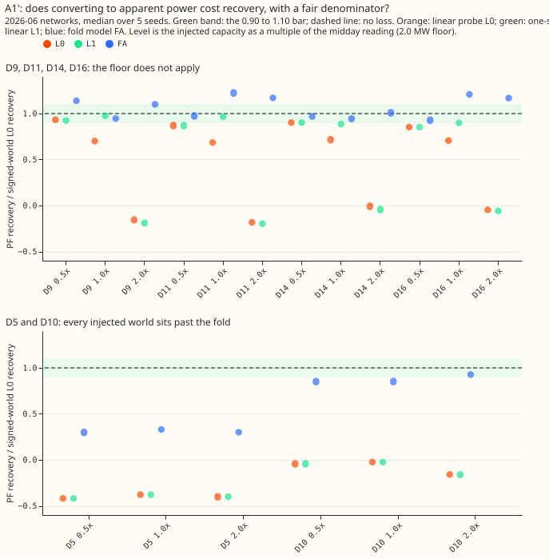
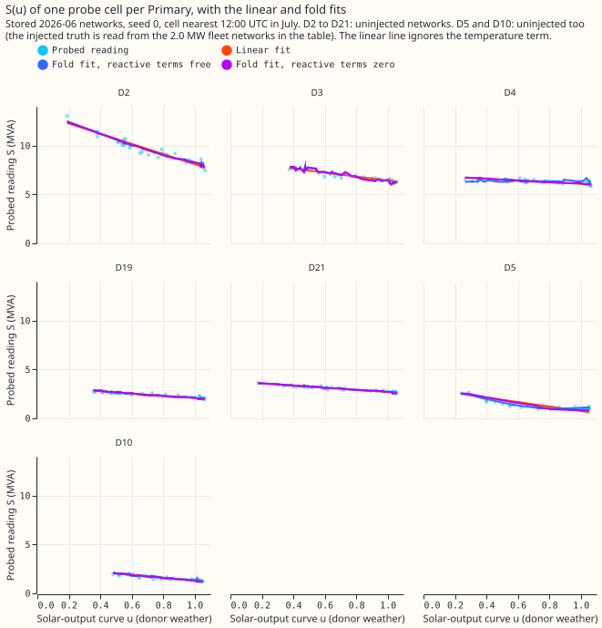

# Does the fold model lose recovery with a fair denominator, and which probe should be trusted at D2, D3, D4, D19, and D21?

**Converting a flow to apparent power costs the linear probe recovery even where the flow never
nears zero, and the fold model's extra capacity at D3 and D4 comes from its free reactive terms,
not from a folded curve.** The fair-denominator test A1' fails for all three probes (decision-rule
branch 3: quantify the loss). Fixing the two reactive terms of the fold model at zero returns the
linear probe's capacity at D2, D3, D4, and D19 to within 0.5 MW. For D2, D3, D4, D19, and D21 we
recommend the linear probe, scaled by the recovery measured on injected farms, with the fold
model's free-reactive reading as an upper bound. Both parts re-use experiment 662's stored networks
(2026-06 cutoff, 5 seeds) and its probe outputs; no network was trained.

**Figure: L0 sits near 0.9 only at 0.5 times, L1 also at 1 times, and the fold model scatters
around 1.**
Each dot is one Primary at one level. D5 and D10 sit past the fold in every injected world (2.0 MW
floor), so their ratios are shown apart.

**Figure: every curve is monotone falling or flat, not V-shaped.** D3 and D4 are nearly flat
(under 2 MVA across the range of u), and the three fits lie on top of each other in this cell.
The disagreement between the probes therefore comes from the fits across cells, not from the curve
class in one cell.

## Part 1: A1' at the six MW Primaries (median over seeds, first farm rotation)

Terms: L0 is the linear probe, L1 the linear probe on rows above the reactive floor, and FA the
fold model with a night prior (all as in experiment 662). "PF" is the apparent-power world with
power factor 0.97. A ratio is valid where the signed-world denominator is at least 0.05.

- **Bar.** 0.90 to 1.10 at 5 of 6. It passes for no probe at any level. Valid ratios in the bar:
  L0 2, 0, 0; L1 2, 2, 0; FA 3, 2, 2 of 6 at 0.5, 1, 2 times.
- **Loss in points of recovery (PF minus signed L0), D9, D11, D14, D16.**

| Probe | 0.5 times | 1 times | 2 times |
|---|---|---|---|
| L0 | -5 to -12 | -22 to -25 | -75 to -94 |
| L1 | -6 to -12 | -2 to -9 | -78 to -95 |
| FA | -6 to +10 | -4 to +18 | +1 to +13 |

- **Pre-registered predictions.** The plan predicted that A1' passes for L0 and L1 at 0.5 times
  and for FA at 0.5 and 1 times. All three failed (L0 2 of 6, L1 2 of 6, FA 3 and 2 of 6), so the
  first hypothesis (no loss where the floor does not apply) is refuted for L0 and L1 and not
  supported for FA. The prediction for Part 2 (curves not V-shaped; most of the extra capacity gone
  with the reactive terms fixed) held.
- **Deviation.** The plan said median over seeds and both farm rotations; only the first rotation
  is used, because the signed arm has no second rotation.
- **Signed-world L0 denominators** are 0.73 to 0.82 at all six Primaries and levels.
- **D5 and D10** (2.0 MW at every level, past the fold): L0 and L1 lose 79 to 115 points; FA loses
  53 to 57 points at D5 and 6 to 12 points at D10.
- **Bias reading (FA over signed L0).** FA's ratio is 0.85 to 1.22 at D9, D10, D11, D14, and D16
  and 0.30 to 0.33 at D5. FA therefore recovers about as much of the signed-world capacity as the
  linear probe does in the signed world, except at D5, and overshoots by up to 22% at D11 and D16.
- **Reading against the decision rule.** Neither FA nor L0 passes, so the apparent-power conversion
  costs recovery even where the floor does not apply. The cost is 5 to 12 points for the linear
  probe at 0.5 times and 22 to 25 points at 1 times.

## Part 2: D2, D3, D4, D19, D21 (and D5, D10)

Terms: a "twin" is the network trained on the real data with no injected farm. "q = 0" fixes both
reactive terms of FA at zero; "q1 = 0.25" fixes the reactive share at the power-factor 0.97 value.
The midday reading is the median flow on sunny half-hours from 10:00 to 15:00 UTC, April to August.
The "A2 rows" are experiment 662's recoveries in native apparent-power worlds.

| Primary | Midday reading (MW) | L0 (MW) | FA free (MW) | FA, q = 0 | FA, q1 = 0.25 | Share of FA's extra gone with q = 0 |
|---|---|---|---|---|---|---|
| D2 | 8.84 | 5.20 | 7.95 (7.4 to 8.2) | 5.70 | 6.05 | 82% |
| D3 | 6.62 | 2.06 | 4.44 (2.7 to 4.7) | 2.26 | 2.37 | 91% |
| D4 | 7.09 | 0.98 | 3.09 (1.1 to 4.0) | 1.10 | 1.15 | 94% |
| D19 | 2.56 | 1.13 | 2.13 (1.3 to 2.4) | 1.28 | 1.36 | 85% |
| D21 | 2.94 | 1.13 | 1.35 (1.2 to 1.8) | 1.26 | 1.32 | 42% |

- **Real twins, raw capacity**, median over 5 seeds (min to max for the free fold fit).
- **Reactive floor of the free fit.** The free fit's q0 is 3.3 to 5.7 MW at D2, 2.1 to 5.1 MW at
  D3, and 0 or 3.5 to 3.8 MW at D4, where two of five seeds find no floor and read 1.1 MW.
- **Known-answer recoveries in native PF worlds (experiment 662, A2 rows).** The linear probe
  recovers 0.63 to 0.82 at 0.5 times and 0.51 to 0.64 at 1 times, and is negative at 2 times
  (-0.10 to -0.19). The fold model recovers 0.49 to 0.97 at 0.5 times, 0.54 to 0.91 at 1 times, and
  0.73 to 0.92 at 2 times. The calibrated linear capacities are 0.2 to 0.5 times the midday
  reading at D3 and D4, where the linear probe recovers 0.74 to 0.82 at 0.5 times, and about 0.5 to
  0.9 times it at D2, D19, and D21, where the linear recovery falls to 0.51 to 0.63 at 1 times.
- **Known answer at D5 and D10 (injected 2.0 MW, past the fold).** Recovery per probe: L0 -0.34 and
  -0.03; FA free 0.24 and 0.65; FA with q = 0 1.16 and 0.00; FA with q1 = 0.25 0.01 and 1.07. No
  probe reads both correctly, so past the fold the reactive-term setting decides the answer.

## Recommendation

Capacity ranges divide the raw linear capacity by the native-world 0.5-times recoveries (0.63 to
0.82) of experiment 662; the "upper bound" divides the free fold fit by 0.71, the median recovery
of the fold model at 1 times at the six MW Primaries (a different level from the linear divisor,
because the fold model's 0.5-times recovery at D3, D4, and D19 is lower). Both assume power factor
0.97.

| Primary | Probe to use | Capacity range (MW) | Upper bound, free fold (MW) | Confidence |
|---|---|---|---|---|
| D2 | L0 | 6.3 to 8.3 | 11.2 | provisional |
| D3 | L0 | 2.5 to 3.3 | 6.2 | provisional |
| D4 | L0 | 1.2 to 1.6 | 4.3 | provisional |
| D19 | L0 | 1.4 to 1.8 | 3.0 | provisional |
| D21 | L0 (the fold model's median is 0.2 MW higher) | 1.4 to 1.8 | 1.9 | provisional |
| D5, D10 | none | not defined | not defined | report-only |

- **Why L0 for D3, D4, and D19.** Fixing the reactive terms at zero or at the power-factor
  value returns the linear capacity, so the extra 1.0 to 2.4 MW of the free fold fit at D3, D4,
  and D19 is a reactive-term effect that the injected farms give no sign of supporting. The fold
  model recovers less than the linear probe at 0.5 times at D3, D4, and D19 (0.68, 0.55, 0.49
  against 0.82, 0.74, 0.63).
- **What stays open.** The injection tests difference a twin against a fleet, so they cannot show
  whether the twin's own absolute read of 3 to 4 MW is true. A real reactive floor of 3 to 5 MW at
  D3 and D4 would also produce the free fit's answer.

## Caveats

- One cutoff (2026-06) and one network architecture; the 2026-03 networks are not re-probed.
- The reactive power of the real meters is unknown, and power factor 0.97 is an assumption.
- D5 and D10 have midday readings near 1 MW, so a 2.0 MW floor puts them past the fold at every
  level.
- NGED's event labels are incomplete, so the clean rows may hold unlabelled events.
- The S(u) lines use one cell and seed 0; the linear line omits the temperature term.

## Checks

- **Forecast checks:** the experiment scores no forecast, so the median-minus-mean and
  quantile-score checks do not apply.
- **Code review (Sonnet):** no wrong-number bugs. It asked for the plan to say that the first farm
  rotation only is used (done) and noted that the temperature term is omitted from the plotted
  linear line (stated).
- **Compute:** CPU only, 2 processes; Part 2 took about 15 minutes.
- **Reproduce:** `e00671_a1.py`, then `e00671_part2.py` (twice, for the twin and the injected
  networks), then `e00671_report.py`, in this experiment's folder.

## What the next experiment should answer

Does a reactive floor of 3 to 5 MW exist at D3 and D4? A test needs the real meters' active and
reactive power, which the meters may record.
