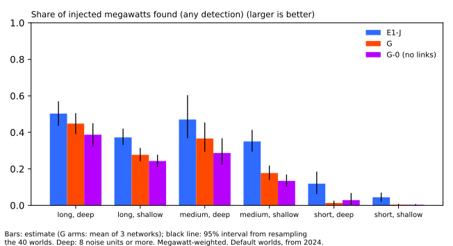

**A graph neural network trained on injected transfers pairs far less than the search of experiment
670, and it does not find donors better, so the graph line is closed at 15 Primaries.** The graph
neural network (G) pairs 0.08 of the injected transfer megawatts in the long and deep cell, against
0.29 for E1-J (difference -0.20, 95% interval -0.33 to -0.09), and 0.04 in the medium and deep cell,
against 0.25. G finds 0.47 of the long and deep donor megawatts, against 0.44 for E1-J, a gain of
+0.03 (interval -0.16 to +0.23) where +0.10 was predicted. The verdict is *not supported*: the
pairing margin of +0.10 failed in both deep cells, so stop rule (a) fires. Stop rules (b) and (c)
did not fire: the cross-injector drop was 0.03 on the same-test-world reading, and G-R decoded no
real edge events.

## Terms

- **G, G-R, G-0, GS.** The graph network on the real connection graph; the same network trained and
  run on a rewired graph; the same network with no links; and G with the explicit solar term added
  to the residual at the six Primaries metered in megawatts.
- **Cell.** One of six groups of injected events by length (long: over 7 days or no end; medium:
  over 1 up to 7 days; short: up to 1 day) and depth (deep: 8 noise units or more; shallow: 2 up to
  8).
- **Donor, recipient, found, paired.** As in the plan below and in [experiment
  670](../00670-event-table-recipient-search-on-six-cell-grid/result.md). *Donor found* is the share
  of the megawatts of injected donor steps (edge transfers with a metered recipient) that the
  decoded table finds.
- **E1-J.** The event table of experiment 653 plus the recipient search of experiment 670, read from
  that experiment's stored rows for the same 40 worlds.

## Figures

**The first figure shows that G pairs less than E1-J in every cell, and that G finds donors about as
often as E1-J in the long and deep cell only.**

**The second figure shows that G finds fewer injected events than E1-J in every cell, and that the
links add 0.03 to 0.08 of found share over the no-link arm in the four cells of 1 day or longer.**

## Results

- **Pairing.** MW-weighted, default worlds (40 worlds), mean of three networks for G, with the
  world-resampled 95% interval of the difference from E1-J.

    | Cell | Injected events (edge-transfer ends) | E1-J paired | G paired | G minus E1-J |
    |---|---|---|---|---|
    | Long, deep | 220 (146) | 0.29 | 0.08 | -0.20 (-0.33 to -0.09) |
    | Medium, deep | 127 (103) | 0.25 | 0.04 | -0.21 (-0.34 to -0.09) |
    | Long, shallow | 840 (524) | 0.19 | 0.04 | -0.15 (-0.20 to -0.10) |
    | Medium, shallow | 458 (347) | 0.13 | 0.01 | -0.12 (-0.17 to -0.07) |
    | Short, deep | 163 (129) | 0.08 | 0.00 | -0.08 (-0.15 to -0.02) |
    | Short, shallow | 561 (435) | 0.03 | 0.00 | -0.03 (-0.05 to -0.01) |

- **Donor end and recipient end, long and deep cell.** E1-J finds 0.44 and pairs 0.36 of the donor
  megawatts, and finds 0.73 and pairs 0.22 of the recipient megawatts. G finds 0.47 and pairs 0.09
  of the donor megawatts, and finds 0.55 and pairs 0.08 of the recipient megawatts. The graph neural
  network finds donors and then fails to link them.
- **Found share.** G minus E1-J is -0.05 (-0.14 to +0.03) in the long and deep cell, -0.10 (-0.25 to
  +0.03) in the medium and deep cell, and -0.10, -0.17, -0.11, and -0.04 in the other four cells,
  each below its predicted margin. G minus the no-link arm G-0 is +0.06 (-0.03 to +0.15) and +0.08
  (-0.03 to +0.19) in the long and deep and the medium and deep cells.
- **Timing.** Of the found events in the long and deep cell, 88% start within 2 hours and 75% end
  within 6 hours of the truth (medium and deep: 94% and 88%), so P5 holds.
- **False transfers.** G decodes 86 transfers in 40 worlds, of which 46 match no injected end (E1-J:
  788 and 568). G pairs conservatively and still pairs little.
- **Placebo and no-link arms.** G-R and G-0 pair 0.00 of the megawatts in every cell, by
  construction for G-0 and because the injected transfers use the real graph for G-R. G-R found
  shares are 0.41 (long and deep) and 0.29 (medium and deep).
- **Cross-injector test (one network per injector, 10 worlds each).** Found share in the long and
  deep and medium and deep cells together: a network trained on constant-megawatt square steps finds
  0.42 on those worlds and 0.35 on shaped transfers; a network trained on shaped transfers finds
  0.32 on shaped transfers and 0.38 on constant-megawatt worlds. The drop is read on the same test
  worlds, as the network trained on that injector minus the network trained on the other: 0.416
  minus 0.384 = +0.03 on constant-megawatt worlds, and 0.320 minus 0.352 = -0.03 on shaped worlds.
  Read per network instead (each network's own injector minus the other injector's worlds), the
  drops are +0.06 and -0.06, and stop rule (b) would also fire. Each reading rests on 10 worlds and
  a handful of deep events, so P9 is not a firm result.
- **Real record, 15 Primaries, scored years (36.0 Primary-years).** G calls 0.75 to 0.97 events per
  Primary-year (E1: 6.83) and 2 to 4 edge events, none in the long and deep or the medium and deep
  cell (E1-J: 8, none in those cells). G-R calls 0 edge events, and G-0 calls none. G locates a D5
  step of -1.08 MW 24 hours after the verified start and a D16 step of +2.1 MW 9.5 hours after it
  (62 hours before it in one network), in all three networks, and links neither. The D5 step is
  below the 1.2 MW bar of P6, and both starts miss P6's 6-hour bar. G matches 5 to 6 of 77 logged
  shifts of more than 1 day with the
  start within 2 hours (E1: 8).
- **Explicit solar term.** GS minus G is -0.02 and -0.01 in found share, +0.04 and 0.00 in
  donor-found share, and 0.00 in paired share in the long and deep and the medium and deep cells,
  with found and donor-found intervals of +-0.1 or more. Experiment 657
  found the same inside E1.
- **Post hoc wider decoder grid (arm `Gw`).** The tuned none-boost of G sat at the edge of its grid
  (10), the decoder weight that raises the cost of calling no event, so the three G networks were
  re-tuned with boosts from 3 to 1000. The long and deep cell
  then gave found 0.48, donor found 0.52, and paired 0.10 (G: 0.45, 0.47, 0.08), and the real record
  gave 0.14 to 0.64 events per Primary-year. The verdict does not change.

## Predictions

- **P1 (pairing margin +0.10): failed** in the long and deep, medium and deep, and long and shallow
  cells, and the margins of +0.05 failed in the medium and shallow and the short and deep cells.
- **P2 (donor-found margin +0.10 over E1-J): failed.** +0.03 in the long and deep cell and -0.06 in
  the medium and deep cell.
- **P3 (found margins and absolute paired shares): failed** in all six cells.
- **P4 (G minus G-0): failed.** +0.03 and +0.04 in the long and shallow and medium and shallow cells
  (needed +0.05), and +0.06 in the long and deep cell (needed within 0.03).
- **P5 (timing): held** in both deep cells.
- **P6 (verified D5 and D16 pair): failed** on pairing, on start timing, and on the size of the D5
  step.
- **P7 (G-R at most a third of G's real edge events in the two deep cells): unreadable.** G has no
  real edge events in those cells.
- **P8 (events per Primary-year within a factor of 2 of E1's): failed.** 0.75 to 0.97 against 6.83.
- **P9 (cross-injector drop at most 0.05): held** on the same-test-world reading (0.03), failed on
  the per-network reading (0.06); one network per injector.
- **P10 (GS within 0.03 of G): failed in donor-found share in the long and deep cell** (GS is 0.04
  higher, interval about +-0.2), and held in the other measures and cell.
- **Reproduction gate: held by reading, not re-scoring.** The E1-J rows are experiment 670's stored
  rows on the same worlds, and they match that page's headline cells (0.29 and 0.25 paired).

## Checks

- **Median minus mean forecast per site and the mean-forecast error beside each quantile-score
  contrast.** Not applicable: no forecast is scored.
- **Audit triggers.** None fired: the result is a clear failure of every pairing prediction against
  a stored benchmark, and the post hoc arm left the verdict unchanged.
- **Caveats.** NGED's logs are an incomplete one-off dump, so matched logged shifts are lower
  bounds. One network trained per injector, three per arm, 120 training worlds, and 2,400 steps; a
  larger network, more worlds, or 1-hour blocks might pair more, and this experiment does not test
  them. The explicit solar term carries a capacity table fitted partly inside the scored window.

## What to try next

- The pre-registered stop rule closes the graph line at 15 Primaries, and X3 (history length) is not
  started because the stop rule fired. Whether to reopen the graph line, and which event table to
  use, is for the roadmap.
- Reduce the false transfers of E1-J (72% of its decoded transfers match no injected end in this
  experiment's tally; experiment 670's page gave 69%) before any
  further pairing method is built.

## The plan as committed

The plan below was committed before any network was trained.

## The question

[Experiment 670](../00670-event-table-recipient-search-on-six-cell-grid/result.md) gave the event
table of [experiment 653](../00653-edge-state-event-table-penalised-segmentation/result.md) a
search at connected Primaries for the recipient of each donor step. That event table (E1-J) paired
0.29 of the injected megawatts in the long and deep cell, against 0.09 without the search. Two
losses limit it: E1 finds only 0.44 of the donor megawatts (E1-J pairs 0.36), and the search pairs
only 0.22 of the recipient megawatts although it finds 0.73. E1-J also decodes false transfers (69%
of its decoded transfers match no injected end, against 57% for E1). This experiment asks whether a
graph neural network, trained to find the donor and reading the recipient evidence at the linked
Primaries, improves both ends, by at least 0.10 of paired megawatts over E1-J.

## Arms

- **G.** The donor-finding network on the real connection graph (below).
- **G-R.** The same network trained and run on a degree-preserving rewired graph, the placebo (one
  rewiring per seed, the draw, out of 300, that keeps the fewest real links, because experiment
  670's best of 30 kept 16% of the real links; the share kept is reported).
- **G-0.** The same network with no links and no neighbour layer: each Primary sees only itself.
- **GS.** G with the explicit solar term added to the residual at the six Primaries metered in
  megawatts: known weather from CAMS and ERA5, and the capacity table of
  [experiment 649](../00649-pv-capacity-table-season-year-from-stored-probes/result.md), built by
  [experiment 657](../00657-event-table-with-explicit-solar-term-against-plain-arm/result.md).
  Experiment 657 tested this term inside E1 and found that it left the residual and the recall
  unchanged; GS repeats the test inside the network. The capacity table's 2026-06 cut-off and the
  gain fitted on 2022 and 2023 sit partly inside the scored years, as in experiment 657, so a gain
  would be an upper bound.
- **Reference rows.** E1-J and E1 from experiment 670's stored scored rows on the same worlds.

Each arm trains 3 seeds, on the `default` generator configuration. Two further networks, each one
seed, give the cross-injector test: G trained on the
`constant_mw_square` configuration of experiment 660 and G trained on its `shaped_transfers`
configuration. Each is scored on 10 worlds (seeds 1000 to 1009) of both configurations, so the
test reads in-injector minus cross-injector found share in both directions. P9 is a one-seed
reading.

## Method

- **Network.** Experiment 658's recurrent encoder, shared by the 15 Primaries, a neighbour-mean
  layer, and a link head, on the 6-hour block grid of experiment 653. A **donor head** is added:
  per Primary, the chance that the Primary is the donor of a transfer with a metered recipient. The
  link head also reads the two Primaries' donor logits, so the recipient state is conditioned on
  the donor. The loss is experiment 658's plus a weighted cross-entropy on the donor flag (donor
  blocks weigh 5, about 2% of blocks). The graph specification's loss table is not used: 658's
  loss is the one already shown to train on these worlds.
- **Decoder.** Experiment 658's Viterbi decode and link pairing, with one addition: the decoder
  moves `lambda` times the donor probability of each block's 'none' mass to 'shift, down'
  (`lambda` 0 is the ablation of the donor head's role in decoding; 1 is the donor-aware decode,
  chosen on validation worlds from {0, 1}).
- **Resolution.** Blocks are 6 hours, as in experiment 658, not the 1-hour blocks the specification
  estimated would take about 10 times as long to train; boundaries are refined to the half-hour by
  experiment 653's refinement. If the timing prediction (P5) fails for this reason, the write-up
  says so.
- **Ends reported separately.** As experiment 670's advice asks, every cell reports the donor end
  and the recipient end separately (found and paired), and the false transfers (decoded transfers
  that match no injected end) beside recall.
- **Donor recall.** The share of the megawatts of injected donor events (negative step, an edge
  transfer with a metered recipient, 4 noise units or more) that the decoded table finds, by the
  matching rule of experiment 653, reported beside pairing for every cell.
- **Panel.** Experiment 653's panel from 2022 (no 2019-onward panel exists on disk, and a fetch
  is outside this experiment's scope); the history-length question belongs to X3.
- **Real record.** As in experiment 670: events per Primary-year, logged shifts matched, edge
  events per cell, the verified D5 and D16 transfer, and the event-free stratum, for G, G-R, G-0,
  and GS.
- **Compute.** 14 networks of about 2,400 steps each. One network is timed first. One network took
  70 seconds, so all 14 networks ran 2,400 steps. Decoder tuning and scoring run
  on CPU while the GPU trains the next network, and the ceiling of 8 GPU-hours counts training time
  only.
  One GPU process at a time, at most 4 CPU cores, `MemoryMax=16G` per script. The one-year backtests
  hold priority: a fit pauses when a backtest worker needs the GPU.
- **Definitions.** A cell is one of six groups of injected events by length (long over 7 days or no
  end, medium over 1 up to 7 days, short up to 1 day) and depth (deep 8 noise units or more,
  shallow 2 up to 8). An event is found when the decoded table has an event at the right Primary
  and sign starting within 12 hours; an end is paired when the decoded table links it to the right
  other end; an edge event is a decoded transfer. Shares are weighted by absolute megawatts.
- **Inherited leaks, stated.** The noise units (experiment 653's, fitted before 2024-01-01) saw the
  validation months, and the injected start hours and weekdays come from NGED's logged onsets up to
  2026-07, so the scored window has shaped both. Both are shared with experiment 670, so the
  contrast with E1-J is unaffected. The GS arm also carries the capacity table (cut-off 2026-06) and
  a gain fitted before 2024-01-01, so a GS gain would be an upper bound.
- **Caveat.** NGED's logs are an incomplete one-off dump, so matched logged shifts are lower
  bounds.

## Reviews

A Sonnet plan review and a Sonnet code review ran before the first fit and are triaged in the pull
request. A Sonnet write-up review and a Sonnet prose review ran on the finished page and are triaged
in the pull request.
