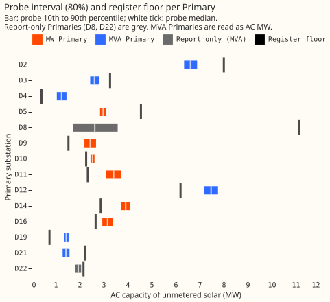
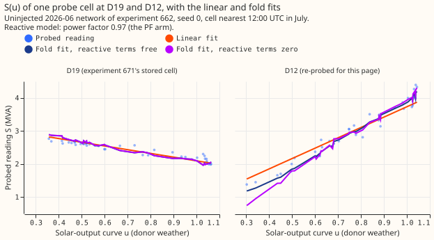

# Unmetered solar capacity per Primary, beside what three registers list

**Take-home.** The probe reads 2.4 to 3.9 MW of unmetered solar at each of the six Primaries metered
in megawatts (MW), and 1.45 to 7.69 MW at the five Primaries metered in megavolt-amperes (MVA) that
do not fold. At 8 of the 12 Primaries that have a probe interval, the interval lies above the solar
capacity that the three registers list inside the Primary's service area. D2 overlaps its register
floor, and D3, D5, and D21 lie below it. The MVA figures may be upper readings if NGED's meters have
power factor 1, and no figure here says when capacity changed. The hypothesis as worded (every
Primary) fails at D3, D5, and D21, and the count falls to 5 of 12 if the Feed-in Tariff band of 50
kW to 1 MW is added to the floor.

This page is for NGED. A Primary is an NGED primary substation, which steps 33 kV down to 11 kV. The
page gives the probe's capacity per Primary, with the registers beside it, and fits nothing: every
probe number is a stored row of experiments
[649](../00649-pv-capacity-table-season-year-from-stored-probes/result.md),
[662](../00662-pv-probe-through-the-mva-fold-matched-level-redesign/result.md), and
[671](../00671-pv-mva-fold-probe-fair-denominator-and-d3-d4-disagreement/result.md). The probe is a
trained demand-forecasting neural network asked how much a Primary's net demand falls for a given
amount of sunshine. The capacity is in MW of alternating current (AC), for unmetered solar only, so
it excludes every generator that NGED meters.

**Figure 1. At 8 of the 12 Primaries with a probe interval, the bar (probe, 10th to 90th percentile)
lies right of the black tick (register floor).** The eight are D4, D9, D10, D11, D12, D14, D16, and
D19. D2's bar ends at its tick, and D3, D5, and D21 lie left of theirs. D8 and D22 are report-only
(grey) and are not among the 12. The floor is the lower bound defined in the register section, with
metered sites removed.

## The six Primaries metered in MW: D5, D9, D10, D11, D14, and D16

**The six MW Primaries need no apparent-power conversion, so the probe's calibration was measured
directly on their own flow.** The table is experiment 649's calibrated capacity for April to
September 2025 at the 2026-06 pretraining cutoff (10th, 50th, and 90th percentile, MW). The raw
value is the probe's reading, and the calibrated value divides it by 0.679, the share of an added
real solar farm that the probe finds again.

| Primary | Raw p10 / p50 / p90 | Calibrated p10 / p50 / p90 |
|---|---|---|
| D5 | 1.96 / 2.02 / 2.09 | 2.85 / 2.98 / 3.11 |
| D9 | 1.50 / 1.66 / 1.82 | 2.20 / 2.44 / 2.68 |
| D10 | 1.70 / 1.72 / 1.75 | 2.46 / 2.54 / 2.62 |
| D11 | 2.12 / 2.32 / 2.52 | 3.11 / 3.42 / 3.73 |
| D14 | 2.56 / 2.66 / 2.76 | 3.74 / 3.92 / 4.10 |
| D16 | 2.01 / 2.15 / 2.28 | 2.95 / 3.16 / 3.38 |

- **Energy-basis sensitivity.** Measured in energy, the probe finds 0.88 (all daylight rows) or 0.78
  (donor rows) of an injected farm's energy, against 0.68 in MW. Experiment 649 shows that the
  energy-basis AC capacity agrees with the MW basis within 1.3% at every Primary (D5 2.95 MW against
  2.98 MW at the median; the largest gap is 1.3%).
- **Other estimates.** The calibrated interval overlaps the interval of experiment
  [474](../00474-pv-capacity-placebo-gated-ladder-and-per-primary-intervals/result.md) (rung R4) at
  6 of 6 Primaries, with medians 0.94 to 1.14 times its medians. It overlaps experiment
  [479](../00479-pv-capacity-anomaly-regression-rung/result.md) at 4 of 6 (D5 and D16 are separated
  by a gap), with medians 0.90 to 1.13 times its medians.
- **Resolution.** The values describe a whole summer. A sunny spring makes the probe read a capacity
  step that is not there (experiment
  [634](../00634-pv-probe-capacity-step-world-and-energy-recovery/result.md)), and a capacity step
  is followed only in an ordinary spring (experiment
  [638](../00638-pv-probe-step-placebo-climatological-and-ordinary-year-followup/result.md)). The
  probe's 2024 and 2025 summers differ by at most 0.07 MW at every Primary at this cutoff.
- **Reactive power.** None: these Primaries are metered in signed MW, so no apparent-power
  conversion applies.

## The five MVA Primaries that do not fold: D2, D3, D4, D19, and D21

**At D2, D3, D4, D19, and D21, the main figure is the linear probe calibrated by 0.68. The fold
model's figure is an upper bound.** The linear probe is experiment 662's L0 and the fold model is
its FA, both at the 2026-06 cutoff. The calibration factor 0.68 is experiment 662's
leave-one-Primary-out recovery of an added farm at 0.5 times the midday reading, measured on the six
MW Primaries after their flow was turned into apparent power with a reactive part of 0.25 times the
median real power (power factor 0.97, the "PF arm"). Experiment 671 recommends the same probe and
marks all five figures provisional.

| Primary | Raw linear p50 | Linear, calibrated 0.68: p10 / p50 / p90 | p50 if recovery is 0.79 / p50 at 0.68 | Fold model, upper bound: p10 / p50 / p90 |
|---|---|---|---|---|
| D2 | 5.20 | 7.38 / 7.69 / 8.01 | 6.62 / 7.69 | 10.44 / 11.28 / 12.13 |
| D3 | 2.06 | 2.84 / 3.04 / 3.26 | 2.62 / 3.04 | 4.03 / 6.30 / 8.58 |
| D4 | 0.98 | 1.22 / 1.45 / 1.69 | 1.25 / 1.45 | 1.12 / 4.38 / 7.68 |
| D19 | 1.13 | 1.56 / 1.68 / 1.79 | 1.44 / 1.68 | 1.96 / 3.03 / 4.11 |
| D21 | 1.13 | 1.50 / 1.66 / 1.83 | 1.43 / 1.66 | 1.32 / 1.92 / 2.52 |

**Figure 2. S(u) is the probed reading S plotted against the solar-output curve u (a clear-sky solar
share). At D19 the probed reading (MVA) falls steadily as the solar-output curve rises, so a
straight line fits it; at D12 the reading rises with the solar-output curve, and the linear fit
misses at low values (it reads about 1.5 MVA where the readings are about 1.2).** The panels share a
vertical axis. Experiment 671's own figure shows the curves of D2, D3, D4, D19, and D21, which are
all falling or flat, not V-shaped (see its [S(u)
figure](../00671-pv-mva-fold-probe-fair-denominator-and-d3-d4-disagreement/s_of_u.svg)). D19's cell
is 671's stored cell. D12's cell was re-probed for this page with the same probe code on experiment
662's stored uninjected neural network (2026-06 cutoff, seed 0), because no stored output holds
D12's curve. The re-probe reproduces 671's D19 capacities exactly (linear 1.12 MW, fold 1.34 MW,
seed 0), and reads D12 at -3.13 MW (linear) and 5.35 MW (fold, reactive terms free), against -3.0
and 5.3 MW in experiment 662's five-seed medians. The rising curve at D12 matches 662's crossing-map
call that D12 folds.

**Conversion loss and the reactive-power setting.** The "p50 if recovery is 0.79" column divides the
raw linear reading by the linear probe's recovery in the signed (no apparent-power) world instead of
0.68. It is the capacity if the apparent-power conversion cost no recovery. Experiments 656, 662,
and 671 simulated apparent power with the PF arm. NGED's statement, relayed by the maintainer, is to
assume power factor 1 for the substation meters, with some reactive power always present. Experiment
662 also ran a floor arm (a constant reactive power of 0.10 times the median sunny-midday power,
close to power factor 1 with a small always-present floor) and a zero-reactive arm (a reactive power
of zero, so the reading is the absolute value of the real power). Median recovery of the injected
farm over the six MW Primaries, first farm rotation:

| Probe and reactive model | 0.5 times | 1 times | 2 times | 6 times |
|---|---|---|---|---|
| Linear, PF arm | 0.68 | 0.53 | -0.12 | -0.80 |
| Linear, floor arm | not run | 0.63 | -0.11 | -0.83 |
| Linear, zero-reactive arm | not run | not run | -0.10 | not run |
| Linear, signed (no conversion) | 0.79 | 0.78 | 0.77 | 0.78 |
| Fold model, PF arm | 0.73 | 0.71 | 0.78 | 0.88 |
| Fold model, floor arm | not run | 0.67 | 0.78 | 0.88 |
| Fold model, zero-reactive arm | not run | not run | 0.77 | not run |
| Fold model, signed | 0.85 | 0.63 | 0.28 | -0.03 |

**The floor arm shows less conversion loss than the PF arm at 1 times, and the other arms show none
or no difference.** At 1 times the linear probe recovers 0.63 with the floor arm and 0.53 with the
PF arm, against 0.78 without the conversion. At 2 times the floor arm (-0.11) and the zero-reactive
arm (-0.10) match the PF arm (-0.12). The stored outputs hold no floor arm at 0.5 times, the level
behind the 0.68 factor, so the loss at that level under power factor 1 cannot be measured here.

**The direction under power factor 1 is therefore likely but not established: the MVA figures may be
upper readings.** If recovery were 0.79, the median signed-world value on the six MW Primaries, the
figures would be about 14% lower. Using experiment 671's per-Primary signed-world values of 0.73 to
0.82, the reduction would be 7% to 17%. The bound assumes that the whole conversion loss disappears,
and the loss measured at 0.5 times was 5 to 12 points at D9, D11, D14, and D16 (experiment 671).

**Every MVA figure on this page uses the PF arm** (reactive power 0.25 times the median real power)
in its calibration and in the known-answer tests of experiments 662 and 671, unless a column says
otherwise.

## D12, D8, and D22

**D12 has a fold-model figure only, because its linear probe reads negative.** The fold model reads
7.19 / 7.48 / 7.77 MW (10th / 50th / 90th percentile, calibrated by 0.704, experiment 662's
fold-model recovery factor) and the linear probe reads -3.0 MW raw. Figure 2 shows the rising curve
behind the negative linear reading.

**D8 and D22 are report-only for the MVA conversion, as are D5 and D10.**

- **D8:** the linear probe reads 1.72 / 2.63 / 3.59 MW (calibrated). Experiment
  [508](../00508-mva-shoulder-hours-and-d8-d22-dips-solar-or-load-shift/result.md) tested whether a
  gas engine behind D8 explains a large share of its midday dips, so a solar reading there is not
  separable from the engine.
- **D22:** the linear probe reads 1.83 / 1.94 / 2.06 MW. Experiment 508 treated D22's midday dips as
  a mix of causes, so the reading is not a clean solar capacity.
- **D5 and D10 for the MVA conversion:** in experiment 662's injected worlds both sit past the fold
  at every level, because their midday readings are about 1 MW and the injected farm is at least 2.0
  MW. The reactive-term setting then decides the recovery (experiment 671 reads 0.0 to 1.16 across
  the fold variants). Their main figures are the MW-probe values above, which need no conversion.

## Register cross-check at all 14 Primaries

**The floor is the capacity that three registers list inside the Primary's service area, with the
sites that NGED already meters removed.** The probe estimates unmetered solar, so the floor must
exclude metered sites. The definitions below were fixed before any total was computed.

- **Where the registers are.** The Feed-in Tariff installation report (Ofgem, covering 2010-04-01 to
  2025-03-31) is `data/ml-experiments/00045-.../outside/fit_solar_pv_installations.parquet`. NGED's
  Embedded Capacity Register (August 2026 release) is `literature/NGED/NGED ECR AUG 2026.xlsx`. The
  Renewable Energy Planning Database (Q2 2026) is cached in `repd_register.json` under the solar BMU
  census's `inputs/raw/` folder. Experiment 129's `registers.parquet` holds the older Feed-in Tariff
  totals that experiment 267 used.
- **Coverage and size cuts.** The Feed-in Tariff lists photovoltaic installations of every size that
  it records, by postcode district only. The Embedded Capacity Register lists generation of 50 kW
  and above that is connected (the table counts only "Connected" solar rows, and some rows carry no
  coordinate, so they cannot be placed in a polygon). The Renewable Energy Planning Database lists
  operational solar, mostly 150 kW and above.
- **Polygons.** The Embedded Capacity Register and the Renewable Energy Planning Database carry
  British National Grid coordinates, so each row is placed by point-in-polygon against the Primary's
  `area_wkt`. The Feed-in Tariff has no coordinates, so a postcode district's capacity is shared to
  a Primary by the share of the district's delivery points inside the polygon (experiment 45's
  `fit_district_polygon_shares`). The Feed-in Tariff column is therefore a share, not a
  point-in-polygon total.
- **De-duplication.** Feed-in Tariff sites above 50 kW can also appear in the Embedded Capacity
  Register, and a Feed-in Tariff row cannot be matched to a register row (no coordinates), so the
  floor counts the Feed-in Tariff only up to 50 kW. A Renewable Energy Planning Database row within
  1 km of an Embedded Capacity Register row inside the same polygon counts as the same site and is
  dropped. The match is by distance only, so it can miss a site that the two registers place more
  than 1 km apart, and can merge two neighbouring sites.
- **Metered sites.** A register row within 1 km of a solar generator that NGED meters is removed
  from the floor. The page does not name those generators.
- **Floor (main).** Feed-in Tariff up to 50 kW (declared net capacity, the AC figure) plus Embedded
  Capacity Register rows below 1 MW, plus Embedded Capacity Register rows of 1 MW and above
  connected at 11 kV or below, plus Renewable Energy Planning Database rows below 1 MW that match no
  Embedded Capacity Register row, all with metered sites removed. A row with a corrupted coordinate
  (203 Embedded Capacity Register rows have a coordinate inflated by a power of 10) is divided by 10
  until it lies in Great Britain; rows with no coordinate (655 connected rows) are not placed, so
  the floor is a lower bound. Sites of 1 MW and above that connect at 33 kV or above are left out of
  the main floor, because they connect above the Primary and are not behind its meter. They are in
  the all-sites sensitivity column, together with Renewable Energy Planning Database rows of 1 MW
  and above that match no Embedded Capacity Register row (none changes a flag).

| Primary | FiT to 50 kW: AC (DC) | FiT 50 kW to 1 MW | ECR below 1 MW | ECR 1 MW and above (of which 33 kV and above) | REPD operational (of which also in ECR) |
|---|---|---|---|---|---|
| D2 | 1.98 (2.04) | 0.15 | 1.02 | 15.00 (10.00) | 4.90 (4.90) |
| D3 | 2.07 (2.16) | 0.32 | 0.00 | 5.82 (4.62) | 6.40 (6.40) |
| D4 | 0.36 (0.38) | 0.05 | 0.05 | 0.00 (0.00) | 0.00 (0.00) |
| D5 | 1.39 (1.44) | 0.66 | 0.46 | 9.20 (6.50) | 11.30 (11.30) |
| D8 | 1.48 (1.55) | 0.23 | 0.75 | 8.91 (0.00) | 1.50 (1.50) |
| D9 | 1.54 (1.59) | 0.03 | 0.00 | 0.00 (0.00) | 0.00 (0.00) |
| D10 | 1.36 (1.39) | 0.54 | 0.91 | 27.50 (27.50) | 42.60 (34.00) |
| D11 | 1.65 (1.70) | 0.92 | 0.69 | 0.00 (0.00) | 0.00 (0.00) |
| D12 | 1.27 (1.32) | 0.61 | 0.18 | 4.75 (0.00) | 5.00 (5.00) |
| D14 | 2.01 (2.10) | 0.51 | 0.87 | 0.00 (0.00) | 0.00 (0.00) |
| D16 | 1.59 (1.64) | 0.61 | 1.08 | 56.70 (56.70) | 0.00 (0.00) |
| D19 | 0.70 (0.72) | 0.03 | 0.05 | 0.00 (0.00) | 0.00 (0.00) |
| D21 | 1.25 (1.30) | 0.34 | 0.96 | 0.00 (0.00) | 0.00 (0.00) |
| D22 | 0.69 (0.71) | 0.30 | 1.47 | 0.00 (0.00) | 0.00 (0.00) |

**All values are MW inside the Primary's polygon. FiT is the Feed-in Tariff, ECR the Embedded
Capacity Register, and REPD the Renewable Energy Planning Database.** The Embedded Capacity
Register's capacity is its "already connected registered capacity" and the Renewable Energy Planning
Database's is its "installed capacity (MWelec)". Neither register states a direct-current or
alternating-current basis in these columns, so they are read as AC.

**Per Primary, the probe interval against the floor, with a plain flag.** "Probe above floor" means
the probe's 10th percentile is at or above the floor, "overlaps" means the floor lies inside the
10th to 90th percentile, and "below floor" means the 90th percentile is below the floor. "Not
comparable" marks the report-only Primaries. The ratio is the probe's median over the floor.

| Primary | Probe 10th to 90th (MW) | Floor, main (MW) | Floor, all sites (MW) | Ratio | Flag |
|---|---|---|---|---|---|
| D2 | 7.38 to 8.01 | 8.01 | 8.01 | 0.96 | overlaps |
| D3 | 2.84 to 3.26 | 3.27 | 3.27 | 0.93 | below floor |
| D4 | 1.22 to 1.69 | 0.41 | 0.41 | 3.50 | probe above floor |
| D5 | 2.85 to 3.11 | 4.55 | 4.55 | 0.65 | below floor |
| D8 | 1.72 to 3.59 | 11.14 | 11.14 | 0.24 | not comparable (report-only) |
| D9 | 2.20 to 2.68 | 1.54 | 1.54 | 1.59 | probe above floor |
| D10 | 2.46 to 2.62 | 2.27 | 2.27 | 1.12 | probe above floor |
| D11 | 3.11 to 3.73 | 2.34 | 2.34 | 1.46 | probe above floor |
| D12 | 7.19 to 7.77 | 6.20 | 6.20 | 1.20 | probe above floor |
| D14 | 3.74 to 4.10 | 2.88 | 2.88 | 1.36 | probe above floor |
| D16 | 2.95 to 3.38 | 2.67 | 59.37 | 1.19 | probe above floor |
| D19 | 1.56 to 1.79 | 0.75 | 0.75 | 2.24 | probe above floor |
| D21 | 1.50 to 1.83 | 2.21 | 2.21 | 0.75 | below floor |
| D22 | 1.83 to 2.06 | 2.16 | 2.16 | 0.90 | not comparable (report-only) |

- **D5 is below the floor mainly because of one site.** Embedded Capacity Register sites of 1 MW and
  above at 11 kV or below contribute 2.70 MW of D5's 4.55 MW floor. Without it the floor is 1.85 MW
  and the probe's interval is above it. The data cannot say whether that site lies behind the
  Primary's meter or is metered, so this is a flag, not a cause.
- **D3 is below the floor by a margin of 0.01 MW.** Its floor is 3.27 MW (2.07 MW from the Feed-in
  Tariff up to 50 kW and 1.20 MW from an Embedded Capacity Register site at 11 kV) against a probe
  90th percentile of 3.26 MW. Experiment 671 reads D3's linear capacity as provisional, and the fold
  model's upper bound is 4.03 to 8.58 MW.
- **D2's floor (8.01 MW) sits at the probe's 90th percentile (8.01 MW),** and includes 5.00 MW from
  sites of 1 MW and above. The margin is 0.002 MW. At D2 the fold model's upper bound is 10.44 to
  12.13 MW.
- **D21 is below the floor.** Its floor is 2.21 MW, mostly 0.96 MW from the Embedded Capacity
  Register below 1 MW and 1.25 MW from the Feed-in Tariff up to 50 kW. The linear probe reads 1.50
  to 1.83 MW and its calibration is provisional. The data cannot say which side is wrong.
- **D16's all-sites floor of 59.37 MW is not a comparison.** It includes 56.70 MW of sites of 1 MW
  and above that connect at 33 kV or above.
- **Feed-in Tariff band of 50 kW to 1 MW.** Adding it to the floor lowers the count above the floor
  from 8 to 5 of 12 (D10, D11, and D16 move to "overlaps", and D2 to "below floor"), but it is
  probably counted twice with the Embedded Capacity Register's sheet below 1 MW, so the main floor
  leaves it out.
- **Double counting that remains.** The Feed-in Tariff between 50 kW and 1 MW overlaps the Embedded
  Capacity Register's smaller sheet. The band is left out of the floor and listed in the table. The
  Feed-in Tariff is a share of postcode districts, so it can over- or under-count a Primary whose
  boundary cuts a district.

## Caveats

- **0.68 per-MW calibration factor.** The probe finds 0.68 of an injected real farm's AC MW (0.676
  to 0.708 across the four injected farms). The factor comes from four injected farms that resemble
  each other, and may not transfer to a fleet of rooftop panels with other tilts.
- **Energy-basis spread.** Measured in energy, the recovery is 0.78 (donor rows) to 0.88 (all
  daylight rows), so the capacity of a physics-shaped plant carrying the same energy is 0.77 to 0.87
  times the megawatt-basis capacity.
- **The fleet is many systems with no single clip.** An unmetered fleet has many panel tilts and
  inverter limits, so the AC capacity here is an effective figure for a fleet shaped like the
  injected farms.
- **Intervals.** The 80% interval is widened by the farm-to-farm spread of the recovery factor. In
  the checks of experiment 649 it covered the injected truth in 0.81 of 96 constant injections, a
  value consistent with 0.80 and not more precise than about 0.1.
- **No month-by-month change.** Nothing here shows how capacity changed from one month or year to
  the next. The probe's 2024 and 2025 summers differ by at most 0.07 MW at every MW Primary.
- **MVA Primaries.** The reactive model of every MVA figure is the PF arm (see the table above), and
  the floor arm shows less conversion loss. The reactive power of the real meters is unknown.
- **Dates.** The Embedded Capacity Register is the August 2026 release and the Renewable Energy
  Planning Database the Q2 2026 release, so both can list sites connected after the probes' 2026-06
  cutoff, and neither carries a date that could remove them. The Feed-in Tariff ends at 2025-03-31.
- **Feed-in Tariff shares.** The district shares of overlapping Primary polygons can sum above 1
  over Primaries, so the Feed-in Tariff column can count one district's capacity twice.
- **Registers.** The registers lag installations, list some sites twice, and list sites connected
  above the Primary. The probe and the registers also measure different things (a probe reading of a
  whole summer against capacity as registered).
- **NGED's event labels are incomplete,** so the rows behind the probes may hold unlabelled events.

## What would change this

- **NGED's list of connected solar behind a Primary, if it lies outside the probe interval by more
  than the interval's width.** Where the list (a count and total capacity at 11 kV and below) does,
  the probe's calibration or the floor's match to metered sites is wrong at that Primary. D3, D5,
  and D21 are the three where the flags already point that way, so those three records would settle
  most. D2's margin is 0.002 MW.
- **A floor arm at 0.5 times, with the 0.68 factor re-measured under it.** That would replace the
  14% bound above with a measured figure.
- **Knowing which of D5's and D2's large sites lie behind the Primary's meter would settle both
  flags.**

## Checks

- **Forecast checks:** the experiment scores no forecast, so the median-minus-mean and
  quantile-score checks do not apply.
- **Prediction (1) held:** the probe's 80% interval lies above the combined floor at 5 of the 6 MW
  Primaries (D5 is below it). **Prediction (2) held:** the probe is above the Feed-in Tariff floor
  (up to 1 MW, the floor of experiment 267, reproduced from experiment 649's table) at 6 of 6 MW
  Primaries and above the combined floor at 5 of 6. **Prediction (3) held:** 2 of the 5 main MVA
  Primaries lie below the floor (D3 and D21), and D2 overlaps it. **Prediction (4) was not tested:**
  experiment 267's totals are Feed-in Tariff only, and the Feed-in Tariff here uses the same
  district-share method.
- **D12 re-probe:** one CPU process, one stored network, about 1.5 minutes. No neural network was
  trained.

**Code:** `ml-experiments/00673-pv-capacity-for-nged-per-primary-with-register-cross-check/`:
`e00673_deliverable.py` (tables and figure 1), `e00673_d12_probe.py` (the D12 re-probe, which
imports experiment 662's and 671's modules), and `e00673_s_of_u.py` (figure 2).
