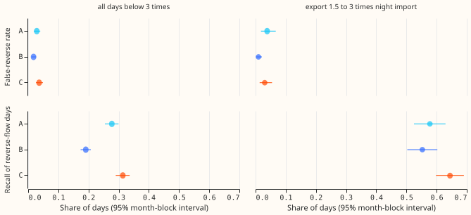
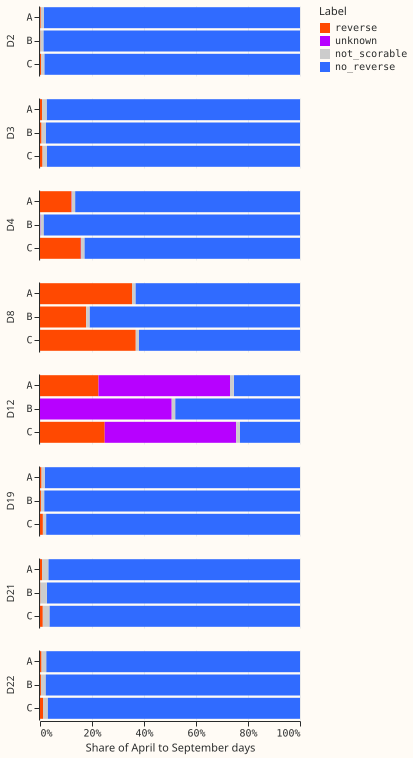
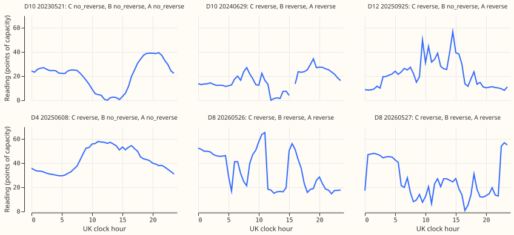

## Summary

**Take-home.** A day labeller that reads two features of each day finds injected solar export well
at moderate export, but real reverse flow at the six substations that report signed power is
shallow and short, and the labeller finds 5 of 59 such days. On the eight substations that report
apparent power it flags 39% of sunny April to August days at D8 and 13% at D4, so it is not yet a
usable sign label for them. A simple midday rule, chosen after seeing the real days, does better on
those 59 days. Verdict: `inconclusive` under the rule registered in the plan, because P1 was met by
the point estimates but not firmly, and P2, P3, and P5 failed. P4 held only in the pooled bin. All
numbers come from injected days or 59 real days, never from truth at the eight. NGED's event labels
are incomplete, so counts are lower bounds.

**What we asked.** Eight of the National Grid Electricity Distribution (NGED) primary substations
report apparent power (megavolt-amperes, which includes reactive power and is never negative), so a
day on which one exported power to the grid looks like a day of low demand. We built a per-day
labeller from two features: the lowest reading at the edges of the sun's path (experiment 508), and
how much better a V-shaped curve fits the day's reading than a falling curve does
([experiment 417's W-shape score](../00417-hidden-sign-mva-export-gate-zero-crossing-labels/result.md)).
We tested it on six substations that report signed power in megawatts, after adding the recorded
output of real solar farms to their readings and hiding the sign ("injected" days), and on the 59
real reverse-flow days of those six. Then we applied it to the eight. No weather or forecasting model
is fitted.

**Terms.** A primary substation ("Primary", D2 to D22 are anonymised identifiers; substations may be
named) steps 33 kV down to 11 kV. A reverse-flow day has at least 2 daylight half-hours of negative
signed power and at least 1 of positive. Readings are in points of the substation's capacity. The
night import is the median reading with the sun more than 6 degrees below the horizon, April to
September. The day ratio is the day's median reading from 10:00 to 15:00 divided by the night
import; a day with ratio 3 or more is labelled sign-unknown. Days are sunny, mixed, or cloudy by the
mean clear-sky index from the Copernicus Atmosphere Monitoring Service (CAMS) from 10:00 to 15:00
(0.7 or more, between, below 0.3). The three arms differ in how they use the expectation that export
happens on sunny days: C uses no prior, B flags only sunny days with enough solar capacity, and A
raises the evidence needed on less sunny days. P1 to P5 are the pre-registered predictions in the
plan below. NGED's "Monitor Direction" labels are a hint, not truth.

## Figures

*Figure 1: recall and false-reverse rate by arm on the six, leave-one-Primary-out, 95% month-block
intervals.*

*Figure 2: share of April to September days in each label, on the eight.*

*Figure 3: example days with the reading and each arm's label (the real D10 days first).*

## Results

- **At export 1.5 to 3 times the night import the labeller finds about 64% of injected days.** The
  1,004 reverse-flow days in this bin are all injected. Recall and false-reverse rate: C 0.644
  (0.598 to 0.690) and 0.030 (0.014 to 0.055); B 0.553 (0.503 to 0.602) and 0.010 (0.002 to
  0.021); A 0.578 (0.525 to 0.630) and 0.038 (0.018 to 0.067). Not scorable: 0.216. No day is
  sign-unknown on the six.
- **Below 3 times the night import, recall is much lower.** Pooled, C 0.314 (0.290 to 0.337), B
  0.191 (0.174 to 0.208), A 0.277 (0.254 to 0.300); false-reverse 0.036, 0.018, 0.029. By injection
  level (1, 2, 3 times) C's recall is 0.121, 0.257, 0.420. Not scorable: 0.237, because farm
  dropouts remove half-hours.
- **P1 to P4.** P1 holds for C by the point estimates but not firmly, and fails for A (recall
  0.578). P2 fails: B cuts false-reverse by 68% (bar 40%) but recall by only 14% (bar 25%) at
  1.5 to 3 times, because 956 of the 1,004 days are sunny, where injected output lies; pooled below 3
  times B loses 39% of recall, and experiment 417's drop was larger (0.77 to 0.37). P3 fails: A's
  recall is within 0.10 of C's, but on mixed and cloudy days A's false-reverse rate is 0.034
  against C's 0.030, not half. P4 held only pooled below 3 times (no subset reaches recall 0.6
  there), and not at 1.5 to 3 times (C: 0.658 on low-demand days). C's false-reverse rate is 0.104
  on low-demand days against 0.026 on other days, pooled below 3 times.
- **Real reverse flow is mostly invisible to the labeller.** Of 59 real days (D10 54, D5 3, D9 2),
  C flags 5, A and B 2. The real days are shallow midday exports (median day ratio 0.15) whose
  shoulders stay near the night import (median shoulder ratio 0.83), and the W-shape score is 0 or
  null on 56 of 59.
- **On the eight, P5 fails at D4 and D8.** In arm A, the reverse-flow label covers this share of
  sunny April to August days: D2 0.2%, D3 1.1%, D19 0.8%, D21 0%, D22 0.9% (all at most 5%), D4
  13.3%, D8 38.9%, and D12 5.7% (63.4% of its days that are not sign-unknown; 91.0% are
  sign-unknown). Arm C labels more days than A at D8 (448 against 431) and D22 (14 against 6), mostly
  on mixed and cloudy days, as predicted. Without the capacity gate D4 rises to 44.3% for A and B.
  Against NGED's hint: D8 "Yes" agrees, D2, D3, D19, and D21 "No" agree, D4 "No" disagrees, D12 and
  D22 "Maybe" make no claim.
- **Why the eight flag more.** D4's day ratio lies in the 1.5 to 3 bin on 71% of days (7% for the six
  without injection), where the shoulder threshold of 0.85 times the night import is loose. D8's
  flags come from the below-1.5 bin, where its shoulder minimum is bimodal. A real gas engine is
  behind D8: 42 of the 44 dip days of experiment 508 in April to September are labelled reverse by C
  and A, and 32 of those carry the engine flag, so the labeller does not separate engine from sun.
- **Other counter-examples.** D22's 11 dip days (of experiment 508's 13) are labelled no reverse flow
  by every arm. 27 of D12's 28 winter days with a midday reading below 6.9 points are labelled
  reverse by C and A (B: no reverse flow); experiment 506 counted 13 such days with a stricter
  sun rule, and the thresholds are calibrated on April to September, so this is an extrapolation
  with non-dip winter days flagged at about 18%. A signed-power series negative on 19,054 of 24,058
  rows was not scored, because the CAMS arrays hold only the 16 demand Primaries.
- **Soft-prior sweep (post hoc).** A_flat (5%, 5%, 5%) and A_steep (5%, 1.25%, 0.25%) move recall
  by under 0.04 but change D4's sunny-day flag rate (A_steep 1.4%, A 13.3%, A_flat 21.9%).
- **Calibration check.** The held-out false-reverse rate of C stays below 10% in both day-ratio bins
  (0.037 below 1.5, 0.030 at 1.5 to 3), so the thresholds count as calibrated on injected days.
  8 threshold cells used a fallback pool.

## Checks

- **Median minus mean forecast per site.** Not applicable: no forecast is made.
- **Mean-forecast error beside quantile contrasts.** Not applicable.
- **Triggers fired.** Trigger 1 (real days missed), trigger 2 (P2, P3, and the conflict with
  experiment 417), and trigger 4 (see below). A fresh Sonnet agent audited the numbers
  (`briefs/674_audit.md`) and reproduced every headline figure and the leave-one-Primary-out
  thresholds.
- **Trigger 4.** Leaving out D10, which holds 453 of the 626 known non-reverse days at 1.5 to 3
  times, makes P3 true on a small base and reverses B's false-reverse contrast against C.
- **Audit findings accepted.** The headline bin holds only injected days (9% of reverse-flow days);
  the W-shape threshold is degenerate (zero in every 1.5 to 3 cell, so the training flag rate is
  about 2.5% to 2.6%, not 5%); D4's flag rate follows from its day ratio. No finding was rejected.
- **Post hoc (audit finding, reproduced in the printed report).** The rule "day ratio below 0.3" was
  chosen after seeing the 59 real days. It flags 52 of them (47 at D10) and 198 of 6,231 other days
  (3.2%; D5 160, D10 32, D9 6). Treat it as a lead, not a result.
- **Extrapolation.** The six report megawatts and the eight megavolt-amperes, so the known-answer
  scores need not carry over; the audit puts D12's false-reverse rate outside the calibration season
  at about 15% to 20%.
- **Lab shortcuts.** ERA5 temperature is dropped from the W-shape profile; the capacity gate uses
  the injected farm's true size in the injected worlds; the profile is built on the scored days.
- **Resampling unit.** Month blocks (Primary and calendar month, four levels pooled), which is
  stricter than resampling days; threshold uncertainty is not in the intervals.
- **Data.** Cleaned data, nothing dated 2026-07-01 or later. Thresholds frozen from the six before
  the eight were built (file digest starts 7cf8570b). No fitted models. Code and printed report:
  `ml-experiments/00674-mva-sign-labels-soft-and-hard-pv-prior-day-labeller/`.

## What to try next

- Start from the midday dip (day ratio below 0.3), and test it at the eight with the shoulder
  minimum as a separate second signal.
- Calibrate on real days where they exist (D10), and use injected days as a stress test.
- Ask NGED for a few weeks of signed power at D12 and D8, which would settle both without a fit.

## Plan (as registered)

**Reading the plan.** `r` is a ratio of observed magnitudes, not a measured export: on an injected
day it can look like an ordinary high-demand day, so the 1.5 to 3 bin mixes both. A Primary (NGED's
33 kV to 11 kV substation) reports signed real power in
megawatts (six of them, D5, D9, D10, D11, D14, D16, used for the known-answer tests) or apparent
power in megavolt-amperes (eight, D2, D3, D4, D8, D12, D19, D21, D22). Readings are in points of the
Primary's capacity. The night import `I` of a Primary is its median reading when the sun is more
than 6 degrees below the horizon, from April to September, before 2026-07-01. The day export ratio
`r` is the day's median reading from 10:00 to 15:00 UK clock time divided by `I`. A day is
reverse flow when its signed power is negative somewhere in daylight and positive elsewhere.

**Day features (both computed from readings only).**

- **Shoulder minimum `s`.** The lowest reading in the morning and the evening shoulder windows of
  experiment 508 (sun 5.6 to 19.0 degrees above the horizon), divided by `I`, taking the smaller of
  the two windows. A day needs at least 3 finite half-hours in each window.
- **W-shape score `w`.** Experiment 417's limb score (`e00417_day_flip.score_days`), built on a
  `Table` made from the Primary's readings and CAMS arrays. The score is copied into this
experiment's folder, so no earlier script is edited. Lab shortcut:
  the ERA5 temperature term is dropped (the copy has none), so the demand profile is an overcast-day
  median by block, day type, and hour with no temperature slope, and bank holidays are not used. The
  profile is built from the readings of the world being scored, with no labels, so it uses the
  scored days too (hindsight, a lab shortcut).
- **Sign-unknown class.** A day with `r` of 3 or more is labelled sign-unknown, because experiment
  508 found that nothing calibrates there (over 98% of injected days cross zero). A day with neither
  `s` nor `w` computable is not scorable; a day with one feature is scored on that feature alone.
  `w` needs a daily maximum of the clear-sky shape of at least 0.6 (experiment 417's rule, and the
  shape includes cloud), so on most cloudy days the labeller rests on `s` alone. Solar-farm dropouts
  also remove half-hours from the injected worlds (experiment 508 found about 22% of days
  qualify), which raises the not-scorable share there. Sign-unknown and not-scorable days count as
  "not flagged" in recall (the conservative reading) and are reported on their own.

**Arms (all use leave-one-Primary-out thresholds frozen before the held-out Primary is read).** A
day is flagged when `s` is below `tau_s` or `w` is above `tau_w`. Each threshold is the value at
which the rule alone flags `alpha / 2` of the non-reverse training days of the same `r` bin (below
1.5, and 1.5 to 3) and the same stratum. A cell with fewer than 30 training days pools the two `r`
bins, then all strata; the number of fallbacks is reported.

- **C, no PV prior.** One stratum for all days, `alpha = 5%`.
- **B, hard PV-high mask.** Only days in the PV-high stratum can be flagged, with `alpha = 5%`
  calibrated on those days; all other days are labelled no reverse flow. Reproduces the idea of
  experiment 417's A+H arm.
- **A, soft PV prior.** Three strata with `alpha` of 5% (PV-high), 2.5% (mixed), and 0.5% (cloudy):
  the evidence needed to flag a day rises where solar output is less likely, and never becomes
  infinite. The 1 : 0.5 : 0.1 ratio is a pre-registered choice and a sweep (post hoc, labelled) over
  1 : 1 : 1 and 1 : 0.25 : 0.05 is reported.
- **Strata.** PV-high: mean clear-sky index `k` (CAMS) from 10:00 to 15:00 of at least 0.7 and the
  capacity gate holds. Cloudy: `k` below 0.3. Mixed: the rest. Capacity gate: the Primary's
  AC p90 PV capacity in the latest season-year of experiment 474's R4 table (plus, in the injected
  worlds, the injected farm's true size, an oracle lab shortcut) is at least 0.5 times the night
  import in MW. The gate is circular at the eight (experiment 474 fitted that table on the same
  readings at reactive power zero and its placebo failed), so a post hoc sensitivity run drops the
  gate and strata use `k` alone.

**Known-answer test.** The six Primaries rotate as held-out Primary; the other five at levels 0 (no
injection), 1, 2, and 3 calibrate the thresholds. Farms Solar A to C rotate over the six as in
experiment 408, and no generator's name or series appears on the page. April to September days
only for the headline; all months for the counter-example in D12's winter dips. Report, per arm, per
`r` bin: recall (flagged reverse-flow days over all reverse-flow days, and over those not
sign-unknown), false-reverse rate (flagged over all non-reverse days), the share sign-unknown, the
share not scorable. **Low-demand days** are the 20% of each Primary's April to September days with
the
lowest median 10:00 to 15:00 reading before injection, reported separately. D5 and D10's real
crossing days (level 0) give a no-injection recall (59 days, so the interval will be wide).

**Application to the eight.** Thresholds are frozen from all six Primaries and written to disk
before any of the eight is read. Report label counts per class (reverse flow, no reverse flow,
sign-unknown, not scorable) per Primary, arm, and stratum, for April to September and for sunny
April
to August days. Agreement with NGED's hint is reported as agreement with a hint (D8 "Yes", D12 and
D22 "Maybe", the other five "No"): a Primary agrees when the reverse-flow share of sunny April to
August days is above 5% for "Yes" and at most 5% for "No", and "Maybe" makes no claim.

**Counter-examples and how each arm treats them.**

- **A signed-MW series negative on 19,054 of 24,058 rows at all hours (Wrangle T1).** Not scored,
  because experiment 412's CAMS arrays hold only the 16 demand Primaries (checked in the folder). By
construction arm B never flags a day outside the PV-high
  stratum, and arm A needs strong evidence there; arm C has no such protection.
- **D8's gas engine pulling apparent power to zero without sun.** Flagged days at D8 split by
  stratum, per arm; if experiment 508's stored day table holds an engine flag, the overlap is
  reported too.
- **D22's unexplained dips.** The 13 dip days of experiment 508 against each arm's label.
- **D12's 13 midday dips between October and February.** The labeller is calibrated on April to
  September, so winter days are outside its calibrated domain (low sun, few shoulder half-hours).
  Report each arm's label on those 13 days, most of which may be not scorable or sign-unknown, and
  count them as an extrapolation, not a test.

**Standing practices.** Cleaned data throughout (flagged half-hours dropped by `scan_power`),
nothing
dated 2026-07-01 or later is read (the CAMS arrays are cut at that date), the D15 and D18 cut does
not
apply (neither is used). Monthly refits, saved models, stored predictions, tails and curtailment
cost, forecast examples, and load-shift event plots do not apply, because no forecast is made.
Caveat to repeat: NGED's event logs are incomplete, so clean days may hold unlogged load shifts and
counts are lower bounds.

**What the earlier advice implies, and where the plan departs from it.** Follows experiment 508's
advice to use sun-elevation shoulders and not the 10:00 to 15:00 minimum, not to calibrate above
three times the night import (hence the sign-unknown class), and to check a shoulder dip against
cloudy days (the strata). Follows experiment 417's advice that a hard mask costs recall. Departs
from
nothing.

**Reproducing experiment 417.** The write-up says which of 417's two figures arm B reproduces: its
drop in false-reverse rate (12.0% to 3.6%) and its drop in recall (0.77 to 0.37), side by side with
this experiment's day-level figures, which use different rows.

**Plan review (Sonnet, 2026-11-09).** Twenty-two findings. Accepted and applied above: the complete
verdict mapping, the point-versus-firm bar wording, the P5 bars, the farm-leakage fix, the minimum
cell size, the 2-half-hour crossing rule, the W-score cloud limit, the winter domain, the hindsight
and oracle notes. Also applied after the code review: days with no ratio count as not scorable, the
false-reverse rate is reported over both known-label days and all non-reverse days, and low-demand
membership no longer depends on the injection level. Not applied: threshold uncertainty in the
intervals (stated as a limit).

**Reviews.** One Sonnet plan review, one fresh Sonnet code review before any score is read, one
Sonnet results check (re-derives the headline numbers), one Sonnet prose review. The audit triggers
of the `ml-experiment` skill run on the finished numbers.
