**This page builds the Candidate demand neural network up one component at a time.** The Candidate
is the neural network that forecasts demand at 16 Primary substations (substations that step 33 kV
or 66 kV down to 11 kV). Step 1 has the date-time encoder alone, each later step adds one component,
and step 8 is the Candidate. The sequence of steps is the ladder. Steps 9a and 9b refit step 5 and
step 8 monthly instead of quarterly. Scores are the normalised mean absolute error (MAE) of the
median forecast, in points of capacity, over 12 months of daily forecasts up to 14 days ahead.

**The earliest step in this ladder to score below the manual heuristic is step 3b, the date-time and
weather encoders pre-trained on ERA5 and CAMS.** (ERA5 and CAMS are two reanalyses, which are
estimates of past weather.) Step 3b scores 8.30 against 8.73 for the manual heuristic. Step 5, the
first step with both lags, scores 7.88.

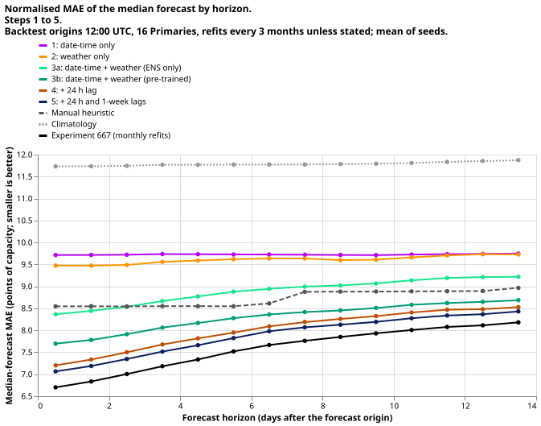

**Steps 6 to 8 add no skill over step 5 on the annual mean.** Step 8 is the Candidate. It scores
7.99, which is 0.105 worse than step 5 (95% interval 0.078 to 0.132). Monthly refits improve both
step 5 and step 8 by about 0.47 points, which is a larger gain than any component added after step
3b.

Colours are assigned within each figure, not across the page. In the second figure the lines of
steps 7 and 8 nearly coincide.

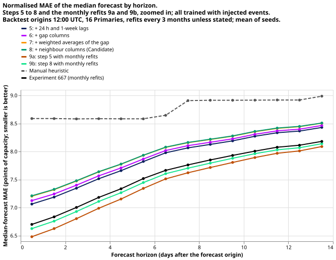

**Steps 6 to 8 make the median forecast copy less of an injected shift, and they raise error on rows
away from logged events.** An injected shift is a simulated step added to the lag inputs. The copied
share is the fraction of the shift's depth that the median forecast reproduces, so 0 means the
forecast ignores the shift. On a held-out bank of such shifts, the median of step 5 copies 5.9% of
the shift and the Candidate copies 2.8%. Steps 6 and 7 copy 4.7% and 3.3%. Away from the logged
events, the same steps raise MAE by 0.05 (step 6) and 0.12 (steps 7 and 8) against step 5. Gap
columns, which step 6 adds, hold the difference between the observed power at the lag time and the
forecast made with both lags masked. Step 7 adds exponentially weighted averages of that gap, and
step 8 adds the same columns from neighbouring substations.

## Take-home

- **Order of importance.** Pre-training the encoders (step 3b, −0.59 against step 3a) and the
  24-hour lag (step 4, −0.28) account for most of the gain over the manual heuristic. The 1-week lag
  adds −0.13. Steps 6 to 8 add +0.04, +0.06, and +0.005.
- **Steps 1 and 2 are worse than the manual heuristic** (9.73 and 9.61 against 8.73), and step 3a is
  too (8.89). Climatology scores 11.79.
- **Training with injected events raises MAE by 0.07 to 0.10 points on every row and cuts the copied
  share by about half to two-thirds.** Step 5 trained without injected events copies 11.0% of a
  shift, and the Candidate trained without them copies 8.1%.
- **Monthly refits (step 9) improve skill more than any component added after step 3b.** Monthly
  refits lower MAE by 0.47 (interval 0.31 to 0.64) for step 5 and 0.47 (0.32 to 0.64) for step 8 on
  matched seeds. The Candidate at monthly refits (step 9b) scores 7.48, against 7.53 for the monthly
  file of experiment 667.
- **On the six MW Primaries the GAM is level with the best monthly arm and ahead of every quarterly
  step; the networks win on the seven MVA-only Primaries.** See [Standard methods beside the
  ladder](#standard-methods-beside-the-ladder).
- **The ladder describes one order of adding components, on 12 months that overlap the Candidate's
  development months.** It ranks nothing for production.

## Results

### Skill by step

**Skill rises steeply to step 3b, then flattens.** The figure below shows steps 1 to 5. Each is a
separate network trained with the Candidate's settings and the components named in its label.

The table lists the annual scores in points of capacity. CRPS is the continuous ranked probability
score, which scores the whole forecast distribution. The 95% intervals come from resampling 7-day
blocks of origin days, and every step is scored on the same 3,879,313 rows, which are the rows that
all the steps share.

| Step | MAE of the median | 95% interval | CRPS |
|---|---|---|---|
| 1: date-time only | 9.73 | | 5.50 |
| 2: weather only | 9.61 | | 5.47 |
| 3a: date-time + weather (ENS only) | 8.89 | | 5.12 |
| 3b: date-time + weather (pre-trained) | 8.30 | 7.99 to 8.61 | 4.74 |
| 4: + 24 h lag | 8.01 | | 4.56 |
| 5: + 24 h and 1-week lags | 7.88 | 7.56 to 8.21 | 4.49 |
| 6: + gap columns | 7.93 | | 4.52 |
| 7: + weighted averages of the gap | 7.98 | | 4.56 |
| 8: + neighbour columns (Candidate) | 7.99 | 7.66 to 8.33 | 4.57 |
| 9a: step 5, monthly refits | 7.39 | 7.14 to 7.67 | 4.19 |
| 9b: step 8, monthly refits | 7.48 | 7.21 to 7.77 | 4.26 |
| Manual heuristic | 8.73 | 8.41 to 9.07 | 4.98 |
| Climatology | 11.79 | | 6.60 |
| Experiment 667, monthly refits (a) | 7.53 | | 4.29 |

(a) Experiment 667's file scored on the same rows with the scoring code of experiment 668; the
private table is `scores_668/primaries_NRA/scores.csv`.

The contrast between adjacent steps carries intervals that are tighter than the intervals of the
scores themselves, because the two steps are scored on the same rows.

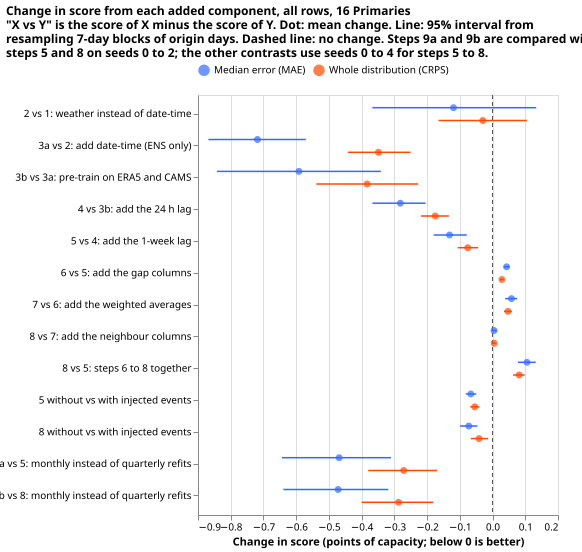

### Whether the later steps ride through load shifts better

**The logged events cannot show which step handles a load shift better, because every step's error
jumps at the event start.** The figure pools 12 logged events (10 at days −7 to 3 after the start,
because two began before the backtest) (10 shifts that lasted more than 7 days and involved two
units or more, plus the verified transfer at D5 and D16). NGED's event labels are an incomplete
dump, so these counts are lower bounds. The normal-running output is meant to carry on as if the
shift had not happened, so a jump in error is expected at every step.

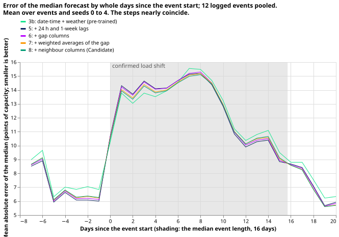

The cell of long events with a deep shift (more than 7 days, 8 or more noise units) holds no rows.
No logged shift fell in it.

**An injected shift measures the same question without the label problem.** The bank holds
simulated shifts of known depth, injected into the lag inputs only, on rows the networks never
trained on. The share of the shift that the median copies is the headline measure here: 0 means the
forecast ignores the shift, and smaller is better for the normal-running output.

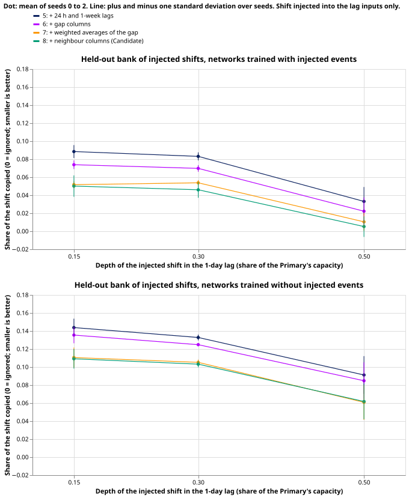

| Step | Copied share, trained with injected events | Copied share, trained without | Copied share, monthly refits |
|---|---|---|---|
| 5 | 0.059 | 0.110 | 0.071 |
| 6 | 0.047 | 0.103 | 0.059 |
| 7 | 0.033 | 0.082 | 0.042 |
| 8 | 0.028 | 0.081 | 0.030 |

Each cell is the mean over seeds 0 to 2 of the pooled share over days 0 to 14, and the standard
deviation over seeds is 0.002 to 0.008. The monthly column is the "trained with" version. Steps 7
and 8 copy similar shares (0.033 and 0.028), so their lines overlap in the figure and the neighbour
columns add little here.

**Away from the logged events, the later steps have a higher MAE.** On rows more than 14 days from
any logged event of the same series, MAE rises against step 5 by 0.049 (interval 0.037 to 0.061) at
step 6, 0.120 (0.084 to 0.156) at step 7, and 0.119 (0.082 to 0.155) at step 8.

**In the 7 days after an event the monthly refits score worse on these 10 logged shifts.** The
slice holds 34,706 half-hours from 102 origin days, and no interval was computed, so the result is
descriptive. With seeds 0 to 2 on both sides, step 9a scores 5.77 against 5.23 for step 5 at
quarterly refits, and step 9b scores 5.69 against 5.15 for step 8. Inside the events and on all
other rows, the monthly arms score better.

### The Candidate's prevailing output

**Only experiment 667's Candidate has a prevailing output.** The normal-running output (NRA) is the
forecast made as if no shift had happened. The prevailing output is the forecast that follows a
detected shift. It comes from a survival head (R-haz), and it needs the lag-free table's signals, so
the ladder's steps have none. The rows of experiment 667 used here are the extra-lag head of
experiment 681 (the folds 2025-11 and 2025-12 keep the older head). Over the 8 logged events where
the shift could be timed, the prevailing output recovered half of the shift after a median of 4 days
(range 2 to 6 days). The two figures below show the NRA and prevailing outputs of experiment 667
over the verified transfer.

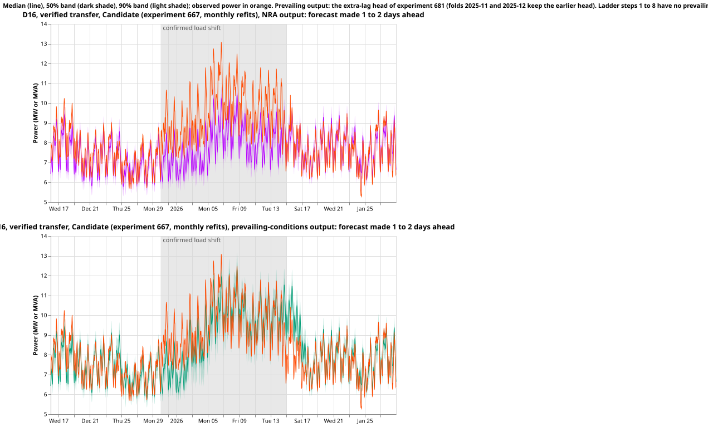

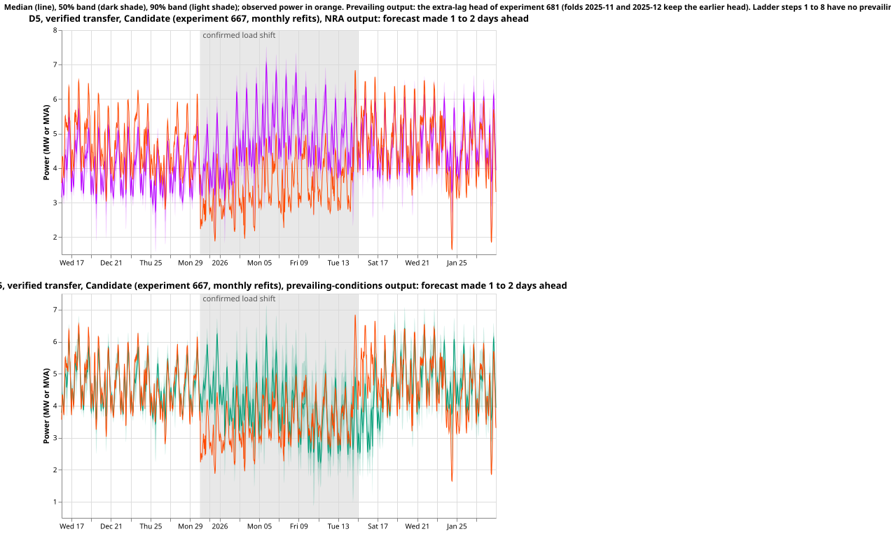

### Time series of the forecasts

**At D16 both step 5 and step 8 follow the daily shape but stay well below the observed peaks during
the confirmed shift, and at D5 they stay above the observed power.** D5 and D16 are the two
Primaries between which load was transferred. Each figure has one arm per panel, where an arm is
one step. The line is the median, the dark band is q25 to q75, the light band is q05 to q95, and
each is the mean over seeds. The orange line is the observed power. The grey rectangle marks the
confirmed load shift from 2025-12-30 to 2026-01-15, with 14 days either side. The scored
"verified transfer" window starts and ends one day earlier, on 2025-12-29 and 2026-01-14. At D16 the
observed peaks reach about 13 MW, and the medians of both steps stay near 9 to 10 MW through the
shift. At D5, which gave up load, the observed power falls and the medians stay above it. The
normal-running output is meant to carry on as if the shift had not happened.

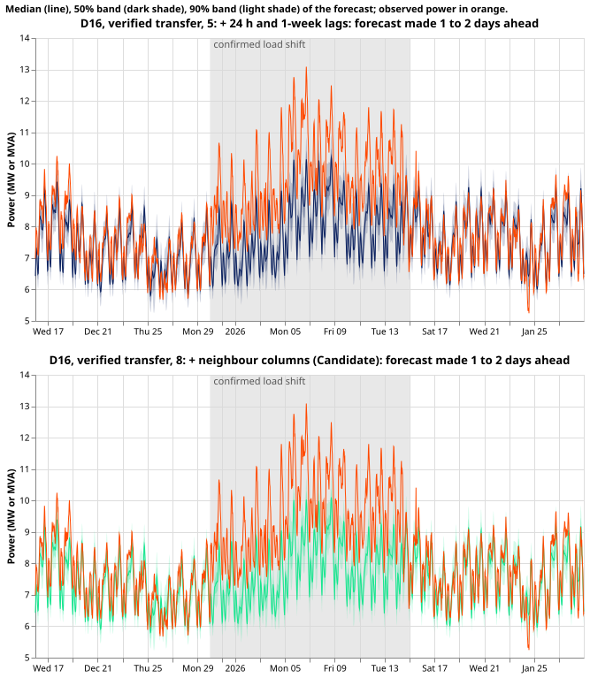

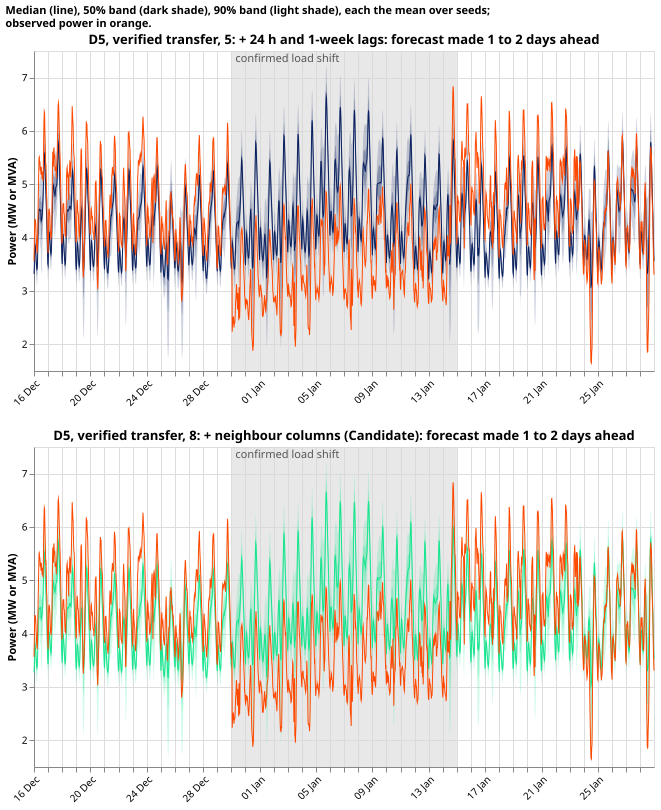

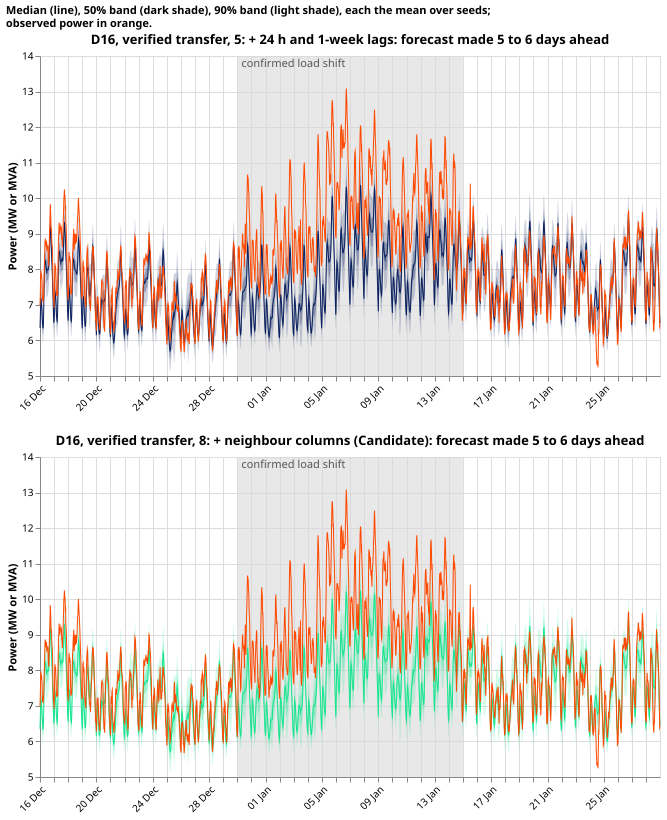

A warm week at D16 shows the same arms away from the event.

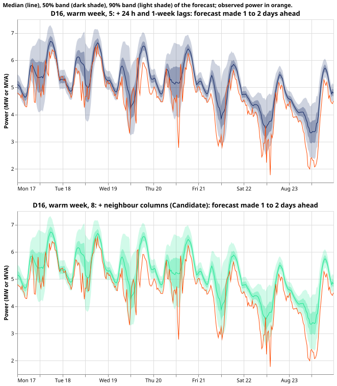

### Tails, CRPS, and curtailment cost

**The forecasts are under-dispersed at both ends.** For steps 5 to 8, 3.4% to 3.8% of observations
fall at or below the q01 forecast and 3.6% to 3.9% fall above q99, against a nominal 1%. Step 3b has
4.4% below q01 and 4.0% above q99. Monthly refits move the observed shares about half a point closer
to the nominal 1%.

**Curtailment cost mostly follows the CRPS ranking of the arms, with the GAM lowest.** XGBoost is
the exception: its CRPS equals step 8's, but its cost is lower than every network's. The
curtailment-cost scale is set by a stress limit of 50% (and 90%) of each series' earlier maximum, so
the amounts in pounds are an index of ranking and not a forecast of spend. Each cell is relative to
the manual heuristic (1.00) on the six MW Primaries, summed:

| Arm | Cost at the 50% limit | Cost at the 90% limit |
|---|---|---|
| GAM | 0.54 | 0.41 |
| XGBoost | 0.68 | 0.70 |
| Experiment 667 | 0.74 | 0.83 |
| 3b | 0.90 | 1.00 |
| 5 | 0.76 | 0.89 |
| 8 | 0.81 | 0.92 |
| 9a | 0.70 | 0.80 |
| 9b | 0.74 | 0.83 |

### Standard methods beside the ladder

**Both stored arms cover a different row set than the ladder, so this section is scored on the rows
that the stored arms and the ladder both cover.** The GAM (Primary demand research default 3) and
XGBoost (arm `p_s6_bg2` of experiment 87) are stored with 09:00 UTC origins, and the rows the arms
share run from origin 2025-11-01 to 2026-06-29 at lead times of 0 to 10 days (1,365,447 half-hours
over the 16 Primaries). The six MW Primaries are scored separately from the seven MVA-only
Primaries, because the MVA meters hide reverse flow.

| Group, slice | GAM | XGBoost | Manual heuristic | 667 | 3b | 5 | 8 | 9a | 9b |
|---|---|---|---|---|---|---|---|---|---|
| Six MW Primaries, all rows | 5.36 | 5.62 | 6.88 | 5.41 | 5.81 | 5.53 | 5.64 | 5.35 | 5.42 |
| Six MW Primaries, all rows, CRPS | 3.11 | 3.27 | 3.97 | 3.14 | 3.39 | 3.20 | 3.27 | 3.09 | 3.14 |
| Six MW Primaries, all rows, twCRPS | 0.480 | 0.525 | 0.611 | 0.506 | 0.543 | 0.506 | 0.516 | 0.497 | 0.507 |
| Six MW Primaries, cold nights | 6.24 | 6.93 | 10.00 | 6.94 | 7.54 | 7.03 | 7.22 | 6.77 | 6.93 |
| Six MW Primaries, Christmas | 6.94 | 6.11 | 10.71 | 6.22 | 6.40 | 6.49 | 7.01 | 6.13 | 6.35 |
| Seven MVA-only Primaries, all rows | 6.08 | 5.92 | 7.03 | 5.62 | 6.11 | 5.57 | 5.60 | 5.54 | 5.58 |
| Seven MVA-only Primaries, all rows, CRPS | 3.49 | 3.35 | 3.99 | 3.14 | 3.40 | 3.12 | 3.14 | 3.10 | 3.12 |
| Seven MVA-only Primaries, all rows, twCRPS | 0.279 | 0.278 | 0.344 | 0.249 | 0.251 | 0.248 | 0.250 | 0.247 | 0.250 |
| Seven MVA-only Primaries, cold nights | 4.11 | 5.13 | 7.58 | 4.67 | 5.53 | 4.64 | 4.79 | 4.43 | 4.60 |
| Seven MVA-only Primaries, Christmas | 4.95 | 5.83 | 7.90 | 4.51 | 5.44 | 4.55 | 4.62 | 4.41 | 4.49 |

The seven MVA-only Primaries are those whose meters record apparent power in megavolt-amperes, which
hides the direction of flow; the six MW Primaries record real power in megawatts. twCRPS is the
threshold-weighted CRPS, which weights errors at high demand more heavily. Each cell is in points of
capacity, and the MAE rows are for the median. The three Primaries in neither group are left out. On
the six MW Primaries the GAM is level with the best monthly arm (5.36 against 5.35) and ahead of
every quarterly arm; on the cold nights the GAM leads steps 5 and above by 0.5 to 1.0 points. On the
seven MVA-only Primaries the networks at step 5 and above beat the GAM and XGBoost on all rows, and
the GAM leads on cold nights. The Christmas rows hold 20,448 and 23,856 half-hours, so those columns
are descriptive. The all-rows cells use 537,136 half-hours for the six MW Primaries and 628,272 for
the seven MVA-only Primaries.

## Predictions that could fail

- **P1 (step 8 matches experiment 667 within 0.10 CRPS on the pilot fold): met.** At the annual
  scale, step 9b scores 4.26 CRPS against 4.29 for the monthly file of experiment 667.
- **P2 (the drop from step 3b to 5 exceeds every other adjacent drop over days 0 to 3): not met.**
  The drops from step 2 to 3a and from 3a to 3b are larger over the same days.
- **P3 (step 8 lowers the copied share by at least 0.03 against step 5): met by a small margin.**
  The drop is 0.031, from 0.059 to 0.028, and the standard deviation over seeds is 0.007.
- **P4 (no step before step 4 beats the manual heuristic over days 0 to 14): refuted.** Step 3b
  scores below the heuristic in all four lead bands, 8.30 against 8.73 over all rows. The intervals
  of the two scores overlap, and the paired contrast was not computed.

The decision rule counts a contrast separable only when its interval excludes zero and it exceeds
the standard deviation of the CRPS across seeds 0 to 2 of the same step. Every contrast in the
contrast figure has an interval that excludes zero except step 1 to step 2 and, on MAE, step 7 to
step 8 (+0.005, interval −0.003 to 0.012). The per-seed standard deviation of the CRPS was not
tabulated, so the second half of the rule and the minimum detectable effect beside each contrast are
not reported; the only seed spread reported is that of the injected-shift measure.

## Caveats

- **The step-8 network does not reproduce the monthly file of experiment 667 at the quarterly
  cadence** (7.99 against 7.53). The monthly step 9b (7.48) is level with it. The two
  ladders differ from experiment 667 by seed count (5 or 3 against 2) and by the per-fold reference
  month of the signal noise.
- **The Candidate's settings were tuned on 5 of the 12 months**, which favours the later steps. The
  year overlaps the development months and the final-test window of experiment 620 (2026-07 to
  2026-10), and no model-selection choice was made from it.
- **Steps 1, 2, and 3a differ from step 3b in three ways:** no pre-training, no frozen encoders, and
  only the newest D5 knot.
- **The ladder is one order of adding components.** It says what each component adds given those
  already present, not what removing it from the Candidate would cost.
- **NGED's event labels are incomplete,** so every event count is a lower bound and the "none and at
  least 7 days after" slice can hold unlabelled events. The long-and-deep cell is empty.
- **The stored GAM and XGBoost forecasts end on 2026-06-30,** so the comparison with them covers 8
  months at lead times of 0 to 10 days. The stored Candidate of experiment 620 is one fit for
  2026-07 only and is not scored, because experiment 667's file covers the whole year.
- **The curtailment-cost amounts depend on a stress limit** and are read as a ranking.
- **Seeds:** steps 1 to 4 use seeds 0 to 2, steps 5 to 8 use seeds 0 to 4 at quarterly refits and
  seeds 0 to 2 at monthly refits. Contrasts that cross cadences use seeds 0 to 2 on both sides.
- **One fit was killed for lack of memory.** The 8 GB cap on the GPU wrapper script stopped three
  Candidate-type fits when three streams ran at once; the cap was raised to 14 GB and the three fits
  were re-run unchanged.

## Method

**Each step adds one component to the previous step, and every step keeps the Candidate's other
settings.** The Candidate is the class 2 neural network of experiment 620 (arm P7 with D50 of
experiment 610). Each step adds one component to the previous step. The order matters: a reverse
ablation gives each component's gain given the components already present, and says nothing about
what removing the component from the full Candidate would cost.

### Components of the Candidate and where each sits on the ladder

These settings are the same in every step that contains the part the setting belongs to:

- Loss and output: a three-component Gaussian mixture, negative log-likelihood, 11 quantiles from
  the mixture CDF, sorted (so no step has crossing quantiles).
- Widths (8-wide Primary embedding, encoders 64 to 32, mixer 64), dropout 0.1, AdamW with weight
  decay 1e-3, batch 8192, 20% of rows per epoch, patience 8, gradient-norm clip 1.0.
- The 730-day window, the 90-day recency half-life, the E3 refit rule (7-day embargo), and the slow
  per-Primary output offset D5. ENS-only fits (steps 1, 2, and 3a) have no pre-trained D5 knots: the
  offset keeps only the newest knot, which departs from the Candidate and is named as a caveat.
- The 7 weather means, the 7 spread columns, the 2 lead columns, the 21 date-time columns, and the
  14 B1 columns (thermal lag and solar gain) read by the weather encoder.
- The cut of D15 and D18 before 2025-03-01.
- No band-width factor at any step. The Candidate's factor 1.0934 is post-processing; step 8 is
  reported without it, and with it as one extra row if 667 applies it.

Added where:

| Step | Components added |
|---|---|
| 1 | Date-time encoder, Primary embedding, and mixer. The weather, spread, and lead inputs are removed, so the mixer sees only the date-time embedding. |
| 2 | Weather encoder alone (B1 columns included); the date-time and lead inputs are removed. The mixer sees the weather embedding and the Primary embedding. |
| 3 | Both encoders into the mixer; the lead columns enter here (the spread columns enter with the weather encoder at step 2). Version a: trained on ENS only, no pre-training, nothing frozen. Version b: ERA5 and CAMS pre-training, then fine-tuning on ENS with both encoders frozen (the chain of experiment 620). |
| 4 | One lag encoder at 24 hours, with its expected-weather and expected-date-time embeddings at the lag's own time, the lag-ID embedding, and block dropout of lags (30% of days). |
| 5 | A second lag at one week through the shared lag encoder. Two versions: with and without injected events. |
| 6 | The gap columns: power at the lag time minus the lag-free table, plus the `exp_missing` flags (arm P3 of experiment 606). Signal dropout D50 applies from here on, because the Candidate applies it whenever signal columns exist. |
| 7 | The exponentially weighted averages of the gap, half-lives 1, 3, and 7 days (arm P5 of experiment 606). |
| 8 | The 42 neighbour columns (arm P7 of experiment 606). Step 8 with injected events is the Candidate. |

### Schedule and frozen parts of each step

All steps use the Candidate's three-stage schedule where it applies: stage 1 pre-training, stage 2
(encoders frozen, fresh mixer), stage 3 fine-tuning (recency weights, E3). "Stage" below never
means a ladder step.

| Step | Stage 1 (pre-training) | Stage 2 | Stage 3 | Frozen after stage 1 |
|---|---|---|---|---|
| 1, 2, 3a | None; random initialisation | Same as other steps, learning rate 5e-4 throughout | Same as other steps | Nothing |
| 3b | ERA5 and CAMS, lag-free | Yes | Yes | Both encoders |
| 4 | ERA5 and CAMS, one lag | Yes | Yes | Both encoders |
| 5 (with, without) | ERA5 and CAMS, two lags (shared) | Yes, shared by the two versions | Yes; "with" adds the 581 shifts to the lag inputs | Both encoders |
| 6, 7, 8 | The step-5 chain | The step-5 stage-2 checkpoint | Starts from it with the signal columns zero-initialised | Both encoders |

Steps 3b, 4, and 5 each have their own pre-training, because the lag encoder is trained in stage 1,
so the contrast between adjacent steps includes a re-pre-trained encoder. Steps 4 and onward do not
start from the step-3b checkpoint. Only stage 3 of the Candidate sees the 581 shifts.

**The lag-free table T** is the median of the step-5 stage-2 checkpoint of the same version and seed
with both lags masked, taken at the freshest origin with lead at most 24 hours. This is the
Candidate's own construction (its stage-2 network), not a fine-tuned network. Steps 6 to 8 build T
once per fold, version, and seed and share it (in-fold, as the Candidate does). The lag-free table
uses the stage-2 lag network because the Candidate does, and step 8 reproduces the Candidate. The
606 reference month for the signal noise is the latest month before each fold's cutoff, not the
Candidate's fixed 2026-06, which is future data for earlier folds.

### What "without injected events" removes

The Candidate trains on the lag-only synthetic shifts of experiment 581 (5% of each Primary's row
span, depths 0.15, 0.30, 0.50 of capacity, lengths 3, 7, 15, 30 days). From step 8, each shift is
also mirrored into one neighbour's summaries; at steps 4 to 7 the shifts reach only the own lag
inputs. Steps 4 and below have no injected-event version (step 4 trains with the 581 shifts, as in
the Candidate, in both ladders). Decisions:

- The **with** version is the Candidate recipe as it stands (581 shifts), so step 8 with injection
  can reproduce 667.
- The **without** version removes the 581 shifts from the lag inputs of stage 3 and the neighbour
  mirror at step 8; nothing else changes. The contrast therefore means different things at different
  steps (own lags only before step 8, own lags plus neighbours at step 8).
- The **held-out scoring bank** is built by experiment 581's own generator with seeds disjoint from
  every training seed, so the bank matches the "with" arm's training distribution, which favours the
  "with" version by design. A second bank from experiment 660's generator (`e00660_generator.py`,
  the shared generator its page tells readers to import) is scored as a check on that bias. Both
  inject into lag inputs only. Each bank also mirrors the shift into one neighbour's summaries, so
  step 8's neighbour columns can show their effect. The injection reaches lag inputs only, never the
  targets.
- **Follow** is the share of an injected shift's depth that the median forecast copies (0 means the
  forecast ignores the shift, 1 means it copies all of it); lower is better for an NRA forecast.
  **Absorption** is the share of the shift that the network's fitted values take up in its training
  power (experiment 595's definition). Absorption was not scored on this page.

The real long-and-deep cell is nearly empty (experiment 665 found none of NGED's 77 logged shifts
lasting more than a day in the long-and-deep type), so the real-record slices are descriptive and
every slice reports its rows and events first.

### Refit cadence, window, and seeds

- Window: the 12 months of experiment 667 (daily 12:00 UTC origins, 2025-11-01 to 2026-10-31, 14-day
  horizon). Origins after about 2026-10-26 have valid times beyond the stored data, so each lead
  band reports its row count. The native origin of the networks is 09:00 UTC; the 12:00 contract
  origin follows 667's convention (`power_fcst_init_time` carries the 12:00 origin). The window
  overlaps the development months (2025-10, 2025-12, 2026-01, 2026-03, 2026-06) and the final-test
  window of experiment 620 (2026-07 to 2026-10); the Candidate's settings were tuned on 5 of the 12
  months, which favours the later steps. The year is descriptive, and no model-selection choice is
  made from it.
- The ladder refits **quarterly**, at the starts of 2025-11, 2026-02, 2026-05, and 2026-08, each
  fold scoring three months. Step 9 refits steps 5 to 8 **monthly** (12 folds). Experiment 667's own
  file is the monthly reference; the quarterly step 8 differs from it by cadence, seed count (5
  against 2), and the per-fold reference month.
- **Pilot fold.** Before the other folds ran, the 2026-05 fold ran step 8 with injection at the
  monthly cadence and 2 seeds, and was compared with the file of experiment 667 on the same rows. P1
  was read there.
- Seeds: steps 1 to 4 use seeds 0 to 2. Steps 5 to 8 use seeds 0 to 4 at quarterly refits and seeds
  0 to 2 at monthly refits. A contrast across cadences, and every contrast on the contrast figure
  that involves the monthly arms, uses seeds 0 to 2 on both sides, which the `!` (quarterly, seeds
  0 to 2) and `@1` (monthly) names mark in the private tables.
- Intervals: block bootstrap over 7-day blocks of origin days, 2,000 draws.
- Lags follow the Candidate's rule, which keeps every lag at least 24 hours before the 09:00 UTC
  native origin. The plan's second per-row check, that every lag was observed before 06:00 UTC on
  the origin day, was not added as a separate assertion.

### Reference arms

- The manual heuristic and climatology, from `baseline_forecasters`, as in 620 and 668.
- The monthly file of experiment 667. The stored Candidate of experiment 620 (one fit, 2026-07 fold
  only) is not scored.
- **GAM**: the Primary demand research default 3 (experiments 251 below 168 h and 322 above), refit
  weekly on the whole history, as stored. **XGBoost**: BG2, arm `p_s6_bg2` of experiment 87, refit
  weekly, as stored.
- Both stored arms have 09:00 UTC origins and end on 2026-06-29. The ladder is scored on the rows it
  shares with them, joined on series and valid time (each arm with its own lead). The shared rows
  cover 16 Primaries, 2025-11-01 to 2026-06-29, and leads of 0 to 10 days. A CPU re-run to cover the
  full year was not run.

### Prevailing output

The survival head (R-haz) is trained on the frozen Candidate's quantiles with a bank of injected
shifts and needs the signal columns, so no step before step 8 can have one. Every ladder file
holds `NRA_or_prevailing` equal to `"NRA"`. The prevailing rows shown on this page are those of
experiment 667's own file.

## Files

**All files are private and live under
`data/ml-experiments/00677-building-up-the-candidate-demand-network-one-component-at-a-time/backtests/`.**
Each holds 16 Primaries with the columns `time_series_id`, `valid_time`, `nwp_init_time`,
`power_fcst_init_time` (the 12:00 UTC contract origin), the 11 quantile columns `q01` to `q99`,
`seed`, `step`, `version`, and `NRA_or_prevailing`. Files named `_sp3` refit quarterly and `_sp1`
refit monthly. The rows are 365 origins × 16 Primaries × 672 half-hours × the number of seeds.

| File | Seeds | Rows |
|---|---|---|
| `step1_ens_only_sp3`, `step2_ens_only_sp3`, `step3a_ens_only_sp3`, `step3b_pretrained_sp3`, `step4_pretrained_sp3` | 3 | 11,773,440 each |
| `step{5,6,7,8}w_with_injected_sp3`, `step{5,6,7,8}wo_without_injected_sp3` | 5 | 19,622,400 each |
| `step{5,6,7,8}w_with_injected_sp1`, `step{5,6,7,8}wo_without_injected_sp1` | 3 | 11,773,440 each |

The checks run on every one of the 21 files were: no duplicate key over `seed`, `time_series_id`,
`power_fcst_init_time`, and `valid_time`; no null quantile; no crossing quantile (each `q` column is
at most the next); and UTC timestamps. All 21 files passed with 0 duplicates, 0 nulls, and 0
crossings. The weights that the fold scripts wrote are in each fold folder's `work/models/` (682
`.pt` files, 131 MB in total). The settings and seeds are in the experiment folder, and its
`e00677_*.py` files re-run every fit.

The score tables behind every number on this page are in `scores/` of the same private folder, and
the banks of injected shifts are in each fold folder's `work/bank/`. The figures are in this page's
folder.
