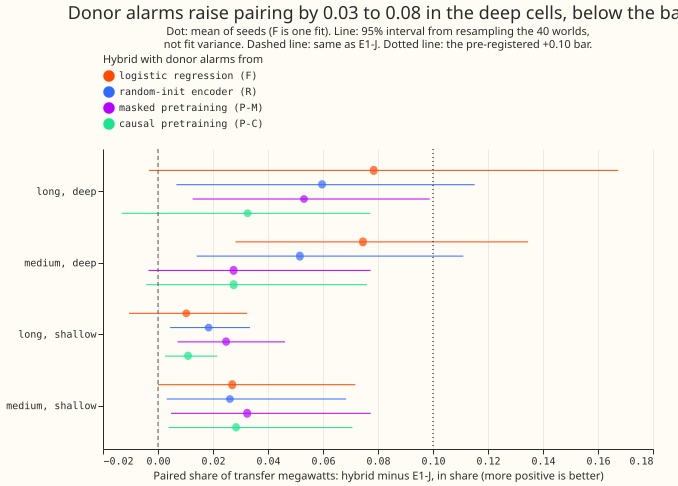

**Feeding the donor alarms of a probe into E1-J's recipient search pairs a little more transfer
megawatts, but less than the predicted +0.10, so the graph line is closed at 15 Primaries.**
Experiment 678 continues the graph line that [experiment
675](../00675-pretrained-graph-model-for-load-transfers-part-1-diagnostics-and-frozen-probe/result.md)
reopened at the maintainer's request after [experiment
672](../00672-graph-model-that-finds-the-donor-of-a-load-transfer/result.md) closed it, with
experiment 660's generator unchanged. The hybrid with the logistic regression's alarms (F-hyb)
pairs 0.36 of the long and deep megawatts against 0.29 for E1-J (difference +0.08, 95% interval
-0.00 to +0.17), and 0.32 against 0.25 in the medium and deep cell (+0.08, +0.03 to +0.13). The
verdict is *not supported*: no hybrid reaches +0.10 in either deep cell.

## Terms

- **F-hyb, R-hyb, P-M-hyb, P-C-hyb.** E1's event table plus one added downward donor event per
  alarm of the probe named, searched for recipients by experiment 670's search. The probes are
  experiment 675's: a logistic regression on the node inputs (F), a randomly initialised encoder
  (R), and encoders pretrained by masked reconstruction (P-M) and by causal prediction (P-C).
- **Rewired placebo.** The same hybrid on a degree-preserving rewired graph, with the draw out of
  30 that keeps the fewest real links.
- **Cell, paired, found, E1-J.** As in [experiment
  672](../00672-graph-model-that-finds-the-donor-of-a-load-transfer/result.md#terms). *Paired* is
  the MW-weighted share of injected edge-transfer ends whose decoded event has the right partner.

## Figures

**The figure shows that every hybrid pairs more than E1-J in the long and deep and the medium and
deep cells, by 0.03 to 0.08, and that the logistic regression's alarms give the largest gain.** The
gain is below the +0.10 bar in every cell.

## Results

- **Paired share per cell, MW-weighted, with 95% intervals from resampling the 40 worlds** (hybrids
  are means over 3 seeds, except F-hyb, which has one fit):

    | Cell | E1-J | F-hyb | R-hyb | P-M-hyb | P-C-hyb | F-hyb rewired |
    |---|---|---|---|---|---|---|
    | Long, deep | 0.29 (0.19 to 0.41) | 0.36 (0.26 to 0.48) | 0.35 (0.25 to 0.47) | 0.34 (0.24 to 0.46) | 0.32 (0.23 to 0.44) | 0.04 |
    | Medium, deep | 0.25 (0.13 to 0.38) | 0.32 (0.20 to 0.46) | 0.30 (0.18 to 0.44) | 0.27 (0.16 to 0.42) | 0.27 (0.16 to 0.42) | 0.06 |
    | Long, shallow | 0.19 (0.14 to 0.24) | 0.20 (0.15 to 0.25) | 0.21 (0.16 to 0.26) | 0.21 (0.16 to 0.27) | 0.20 (0.15 to 0.25) | 0.03 |
    | Medium, shallow | 0.13 (0.09 to 0.18) | 0.16 (0.10 to 0.22) | 0.16 (0.11 to 0.22) | 0.16 (0.11 to 0.23) | 0.16 (0.11 to 0.22) | 0.01 |
    | Short, deep | 0.08 | 0.08 | 0.08 | 0.08 | 0.08 | 0.00 |
    | Short, shallow | 0.03 | 0.03 | 0.03 | 0.03 | 0.03 | 0.00 |

- **Differences from E1-J, with 95% intervals.** Long and deep: F-hyb +0.08 (-0.00 to +0.17), R-hyb
  +0.06 (+0.01 to +0.12), P-M-hyb +0.05 (+0.01 to +0.10), P-C-hyb +0.03 (-0.01 to +0.08). Medium
  and deep: +0.08 (+0.03 to +0.13), +0.05 (+0.01 to +0.11), +0.03 (-0.00 to +0.08), and +0.03
  (-0.00 to +0.08). Long and shallow: +0.01, +0.02, +0.03, and +0.01. Medium and shallow: +0.03 in
  every hybrid.
- **Short cells.** The hybrids equal E1-J exactly, because the added donor's end is searched from 2
  days after its start, so a donor shorter than 2 days gets a late end or none and cannot match.
- **Seeds.** R-hyb's three seeds pair 0.37, 0.36, and 0.31 in the long and deep cell, and 0.31,
  0.30, and 0.29 in the medium and deep cell, so every seed is below the +0.10 bar.
- **Placebo.** On the rewired graph F-hyb pairs 0.04 and 0.06 in the two deep cells and R-hyb 0.05
  and 0.06, so the real connection graph supplies almost all of the pairing (E1-J rewired: 0.04
  and 0.06). The empty graph pairs 0 by construction and was not scored.
- **False transfers.** Decoded transfers that match no injected end per Primary-year: E1-J 0.38;
  F-hyb 0.51; R-hyb 0.54 (0.41 to 0.62 over seeds); P-M-hyb 0.58; P-C-hyb 0.47.

## Predictions

- **P1 (F-hyb or R-hyb at least +0.10 in both deep cells): failed.** F-hyb +0.08 and +0.08, R-hyb
  +0.06 and +0.05.
- **P2 (R-hyb at least +0.10): failed**, as above.
- **P3 (F-hyb at least +0.05 in the long and shallow cell and +0.03 in the medium and shallow
  cell): failed** (+0.01 and +0.03; the second is +0.027, short of +0.03).
- **P4 (false transfers at most 1.5 times E1-J's, 0.57): held** for F-hyb (0.51), R-hyb (0.54),
  and P-C-hyb (0.47), and failed for P-M-hyb (0.58).
- **P5 (the rewired placebo pairs at most a third of its hybrid in the deep cells): held**
  (0.04 against 0.36, and 0.06 against 0.32).
- **Adoption bar (0.60 in both deep cells): not reached.** The best hybrid pairs 0.36 and 0.32.
- **Stop rule fires.** No hybrid reaches +0.10 in either deep cell, so the graph line is closed at
  15 Primaries and the edge-state network is not built.

## Checks

- **Code review.** A fresh Sonnet reviewer found no use of injected truth in the donor
  construction. Before any score was read, the plan and code were changed on its findings: the
  start-search window now matches the window in which experiment 675 credits an alarm (24 hours
  before to 12 hours after), an alarm near any E1 downward event of 4 noise units or more is
  skipped whether or not E1 paired it, a donor counts as permanent at 180 or more days of record
  left (experiment 653's rule), and donors added by earlier alarms count for the near-duplicate
  rule.
- **Known biases.** The added donor's end is late by up to about 12 hours and is searched from 2
  days after the start. Donor-found and false-transfer counts include added donors under 4 noise
  units, which the search ignores but the scoring can match. The real-graph hybrid and its
  rewired placebo have different added-donor lists, because E1's pairing differs on the two
  graphs. A post hoc rule for short events was not tried.
- **Audit.** AUDIT_PLACEHOLDER
- **Caveats.** F-hyb is one fit, and the intervals resample worlds only, not fit variance. NGED's
  logs may miss load shifts, so matched logged shifts on the real record are lower bounds, and the
  injected start hours come from NGED's logged onsets up to 2026-07, as in experiments 670, 672,
  and 675. The probes are experiment 675's, trained on 200 worlds.

## What to try next

- The pre-registered stop rule closes the graph line at 15 Primaries. A donor probe is worth
  testing again only with a donor end that can be shorter than 2 days, and on the fleet-scale
  adjacency of about 1,161 Primaries; both are for the roadmap to decide.

## The plan as committed

The plan below was committed before any score was read, and was changed once afterwards, on the
code review above and before any score was read.

**This is the plan, committed before any score is read.** It continues the graph line that
[experiment 675](../00675-pretrained-graph-model-for-load-transfers-part-1-diagnostics-and-frozen-probe/result.md)
reopened, and which [experiment 672](../00672-graph-model-that-finds-the-donor-of-a-load-transfer/result.md)
had closed under its stop rule. Experiment 675 found that masked pretraining did not help, and that
neither did causal pretraining as designed (the causal arm finds 0.26 and 0.20 fewer donor
megawatts than the random-init encoder in the two deep cells). The graph Discuss session therefore
asked for the cheapest test of the finding that matters: a donor probe finds more long and deep
donor megawatts than E1-J, so does that gain turn into more pairs?

## The question

Experiment 675's step 0a showed that the donor, not the link to the recipient, is where E1-J loses
the megawatts it finds at the recipient. The no-encoder logistic regression (F) found 0.63 of long
and deep donor megawatts against E1-J's 0.44 (one fit, no interval for E1-J), and the random-init
encoder (R) found 0.59 (seeds 0.46 to 0.70). The question here is whether adding those donors to
E1-J's search lifts the paired share. F is the non-neural baseline that any neural donor head has
to beat, so it is run beside R.

## Method

- **Probe scores.** Experiment 675's stored probe scores for the 40 scored worlds: F (1 fit) and R,
  P-M, and P-C (3 seeds each). No probe is retrained, and no GPU time is used.
- **From an alarm to a donor event.** Each alarm becomes a downward donor event whose start and end
  are measured on the arm-C residual by the rule in the decision rule above, with the size from
  experiment 670's `step_size`. An alarm near an existing unpaired E1 donor adds nothing.
- **Recipient search.** Experiment 670's `search_recipients`, unchanged, on E1's events plus the
  added donors, on the real graph. Placebos: the degree-preserving rewired graph of experiment 670
  (`rewire_low_overlap`, the draw keeping the fewest real links, with the share kept reported) and
  an empty graph.
- **Scoring.** Experiment 653's `match` and experiment 665's cell statistics, as in experiment 670,
  with world-resampled intervals. Decoded transfers matching no injected end are counted per
  Primary-year.
- **Reviews and running.** A fresh Sonnet code review before the first run (checking that no
  injected truth enters the donor construction and that the probe scores are the stored ones), a
  results audit, a write-up review, and a prose review. CPU work runs under `systemd-run --user
  --scope -p MemoryMax=16G -p OOMPolicy=continue`.
- **Inherited caveats.** NGED's logs may miss load shifts, so matched logged shifts on the real
  record are lower bounds, and the injected start hours come from NGED's logged onsets up to
  2026-07, as in experiments 670, 672, and 675.
