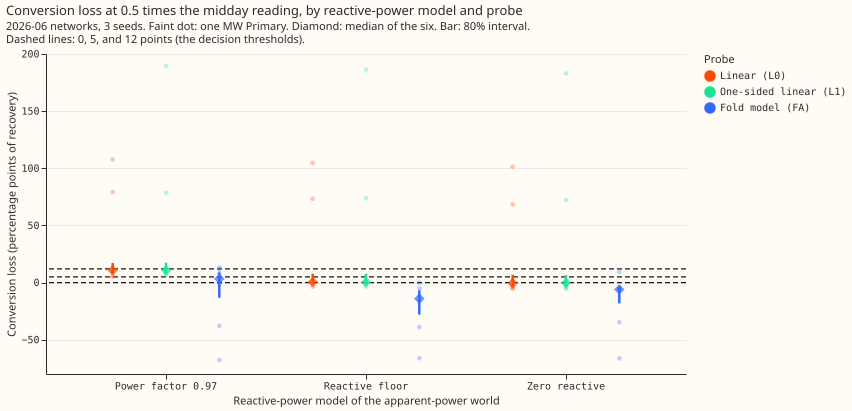

# Does the linear probe lose recovery when the substation meter has power factor 1 and a small reactive floor?

**Almost none: at half the midday reading, the linear probe recovers 0.73 of an added farm in the
reactive-floor world, against 0.75 with no conversion at all.** The median conversion loss is 0.5
percentage points (80% interval -1.0 to 7.7), where the power-factor 0.97 world that experiments
656, 662, and 671 used loses 10.7 points (7.8 to 17.1). The floor world matches NGED's statement of
power factor 1 with some reactive power always present, so the 10-point loss was probably an
overestimate for the five MVA Primaries whose midday reading never nears zero (D2, D3, D4, D19, D21). **The pre-registered rule (under 5 points)
is met on the point estimate; the verdict is supported.**

We repeated experiment 662's test at 0.5 times the midday reading, the level that matches D2, D3,
D4, D19, and D21. The six MW Primaries are converted to synthetic apparent power, a known farm is
added, a neural network is trained, and the probe reads the farm's capacity. The conversion loss is
the signed-world recovery minus the apparent-power-world recovery of the same farm, in percentage
points. The headline loss is the median over the six Primaries of each Primary's own difference, so it
can differ from the difference of the medians (0.746 minus 0.733 is 1.3). L0 is the linear probe of
experiment 621, L1 is L0 on rows well above the reactive floor, and FA is a fold model that fits the
reading as apparent power. This page covers 9 new neural networks (3 conditions of 3 seeds) beside 24
neural networks that experiment 662 trained (the twin and farm networks of 8 conditions, seeds 0 to
2), at the 2026-06 cutoff.

**Figure: the loss is near zero in the floor and zero-reactive worlds and about 11 points in the
power-factor world, for both linear probes.** The fold model (FA) is not a fair comparison, because
it reads above the signed world in the floor world (0.88 against 0.80) and below it in the zero-reactive world (0.77), so its losses are negative and carry no meaning.

## Results

Median over the six MW Primaries, 2026-06 cutoff, 3 seeds. Loss is in percentage points of recovery
in megawatts; the interval is 80%.

| Probe | Level | Signed recovery | Power factor 0.97 loss | Reactive-floor loss | Zero-reactive loss |
|---|---|---|---|---|---|
| L0 | 0.5 | 0.746 | 10.7 (7.8 to 17.1) | 0.5 (-1.0 to 7.7) | -0.5 (-3.3 to 6.8) |
| L1 | 0.5 | 0.758 | 10.6 (8.4 to 17.5) | 0.4 (-1.2 to 7.8) | -0.4 (-3.3 to 6.7) |
| FA | 0.5 | 0.798 | 3.3 (-13.4 to 8.8) | -14.1 (-28.0 to -6.7) | -6.1 (-18.2 to -3.8) |
| L0 | 1 | 0.777 | 24.3 (23.3 to 27.8) | not run | 8.7 (7.4 to 13.2) |
| L1 | 1 | 0.787 | 9.4 (7.8 to 13.8) | not run | 3.1 (0.6 to 6.4) |
| FA | 1 | 0.596 | -11.9 (-22.9 to -8.9) | not run | -1.1 (-9.9 to 1.2) |

- **Which arm matches NGED's statement.** The reactive-floor arm (constant reactive power 0.10 times
  the median sunny-midday reading) is the closest to power factor 1 with a small always-present
  floor. The zero-reactive arm is a bound.
- **Decision.** The floor-arm L0 loss at 0.5 times is 0.5 points, under 5. We recommend that the
  NGED capacity page's calibration for the five MVA Primaries use the signed-world factor 0.68 alone,
  with the conversion loss stated as not distinguishable from zero on the point estimate at that level. Experiment 673's table is unchanged
  here; the edit is proposed in the pull request description.
- **Recovery in energy.** The factor from MW to energy is 1.00 to 1.10 per Primary (median about
  1.07), so energy recovery at 0.5 times is 0.79 (floor, L0) against 0.80 signed and 0.67
  (power factor 0.97). The loss in energy points is 0.6 (floor), -0.6 (zero), and 11.5 (power
  factor 0.97). The factor compares the standard unit curve averaged over donor weather with the
  fleet shape on the probe dates, so the factor is approximate.
- **Per Primary (L0, 0.5 times, floor arm).** D9 1.0, D11 0.1, D14 -0.5, D16 -3.6, D5 104.7, and D10
  73.3 points. D5 and D10 have midday readings near 1 MW, so the 2.0 MW injection floor puts every
  world past the fold there, as experiment 662 found; the median of six is the mean of the middle two values (D11 0.1 and D9 1.0).
- **Interval caveat.** The interval is an 80% interval from independent draws of the day-block
  bootstrap and the between-seed spread of each recovery, so the interval is probably wider than the true
  interval of the difference. The interval's upper end (7.7) is above the 5-point line, so a loss up to about 8
  points is not excluded.
- **Fold model.** FA reads above the signed world in the floor world at 0.5 times (0.88 against 0.80). Experiment 662 found the fold model an unfair signed-world denominator, so
  the FA rows are for completeness and carry no verdict.
- **Not run.** Native worlds at the five MVA Primaries in the floor arm: experiment 662's code
  builds no floor-arm worlds at those five Primaries, so the read needs a code change that this
  experiment does not make. The floor arm at 1 times was not rerun (experiment 673 has it).
- **Code.** `ml-experiments/00679-pv-mva-conversion-loss-reactive-floor-at-half-level/` calls
  experiment 662's fit and probe code (folder
  `ml-experiments/00662-pv-probe-through-the-mva-fold-matched-level-redesign/`), and edits none of it.
  The new networks are in the private folder `work/pretrained/2026-06/`; the twins and the signed
  and power-factor networks are links to experiment 662's.
- **Compute.** The 9 fits took 21 to 31 s each on the GPU (cuda, one process), about 4 minutes in
  all; the probes ran on the CPU. Fits are not forecasts, so no refit cadence applies.
- **Weather.** ERA5 and CAMS, as in experiment 662; the probe is a diagnostic, so forecast-time
  availability does not apply. Development months only (nothing from 2026-07-01).

## Caveats

- The reactive power of the real meters is unknown. The floor level (0.10 times the midday reading)
  and the power-factor 0.97 level are both assumptions.
- Three seeds and six Primaries, two of which (D5, D10) behave differently from the other four.
- One set of farms and one neural network architecture.
- NGED's event labels are incomplete, so the clean rows may hold unlabelled events.

## Checks

- **Forecast checks:** the experiment scores no forecast, so the median-minus-mean and
  quantile-score checks do not apply.
- **Code review (Sonnet, before the first fit and again before the report):** the script that points
  experiment 662's code at this experiment's folder reaches every file path; linked weights are never overwritten (a link-existence check
  was added); targets and rows match experiment 662's (the world files are byte-identical). The
  report review found no error in the loss pairing or the interval; its asks to assert that all
  conditions were probed with bootstrap draws and to restrict the seeds were applied. Its note on
  the energy factor (different weather in numerator and denominator) was accepted as a caveat.
- **Audit triggers that fired:** none of the seven apply to a probe experiment that scores no
  forecast; the pre-registered rule was not changed.

## Open questions

Does the same near-zero loss hold at the five MVA Primaries' own native worlds, which needs a floor
arm in the native-world builder? And does the fold model, with a night prior, stay unbiased at 0.5
times in the floor world?
