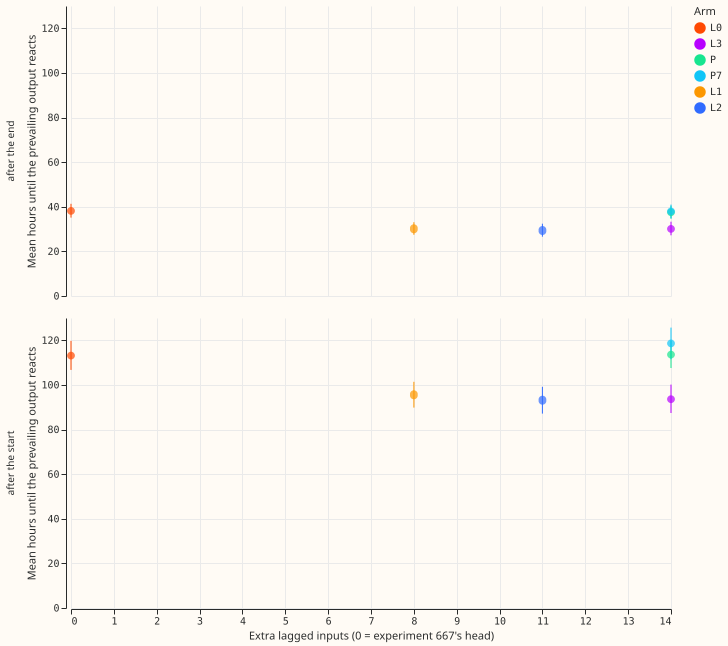
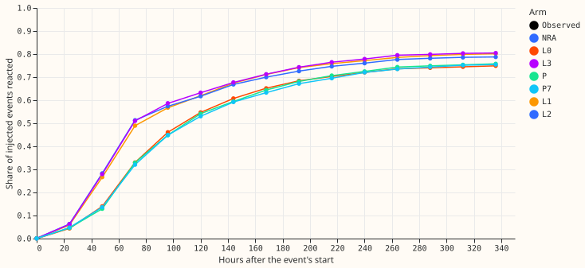
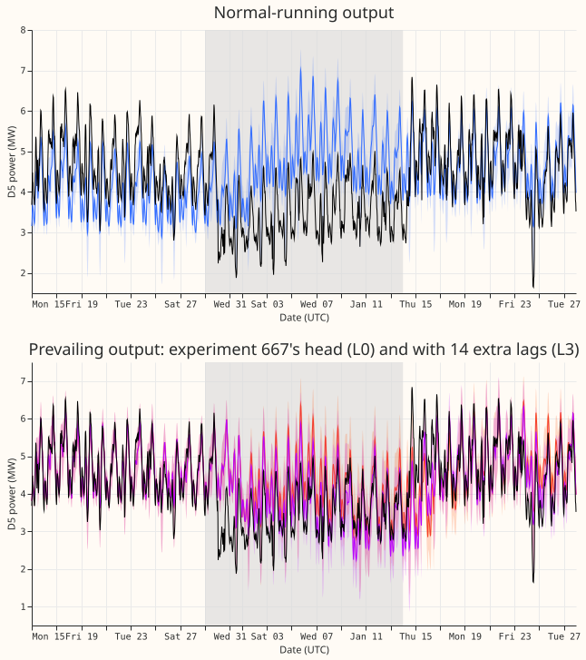
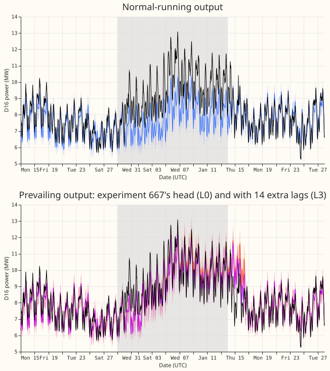
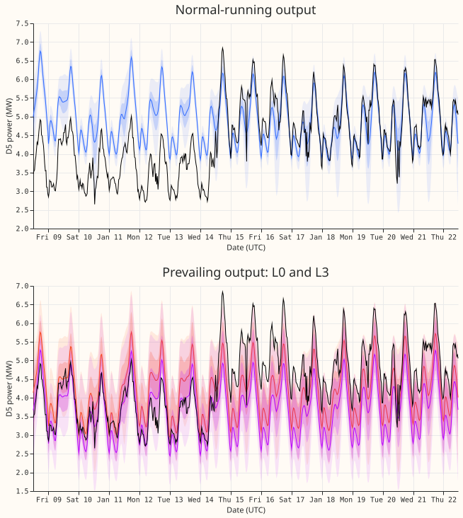
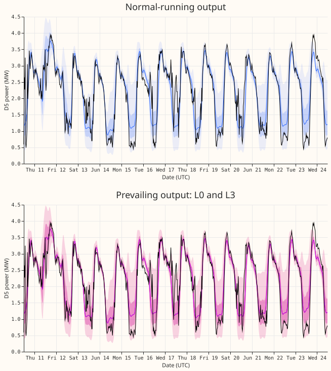

**Giving the prevailing head 8 to 14 extra lagged power inputs makes the prevailing output react
about 20 hours sooner to the start of an injected load shift and about 8 hours sooner to its end,
and does not raise the event-free CRPS.** The head was trained on injected shifts from the same
generator. Over 1152 injected load shifts in the six development folds, the
first origin at which the prevailing median has moved half-way to the new level comes 20.4 hours
earlier with the 14-input set L3 (95% interval 16.3 to 24.8 hours) and 19.1 hours earlier with the
8-input set L1. Neither placebo gains anything: lags taken from another Primary change the reaction
by -1.6 hours, and the same lags read 7 days earlier by +2.3 hours. The gain is under the 24 hours
this experiment set in advance as worth porting, so the verdict is a small gain.

A load shift is a transfer of load between Primaries that the metered power contains and the
normal-running (NRA) output deliberately ignores. The prevailing output is a separate small neural
network, the head of experiment 667, that reads the Candidate's frozen NRA quantiles and a set of
origin features and decides how much of a recent shift to carry forward. Its lagged inputs stop at
the 24-hour and 7-day lags. This experiment adds more recent lags (6 to 72 hours before the origin,
all at least 6 hours old) to that head only, so the NRA output is unchanged by construction.

## Headline numbers

- **Scope.** Six development folds (2026-01 to 2026-06), 16 Primaries, daily origins at 09:00,
  14-day forecasts. The final-test window (from 2026-07-01) is not read. Every arm is the
  mean of two seeds, as in experiment 667. Retraining is monthly. No GPU was used.
- **Reaction time on injected events** (experiment 660's generator as built into experiment 667's
  bank; 1152 events, 192 per fold, paired with L0; mean paired difference with a 95% interval from a
  bootstrap over events; origins are daily, so each time resolves to 24 hours):

| Arm | Extra inputs | Start: paired events | Start: difference (hours) | End: difference (hours) |
|---|---|---|---|---|
| L1 | 8 | 879 | -19.1 (-23.1 to -15.3) | -7.9 (-9.8 to -6.1) |
| L2 | 11 | 873 | -18.7 (-22.9 to -14.7) | -8.8 (-10.8 to -6.9) |
| L3 | 14 | 881 | -20.4 (-24.8 to -16.3) | -8.1 (-10.0 to -6.2) |
| P (other Primary) | 14 | 862 | -1.6 (-5.5 to +2.4) | -0.6 (-2.1 to +0.8) |
| P7 (7 days earlier) | 14 | 871 | +2.3 (-0.7 to +5.3) | -0.2 (-1.7 to +1.2) |

- **Share of injected events that react at all.** L0 reacts to 78.3% of events after the start and
  45.6% after the end; L3 reacts to 82.7% and 45.8%. Events that never react before they end or
  before the data stop are excluded from the paired differences (the paired counts are in the
  table).
- **Verified D5 and D16 transfer (2 events, origins from 2026-01-01 only).** At D5 the first
  reacting origin comes 201 hours after the start with L0 and 81 hours with L2 and L3 (129 hours
  with L1); the placebos give 225 hours. The end moves from 57 hours (L0) to 33 hours (L1 to L3). At
  D16 the start stays at 81 hours for L0 to L3 and P (129 hours for P7), and the end stays at 57
  hours for every arm. Two events
  support no interval and no general statement.
- **Score, event-free rows more than 14 days from any event** (CRPS in points of capacity, 1.78
  million half-hours): NRA 3.45 to 4.52 by lead band, L0 4.092, L3 4.042 pooled. The paired
  difference L3 minus L0 is -0.050 (95% interval -0.119 to +0.000, blocks of Primary and month);
  the placebo P is -0.021 (-0.059 to +0.007). Normalised MAE of the median: L3 minus L0 is -0.098
  points (-0.226 to -0.002).
- **Score, all rows** (1.92 million half-hours; CRPS): NRA 4.161, L0 4.079, L1 4.055, L2
  4.057, L3 4.028, P 4.058, P7 4.049. By lead band L3 scores 3.08, 3.43, 3.89, and 4.39 (days 0 to
  1, 1 to 3, 3 to 7, 7 to 14) against 3.18, 3.50, 3.93, and 4.43 for L0. The q05 to q95 band covers
  0.89, 0.88, 0.86, and 0.85 of observed power (L3), against a nominal 0.90.
- **Inside the real events** (the 2 verified transfers and the event-table events of experiment 653
  that last over 7 days; 1,836 to 13,086 half-hours per band): L3 scores 3.55, 4.56, 6.32, and 6.73
  against 3.64, 4.49, 6.30, and 6.61 for L0, so L3 gains 0.09 at days 0 to 1 and loses 0.07, 0.02,
  and 0.12 at days 1 to 3, 3 to 7, and 7 to 14. L1 scores 3.69, 4.76, 6.71, and 6.91, worse than L0
  in every band, and L2 scores 3.53, 4.59, 6.50, and 6.81.
  The NRA output scores 6.29, 6.56, 7.03, and 6.44, and covers only 0.38 to 0.48 of observed power.
- **Cost of false alarms.** The share of event-free rows on which the prevailing median departs from
  the NRA median by 3 points of capacity or more is 0.1165 for L0 and 0.1144 for L3 (0.1031 for L1,
  0.1200 for P, 0.1226 for P7).
- **Tails** (prevailing output, all rows; share of observed power below the quantile, then pinball
  loss in points of capacity): q01 0.021 and 0.226 (L3; L0 0.021 and 0.229); q05 0.081 and 0.866;
  q95 0.940 and 1.035; q99 0.985 and 0.295. The lags do not change the tail calibration.
- **Injected events by stage** (CRPS of the prevailing output against the shifted power, L3 minus
  L0): before the onset or no event -0.16; in force -0.65; ended in the last 24 hours -1.02; in the
  last 3 days before the end **+0.33** (3.2 million, 5.4 million, 0.17 million, and 0.53 million
  half-hours). The lags help at the start and in the middle of a shift and cost a little near its
  end.

## Arms, method, and checks

- **Arms.** L0 is experiment 667's head as stored; a refit reproduces its real-row quantiles with a
  maximum difference of 0 (the gate for every other arm). L1 adds the residual power at 6, 9, 12,
  18, 24, 36, 48, and 72 hours before the origin; L2 adds the means of the last 6, 12, and 24 hours;
  L3 adds the differences of consecutive trailing 24-hour means. A lag is the cleaned power minus
  the
  Candidate's lag-free median at that time, as a fraction of capacity, with a missing flag per
  input.
  P reads another Primary of the same metering group that is no electrical neighbour (a fixed map);
  P7 reads L3's own lags 7 days earlier. The placebo reads the other Primary's cleaned power with no
  injected shift, so it controls for extra capacity and not for a shift in the placebo Primary.
- **Data delay.** No input reads power newer than 6 hours before the origin; a test perturbs every
  later half-hour and checks that no input moves (and that moving the 6-hour half-hour does).
- **Bank rows.** The injected shift enters the new lags exactly as it enters the target, and L0's
  existing lag features are built from the same shifted series. The regenerated injected events
  match experiment 667's stored table for every fold month.
- **Code reused.** Experiment 667's `p667_fit.py`, `p667_data.py`, and `p667_head.py` run
  unchanged (folder `ml-experiments/00667-*/prevailing`), with experiments 647, 650, and 668.
- **Fallback months.** November and December 2025 use the fallback hazard head with no trained
  weights, so no arm changes them and no arm is scored there. The D5 start in the transfer, 29
  December, falls in a fallback month, so only the first origins of January carry the start
  reaction.
- **Pre-registered conditions.** P2 (NRA unchanged) holds. P3 holds: the false-alarm share is lower
  with L3, not higher. P4 holds: P gains 1.6 hours (under a tenth of L3's 20.4) and P7 loses 2.3
  hours, well under the third pre-registered. P1 fails by its size: the gain on injected events is
  20 hours, not
  the 24 hours pre-registered, and the 95% interval reaches 24.8 hours at its upper end. The D5 gain
  of 120 hours is real but one event. The veto (an event-free CRPS cost above 0.03) is not
  triggered.
- **Audit triggers.** None fires: no control fails (the placebos gain nothing); P1's size miss is
  plausibly due to the 24-hour resolution and to censoring, not to a method fault (untested); the
  CRPS and
  median-error contrasts agree in sign; leaving any one Primary out of the injected start contrast
  moves it between -21.5 and -17.5 hours for L1 to L3 and +1.8 to +3.1 hours for P7; the placebo
  moves the event-free CRPS by -0.021, inside its own half-width of 0.033.
- **Not computed.** The median minus mean forecast per site and the curtailment cost are not
  computed.

## Reusing the L3 head

- **The L3 lag set (14 inputs, each as a residual plus a missing flag, so 28 columns).** For a
  Primary and a forecast origin, with every time in hours before the origin and every value the
  cleaned power minus the Candidate's lag-free median at that time, as a fraction of capacity:
  columns 0 to 7 are the residuals at 6, 9, 12, 18, 24, 36, 48, and 72 hours; columns 8 to 10 are
  the means over the last 6, 12, and 24 hours ending 6 hours before the origin; columns 11 to 13 are
  the differences between consecutive trailing 24-hour means (the 24 hours ending 6 hours before the
  origin minus the 24 hours before that, then the next two pairs). A mean is missing when under half
  of its window is finite. The code is `e00681_lags.py` (`lag_block`).
- **The head recipe.** Experiment 667's survival-hazard head (`p667_head.HazardHead`: two hidden
  layers of 64 units, outputs a depth, a spread, and 14 daily hazards) with its inputs widened by the
  28 lag columns, appended after experiment 667's columns. Everything else is experiment 667's recipe,
  unchanged: its training months, its pre-training chain, the loss and optimiser of experiments 647
  and 652, and two seeds averaged. `e00681_fit.py` wraps experiment 667's `p667_fit.fit_rhaz` and
  changes only its input loader. The fitted heads are in `fits/L3/` of the experiment's private data
  folder.
- **Folds fitted: 6 of the 12 monthly folds of experiment 667.** The folds are 2026-01 to 2026-06.
  The missing folds are 2025-11 and 2025-12, which use the fallback hazard head with no trained
  weights (so there is no head to widen), and 2026-07 to 2026-10, the final-test window, which this
  experiment does not read. The lag blocks and the head fits for those four months need only
  `e00681_lags.py MONTH` and `run_arm.sh L3 14 MONTH`; experiment 667's banks and Candidate quantiles
  for them already exist.
- **Fit time per head.** 34 to 95 seconds per head and seed (including the prediction pass) on one
  CPU thread with four fits running at once; the longer times are the later folds, which train on
  more months. All 12 L3 head fits (6 folds, 2 seeds) take about 12 minutes of one thread. The lag blocks take about 1 minute per
  month.
- **Leakage check.** Every lag is at least 6 hours older than the origin. `lag_block` asserts that
  the newest half-hour any input reads is the origin minus 12 half-hours, and `selftest` adds 123
  to every half-hour newer than that for 200 real origins and checks that no input moves (and moves
  the half-hour at that limit to confirm that the test can detect a change). A head for fold M trains
  only on the real and injected rows of earlier months, with valid times before the first day of M.

## Caveats and what to try next

- **The conclusions rest on injected events.** The generator that builds the injected events also
  built the bank on which the head trains, so the head meets familiar shapes: exact steps with no
  measurement noise. Only 2 real events can be read, and one (D16) does not change.
- **The event labels are an incomplete dump.** NGED says load shifts may be missing from its logs,
  so
  the event-free rows hold unlabelled events and every real count is a lower bound.
- **The event-table events have no reaction time.** The events of experiment 653 carry no fitted
  transfer, so they appear only in the inside-event scores, and only the 2 verified transfers have a
  real reaction time.
- **Proportional injected events.** For an event whose shift scales with the Primary's power, the
  half-of-the-depth threshold is approximate. It is the same for every arm.
- **Reaction time resolves to 24 hours.** The daily origins make the 20-hour mean difference a
  mixture of 0-day and 1-day steps.
- **Mean reaction times on the figure** use only events that react, so they exclude the 17% of
  events that never react after the start and the 54% that never agree again after the end.
- **The weather inputs are unchanged.** Lags use cleaned power only; nothing here needs ERA5, so no
  past-weather ceiling applies.
- **Next, for the maintainer to choose.** Settle the choice between L1 and L3 on more real events,
  and test whether the loss near the end of a shift (+0.33) goes away when the head also reads the
  age of the departure. A port needs one check on the final-test months.
