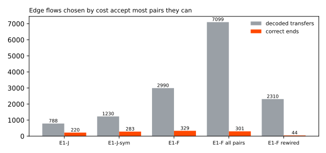

**Choosing edge flows by a fixed cost per change does not pair injected load transfers better than
the simple searches of experiments 670 and 680: it pairs 0.33 of the long and deep transfer
megawatts, against 0.29 and 0.38, and it accepts 2990 transfers of which only 329 ends are
correct.** A *Primary substation* steps electricity down to a local distribution network. A *load
transfer* moves part of one Primary's demand (the *donor*) onto a neighbour (the *recipient*).
Experiments 672 and 676 closed the neural-network graph-learning approach at 15 Primaries; the model
here uses no neural network. A *noise unit* is a Primary's usual difference between successive
6-hour means. The long, medium, and short cells are over 7 days, 1 to 7 days, and 1 day or less, and
*deep* means 8 noise units or more. *Found* means an injected event has a decoded event at the right
Primary, sign, and start; *paired* means the decoded donor and recipient are the right two
Primaries.

**E1-F decides every pair of opposite steps at two connected Primaries by cost.** For each pair it
compares the saving in change cost with the misfit of one common flow (the donor's step and the
recipient's step must roughly match, with a prior on their ratio), and takes the largest savings
first. Either end can propose the other. The verdict is *not supported*: the stop rule of the plan
closes the edge-flow line at 15 Primaries, because E1-F misses E1-J + 0.10 in both deep cells and
the all-pairs graph matches E1-F on false transfers.

## Results (40 default worlds)

- **Gate passed.** E1-F with no edges has the same found share as experiment 670's E1 in every cell,
  to four decimals (long and deep 0.488).
- **Paired share:** long and deep: E1-F 0.327 (0.228 to 0.455), E1-J 0.286, E1-J-sym 0.379. Medium
  and deep: E1-F 0.272 (0.163 to 0.403), E1-J 0.245, E1-J-sym 0.316.
- **E1-F minus E1-J (95% interval):** long and deep +0.041 (-0.041 to 0.124); medium and deep +0.027
  (-0.048 to 0.113); long and shallow +0.097 (0.037 to 0.150); medium and shallow +0.090 (0.032 to
  0.154). **E1-F minus E1-J-sym:** long and deep -0.053 (-0.113 to 0.000); medium and deep -0.045
  (-0.120 to 0.029).
- **Donor megawatts found,** long and deep: E1-F 0.491, E1-J 0.441, E1-J-sym 0.481.
- **Decoded transfers and correct ends:** E1-F 2990 and 329 (89% of decoded transfers beyond the
  ends); E1-J 788 and 220 (72%); E1-J-sym 1230 and 283 (77%).
- **Placebos.** E1-F on a rewired graph pairs 0.022 and 0.053 in the two deep cells (2310 transfers,
  44 correct ends). E1-F on all pairs pairs 0.316 and 0.257 (7099 transfers, 301 correct ends). E1-F
  on the real edges is therefore only 0.011 and 0.015 above the all-pairs graph, and its
  false-transfer share is 0.068 lower, under the 0.10 predicted.
- **Costs.** The tuning rule chose `c_edge` 2 and `delta` 8, and no pair of the 25 met the
  constraint of a false-transfer share no higher than E1-J's (0.75 on the validation worlds), so the
  page uses the fallback of the highest paired share. Every pair had a false share of 0.88 to 0.89.
- **Cross-injector check.** Tuning on constant-MW square worlds chose the same costs, so the drop is
  zero by construction. On 20 constant-MW square worlds E1-F minus E1-J is +0.036 (-0.171 to 0.303)
  long and deep and +0.302 (0.161 to 0.473) medium and deep. On long-heavy worlds it is +0.003 and
  +0.040, and on short-heavy worlds +0.020 and +0.101; all those intervals include zero.

## Post hoc grid (not pre-registered)

Because every pair of the planned grid met the same false share, a second grid was run on the same
validation worlds: `c_edge` 8, 16, or 32 and `delta` 8, 16, 32, or 64. It also met no pair under
E1-J's false share (best 0.876), and chose `c_edge` 8 and `delta` 64. On the scored worlds it pairs
0.349 and 0.293 in the two deep cells (+0.063 and +0.048 over E1-J, intervals -0.016 to 0.148 and
-0.019 to 0.135), with 3008 decoded transfers and 348 correct ends. The conclusion is unchanged. In
this model a larger change cost for a step that stands alone makes merging more attractive, so no
cost in either grid restricts the merges.

## Real record

- **Decoded transfers** (2024-01 to 2026-06, 36.0 Primary-years): E1-F 17; E1-J 8; E1-F on a rewired
  graph 4, with a median of 6 over 100 rewired graphs; E1-F on all pairs 30. NGED's event labels are
  an incomplete dump, so every count of real events is a lower bound.
- **Verified D5 to D16 transfer (December 2025):** one flow with D5 as the donor (-1.08 MW) and D16
  as the recipient (+1.28 MW, a share of 1.19), the same pair as E1-J found. Both starts are late
  (D5 by 24 hours, D16 by 12.5 hours), and both ends are 24 hours late, so the plan's bars of 6
  hours at the start and 12 hours at the end do not hold. The donor amplitude is under the 1.2 to
  2.2 MW range.
- **Logged shifts longer than 1 day (77 in the scored years):** 10 have an event start within 2
  hours (E1-J: 8) and 21 within 24 hours (E1-J: 18).
- **Event-free time** (27.6 Primary-years more than 14 days from a logged or verified event): E1-F
  calls 3 transfers; E1-F on all pairs calls 11.

## Pre-registered predictions

- Held: long and shallow E1-J + 0.05 (+0.097); medium and shallow E1-J + 0.03 (+0.090); short cells
  no worse than E1-J - 0.03; paired share on all pairs no more than 0.03 below E1-F.
- Did not hold: long and deep 0.39 or more (0.327); medium and deep 0.35 or more (0.272); 0.03 above
  the better hybrid; donor megawatts found 0.54 or more (0.491); E1-F minus E1-J-sym +0.05 (negative
  in both deep cells); false-transfer share 0.10 below all pairs (0.068 below); rewired pairs 0.05
  or less (0.053 in the medium and deep cell); rewired calls a third or fewer of the real-record
  transfers (4 against 17 for the stored graph, but a median of 6 over 100 graphs); no-edges found
  within 0.03 of E1-F (0.039 and 0.044 below); D5 to D16 timing bars.
- References: the better of F-hyb and R-hyb pairs about 0.36 and 0.33 in the two deep cells
  (experiment 678), so E1-F is below both hybrids.

## Method

- **Code:**
  `ml-experiments/00682-event-table-reconstruction-from-edge-flows-part-2-change-cost-model/`,
  importing the folders of experiments 653, 660, 665, 670, and 680. The panel, residual, worlds,
  cells, and the found and paired definitions are unchanged. E1-J and E1-J-sym are read from the
  stored rows of experiments 670 and 680.
- **Model.** Steps: E1's steps of 2 noise units or more, plus the opposite step each proposes at
  each connected Primary. A step that stands alone costs `c_edge + delta`; an edge flow costs
  `c_edge` plus 1 per extra recipient; the misfit is half the squared distance, in noise units, from
  the best common amplitude and share (share between 0.3 and 2.0 on a 24-point grid, normal prior on
  its logarithm with mean `log 0.8` and standard deviation 0.5). Not built: the segment-boundary
  search with end moves, ramps, and a routine-step cost; E1's own segment boundaries are used.
- **Tuning.** 60 validation worlds (seeds 20000 to 20059, events from 2023-07-01 to 2023-12-31,
  readings after 2023-12-31 hidden).
- **Reviews.** A fresh Sonnet code review ran before the first scored run. It found that a flow made
  only of proposed steps crashed `reconstruct`, that tuning counted correct ends differently for
  E1-J and E1-F, that validation truth ran past the hidden readings, that the fitted share was not
  stored, and that the fallback was not recorded; all were fixed. A bug in the real-record run
  (noise units from the wrong residual) was found afterwards and fixed before the real-record
  numbers above. The results and the write-up were reviewed by fresh Sonnet agents.
- **Compute:** CPU only, 2 cores, under 40 minutes. The final-test window from 2026-07-01 is never
  read. No NGED generator is named.

## What the next experiment should answer

The line closes at 15 Primaries for the reasons above. The remaining gap is information that the
power of the 15 Primaries may not carry: which neighbour received the load. A source of that
information, such as NGED's records of which circuits were switched, is the option left to explore.
Another model fitted to the same residuals is not.

## Files

- `figure_paired_by_cell.svg` and `figure_decoded_transfers.svg`: the figures above.
- Private tables:
  `data/ml-experiments/00682-event-table-reconstruction-from-edge-flows-part-2-change-cost-model/`.
