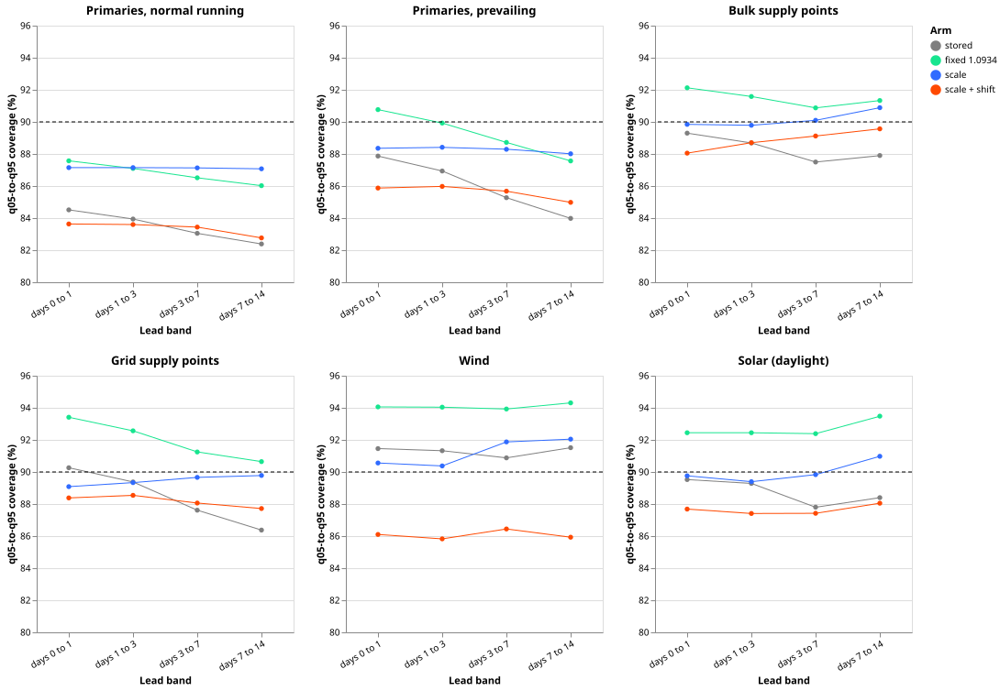
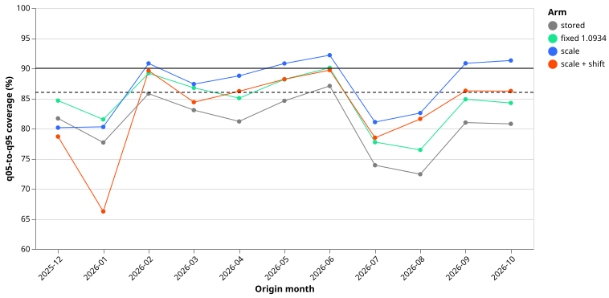
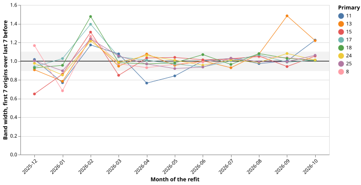
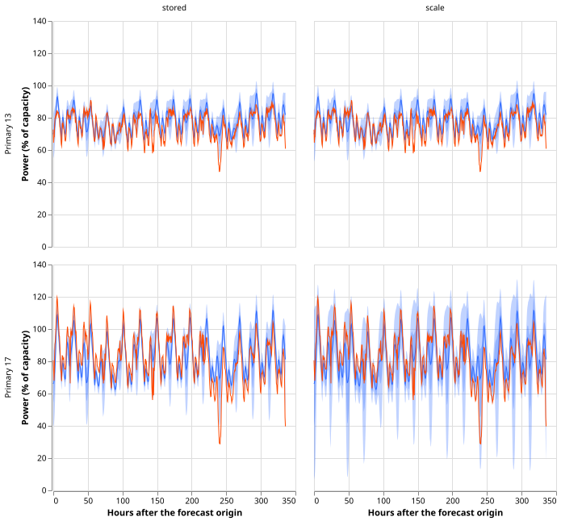
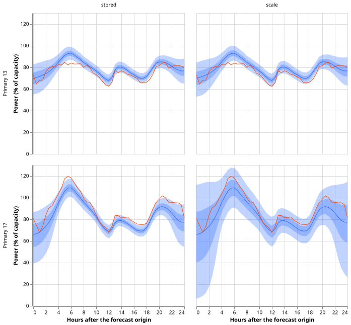

**Widening the stored quantile bands by a factor fitted on earlier months brings four of five
outputs close to the 90% coverage their q05 and q95 quantiles promise, and leaves the
normal-running Primaries output at 87%.** The stored files hold the one-year backtest forecasts of
experiments 666, 667, and 669: 16 Primaries (primary substations, each with a normal-running
output, which assumes the usual network configuration, and a prevailing output, which assumes the
configuration in force at the forecast origin), 2 bulk supply points, 2 grid supply points, 3 wind
farms, and 6 solar farms. We multiplied the distance of every quantile from the median forecast by
a scale, fitted separately for each series, output, and lead band on the 90 days of actual power
that were known when each month started. We then counted how often the actual power fell between
the q05 and q95 quantiles. Of those five outputs (the two Primaries outputs, the two kinds of
supply point, and solar), four were too narrow and now come within 2 points of 90% on origin
months 2025-12 to 2026-06: the prevailing Primaries output (88.0% to 88.4% across the four lead
bands, stored 84.0% to 87.9%), the bulk supply points (89.8% to 90.9%, stored 87.5% to 89.3%), the
grid supply points (89.1% to 89.8%, stored 86.4% to 90.3%), and solar (89.4% to 91.0%, stored 87.8%
to 89.5%). Wind was already above 90% and the scale does not improve it. The normal-running
Primaries output rose from 82.4% to 84.5% to 87.1%, and its continuous ranked probability score
(CRPS, a measure of the whole forecast distribution, here in percent of each series' capacity)
rose by 0.081 points, from 4.23. The normal-running Primaries also fell to 80.1% in December and
80.3% in January, which triggers the stop rule that we set in advance: if pooled normal-running
Primaries coverage stays below 86% in any month, the width of the bands is not the whole problem.
The method applies the calibration idea of [experiment
630](../00630-roster-upper-demand-tail-calibration-event-days-and-bias-correction/result.md),
which fitted a shift and a rescale of the upper tail on earlier months.

**Verdict: partly supported.** The 5 stored files and 4 lead bands give 20 combinations (the
Primaries count once, as normal running). In 16 of them, arm 2 brings coverage within 3 points of
90% and raises CRPS by no more than 0.05 points of capacity. The other four are the normal-running
Primaries in each lead band, which fail on the CRPS limit. Numbers are from the origin months
2025-12 to 2026-06 ("before July") unless a line says otherwise. The origin months from 2026-07 are
the final-test window, described and never used to choose.

## Arms and rows

- **Arm 0:** the stored file.
- **Arm 1:** the distance of every quantile from `q50` (the median) multiplied by 1.0934, the
  factor that [experiment 613](../00613-nra-roster-contrasts-with-intervals-five-seeds/result.md)
  fixed.
- **Arm 2:** the distance of every quantile from `q50` multiplied by a scale fitted per series,
  output, and lead band (days 0 to 1, 1 to 3, 3 to 7, 7 to 14 after the forecast origin). At the
  start of each origin month, the scale is the 90th percentile of the ratio of the actual power's
  distance from `q50` to the stored half-width of the band on that side (`q95 - q50` above,
  `q50 - q05` below). That choice makes the scaled band cover 90% of the fitting rows. The fitting
  rows are the half-hours whose valid time lies in the 90 days ending 6 hours before the month
  starts, because power is available only up to 6 hours before an origin.
- **Arm 3:** arm 2 plus a per-series level shift on every quantile, the median of the actual power
  minus `q50` over the same fitting rows.
- **Clipping.** After each arm, the quantiles of MVA series (series measured in megavolt-amperes),
  wind, and solar are clipped at zero.
- **Rows.** Cleaned observed power as in experiments 666 to 669 (wind idle half-hours set to zero;
  solar daylight only). The scored set is the origin months 2025-12 to 2026-10, because 2025-11 has
  no earlier forecast to fit on: 3,574,946 half-hours per Primaries output, 448,098 at bulk supply
  points, 448,406 at grid supply points, 651,550 for wind, and 644,760 for solar. Experiment 668
  scored 3,893,864 half-hours per Primaries output over all 12 origin months, against 3,897,273
  here, because it also required finite manual-heuristic and climatology forecasts.
- **Every "X% to Y%" range** in this page is a range over the four lead bands, and every
  "interval" is a 95% day-block bootstrap interval over forecast-origin days.

## Figures

*Pooled q05-to-q95 coverage by lead band, for each arm and file, on the months before July. The
dashed line is the nominal 90%. Wind and solar are pooled over farms.*

*Pooled normal-running coverage of the 16 Primaries per origin month, all lead bands. In this
figure the dashed line is the 86% stop line and the solid line is 90%.*

*Days 10 to 14 band width at each month start, over its value in the last seven origins of the
month before, for the eight Primaries of the refit question. The grey band is the 5th to 95th
percentile of the ratio between the two seeds of one fold in experiment 667 (0.89 to 1.10).*

*One 14-day forecast (origin 2026-01-14 12:00 UTC) of Primaries 13 and 17: stored on the left, arm
2 on the right. Blue is the median, with the 50% and 90% bands; orange is the observed power.*

*The first day of the same forecasts.*

## Results

- **Normal-running Primaries.** Coverage is 82.4% to 84.5% stored, 86.0% to 87.6% under arm 1,
  87.1% under arm 2, and 82.8% to 83.6% under arm 3. CRPS changes against the stored file are
  -0.027 under arm 1 (interval -0.031 to -0.023), +0.081 under arm 2 (0.064 to 0.099), and +0.306
  under arm 3 (0.253 to 0.362) points of capacity.
- **Prevailing Primaries.** Arm 2 coverage is 88.0% to 88.4% (stored 84.0% to 87.9%), and CRPS
  rises by 0.047 (0.039 to 0.055).
- **Bulk supply points.** Arm 2 coverage is 89.8% to 90.9%, and CRPS rises by 0.005 (-0.001 to
  0.011). **Grid supply points:** 89.1% to 89.8%, +0.003 (-0.012 to 0.017). **Solar:** 89.4% to
  91.0%, -0.002 (-0.006 to 0.002). **Wind:** 90.4% to 92.0%, +0.007 (0.000 to 0.015).
- **Closer to 90% than the stored file.** Arm 2 is closer in 20 of the 24 combinations of file and
  lead band (the two Primaries outputs count as two files). Arm 1 is closer in fewer, because it
  overshoots wind, solar, and the supply points. Arm 3 is not preferred over arm 2, because its
  CRPS is worse by 0.23 to 0.84 points.
- **Stop rule fired.** Pooled normal-running Primaries coverage under arm 2 is 80.1% in 2025-12
  (the scale is fitted on about 30 days) and 80.3% in 2026-01, below the 86% line. Arm 3 gives
  78.7% and 66.2%, and the stored file 81.7% and 77.7%. We therefore did not run the sensitivity
  checks at 45 and 180 days or the refit-ratio diagnostic.
- **P3 and P4 of the plan.** P3 (arm 3 gains less than 0.05 points over arm 2) holds, because arm
  3 loses. Its premise, that stored medians are unbiased on average, does not hold at the grid
  supply points (mean fitted shift 5.9 points of capacity). P4 (arm 1 leaves normal-running
  Primaries coverage below 87%) holds: the mean of its four lead-band values is 86.8%.

### Primaries 13 and 16 in the July and August transfers

- **Stored coverage** is 28.3% (July) and 22.9% (August) at Primary 13, and 24.5% and 22.1% at
  Primary 16, which we think reflects load moved between substations that normal running ignores.
- **Arm 2 coverage** is 25.5% and 49.4% at Primary 13 and 26.1% and 66.7% at Primary 16, so P5 (all
  below 80%) holds.
- **Pooled coverage of the other Primaries** in those two months is 80.6% and 79.5% stored and
  88.9% and 86.0% under arm 2. For all 16 series it is 73.9% and 72.4% stored and 81.1% and 82.6%
  under arm 2.
- **After the transfer ends,** the scale overshoots: Primary 13 has 97.5% in 2026-09 and 97.8% in
  2026-10 under arm 2.

### Final-test window (2026-07 to 2026-10, descriptive)

Arm 2 coverage: normal-running Primaries 85.9% to 86.7% (stored 76.9% to 77.5%), prevailing 88.7%
to 89.0%, bulk supply points 86.8% to 88.5% (stored 83.7% to 84.9%), grid supply points 87.5% to
88.1% (stored 86.9% to 89.0%), wind 89.4% to 93.3%, and solar 87.3% to 88.2% (stored 89.5% to
91.3%). The scale lowers coverage at solar and at the grid supply points' long leads below the
stored values, so the gain from calibration is not uniform across the year.

### Tails of the normal-running Primaries (before July, all lead bands)

- **Share of actual power below q05:** 8.06% stored, 5.43% under arm 2 (nominal 5%).
- **Share above q95:** 8.99% stored, 7.47% under arm 2. **Below q01:** 2.47% and 1.60%. **Above
  q99:** 2.94% and 2.56%.
- **Pinball loss at q05 and q95** rises under arm 2, from 0.920 to 0.939 and from 1.164 to 1.286.
- **Curtailment cost** is not reported, because it needs the node-plus-generators frame and a
  thermal limit.
- One scale applies to all 11 levels, so the tails are only approximately calibrated.

### Refit boundaries

- **February.** The days 10 to 14 band width of Primaries 8, 15, 17, 18, 24, and 25 widens at the
  February month start by 1.26, 1.31, 1.39, 1.48, 1.21, and 1.24 times. **September:** Primary 13
  widens by 1.48 times. **April:** Primary 11 narrows by 0.76 times.
- **Seed spread.** The ratio between the two seeds' widths in one fold ranges from 0.89 to 1.10
  (5th to 95th percentile; extremes 0.68 and 1.29), so the February and September steps lie
  outside the seed spread.
- **Coverage after the step.** Under arm 2, coverage at the six February Primaries goes from 76.3%
  in January to 93.1% in February, 94.1% in March, and 91.0% in April. The overshoot lasts more
  than the first month, so P6's second clause (the error is confined to the first month after a
  refit) is not supported.
- **Refitting the scale at every refit** is not decided here, because the diagnostic that would
  decide it was not run.

## Checks

- **Median minus mean forecast.** Not applicable, because the stored files hold no mean forecast.
  Arms 1 and 2 leave `q50` unchanged, so the error of the median equals the stored file's. Arm 3
  moves the median. The mean fitted shift (stored median bias, in points of capacity, unweighted
  over the fitted series-by-month combinations from 2025-12 to 2026-10) is 0.9 for the
  normal-running Primaries, -0.2 for the prevailing, -0.4 for the bulk supply points, 5.9 for the
  grid supply points, 1.7 for wind, and 0.2 for solar.
- **Why arm 3 hurts.** A shift-only counterfactual (stored quantiles plus the fitted shift, no
  rescale) reproduces nearly all of arm 3's damage: grid supply points CRPS 13.88 stored, 14.75
  shift-only, 14.72 arm 3; normal-running Primaries 4.23, 4.47, 4.54. The fitted shift does not
  persist: its correlation with the next month's median error is -0.41 at the grid supply points
  and +0.26 for the normal-running Primaries.
- **Audit trigger fired:** a nested arm beats the arm that contains it (arm 2 beats arm 3, which
  adds a shift to arm 2). An independent re-derivation from the raw files reproduced the
  bulk-supply-point and normal-running Primaries coverage and CRPS, rebuilt the Primary 17 scale for
  2026-01 (matching the stored arm 2 to 6 significant figures, with no fitting row after the
  cut-off), and confirmed the stop-rule months and the Primary 13 and 16 figures. It found no bug.
  The other triggers did not apply, and the contradiction of the P2 prediction is explained by the
  monthly and Primary 13 and 16 slices above.
- **Scale limits.** The scale hit its bounds (0.5 and 3) in 24 of the 704 combinations of series,
  month, and lead band for the normal-running Primaries, and in none for the other files. No
  combination fell back to a scale of 1.
- **Caveats.** The first calibrated month, 2025-12, fits on about 30 days. The cleaned power comes
  from a flagging rule run over the whole table, so a fit uses cleaning decisions made with later
  data. The event logs of National Grid Electricity Distribution (NGED) may miss load transfers, so
  the fitting rows may hold events that no label covers. Wind's q01 share is about 9% in every arm
  because the scoring sets idle half-hours to zero, which equals the quantile.

## What the next experiment could answer

A scale on the band half-width cannot be shown to repair a median that is wrong in winter at the
Primaries. A learned width head on the normal-running Primaries, conditioned on temperature and the
recent error, is one candidate, to be scored on 2025-12 to 2026-01 against arm 2; the Discuss
session decides whether to run it.
