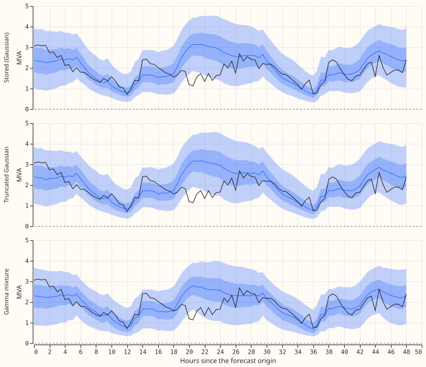
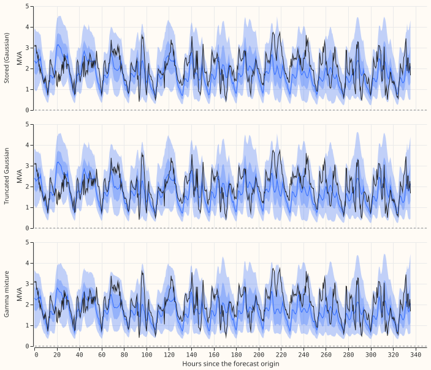
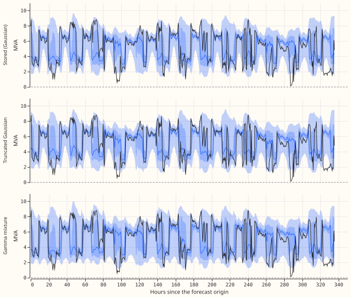
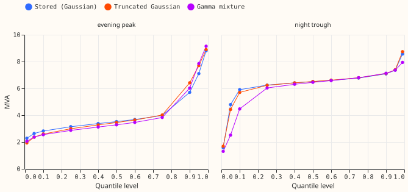
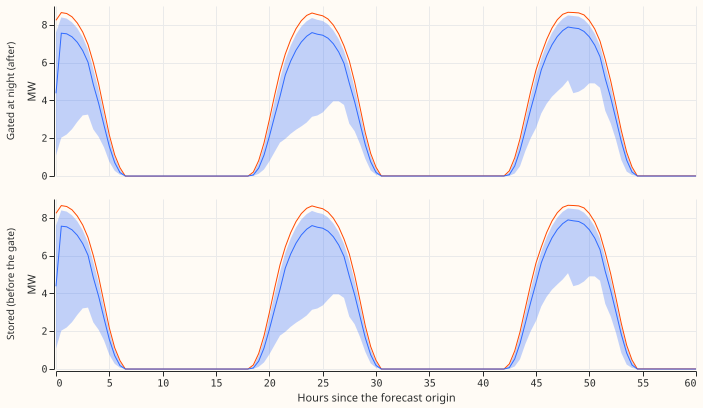

**A Gaussian mixture conditioned on power at or above zero gives the four demand series positive
quantiles with CRPS (continuous ranked probability score) improved at two series and worsened by 0.03
points of capacity at one, and a gamma mixture does not.** The one-year backtest files held
negative lower quantiles at Primaries that meter apparent power (MVA), and small non-zero solar
quantiles at night. A post hoc clamp had removed both. We refitted the demand network with two output
families that cannot go below zero, on two test months (2026-02 and 2026-05), and gated the solar
quantiles at night at each half-hour's own sun position. The truncated Gaussian mixture changed CRPS
by -0.070, -0.015, -0.010, and +0.030 points of capacity at four Primaries, and the gamma mixture
raised it by 0.68 to 1.48 points at two of them, so it failed its stop rule. Both new families
remove every negative q01. The gate removes every non-zero night quantile, lowers night CRPS, and
changes no daylight or dawn score. Its zero quantiles lie below night observations that are
slightly positive, so the share above q99 at night rises. Two test months and one pair of seeds can
rank these ideas but cannot support a claim of benefit.

## Results

**Demand: the truncated Gaussian mixture passed, the gamma mixture failed.** Rows are the normal-running
output at test months 2026-02 and 2026-05 (59 origin days; about 38,000 scored half-hours per
series). CRPS is in points of capacity (twice the mean pinball loss over 11 levels, times 100).
"Stored" is experiment 667's output; "clamp" sets its negative quantiles to zero. The Gaussian refit
reproduced the stored forecasts to the printed digits (the training is deterministic), so the
refit adds no noise floor, and its rows are not repeated below.

| Primary | Stored CRPS | Clamp | Truncated Gaussian | Gamma | Stored q01 at or below 0 | q05 to q95 coverage: stored, truncated, gamma |
|---|---|---|---|---|---|---|
| 14 (MVA) | 6.728 | 6.728 | 6.758 (+0.030) | 6.680 (-0.048) | 5.7% | 0.886, 0.902, 0.876 |
| 15 (MVA) | 3.527 | 3.527 | 3.512 (-0.015) | 5.009 (+1.482) | 0% | 0.885, 0.890, 0.715 |
| 17 (MW) | 3.789 | 3.789 | 3.778 (-0.010) | 4.472 (+0.683) | 0.3% | 0.812, 0.811, 0.772 |
| 26 (MVA) | 6.653 | 6.651 | 6.582 (-0.070) | 6.699 (+0.046) | 22.0% | 0.913, 0.916, 0.932 |

- **Intervals** (95%, paired bootstrap over origin days, 2000 draws), CRPS change of the truncated
  Gaussian: Primary 14 +0.030 (0.001 to 0.061); 15 -0.015 (-0.025 to -0.005); 17 -0.010 (-0.031 to
  0.011); 26 -0.070 (-0.083 to -0.059). Gamma: 14 -0.048 (-0.093 to -0.007); 15 +1.482 (1.295 to
  1.701); 17 +0.683 (0.566 to 0.802); 26 +0.046 (0.015 to 0.078).
- **Predictions.** P1 holds by construction: no q01 is at or below zero under either family. P2
  failed for the truncated Gaussian, because the changes are not all within 0.01 (two are larger
  improvements, one is a larger loss). The stop rule did not fire for it (no series worsened by
  0.05). P2 and the stop rule failed for the gamma mixture at Primaries 15 and 17, so the gamma
  family is dropped. P3 held for the truncated Gaussian (coverage change from -0.001 to +0.016) and
  failed for the gamma mixture at Primaries 15 and 17.
- **The sign differs by month at one series.** The truncated Gaussian's CRPS change at Primary 17 is
  -0.085 in 2026-02 and +0.066 in 2026-05. At Primary 14 it is +0.028 and +0.032 (worse in both
  months), and at Primaries 15 and 26 it is negative in both.
- **The other 12 Primaries** (same shared network, Gaussian output): CRPS 3.468 stored, 3.465
  truncated-Gaussian run, 3.496 gamma run. The gamma head therefore also hurt Primaries that kept a
  Gaussian output.
- **Tails, pooled over both months, stored / truncated Gaussian / gamma.** q01 pinball loss: Primary
  14 0.295 / 0.292 / 0.272; 15 0.206 / 0.201 / 0.363; 17 0.198 / 0.193 / 0.218; 26 0.348 / 0.342 /
  0.348. q99 pinball loss: 14 0.485 / 0.480 / 0.488; 15 0.221 / 0.221 / 0.302; 17 0.216 / 0.221 /
  0.284; 26 0.379 / 0.382 / 0.374. Share of observations above q99: 14 0.013 / 0.010 / 0.016;
  15 0.008 / 0.009 / 0.028; 17 0.012 / 0.019 / 0.031; 26 0.012 / 0.011 / 0.007.
- **By lead band** the truncated Gaussian's CRPS change at Primary 14 is -0.014 (0 to 1 days) and
  +0.060 (7 to 14 days), and at Primary 26 it is -0.037 and -0.082.

**The fitted shape differs only near zero.** At two half-hours of Primary 26 the three arms' 11
quantiles agree in the middle and differ at the lower levels, where the stored output reaches below
zero.

**Solar: the gate leaves no night quantile and changes nothing else.** The gate (arm a) keeps the
stored networks of experiment 666 and sets every quantile to zero where the sun's elevation at the
middle of the half-hour is at or below zero. The stored output has a non-zero quantile at 21,968
of 57,890 night half-hours of the two farms (32,200 of them have observed power and are scored in
the table) (origins from 2026-02-01 to 2026-04-30); the gated
output has none. Arm b (the physics-lite power at each half-hour's own zenith as a network input)
was not run, because experiment 666's network already reads that power as an input and as the
mixture's centre (`pl_mean` of its `build_day`), so the refit would repeat the network it was meant
to change.

| Farm | Sun class | Half-hours | CRPS stored | CRPS gated | q05 to q95 coverage | Share above q99, stored / gated | Share below q01 |
|---|---|---|---|---|---|---|---|
| Solar B | night | 16,920 | 0.0147 | 0.0124 | 0.820 / 0.818 | 0.0017 / 0.0037 | 0.178 |
| Solar B | dawn and dusk | 3,022 | 0.1817 | 0.1817 | 0.690 | 0.0003 | 0.300 |
| Solar B | daylight | 27,648 | 3.9698 | 3.9698 | 0.939 | 0.0141 | 0.007 |
| Solar E | night | 15,280 | 0.0119 | 0.0101 | 0.933 / 0.929 | 0.0000 / 0.0046 | 0.067 |
| Solar E | dawn and dusk | 2,984 | 0.1781 | 0.1781 | 0.751 | 0.0000 | 0.237 |
| Solar E | daylight | 27,726 | 3.7082 | 3.7082 | 0.969 | 0.0013 | 0.001 |

Dawn and dusk is a sun elevation above 0 and under 5 degrees. The unchanged networks cover the
observed power with 0.69 and 0.75 inside q05 to q95 there, and 0.30 and 0.24 of observations fall
below q01, so the lower quantiles at dawn and dusk are too high. That gap is not touched by a night
gate.

## Checks

- Reproduction: the Gaussian-loss run of the new chain reproduced experiment 667's stored forecasts
  at both folds (CRPS equal to 6 digits at the four Primaries).
- Known-answer test (`e00684_check.py`): both families' densities integrate to 1 over their
  support, the quantiles invert the cumulative distribution to 1e-5, Gaussian rows equal the
  original functions, and the target statistics are recorded when a fold's rows are built.
- Scored rows: the four demand series have 39,648, 39,648, 37,165, and 39,605 scored half-hours, the
  stored rows' own.
- Reviews run: a Sonnet plan review and a Sonnet code review (it found that the target statistics
  were hooked on the wrong class, which would have stopped the first fit, and that the gamma floor
  depended on each Primary's standard deviation; both were fixed before any fit). A Sonnet numbers review
  recomputed every table from the stored forecasts and agreed, apart from the 2026-02 split at
  Primary 14 (corrected here) and bootstrap bounds that differ by 0.003 to 0.02 between random
  seeds. A Sonnet prose review led to the rewording of this page.
- Audit triggers: trigger 2 fired for the gamma mixture, whose result contradicts its prediction
  with no tested explanation (the shared head reading Gaussian parameters at some Primaries and
  gamma parameters at others is the likely cause, untested). The gamma result does not support any
  conclusion beyond dropping the family. The median-error contrast was not run.
- Not checked: seed-to-seed variation. The two seeds are averaged, so no spread between seeds is
  available, and the truncated Gaussian's differences of 0.01 to 0.07 may include training variation.

## Method

- **Architecture.** The Candidate demand network of [experiment
  667](../00667-one-year-backtest-of-the-two-output-demand-network-at-primaries/result.md) (arm
  `P7+D50`): encoders for lagged power, neighbours' power summaries, ECMWF ENS weather, and date and
  time, then a three-component mixture head, one shared network for the 16 Primaries. The output
  family is replaced only at Primaries 14, 15, 26, and 17. Truncated Gaussian: the mixture is
  conditioned on power at or above zero, so the negative log likelihood adds the log of the mixture's
  mass above zero and the quantiles are read from the conditional cumulative distribution. Gamma: three
  gamma components on power over the Primary's standard deviation, with each component's mean and
  coefficient of variation read from the head's raw outputs. The Primary index and the fold's target
  statistics reach the loss and the read-out through a patch of experiment 397's mixture functions.
- **Training regime.** The encoders keep experiment 667's weights pre-trained on ERA5 and CAMS (under
  the Gaussian loss). The step 2 mixer, the cross-fit tables, and the daily fine-tune are refitted
  under the new loss, with experiment 667's recipe: monthly refit, 2 seeds averaged quantile by
  quantile, cleaned power, D15 and D18 cut before 2025-03-01, and ENS weather at lags of at least 24
  hours. About 0.8 GPU-hours in all (7 to 12 minutes per chain). Solar: no refit.
- **Measurement.** Test months 2026-02 and 2026-05 (test month 2026-08 lies inside the final-test
  window and was not read). Normal-running output only; the prevailing output was not refitted.
  CRPS, median error, coverage, and pinball loss are experiment 667's (`e00667_score.score_frame`),
  against cleaned observed power. Intervals are a paired bootstrap over origin days. Solar uses the
  scoring rule of experiment 666 (night half-hours: sun elevation at the middle of the half-hour at
  or below zero).
- **Limits.** The lead range is 14 days, which covers NGED's 1 to 10 days. The weather is the ENS
  forecast, available at forecast time, and the lags are at least 24 hours old.

## Files

- `ml-experiments/00684-*/e00684_family.py`: the output-family patch (truncated Gaussian and gamma
  mixtures); `e00684_run.py` and `chain.sh` run experiment 667's chain under a family;
  `e00684_check.py` is the known-answer test.
- `e00684_demand_score.py` scores the arms and the clamp; `e00684_figures.py` draws the demand
  figures and the bootstrap; `e00684_solar_gate.py` and `e00684_solar_figure.py` are the solar arm.
- Experiment 667's folder supplies `e00667_k1.py`, `e00667_cand.py`, `e00667_export.py`, and
  `e00667_score.py`, and experiment 666's folder `e00666_export.py` and `e00666_score.py`.
- Data (private, not committed): `data/ml-experiments/00684-*/demand_<family>/` (the fits and logs
  of each family), `score/demand_arms.csv`, `score/crps_bootstrap.csv`, and `solar_gate_scores.csv`.
  Experiment 667's stored forecasts are in `data/ml-experiments/00667-*/exports/NRA_<month>.parquet`.
