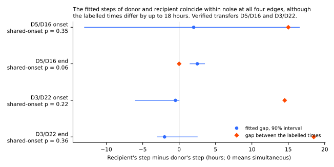
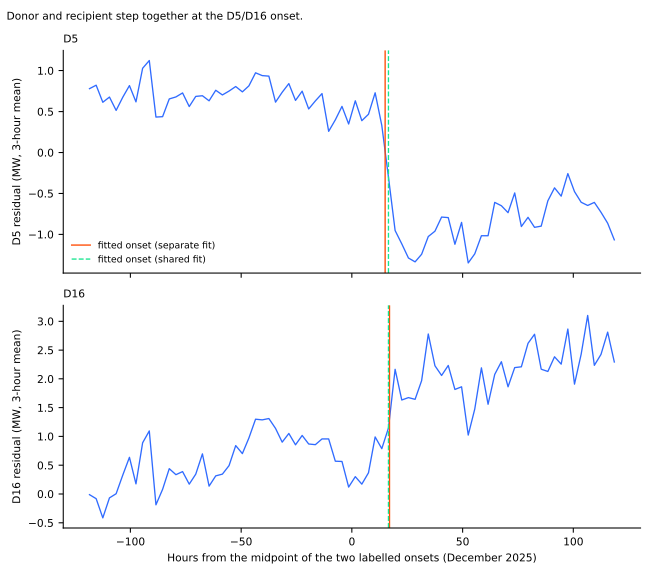
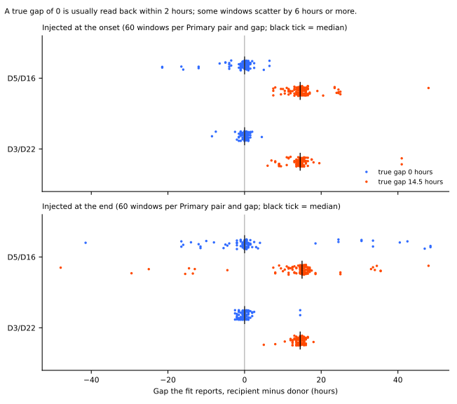
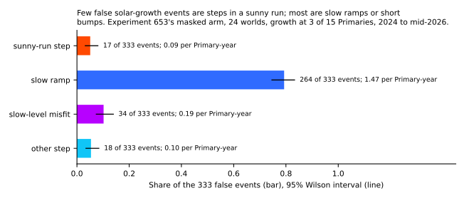
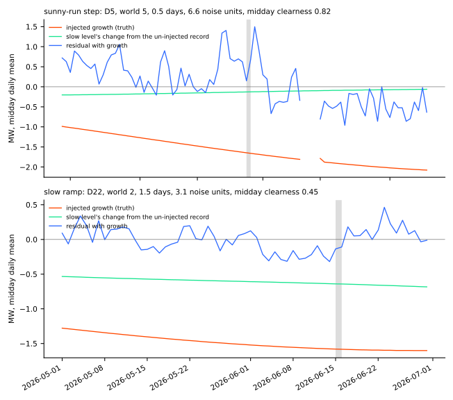
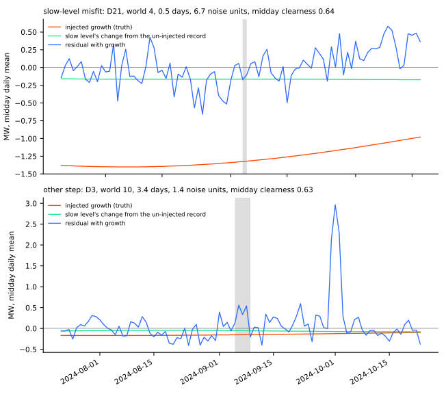

**At both verified transfers the donor and the recipient step at the same time to within the noise
of the fit, so a detector may require the two ends to coincide.** The recipient lag of 14.5 and 15
hours that experiment 660 reported is the gap between the two Primaries' *labelled* times. The fitted
gaps are 2.0 hours at the D5/D16 onset, 2.5 hours at its end, −0.5 hours at the D3/D22 onset, and
−2.0 hours at its end. Experiment 660's own fitted shifts, added to the labelled times, also give
gaps under 1 hour. Of the 333 false events that injected solar growth causes, few are abrupt
steps inside a sunny run, but half last 3 days or less. A composite capacity curve for slow
drift would therefore remove fewer false events than the ramp share suggests.

**Check 1 asks whether the two ends of a verified transfer start together.** A transfer happens
when an operator switches a circuit from one Primary substation (the donor) to a neighbour (the
recipient). The answer decides how tightly a detector may require the two steps to coincide. **Check
2 asks what kind of false event solar growth causes** in the event table of experiment 653.

The verdict is *partly supported*. Hypothesis 1 (a lag of 12 hours or more) is not supported, the
method check P2 fails at D5/D16, and hypothesis 2 is supported on the pre-registered definition. The
page says in each section how much the definition matters.

## Figures

**Figure 1 shows that the fitted gap is near zero at all four edges, and that the labelled gap is
not.** The dot is the fitted gap (recipient minus donor) and the line is a 90% interval from
resampling whole days. The interval at the D5/D16 onset is wide (−13.0 to 16.5 hours), so that
edge alone cannot exclude a lag of 14.5 hours. The other three intervals can.

**Figure 2 shows the D5/D16 onset in the data.** Both Primaries step within a few hours of one
another, and the step fitted separately for each Primary falls beside the step fitted jointly.

**Figure 3 shows what the fit reports when the true gap is known.** A gap of 0 is read as within
2 hours in most windows, but a few windows scatter by 6 hours or more, most at D5/D16. A gap of 14.5
hours is read back with a median of 14.5 to 15 hours.

**Figure 4 shows the class of the false events.** The ramp class is the largest, and it mixes slow
ramps with short bumps (see the post hoc bullets below).

**Figures 5 and 6 show one example of each class,** each the event whose size is nearest its
class's median size. The grey band marks the false event, the orange line is the injected growth,
and the green line is the change in the slow level. The slow level absorbs little of the midday-only
growth in any example.

## Results

**Check 1, fitted gap (hours) and test of one shared onset.** Window: 5 days either side of the
midpoint of the two labelled edges. "Statistic" is twice the log likelihood ratio of separate
against shared onsets, computed per Primary; a ratio of 4 is 2.77. The p-value is from a day-block
bootstrap under the shared model (300 draws).

| Edge | Labelled gap | Fitted gap (90% interval) | Statistic | Bootstrap p |
|---|---|---|---|---|
| D5/D16 onset | 15.0 | 2.0 (−13.0 to 16.5) | 0.32 | 0.35 |
| D5/D16 end | 0.0 | 2.5 (1.5 to 3.5) | 43.8 | 0.06 |
| D3/D22 onset | 14.5 | −0.5 (−6.0 to 0.0) | 2.79 | 0.22 |
| D3/D22 end | 18.5 | −2.0 (−3.0 to 2.5) | 1.66 | 0.36 |

- **Method check P2 fails at D5/D16 and passes at D3/D22.** With a true gap of 0, the fitted gap lies
  within 4 half-hours in 83% (onset) and 75% (end) of 120 windows at D5/D16, against the 90% bar,
  and in 97% and 95% at D3/D22. At D5/D16 the fit reports a gap of 6 hours or more in 7.5% (onset)
  and 18% (end) of windows. Both a constant step and a step that follows the donor's profile give the
  same shares.
- **A gap of 14.5 hours is detected.** With a true gap of 14.5 hours, the statistic exceeds 2.77 in
  all 120 windows of every pair and edge, and the fitted gap is within 2 hours of the truth in 67% to
  95% of them.
- **The likelihood-ratio cut-off of 4 is too eager.** The statistic exceeds 2.77 in 25% to 32% of
  windows with a true gap of 0, so a rule of "ratio under 4 means simultaneous" would reject a truly
  simultaneous transfer about 3 times in 10. The bootstrap null is the calibrated test. The D5/D16 end
  has a statistic of 43.8, which sits at the 95th percentile of its own bootstrap null (44.9).
- **The labelled gap is not a fitted lag.** Experiment 660 fitted each Primary in its own window
  and searched 24 hours either side of its labelled time. Adding each Primary's fitted shift to its
  labelled time gives a recipient lag of 0.5 hours at D5/D16 and 0 hours at D3/D22, although four
  of its eight shifts sat at the limit of the search.
- **Post hoc, constant-MW steps only:** the fitted gaps are 0.5, 2.0, −0.5, and −0.5 hours at the
  four edges, so the profile-shaped alternative does not explain the finding.

**Check 2, classes of the false events.** The 24 worlds (worlds 0 and 1 reproduce experiment 653's
5 and 9 false events) hold 333 false events, or 1.85 per injected Primary-year (95% interval 1.06
to 2.86 from resampling worlds), against experiment 653's 0.93 on its two worlds.

| Class (first match) | Events | Share (95% interval) | Per Primary-year (95% interval) |
|---|---|---|---|
| Sunny-run step | 17 | 0.05 (0.03 to 0.08) | 0.09 (0.05 to 0.14) |
| Slow ramp (rise over more than 1 day, or not complete in 14) | 264 | 0.79 (0.75 to 0.83) | 1.47 (0.79 to 2.36) |
| Slow-level misfit | 34 | 0.10 (0.07 to 0.14) | 0.19 (0.08 to 0.32) |
| Other step | 18 | 0.05 (0.03 to 0.08) | 0.10 (0.06 to 0.14) |

- **P3 is supported on the pre-registered definition.** Slow ramps and misfits are 0.89 of the
  events (0.83 to 0.93 from resampling worlds), and sunny-run steps are 0.05 (0.03 to 0.09).
- **Post hoc, the ramp class is mostly not a slow ramp.** 167 of the 333 events have no completed
  edge on the midday series, and 173 (52%, interval 47% to 57%) last 3 days or less. Only 97 (29%)
  are ramps that complete over more than 1 day.
- **Post hoc, a loose reading of "sunny run" gives a different answer.** 122 of 333 (37%, 32% to
  42%) start in a run whose first 3 days have a midday clearness of 0.7 or more. Under the
  pre-registered definition only the 17 with a step-like edge count. The page does not decide which
  reading the detector needs.
- **Daily shape.** The median share of an event's megawatts that falls between 10:00 and 15:00 UTC
  is 0.26 to 0.29 for the sunny-run, ramp, and misfit classes. A constant step would give 0.21, so
  the events are only weakly midday-shaped.
- **Season boundaries.** 20 of 333 events start within 14 days of 1 April or 1 October.

## Caveats

- **Two verified transfers are the only real evidence for check 1.** The D5/D16 onset interval is
  wide, so a lag of about 15 hours is not excluded there. The result is consistent with simultaneity
  at four edges and cannot prove it.
- **The injection check scores the method on residual windows that NGED's logs call event-free.**
  The logs are incomplete, so some windows may hold an event, which would widen the scatter.
- **The edge width in check 2 has a resolution of 1 day** (daily mean of the midday half-hours), so
  a step of 1 hour is not separated from a step of 1 day. The sunny-run clearness uses ERA5
  shortwave, a recorded product, not CAMS.
- **Solar growth is injected, not real.** The injected growth is a midday-only term of 0.2 to 1.0 MW
  per year at 3 Primaries per world, so the false-event rate describes experiment 653's masked arm
  under that injection only.
- **Unlogged events.** NGED says its logs may miss load-shift events, so the real-record windows
  here may hold unlabelled events, and the injected-window scatter is a lower bound.

## What the next experiment should answer

- **Does a detector that requires both ends to coincide within about 4 half-hours cut the
  false-transfer share?** The tolerance should be tested on injected worlds, because the fit
  misplaces some true simultaneous steps by 6 hours or more at D5/D16.
- **How many of the short bumps in check 2 are a sunny day or two rather than solar growth?** A
  placebo with solar growth removed would count the short bumps the slow level cannot explain.

## Checks

- **Median minus mean forecast, and error of the mean beside each quantile-score contrast:** not
  applicable, because this experiment trains and scores no forecast.
- **Audit triggers:** none of the seven apply (no forecast, no leakage path, no tuned threshold read
  from the scored rows). The class definitions were fixed in the plan and then changed once, after
  the code review and before any scored number was read; the plan page records the change.
- **Process:** the timing script was run once as a trial before the plan commit and the code review,
  and its output was not read. A fresh Sonnet agent then reviewed the code and found four bugs
  (midday slices not aligned to the clock, a bootstrap null that used the separate fit's step shape,
  a forecast gap that made every fit NaN, and a pooled noise level in the statistic). All were fixed
  before the scored run. A fresh Sonnet agent reviewed the numbers and the prose.
- **Final-test window:** never read. All windows and worlds end before 2026-07-01.
- **Standing practices:** no forecast is trained, so monthly refits, saved models, tail scores, and
  curtailment cost do not apply. D18's rows before 2025-03-01 are dropped as in experiment 653.

## Files

- `ml-experiments/00686-event-table-transfer-timing-and-false-solar-growth-events/e00686_timing.py`:
  check 1, the fits, the bootstrap, and the injection check. Imports the folder of experiment 660.
- `.../e00686_false_events.py`: check 2, the re-injection of the solar-growth worlds and the
  per-event measurements. Imports the folders of experiments 653 and 657.
- `.../e00686_classes.py`: assigns the classes and prints the shares and rates.
- `.../e00686_figures.py`: draws the six figures.
- `data/ml-experiments/00686-event-table-transfer-timing-and-false-solar-growth-events/`: private
  tables (`timing_real.json`, `timing_injected.parquet`, `false_events.parquet`, `classes.parquet`,
  `classes.json`).
