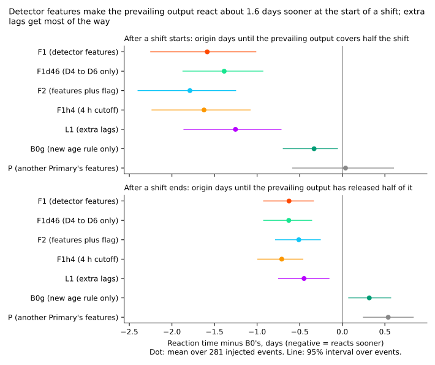
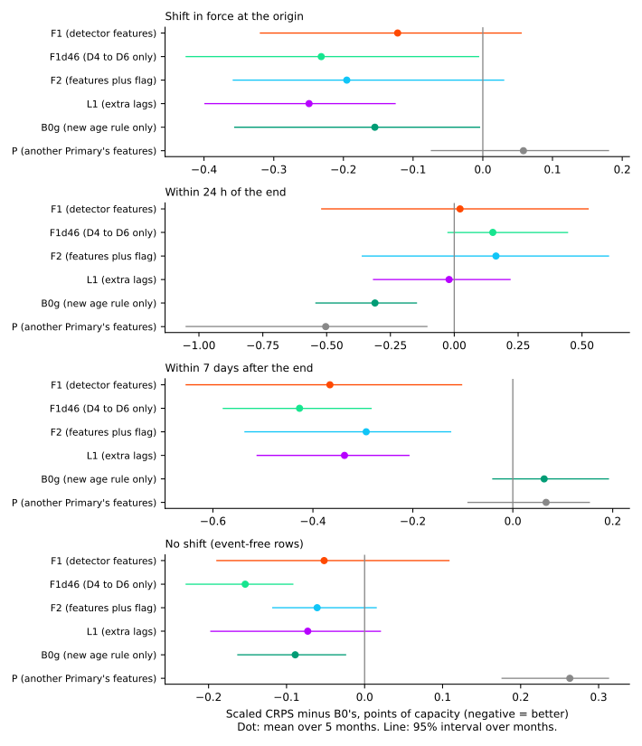
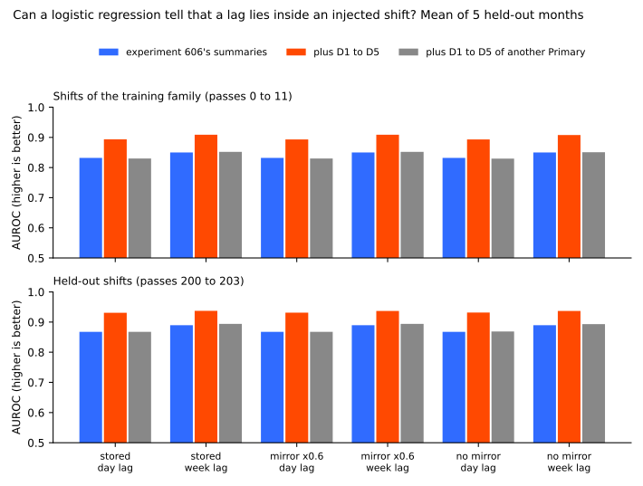
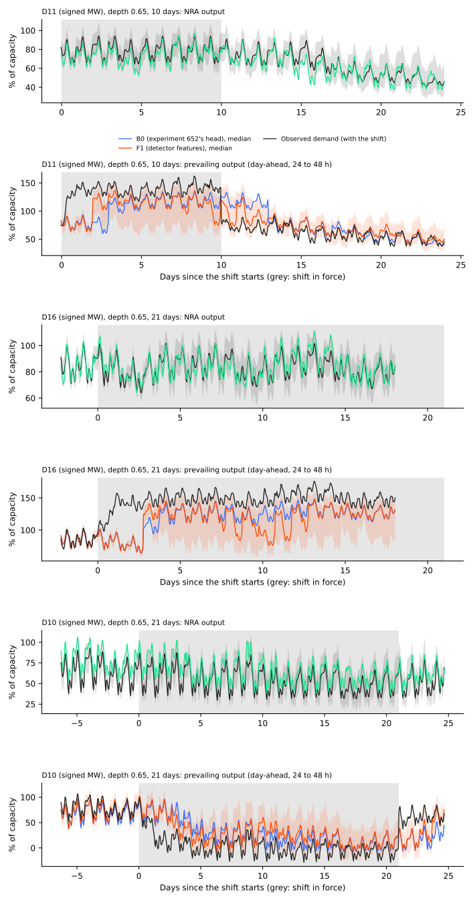
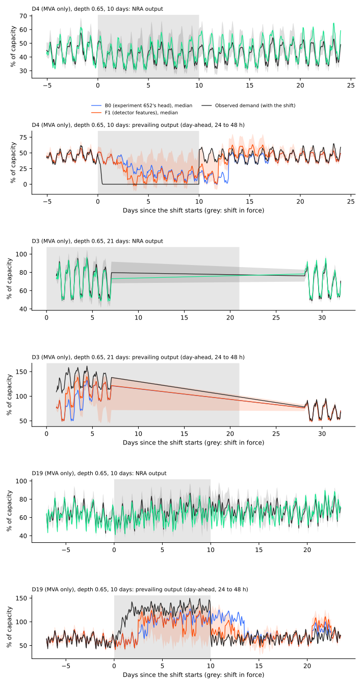
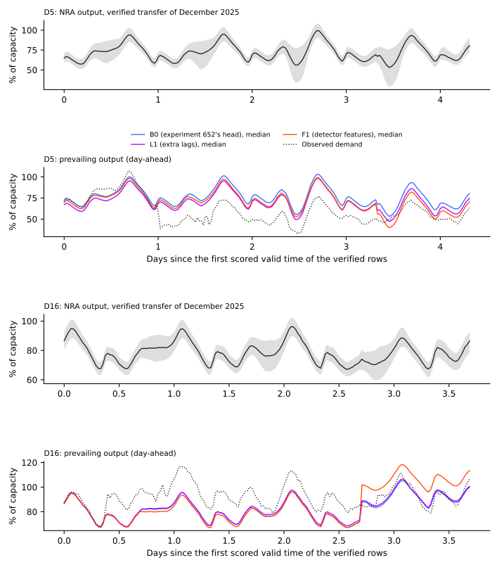
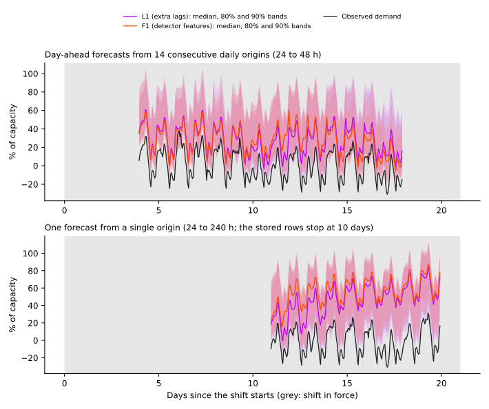

Throughout, K1 is the frozen two-output demand neural network. Its normal-running-arrangement
(NRA) output forecasts demand as if no shift were under way, and its prevailing output forecasts
demand including any shift in force. The small head is the neural network that corrects the
prevailing output. B0 is experiment 652's head, L1 is B0 plus extra lagged power, F1 is B0 plus
the detector features D1 to D6, and P is the placebo.

A load shift is a period when the electricity network operator moves part of one primary
substation's (Primary's) demand onto or off a neighbouring Primary. The two-output demand neural
network (K1 plus a small head) should follow such a shift in its prevailing output. We asked whether
giving the small head the statistics of a simple step detector makes it follow a shift sooner, and
compared it with giving the same head extra recent lagged power instead. Every shift is injected
into real history, with its start and end known, so reaction time can be measured exactly.

**Take-home message.** Detector features make the prevailing output cover half of a new shift 1.59
days [-2.26, -1.00] sooner than experiment 652's head (B0), and release half of it 0.63 days
[-0.91, -0.36] sooner after the shift ends. Extra lagged power inputs (L1, experiment 681's block)
get 1.25 days [-1.87, -0.74] at the start and 0.45 days at the end, and F1 minus L1 is -0.33
[-0.72, +0.07] at the start, so the features are not shown to beat plain lags. The scaled CRPS
where a shift is in force improves by 0.12 points of capacity [-0.33, +0.06], below the 0.30 bar.
Verdict: partly supported. F1 reacts sooner than B0 (supported); F1 is not shown to react sooner
than L1 (not supported); the veto is not cleared, because F1's CRPS on real event-free rows is
above the P4 limit.

## Figures

## Results

Scores are CRPS in points of capacity (1 point is 1% of a Primary's effective capacity), scaled to
a q05 to q95 coverage of 0.90 as in experiment 652, mean of 2 seeds, then of the 5 development
months (2025-10, 2025-12, 2026-01, 2026-03, 2026-06). Intervals are percentile bootstraps over the
months (5 blocks, so coarse) or over events. B0 refitted here equals experiment 652's stored R-haz
exactly (the gate passes).

- **Step 1, separability (no refit).** A logistic regression on experiment 606's summaries and their
  absolute values reaches an AUROC of 0.83 to 0.85 (training-family shifts) and 0.87 to 0.89
  (held-out shifts) for "this lag lies inside an injected shift". Adding D1 to D5 raises it by
  +0.061 (day lag) and +0.059 (week lag) on training-family shifts, and by +0.063 and +0.048 on
  held-out shifts, on the stored bank; the mirror-at-60% and no-mirror banks differ by under 0.002.
  Predicted +0.05 on every bank: met except the week lag on held-out shifts (+0.047). Stop rule
  (gain under 0.03): not triggered. The placebo scorer (D1 to D5 of another Primary) adds under
  0.005.
- **Reaction time, start of a shift (281 held-out events).** Mean origin days to cover half the
  shift, minus B0: F1 -1.59 [-2.26, -1.00] (median -1.0), F1d46 -1.39, F2 -1.79, F1h4 (4 h cutoff)
  -1.62, L1 -1.25 [-1.87, -0.74], B0g (new age rule, no extra inputs) -0.33 [-0.67, -0.05], P
  +0.04 [-0.59, +0.59]. P2 (at least 1 day, interval excluding zero) is met for the mean and the
  median. By event length F1 minus B0 is -0.66, -1.17, -1.48, and -3.34 days (5, 10, 21, and 45
  days), so the gain of F1 over B0 is below 1 day for 5-day shifts (audit's own code).
- **Reaction time, end of a shift.** F1 minus B0 -0.63 [-0.91, -0.36] mean, median 0.0, so P2's
  1-day bar is not met at the end. F1 minus L1: -0.33 [-0.72, +0.07] at the start and -0.18
  [-0.42, +0.07] at the end. A 4-hour cutoff reacts no sooner than a 6-hour cutoff (F1h4 minus F1:
  -0.03 and -0.08).
- **Scaled CRPS minus B0.** In force: F1 -0.12 [-0.33, +0.06], F1d46 -0.23, L1 -0.25 [-0.40,
  -0.13], P +0.06. Near the end: F1 +0.02, L1 -0.02, B0g -0.31. Just ended: F1 -0.37 [-0.66,
  -0.10], L1 -0.34, F1d46 -0.43. Event-free: F1 +0.01 [-0.16, +0.20], L1 -0.03. P3 (-0.30 in
  force, near the end, and just ended) is met only for just ended. Within 7 days after the end,
  the gain of -0.37 meets the 0.30 bar.
- **False alarms.** Share of event-free rows where the head's median departs from K1's median (the
  NRA output) by 3 points or more: B0 0.18, F1 0.19, F1d46 0.18, L1 0.23, K1 0.00. P4 (at most +1
  percentage point and +0.02 CRPS) holds for F1 on the bank (+0.7 points; +0.01 CRPS) and not for
  L1 (+4.5 points). On real event-free rows F1's CRPS is +0.05 [-0.02, +0.13] against B0, an
  interval that includes zero, so the contrast is unresolved, with a point estimate above the 0.02
  limit.
- **Scaled in-force CRPS on held-out-family shifts only (the verdict reads the all-rows figure
  above).** B0 10.96, L1 10.28 (-0.67), F1 10.42 (-0.54), F1d46 10.22 (-0.74), K1 16.05, R0 (168
  h) 12.43.
- **Tails, in force (unscaled).** q05 to q95 coverage: K1 0.49, B0 0.83, F1 0.85, L1 0.84. Pinball
  loss at q01, q05, q95, and q99: B0 0.53, 1.45, 1.51, and 0.52; F1 0.43, 1.31, 1.49, and 0.49; L1
  0.43, 1.33, 1.41, and 0.45.
- **Verified transfer between Primaries D5 and D16 (real rows, one episode, 13,068 rows).** CRPS:
  K1 14.9, B0 9.73, B0g 9.35, F1 8.58, L1 8.63, P 9.92. Descriptive only.
- **Avoidable-curtailment cost (experiment 601 units, six MW Primaries, leads 12 to 36 h).**
  Inside a shift: K1 549,533, B0 162,976, F1 136,173, F1d46 124,801, L1 136,284. In the 7 days
  after the end: K1 541, B0 10,786, F1 9,105, L1 9,148. All rows: K1 316,942, B0 95,937, F1
  80,090, L1 80,185.
- **Placebo (P).** P reacts like B0 at the start (+0.04) and slower at the end (+0.54, an artefact
  of the release rule, see Caveats), and has a false-alarm rate of 0.36. It cannot serve as the
  plan's placebo, because the placebo Primary is itself in a shift on 44% to 55% of the target's
  events (every Primary is shifted in every pass). P5 is not tested.

## Arms, data, and method

- **Arms.** B0 (experiment 652's R-haz, refitted), B0x (B0 with L1's age rule), B0g (B0 with F1's
  age rule, no extra inputs), L1 (B0 plus experiment 681's lag block at 6 to 72 hours before the
  origin, built here), F1 (B0 plus D1 to D6 at the day lag, week lag, and 6-hour cutoff), F1d46
  (D4 to D6 at the 6-hour cutoff only), F2 (F1 plus the explicit flag), F1h4 (4 hour cutoff), F1nd
  (F1 without dropout), P (features of another Primary). 10 arms x 5 months x 2 seeds = 100 fits.
- **Code.** `ml-experiments/00687-*/`: features `e00687_features.py`, tables `e00687_tables.py`,
  separability `e00687_separability.py`, fits `e00687_fit.py`, scores `e00687_score.py`. Reuses the
  code of experiments 598, 606, 647, 650, and 652 (imported). Fitted weights and tables are in
  `data/ml-experiments/00687-*/`.
- **Cadence and compute.** One small head per scored month (no refit cadence), 4 CPU processes,
  about 25 minutes for the fits, no GPU. Data before 2026-07-01 only (asserted). Cleaned power, as
  in experiment 650.
- **Features.** D1 to D6 of the plan, in noise units; the noise unit uses all five months, including
  the scored month (scale only; no sensitivity check was run). The age that gates the survival
  probability is the larger of the day-lag age and the detector's age (F arms), or 1 day when the
  mean residual at 6 to 24 hours before the origin exceeds 5 points (L1, B0x).

## Checks

- **Median minus mean forecast, in force, points of capacity:** B0 -0.34, L1 -0.40, F1 -0.51. Mean
  absolute error of the mean forecast: B0 10.22, L1 9.96, F1 10.15; of the median: 10.20, 9.87,
  10.18. The mean-forecast contrast agrees in direction with the CRPS contrast.
- **Plan conditions that fired.** (1) The placebo P gained on rows near the end of a shift. (2)
  The in-force CRPS gain missed its own prediction (P3). (3) F1 scored worse than its subset F1d46
  on some strata (nested arm). A Sonnet audit re-derived the contrasts from the stored predictions
  with its own code and matched them (`briefs/e687_audit.md`, private). Its findings: the placebo
  is not independent (accepted: P5 untested, P not read as a control); P's near-end gain is
  shrinkage, because K1 itself scores 5.93 there against B0's 7.35, so that stratum rewards
  departing less (accepted); the F1 against F1d46 gap is seed variance of 0.1 to 0.6 points
  (accepted); the reaction-time definition is partly unsound (accepted, see Caveats). B0 equals
  experiment 652's stored head exactly because the refit is deterministic, not because a file was
  read twice.
- **Reviews.** A Sonnet plan review (14 findings, 13 accepted, noise-unit leakage kept with a
  stated reason), a Sonnet code review before the fits (13 findings: pass-family leak in the AUROC,
  a gate-only arm, assertions fixed; 5 low items noted), the audit above, and a Sonnet prose review
  (see the pull request).

## Caveats

- **The injected world flatters the features.** Shifts are exact constants added to clean power,
  every Primary is shifted in every pass, and the neighbour sees the opposite step at a gain of 0.5
  to 1. The fits and scores use only the stored-mirror tables. NGED's event labels are incomplete,
  so real event-free rows may hold unlogged shifts, and the real-row numbers are optimistic.
- **The reaction-time start rule counts noise.** A hit needs only a departure of half the shift at
  one origin, so false departures count; a two-origin rule gives P minus B0 +0.73 [+0.02, +1.40] and
  leaves F1 minus B0 unchanged (audit). A start with no hit is censored at the event length, so the
  mean is dominated by 45-day events (use the median, -1 day).
- **The end rule is relative to each head's own earlier level.** With a sign-aware, truth-relative
  release, F1 minus B0 at the end is -0.46 [-0.65, -0.29] and P minus B0 is +0.01 (audit). Only 55%
  of events are released within 14 days.
- **Seed noise.** The per-event start reaction differs by a standard deviation of 5.7 days (B0) and
  3.9 days (F1) between the two seeds.
- **Stored banks.** The no-mirror and 60% banks enter only the separability step. The 60% bank is an
  approximation of a split, not experiment 651's bank.
- **Lead range.** The stored rows stop at 10 days, which is NGED's horizon.

## What to try next

- Open the survival gate from the newest readings in every prevailing head, and re-test the
  detector features against extra lags in a world with few concurrent shifts and a placebo Primary
  that is never shifted.
- L1 and B0g, which add no detector statistics, give 1.25 and 0.33 of the 1.59 days, so test
  whether a feature block helps beyond the lag block on real shifts, where the two cannot be
  separated yet.
