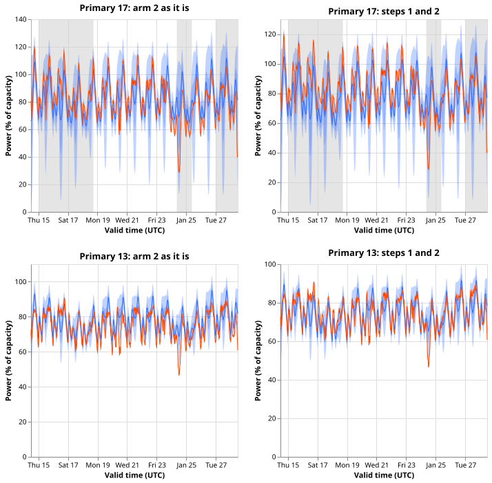

**The 90% bands of the normal-running Primaries miss in winter mostly because the median forecast is
off by a different amount each month, and partly because of load transfers; the bands themselves
are close to the right width.** We asked why the 16 Primary substations' normal-running forecasts
cover only 80% of the observed power inside their 5%-to-95% bands in December 2025 and January
2026, where 90% is promised. The normal-running output assumes the usual network configuration. We
took the stored bands (after [experiment
683](../00683-walk-forward-calibration-of-the-quantile-bands-in-the-one-year-backtest-files/result.md)
widened them by a factor fitted on earlier months), dropped the half-hours inside labelled and
verified load transfers, and moved each band by that month's observed median error, which no
forecast could know in advance. Coverage rose to 90.1% and 88.6%, and the width factor still needed
fell to about 1. Pre-registered prediction P1 held and the stop rule did not fire.

- **Arms and steps.** Arm 2 of experiment 683 (the walk-forward scale) is the object; the stored
  quantiles (arm 0) are the reference. Step 1 drops the half-hours whose valid time lies inside a
  span (the 34 labelled events of experiment 580's label table in the period, plus its verified
  transfers) at the Primary the span names. Step 2 adds, to all 11 quantiles, the median of
  observed minus the median forecast per series and origin month. Both are diagnostics: step 2
  uses the rows it scores.
- **Rows.** The normal-running output of 16 Primaries, origin months 2025-12 to 2026-06, scored rows
  of experiment 683 with valid times before 2026-07 (74,406 rows from late June origins are left
  out, so 2026-06 differs from experiment 683's figure; earlier months match it exactly). Step 1
  masked 39,163 of 332,611 half-hours in 2025-12 and 23,586 of 333,312 in 2026-01 (11.8% and 7.1%).
  Standing practices: stored forecasts reused, nothing fitted, cleaned observed power, final-test
  window untouched.
- **Coverage, pooled, 95% day-block bootstrap intervals (arm 2):** as it is 80.1% (79.3 to 80.9) and
  80.3% (79.3 to 81.1); step 1 alone 86.0% (85.2 to 86.8) and 81.9% (81.0 to 82.8); step 2 alone
  86.3% (84.7 to 87.8) and 86.5% (85.1 to 87.8); both 90.1% (89.4 to 90.8) and 88.6% (87.7 to
  89.5), for 2025-12 and 2026-01. February to June as it is: 90.8%, 87.4%, 88.8%, 90.8%, and 93.5%;
  after both: 92.3%, 92.0%, 90.3%, 92.9%, and 94.2%.
- **Share of the shortfall from 90% explained (2025-12, 2026-01):** step 1 alone 59% and 17%; step 2
  alone 63% and 64%; both 101% and 86%. The order changes the split (step 2 after step 1: 42% and
  69%; step 1 after step 2: 38% and 22%), because the transfers are also a large error in the
  median. Intervals are in `tables/explained.csv`.
- **Tails, arm 2, both steps (2025-12, 2026-01):** below q05 5.4% and 6.5%; above q95 4.6% and 4.9%
  (nominal 5% each). As it is: below 4.7% and 11.6%; above 15.2% and 8.1%. The mix of one-sided
  misses changes month to month, which is the sign of a median level that moves.
- **Series below 0.86 after both steps:** 2025-12: Primaries 12 (80.2%) and 14 (75.4%); 2026-01:
  Primaries 3 (83.3%), 9 (74.9%), 11 (84.4%), and 12 (81.9%). Primaries 17 and 18 (the verified
  transfer) go from 50% and 66% as it is to 99.5% and 92.0% over the two months.
- **Width against residuals, pooled Primaries, both winter months.** The scale that would make 90%
  of observations fall inside the band is 1.33 to 1.38 as it is and 0.99 to 1.04 after both steps,
  in each of the four lead bands (days 0 to 1, 1 to 3, 3 to 7, 7 to 14). The ratio of the median band
  half-width to the empirical half-width of the residuals is 0.50 as it is and 0.66 after both
  steps, outside the 0.75 to 1.25 range of P4. The ratio compares a median over rows with a spread
  that mixes wide and narrow bands, so the needed scale is the fairer verdict on width.
- **Sensitivities (reported, not deciding).** One shift per series, origin month, and lead band gives
  90.1% and 89.4%. Widening the mask to the fitted spans of experiment 580 and to experiment 685's
  candidate events gives 91.4% and 88.4% after both steps, and 88.6% and 81.5% for step 1 alone.
- **Predictions.** P1 held (90.1% and 88.6% exceed 86%). P2 held in point estimate in both months
  (63% against 59% in December, where the intervals overlap, and 64% against 17% in January). P3 held
  (at least two series below 0.86 in 2025-12 or 2026-01 after both steps: Primaries 9 and 12). P4
  failed as written (ratio 0.66), for the reason above.
- **Checks.** The stored files hold quantiles only, so there is no mean forecast; the median's mean
  absolute error in the two winter months falls from 7.24 to 6.39 points of capacity under step 2
  and to 5.71 under both steps, and its mean signed error is 0.67 as it is and 0.15 after both, so
  the coverage and the median-error contrasts point the same way. Trigger 3 did not fire. A leave-
  one-out run (trigger 4) was not made; the step 1 gain in 2025-12 is concentrated at Primaries 17
  and 18, the verified transfer, and in 2026-01 step 2 carries the gain. Triggers 1, 2, 5, 6, and 7
  did not fire (no control failed; the result agrees with experiment 683's lesson; the nested stages
  are ordered; no sister experiment on the same rows; no later design depends on it yet). No audit
  was run.
- **Caveats.** The mask uses labelled events that experiment 580 could not confirm in the telemetry
  (only the 2025-12-29 to 2026-01-13 transfer was confirmed), and NGED's event labels are
  incomplete, so the share explained by transfers is not a count of real events and clean rows may
  hold unlabelled events. The shift is computed on the month it scores, so it measures how much
  median error there is, not a gain a forecast could realise. The horizon is 1 to 14 days; the
  final-test window 2026-07 to 2026-10 is untouched. The July and August 2026 miss at Primaries 13
  and 16 is not examined here: it is an unexplained level miss, and the candidate events of
  experiment 685 are candidates, not labels.
- **Reuse and code.** Imports `e00668_score_lib` (experiment 668) and `e00683_calibrate`
  (experiment 683); code in `ml-experiments/00688-*/` (`e00688_diagnose.py`, `e00688_tables.py`,
  `e00688_checks.py`, `e00688_figures.py`).
- **What to try next.** A correction to the median level that a forecast could compute during the
  month, scored with the same stages; a mask of verified transfers only, to separate confirmed
  events from unconfirmed labels.
