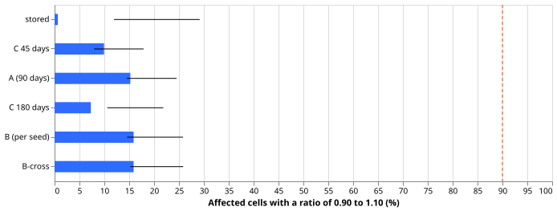
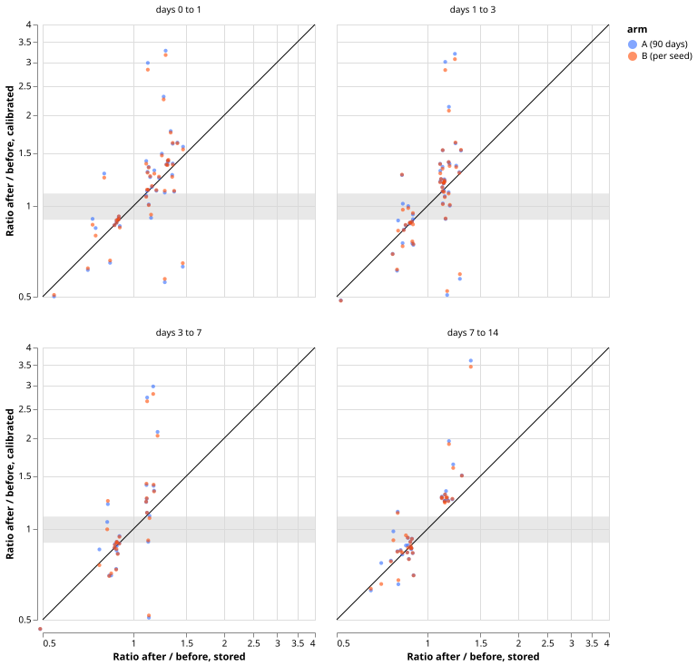

**A width scale fitted on a fixed lookback does not remove the steps in band width at the model
refits, and seed averaging does not drive them.** Under the 90-day scale of experiment 683 (arm A),
23 of the 151 affected cells (15.2%) end with a ratio of 0.90 to 1.10 across the refit, against the
predicted 90%. The scale moves the ratio farther from 1 in 67% of the affected cells. Fitting the
scale on each seed's quantiles and then averaging (arm B) changes the ratios by at most 0.05 in
89.4% of the cells, just under the pre-registered 90%, so we read the seed average as having no
material effect on the steps.

The question was whether the steps that experiment 683 measured (Primaries 11 and 13, and six
widenings in February) are removed by one scale per series and lead band, or come from the seed
average of the quantiles changing at a refit. The September step of Primary 13 lies after the last
scored origin month, so this experiment tests Primary 11 and the February widenings only. A
lookback of 45, 90, or 180 days leaves 7.3% to 15.2% of cells inside 0.90 to 1.10, far below 90%. We
expect the new model's raw band width to differ from the old model's, and the scale for a month is
fitted on the old model's forecasts, but this experiment did not test that mechanism and did not
fit a scale on any new-model forecasts.

## Figures

*Share of the 151 affected cells whose after-to-before ratio of band width lies between 0.90 and
1.10, by arm. The dashed line is the predicted 90%. Whiskers are 95% percentile intervals over
resampled origin days, with one set of draws per refit boundary.*

*Calibrated ratio against stored ratio for each affected cell, by lead band, arms A and B. The grey
band is 0.90 to 1.10 and the diagonal is no change. Points above the diagonal on the right are
steps that the scale has enlarged.*

## Arms and rows

- **Rows:** the 16 Primaries, normal-running output, origin months 2025-12 to 2026-06 (refit
  boundaries 2026-01 to 2026-06; 2025-11 has no earlier forecast to fit on, and origin months from
  2026-07 lie in the final-test window and are not loaded). 384 cells
  (16 series, 6 boundaries, 4 lead bands); 151 are affected (stored ratio above 1.10 or below
  1/1.10). Affected cells by boundary: 36, 20, 15, 25, 31, 24 (January to June).
- **Cell ratio:** median band width (q95 minus q05, after the zero clamp for the MVA Primaries) of
  the first 7 origin days after the boundary over the median of the last 7 days before it. Ratios of
  the width and of the half-width agree away from the clamp.
- **Arm 0:** stored seed-mean file. **Arm A:** experiment 683's rule, 90 days, fitted on the seed
  mean. **Arm B:** the same rule fitted on each seed's quantiles of experiment 667's fits (moved
  3 hours to the 12:00 UTC origin, times capacity), applied to the same seed, averaged, then clamped.
  The seed fits are clamped at zero for the fit only. **B-cross:** each seed scaled by the other
  seed's fit. **Arm C:** arm A at 45 and 180 days.
- **Seed check:** the mean of the two seed files reproduces the stored file to a maximum absolute
  difference of 4e-6 in the stored units (3,924,480 rows). Only the normal-running output has
  per-seed files, so the prevailing output is not tested.
- **Code reuse:** the fitting rule is copied from `ml-experiments/00683-*/e00683_calibrate.py`,
  which also supplies `z_scores`, `band_index`, and `load_truth`; scoring helpers come from
  experiment 668. The experiment fits no forecasting model and ran on CPU only.

## Results

- **P1 (at least 90% of affected cells within 0.90 to 1.10 under arm A): not supported.** 15.2%
  (23 of 151; interval 14.6% to 24.5%). By lead band: 7 of 44, 8 of 46, 4 of 27, 4 of 34 for days 0
  to 1, 1 to 3, 3 to 7, and 7 to 14. Stored: 1 of 151.
- **Stored: 1 of 151 is near zero by construction**, because affected cells are those whose stored
  ratio lies outside 0.909 to 1.10. Resampling regresses extreme cells towards 1, which favours the
  calibrated arms, so the not-supported verdict is not weakened by it.
- **P2 (expected to fail): held.** The median absolute step of an affected cell is 15% stored and
  24% under arm A; arm A moves the ratio farther from 1 than stored in 67% of cells (in either direction).
- **P3 (arm B within 0.05 of arm A in at least 90% of cells): narrowly not met, at 89.4%** (135 of
  151); B-cross is 86.8%. No interval was computed for this share. Arm B passes 24 of 151 cells
  (15.9%), against 23 for arm A.
- **Lookback (arm C):** 15 of 151 cells (9.9%) at 45 days and 11 (7.3%) at 180 days, against 23 at
  90 days. The steps do not follow the lookback.
- **Named steps:** at the February refit, days 7 to 14 ratios (stored, arm A, arm B) are 1.21, 1.25,
  1.26 for Primary 8; 1.22, 1.64, 1.59 for 15; 1.30, 1.51, 1.50 for 17; 1.39, 3.62, 3.45 for 18;
  1.17, 1.24, 1.24 for 24; 1.16, 1.27, 1.27 for 25. Primary 11 at the April refit goes from 1.30 to
  1.37 at days 0 to 1 and from 0.76 to 0.79 at days 7 to 14 (arm A). The September refit of
  Primary 13 lies after July and is not scored.
- **Coverage, q05 to q95, pooled by lead band, origin months 2025-12 to 2026-06 (weekly-block 95%
  intervals about 1.7 points wide each side):** stored 82.4% to 84.5%, arm A 87.1%, arm B 88.0% to
  88.1%, B-cross 88.0% to 88.2%, 45 days 86.8% to 86.9%, 180 days 86.9% to 87.0%. Arm B's coverage is
  about 1 point above arm A's, which is inside the width of the intervals.

## Checks

- **Audit checks (median minus mean forecast, mean-forecast error, audit triggers):** not
  applicable, because the experiment writes no forecast and scores no CRPS. No audit trigger fired.
- **Code review:** a fresh Sonnet reviewer found five problems: arm B clamped before averaging,
  arm B fitted on unclamped seed quantiles, independent day draws per cell, the final-test months
  loaded, and missing duplicate-key and month-pairing guards. All were fixed before the numbers
  above were produced.
- **Bias in the intervals:** cells are chosen for an extreme stored ratio, so resampled days regress
  towards 1 and every percentile interval sits above its point share (the stored arm: 11.9% to 29.2%
  against 0.7%). Read the intervals as spread, not as bounds.

## Caveats and what to try next

- **Caveat:** each ratio rests on two windows of 7 origin days and may be noisy. The pass share
  rests on 151 cells that share 6 boundaries.
- **Caveat:** the per-seed files exist for the normal-running output only, and for two seeds.
- **Options for a later experiment, not a plan:** fit the scale on the first weeks of forecasts
  after each refit, or on the new model's own back-test forecasts.
