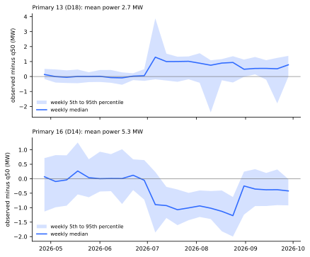
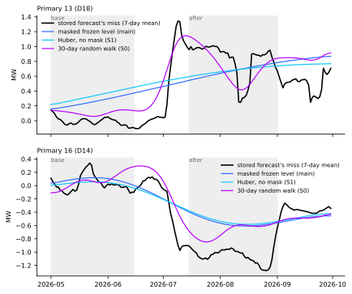
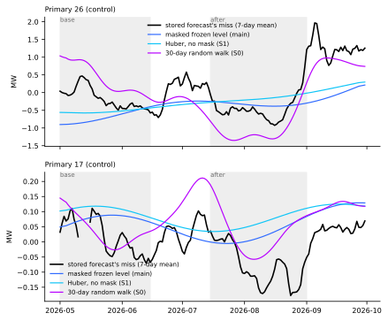
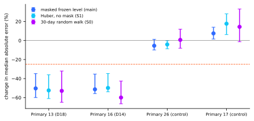

**The slow-level state of the edge-state addendum tracks the July to August level change at
Primaries 13 and 16, so the miss is a slow drift.** The stored normal-running forecasts miss the
observed power by +0.84 MW at Primary 13 (D18, mean power 2.1 MW before the change) and by -1.09 MW
at Primary 16 (D14, 5.9 MW). The masked frozen level crossed half of that change 3 days before (id
13) and 2 days before (id 16) the residual's own crossing, and adding it to q50 halves the median
absolute error at both Primaries. The level moved the median absolute error of two control Primaries
by 5.5% (a fall, with an interval that includes zero) and 7.5% (a rise), which is above the
5% limit, so the verdict is *partly supported*. The stop rule did not fire, because neither id
missed.

**What it narrows.** The level miss is a gradual drift that a smooth level absorbs, not an
unexplained step. This is a hindsight diagnostic on a lab setting: the level was fitted on the whole
record, including the window, from a different forecast's residual. July to September 2026 lies in
the final-test window and is read descriptively only; no choice is made from it.

## Results

- **Arms and data.** Arm 1: observed `power` minus stored `q50` on normal-running rows (one row per
  half-hour, the smallest lead). Arm 2: `fit_slow` of experiment 653 (masked, frozen) on experiment
  685's lag-free residual panel (ERA5 and CAMS weather at the target time, so a lab setting), noise
  units frozen on the residual before 2026-07-01. S1 (Huber, no mask) and S0 (30-day random walk)
  are the addendum's other arms, reported beside it. No forecast model was fitted, so no retraining
schedule applies.
- **Controls, by the rule fixed in the plan:** ids 26 and 17 (stored q05 to q95 coverage 0.89 and
  0.91 in July, 0.91 and 0.86 in August). Only the 15 panel ids were candidates, because the state
  needs the panel.
- **Timing (main arm).** Half of the change is passed at day 0 (id 13) and day 3 (id 16), counted
  from 2026-07-01, against day 3 and day 5 for the residual. At id 13 the level estimate rises from
  May, so the crossing is early. Level change is +0.41 MW at id 13 (residual +0.84) and -0.64 MW at
  id 16 (residual -1.09).
- **Agreement.** Weekly correlation of level with residual: 0.66 at id 13 and 0.87 at id 16 (S0:
  0.89 and 0.90). Best daily lag: 28 days at id 13 (the edge of the search) and 6 days at id 16.
- **Median absolute error, July to September, level added (main arm).** Id 13: 0.78 to 0.39 MW,
  -50.3% (95% day-block interval -59.9 to -34.8). Id 16: 0.83 to 0.40 MW, -51.3% (-55.8 to -35.3).
  Controls: id 26 -5.5% (-9.9 to +1.3); id 17 +7.5% (+1.6 to +14.0).
- **q05 to q95 coverage, same rows.** Id 13: 36% to 51%. Id 16: 49% to 66%. Control 26: 85% to 86%.
  Control 17: 90% to 87%. The level does not restore 90% coverage.
- **Variants.** The level change is half the residual change at id 13 (+0.41 against +0.84 MW), and
  the mean level added there is +0.70 MW, so an offset between the two forecasts enters. The post
  hoc variant that adds only the change from the 2026-05-01 to 2026-06-14
  mean gives -44.0% and -55.1% at ids 13 and 16 and +8.5% and -1.2% at the controls, with coverage
50% and 70% at ids 13 and 16. The random-walk
  arm S0 gives -52.9% and -59.9%, and +0.7% and +14.4% at the controls.
- **Caveats.** The level is a smooth spline, so it ramps over months and misses the step on
  2026-07-01 and the fall from late August. The residual panel belongs to a different forecast from
  the stored one, so a constant offset between them enters the "level" variant. Control crossing
  days are not meaningful because their changes are under 0.4 MW. NGED's event labels are an
  incomplete dump, so "no transfer" in experiment 685 is a lower bound. The 5% limit on the controls
  was met by neither control, so the main arm fails the pre-registered test on that count.
- **Checks.** No new forecast was scored, so the median-minus-mean and mean-forecast audit checks do
  not apply, and no audit trigger fired.
- **What to try next.** Fit the level causally (data before each origin only) to see whether it
  could be used live; this is a proposal for the maintainer.

## Method

The code is in `ml-experiments/00690-slow-level-state-on-primaries-13-and-16-july-august/`
(`e00690_run.py`, `e00690_figures.py`); it imports the folders of experiments 653 and 685.
Intermediate tables are in the experiment's data folder (private, not committed): `weekly_miss.csv`,
`daily_level_and_residual.parquet`, `results.json`, and `control_choice.csv`. Bootstrap: 7-day
blocks, 2,000 draws, paired. Review: one fresh Sonnet agent reviewed the code before the run.
