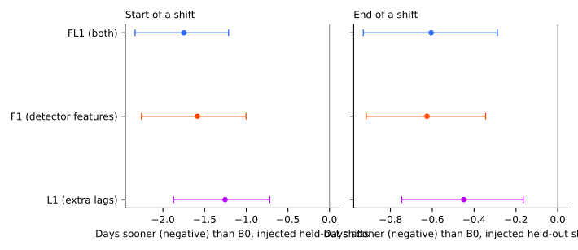
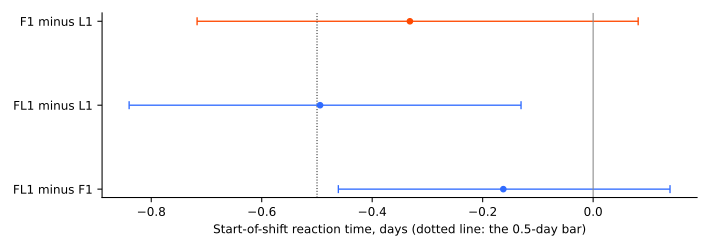
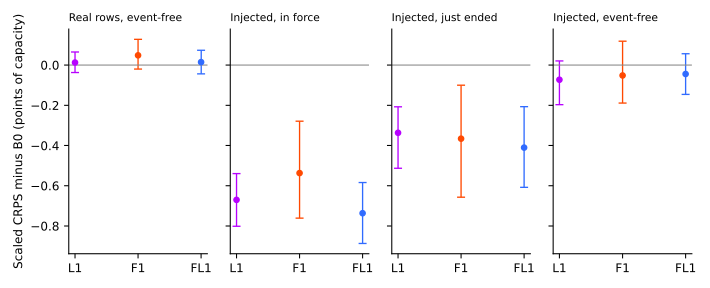

**Terms.** Throughout, K1 is the frozen two-output demand neural network, and the small head is the
neural network that corrects its prevailing output (experiment 652's R-haz head). B0 is that head
with no extra inputs, L1 adds the extra lagged power block (experiment 681), F1 adds the causal
detector features D1 to D6 (experiment 687), and FL1 adds both.

**Take-home message.** A head that reads both the detector features and the extra lagged power
covers half of a new shift 1.75 days [-2.34, -1.24] sooner than experiment 652's head (B0), but only
0.16 days [-0.45, +0.14] sooner than the features alone (F1) and 0.49 days [-0.84, -0.13] sooner
than the lags alone (L1). The pre-registered stop rule fires: the gain over the better single arm is
under 0.5 days and its interval includes zero, so the lags add under 0.5 days to what the features
give, and no new feature is proposed. The in-force scaled CRPS improves by 0.20 points of capacity
[-0.33, -0.04], below the 0.30 bar, and false alarms on event-free rows rise by 5.1 points against
B0, so the veto fails as well. Verdict: not supported.

## Figures

## Results

**All scores follow experiment 687's method.** CRPS is CRPS in points of capacity (1 point is 1% of
a Primary's effective capacity), scaled to a q05 to q95 coverage of 0.90, mean of 2 seeds, then of
the 5 development months (2025-10, 2025-12, 2026-01, 2026-03, 2026-06). Intervals are percentile
bootstraps over the months (5 blocks, so coarse) or over 281 held-out events. B0, L1, and F1 are
experiment 687's stored fits, and the report reproduces experiment 687's point values (bootstrap
intervals differ in the second decimal).

- **Real rows first.** On real event-free rows the scaled CRPS minus B0 is +0.01 [-0.04, +0.07] for
  FL1, +0.01 for L1, and +0.05 for F1: no arm moves. The false-alarm rate on those rows is B0 0.104,
  F1 0.127, L1 0.138, FL1 0.142. The verified D5 and D16 transfer of December 2025 is one episode
  (13,068 rows) with no known shift size, so reaction time is not scored on it. Its CRPS
  (descriptive): B0 9.73, F1 8.58, L1 8.63, FL1 8.67, K1 14.93.
- **Reaction time, start of an injected shift (281 held-out events), minus B0.** FL1 -1.75 [-2.34,
  -1.24] (median -1.0), F1 -1.59 [-2.23, -0.98], L1 -1.25 [-1.86, -0.71].
- **Paired contrasts at the start.** FL1 minus F1 -0.16 [-0.45, +0.14] (the better single arm, P1
  fails), FL1 minus L1 -0.49 [-0.84, -0.13], F1 minus L1 -0.33 [-0.72, +0.07]. By event length (5,
  10, 21, and 45 days; each event is scored under 2 seeds) FL1 minus F1 is -0.29, -0.11, -0.54, and
  +0.34 days.
- **Reaction time, end.** FL1 minus B0 -0.61 [-0.93, -0.30] (median 0); FL1 minus F1 +0.02 [-0.21,
  +0.25]; FL1 minus L1 -0.16 [-0.40, +0.10].
- **Scaled CRPS minus B0, in force (P2).** FL1 -0.20 [-0.33, -0.04], F1 -0.12 [-0.33, +0.07], L1
  -0.25 [-0.40, -0.13]. The 0.30 bar is not met by any arm. Just ended: FL1 -0.41 [-0.61, -0.21].
  Near the end, FL1 minus B0: -0.11 [-0.65, +0.42]. Event-free: -0.04 [-0.15, +0.06]. P2 is scored
  on in-force rows of all shift families, as in experiment 687; on held-out-family shifts only, the
  bar is met by every arm (FL1 -0.74, L1 -0.67, F1 -0.54), with raw scores FL1 10.22 against B0
  10.96, L1 10.28, F1 10.42.
- **False alarms on event-free injected rows (P3).** B0 0.182, F1 0.189, L1 0.226, FL1 0.232: FL1 is
  +5.1 points against B0, above the 1-point limit, like L1 (+4.4).
- **Tails, in force (unscaled).** q05 to q95 coverage: B0 0.825, F1 0.850, L1 0.843, FL1 0.856.
  Pinball loss at q01, q05, q95, and q99: B0 0.53, 1.45, 1.51, 0.52; F1 0.43, 1.31, 1.49, 0.49; L1
  0.43, 1.33, 1.41, 0.45; FL1 0.39, 1.26, 1.48, 0.49.
- **Avoidable-curtailment cost (experiment 601 units, six MW Primaries, leads 12 to 36 h).** Inside
  a shift: B0 162,976, F1 136,173, L1 136,284, FL1 155,122. In the 7 days after the end: B0 10,786,
  F1 9,105, L1 9,148, FL1 7,970. All rows: B0 95,937, F1 80,090, L1 80,185, FL1 91,417. FL1 is the
  best in the 7 days after the end. FL1 is the worst of the three input arms inside a shift and over
  all rows.

## Arms, data, and method

- **Arms.** B0, L1, and F1 are loaded from experiment 687's fits (10 arms x 5 months x 2 seeds
  there); FL1 is B0 plus F1's columns plus L1's 16 lag columns, with the larger of the two ages
  opening the survival gate and dropout on the extra columns. 10 new fits.
- **Code.** `ml-experiments/00691-*/` imports experiment 687's folder (`e00687_fit.py`,
  `e00687_score.py`, `e00687_report.py`) and, through it, experiments 598, 606, 647, 650, and 652.
  Fits, scores, and weights are in `data/ml-experiments/00691-*/`.
- **Cadence and compute.** One small head per scored month, 4 CPU processes, about 2 minutes for
  the fits and the scoring. No GPU. Data before 2026-07-01 only (asserted). Cleaned power, as in
  experiment 687.
- **Lab shortcuts.** The injected world of experiment 687 (exact constant shifts, every Primary
  shifted in every pass, a mirrored neighbour) flatters both blocks.

## Checks

- **Median minus mean forecast, in force, points of capacity:** B0 -0.34, L1 -0.40, F1 -0.51, FL1
  -0.56. Mean absolute error of the mean forecast: B0 10.22, L1 9.96, F1 10.15, FL1 10.04; of the
  median: 10.20, 9.87, 10.18, 10.09. The mean-forecast contrasts agree in direction with the CRPS
  contrasts.
- **Audit triggers.** The result missed its own prediction (P1, P2, P3), which the stop rule above
  already treats as an outcome to report plainly. The other audit triggers of the `ml-experiment`
  skill did not apply: no placebo arm was run and no arm is a subset of another arm.
- **Reviews.** A Sonnet code review before the fits (no blocking findings; two optional notes
  accepted as cosmetic), a Sonnet check of this page against the printed report, and a Sonnet
  prose review (see the pull request).

## Caveats

- Three caveats of experiment 687 apply unchanged: the injected world flatters both blocks, the
  start rule counts a single noisy origin as a hit, and 2 seeds leave a per-event standard deviation
  of 4 to 6 days; the mean is dominated by 45-day events.
- The interval on FL1 minus F1 (-0.45 to +0.14) does not exclude a gain of up to 0.45 days, which
  stays below the 0.5-day bar.
- NGED's event labels are an incomplete dump, so real event-free rows may hold unlogged shifts.

## What to try next

- Do not combine the two blocks. A head that reads the features alone gets the reaction gain with
  fewer false alarms; the open step is experiment 687's: open the survival gate from the newest
  readings, and re-test in a world with few concurrent shifts.
