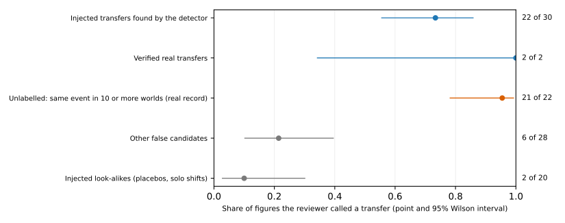
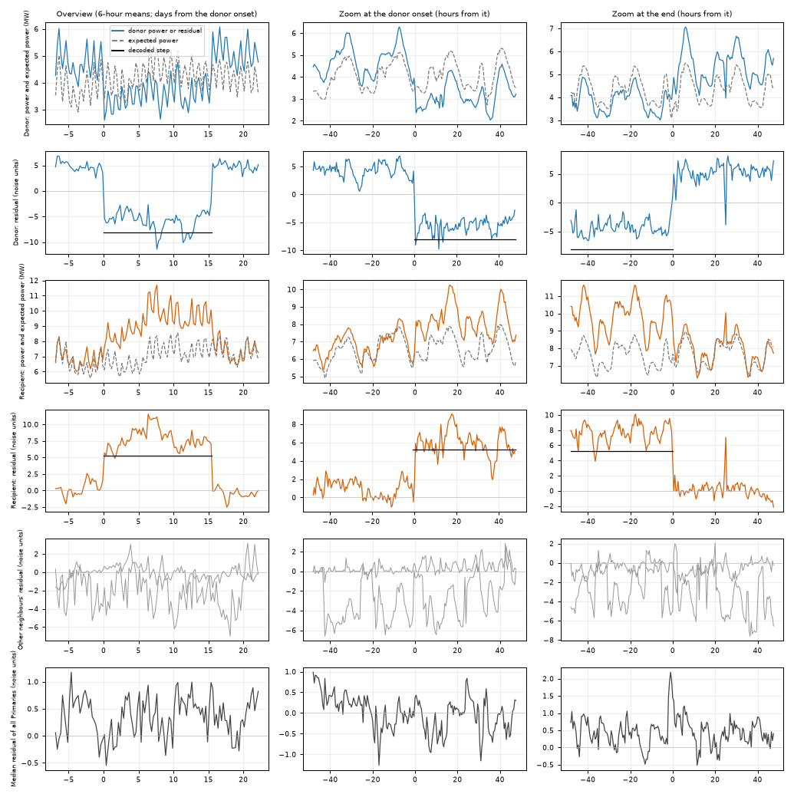
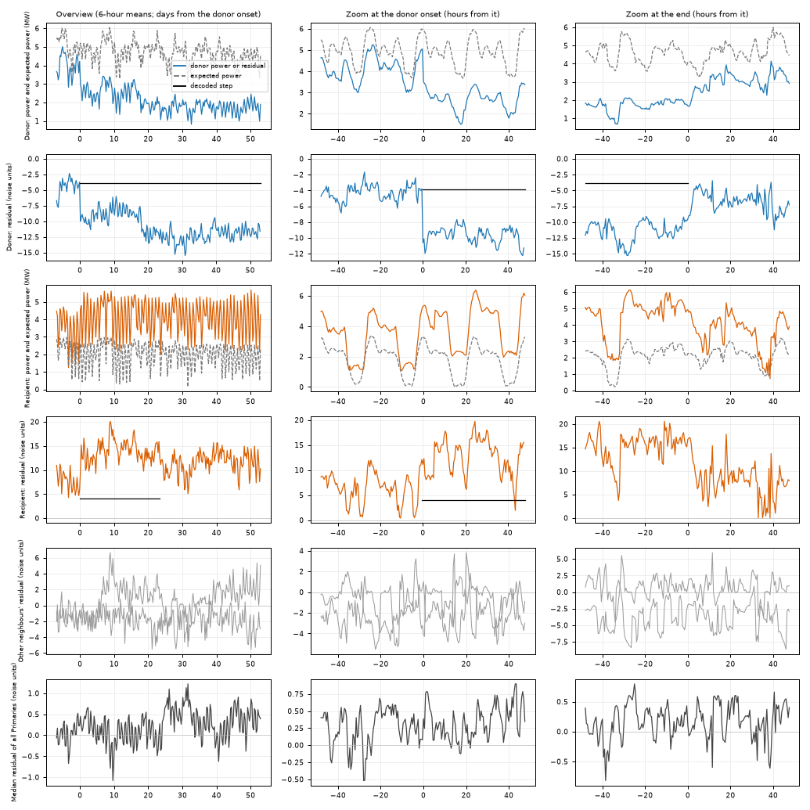

**A Claude Sonnet model shown one picture of each candidate load transfer did not pass the
precision mark we set beforehand.** A *Primary substation* steps electricity down to a local
distribution network. A *load shift* is a lasting change in a Primary's demand with no change in the
weather, and a *load transfer* is a load shift that moves between two neighbouring Primaries. The
*event table* is an algorithm that reads the power records of the Primaries and lists the transfers
it finds. About three in four of the transfer ends it decodes match no injected transfer, so we
asked whether a reviewer looking at a picture could remove them.

We took 613 candidate transfers that the event table (E1-J-sym, from [experiment
680](../00680-event-table-reconstruction-from-edge-flows-part-1-symmetric-search/result.md))
decodes in 40 *worlds*. Each world is the real power record with synthetic ("injected") transfers
added. We drew one picture per candidate and asked the reviewer nine questions and for a verdict.
*Precision* is the share of the reviewer's "transfer" calls that were true: it was 0.45 against the
pre-registered gate of 0.80. The reviewer called 24 of the 32 true transfers a transfer, and also
called 29 of the 70 candidates that the injected truth labels false a transfer.

**Most of the reviewer's false calls were on real-record events that the injected truth omits.**
Five candidates recur in 13 to 28 of the 40 worlds, which means they come from the real record
under every world. The reviewer called 21 of the 22 calibration figures of these candidates a
transfer, and the injected truth labels them false. NGED (the electricity distribution network
operator) has told us that its event labels are an incomplete dump, so a clean half-hour may hold an
event that no label covers. **Every row is a candidate, never a label.** No data on or after
2026-07-01 was read.

## Headline rows

| Measure | Result |
|---|---|
| Precision for "transfer" on the calibration set (102 figures) | 0.45 (24 of 53 calls; 95% interval 0.33 to 0.59); gate 0.80, **fails** |
| Recall of the 32 true transfers (30 injected, 2 verified real) | 0.75 (24 of 32; 0.58 to 0.87); gate 0.60, passes |
| Direction of the called true transfers | 23 of 24 as drawn; gate 90%, passes |
| The two verified real transfers (D5 to D16, D3 to D22) | Both called a transfer, passes |
| Realness: "injected or real?" on 38 figures (30 injected, 8 real) | 39% right (balanced accuracy, averaged over the two classes, 43%); gate 60% or less, passes (near 50% means the figures give no sign of which are real), but with 8 real figures the interval is wide |
| Candidates that recur in 10 or more worlds, among the 460 false candidates | 111, from 5 distinct real-record transfers |
| Post hoc: precision without the 22 recurring candidates in the calibration set | 0.75 (24 of 32; 0.58 to 0.87), still under 0.80, though the interval contains 0.80 |
| False-transfer share of candidates, natural mix (before, after the gate) | 0.75, then 0.56 (95% interval 0.44 to 0.66); not at the 0.45 target |

**The 0.56 after the gate overstates the false share.** The gate keeps 21 of the 22 recurring
candidates, and the 0.56 counts them as false. We did not recompute the share without them, because
the 28 non-recurring false figures would give an interval too wide to compare with the 0.45 target.

| Kind of candidate | Called a transfer |
|---|---|
| Injected transfers that the detector found | 22 of 30 |
| Verified real transfers | 2 of 2 |
| Recurring real-record transfers (labelled false) | 21 of 22 |
| Other false candidates | 6 of 28 |
| Injected look-alikes (placebos, solo shifts) | 2 of 20 |

## What the reviewer got wrong

- **The 8 true transfers it missed.** Six were called "unclear" (a gradual donor step, a recipient
  dominated by solar output, a recipient that ramps over weeks, or an end beyond the record) and two
  "solo shift" (one Primary shows no clear step).
- **The 8 calls on candidates that do not recur.** Six were on the 28 other false candidates and
  two on injected look-alikes. Of the 27 calls on false candidates that are not look-alikes, 4
  overlap an injected transfer between the same two Primaries whose start lies 3 to 129 half-hours
  from the decoded start. The label "false" there comes from the rule that a true candidate starts
  within 24 half-hours of the injected start.
- **Example of a call on a high-confidence false candidate.** In the figure below both Primaries
  step together at the onset and return together, as a transfer does, which is why the reviewer
  called it a transfer.

- **Example of a missed true transfer.** The figure below is an injected transfer that the reviewer
  called "unclear" because the recipient's step is smaller than its day-to-day swings.

## Checks

- **Median minus mean forecast, and mean-forecast error beside each quantile-score contrast:** not
  applicable, because no forecast is scored.
- **Audit triggers:** none fired. The result does contradict the prediction of a false-transfer share
  of about 0.6 before the gate (it is 0.75). Experiment 680 reports 0.77 of the ends, and the
  per-candidate share here is 0.75, so the prediction was only a wrong guess. The contaminated
  labels were found and explained by the recurrence check, which is recorded as post hoc.
- **Confidence field.** Some reviewer sessions wrote a probability (such as 0.9999) in the field that
  asked for an integer from 1 to 5, so the confidence is not used.
- **Code review.** One fresh Sonnet code reviewer ran before the first reviewer call. It found that the
  figure identifiers revealed the source (injected, real, or verified), that injected solo shifts were
  labelled false and not hard, and that the true label has no one-to-one assignment. The identifiers
  were randomised and the hard set widened. The one-to-one rule and the unmatched real-case step
  scaling were not changed, and both are small against the recurrence effect.
- **Load-shift scenarios and event plots:** not applicable, because no forecast is scored. The two
  figures above are the example candidates.
- **Unlogged events:** the recurrence check shows the real record holds at least five events that no
  injected label covers, so the false-transfer shares here are overstated by at least those candidates.

## Method

- **Candidates.** A candidate is a donor end (a decoded fall) of E1-J-sym with its largest decoded
  partner, in each of the 40 default worlds of experiment 680 (seeds 900 to 939) with a start in
  2024-01-01 to 2026-06-30. There are 613 (153 true, 460 false). A candidate is *true* when its donor
  end matches an injected donor end (same Primary, start within 24 half-hours, overlap of 0.5 or
  more) and a decoded partner is a partner of that injected transfer. A candidate is *hard* when an
  injected placebo, common-mode, solo-shift, or hard-negative event at either Primary starts within 2
  days of its start. The spec's scorer over candidate pairs does not exist, so the "highest-scoring"
  false pairs are the ones with the highest detector confidence for the donor end.
- **Calibration set (102 figures).** 30 true candidates drawn at random, excluding hard ones; 20
  false candidates of the highest confidence, excluding hard ones; 30 false candidates drawn at
  random, excluding hard ones; 20 hard false candidates drawn at random; and the 2 verified real
  transfers. The spec asks for 400 figures including routine steps and sunny runs.
- **Figure.** One image per candidate, identical for injected and real cases: neutral Primary labels,
  no dates, no truth marks. Panels: the donor's power and expected power, the donor's residual in
  noise units with the decoded step, the same for the recipient, the residual of up to 4 other
  neighbours, and the median residual of all Primaries. Columns: an overview from 7 days before the
  onset to 7 days after the end (6-hour means, capped at 60 days), and half-hourly zooms of 48
  hours either side of the onset and of the end. The ERA5 and CAMS panels of the spec are left out.
  Figure identifiers are random three-digit numbers.
- **Figure reviewer.** Claude Sonnet, never Opus, with one fixed brief (the nine questions R1 to R9
  of the spec scored 0 to 2, a verdict, a direction, and a confidence, as JSON), run in fresh sessions of about
  10 figures each. Each session reads only the brief and its figures and starts no sub-agent. The
  answer key was kept in a different folder. Cost: 14 sessions at about 93,000 tokens each, about
  1.3 million tokens in all, about 9,000 tokens per figure.
- **Realness reviewer.** A second brief, 4 sessions, 38 figures: 30 injected candidates and 8 real ones
  (the 6 real transfer pairs of experiment 680's real-record table, and the 2 verified transfers).
  The real record holds too few pairs for the 30 real figures the spec asks for.
- **Scoring.** A call is a verdict of "transfer". Precision and recall use the calibration set with
  [Wilson (1927)](https://doi.org/10.1080/01621459.1927.10502953) intervals. The false share after the
  gate is reweighted to the natural mix of the 40 worlds (153 true, 276 plain false, 184 hard false
  candidates), using each stratum's call rate, with a bootstrap over the figures of each stratum.
- **Post hoc recurrence check.** A false candidate that has the same donor, recipient, and day in 10
  or more of the 40 worlds is a real-record event, because the worlds differ only in what is injected.
  Five such groups cover 111 of the 460 false candidates. The check was run after the answers were read.
- **Standing practices.** No refit, no forecast, no tails or curtailment cost. Cleaned power and the
  D18 cut before 2025-03-01 come from experiment 653's residual. CPU only, 2 cores.

## Files

- `ml-experiments/00692-.../e00692_run.py`: decodes the 40 worlds, lists the candidates, picks the
  sets, and draws the figures and the key.
- `e00692_common.py`: draws one candidate figure.
- `e00692_ids.py`: renames the figures to random identifiers.
- `e00692_score.py`: scores the answers against the key and writes `scores.json`.
- `e00692_diagnose.py`: post hoc check of which injected transfers overlap the reviewer's false calls.
- `e00692_figures.py`: draws the call-rate figure and copies the two example candidates.
- Private data, not in git, in `data/ml-experiments/00692-event-table-reviewer-calibration-gate/`:
  `figures/` (the 140 figures), `answers/` (the reviewer's JSON lines), `reviewer_brief.md` and
  `realness_brief.md`, `answer_key_private/` (`candidates.parquet`, `key.parquet`, and
  `diagnose.parquet`), and `scores.json`. Inputs are experiment 680's stored real-record table and
  the generator of [experiment
  660](../00660-shared-generator-of-injected-load-transfer-events/result.md).
