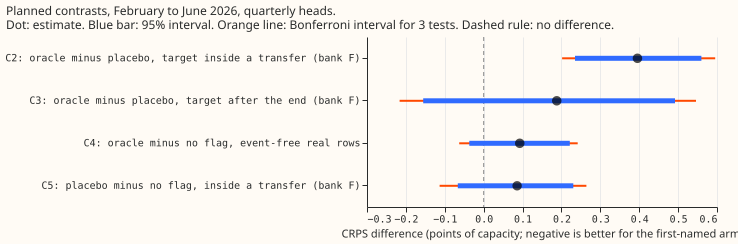
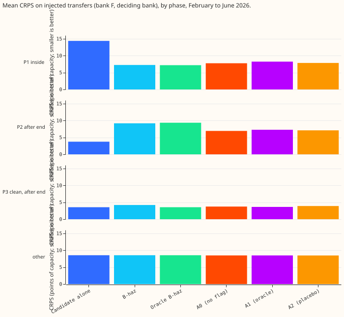
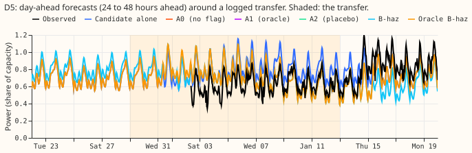
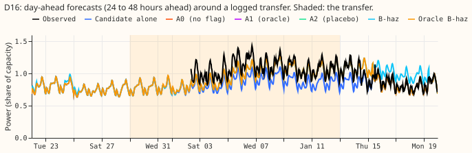
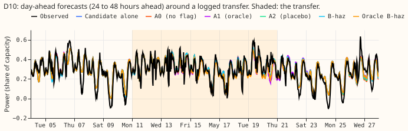
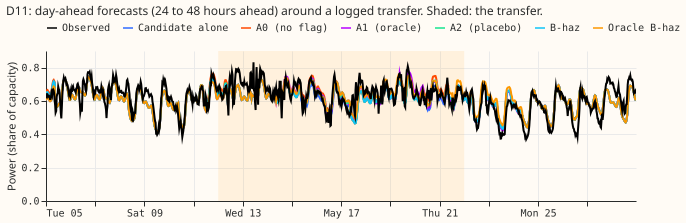
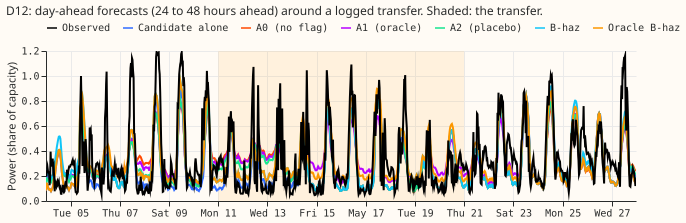
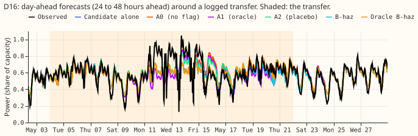
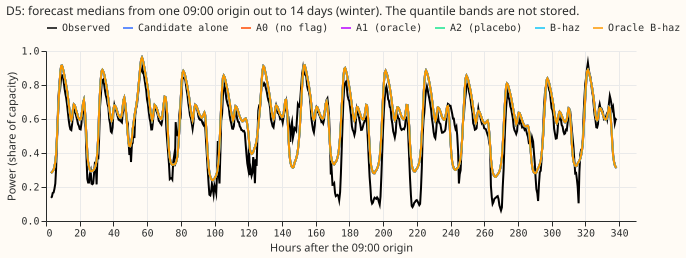
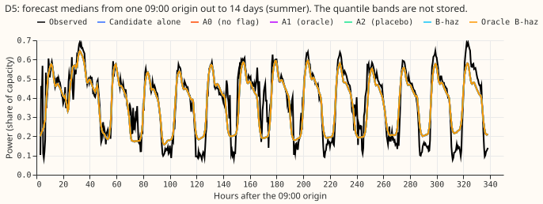

We asked whether the demand forecast at 16 primary substations gets better when it is told exactly
when a load transfer (a switch that moves load between two substations) is happening. The
Candidate is the neural network that forecasts demand from weather, calendar, and recent power
inputs. The prevailing head is a second neural network that adapts the Candidate's forecast to a
transfer already under way. We added simulated transfers from the experiment 660 generator to the
recorded power. One copy of each forecast received the logged start of every transfer (the oracle
flag), and another copy received start times shifted to other dates (the placebo flag). Errors are
the continuous ranked probability score (CRPS), in percentage points of capacity, so a lower value
is better. The perfect flag did not help. A transfer costs the Candidate 0.1 points of capacity. The
prevailing head scored 0.395 points worse with the oracle flag than with the placebo flag while the
target lay inside a transfer, a difference that refit noise could explain. Three refits (seeds) of
the same head already differ by about 0.4 points, so the comparison cannot separate a gain or loss
under about 0.5 points from noise.

**Verdict: inconclusive, because the pre-registered checks failed.** The rule makes the verdict
inconclusive when the placebo check fails or the harm on real event-free rows exceeds 0.05 points.
The placebo check gave +0.086 against a bound of 0.05, and the harm was +0.093 against the same
bound (the harm comes almost entirely from one Primary). No contrast reached the 0.3-point gain that
would justify the work. The Candidate was not retrained with the flag, because the no-retraining
ceiling was 0.107 points. Only the prevailing head was retrained, so the oracle flag was tested on
the prevailing head alone.

| Contrast (points of capacity; negative is better for the first-named arm) | Estimate | 95% interval | Bonferroni interval (three tests) |
|---|---|---|---|
| C2: oracle minus placebo, target inside a transfer, injected transfers | +0.395 | +0.235 to +0.560 | +0.202 to +0.595 |
| C3: oracle minus placebo, target after the end, injected transfers | +0.188 | -0.155 to +0.492 | -0.216 to +0.546 |
| C4: oracle minus no flag, event-free real rows (5 month blocks) | +0.093 | -0.037 to +0.221 | -0.063 to +0.242 |
| C5: placebo minus no flag, inside a transfer, injected transfers | +0.086 | -0.067 to +0.230 (90%: -0.041 to +0.212) | not in the family |

**Two ceilings fall short of the predicted gain of 0.3 to 1.0 points.** The no-retraining ceiling is
0.107 points (stage 0, below). Two baselines with no fitted weights bound the prevailing head's
gain: one estimates when a transfer began from residuals, and the other is told. The second minus
the first is -0.068 points inside a transfer and +0.165 after the transfer ends. The oracle age does
lift the age floor (the lowest transfer age the head sees): the share of rows inside a transfer with
a non-zero survival probability is 0.774 for the arm with no flag, 0.998 for the oracle arm, and
0.898 for the placebo arm, on the deciding bank.

**The intervals ignore refit noise.** The audit found that the seed-to-seed standard deviation of
one fit is 0.395 points inside a transfer, so a contrast over three seeds and two folds has a
standard error of about 0.23 points. One fit (oracle arm, fold 2026-05, seed 1) scored 4.2 points
worse than the other two oracle fits of that fold, in every (fold, pass, Primary) group. All three
oracle fits of that fold stopped after 5 epochs with the best validation loss at the first epoch.
Without the seed-1 fit, C2 is about +0.05.

## Figures

**Six real transfers, day-ahead medians of each arm.** The shaded band is the logged transfer. The
oracle, placebo, and no-flag heads exist only from the 2026-02 fold, so the December 2025 panels
show the Candidate alone and the two hazard baselines. Observed power is the cleaned reading.

**The 14-day fans show medians only.** Each figure shows the medians of one 09:00 origin out to 14
days. The figures draw only medians, because quantile bands would need the full per-row quantile
files, so they cannot show whether the bands widen with lead.

## Checks

- **Median minus mean forecast: not computed,** because the stored scores hold quantiles and no
  mean.
- **The oracle arm is worst on both CRPS and the error of the median.** On the deciding bank, inside
  a transfer, the normalised mean absolute error of the median is 12.65 for the no-flag arm, 13.64
  for the oracle arm, and 12.46 for the placebo arm. The CRPS values are 7.75, 8.23, and 7.84. The
  placebo arm beats the no-flag arm on the error of the median and loses on CRPS, so the two
  measures differ in direction for that contrast, which fires audit trigger 3 (an error-direction
  mismatch).
- **Four audit triggers fired:** the placebo control failed its equivalence bound (trigger 1), the
  result contradicts the pre-registered gain of 0.3 to 1.0 points (trigger 2), the median and the
  quantile scores differ in direction (trigger 3), and a control moved the score by more than its
  own interval's half-width (trigger 5). The audit report,
  `data/ml-experiments/briefs/e693_audit_report.md`, lists six findings; the page accepted five and
  did not act on one:
    - **Accepted: the printed contrasts reproduce to three decimals.** Nothing to change.
    - **Accepted: the intervals ignore refit noise, and the placebo check could not pass at plus or
      minus 0.05.** The page states both, and the verdict stays inconclusive.
    - **Accepted: one oracle fit (fold 2026-05, seed 1) stopped at its first epoch.** The page
      reports it and the contrast without it. The fit was not rerun, because the pre-registered rule
      fixes three seeds.
    - **Accepted: the placebo is not neutral** (it lifts the age floor on rows without a transfer,
      and the flag is almost always 0 on real training rows). Listed in the lessons and the advice.
    - **Accepted: leave-one-out.** The harm on real event-free rows (C4) comes almost entirely from
      one Primary that has no bank rows; without it C4 is about 0.000, and its sign flips by fold.
    - **Not done: ten or more seeds per arm, a placebo from an independent world, and matched
      training and deciding generators.** Each would change the pre-registered design.
- **Two Sonnet code reviews ran before any quoted fit or score.** Review 1 (the flag module and
  stage 0) found five must-fix problems, all fixed. Review 2 (the head banks, head data, and head
  fit) found one must-fix problem, a reversed window in `dilate` that dropped half the "after the
  end" rows. Review 2's other findings were recorded as caveats: the
  injected-bank residuals lose the first 8 days of each month (affects only the hazard baselines),
  and phase P3 also holds transfers that began and ended after the origin's freshest reading.

## Departures from the plan

- **The bank panel runs 15 days past the fold's scored months,** so the longest horizons of the last
  origins lie inside it.
- **Phase flags count neighbour-only rows as "lag inside"** on bank L. On bank F the phase uses the
  oracle's in-progress state at the origin's freshest reading (the origin minus 6 hours). Phase P1
  needs the oracle's in-progress state and a target inside a transfer. Phase P2 needs the oracle's
  in-progress state and a target within 14 days after the end. Phase P3 needs no in-progress state
  and a target within 14 days after an end.
- **Bank L injects 3 simulated transfers per Primary per year.** At 6, 99.7% of rows inside a
  transfer also had a flagged neighbouring Primary, so the flags could not tell the two apart.
  Settings: 48 passes, class mix `edge_transfer` 0.55, `edge_transfer_unseen_donor` 0.10,
  `edge_transfer_unseen_recipient` 0.15, and `permanent_shift` 0.20, `hard_negatives=False`, and
  seed 693000 + 100 × (year × 12 + month) + pass. Bank F reuses the same worlds. Bank F's deciding
  bank holds 150 to 197 events per scored month over 48 passes (printed by
  `e00693_event_counts.py`), under the brief's target of about 200, so each month's interval is
  wider than planned.
- **The Bonferroni family has three tests** (C2, C3, C4-prevailing), because the stage 0 gate
  dropped C1 and C4-NRA.
- **The one-fold screen checked only whether the oracle flag lifts the age floor.** On the 2026-02
  fold the share of rows inside a transfer with a non-zero survival probability rose from 0.776 to
  0.998, so the 2026-05 fold was also run.
- **Not done:** positive controls beyond the two ceilings, the flag-permutation wiring check, the
  benchmark rows (climatology, the manual heuristic, experiments 677 and 667), the four load-shift
  scenarios on every arm (real rows only), the q01 and q99 coverage and pinball loss, the
  cold-winter-night and avoidable-curtailment tables, the reaction-time measurement, and
  quantile-band figures.
- **The sensitivity with label-plus-verified spans** is in the printed head report only.

## Plan

- **Arms.** A0 (default: [experiment
677](../00677-building-up-the-candidate-demand-network-one-component-at-a-time/result.md)'s
  step-8 Candidate network and the adopted lag-input prevailing head of [experiment
  681](../00681-extra-lagged-power-inputs-for-the-prevailing-forecast/result.md)), A1 (default plus
  oracle flags), A2 (placebo flags with matched span lengths, overlaps, and per-Primary counts).
  Stage 0 adds the inference-only ceilings A0-mask, A0-clean, and oracle B-haz (the no-fit hazard
  baseline of
  [experiment
  667](../00667-one-year-backtest-of-the-two-output-demand-network-at-primaries/result.md)).
- **Folds.** Quarterly refits at the maintainer's request (cut-offs 2025-11-01, 2026-02-01,
  2026-05-01), scored on valid times 2025-11-01 to 2026-06-30 only. Seeds 0 to 2.
- **Information sets.** The Candidate lag flags use 09:00 UTC origins, and every lag lies at least
  24 hours before the origin. The prevailing head uses the 12:00 UTC contract origin, and its
  freshest
  reading is 6 hours before the network origin. `in_progress` is the transfer state at that freshest
  reading, never at the origin: it is 1 only if the onset is at or before it and no end is at or
  before it. The oracle age is the origin minus the earliest onset in progress, and is 0 when
  `in_progress` is 0. The flags cover the row's own Primary for the prevailing head, and the own
  Primary and its electrical neighbours for the Candidate. The placebo flags obey the same rules.
  Both
  rules are asserted per row in code.
- **Banks (pre-registered).** Deciding banks L and F use the experiment 660 generator with
  `hard_negatives=False`, class probabilities edge_transfer 0.55, edge_transfer_unseen_donor 0.10,
  edge_transfer_unseen_recipient 0.15, and permanent_shift 0.20, `events_per_primary_year=3`, and 48
  passes, injected into the cleaned panel of 15 Primaries (the 16th has no noise unit) from 60 days
  before the fold's first scored month to the end of its scored months. A pass's seed is 693000
  plus 100 times (calendar year times 12 plus fold month) plus the pass number, so all arms and
  network seeds see the same injected worlds. A smoke pass at 6 events per Primary-year left 99.7%
  of
  phase P1 rows with a neighbour flag, so the rate was lowered before any quoted run. If a scored
  month still holds under about 200 events, the pass count is raised in a commit before the first
  fit. Check banks: experiment 581's generator with seeds disjoint from
  training (bank L), and experiment 650's held-out passes (bank F).
- **Contrasts** (A1 minus A2 unless stated; negative is better). C1: no-retrain-arm (NRA) output,
  bank L, phases P1 plus P2, November 2025 to June 2026. C2: prevailing output, bank F, phase P1,
  February to June 2026. C3: prevailing output, bank F, phase P2, February to June 2026. C4-NRA and
  C4-prevailing: A1 minus A0 on real rows with an event-free origin and target (phase P4), verified
  transfers deciding. C5 (outside the family): A2 minus A0 on banks L and F and on real P4 rows.
  Phases: P1 = a lag (for the prevailing head, the origin) is inside a transfer and the target is
  inside it; P2 = same, but the target is after the end; P3 = lags clean, target after the end; P4 =
  event-free origin and target. Each contrast has its own row set: `oracle693_c1_bankL_nov25_jun26`,
  `oracle693_c2_c3_bankF_feb_jun26`, and `oracle693_c4_real_p4`. Experiment 677's file has another
  `row_set_id`, so A0 is re-scored on these rows (valid times to 2026-06-30) and checked against
  677's
  stored scores, rather than read as 677's file.
- **Bars apply to the unweighted deciding-bank contrast.** The reweighting to the verified
transfers'
  depth and duration and the implied all-rows annual effect are reported beside it. Each contrast is
  also reported per seed.
- **Stage 0 gate.** Seed-mean CRPS(A0) minus CRPS(A0-clean) on bank L, phases P1 plus P2, all three
  folds pooled. If under 0.3 points, the NRA retraining is not run, C1 and C4-NRA are not computed,
  the Bonferroni family is C2, C3, and C4-prevailing (three tests), and "supported" needs C2 or C3
  at 0.3, C4-prevailing within 0.05, and C5.
- **Screen advance rule.** Run stage 0, then fold 2 for A0, A1, and A2 (all numbers interim).
  Continue to the other folds only if A1's copied share on bank L is at most half of A0's, the share
  of P1 rows with p above 0 is higher in A1 than in A0, and scoring A1 with its flags permuted
  changes its predictions. Otherwise stop and debug the wiring.
- **Reading a null.** A `not supported` or `small gain` verdict supports "switching labels belong in
  evaluation, not in the forecast" only if A0-clean (bank L) and oracle B-haz (bank F) have been
  computed and the share of P1 rows with p above 0 is higher in A1 than in A0. Otherwise the verdict
  stays as scored and the consequence is withheld. A `supported` verdict on C2 or C3 alone means a
  detector is worth testing as an input to the prevailing head, with a degradation sweep next.
- **R-haz fit boundary.** Every R-haz training row has its target valid time before the fold's
  cut-off, and its labels (end, verification) known before the cut-off. Spans of verified real
  transfers are truncated at the cut-off. Both are asserted per fold.
- **Standing practices followed:** cleaned data (count of `substation_zero` half-hours printed per
  fold), D15 and D18 cut before 2025-03-01, every network saved, stored predictions reused,
  origin-time weather only (asserted per row), no new calendar inputs (the Candidate's own date-time
  encoder is unchanged), and normalised MAE of the median in every table. The four load-shift
  scenarios (all rows; outside events and at least 7 days after; inside events; the 7 days after)
  are
  reported, with a day-ahead forecast, a 14-day forecast, and at least 6 load-shift time series
  across
  both metering groups. **Departures:** quarterly instead of monthly refits (the maintainer's
  request; experiment 677's advice favours monthly, and any gain here applies to quarterly refits),
  and a one-fold screen instead of four seasonal months.
- **Earlier advice and background.** `docs/ml-experiments/background/index.md`,
`data-processing.md`,
  and the `advice` lists of experiments 667, 677, 681, 687, and the switching-detector experiments
  were
  read. The plan follows experiment 677's advice to judge on copied share and event-free error
  together, and treats a seed contrast under 0.03 points as unresolved without five seeds
  ([experiment
  651](../00651-graph-layer-over-electrical-neighbours-in-the-demand-network-part-1/result.md));
  it departs from the advice to refit monthly.
- **Caveats.** NGED's logs miss transfers, so event-free real rows may hold transfers no label
covers
  and the C4 harm figure is optimistic. C4 compares A1 with A0 on rows the oracle never flags, so it
  measures the extra input columns and refit noise. C4's real rows are four or five month blocks, so
  its interval is coarse.

## Stage 0 result

**The no-retrain ceiling is 0.107 points of capacity, under the 0.3 gate, so the no-retrain-arm
retraining is not run.** Stage 0 scored experiment 677's stored step-8 `P7+D50` networks on bank L
(the experiment 660 generator, 48 passes per fold, seeds 0 to 2, folds 2025-11, 2026-02, and
2026-05; 47.9 million scored rows). The gate statistic is CRPS(A0) minus CRPS(A0-clean) on phases P1
and P2 pooled over the three folds: +0.107 points, 95% interval [+0.087, +0.129] from 2,000
resamples of (fold, pass, Primary) clusters. By fold it is +0.125, +0.073, and +0.128.

- **Copied share.** A0 copies 0.031 of the day-lag shift into its median, and A0-mask copies 0.003.
- **Masking.** A0 minus A0-mask is +0.027 [+0.004, +0.050] on P1 and negative on P2.
- **Phase P3.** The gap is 0.000, as it must be when every lag is clean.
- **Consequence.** C1 and C4-NRA are dropped, the Bonferroni family becomes C2, C3, and
  C4-prevailing, and stage 1 retrains only the prevailing head.

Source: `scores/stage0_report.md`, printed by `e00693_stage0_report.py`.

## Method

- **Architecture, Candidate.** The Candidate is [experiment
  677](../00677-building-up-the-candidate-demand-network-one-component-at-a-time/result.md)'s step-8
  `P7+D50` neural network. Experiment 677 fine-tuned one copy per quarterly cut-off (2025-11-01,
  2026-02-01, 2026-05-01) and seed (0 to 2). This experiment reads those copies without retraining
  them. The head's origin is the 09:00 origin of the Candidate, so its freshest reading is at 03:00
  UTC, 6 hours earlier.
- **Architecture, prevailing head.** The head is [experiment
  667](../00667-one-year-backtest-of-the-two-output-demand-network-at-primaries/result.md)'s
  survival-hazard head with 14 daily hazards on the Candidate's quantiles, with [experiment
  681](../00681-extra-lagged-power-inputs-for-the-prevailing-forecast/result.md)'s 14 residual lags
  (28 columns), 93 inputs. Two hidden layers of 64 units output a signed depth, a spread, and 14
  hazards.
- **Arms.** `A0` has no flag. `A1` adds three columns (whether a transfer is known to be in
  progress, the logarithm of its age in days, and the age divided by 30) and takes the larger of the
  heuristic age and the oracle age as the structural age. `A2` is `A1` with every Primary's spans
  rolled circularly inside one window by one offset per month and pass, which keeps nearly every
  span's length and each Primary's span count (a span that straddles the window edge splits in two).
  The hazard baselines have no fit: `B` uses the heuristic age and `OB` the oracle age with a
  survival probability of 0 outside a transfer.
- **The oracle** knows whether the freshest reading (the 09:00 origin minus 6 hours) lay inside a
  transfer and when that transfer began; it never knows the end or the depth.
- **Training regime.** Each head trains on the real rows and the injected rows of experiment 650's
  12 training passes of the months before its cut-off, only on valid times before the cut-off, with
  the loss, optimiser, and early stopping of experiments 647 and 652 (30 to 75 seconds per fit on a
  CPU core). The 2025-11 fold has fewer than two earlier banks, so that fold uses only the two
  baselines `B` and `OB`. A quarterly head is applied to all three months of its fold.
- **Stage 0** scores the stored Candidate on bank L (no retraining) with the observed lags
  (A0-clean), the injected lags (A0), and the injected lags with every flagged lag masked (A0-mask).
- **Measurement.** Valid times 2025-11-01 to 2026-06-30 for stage 0, and 2026-02-01 to 2026-06-30
  for every head contrast (the heads exist from the 2026-02 fold). CRPS is twice the mean pinball
  loss over 11 quantiles, in points of capacity, of the seed-mean forecast. The truth is the
  unshifted observed power on bank L and the shifted power on bank F. Bank L and the deciding half
  of bank F both come from the [experiment
  660](../00660-shared-generator-of-injected-load-transfer-events/result.md) generator (48 passes
  per fold); bank F's check bank is experiment 650's held-out passes 200 to 203. Real rows use
  experiment 580's verified transfers (the label-plus-verified set is a sensitivity). Intervals
  resample clusters of (fold, pass, Primary) for banks and calendar months for real rows, 2,000
  resamples; the Bonferroni level is for three tests.
- **Compute.** Each head fit took 30 to 75 CPU-seconds, and the bank forecasts took about 30 minutes
  of GPU time per fold. No money was spent.

## Files

- `ml-experiments/00693-*/e00693_flags.py`: the oracle and placebo flags and a known-answer test.
- `e00693_real.py`: the verified and label spans of real transfers on the common grid.
- `e00693_cand.py`: a copy of experiment 677's Candidate script with the flag columns; its `stage0`
  command runs stage 0 and its `headbank` command writes the Candidate's forecasts on the injected
  banks.
- `e00693_stage0_report.py`: pools stage 0 and prints the gate. `e00693_event_counts.py`: counts the
  injected events per scored month.
- `e00693_headdata.py`: builds the head's real and bank rows with the oracle and placebo state.
- `e00693_headfit.py`: fits the head arms, runs the hazard baselines, and writes per-row scores.
- `e00693_scoring.py`: per-row CRPS and error. `e00693_headreport.py`: the contrasts.
  `e00693_figures.py`: the figures. `gpu.sh`, `cpu.sh`, `run_stage0.sh`, `run_headbank.sh`:
  launchers.
- `data/ml-experiments/00693-*/P7_D50_<fold>_stage0/work/stage0/*.parquet`: per-row stage 0 scores
  (written). `.../P7_D50_<fold>_headbank/work/headbank/*.npz`: Candidate quantiles on injected
  passes (written). `.../head_data/*.npz`: head rows (written). `.../head_scores/*.parquet`:
  per-row head scores (written). `.../scores/*.md` and `*.csv`: the printed reports (written).
- Read from earlier experiments: 677's stored fits, models, and tables
  (`data/ml-experiments/00677-*`); 667's and 681's code; 650's and 660's generators; 580's
  verified transfers (`events_verified.parquet`).
