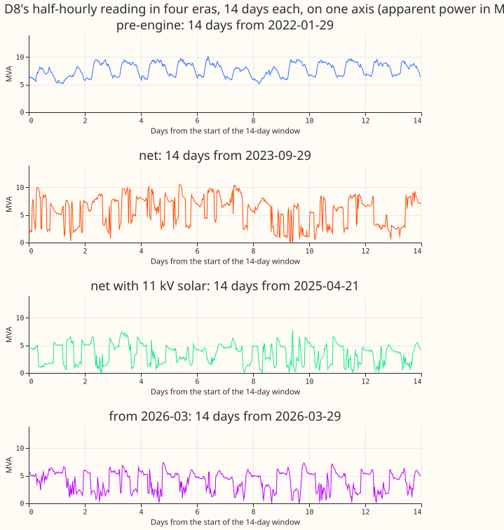
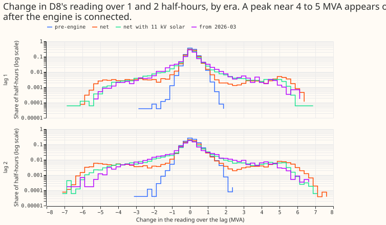
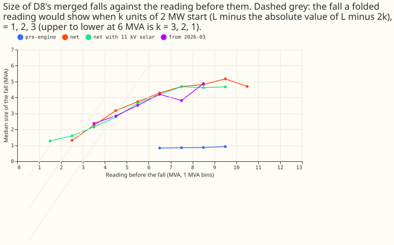
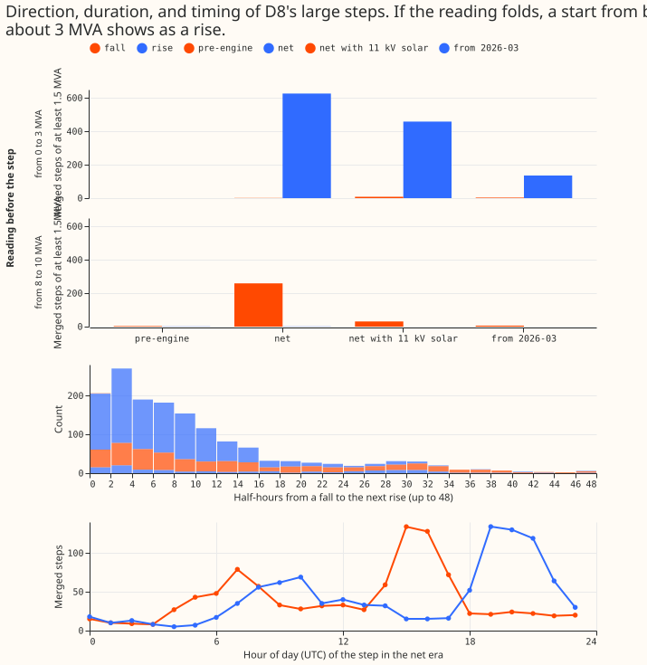
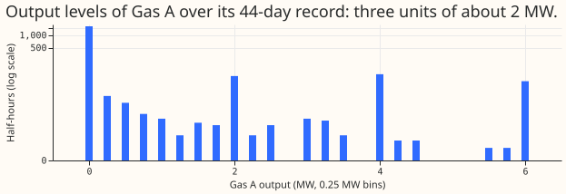
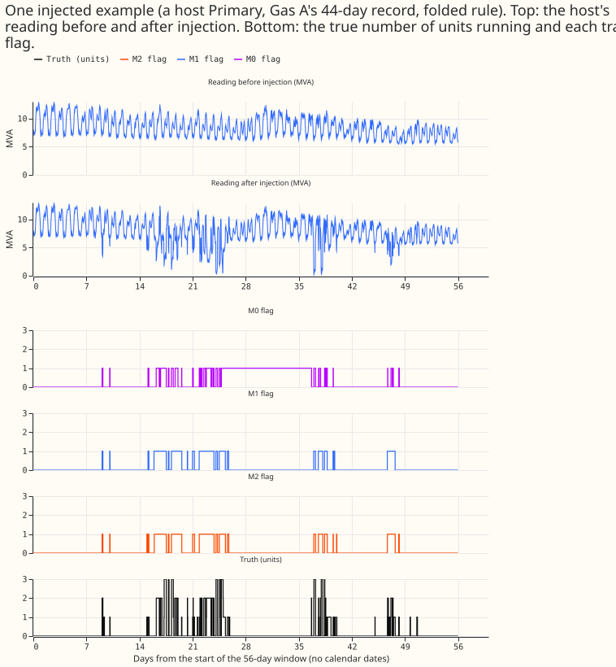
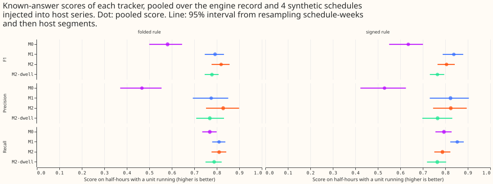
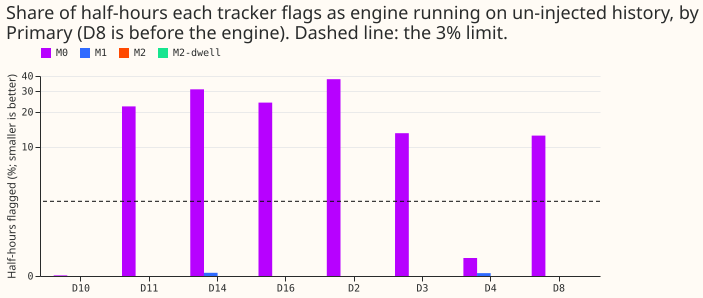
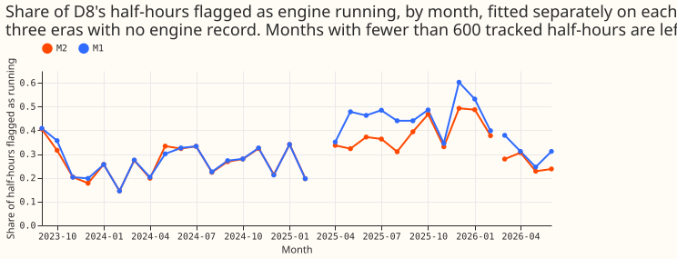

**A filter that tracks how many of D8's three gas-engine units are running, using only the
substation's half-hourly reading, finds about four in five running half-hours in tests where we
knew the answer, and it raises no false alarms at eight Primaries.** We asked whether the number of
units running (0 to 3), and the size of each unit, can be inferred from the raw reading of a
substation, with no price, no weather, and no forecast of ordinary demand to subtract. We took the
recorded output of a metered gas engine ("Gas A") and subtracted it from the readings of eight
substations (Primaries), in 44 segments of 120 days, and checked how many of the running
half-hours each tracker found again. We also ran the trackers over the same Primaries without any
injection, and over D8 itself. The trackers re-implement and extend the load-disaggregation idea of
[Hart (1992)](https://doi.org/10.1109/5.192069) and [Kolter and Jaakkola
(2012)](https://proceedings.mlr.press/v22/zico12.html), in which a hidden state per appliance is
read from the total; the folded reading and the known-answer tests are this project's.

**The pre-registered verdict is `supported`, and the margins are thin.** The best tracker (M2)
reaches a half-hour F1 of 0.819 (folded injection rule) and 0.805 (signed rule) against the
pre-registered bar of 0.80. A plain count model on differences (M1) scores 0.792 and 0.838, so the
extra machinery of M2 adds +0.027 under one rule and -0.032 under the other. Three further limits
apply. On the one real engine record alone, M2 scores F1 0.68, because its precision is 0.61. A
unit of 1 MW is found in 13 of 44 segments. The tracker was tuned on nothing, but one prior (a
small cost per unit-half-hour of running) was added after a first test on one Primary.

**On D8 itself, without any engine record, the tracker finds three units of about 1.75 MW and flags
27% of half-hours from 2023-09 to 2025-02.** It needs the fold at low demand: from a level below 3
MVA, 626 of 627 large steps are rises. In the three eras of D8, the fitted unit size moves from
1.75 MW to 2.25 MW (0.50 MW, exactly the pre-registered limit) after 11 kV solar was connected.
After 2026-03 the fit changes to K = 2 and u = 3.5 MW, which fits experiment 194's finding that
the engine fades from D8's reading in 2026.

The pre-registered probes (P1 to P5) are in the table below. The planned contrasts (C1 to C3) are in
the next section.

| Probe | Prediction | Result | Holds |
|---|---|---|---|
| P1 | K = 3 and u of 1.7 to 2.3 MW on D8, 2023-09 to 2025-02 | K = 3, u = 1.75 MW | yes |
| P2, folded rule | F1 ≥ 0.80, precision ≥ 0.80, recall ≥ 0.80 at 2 and 3 units, ≥ 0.50 at 1 unit, switch error ≤ 1 half-hour | 0.819, 0.828, 0.87 and 0.87, 0.72, median 0 | yes |
| P2, signed rule | same | 0.805, 0.824, 0.85 and 0.86, 0.68, median 0 | yes |
| P3 | ≤ 3% of half-hours flagged and ≤ 1 active day a month on un-injected history, at each of 8 Primaries | 0.00% and 0.00 days at all 8 | yes |
| P4 | M2 beats M0 by ≥ 0.10 F1, with an interval above zero | +0.238 (folded), +0.170 (signed) | yes |
| P5 | The fold predicts held-out months of D8 better | better in 9 of 9 months, +51.6 log-likelihood units | yes |

## Results

**Phase A: D8's engine appears as steps of about 5 MVA, and the direction depends on the level.**
The engine record reproduces experiment 194's counts exactly (1,704, 137, 133, and 80 half-hours at
0, 1, 2, and 3 units, of 2,054), and one unit puts out 1.97 MW. The record holds 55 running
spells (experiment 194 counted 56) with a median of 4 half-hours. D8's reading has steps of about
5 MVA only after the engine connected (Figure 2). The fall that follows an engine start grows with
the reading before it, as a folded reading predicts (Figure 3). From a level below 3 MVA, 626 of
627 merged steps of at least 1.5 MVA in 2023-09 to 2025-02 are rises; from 8 to 10 MVA, 259 of 260
are falls (Figure 4).

**Phase B: known answers.** Figure 6 shows one injected segment. Figure 7 gives the scores pooled
over the engine record and four synthetic schedules (the schedules are built by resampling the
record's runs). The pooled scores, with 95% intervals from resampling schedule-weeks and then
segments, are in the table.

| Arm | F1, folded rule | F1, signed rule | Precision (folded) | Recall (folded) |
|---|---|---|---|---|
| M0, difference pairing | 0.581 [0.500, 0.646] | 0.635 [0.550, 0.701] | 0.467 | 0.769 |
| M1, count model on differences | 0.792 [0.746, 0.832] | 0.838 [0.788, 0.880] | 0.775 | 0.810 |
| M2, grid filter | 0.819 [0.777, 0.857] | 0.805 [0.765, 0.842] | 0.828 | 0.810 |
| M2-dwell | 0.778 [0.746, 0.808] | 0.765 [0.731, 0.795] | 0.769 | 0.788 |

**The three planned contrasts, at 98.3% (Bonferroni for three), are the following.**

| Contrast (difference in F1) | Folded rule | Signed rule |
|---|---|---|
| C1, M2 minus M0 (threshold +0.10) | +0.238 [+0.153, +0.352] | +0.170 [+0.083, +0.288] |
| C2, M2 minus M1 (threshold 0) | +0.027 [+0.009, +0.047] | -0.032 [-0.049, -0.013] |
| C3, M2-dwell minus M2 (threshold 0) | -0.041 [-0.069, -0.018] | -0.040 [-0.067, -0.018] |

M0 is a weak baseline, because after a large fall it stays flagged until a matching rise, so it
flags 12.6% to 37.6% of un-injected half-hours at six of the eight Primaries. The fair comparison
is M1, and it is nearly a tie. A minimum dwell of 2 half-hours lowers F1 under both rules, so the
short spells of the real record (median 4 half-hours) are not noise.

**Schedule by schedule (M2, folded rule), the tracker finds engines of 2 MW and 3 MW units, and it
misses 1 MW units.**

| Schedule | Units and size | M2 F1 | Segments where M2 chose K = 0 |
|---|---|---|---|
| Gas A record | 3 units of 1.97 MW | 0.678 | 0 of 44 |
| Synthetic, seeds 0 to 3 | 3 units of 2 MW | 0.835 to 0.889 | 0 of 176 |
| Synthetic, seed 4 | 3 units of 1 MW | 0.116 | 31 of 44 |
| Synthetic, seed 5 | 3 units of 3 MW | 0.872 | 0 of 44 |
| Synthetic, seed 6 | 1 unit of 2 MW | 0.695 | 6 of 44 |
| Synthetic, seed 7 | 2 units of 2 MW | 0.858 | 0 of 44 |

Where the engine is found, the fitted unit size is close to the true size (1.75 MW for the record,
2.00 MW for 2 MW units, 3.00 MW for 3 MW units, and 1.00 MW for 1 MW units).

**On real D8, the fitted size and the share flagged shift when the 11 kV solar was connected.**

| Era of D8 | M2 K and u | M2 share flagged | M1 K and u | M2 without fold K and u |
|---|---|---|---|---|
| 2023-09 to 2025-02 | 3, 1.75 MW | 0.268 | 3, 1.75 MW | 3, 1.75 MW |
| 2025-03-24 to 2026-02 | 3, 2.25 MW | 0.384 | 3, 1.50 MW | 3, 1.50 MW |
| 2026-03 to 2026-06 | 2, 3.50 MW | 0.262 | 3, 1.50 MW | 3, 1.75 MW |

K1 (D8's own 44-day reading with the record subtracted, not decisive) gives F1 0.769 for M2 (284
true positives, 105 false positives, 66 false negatives), 0.731 for M1, 0.709 for M2-dwell, and
0.534 for M0.

## Checks

- **Median minus mean forecast, and the error of the mean or median forecast beside each
  quantile-score contrast:** not applicable, because the experiment forecasts nothing.
- **Leave-one-Primary-out (trigger 4):** C1 stays between +0.227 and +0.245 (folded) and +0.156 and
  +0.213 (signed). C2 stays positive (+0.006 to +0.034) under the folded rule and negative (-0.007
  to -0.039) under the signed rule. No sign changes. Dropping D10 moves C2 the most.
- **Triggers that fired:** none fired on the rules' own terms. Two readings come close and a reader
  should know them. The real record alone misses the F1 bar (0.678 folded, 0.675 signed), because
  its precision is 0.61, and 50 of its 1,704 "off" half-hours carry more than 0.3 MW of output (ramps
  and part load), so some of the false positives are not errors of the tracker. The pooled gate is
  weighted 4 to 1 towards synthetic schedules. K1 on D8 (F1 0.769) is under 0.80, and was declared
  non-deciding in the plan. No audit was run.
- **Fold versus no fold on real D8:** the fold predicts held-out months better in 9 of 9, but the
  fitted K, u, and flagged share are almost the same with and without it (0.268 and 0.267), so the
  fold's effect on the answer is small.
- **Code review:** a fresh Sonnet reviewer found one blocking bug (the backward pass used the
  transpose of the level kernel, which gave wrong smoothed marginals near zero demand) and eight
  advisory points. The bug is fixed before every number on this page, and seven of the eight
  advisory points were applied. The eighth, matching a true switch to the nearest flagged switch of
  either direction, is left as designed, and the share of true switches matched (0.62 to 0.82) is
  reported beside the median error of 0 half-hours.

## Deviations from the plan

- **An occupancy prior was added after one smoke test.** The first test on one Primary showed that
  differences alone cannot tell "0 units" from "1 unit held all the time", and the model learned
  "one unit on" as its resting state (5,238 of 5,760 half-hours). Every fit now multiplies each
  half-hour's likelihood by exp(-0.02 k) for k units running. The cost leans the Bayesian
  information criterion towards K = 0 (about 17 log-likelihood units for 5% running over 5,760
  half-hours), so the zero false alarms are partly a property of this prior.
- **The prior transition matrix has a stay probability of 0.995, not 0.9.** With 0.9, a first
  smoke test chose K = 0 on an injected segment, because each half-hour in the same state costs
  log 0.9 once the model allows switches.
- **K and u are selected in two steps, not by a full grid.** The unit size is profiled at K = 3, then
  K = 0 to 3 are each refitted by 3 rounds of expectation-maximisation at that unit size.
- **The reactive floor q is fixed at 0.14 MVA and is not fitted.**
- **The verdict table has a default branch.** Any combination the plan did not list is `not supported`.
  No result here fell into it.
- **K1 uses the same injection code as the other segments (both rules), and it is placed by
  timestamp.** The record has one gap of 12 half-hours, which is not scored in K1. The host segments
  use the record as stored, so the schedule is shortened by the gap.
- **P5 holds if the total difference is above zero and the fold wins at least two thirds of the
  held-out months**, a definition fixed in the scoring code before the result was read. The
  held-out months are the even-numbered months counted from 2023-09. P5's likelihood leaves out
  the occupancy prior.
- **One D16 segment was dropped** because under 90% of its half-hours were present, leaving 44
  segments.

## Method

**Architecture:** the design of each tracker.

- All four trackers read only the segment's reading in MVA, with a causal spread of the lag-1
  difference: 1.4826 times the median absolute difference at the same half-hour of the day over
  the previous 28 days, rounded to one of 8 log-spaced levels.
- M0 merges consecutive same-sign differences that each exceed 4 spreads, opens a spell at a merged
  fall of at least 1.5 MVA, and closes it at the next merged rise of at least half the fall.
- M1 is a hidden Markov model on the number of units k (0 to 3). The lag-1 difference is
  -(change in k) times u plus Student-t noise (4 degrees of freedom) at the spread. Any jump in k
  is allowed.
- M2 is a grid filter on (demand level L, k). L lies on a 0.1 MVA grid from 0 to 22 MVA and does a
  random walk with Student-t steps (4 degrees of freedom) at the spread. The reading is
  sqrt((L - k u)^2 + q^2) with q = 0.14 MVA, plus Student-t noise with scale 0.08 MVA. The forward
  pass costs O(T K G) for G = 221 grid points. The flag uses the smoothed probability that k is at
  least 1; the filtered (online) flag is stored too.
- M2-dwell expands the state to (k, age) so that k cannot change twice in successive half-hours, the
  smallest explicit-duration model in the sense of [Yu
  (2010)](https://doi.org/10.1016/j.artint.2009.11.011).
- No arm uses a demand forecast, the price, the weather, or Gas A's record when it fits.

**Training regime:** how each tracker is fitted, and on what.

- Each segment is fitted on its own reading: K and u by the Bayesian information criterion, then 5
  rounds of expectation-maximisation on the transition matrix with a prior of 5 pseudo-counts.
- The synthetic schedules resample the record's runs (a unit level and a duration) with
  replacement. Seeds 0 to 3 give 3 units of 2 MW (the decisive set). Seeds 4 to 7 give 3 units of
  1 MW, 3 units of 3 MW, 1 unit of 2 MW, and 2 units of 2 MW, and are reported only.
- Segments: 28 days of pre-roll, then 120 days, with the 44-day schedule injected from day 38.
  Hosts D3, D4, D11, D14, D16, D2, and D10 have 3 segments before 2025-03-24 and 3 from
  2025-04-01; D8 has 3 before 2023-06-13.
- No GPU was used. The whole run took about 7 CPU-minutes for the false-alarm pass and about 4
  CPU-hours for the injections, on 24 cores.

**Measurement:** how the trackers are scored.

- Two injection rules, run on every segment. The folded rule subtracts the engine output from the
  real power behind the reading and reads it back as apparent power. The signed rule subtracts the
  output from the reading and floors it at 0.01.
- Scored: half-hour F1, precision, and recall for "any unit running" in the 44-day window, recall by
  the number of units truly running, and the distance in half-hours from each true switch to the
  nearest flagged switch (within 6).
- Intervals: 10,000 cluster-bootstrap draws. A cluster is one schedule-week (7 per schedule),
  resampled with replacement, and segments are resampled within each drawn cluster. Contrasts are
  read at 98.3%.
- False alarms are scored on the same segments without injection: the share of half-hours flagged,
  and the days with at least 4 flagged half-hours.
- The engine record's own counts are checked before any model runs, and the check passed.

## Files

- `ml-experiments/00694-gas-engine-state-tracker-part-1/e00694_common.py`: paths, constants, loaders,
  the two injection rules, the causal spread, and the metrics.
- `e00694_trackers.py`: M0, M1, M2, and M2-dwell.
- `e00694_look.py`: Phase A figures 1 to 5 and the Phase A printout (`printed_look.txt`, under `data/`).
- `e00694_run.py`: the false-alarm pass, the injections, K1, the example segment, the real D8 eras,
  and P5. Writes pickles under `data/ml-experiments/00694-gas-engine-state-tracker-part-1/`.
- `e00694_report.py`: scoring, the cluster bootstrap, the verdict table, figures 6 to 9, and
  `printed_report.txt`.
- `data/NGED/cleaned_power_time_series.delta` is not read here. The host and D8 readings come from
  `data/ml-experiments/briefs/sw_false_alarms/work/arrays.pkl`, the residual panel that
  [experiment 196](../00196-ps2-quantised-engine-detector-on-d8-with-known-answer-gate/result.md)
  stored (a `power` array per site, half-hourly from 2022-01-01). Read only.
- `data/ml-experiments/00194-*/g2_window.parquet`: Gas A's 44-day record (columns `time`, `power`,
  `price`, `units`), stored by [experiment
  194](../00194-ps1-ps5-generator-visibility-d8-analogue-break-and-price-following-census/result.md).
  Read only. Not published with dates.
- `data/ml-experiments/00694-gas-engine-state-tracker-part-1/{fa,inject,k1,example,d8,p5}.pkl`: stage
  outputs written by `e00694_run.py`.

## What the next experiment should answer

**Written after the results.** The tracker is good enough to try on registered engines, but not yet
good enough to trust where it is quiet. The next experiment should ask whether it finds the
registered engines in the Embedded Capacity Register, and no others, at Primaries it has not seen,
and what it reports for a unit of 1 MW. A second question comes from the maintainer: if the engine
is tracked well, subtracting it from the series, training the demand forecaster on the cleaned
series, and adding back a climatology of the engine at forecast time could improve the forecast,
unless the engine turns out to respond to something predictable other than price.
