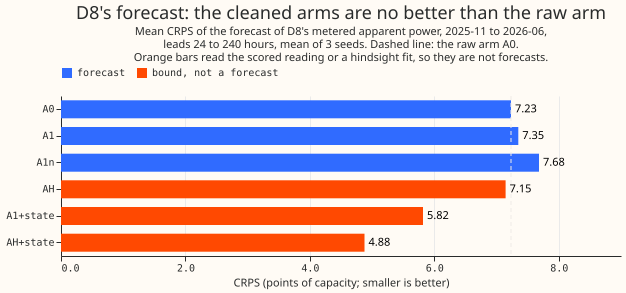
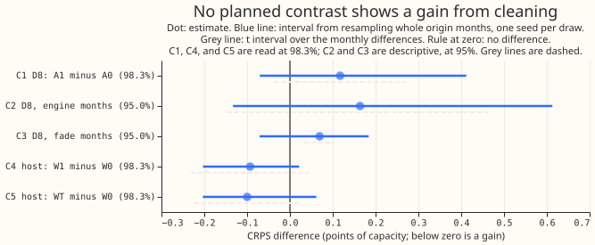
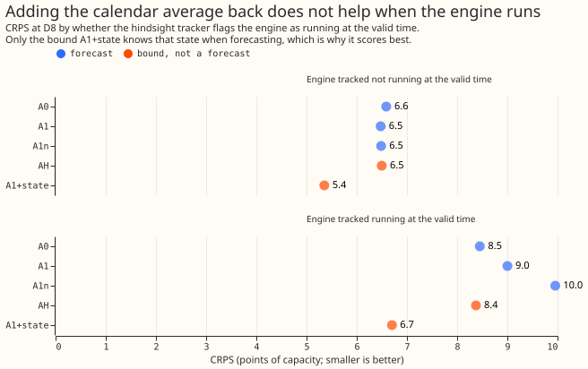
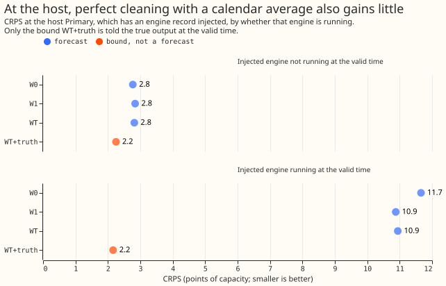

**This experiment asks whether a gas engine's output can be taken out of one substation's recorded
demand before a neural network learns from it, and added back as an average when forecasting.** The
substation, D8, is one of the 16 Primary substations in this research, and the output of a gas
engine connected behind its meter is included in its recorded power. The engine switches on and off,
so D8's recorded power jumps by up to about 50% of the substation's capacity. We took the engine out
of the neural network's training data and recent-power inputs, using the on and off tracker of
[experiment 694](../00694-gas-engine-state-tracker-part-1/result.md). We refitted the neural network
every month, and added the engine back to each forecast as an average of the engine's running share
for each half-hour of the day and for weekday or weekend, taken over the previous 12 weeks with
recent weeks weighted more. Arm A1 is this method and arm A0 is the same neural network trained on
the raw reading. We compared them over 8 monthly refits from 2025-11 to 2026-06, with 3 random seeds
each, using the CRPS (continuous ranked probability score, in which smaller is better) of the
forecast of D8's metered apparent power in MVA (megavolt-amperes). Scores are in points of capacity,
which are percentage points of D8's effective capacity of 10.379 MVA.

**Cleaning and adding back did not improve the forecast.** The verdict is `not supported`, by branch
8 of the pre-registered verdict table. The planned contrast C1 (A1 minus A0) is +0.117 points, with
a 98.3% interval from -0.070 to +0.412 and a t interval from -0.037 to +0.268. A gain needs both
intervals below zero and an estimate of at least 0.398 points (5.5% of A0's own score). The lower
bound of -0.070 rules out any gain above about 0.07 points, so the predicted gain of 0.3 to 1.0
points is ruled out. A post hoc reading, not pre-registered, averages the 3 seeds before resampling
whole origin months. It gives +0.036 to +0.245 for C1, so A1 is probably about 0.1 points worse. The
library interval is 2.3 times wider (0.48 against 0.21) mainly because it draws one seed per
resample, and the t interval stays the decision interval.

**Next steps are options, not commitments.** A forecast of the engine's on or off state from
information available at the forecast origin is the open question: an upper limit that reads the
engine's state at the valid time lowers the error by 1.4 to 2.4 points. A private follow-on analysis
of experiment 694 (`data/ml-experiments/briefs/e694_followon/predictability.md`) found that the
state's persistence helps within about a day and that no input beyond a day beat a calendar
climatology, except possibly a wind forecast out to a few days. Two options follow: part 3 of this
series, which gives the neural network origin-time engine-state features, and a pre-registered test
of a wind forecast as a predictor of the engine's state at days 2 to 5.

## Predictions against outcomes

**Three of the six pre-registered predictions fail, and two hold only in part.** "Bound" below means
a system that reads the scored reading, a hindsight fit, or the true injected output, so no forecast
can match it.

| Prediction | Outcome |
|---|---|
| P1: A1 lowers CRPS by 0.3 to 1.0 points and the normalised MAE of the median by 0.5 to 1.5 | Fails: CRPS +0.117, MAE +0.120 |
| P2: the gain is at least as large in the fade months (2026-03 to 2026-06) as in the engine months (2025-11 to 2026-02) | Fails: neither is a gain; C2 is +0.164 and C3 is +0.069 |
| P3: AH (cleaning with hindsight) beats A1 by under 0.2 points | Fails by 0.003: AH minus A1 is -0.203 (interval -0.363 to -0.050), a bound |
| P4: at the host, WT beats W0, and W1 recovers at least half of that gain | Holds in the estimates (-0.100, and W1 recovers 93%), but both intervals cross zero |
| P5: the state at the valid time lowers CRPS by 2 points or more | Holds for AH+state (-2.354), fails for A1+state (-1.413); both are bounds |
| P6: no other Primary moves | Holds: all 15 intervals include zero |

## Results

**The cleaned arms do not beat the raw arm, and only the bounds score much lower.** Every row is
scored against the metered apparent power at D8, or the injected reading at the host, for leads of
24 to 240 hours from the 12:00 UTC forecast origin, origins 2025-11-01 to 2026-06-30, mean of 3
seeds. "MAE" is the normalised mean absolute error of the median forecast. The host is D4, a Primary
into which we injected (added) a real engine's recorded output. W0, W1, and WT are the host's raw,
causally cleaned, and perfectly cleaned arms. The reference rows come from [experiment
677](../00677-building-up-the-candidate-demand-network-one-component-at-a-time/result.md) on its
80,688 shared half-hours at D8, a different row set from the 102,310 scored here. Step 9a is
experiment 677's raw-reading neural network at monthly refits.

| System | What it is | CRPS | MAE |
|---|---|---|---|
| A0 | Raw reading, the control | 7.232 | 13.252 |
| A1 | Causal cleaning plus the calendar add-back | 7.349 | 13.372 |
| A1n | A1 with the no-fold cleaning and a signed add-back | 7.683 | 13.891 |
| AH (bound) | Hindsight cleaning to 2026-06-30 | 7.146 | 12.942 |
| A1+state (bound) | A1 plus the tracked state at the valid time | 5.819 | 10.386 |
| AH+state (bound) | AH plus the tracked state at the valid time | 4.878 | 8.830 |
| W0 | Host, raw injected reading | 4.489 | 7.447 |
| W1 | Host, causally cleaned plus add-back | 4.396 | 7.390 |
| WT | Host, raw neural network plus the true engine's calendar add-back | 4.389 | 7.401 |
| WT+truth (bound) | WT plus the true injected output at the valid time | 2.232 | 3.953 |
| Step 9a (reference) | Stored control on experiment 677's rows | 7.100 | 13.002 |
| Manual heuristic (reference) | Stored | 7.934 | 14.135 |
| Climatology on the raw reading (reference) | Stored | 8.581 | 16.189 |

**No planned contrast shows a gain, and the host's gain of about 0.1 is within noise.** C1, C4, and
C5 are read at 98.3% (a Bonferroni split of 5% over three), and C2 and C3 are descriptive at 95%.
Each row gives the estimate, the interval from resampling whole origin months with one seed per
draw, and the t interval over the monthly differences. A negative value is a gain.

| Contrast | Estimate | Bootstrap interval | t interval | Seeds |
|---|---|---|---|---|
| C1: A1 minus A0, D8 | +0.117 | -0.070 to +0.412 | -0.037 to +0.268 | +0.182, +0.062, +0.108 |
| C2: C1 in the engine months | +0.164 | -0.133 to +0.613 | -0.146 to +0.472 | +0.306, +0.115, +0.070 |
| C3: C1 in the fade months | +0.069 | -0.071 to +0.184 | +0.033 to +0.103 | +0.055, +0.007, +0.146 |
| C4: W1 minus W0, host | -0.093 | -0.203 to +0.021 | -0.231 to +0.043 | -0.087, -0.085, -0.108 |
| C5: WT minus W0, host | -0.100 | -0.203 to +0.062 | -0.224 to +0.027 | -0.119, -0.064, -0.116 |
| MAE of the median, A1 minus A0 (95%) | +0.120 | -0.487 to +0.788 | -0.526 to +0.720 | +0.287, -0.019, +0.094 |

**The bounds, and every contrast that contains a bound, show where a forecast could gain, and none
is a forecast.** AH minus A1 is -0.203 (95% interval -0.363 to -0.050). A1+state minus A0 is -1.413
(-2.245 to -0.550), AH+state minus A0 is -2.354 (-3.488 to -1.344), and WT+truth minus W0 is -2.257
(-2.583 to -1.915). W1 minus WT is +0.007 (-0.052 to +0.069), so the causally cleaned host arm and
the perfectly cleaned host arm are indistinguishable. A1n minus A1 is +0.334 (+0.197 to +0.457); A1n
is a mis-specified variant, so its result says only that the fold is needed.

**A1 is worse than A0 on rows where the engine is tracked as running, on cold winter nights, and
over the fade months as a whole.** On the 35,302 rows per seed that the hindsight tracker flags as
running, CRPS is 8.453 for A0 and 9.002 for A1. On the 67,008 rows flagged as not running, it is
6.588 and 6.478. On cold winter nights it is 7.137 and 7.593, and in the fade months 6.439 and
6.492. A1 scores better on sunny middays in the fade months (6.856 against 7.061). The median of A1
sits 12.9 points above the reading on running rows, against 10.0 for A0, and the 90% band of A1 is
62.4 points wide against 51.3 for A0, so A1 over-covers the low tail: the share of readings below
the q05 forecast is 0.013 for A1 and 0.059 for A0.

**A calendar average cannot say which days the engine runs, and the add-back turns that into a wider
forecast.** In each engine month the add-back's running share was 0.37 to 0.38, against hindsight
shares of 0.36 to 0.48, and it lagged the fade: in 2026-03 it was 0.386 against a hindsight share of
0.267 (`printed/e00695_audit_out.txt`). The add-back then mixes two levels, with and without the
engine, in every forecast. At the host, perfect cleaning with a perfect calendar average gained no
more than the causal tracker did, so the host does not show the tracker as the limit. At D8, the
hindsight tracker (AH) scores 0.203 points better than the causal one (A1), and AH scores 7.146
against A0's 7.232, so the tracker may be some of the limit at D8 as well.

## Checks

- **Median minus mean forecast.** The neural networks output 11 quantiles and no mean, so the mean
  is the mean of the 11 quantile values. At D8 the mean of the quantiles minus the median is +1.627
  points for A0, -2.774 for A1, and -1.766 for AH; across the other 15 Primaries on A0's output it
  is +0.155 to +0.996 except +2.648 at D12 and +8.562 at D15, which were not investigated
  (`printed/e00695_median_mean.txt`).
- **Error of the median beside the CRPS contrasts.** The MAE contrast is +0.120 (interval -0.487 to
  +0.788), the same sign as C1. The mean error of the median at D8 is +0.24 for A0, +2.00 for A1,
  and +1.15 for AH.
- **Gate G0 (reproduction).** Refitted A0 scores 7.231588 at D8 against 7.231586 for the stored step
  9a, on 102,310 shared rows. The audit found a paired difference of 0.000 at every seed.
- **Gate G1 (tracker in the scored era).** At the host, the causal tracker's F1 is 0.785, precision
  0.998, and recall 0.647, and it flags 0.03% of un-injected half-hours. The pre-registered bars
  were F1 0.60, precision 0.50, and at most 3% false flags. G1 passed before any neural network was
  fitted.
- **Sign check.** Of the half-hours with a unit running, 42.1% differ by more than 1 MVA between the
  folded and the no-fold cleaning (0.35 to 0.51 by fold), above the 10% trigger, so arm A1n ran
  (`printed/sign_check.txt`).
- **Identity control.** Arm A1id sends D8's raw row through A1's cleaned-row route with cleaning
  disabled, for fold 2025-11 and seeds 0 to 2. Its quantiles match A0's to a maximum of 8.8e-5 of
  capacity (`printed/e00695_identity_compare.txt`).
- **Leakage and weather.** Every leakage test gives a change of exactly 0. The scorer reads all 8
  per-fold prediction logs of each of the 6 scored arms, host arms included, and finds 242 origins
  (30, 31, 31, 28, 31, 30, 31, and 30), each asserted to use a weather run at or before the origin.
- **Audit triggers.** Trigger 2 (the result contradicts the prediction) and trigger 6 (the C1
  interval is 0.48 wide, against 0.10 for experiment 677's two sister arms, which differ only in
  injected shifts and barely differ at D8) fired and are explained by seed noise, which makes a
  seed-against-seed contrast of A0 0.36 to 0.61 wide. Trigger 7 arguably fires, because part 3 would
  depend on the sign of C1. Triggers 1, 3, 4, and 5 did not fire.
- **Audit findings** (an Opus audit, `printed/e00695_audit_out.txt`; none rejected). Every headline
  number reproduced, so branch 8 stands. The cleaned arm is reliably a little worse (reported as
  post hoc). The scorer's D8 row in the per-Primary table scored A1 without the add-back (fixed: the
  row is dropped). The scorer read only the last fold's weather count (fixed). The bounds were
  unlabelled in the printed table (fixed). Weather alignment, the paired design, and leakage were
  confirmed.
- **Not done.** The sun check, the false-alarm check at the 7 other MVA-only Primaries, the
  correlation of engine state with forecast error, the climatology row on the cleaned series, and
  the per-fold count of dropped half-hours were not run; none can change the branch.

## Method

### Architecture

- **The neural network is experiment 677's step-5 chain at monthly refits** (step 9a of [experiment
  677](../00677-building-up-the-candidate-demand-network-one-component-at-a-time/result.md)), pooled
  over 16 Primaries, with a three-component Gaussian mixture output from which 11 quantiles (0.01 to
  0.99) are read and sorted.
- **The inputs are weather, date-time, and two lagged-power encoders.** The weather encoder reads 7
  weather means, 7 spread columns, 2 lead columns, and 14 thermal-lag and solar-gain columns; the
  date-time encoder reads 21 columns; the lag encoder reads power at 24 hours and 1 week before the
  origin, with block dropout of lags. Every power input is at least 24 hours older than its origin.
- **The widths are an 8-wide Primary embedding, encoders from 64 to 32, a mixer of 64, and dropout
  0.1.** The encoders are trained on ERA5 and CAMS rows and then frozen, a fresh mixer is trained,
  and the whole is fine-tuned on ensemble weather with experiment 581's injected lag-only shifts.
- **Arm A1 replaces D8's row of the power stack with a series with the engine removed.** Where the
  smoothed most probable unit count is 0, the cleaned value is the reading. Where it is 1 or more,
  the cleaned value is the posterior mean of the demand level under y = sqrt((L - k u)^2 + q^2),
  with L the demand level, k the units running, u the unit size, and q = 0.14 MVA the reactive
  floor. All three training stages read the replaced row, for training targets and lagged inputs
  alike.
- **The add-back mixes the forecast over the unit count.** For each origin, the weights p_j (j = 0
  to 3) are the weighted mean of the smoothed marginal P(k = j), by half-hour and weekend flag, over
  the 84 days of states at least 24 hours before the native origin, with weight 0.5 raised to the
  age in units of 28 days. The 11 quantiles are extrapolated linearly to 0.001 and 0.999, each level
  c maps to c for j = 0 and to sqrt((c - j u)^2 + q^2) for j of 1 or more, and the output quantiles
  are the weighted quantiles of that set. The mixture parameters are not exported, so this is an
  approximation.
- **The tracker is experiment 694's grid filter** ([experiment
  694](../00694-gas-engine-state-tracker-part-1/result.md)), fitted per fold on readings up to 3.5
  hours before the refit. Era 1 (to 2025-03-23) is fitted once, and era 2 is refitted per fold and
  never split at the fade. A training state never reads a reading from 3.5 hours before the refit
  onward, and at inference the state at time t reads readings up to t + 20 hours.
- **The other arms differ as follows.** AH uses one tracker fit and one smoothed series to
  2026-06-30 for every fold. A1n uses the no-fold cleaning (y + k u) and a signed add-back clamped
  at zero. W0 trains on the host's reading with the injected engine, W1 cleans it as A1 does, and WT
  adds the true injected engine's calendar average to the neural network trained on the raw host
  reading, reusing W0's fits. The bounds add the tracked or true state at the valid time. Arm A1id
  is the identity control.

### Training regime

- **Training data are ERA5 and CAMS (pre-training rows to 3.5 hours before the refit) and the ECMWF
  ensemble 00Z run of the origin day (fine-tuning and inference, treated as available at 09:00
  UTC).** Power comes from the cleaned power table with `substation_zero` half-hours dropped, and
  D15 and D18 are cut before 2025-03-01.
- **The host is D4**, chosen before any fit from the MVA-only Primaries D2, D3, and D4 because its
  median reading over 2025-03-24 to 2025-10-31 is closest to D8's tracked-off median. One real
  engine's 44-day record is resampled by whole days within weekday and weekend classes (seed 0) and
  injected by experiment 694's folded rule. The record is never shown with dates.
- **Refits are monthly for the test months 2025-11 to 2026-06, with seeds 0, 1, and 2.** The fold
  equals the origin month. Each fold pre-trains (60 epochs in the logs), fits a fresh mixer, and
  fine-tunes with a 7-day embargo. Every fitted state file is saved.
- **The run took about 1.5 GPU-hours of wall-clock time against a cap of 12.** Arm A0 ran as 8
  single-fold jobs started together (929 to 1,030 s each), and the other arms ran 10 jobs at a time
  for about 75 minutes (`printed/e00695_gpu_time.txt`).

### Measurement

- **Rows:** all 16 Primaries are fitted, and D8 is the decision series. Scored rows have leads of 24
  to 240 hours from the 12:00 UTC contract origin, origins 2025-11-01 to 2026-06-30, valid times
  before 2026-07-01, and a finite metered reading (102,310 half-hours per seed at D8, 102,391 at the
  host). The row set is `backtest_year_2025_11_to_2026_06_daily_12utc`.
- **Metrics:** CRPS (twice the mean pinball loss over 11 quantiles) and the normalised MAE of the
  median, in points of effective capacity, with D8's capacity fixed at 10.379 MVA for every arm.
  Truth is the metered apparent power, and at the host the injected reading.
- **Intervals:** each planned contrast is read through
  `studies.bootstrap.bootstrap_difference_at_level` from 20,000 resamples of whole origin months
  with one seed per draw (167 draws per tail at 98.3%), with a paired t interval on the 8 monthly
  differences. C2, C3, and the MAE contrast are read at 95% with 2,000 resamples. A Primary "moves"
  when its 95% interval excludes zero and the estimate exceeds the stored sister-arm difference, the
  CRPS gap between experiment 677's two arms that differ only in injected shifts.
- **Decision rule:** the smallest gain worth porting is 5.5% of A0's CRPS at D8 (0.398 points). The
  verdict is the first branch of the pre-registered table that applies.

## Files

- `ml-experiments/00695-gas-engine-state-tracker-part-2-cleaned-target-and-climatology-add-back/`
    - `e00695_look.py`: the short look at the stored forecasts that fixed the predictions.
    - `e00695_tracker.py`, `e00695_engine.py`, `e00695_clean.py`: the tracker import, the engine
      injection, and the build of each arm's cleaned stack row and states per fold.
    - `e00695_addback.py`: the climatology and the add-back of the engine mixture.
    - `e00695_phase_a.py`, `e00695_checks.py`: the host choice, gate G1, the leakage tests, and the
      sign check.
    - `e00695_k1.py`, `e00695_chain.sh`, `e00695_gpu.sh`: the step-5 chain with the stack row
      replaced.
    - `e00695_arm.sh`, `e00695_queue.sh`, `e00695_wait.sh`: the launch and wait scripts, 8 to 10
      single-fold jobs at a time.
    - `e00695_identity.py`: the identity control (writes arm A1id's row and compares its forecasts
      with A0's).
    - `e00695_score.py`: the scorer, which computes every contrast and the verdict branch.
    - `e00695_median_mean.py`: the median-minus-mean check and the median error by tracker state.
    - `e00695_audit_rederive.py`: the audit's independent re-derivation of the scores, with its
      output in `printed/e00695_audit_out.txt`.
    - `e00695_figures.py`: draws the four figures.
    - `printed/`: the printed outputs, including the GPU job times.
- `data/ml-experiments/00695-gas-engine-state-tracker-part-2-cleaned-target-and-climatology-add-back/`
  (private, never committed)
    - `runs/<ARM>/`: the fits (`arms/k1_5w_sp1/work/fits/P5/<month>_d0_s<seed>.parquet`, quantiles
      as fractions of capacity), logs, and saved neural networks, for A0, A1, A1n, AH, W0, W1, and
      A1id.
    - `stacks/<ARM>/`, `states/<ARM>/`: the cleaned stack rows and the tracker's state marginals per
      fold.
    - `predictions/a0-d8`, `a1-d8`, `ah-d8`, `w0-host`, and `w1-host`: the immutable prediction
      sets.
    - `scores/report.json`, `d8_slices.csv`, `host_slices.csv`, `references_d8.csv`: the scorer's
      tables.
    - `checks.json`, `host.json`: the gate and leakage results and the host's name.
- Read from earlier experiments: experiment 677's chain, shared protocol rows, and the stored step
  9a at `backtests/step5w_with_injected_sp1.parquet`
  ([677](../00677-building-up-the-candidate-demand-network-one-component-at-a-time/result.md), read
  only), and experiment 694's tracker and D8 hindsight flags
  ([694](../00694-gas-engine-state-tracker-part-1/result.md)).
