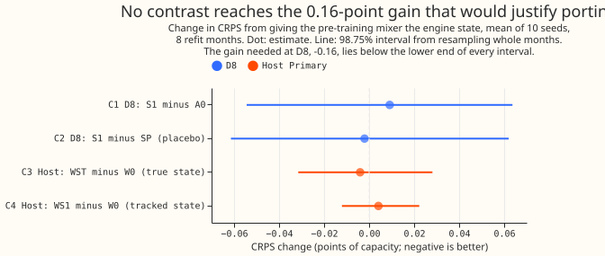
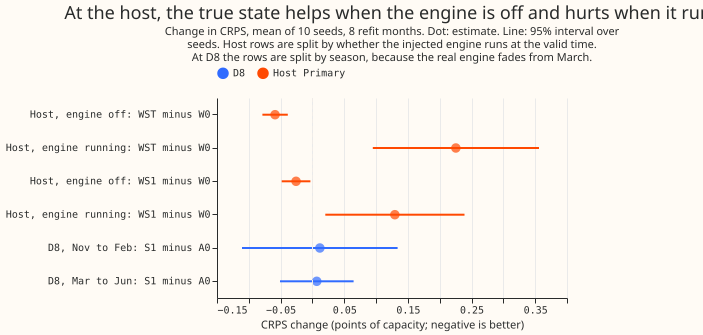
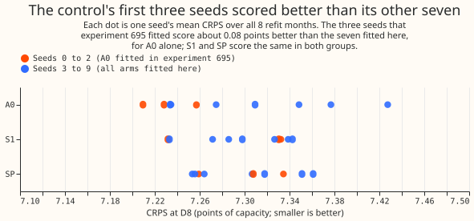

**Letting the neural network see the gas engine's state while it learns from weather and the
calendar, and then dropping that knowledge before the forecast, did not improve the forecast of
D8.** The change in error is +0.009 points of capacity, which we cannot distinguish from zero, and
the lower ends of the intervals rule out a net gain above about 0.07 points. At a second
substation, where we added a recorded engine's output and so know the true state, a post hoc split
shows a gain of 0.059 points on half-hours when the engine is off and a loss of 0.225 on half-hours
when it runs. Weighted by the 19% of half-hours when it runs, the two cancel. The verdict is `not
supported`.

## The question and how we tested it

**The experiment asks whether a neural network learns better weather and calendar patterns if it is
told, in its first training stage only, whether a gas engine is running.** D8 is a Primary
substation (a substation that supplies the local distribution network), one of the 16 that this
research forecasts. A gas engine, a set of generating units that switch on and off, sits behind
D8's meter, so D8's recorded power includes the engine's output. The forecast is the 11 quantiles of
the power for each half-hour 24 to 240 hours ahead. A "point of capacity" is one percentage point of
D8's effective capacity of 10.379 MVA (megavolt-amperes). CRPS (the continuous ranked probability
score) is twice the mean pinball loss over the 11 quantiles. For every change in CRPS on this page,
a positive value means the forecast got worse. Every contrast, interval, and verdict rule below was
written down before any fit (pre-registered), except where a paragraph says post hoc.

**The neural network trains in three stages, and the engine state enters only the first.** In
stage 1, the pre-training stage, a weather encoder and a date-time encoder (the parts that turn
weather and the calendar into numbers) learn together with the pre-training mixer, which combines
their outputs. In stages 2 and 3 the encoders are frozen, and a fresh fine-tune mixer with no
engine input learns from ensemble weather forecasts. The method is learning with privileged
information ([Vapnik and Vashist (2009)](https://doi.org/10.1016/j.neunet.2009.06.042);
[Lopez-Paz et al. (2016)](https://arxiv.org/abs/1511.03643)): the state helps training and is never
available at forecast time. The state is three columns from the tracker of [experiment
694](../00694-gas-engine-state-tracker-part-1/result.md), as stored by [experiment
695](../00695-gas-engine-state-tracker-part-2-cleaned-target-and-climatology-add-back/result.md): the
expected engine output as a share of capacity, the probability that one or more units run, and a
flag for hidden rows. The tracker infers this "tracked state" from the reading alone. An earlier
test of the same kind, [experiment
570](../00570-price-encoder-part-1-known-answer-test-and-pretrained-stack/result.md), used
electricity price in place of the engine state and made the forecast worse.

**The arms differ only in the state that the pre-training mixer reads.** The "host" is D4, another
Primary, to whose reading we added the recorded output of a real engine ("injection", from
experiment 695), so its "true state" is known. Each arm is refitted at the start of each of 8
months (2025-11 to 2026-06, the refit months) with 10 seeds (starting points for the training's
random numbers).

| Arm | Series | What the pre-training mixer reads |
|---|---|---|
| A0 | D8 | No state (the control, from experiment 695) |
| S1 | D8 | The tracked state |
| SP | D8 | The tracked state with whole days shuffled within the tracker's era, calendar month, and weekday class (placebo) |
| S1d | D8 | The tracked state, hidden on half of the origin days (3 seeds, descriptive) |
| W0 | Host | No state (the control, from experiment 695) |
| WST | Host | The true injected state |
| WS1 | Host | The tracked state of the injected reading |

**Four contrasts were planned, each read at 98.75% (a Bonferroni split of 5% over four), and a
nine-branch table fixed the verdict.** C1 is S1 minus A0 at D8, C2 is S1 minus SP at D8, C3 is WST
minus W0 at the host, and C4 is WS1 minus W0 at the host. A contrast passes when all three of its
decision intervals lie below zero: a t interval over the 8 monthly differences of the seed means, a
bootstrap over whole origin months of the seed-averaged losses, and a t interval over the 10
per-seed means. The branches are applied in order: (1) `invalid` if a leakage test fails; (2)
`failed` if a reproduction or identity gate fails; (3) `not supported`, with an audit trigger, if C1
passes and C2 does not; (4) `inconclusive` if C1 and C2 pass and the encoder probe M1 fails; (5)
`supported` if C1 passes with a gain of at least 0.16 points, C2 and M1 pass, and no veto applies;
(6) `partly supported` if C1 passes at 0.16 or more, C2 and M1 pass, and a veto applies; (7) `small
gain` if C1 passes below 0.16 and C2 and M1 pass; (8) `refuted` if all three C1 intervals lie above
zero; (9) `not supported` otherwise. The vetoes are a host contrast whose intervals all lie above
zero, a rise in the mean absolute error of the median (MAE), and another Primary that moves for the
worse. The threshold of 0.16 points is 8 times the project's minimum of 0.02 for a change aimed at
one Primary.

## Results

**The verdict is `not supported`, branch 9, because C1 does not pass.** No leakage test failed, the
reproduction and identity gates passed, and all three C1 intervals contain zero. No other planned
contrast passes. The estimate is the change in CRPS in points of capacity.

| Contrast | Estimate | t over months | Month bootstrap | t over seeds |
|---|---|---|---|---|
| C1: S1 minus A0, D8 | +0.009 | -0.074 to +0.091 | -0.055 to +0.064 | -0.074 to +0.092 |
| C2: S1 minus SP, D8 | -0.002 | -0.092 to +0.086 | -0.062 to +0.064 | -0.059 to +0.055 |
| C3: WST minus W0, host | -0.004 | -0.047 to +0.038 | -0.032 to +0.029 | -0.023 to +0.015 |
| C4: WS1 minus W0, host | +0.004 | -0.021 to +0.029 | -0.012 to +0.022 | -0.030 to +0.038 |

**The intervals rule out a net gain above about 0.07 points at D8 and about 0.05 at the host, so the
0.16 points needed to justify porting is out of reach.** The lower ends of the three C1 intervals
are -0.055 to -0.074, and of the three C3 intervals -0.023 to -0.047. The standard deviation of one
seed's monthly difference at D8 is 0.233 points, and the smallest effect that 10 seeds could
resolve is about 0.10 points at D8 and 0.05 at the host. Mean CRPS is 7.290 for A0, 7.299 for S1,
and 7.301 for SP at D8, and 4.487 for W0, 4.483 for WST, and 4.492 for WS1 at the host.

**Post hoc, the host's change splits by whether the engine runs, and the two parts cancel.** The
split was not planned, so its intervals are 95% over the 10 seeds and are not Bonferroni-adjusted.
WST minus W0 is -0.059 (-0.079 to -0.039) on the 81% of half-hours when the injected engine is off,
and +0.225 (+0.095 to +0.356) on the 19% when it runs. The MAE of the median splits the same way,
-0.119 and +0.312. WS1 shows the same pattern at about half the size. Weighting the two parts by
their shares gives -0.004, which is C3.

**One explanation that fits, not measured directly, is that the weather and calendar parts of the
neural network lose the engine's daily pattern, and the fresh fine-tune mixer cannot recover it.**
The frozen date-time encoder no longer needs to carry when the engine tends to run, yet the forecast
target still contains the engine. The encoder probe M1 points the same way but missed its
pre-registered gate. M1 freezes each arm's pre-trained encoders and fits a fresh mixer with no state
to the host's reading without the engine. Its held-out error is 6.456 points for WST against 6.504
for W0, a change of -0.049 (95% t interval over the 8 folds, -0.099 to +0.002). A t interval over the
10 seed means, -0.090 to -0.007, would pass, but that reading is post hoc.

**Next steps are options, and none is committed.** The pre-training state could be tried together
with a way of putting the engine back after pre-training, either experiment 695's calendar add-back
or an origin-time engine state in the fine-tune mixer, and tested first at the host, where the true
state is known.

## Checks

- **The six pre-registered predictions hold, and M1's estimate is in its range but missed its
  gate.**
    - P1: C1 between -0.08 and +0.05; observed +0.009.
    - P2: S1 better by 0 to 0.10 when the engine is tracked off, and worse by 0 to 0.15 when it runs;
      observed -0.016 and +0.058.
    - P3: SP within 0.05 of A0; observed +0.011.
    - P4: WST minus W0 between -0.10 and +0.03, and WS1 within 0.05 of WST; observed -0.004 and
      +0.008.
    - P5: M1 lower by 0.02 to 0.3; observed -0.049, but the 95% interval missed the gate.
    - P6: no other Primary moves; none moves by the rule below.

- **The state does reach pre-training, so the null result is not a failed patch.** After
  pre-training, the pre-training mixer's weights on the two state columns average 1.10 and 0.71 in
  size for S1, against 0.10 on its original inputs, and 0.44 for SP. In one fold and seed, S1's weather
  and date-time encoders differ from A0's by 40% to 48% in relative norm, but a different seed of A0
  differs from A0 by 140% and SP differs by 22% to 28%, so the size does not show that the state
  changes what the encoders learn. The stored final networks have encoders identical to the
  pre-trained file, and the fine-tune mixer has the same shape in S1 as in A0, so no state reaches a
  forecast.
- **Pre-training loss and length.** On seeds 3 to 9 of the controls and all 10 seeds of the state
  arms, the pre-training validation loss is 0.193 for S1 against 0.207 for A0, and 0.188 for WST
  against 0.203 for W0 (experiment 695's seeds 0 to 2 gave 0.212 and 0.206). The mean number of
  pre-training epochs is 56.8 for both A0 and S1, so an earlier stop does not explain a difference.
- **Post hoc, the control's first three seeds score better than its other seven.** A0 seeds 0 to 2,
  fitted in experiment 695, average 7.232 points, and A0 seeds 3 to 9, fitted here, average 7.315.
  Between the same seed groups S1 moves by -0.001, SP by -0.001, and the host's W0 by +0.002. On
  seeds 3 to 9 only, C1 is -0.016 (95% t interval over months, -0.092 to +0.065), against +0.067 on
  seeds 0 to 2. The gap is probably chance among three seeds. Arms G0 and SZ reproduce experiment
  695's A0 to 2e-5, the pre-training rows and epochs match, and at the other 15 Primaries the A0 gap
  between seed groups averages -0.023 against -0.042 for S1. The decision interval stays the
  pre-registered 10-seed interval.

- **S1d reads better against S1 and SP than against A0.** On seeds 0 to 2, S1d scores 7.318 against
  7.298 for S1 and 7.300 for SP, so S1d minus S1 is +0.020 (95% t over seeds, -0.173 to +0.214) and
  S1d minus SP is +0.018 (-0.016 to +0.051), against +0.087 for S1d minus A0. The state is hidden by
  origin day but indexed by valid time, so one target half-hour is shown with the state on some rows
  and without it on others.
- **No other Primary moves by the pre-registered rule, which uses the library interval (95%, one
  seed per resample).** The rule needs the interval of the paired difference to exclude zero and
  the estimate to exceed its sister-arm difference from experiment 677. With a seed-averaged month
  bootstrap at 95%, two of 15 Primaries exclude zero: D10 at +0.053 (+0.007 to +0.109), which would
  count as worse, and D11 at -0.031 (-0.068 to -0.001). About one would be expected by chance and
  two were seen, so the page reports both and does not use either against the verdict.
- **Mean of the 11 quantiles minus the median, per series.** At D8 it is +1.716 for A0, +1.629 for
  S1, +1.744 for SP, and +1.435 for S1d. At the host it is -4.727 for W0, -5.009 for WST, and -4.952
  for WS1 (`printed/score_report.txt`). The check was not run at the other 15 Primaries.
- **Error of the median beside each CRPS contrast.** C1's MAE contrast is +0.019 (95%, t over months
  -0.165 to +0.197), the sign of C1. At the host the MAE contrast of WST minus W0 is -0.036 (95%: t
  over months -0.080 to +0.009, month bootstrap -0.071 to -0.001, t over seeds -0.061 to -0.011),
  the sign of C3 (`printed/audit_analyse.txt`).
- **Gates.** The identity control SZ (a state of all zeros, which must reproduce A0), the
  reproduction gate G0 (a refit of A0), and G0W (a refit of W0) match experiment 695's fits to 1.4e-5
  to 1.9e-5, 1.9e-5, and 5.6e-6 of capacity (tolerance 1e-4). Liveness holds for every arm (the
  state weights are non-zero, and exactly 0 for SZ), and the alignment gaps are 0.0 in all 8 folds.
  Every real-series leakage test gives a change of exactly 0, and every arm has 242 origins with
  origin-time weather (`printed/checks_fits.txt`, `printed/checks_real_all.txt`,
  `printed/score_report.txt`).
- **Audit triggers.** The `ml-experiment` skill requires an independent audit when a trigger fires;
  an Opus audit ran, and `printed/audit_*.txt` holds the numbers it reproduced.
    - Trigger 1, a failed control, fired: M1 missed its gate and C3 shows no net gain, which the
      host split explains.
    - Trigger 2, a result that contradicts its prediction, did not fire: all six predictions hold.
    - Trigger 3, a CRPS contrast and an error contrast that disagree in sign, did not fire: the
      MAE contrasts above match the signs of C1 and C3.
    - Trigger 4, a flip when one site is left out, was not run, because each contrast sits at one
      series.
    - Trigger 5, a nested arm that beats its container, did not fire: SP minus A0 is +0.011, inside
      its 95% half-width of about 0.03.
    - Trigger 6, an interval more than twice as wide or half as wide as a sister experiment's, fired
      in the letter only: the C1 month-bootstrap and t intervals are 0.12 to 0.17 wide, against 0.48
      for experiment 695's C1, which compared different arms with 3 seeds.
    - Trigger 7, a later design that depends on this headline, applies only to a design that reuses
      the host split.
- **Audit findings (an Opus audit; none rejected).** Every headline number reproduced, so branch 9
  stands. The seed-group, S1d, host-split, and other-Primaries readings are on this page and
  labelled post hoc. The patch, the frozen encoders, and the absence of leakage were confirmed.
- **Not done.** The climatology row, the example-forecast plots, the load-shift scenarios, the
  count of dropped half-hours per fold, and the check of the median minus the mean at the other
  Primaries.

## Method

### Architecture

- **The neural network is experiment 677's step-5 chain at monthly refits** (step 9a of [experiment
  677](../00677-building-up-the-candidate-demand-network-one-component-at-a-time/result.md), class
  `AuxLagMdn` of [experiment
  591](../00591-shared-lag-encoder-auxiliary-shift-depth-loss/result.md)), pooled over 16 Primaries,
  with a three-component Gaussian mixture output from which 11 quantiles are read and sorted.
- **The inputs are weather, date-time, and lagged power.** The weather encoder reads 7 weather
  means, 7 spread columns, 2 lead columns, and 14 thermal-lag and solar-gain columns; the date-time
  encoder reads 21 columns; the lag encoder reads power at 24 hours and 1 week before the origin;
  every power input is at least 24 hours older than its origin.
- **The widths are an 8-wide Primary embedding, encoders from 64 to 32, a mixer of 64, and dropout
  0.1.** Stage 2 and stage 3 freeze the weather and date-time encoders and train a fresh fine-tune
  mixer, as in [experiment
  574](../00574-part-d-primaries-only-modular-recipe-lag-encoder-offset-and-add-one-arms/result.md).
- **The state arms widen the first layer of the pre-training mixer by 3 inputs.** The layer is
  built at the original width under the original random-number stream and then padded with 3 zero
  columns, so a zero state reproduces A0. The state columns come from the stored per-fold tracker
  states of experiment 695 at the valid time of each pre-training row, and other Primaries read
  zeros. The widened layer is loaded at all three stages and is never called after pre-training.
- **The placebo SP shuffles whole days of S1's columns within the tracker's era (the tracker fits
  the engine's unit size separately for two stretches of D8's history), calendar month, and weekday
  class (Monday to Friday, or Saturday and Sunday).** It uses only days at or before the fold's cut,
  with seed 0.
- **S1d hides the state on a random half of origin days, with the hidden flag set. WST reads the
  true injected output as a share of capacity and whether any unit runs, and WS1 reads the tracked
  state of the injected reading.** The injected engine is experiment 695's resampled 44-day record.

### Training regime

- **Training data are ERA5 and CAMS rows (two sets of weather reanalyses) to 3.5 hours before the
  refit in stage 1, and the ECMWF ensemble 00Z run of the origin day in stages 2 and 3 and at
  inference.** Power comes from the cleaned table with `substation_zero` half-hours dropped, and D15
  and D18 are cut before 2025-03-01.
- **Everything outside the pre-training mixer's input is step 9a unchanged:** the loss, the
  optimiser, early stopping on held-out weeks, the 7-day embargo, the injected lag-only shifts, and
  monthly refits for 2025-11 to 2026-06.
- **There are 10 seeds per arm and fold, with seeds 0 to 2 of A0 and W0 reused from experiment
  695's stored fits and seeds 3 to 9 fitted here by the same chain.** The fits used about 28
  job-hours, and the resource log spans 4.5 hours of wall-clock time with 6 to 7 jobs at once and a
  peak of 33 GB of GPU memory (`printed/job_times.txt`).
- **The state never reaches a forecast.** The state at a pre-training row reads readings only before
  the refit minus 3.5 hours, and a perturbation of every later reading changes no state value.

### Measurement

- **The metric of record is CRPS at D8 in points of effective capacity (fixed at 10.379 MVA),** with
  leads 24 to 240 hours from the 12:00 UTC contract origin, origins 2025-11-01 to 2026-06-30, valid
  times before 2026-07-01, and all 16 Primaries scored. The normalised mean absolute error of the
  median, pinball loss, and coverage at q01, q05, q95, and q99 are printed beside it.
- **The host's truth is the injected reading.** The 102,310 D8 rows per seed and the host's rows
  come from the scorer of experiment 695, and the audit re-derives each number from the raw fits.
- **Intervals are the three decision intervals above, a library interval for the other-Primaries
  rule, and 40,000 resamples (250 draws per tail at 98.75%).** The threshold of 0.16 points follows
  the project's demand evaluation protocol, demand-v2, which sets a minimum of 0.02 points for a
  change aimed at one Primary.
- **The verdict follows the pre-registered table of nine branches, evaluated in order.**

## Files

- `ml-experiments/00696-*/e00696_common.py`, `e00696_state.py`, `e00696_model.py`,
  `e00696_probe.py`, `e00696_hooks.py`, and `e00696_k1.py`: the arm table, the state builders, the
  widened network, the encoder probe, the hooks that attach the state to the pre-training rows, and
  the wrapper that runs experiment 677's step-5 chain.
- `e00696_chain.sh`, `e00696_gpu.sh`, `e00696_queue.sh`, and `e00696_wait.sh`: one fold of one arm,
  one process under a memory cap, the job queue, and the wait loop.
- `e00696_checks.py`: the synthetic and real-series checks and the identity and reproduction gates.
- `e00696_score.py` and `e00696_verdict.py`: the scorer (contrasts, the probe, slices, the
  weather assertion) and the verdict function, with `e00696_selftest_*.py` covering every branch.
- `e00696_audit_*.py`: the audit's loss, contrast, slice, weight, epoch, and host code.
  `e00696_figures.py` draws the three figures from the audit's losses, so its bootstrap bounds
  differ from the scorer's by up to 0.001. `e00696_job_times.py` prints the job-hours.
- `printed/`: the printed reports of the checks, the scorer, the audit, the job times, and the job
  lists.
- Data under `data/ml-experiments/00696-*/` (read and written): `runs/<arm>/` (fits, models, logs),
  `states/<arm>/<month>.npz` (the state columns), `checks.json`, and `audit/` (per-row losses).
  Experiment 695's `states/`, `stacks/`, and the stored fits of A0 and W0 seeds 0 to 2 are read.
