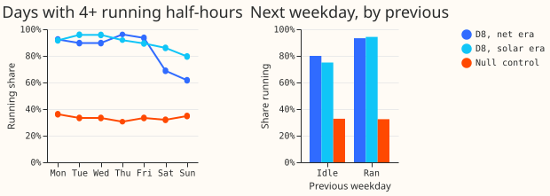
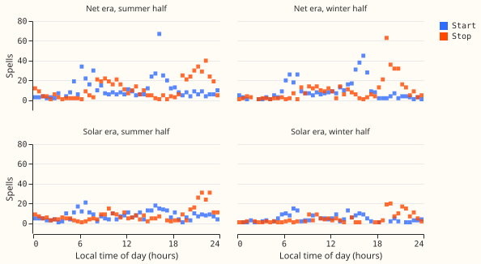
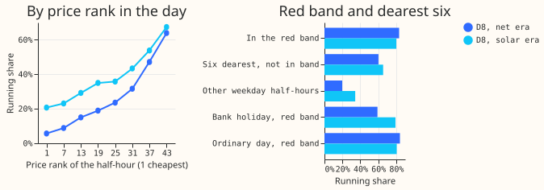
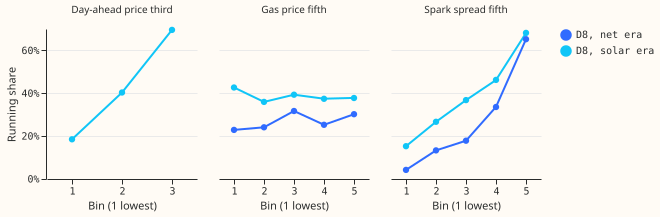
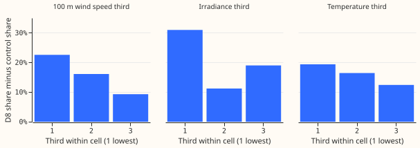
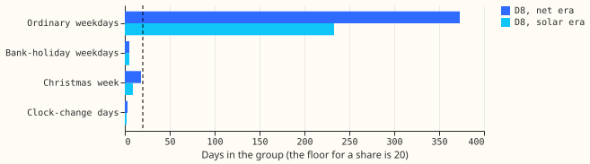
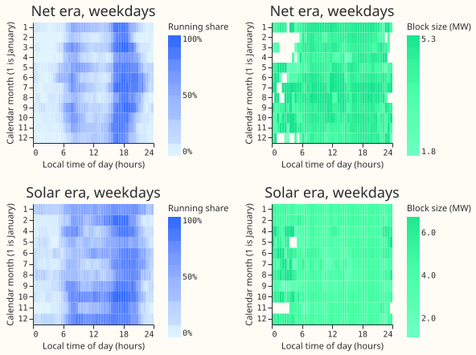
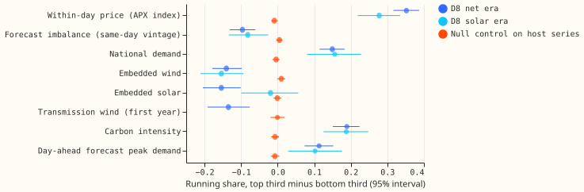
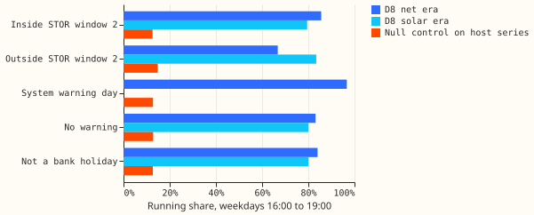

# Experiment 697: exploratory figures

**These nine figures are exploratory, and none of them changes the verdict of [experiment
697](result.md).** Each shows the running share of D8's gas engine as the tracker labels it, in the
net era (2023-09-01 to 2025-02-28) and the solar era (2025-03-24 to 2026-02-28), and the
null control where one is drawn. The figures were drawn after the tables were seen, so any reading
of them is post hoc. The night share by month (G7) and D8's dated rasters stay in the private data
folder.

**G1: D8's labels show a running day on almost every weekday and a gap at weekends in the net
era.** The left panel is the share of days with 4 or more running half-hours, by weekday. The right
panel is the share of running days after a running day and after an idle day, for Tuesday to Friday.
The null control's truth has no day-to-day link, so its flat line is what a patternless engine
gives.

**G2: starts cluster around 06:00 to 08:00 and 15:00 to 17:00 local time, and stops around 19:00 to
22:00.** Each point is the number of on-spells that start, or end, at one local half-hour, for the
summer half and the winter half of each era.

**G3: the running share rises with the half-hour's price rank within its day, and is highest in the
red band.** The left panel ranks the half-hours of each local day by price. The right panel compares
the red band (Monday to Friday, 16:00 to 19:00 local) with the six dearest half-hours of the day
that fall outside the band, other weekday half-hours, and bank-holiday and ordinary weekday
evenings.

**G4: the running share rises with the spark spread and not with the gas price.** The spark spread
is the system price minus the gas price divided by 0.40. The day-ahead price panel holds only the
solar era, because no day-ahead price is stored before 2025-09.

**G5: D8's share minus the null control's share falls as the wind speed and temperature rise.** The
bars are thirds of each driver within a cell, for the net era only. D8's heating load changes its
reading, so D8's raw weather link is not read.

**G6: the evening share on bank holidays, in Christmas week, and on clock-change days rests on a
handful of days.** Only 5 bank-holiday weekday evenings fall in each of the net and solar eras, and
2 or 3 clock-change days.

**G8: the running share and the tracker's fitted block size by month and local half-hour.** Left
panels: the running share on weekdays. Right panels: the mean fitted block size in MW when flagged.
White cells hold fewer than 15 days.

**G9: the running share is higher in the top third of the within-day price and of national demand,
and lower in the top third of embedded wind and of the forecast imbalance.** Each row is the running
share in the top third of a signal minus the bottom third, within a cell, with a 95% interval, for
D8's net and solar eras and for the null control on the host series. The Elexon within-day price
index is not the day-ahead auction.

**G10: the running share inside and outside a Short Term Operating Reserve window, on system warning
days, and on bank holidays.** Whether the engine holds a reserve agreement is unknown, so a match
with a window is a coincidence of timing and not a cause. The system warning days hold 384
half-hours.

