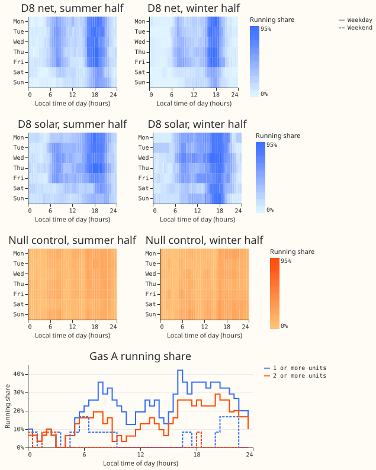
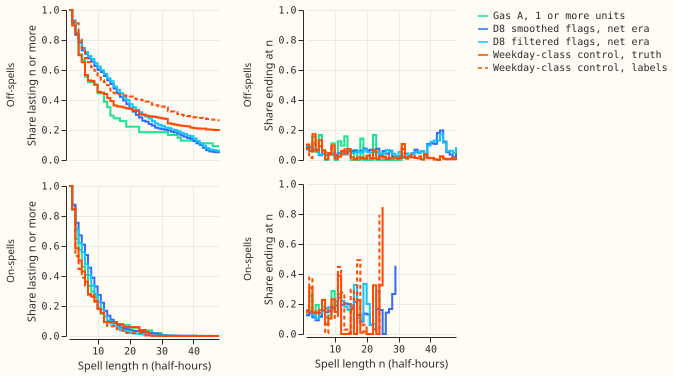
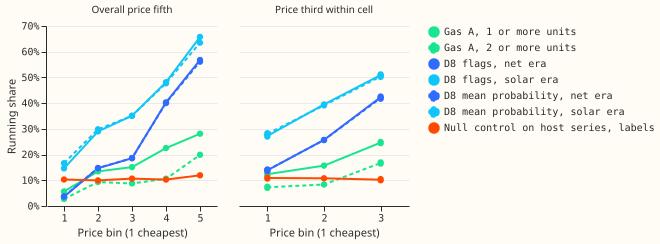
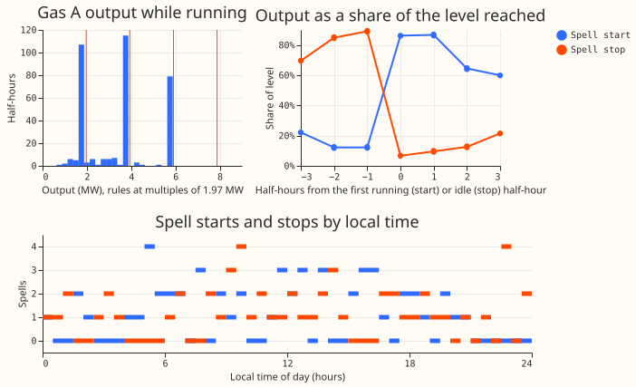

**This experiment asks whether the gas engine behind D8, one of the 16 Primary substations that this
research forecasts, runs to a schedule that follows the working week.** The engine is a gas engine
with a long-term capacity contract. We read the engine from D8's half-hourly reading with the
**tracker** of [experiment 694](../00694-gas-engine-state-tracker-part-1/result.md), a filter that
infers from the reading alone how many of the engine's units are running in each half-hour. A unit is
one block of output, of about 2 MW, that the engine adds or drops as a whole. The **running share**
is the share of half-hours in a group that the tracker flags as running. No meter on the engine behind
D8 is used.

**The question is measured as Q1, the weekday-minus-weekend running share from 16:00 to 19:00 local
time.** That window is the **red band**: the hours in which NGED's Distribution Use of System
charges for half-hourly metered customers in the East Midlands, where D8 sits, are highest on Monday
to Friday. All shares in this page come from the tracker's smoothed labels, which use the whole
record to place each flag, and not from its filtered labels, which use only readings up to the
half-hour.

**The tracker could produce a weekday pattern by itself, so we measured the pattern against
controls.** A **host reading** is a real reading that an engine is injected into. A **null
control** is a host reading with the one metered engine record that we hold (called Gas A here, 44
days long) injected by experiment 694's method of adding a recorded engine to a reading. The injected
days are drawn at random with no regard to the weekday, so any weekday pattern in the tracker's
labels of a null control is tracker error. There are six null controls. One uses D8's reading before
its engine. Two use that reading with a constant subtracted so that its weekday daytime level matches
D8's level in the net era and in the solar era (the **level-matched controls**, one constant for each
era). Three use the readings of three other Primaries (D2, D3, and D4) over the same two periods.
Each control ran with 2 or 3 random seeds for the drawn days.

**D8's reading changes between the net era and the solar era, so each era is tested alone.** The
**net era** is 2023-09-01 to 2025-02-28, and the **solar era** is 2025-03-24 to 2026-02-28, after
11 kV solar generation began. The **fade era** is 2026-03-01 to 2026-06-30, when the engine's effect
on D8's reading fades while the tracker's flags persist. The fade era carries no part of the
verdict.

**The verdict is `supported`.** D8's Q1 is +0.392 (95% interval +0.323 to +0.464) in the net era and
+0.256 (+0.156 to +0.365) in the solar era. D is D8's Q1 minus a null control's Q1, with independent
resampling of whole calendar weeks for the two terms. Against all six null controls in both eras the
interval of D lies above zero, and every point estimate is 0.10 or more, which is the condition for
`supported` in the decision rule. In both eras the smallest D is against the level-matched control
that uses the solar-era constant: +0.337 (+0.260 to +0.416) in the net era and +0.202 (+0.097 to
+0.311) in the solar era.

**P1b, a check named in the prediction and not in the decision rule, also passes and does not change
the verdict word.** P1b requires that, on D8's readings from before the engine with a patternless
engine injected, the labels show a weekday-minus-weekend difference below 0.10. The three controls
built on D8's history show +0.015, +0.017, and +0.054. The largest, +0.054, is the level-matched
control with the solar-era constant, and its interval (+0.023 to +0.084) excludes zero, so the
tracker shows a small weekday excess on a patternless engine in that control.

**Two limits keep the finding from being a result about the engine itself.** First, the shares come
from the tracker. D8's own demand is highest on weekday evenings, and the null controls cannot show
that the tracker never reads part of that demand as the engine. The labels also understate a weekday
pattern: in controls whose injected days do follow the weekday, the ratio of the labels' Q1 to the
truth's Q1 is 0.745 at D8's history before the engine. The +0.392 measures the labels and not the
size of the engine's pattern. Second, the one metered engine record (Gas A) agrees in direction
only. At 2 or more units its weekday-minus-weekend share is +0.233 (+0.057 to +0.442), but the
record spans 7 calendar weeks with 12 weekend days, 3 of them with the engine running, so its
interval is rough.

## Questions beyond the verdict

**The verdict rests on Q1 alone. Every other question was listed in the experiment's plan before the
run and does not change the verdict word.** Q4 was dropped in the plan. About 30 intervals were
computed, at 95% and without a correction for multiple comparisons, and the table shows the net-era
and solar-era estimates of the others. A **cell** is one local half-hour in one weekday class in one
calendar month. A **spell** is a run of consecutive half-hours with the same flag, an on-spell if the
engine is flagged as running and an off-spell if not. The **hazard** at length n is the share of
spells that last n or more half-hours and end at n. A reading of 1 means that D8's interval excludes
zero with the same sign in both eras and excludes zero against every null control, a reading of 2
means that a null control reproduces the pattern, and a reading of 3 means that D8's interval
includes zero.

| Question | D8, net era | D8, solar era | Reading |
|---|---|---|---|
| Q1: weekday minus weekend, 16:00 to 19:00 | +0.392 (+0.323 to +0.464) | +0.256 (+0.156 to +0.365) | Supported (the verdict) |
| Q2: dearest system-price third minus cheapest third, within cell | +0.284 (+0.251 to +0.316) | +0.237 (+0.190 to +0.285) | 1, not explained by the controls |
| Q2q: the same with calendar quarters in place of months | +0.303 (+0.273 to +0.334) | +0.250 (+0.190 to +0.302) | 1, not explained by the controls |
| Q3: hazard at 1 to 2 half-hours minus at 3 to 8 | +0.007 (-0.014 to +0.027) | +0.006 (-0.016 to +0.028) | 3, no pattern found |
| Q3a: hazard at 1 half-hour | +0.125 (+0.098 to +0.151) | +0.095 (+0.072 to +0.120) | 2, tracker error not excluded: the null controls show a higher value |
| Q6: winter-half minus summer-half weekday evening | +0.011 (-0.064 to +0.083) | not asked | 3, no pattern found |
| Q7: running day after a running day minus after an idle day | +0.133 (-0.032 to +0.294) | not estimable | 3 in the net era (the interval includes zero and is wide); the solar era has too few days |
| Q8: most common start half-hour, winter half and summer half | 32 and 32 (16:00), the same | 14 and 13 (07:00 and 06:30), different | Not an interval; not read |

**Q3a is the one question where the tracker's labels at D8 show less than the null controls do.** The
difference D (D8 minus the null control) is negative in all 12 comparisons, from -0.008 to -0.101,
so the null controls' labels show a higher hazard at 1 half-hour than D8's. A patternless injected
engine therefore gives at least as many one-half-hour spells in its labels as D8 does.

**The running share rises with the half-hourly system price within a cell, and the controls do not
explain it.** Gas A shows the same direction at 1 or more units (+0.123, +0.038 to +0.256) and at 2
or more units (+0.094, +0.019 to +0.212). Q2 and Q2q are compared with the host controls only,
because D8's history before the engine overlaps the half-hourly system price by about 12 days, so
the controls built on it have a price for 4% of their half-hours. The price peak, the red band, and
D8's own demand peak all fall on weekday evenings, and this experiment cannot separate them.

**Q5 is +0.074 (+0.031 to +0.123) and is descriptive.** Q5 is the share of half-hours between 00:00
and 05:00 that the tracker flags, in the 6 months after 2025-03-24 minus the same months a year
earlier. The host controls show -0.006 to -0.003 for the same contrast, so the rise is not a
property of the tracker on other Primaries. D8's night readings changed when its solar generation
began, and this experiment does not say whether the engine ran more at night.

## Figures

**Figure 1 shows the weekday evening block in D8's labels and not in the null control's.** Each D8
panel is a weekday by local half-hour heat map of the running share, for the summer half (the months
of British Summer Time) and the winter half of each era. The null-control panels use the control
built on D8's reading before its engine (C1), in which the injected engine has no weekday pattern.
The bottom panel shows Gas A's running share by local half-hour at 1 or more units (blue) and 2 or
more units (orange), for weekdays (solid) and weekends (dashed). A tracker artefact could produce
the evening block if the tracker reads D8's weekday evening demand peak as the engine.

**Figure 2 shows spell lengths that look alike in D8's labels, in Gas A, and in a control's labels,
so they say little about the engine.** The panels show the survival curve (the share of spells that
last at least n half-hours) and the hazard of on-spells and off-spells of 1 to 48 half-hours. A
tracker artefact could produce any shape, because the tracker's built-in assumption about how long
the engine stays in one state sets the hazard.

**Figure 3 shows the running share rising with the system price in D8's labels and in Gas A, and
staying flat in the null control on the host series.** The left panel uses system-price fifths over
the whole period, and the right panel uses system-price thirds within a cell. A tracker artefact
could produce an overall rise, because the price and D8's demand both peak on weekday evenings. The
flatness of the control answers that only for the demand shapes that the control contains.

**Figure 4 shows that Gas A runs at about 1, 2, or 3 times 1.97 MW and reaches its first full level
within 2 half-hours in 94% of its 54 complete on-spells.** Left: output in running half-hours, with
rules at multiples of 1.97 MW. Right: output as a share of the level reached. Bottom: starts and
stops by local clock time. No panel for D8 is drawn, because the tracker places its edges where D8's
reading steps. At D8 the tracker fits the size of one block of output (1.75, 2.25, or 3.5 MW, by
era), and D8's reading cannot show how many separate units the engine has.

Eight more exploratory figures (G1 to G6 and G8 to G10, less G7) are on [the gallery
page](gallery.md). G7, the night share by month, and the dated rasters stay in the private data
folder.

## Checks

- **The null controls on D2 and on the level-matched control with the solar-era constant recover the
  injected engine worst, and the verdict holds against them too.** The attenuation (the ratio of the
  labels' Q1 to the truth's Q1, which is 1 if the tracker recovers an injected weekday pattern
  exactly) is 0.745 at D8's history before the engine, 0.687 to 0.821 at D3 and D4, and 0.149 (net
  era) and 0.221 (solar era) at D2. The F1 score of the tracker against the injected truth is 0.54
  to 0.73 at D2 and 0.62 to 0.65 for the level-matched control with the solar-era constant, against
  0.80 to 0.90 elsewhere. The six D values above include the one against D2's control, which is the
  weakest of the six.
- **The audit passed with 0 failed checks.** It asserts the row counts, the era lengths, the shares
  of half-hours flagged in the net, solar, and fade eras (0.268, 0.384, and 0.262), the 1.75, 2.25,
  and 3.5 MW block sizes, and 0 flags among 253,440 half-hours in 44 segments (separate stretches of
  readings, at 8 Primaries) of experiment 694's stored false-alarm pass. The stored host reproduction
  (experiment 695, host D4) gives an F1 score of 0.785 and a precision of 0.998.
- **The smoothed labels match experiment 695's stored probabilities except in the fade era.** They
  agree on 0.999 of half-hours in the net era, 0.989 in the solar era, and 0.867 in the fade era.
  The smoothed and filtered labels agree on 0.958 (net era), 0.825 (solar era), and 0.798 (fade era).
- **The fade era is never read as a pattern.** The smoothed labels flag 0.262 of its half-hours and
  the filtered labels flag 0.150. Q1 is +0.383 on the smoothed labels and +0.030 (-0.051 to +0.105)
  on the filtered labels.
- **The timestamp shift is checked.** A power stamp marks the end of a half-hour and a price stamp
  marks the start, so every power-derived stamp is moved 30 minutes earlier before any join. The
  audit reproduces the five system-price-fifth shares of [experiment
  194](../00194-ps1-ps5-generator-visibility-d8-analogue-break-and-price-following-census/result.md)
  at the end-stamp join (0.089 to 0.259) and gives the shares at the start-stamp join (0.057 to
  0.281). Every hour-of-day axis sits 30 minutes earlier than in experiment 194.
- **Bank holidays are weekdays in Q1.** The weekday class follows the local date. NGED's Statement
  of Use of System Charges for 2025-26 says that its red band includes bank holidays, and the
  statements for 2023-24 and 2024-25 do not mention them. D8's net era holds 5 bank-holiday weekday
  evenings (18 in Christmas week and 3 clock-change days), and the solar era holds 5 (9 and 2), all
  under the 20-day floor, so no share is read or printed for them.
- **No audit trigger from the experiment skill fired.** No control failed, and no result
  contradicted its prediction.
- **A half-hour without a system price is dropped and the price series is never filled.** The
  Elexon APX Market Index Data is the within-day half-hourly price, not the day-ahead auction. Its
  table has 20 half-hours with a missing price, set to missing where the price and the volume were
  both 0 (`printed/signals_download.txt`).
- **We looked for combined heat and power and found no sign of it.** The sources were the public
  Capacity Market register entry for the engine, NESO's reserve results by technology, and public web
  searches for the operator and the site. None mentions a heat supply, and no permit or planning
  text was found. That is not evidence either way, and this experiment did not measure whether D8 has
  a heat load.

## What the options are for a next experiment

**A next experiment could build equations for a gas engine's running and test them on Gas A and on
D8's labels.** The equations could include a minimum on-time and a ramp time, and the experiment
could test whether a simple rule reproduces the weekday-evening share and the rise with the system
price. The experiment could also add a Primary in the East Midlands that has the same red band and no
gas engine, to separate the band from the evening demand peak. No such experiment is agreed.

## Method

**Architecture and inputs:**

- The tracker is experiment 694's M2 grid filter (a filter over a grid of demand levels and numbers
  of units running) on D8's apparent-power reading. The eras fit different block sizes: 1.75 MW
  (net), 2.25 MW (solar), and 3.5 MW (fade).
- The label sets are Ts (the smoothed flag, which carries the verdict), Tf (the filtered flag), Ta
  (experiment 695's stored probabilities, used as a mean probability), and Tc (experiment 695's
  fixed-lag states, in the table of labels only).
- A half-hour start becomes `Europe/London` time, the weekday is that of the local date, and the six
  clock-change days are left out of hour-of-day plots.
- The drivers are the half-hourly system price, the daily gas price, the spark spread (the system
  price minus the gas price divided by an assumed efficiency of 0.40, in pounds per MWh), the
  day-ahead price from 2025-09, national wind, and local temperature, wind speed at 100 m, and
  irradiance (carried by grid index and never re-joined by time). The price and gas loaders copy a
  private file, `predictability_work/data.py`, of the engine-state follow-on. The multi-day demand
  drops are those of [experiment
  159](../00159-switching-d8-multi-day-drops-recurrence-and-report/result.md), and the spark spread
  follows [experiment
  186](../00186-switching-d8-gas-peaker-spark-spread-and-triads/result.md).

**Controls and injected truth:**

- A control injects Gas A's recorded days by experiment 694's method, at a grid offset of 40,944
  half-hours between the pipeline's grid and the panel's. Null truth draws days with no regard to the
  weekday, and weekday-class truth draws days within the weekday class. The engine draw is copied from
  experiment 695's `drive_series`, and the era recipe from experiment 694's run script. Neither is
  imported.
- C1 is D8's reading before its engine (3 seeds, null and weekday-class truth, 6 runs). C1s, the
  level-matched control, is C1 with a constant of 0.093 MVA (net) or 3.019 MVA (solar) subtracted (3
  seeds, null truth, 6 runs). C2 is the three other Primaries (2 seeds, null and weekday-class truth
  in the net and solar spans, 24 runs). A job is one series, one span, one kind of truth, and one
  seed, so the 36 jobs ran at 8 workers on CPU in 205 s of wall-clock time, 31 to 52 s each
  (`printed/controls.txt`, which also prints the constants).
- C3 reads experiment 694's stored false-alarm pass, and C4 reads experiment 695's stored host
  states. Every control seed differs: the seed is the draw seed plus the job seed plus a per-series
  and a per-control offset.

**Measurement:**

- Q1 is the weekday-minus-weekend running share from 16:00 to 19:00 local, read on Ts, with Tf and
  Ta shown beside it.
- Every interval resamples whole ISO weeks of local dates within an era (2,000 draws, percentile
  method). D uses independent resamples for D8 and the control.
- Bins with fewer than 20 distinct days are dropped from every plot and test, and the heat-map floor
  is 15. G6 and G10 show the groups that fall under the floor as counts or leave them out.
- The verdict rule is the one in the front matter, written before the run, and inconclusive is the
  default. P1b is a check in the prediction. No gain threshold applies, because no forecast is scored
  and the experiment changes no production code.
- Gas A is shown only as aggregates over the whole record: by local half-hour, weekday class, system
  price third or fifth, spell length, and output level. D8's dated rasters, example weeks, and the
  night share by month stay in the private data folder.

**Signals added after the design (post hoc):**

- Ten open data tables from nine groups of signals were added after the design and show in G9 and
  G10: Elexon's within-day price index, the National Energy System Operator's (NESO) Short Term
  Operating Reserve (STOR) windows and auction results (without unit or company names), Elexon's
  system warnings, the indicated imbalance forecast, NESO's day-ahead demand forecast, NESO's
  historic demand, Elexon's transmission wind (2023-06 to 2024-06, filling the gap before the held
  wind table, which starts in 2024-07), the national Carbon Intensity API, and the gov.uk bank
  holidays. Whether the engine holds a STOR agreement is unknown. Their coverage is in
  `printed/signals_download.txt`.
- Q3a and Q2q are variants that the plan names, split from Q3 and added as a sensitivity.
- A lookup of NESO's Enduring Auction Capability results asks only for the technology "Gas
  Reciprocating Engines" and filters by distance on this machine. The lookup found one post code
  within 5 km of D8's supply area. That match does not confirm the engine's identity, and the match
  stays in the private data folder.

## Files

- `ml-experiments/00697-gas-engine-state-tracker-part-4-running-patterns/e00697_common.py`: helpers
  for the stamp shift, local time, the gas-day join, spells, hazards, week-block intervals, and the
  injected-day draw, with the era recipe copied from experiment 694's run script.
- `e00697_selftest.py`: 16 known-answer tests that read no stored data apart from one check of the
  level-matched constants.
- `e00697_audit.py`: the data audit, which writes `printed/audit.txt` and a private file of two
  checks of the record.
- `e00697_engine.py`, `e00697_controls.py`: the injected-day draw (copied from experiment 695's
  `drive_series`) and the 36 control runs, each written to its own file in the data folder, with the
  log in `printed/controls.txt`.
- `e00697_frame.py`, `e00697_drivers.py`: build one half-hour table per label set, and load the
  drivers (copied in part from the private file named in the Method).
- `e00697_analysis.py`, `e00697_stats.py`: Q1 to Q3a and Q5 to Q8, the differences D, the tables T1
  to T6, and `stats.json`.
- `e00697_verdict.py`: applies the decision rule and writes `printed/verdict.txt`, with the P1b values
  of each control.
- `e00697_figures.py`, `e00697_private_figures.py`: the published figures and the private dated ones.
- `e00697_signals_download.py`, `e00697_signals.py`, `e00697_lookups.py`: the extra signals (with
  `printed/signals_download.txt` and `printed/signals_checks.txt`), their panels, and the register
  lookup.
- `printed/`: the audit, the tables, the verdict, the controls log, and the signal checks, as
  printed by the scripts.
- `data/ml-experiments/00697-gas-engine-state-tracker-part-4-running-patterns/`: private. It holds
  the 36 control files (`controls/`), the half-hour frames (`frames/`), `stats.json`, the downloaded
  signals (`signals/`), the lookup rows (`lookups/`), and the private figures.
- Read, from earlier work: experiment 694's tracker and stored false-alarm pass, and [experiment
  695](../00695-gas-engine-state-tracker-part-2-cleaned-target-and-climatology-add-back/result.md)'s
  stored probabilities and host states.
