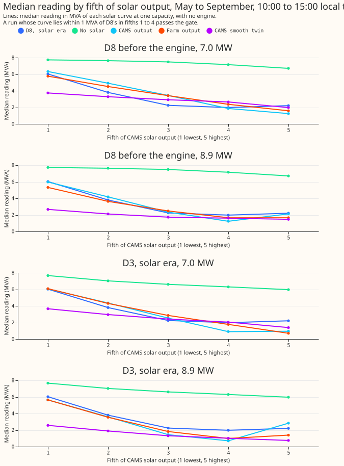
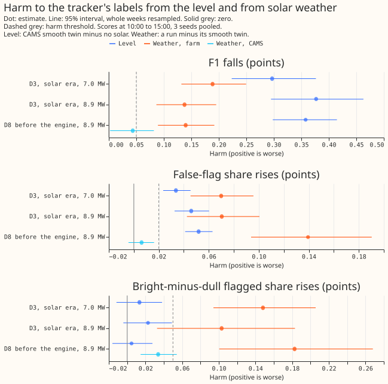
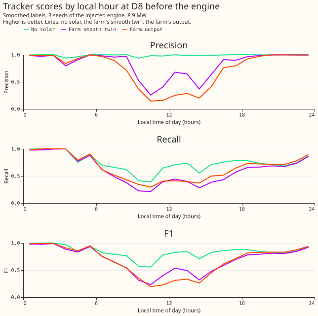
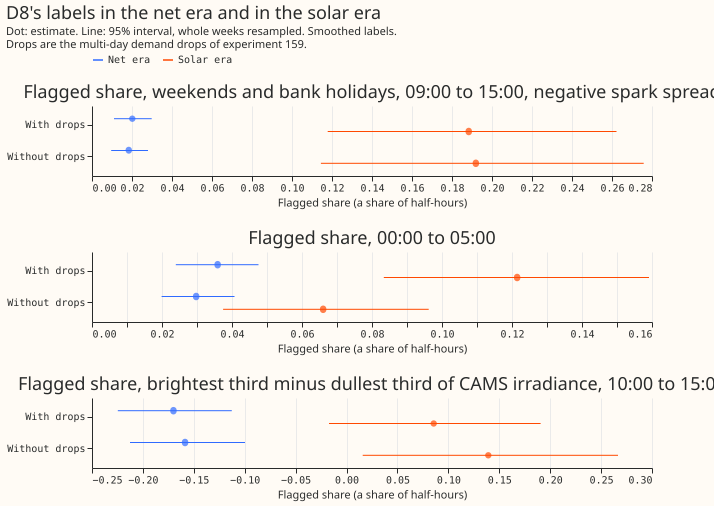

**The test could not decide, and the numbers it produced point to harm.** We asked whether solar
panels behind the meter of the substation D8 (which also has a gas engine behind its meter) make a
statistical tracker label the engine worse. The tracker is a filter that reads a substation's
half-hourly power and estimates how many blocks of the engine are running. We injected the recorded
output of a real solar farm, and a recorded gas-engine pattern, into real readings from two
substations, D8 and D3, and compared the tracker's labels with the injected truth. Under the
decision rule fixed before any score was seen, two audit clauses fired, so the verdict is
`inconclusive`. The pooled numbers point to real solar-farm output lowering the tracker's F1 score
(the balance of precision and recall) by 0.140 and raising its false-flag share (the share of
half-hours with no injected engine output that the tracker flags as running) by 0.139, against a
smooth solar curve of the same size, at D8 with 8.9 MW of solar between 10:00 and 15:00.

## Terms used on this page

- **D8, D3, and host:** D8 and D3 are substations. A host is a substation whose real reading carries
  the injected solar and engine output. The hosts are D8 and D3. Experiment 694's panel gives each
  host's reading and its CAMS shape (the stored panel of experiment 196, built by
  `studies.dp_features`).
- **D8 before the engine:** the span of D8's history before its own gas engine was connected, so the
  reading holds no engine output. The span is experiment 697's control C1. It is earlier than the
  net era below.
- **Tracker:** the grid filter of [experiment
  694](../00694-gas-engine-state-tracker-part-1/result.md) (its `M2` filter). For each half-hour it
  estimates how many equal blocks of the engine run. A block is 1.75 MW in the fits of the host runs
  that carry an engine.
- **Flag and false-flag share:** the tracker flags a half-hour when its smoothed probability (the
  probability after a backward pass that also uses later readings) that one or more blocks run
  exceeds 0.5. The false-flag share is the share of half-hours with zero injected engine output that
  the tracker flags. The filtered labels use earlier readings only, and the page quotes the smoothed
  labels unless it says otherwise.
- **PV and the solar term:** PV is photovoltaic (solar panel) generation. The solar term is the
  contribution of solar generation to the reading.
- **CAMS:** the Copernicus Atmosphere Monitoring Service, whose satellite-derived irradiance (the
  sunlight reaching the ground, in W/m2) we turn into a solar-output shape per megawatt at each
  host.
- **Net era and solar era:** experiment 697 divides D8's history into two periods. The net era is the
  period before solar generation began on the 11 kV distribution network around D8, and the solar
  era is the period after it ([experiment
  697](../00697-gas-engine-state-tracker-part-4-running-patterns/result.md) gives the dates).
- **Fold and reverse flow:** the fold is the reflection of the reading at zero. The meter reports
  the size of the net power and not its sign, so once solar and engine output exceed the demand
  behind the meter, the reading rises again. Reverse flow is a real power behind the reading below
  zero. The experiment applies the fold once, to the sum of solar and engine output.
- **Smooth twin:** a solar curve of the same capacity that carries the average daily and seasonal
  shape and no weather. The farm's smooth twin is the farm's own average output for each month and
  half-hour. The CAMS smooth twin is the average of the CAMS shape for each month and half-hour.
- **Level contrast and weather contrast:** the level contrast is the CAMS smooth twin minus a run
  with no solar, so it holds the harm from the lower level of the reading and its fold. The weather
  contrast is a run with real weather minus its own smooth twin (the farm run minus the farm's smooth
  twin, or the CAMS run minus the CAMS smooth twin). Harm is positive when the labels get worse.
- **Bright-minus-dull:** the flagged share in the brightest third of CAMS irradiance minus the
  flagged share in the dullest third, from 10:00 to 15:00. A tracker that reads cloud swings as
  engine steps shows a larger value.
- **Curve gate:** a host and capacity run only if the median reading by fifth of solar output lies
  within 1 MVA (megavolt-ampere) of D8's solar-era curve in each of the first four fifths.
- **Null control:** a series that carries an injected engine with no weekday, price, or schedule
  pattern, from experiment 697. The solar-free twin of D8 before the engine is that experiment's
  control C1.
- **Drops and off-spells:** the drops are the multi-day periods in which D8's power falls by 3 to 5
  MW for days at a time, listed in [experiment
  159](../00159-switching-d8-multi-day-drops-recurrence-and-report/result.md). An off-spell is a run
  of 48 half-hours or more that the smoothed labels call off. Step 4 (see Method) uses the
  off-spells.
- **Scorable half-hour and seed:** a scorable half-hour has a reading, is not on a clock-change day,
  and has a finite farm value. A seed fixes which days of Gas A the injected engine draws.
- **Gas A:** the one metered gas-engine record we hold. The page shows it only inside scores pooled
  over a whole run.

## Verdict: inconclusive

**By the rule fixed before any score was seen, the verdict is `inconclusive`, because the audit
blocks the test.** Two clauses of the first outcome of the decision rule fired:

- The paired half-width of the F1 of the farm weather contrast at D8 before the engine is 0.051,
  above the limit of 0.05.
- The farm series covers 0.859 of the daylight half-hours at both hosts, under the limit of 0.90.
  Daylight half-hours are those with a positive CAMS shape at the host.

The other clauses of the test held: the farm shape passes the curve gate at D8 with 8.9 MW, and the
solar-free twin reproduces a midday F1 of 0.767.

**The clause on coverage concerns half-hours outside the scored window.** The farm series has a
reading in 0.984 of the daylight half-hours from 10:00 to 15:00 in May to September at D8 and 0.992
at D3, so the missing half-hours lie mostly outside the 10:00 to 15:00 window that the criteria
read. The farm's gaps are filled with its own average and left out of every score.

**A reading chosen after seeing the scores is post hoc and does not change the verdict.** Without
the two clauses, the rule would have returned `supported` for the farm contrast, because the farm
weather contrast meets a criterion at D8 and at D3 at 8.9 MW, the one capacity that ran at both
hosts. A further test on D8's own off-spells (step 4, defined under Method) can lower `supported` to
`partly supported` only when its half-width is 0.10 or less, and its half-width is 0.69. We report
this reading as post hoc only.

**Two changes to the rule's clauses were made before any score was seen, and the page lists both.**
The planning commit (`f74324de9`) fixed the coverage clause at 95% of all half-hours of D8's span
and the half-width clause over every contrast at D8. After the audit printed a coverage of 0.914,
commit `4c6b78134` lowered the limit to 0.90 and applied it to each host's span. After a code review
estimated that about a fifth of daylight half-hours had no farm value, commit `7665d4dbb` counted the
coverage over daylight half-hours and narrowed the half-width clause to the farm weather contrast.
The first version of the rule, with its 95% limit, would also have returned `inconclusive` at 0.914.
The scores, the jobs, and the contrasts did not exist at either change.

## What the contrasts show

**The farm weather contrast shows harm at every host and capacity that ran, and the CAMS weather
contrast is weak.** Each cell holds the point estimate and the 95% interval from 2,000 resamples of
whole ISO weeks, with 3 seeds pooled and the smoothed labels. D8 before the engine has 73 weeks and
4,911 scored midday half-hours, and D3 has 49 weeks and 3,376. A positive number is worse. The
thresholds are 0.05 for F1 and for bright-minus-dull, and 0.02 for the false-flag share. The 7.0 MW
run at D8 did not pass the curve gate, and the CAMS shape did not pass it at D3.

| Host and capacity | Contrast | F1 falls | False-flag share rises | Bright-minus-dull rises |
|---|---|---|---|---|
| D8, 8.9 MW | level | +0.358 (+0.298 to +0.415) | +0.052 (+0.041 to +0.063) | +0.005 (-0.016 to +0.028) |
| D8, 8.9 MW | weather, farm | +0.140 (+0.089 to +0.192) | +0.139 (+0.094 to +0.190) | +0.183 (+0.100 to +0.268) |
| D8, 8.9 MW | weather, CAMS | +0.043 (+0.002 to +0.082) | +0.006 (-0.004 to +0.016) | +0.034 (+0.015 to +0.054) |
| D3, 7.0 MW | level | +0.297 (+0.224 to +0.377) | +0.034 (+0.023 to +0.045) | +0.013 (-0.012 to +0.038) |
| D3, 7.0 MW | weather, farm | +0.189 (+0.132 to +0.250) | +0.070 (+0.045 to +0.096) | +0.148 (+0.094 to +0.206) |
| D3, 8.9 MW | level | +0.377 (+0.295 to +0.463) | +0.046 (+0.033 to +0.060) | +0.023 (-0.004 to +0.049) |
| D3, 8.9 MW | weather, farm | +0.138 (+0.087 to +0.195) | +0.070 (+0.043 to +0.100) | +0.103 (+0.033 to +0.183) |

**The level contrast holds most of the F1 harm, and the weather contrast holds most of the harm to
the false-flag share and to bright-minus-dull.** At D8 with 8.9 MW, the total harm of the farm run
against no solar is F1 +0.495, false-flag share +0.180, and bright-minus-dull +0.181. The level
contrast is +0.358, +0.052, and +0.005 of those, and the farm weather contrast is +0.140, +0.139, and
+0.183. The same split holds at D3. The level contrast comes from the lower level of the reading and
its fold at zero. The smooth twin's real power behind the reading is in reverse flow in 7.5% of the
scorable midday half-hours (seed 0, all months), and within 1 MW of zero in another 18.4%, against
0.1% and 0.6% for the solar-free twin. From May to September the share in reverse flow is 8% for the
smooth twin, 20% for the farm run, and 23% for the CAMS run (the curve-gate table in
`printed/audit.txt`). The experiment cannot turn the fold off, so it cannot split the level contrast
any further. [Experiment 697](../00697-gas-engine-state-tracker-part-4-running-patterns/result.md)
had already shown the same kind of harm: its level-matched control moved the midday F1 from 0.767 to
0.559.

**With no engine injected, the injected farm's half-hourly variation alone makes the tracker flag
the engine.** The farm run's flagged share exceeds its smooth twin's by +0.146 (+0.098 to +0.198) at
D8, and the CAMS run's exceeds its twin's by +0.000. The tracker fits 3 blocks to the farm run with
no engine and none to the smooth twin. The farm's half-hourly changes at midday have a robust spread
(1.4826 times the median absolute change) of 0.758 MVA at D8, against 0.461 for the farm's smooth
twin and 0.276 with no solar. The farm sits at another site, so its cloud pattern is not the weather
at D8. The farm weather contrast therefore measures the effect of a rough solar curve and not of D8's
own weather.

**The CAMS weather contrast is weak, and a smoother curve is a simpler reason than any property of
the weather.** The CAMS run's F1 falls by 0.043 (+0.002 to +0.082), under the threshold of 0.05. The
CAMS shape is hourly and smoother than the farm's half-hourly series: the spread of half-hourly
changes is 0.520 MVA for the CAMS run, against 0.758 for the farm run. The thirds of the
bright-minus-dull criterion are thirds of the host's CAMS shape, so the criterion can show whether
the harm follows the host's own brightness, and it cannot show harm that follows the injected
source's brightness at another site. The audit's correlation of the farm with the host's CAMS shape
within each cell of month and half-hour is 0.765 at D8 and 0.724 at D3. The statement "weather
explains D8's swing between the eras" holds when the bright-minus-dull harm is at least 0.125 (about
half of the +0.256 swing in the label-only checks below) with the interval above zero. It holds for
the farm contrast (+0.183, 8.9 MW) and fails for the CAMS contrast (+0.034).

**Between the no-solar run and the farm run at D8, precision falls from 0.987 to 0.210.** The table
holds the pooled midday scores of 3 seeds, with the smoothed labels, on the scored rows. The no-solar
F1 is 0.766 on those rows and 0.767 on every observed half-hour.

| Run at D8 before the engine, 8.9 MW | Precision | Recall | F1 | False-flag share |
|---|---|---|---|---|
| No solar | 0.987 | 0.626 | 0.766 | 0.000 |
| Farm output | 0.210 | 0.380 | 0.270 | 0.180 |
| Farm's smooth twin | 0.482 | 0.357 | 0.410 | 0.041 |
| CAMS output | 0.391 | 0.342 | 0.365 | 0.058 |
| CAMS smooth twin | 0.446 | 0.376 | 0.408 | 0.052 |

## What the labels of D8 show before any injection

**Three label-only checks show that D8's labels in the solar era behave differently from the labels in
the net era, and none of the three shows that solar generation is the cause.** The checks read the
stored smoothed labels of experiment 694's tracker, with the drops kept. Intervals resample 1,000
times over whole weeks. The checks were seen before the thresholds were set.

| Check | Net era | Solar era | Swing (solar minus net) |
|---|---|---|---|
| Flagged share on weekends and bank holidays, 09:00 to 15:00, negative spark spread | +0.020 (+0.011 to +0.030) | +0.188 (+0.118 to +0.262) | +0.168 (+0.097 to +0.243) |
| Flagged share at night, 00:00 to 05:00 | +0.036 (+0.024 to +0.048) | +0.121 (+0.083 to +0.159) | +0.086 (+0.043 to +0.127) |
| Bright-minus-dull flagged share, 10:00 to 15:00 | -0.170 (-0.225 to -0.113) | +0.086 (-0.017 to +0.191) | +0.256 (+0.149 to +0.383) |

Without the drops the swings are +0.174, +0.036, and +0.298. The solar-era bright-minus-dull value
alone includes zero with the drops kept (+0.086, -0.017 to +0.191) and excludes it without them
(+0.139, +0.016 to +0.267). The night share also rises, and solar generation makes no power at
night, so the labels changed between the eras for at least one reason that solar output cannot
supply.

**The label-only checks are consistent with restricting experiment 697's price, weekday, and
schedule claims to the net era.** The weekend cheap-spark flag share rises from 0.020 to 0.188, the
night share from 0.036 to 0.121, and the bright-minus-dull share changes sign. These changes are
observations about the labels and not a verdict. The changes do not show that the solar-era pattern
in experiment 697 is false. Experiment 697's claims concern 16:00 to 19:00, and this experiment
computes no criterion there.

## Figures

**Figure 1 shows which solar curves reproduce D8's solar-era reading.** Each panel is one host and
capacity. Lines show the median reading by fifth of CAMS solar output, May to September, 10:00 to
15:00, for D8's solar era, no solar, the CAMS run, the farm run, and the CAMS smooth twin. The farm
and CAMS runs at D8 with 8.9 MW and the farm run at D3 pass the gate.

**Figure 2 shows the harm from the level and from weather at each host.** Dots are estimates and
lines are 95% intervals for each criterion. The farm weather contrast is orange, the CAMS weather
contrast is sky blue, and the level contrast is blue.

**Figure 3 shows the tracker's scores by local hour at D8 before the engine with 8.9 MW.** The farm
run (orange) and its smooth twin (purple) lie below the no-solar run (green) in the middle of the
day and close to it at night. Hourly values are not printed, so the figure carries no further claim.

**Figure 4 shows the three label-only checks by era.** Blue is the net era and orange is the solar
era, with and without the drops.

## What the experiment cannot show

- **The amount of solar generation behind D8's meter is unknown.** The capacities of 7.0 MW and
  8.9 MW come from the private review and from [experiment
  673](../00673-pv-capacity-for-nged-per-primary-with-register-cross-check/result.md)'s register
  row, and the curve gate only checks that the injected curve resembles D8's solar-era reading.
- **The injected farm is at another site.** Its cloud pattern is not D8's weather. The CAMS contrast
  uses the weather at the host's own location, the nearest of the checks we ran, and that contrast
  is weak.
- **One engine record supplies the engine.** Gas A is one engine with its own running pattern, drawn
  as whole days with no weekday pattern, so other engines may behave differently.
- **Step 4's recall contrast is too imprecise to lower a verdict.** The contrast (bright minus dull,
  solar era minus net era) is +0.275 (-0.617 to +0.754), with a half-width of 0.69 against the 0.10
  that the rule requires. Whole local days inside off-spells give 57 days in the net era and 16 days
  (768 half-hours) in the solar era.
- **The criteria are read at 10:00 to 15:00 only.** The experiment says nothing about the evening
  window of experiment 697.

## Options for handling solar generation in the reading

**One option is to subtract an estimate of the solar term before the tracker reads the reading, and
another is to restrict the tracker's claims.** An estimate of the solar term from CAMS, from a
fitted solar model, or from a neighbouring solar farm could shrink the level and weather harm at
midday, but adds an estimate whose own error enters the labels. Alternatively, claims could be
restricted to hours and seasons with little sunlight, or to the net era, with the solar era left to
a method that models the solar term. The experiment gives no basis to choose among the options.

## Open questions for a later experiment

**Two designs might settle the weather question.** A design whose paired half-width for the farm
weather contrast falls under 0.05, together with a coverage measure over daylight half-hours chosen
before the audit, might decide it. A test with weather taken from the host's own CAMS irradiance
would separate the farm's roughness from real weather as the cause.

## Checks

- **The audit passed with 0 failed checks.** The audit asserts the midday F1 of experiment 697's
  control C1 (0.767) and of its level-matched control (0.559), the false-flag share of the
  level-matched control (0.020 with zero injected output, 0.027 with under 1 block), the lag-0
  alignment of the reading and of the farm with the CAMS shape (strongest correlation at lag 0 in
  four tests), and step 4's counts in the net and solar eras of 52 and 29 off-spells (4,913 and
  2,083 half-hours) and of 57 and 16 whole days.
- **The weekend cheap-spark share is 0.188 under this experiment's row definition** (observed
  half-hours not on a clock-change day, drops kept).
- **None of the conditions that call for an audit of this experiment held, by the author's
  reading:** no control failed, the result agrees in direction with the prediction, a leave-one-out
  check is not possible with two hosts, and no sister experiment gives an interval to compare with.
  The maintainer decides whether to run an audit.
- **A fresh Sonnet agent reviewed the code before the first run.** The code guards against the three
  faults the review found: a farm contrast whose twin shared no level with the farm, `--ignore-gate`
  writing jobs, and a failed audit writing the gate.
- **Anonymisation holds.** No SVG text node holds a four-digit year, no printed file holds a date,
  and the private data folder holds every dated series.

## Method

**Architecture.**

- **Tracker:** experiment 694's `M2` grid filter, run through experiment 697's `track_span`, with
  the smoothed labels as the headline and the filtered labels beside them. The fitted block is 1.75
  MW for the three engine seeds of every scored cell, and 2.25 MW or 3.50 MW in step 4's solar-era
  fits.
- **Injected engine:** Gas A's whole local days, drawn at random with no weekday pattern by
  experiment 697's `drive_series` (kind `null`), with the seed recipe of experiment 697.
- **Injected solar:** at 7.0 MW and 8.9 MW of AC capacity, one of four curves: the farm's
  normalised half-hourly output (the farm is one of the four of experiment 662, chosen as the one
  with the highest finite share over both spans), the CAMS shape of the host, and the two smooth
  twins. Farm gaps are filled with the farm's cell mean and are left out of every score. The CAMS
  shape comes from the stored panel of experiment 196, built by `studies.dp_features`.
- **Fold:** the real power behind a reading is `sqrt(max(y^2 - q^2, 0))`, where `y` is the reading and
  `q` = 0.14 MVA is the reactive-power floor of experiment 196. Solar and engine output are
  subtracted together once, and the reading is `sqrt((real - total)^2 + q^2)`. The signed real power
  is stored for the fold census.
- **Hosts:** D8 before the engine (the span of experiment 697's control C1) and D3 in its solar era
  (control C2).

**Training regime.**

- **No machine-learning model is trained.** The tracker's fits are the fits the filter computes on
  each injected reading, at 22 to 51 seconds per run on CPU.
- **Jobs:** 58 runs (48 on host readings and 10 on D8's own readings), with 3 seeds for each host,
  capacity, and shape plus a run with no engine, on 8 workers in 283 seconds. The curve gate left 48
  of the 72 host runs that the design allows.
- **Seeds:** the engine's day draw uses seed 0 to 2 plus the series offset and the control offset of
  experiment 697, so the D8 twin draws the days of control C1.

**Measurement.**

- **Rows:** scorable half-hours from 10:00 to 15:00 local time. Every run of a host is scored on the
  same rows.
- **Metrics:** F1 against the injected truth (one or more blocks running, at least 0.985 MW), the
  false-flag share, and the bright-minus-dull flagged share, with thirds of the host's CAMS shape
  within each cell of local half-hour, weekday class, and month, above 50 W/m2.
- **Intervals:** one draw of whole ISO weeks (2,000 resamples) serves every run of a host, so each
  contrast is paired. The label-only checks use 1,000 resamples.
- **Decision rule:** as in the front matter, with the curve gate, the twin's F1, the paired
  half-width of the farm weather contrast, and the coverage clause tested first.
- **Step 4:** Gas A is injected into whole local days inside off-spells in D8's stored labels, 5
  seeds in each era, and the recall by CAMS third is compared between the eras.
- **Thresholds:** 0.05 (F1 and bright-minus-dull) and 0.02 (false-flag share) were set after seeing
  the stored controls of experiment 697, so they are not an independent test. The coverage limit is
  90% of daylight half-hours, and the changes to it are listed under Verdict.
- **Grey in the figures:** the zero line and the threshold line use the theme's grey
  (`ENSEMBLE_LINE`), which is not one of the five main Open Climate Fix (OCF) colours. The
  maintainer may replace that grey.

## Files

- `ml-experiments/00698-gas-engine-state-tracker-part-5-does-pv-harm-the-disaggregation/e00698_common.py`:
  constants, the job list, the farm loader (copied from experiment 405's `farm_norm_series`, because
  importing it needs `torch`), the solar curves, the fold, the paired week-block intervals, and
  the audit marker check.
- `e00698_audit.py`: the data audit and curve gate (steps 1 and 2). Writes `printed/audit.txt` and
  the private `audit.json` and `gate.json`.
- `e00698_jobs.py`: the tracker runs (steps 3 and 4), one `jobs/<name>.npz` each. Writes
  `printed/jobs.txt`.
- `e00698_labels.py`: the three label-only checks of D8 by era.
- `e00698_score.py`: the five contrasts, the pooled scores, the fold census, the spread of changes,
  and step 4's recall. Writes `printed/score_report.txt` and the private `scores.json`.
- `e00698_verdict.py`: applies the decision rule. Writes `printed/verdict.txt` and `verdict.json`.
- `e00698_figures.py`: the four published figures, with a guard against a year in any SVG text.
- `e00698_selftest.py`: 27 known-answer tests on synthetic inputs.
- `docs/ml-experiments/00698-gas-engine-state-tracker-part-5-does-pv-harm-the-disaggregation/f1_curve_gate.svg`
  to `f4_label_only_checks.svg`: the four figures.
- `data/ml-experiments/00698-gas-engine-state-tracker-part-5-does-pv-harm-the-disaggregation/`:
  private. It holds `jobs/` (dated runs, read by `e00698_score.py`), `audit.json`, `gate.json`,
  `scores.json`, and `verdict.json`.
- Inputs from earlier experiments: experiment 694's panel and D8 era records, experiment 697's
  stored frames, controls, and engine draw, experiment 695's grid helpers, and experiment 39's farm
  frame.
