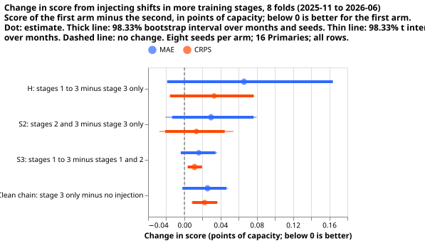
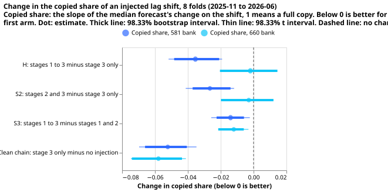
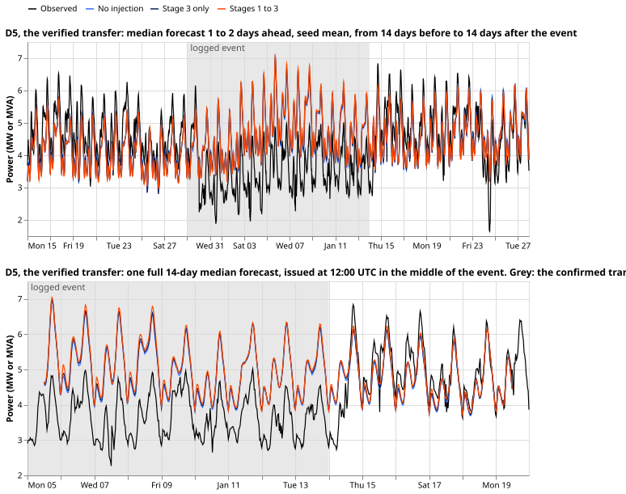
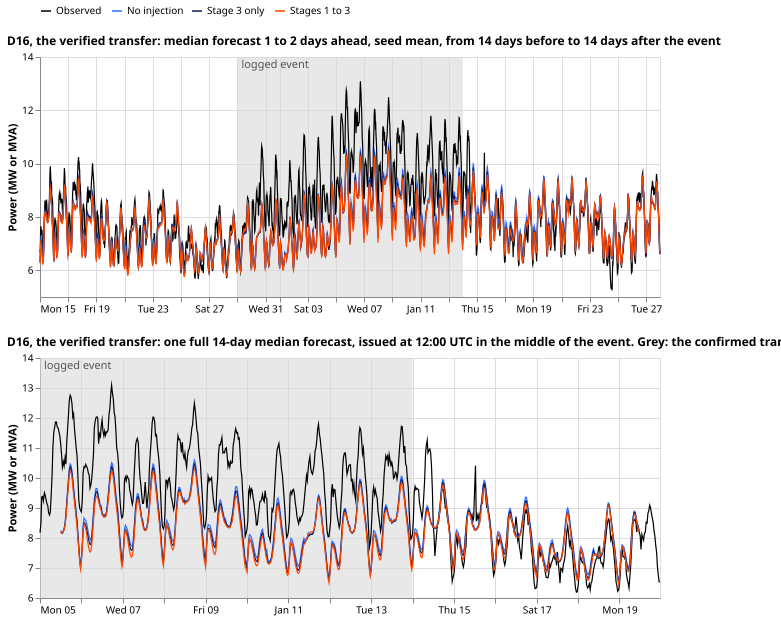
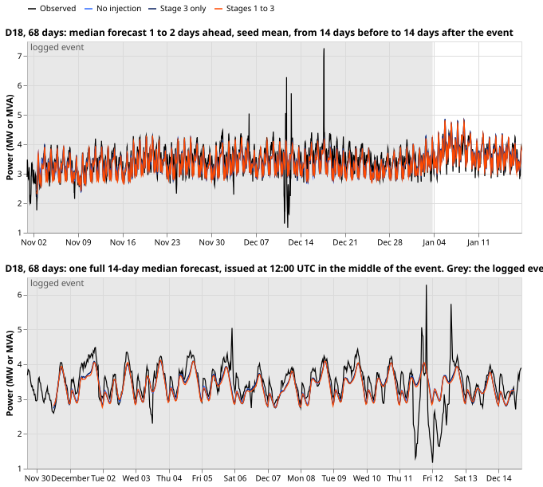
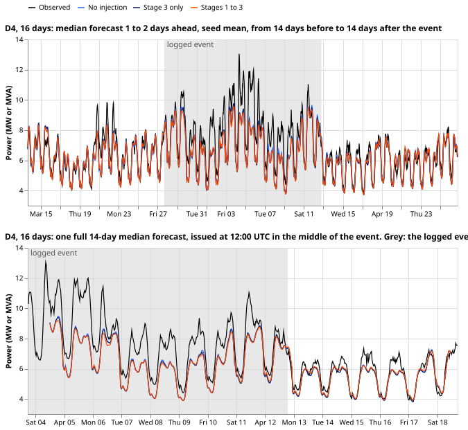
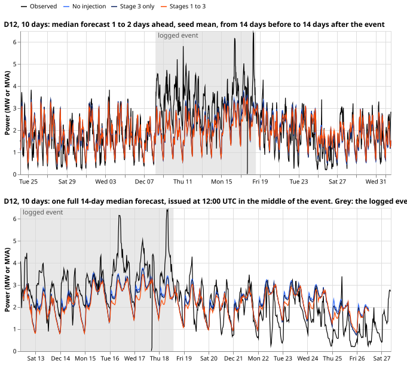
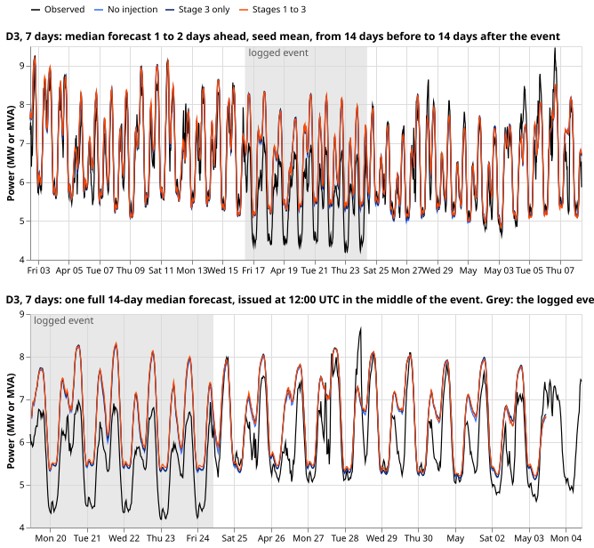

**We asked whether a demand forecasting neural network can learn to ignore false jumps in its
lagged power inputs if it sees simulated jumps in every training stage, and not only in the last
one.** The network is the Candidate, which forecasts the power drawn at 16 Primary substations
(substations that step 33 kV or 66 kV down to 11 kV) up to 14 days ahead. Two of its inputs are the
power drawn 24 hours and 1 week earlier. A switching event, in which the network operator moves load
from one substation to another, makes those two inputs misleading for days or weeks. We therefore
train the Candidate on simulated switching events: shifts of 15%, 30%, or 50% of a substation's
capacity, lasting 3 to 30 days, added to the lagged inputs. The Candidate trains in three stages,
and today the simulated shifts reach only the last stage, a short fine-tune.

**We trained five variants of the Candidate that differ only in which stages see the simulated
shifts, and scored them on 8 months of forecasts.** Each variant was trained with 8 random seeds for
each of 8 monthly refits (November 2025 to June 2026), and every forecast was scored against the
power actually measured. The score is the mean absolute error (MAE) of the median forecast, in
points of capacity (1 point is 1% of a substation's capacity). We also scored the whole forecast
distribution with the continuous ranked probability score (CRPS), and measured how much of a
simulated shift the median forecast copies.

**Showing the shifts in every stage did not give back forecast skill, and the data could not say
whether the change helps or harms.** Against the present recipe (shifts in stage 3 only), the
variant with shifts in all three stages had a higher MAE by 0.066 points (interval −0.019 to
+0.164) and a higher CRPS by 0.033 (interval −0.016 to +0.077). The plan predicted a fall of at
least 0.022 points of MAE, and the plan said in advance that the noise between seeds would probably
hide an effect of that size. It did. On a held-out bank of simulated shifts, the same variant copied
3.9% of a shift where the present recipe copies 7.5%. On a second bank of shifts from a different
generator, the copied share did not change (−0.002, interval −0.021 to +0.015).

## Verdict: inconclusive

**The verdict is `inconclusive`, as the plan predicted.** The verdict rests on one contrast, the
variant with shifts in all three stages minus the present recipe (family H). Its MAE and CRPS
intervals include zero. Both MAE intervals exclude the predicted regain of 0.022, but the CRPS
bootstrap interval reaches −0.0159, which is below the predicted −0.014. The data therefore cannot
rule out the predicted CRPS regain, so the rule gives `inconclusive` and not `not supported`. Two
further contrasts (families S2 and S3) are labelled findings and never decide the verdict.

**Take-home message: do not spend more experiments on moving the injection earlier in training to
regain skill.** The data do not show that earlier injection helps. All three MAE contrasts that
bear on earlier injection have positive point estimates (the treatment is not better), and so do
all three CRPS contrasts. Stage 3 alone already lowers the copied share on the training generator's
bank from 12.7% to 7.5%, and the remaining stages lower it a further 3.5 points on that bank and
not at all on the second bank. The experiment could not rule out a small gain or a small loss in
skill: family H's MAE interval runs from −0.019 to +0.164. The sizing of the noise shows that no
seed count up to 16 would have resolved the predicted size.

**Eight seeds cannot resolve a difference of 0.022 points of MAE.** The standard deviation of
all-rows MAE between the 8 seeds of one arm is 0.07 to 0.09 points, and between the seeds of the
first fold alone 0.36. The "Sizing" section gives the expected interval half-widths, which stay
above 0.07 at 16 seeds.

## Results

### Skill and copied share

**All-rows skill gets slightly worse as shifts reach more stages, but every difference is within
the noise.** The table gives the mean over 8 seeds and 8 folds of each seed's MAE and CRPS on the
2,492,233 forecast rows that every arm shares. The manual heuristic and climatology are the two
reference forecasts.

| Arm (stages that see shifts) | MAE | CRPS | Copied share, 581 bank | Copied share, 660 bank |
|---|---|---|---|---|
| No injection (none) | 7.322 | 4.108 | 0.127 | 0.082 |
| Stage 3 only (the present recipe) | 7.348 | 4.130 | 0.075 | 0.024 |
| Stages 2 and 3 | 7.377 | 4.144 | 0.048 | 0.021 |
| Stages 1 and 2 | 7.398 | 4.152 | 0.053 | 0.034 |
| Stages 1 to 3 (the treatment) | 7.414 | 4.163 | 0.039 | 0.022 |
| Manual heuristic | 8.401 | 4.807 | | |
| Climatology | 10.157 | 5.671 | | |

**The copied share is the slope of the median forecast's change on an injected shift.** A share of
1 is a full copy and 0 means the forecast ignores the shift. The 581 bank holds shifts from
experiment 581's generator, which every training stage used. The 660 bank holds shifts from
experiment 660's generator, a different one that no stage saw, with shifts drawn for each Primary's
scored window.

**Family H, the contrast that decides the verdict, is positive on both scores, and both intervals
include zero.** Each contrast is the first arm minus the second, so positive means the first arm
is worse. "Bootstrap" resamples months, and then seeds within each month. "t" is a row-weighted t
interval on the eight monthly differences. Both are read at 98.33%, because each family of 3
contrasts shares a 5% error rate.

| Contrast (first arm minus second) | Score | Estimate | Bootstrap interval | t interval |
|---|---|---|---|---|
| H: stages 1 to 3 minus stage 3 only | MAE | +0.0660 | −0.0189 to +0.1640 | −0.0105 to +0.1424 |
| H | CRPS | +0.0329 | −0.0159 to +0.0767 | −0.0001 to +0.0659 |
| H | Copied share, 581 bank | −0.0354 | −0.0483 to −0.0209 | −0.0517 to −0.0191 |
| H | Copied share, 660 bank | −0.0020 | −0.0205 to +0.0145 | −0.0174 to +0.0134 |
| S2: stages 2 and 3 minus stage 3 only | MAE | +0.0295 | −0.0134 to +0.0764 | −0.0207 to +0.0797 |
| S2 | CRPS | +0.0133 | −0.0212 to +0.0446 | −0.0275 to +0.0541 |
| S2 | Copied share, 581 bank | −0.0266 | −0.0371 to −0.0140 | −0.0413 to −0.0119 |
| S2 | Copied share, 660 bank | −0.0029 | −0.0199 to +0.0121 | −0.0166 to +0.0107 |
| S3: stages 1 to 3 minus stages 1 and 2 | MAE | +0.0160 | −0.0038 to +0.0345 | −0.0041 to +0.0361 |
| S3 | CRPS | +0.0113 | +0.0038 to +0.0196 | +0.0035 to +0.0190 |
| S3 | Copied share, 581 bank | −0.0140 | −0.0225 to −0.0059 | −0.0257 to −0.0023 |
| S3 | Copied share, 660 bank | −0.0120 | −0.0215 to −0.0060 | −0.0209 to −0.0031 |
| Clean chain: stage 3 only minus no injection | MAE | +0.0255 | −0.0021 to +0.0465 | +0.0028 to +0.0482 |
| Clean chain | CRPS | +0.0224 | +0.0089 to +0.0362 | +0.0078 to +0.0370 |
| Clean chain | Copied share, 581 bank | −0.0522 | −0.0660 to −0.0406 | −0.0697 to −0.0348 |
| Clean chain | Copied share, 660 bank | −0.0579 | −0.0740 to −0.0436 | −0.0746 to −0.0412 |

**Two contrasts have CRPS intervals wholly above zero, on the harm side: S3 and the clean chain.**
Adding the stage-3 injection on top of injection in stages 1 and 2 raises CRPS by 0.0113 (both
intervals above zero) and lowers the copied share on both banks. This is a labelled finding from the
eight-fold read and not verdict material. It means that, once stages 1 and 2 have seen shifts, the
stage-3 injection does not add skill. The clean-chain contrast, stage 3 only minus no injection, has
the same sign (+0.0224 on CRPS, both intervals above zero), which agrees with experiment 677's
stored +0.027.

**Injecting at every stage adds little copied-share reduction beyond stage 3.** On the 581 bank the
copied share falls from 0.127 (none) to 0.075 (stage 3 only) and to 0.039 (stages 1 to 3). On the
660 bank the copied share falls from 0.082 to 0.024 with stage-3 injection, and the remaining
stages change it by −0.002. Training on the generator's own shifts earlier makes the network
better at that generator's shifts, and it does not carry over to a different generator.

### Where the extra error sits

**The point estimate of family H is positive in every lead band, every metering group, and every
load-shift scenario.** The table gives the contrast of stages 1 to 3 minus stage 3 only on MAE,
read at 95% and not at the family level. Only the two shortest lead bands have both intervals above
zero. The rows are the half-hours that every arm and both baselines have a forecast for. The
point estimates for the three metering groups are +0.2753 (the two Primaries D15 and D18, 285,287
rows), +0.0494 (the eight MVA-only Primaries), and +0.0249 (the six signed-MW Primaries).

| Rows | Half-hours | MAE contrast | Bootstrap interval | t interval |
|---|---|---|---|---|
| All rows | 2,492,233 | +0.0660 | −0.0035 to +0.1432 | +0.0081 to +0.1238 |
| Outside every logged event and 7 days after | 1,597,245 | +0.0581 | −0.0280 to +0.1483 | −0.0010 to +0.1173 |
| Inside a logged event | 612,041 | +0.1046 | −0.0252 to +0.2731 | −0.0486 to +0.2578 |
| 7 days after a logged event | 282,947 | +0.0266 | −0.0493 to +0.1205 | −0.0365 to +0.0897 |
| Days 0 to 1 | 184,885 | +0.0774 | +0.0080 to +0.1578 | +0.0153 to +0.1396 |
| Days 1 to 3 | 366,606 | +0.0766 | +0.0041 to +0.1631 | +0.0079 to +0.1453 |
| Days 3 to 7 | 720,534 | +0.0766 | −0.0033 to +0.1691 | −0.0015 to +0.1546 |
| Days 7 to 10 | 529,218 | +0.0679 | −0.0086 to +0.1474 | +0.0071 to +0.1288 |
| Days 10 to 14 | 690,990 | +0.0447 | −0.0374 to +0.1283 | −0.0141 to +0.1035 |

**NGED's logs may miss events.** The rows "outside every logged event" can therefore hold events
that no label covers, so the harm shown there may be understated and the rows "inside" may be
undercounted. The events are the logged events that overlap the 8 months (the table of [experiment
653](../00653-edge-state-event-table-penalised-segmentation/result.md)) plus the verified transfer
between two Primaries from 2025-12-30 to 2026-01-15. The harm is largest inside a logged event
(+0.1046), which is the opposite of what the treatment is for.

**The mean forecast is an approximation from the 11 stored quantiles.** The median minus the mean
forecast is −0.709 points for no injection and −0.720 for stages 1 to 3, so no arm's spread shifts
its median. One Primary, the series with time_series_id 12, has a median 5.4 to 5.9 points below
its mean in every arm, and no other Primary exceeds 1.6 in size.

### Tails, cold nights, and curtailment

**Injecting shifts barely changes the tails, and every arm's q05 to q95 band is too narrow.**
The table gives the share of scored half-hours at or below each quantile forecast. A calibrated
forecast gives the quantile's own level.

| Arm | q01 (1%) | q05 (5%) | q95 (95%) | q99 (99%) |
|---|---|---|---|---|
| No injection | 2.03% | 7.31% | 92.01% | 97.73% |
| Stage 3 only | 1.96% | 7.11% | 91.64% | 97.59% |
| Stages 2 and 3 | 2.04% | 7.21% | 91.52% | 97.48% |
| Stages 1 and 2 | 2.01% | 7.23% | 91.50% | 97.48% |
| Stages 1 to 3 | 2.00% | 7.24% | 91.49% | 97.45% |

**The q05 to q95 band is 25.4 to 25.6 points wide in every arm.** The mean width is 25.613 (no
injection), 25.601 (stage 3 only), 25.511 (stages 2 and 3), 25.430 (stages 1 and 2), and 25.448
(stages 1 to 3). Experiment 603 found narrower bands in arms injected in pre-training, and this
experiment finds a band 0.15 points narrower (0.6%) for stages 1 to 3 than for stage 3 only,
against a CRPS that is 0.033 higher.

**Cold nights and the cost of avoidable curtailment follow the order of the arms on all rows.**
The protocol rows are the half-hours that the arms of experiment 668's comparison share, at 13
Primaries (6 with signed-MW meters and 7 with MVA-only meters), not the 16 Primaries of the main
scores. A cold night is a half-hour at 3 °C or below, as defined in `studies.eval_protocol`. MAE of
the median, in points of capacity:

| Metering group, rows | None | Stage 3 only | Stages 2 and 3 | Stages 1 and 2 | Stages 1 to 3 |
|---|---|---|---|---|---|
| Signed-MW six, all rows | 5.302 | 5.348 | 5.352 | 5.369 | 5.382 |
| Signed-MW six, cold nights | 6.659 | 6.789 | 6.829 | 6.865 | 6.878 |
| MVA-only seven, all rows | 5.474 | 5.508 | 5.540 | 5.553 | 5.565 |
| MVA-only seven, cold nights | 4.291 | 4.300 | 4.390 | 4.434 | 4.421 |

**Injection raises the avoidable-curtailment cost, and more injected stages raise it more.** At the
limit fraction of 0.5 the cost is 4.4% higher for stage 3 only and 8.8% higher for stages 1 to 3
than for no injection, and at 0.9 it is 5.9% and 13.9% higher. The GAM costs less than every
network arm. The measure is
`avoidable_curtailment_cost` of `studies.eval_protocol`, summed over the six signed-MW Primaries,
in pounds, at limit fractions of 0.5 and 0.9. It is read only at those Primaries because unsigned
MVA meters hide reverse flow.

| Forecast | Cost at limit 0.5 | Cost at limit 0.9 |
|---|---|---|
| No injection | £56.8 million | £7.37 million |
| Stage 3 only | £59.3 million | £7.80 million |
| Stages 2 and 3 | £61.9 million | £8.45 million |
| Stages 1 and 2 | £61.2 million | £8.30 million |
| Stages 1 to 3 | £61.7 million | £8.40 million |
| Manual heuristic | £86.7 million | £10.35 million |
| GAM | £46.8 million | £4.21 million |
| Climatology | £91.2 million | £10.98 million |

### Forecasts around switching events

**The page shows the six logged events that the plan fixed before the fits.** They are the verified
transfer at the two Primaries D5 and D16, and the four longest other events in the plan's set (at
D18, D4, D12, and D3). Each figure has two panels: the median forecast 1 to 2 days ahead, averaged
over the 8 seeds, from 14 days before to 14 days after the event, and one full 14-day forecast
issued in the middle of the event. Grey marks the event. The arms drawn are the present recipe, the
treatment, and the observed power. The plan's event-free fortnight panels were not drawn (see
"Departures").

### Noise, sizing, and the flagged fit

**The first fold is the noisiest, and the contrast of family H changes sign in two folds.** The
contrast of family H on MAE is +0.191 in 2025-11, +0.068 in 2025-12, +0.065 in 2026-01, +0.024 in
2026-02, −0.014 in 2026-03, +0.104 in 2026-04, +0.100 in 2026-05, and −0.032 in 2026-06. Without
fold 2025-11 the contrast is +0.0480 (bootstrap −0.0299 to +0.1207; t −0.0161 to +0.1120, at
98.33%). Seed against seed, the contrast is positive for 7 of 8 seeds (−0.069, +0.171, +0.054,
+0.122, +0.048, +0.051, +0.095, +0.056).

**The flagged fit is seed 0 of the stage-3-only arm in fold 2025-11.** The fit scores an MAE of
7.309 in that fold, 3.4 standard deviations from the other seven seeds. It stopped after 9 epochs
at a validation loss of 0.413. The fit is kept in every contrast, as the plan fixed.

**Leaving one Primary out never changes the sign of family H.** The point estimate of the MAE
contrast stays between +0.037 and +0.075 over the 16 leave-one-out contrasts, and the 95%
bootstrap interval excludes zero only when time_series_id 7 is left out (+0.074). The CRPS contrast
stays between +0.023 and +0.038, and no leave-one-out interval excludes zero.

**The seed-mean forecast gives the same sign.** With the 8 seeds averaged into one forecast, the
MAE of the present recipe is 7.139 and of stages 1 to 3 is 7.225, a contrast of +0.0858
(bootstrap over months only, +0.0231 to +0.1511); the CRPS is 4.009 and 4.048.

**The S3 contrast and the clean-chain contrast do not differ.** The S3 contrast minus the
clean-chain contrast is −0.0095 on MAE (bootstrap −0.0361 to +0.0200, at 95%), so stage-3 injection
adds the same MAE whether or not stages 1 and 2 saw shifts.

## Predictions

**Two of the six predictions held (P3 and P5), and four failed (P6 at the four-fold screen, P1, P2,
and P4).** P6 is listed first because the plan made it a stop rule.

| Prediction | Result |
|---|---|
| P6: the refitted stage 3 only minus no injection lies between +0.015 and +0.075 on MAE, and the copied shares lie within 0.020 of 0.075 and 0.123 | **Failed at the four-fold screen** (+0.0141); +0.0255 on eight folds is inside the range, and the shares are 0.075 and 0.127 |
| P1: H, MAE at most −0.022, both intervals below zero | Failed: +0.0660, both intervals include zero |
| P2: H, CRPS at most −0.014, both intervals below zero | Failed: +0.0329, both intervals include zero |
| P3: H, copied share non-inferior at 0.012 on both intervals | Held on the 581 bank (upper ends −0.0209 and −0.0191). Not shown on the 660 bank (upper ends +0.0145 and +0.0134), so the claim is "on the training generator's distribution" |
| P4: S2, MAE and CRPS below zero with both intervals below zero, copied share non-inferior | Failed: MAE +0.0295, CRPS +0.0133 |
| P5: S3, copied share at most −0.012, both intervals below zero | Held: −0.0140 (581 bank) and −0.0120 (660 bank) |

## Checks

**P6 failed at the four-fold screen, and this lowers confidence in treating the refitted clean chain
as a replica of experiment 677's stage-3-only arm.** The plan made P6 a stop rule: the screen
reads it on the four phase-A folds (2025-11, 2026-01, 2026-04, and 2026-06), and the run stopped
for the manager's decision. The stage-3-only arm minus the no-injection arm was +0.0141 on MAE
there, 0.0009 below the lower edge of +0.015. The bootstrap interval of that four-fold contrast is
−0.0295 to +0.0439 and the t interval is −0.0342 to +0.0623, so the t interval includes the stored
+0.045 and the bootstrap interval ends 0.001 below it. The reproduction of fold 2026-01 at seeds 0
to 2 (phase A0) matched experiment 677's stored per-seed scores, and the known-answer table (below)
matched on the scoring path, so the code and the data are unchanged. The miss is therefore noise in
a four-fold, within-seed contrast. The manager decided that the experiment continues. This page does
not relabel the failure. The eight-fold reading is +0.0255, inside the range, and is reported beside
the failed screen and not instead of it.

**The known-answer table reproduces experiment 677's stored contrast on the stored forecasts.** The
stored seeds 0 to 2 give a MAE of 7.124 (no injection) and 7.165 (stage 3 only), a contrast of
+0.042 (interval +0.020 to +0.065), CRPS of 3.994 and 4.020 (+0.027, +0.014 to +0.043), and copied
shares of 0.123 and 0.075 (−0.047, −0.061 to −0.036). The plan's first reference table was 7.169,
7.213, and +0.045; the "Departures" section explains the change.

**Median minus mean, MAE beside CRPS, and the audit triggers.**

- **The median forecast minus the mean forecast, per Primary,** is −0.709 to −0.720 on average in
  every arm, and one Primary (time_series_id 12) has −5.4 to −5.9. No arm shifts its median.
- **The MAE contrast beside every CRPS contrast** has the same sign in every family and on both
  banks (H +0.066 and +0.033, S2 +0.030 and +0.013, S3 +0.016 and +0.011, clean chain +0.026 and
  +0.022), so trigger 3 did not fire.
- **Trigger 1 (a control fails) fired,** because P6 failed at the four-fold screen. The reproduction
  and the known-answer table passed, which points to noise, and the runner cannot run the audit.
- **Trigger 2 (a result contradicts its own prediction) fired.** The point estimates of P1, P2, and
  P4 have the opposite sign to the predictions. The plan predicted that P1 and P2 would not be
  resolved. The descriptive readings above test the noise explanation and do not settle it.
- **Trigger 4 (leaving one site out flips a contrast) did not fire.** The sign of family H never
  flips.
- **Trigger 5 (a nested arm beats the arm that contains it) did not fire.** The arms differ in the
  stages that see shifts and not in their inputs, so no arm is nested in another.
- **Trigger 6 (an interval more than twice or under half a sister experiment's) was not assessed.**
  Experiment 677's stored interval is a months-only bootstrap with the seeds fixed, which is not a
  comparable interval.
- **Trigger 7 (a later design depends on this result) is not applicable now.**
- **No audit was run.** The runner cannot start one, and the manager decides whether trigger 1 or 2
  calls for one.

**The experiment's own checks passed.** `e00699_checks.py all` prints:

- 21 input tables unchanged, and the cleaned-power table's dropped rows unchanged (Delta version 493,
  hashed at version 490);
- no valid time on or after 2026-07-01 in 748 forecast, score, and bank files;
- world seed ranges, injection shares in 0.04 to 0.10, the time guard, and the target guard on 48
  stage records;
- 688 bank files with identical lag shifts per fold, and training worlds that end before the bank's
  first shift;
- the weather of each forecast taken at or before its origin (40 predict-phase files, and 7 exported
  files with an NWP initialisation time at or before the native origin);
- equal training budgets: the stage-1, stage-2, and stage-3 counts agree across chains in all 8
  folds;
- the B1 statistics of 24 files equal experiment 677's;
- 64 recorded initial-weight hashes equal a fresh network built with the same seed;
- no file in experiment 677's data folder is newer than the input hashes.

**The exported forecast files are valid.** The seven files hold 20,213,760 rows each for the new
arms and 7,580,160 for the stored arms, with no duplicate key (`time_series_id`, `nwp_init_time`,
`valid_time`, seed), no null or NaN quantile, no crossing of adjacent quantiles, and valid times in
UTC from 2025-11-01 12:00 to 2026-06-30 23:30.

## Method

- **Architecture:** experiment 677's step 5, which is arm A1 of [experiment
  591](../00591-shared-lag-encoder-auxiliary-shift-depth-loss/result.md) with no auxiliary loss. The
  network has a weather encoder, a date-time encoder, one shared lag encoder that reads the 24-hour
  and the 1-week lag, an 8-wide Primary embedding, and a mixer. The mixer feeds a three-component
  Gaussian mixture from which 11 sorted quantiles are read. The forecast reads only weather
  forecast fields issued at or before the forecast origin.
- **Training regime:** three stages for each monthly fold and seed. Stage 1 pre-trains the whole
  network on ERA5 and CAMS (two estimates of past weather). Stage 2 freezes the weather and
  date-time encoders and trains a fresh mixer on stored ensemble weather forecasts over a 730-day
  window with a 7-day embargo. Stage 3 fine-tunes from the stage-2 weights with recency weights.
  The lag encoder trains in all three stages. Each arm differs only in which stages read lag inputs
  that carry [experiment 581](../00581-robust-multiweek-lag-encoder-x3/result.md)'s synthetic
  shifts: 5% of each Primary's half-hours, depth 0.15, 0.30, or 0.50 of capacity, length 3, 7, 15,
  or 30 days, random sign and start, added to the lag columns and never to the training target.
  Each stage draws its own world (seeds YYYYMM for stage 3, 2,000,000 + YYYYMM for stage 2, and
  5,000,000 + YYYYMM for stage 1), shared by the 8 network seeds of a fold. Seeds are 0 to 7,
  folds are the 8 monthly refits 2025-11 to 2026-06, and the GPU time was about 7 hours of
  wall-clock time on the shared workstation GPU (phase A0 about 0.2, phase A1 about 2.1, phase A2
  about 1.6, phase B about 2.5, the 660 banks about 0.3, and smoke tests about 0.1), against a
  ceiling of 16 hours. Phase C (step 8) was not run, because the verdict is `inconclusive`.
- **Measurement:** each fold is scored on the daily 12:00 UTC forecast origins of its month, up to
  14 days ahead, and valid times on or after 2026-07-01 are cut from every file before any score
  script reads it. All arms and both baselines are scored on the same 2,492,233 half-hours. Capacity
  is the production effective-capacity table (`series_capacity.parquet` in
  `data/ml-experiments/backtest_year_2025-11_to_2026-10/`). The headline scores are the mean over
  seeds of each seed's own MAE and CRPS. The two intervals are a bootstrap that resamples months and
  then seeds within each month (50,000 draws), and a row-weighted t interval on the eight monthly
  differences. The copied share is the sum of (change in the median forecast × shift) over the
  sum of shift², on two banks of held-out shifts: the 581 bank (seed 9,000,000 + YYYYMM) and the 660
  bank (seed 660,000 + YYYYMM). Non-inferiority uses a margin of 0.012. The families are H, S2, S3,
  and the clean chain, each read at 98.33%.

### Departures from the plan

- **The reference rows of the plan changed after the plan was locked, and nothing else did.** See
  "Reference numbers from the stored arms" below. The experiment's arms, seeds, thresholds, and
  decision rule are as locked. `inputs.sha256` also records the cleaned-power Delta table's version
  and a hash of its dropped rows, which the plan did not ask for.
- **The 660 bank is built on a panel sliced to the scored window.** The plan did not say how to
  build the bank's panel. `e00699_bank660.py` slices the panel to the scored window before
  `gen660.inject` (24 events per Primary and year, D15 unshifted), so the 660 bank's shifts fall in
  the months scored. The 660 bank includes hard negatives among its shifts.
- **The raw fits stay whole.** The plan's filter cut every file at the holdout, but the export
  asserts that every forecast has 672 half-hours, so the filter cuts only the exported backtests
  and the bank files.
- **The known-answer table's interval uses fixed seeds.** The copied-share interval of the
  known-answer table fixes the network seeds and resamples months only, which reproduces
  experiment 677's stored interval (−0.061 to −0.036).
- **The folds of one chain run one after the other.** Experiment 677's `checks_fit.json` is one
  file for each arm folder, so two folds of one chain cannot run at once. The `early` and `clean`
  chains ran side by side.
- **The event-free fortnight panels were not drawn.** The six event figures are drawn, and the
  scenario "outside every logged event" is scored in the table.

### Limits

- **Stage-3 row counts cannot be compared with experiment 677's.** Experiment 677's stored stage-3
  logs are `reused` stubs with no `rows` field, so the check compares stage-3 rows between this
  experiment's chains only.
- **The mean forecast is an approximation.** It is the quantile function integrated over the 11
  stored levels.
- **The bank runs write no `checks_fit.json`.** The bank-run folders hold no fit log.
- **The clean chain's stage-1 epoch mean is over 32 fit logs.** The mean is 55.8 epochs over 32 fits
  in the clean chain, against 54.0 over 64 fits in the early chain. The equal-budget check compares
  counts and not these means.
- **The initial-weights check covers the early chain.** The equality of the initial weights of the
  clean chain with those of a fresh network holds by code and is not recorded.
- **The eight seeds of an arm share the fold's world,** so the intervals do not include the
  variance between worlds.
- **The folds are the months of the Candidate's own development,** so the scores are not a ranking
  against other experiments' arms.

## Files

- `ml-experiments/00699-injection-in-every-training-stage-of-the-candidate-demand-network/run699.sh`
  runs phases A0, A1, A2, and B: each chain's fits, the export, the holdout cut, and the scores.
- `.../chain699.sh` runs one fold of one chain, one command at a time, through experiment 677's
  `chain.sh`, and copies each arm's `checks_fit.json`.
- `.../gpu699.sh` is a copy of experiment 677's `gpu.sh` that runs a script of this folder.
- `.../e00699_k1.py` runs stage 1 and stage 2 with shifted lags (`pretrain` and `step2`).
- `.../e00699_filter.py` cuts exported forecasts and bank files at 2026-07-01.
- `.../e00699_bank660.py` builds the 660 bank by replacing `e00581_bank.synthetic_clean` with
  experiment 660's generator.
- `.../e00699_checks.py` holds every assertion of the plan and the input hashes.
- `.../e00699_contrasts.py` prints the known-answer table, the sizing, every contrast, and the
  scenario tables. `.../e00699_stats.py` holds the intervals.
- `.../e00699_bank.py` prints the copied shares and the non-inferiority intervals.
- `.../e00699_extras.py` prints the tail coverage, the cold-night scores, and the curtailment cost.
- `.../e00699_figures.py` draws the figures of this page, and `.../e00699_common.py` holds the arm
  table and paths.
- `.../e00699_validate.py` validates the exported forecast files (duplicate keys, null and crossing
  quantiles, and UTC).
- `contrasts.svg`, `copied_share.svg`, `transfer_D5.svg`, `transfer_D16.svg`, and `event_1.svg` to
  `event_4.svg` in this page's folder are the figures.
- `data/ml-experiments/00699-injection-in-every-training-stage-of-the-candidate-demand-network/`
  (private) holds `roots/{clean,stage2,early,stored}` (fits, exported forecasts, scores, and bank
  files, with `E00677_ROOT` redirected into each), `checks/` (the copied `checks_fit.json` files),
  `logs/` (every printed table of this page, as `families_8folds.txt`, `tables_8folds.txt`,
  `bank_8folds.txt`, `sizing_phaseA.txt`, `checks.txt`, and `extras.txt`), and `inputs.sha256`.
- Experiment 677's `backtests/step5w_with_injected_sp1.parquet` and
  `step5wo_without_injected_sp1.parquet` are the stored forecasts that the known-answer table reads.
  They are never written.

## The locked plan

**The sections below are the plan as locked before any fit, with the post-lock departures marked.**
They keep the plan's wording, in the future tense.

### The question

**Training with injected shifts halves how much of a shift the forecast copies, and raises the mean
error.** [Experiment
677](../00677-building-up-the-candidate-demand-network-one-component-at-a-time/result.md) built the
Candidate up one component per step. Step 5 is the network with the date-time encoder, the weather
encoder, and two lagged power inputs (24 hours and 1 week). At quarterly refits over 12 months, step
5 trained with the shifts copies 5.9% of an injected shift into its median forecast, and step 5
trained without the shifts copies 11.0%. On the rows of this plan, training with the shifts raises
the mean absolute error (MAE) of the median forecast, averaged over all rows, by 0.045 points of
capacity.

**The shifts reach only stage 3 of training.** The Candidate trains in three stages. Stage 1
pre-trains the whole network on ERA5 and CAMS, two estimates of past weather. Stage 2 freezes the
weather encoder and the date-time encoder, and trains a fresh mixer (the layers that combine the
encoder outputs) on the stored ensemble weather forecasts. Stage 3 fine-tunes from the stage-2
weights with recency weights. The lag encoder is trained in all three stages and is never frozen.
The synthetic shifts of [experiment 581](../00581-robust-multiweek-lag-encoder-x3/result.md) are
added to the lag inputs in stage 3 only. In the stored logs read for this plan, a stage-3 fit
stops after 9 to 19 epochs, and a stage-1 fit runs for 37 to 60 epochs on up to 7.93 million rows.

**The maintainer's question is whether injecting in every stage regains skill, averaged over all
rows, while the copied share stays near its present level.** All-rows MAE and CRPS (the continuous
ranked probability score, which scores the whole forecast distribution) matter most. The copied
share is the fraction of an injected shift's depth that the median forecast reproduces.

### What earlier experiments already tell us

**No earlier experiment that we found compared injection in stage 3 only against injection in every
stage on all-rows skill, with intervals.** Four experiments come close.

**Experiment 603 is the closest, and measured coverage in one month.** Arm J2 of [experiment
603](../00603-nra-lag-perturbation-in-pretraining-and-split-mixer/result.md) injected the same 581
shifts in pre-training, stage 2, and stage 3 of the network of experiment 584 (arm C1), and arm J1
injected in pre-training and stage 3. Experiment 603 ran one fold month (2025-12) with two seeds
and judged the arms on how often the q05 to q95 band held the unshifted power after an injected
shift. No arm beat the stored stage-3-only network on that coverage, and the bands of the arms
injected in pre-training were narrower. Experiment 603 measured no copied share and no all-rows MAE
or CRPS contrast, and its audit found that the stored comparator had no re-run control.

**Experiment 567 injected in both stages in every arm, so experiment 567 holds no contrast by
stage.** [Experiment
567](../00567-neighbour-lag-encoders-synthetic-load-shifts-in-pretraining-and-fine-tuning/result.md)
injected synthetic load transfers in both pre-training and fine-tuning (`cmd_pretrain` and
`Cell.apply_world` in `e00567_fit.py`), in the comparison arm as well, and changed the neighbour
encoders at the same time.

**Experiment 486 found that more exposure to shifts lowers the copied share and raises the error.**
[Experiment 486](../00486-lagged-network-injection-rate-and-schedule/result.md) varied the share of
injected rows and the share's schedule inside one training run of an earlier lagged network. A
higher share raised the error on rows with no labelled event, and the share used in the last third
of training set most of the copied share.

**Experiments 581, 590, 591, 595, and 606 kept the injection in stage 3 only.** [Experiment
581](../00581-robust-multiweek-lag-encoder-x3/result.md) introduced the stage-3 injection, and
experiments [590](../00590-synthetic-load-shifts-in-the-training-targets/result.md),
[591](../00591-shared-lag-encoder-auxiliary-shift-depth-loss/result.md),
[595](../00595-nra-target-side-absorption-for-p5-lag-encoder-with-synthetic-shifts/result.md), and
[606](../00606-nra-lag-encoder-signal-permutations-gap-averages-and-neighbours/result.md) did not
move the injection.

**The designer's expectation, recorded before any fit, is that the verdict is `inconclusive`.**
Experiment 486's finding predicts no regain, and the next section shows that the noise between
seeds is larger than the predicted regain. The experiment also reports two findings from arms that
share weights, which can be resolved and which say where the stage-3 injection acts.

### Why the design rests on arms that share weights

**Refitting stage 1 and stage 2 changes the all-rows MAE of one seed by more than the effect under
test.** The three stored seeds of the "stage 3 only" arm score 7.445, 7.310, and 7.282 on the rows
of this plan, a standard deviation (SD) of 0.087. The stored "no injection" arm shares its stage-1
and stage-2 weights with the stored "stage 3 only" arm, seed by seed, and the within-seed contrasts
are +0.047, +0.058, and +0.031, an SD of 0.014. Pairing one seed of one arm with another seed of
the other arm gives contrasts from −0.116 to +0.194 on MAE and from −0.015 to +0.070 on CRPS. An
arm that refits stage 1 shares no weights with the present recipe, so a contrast between the two
arms carries the noise between seeds in each arm.

**The second plan review found that most of the stored noise sits in one fold.** In the review's
figures, which the designer did not recompute, the SD between the three stored seeds is 0.61 in
fold 2025-11 and 0.03 to 0.18 in the other seven folds, and a seed's deviation in one month is
uncorrelated with its deviation in another month. A fold whose seeds spread that widely may hold a
failed fit, so the noise step below prints the SD for each fold and flags outlying fits.

**The experiment asks three questions, and says which arms share weights in each.**

| Family | Contrast | Weights the two arms share | Question the contrast answers |
|---|---|---|---|
| H (the verdict) | "Stages 1 to 3" minus "stage 3 only" | None | The maintainer's question: does injecting in every stage change skill and the copied share? |
| S2 (a finding) | "Stages 2 and 3" minus "stage 3 only" | Stage 1 | Does adding the shifts to stage 2, with the present pre-training, change skill and the copied share? |
| S3 (a finding) | "Stages 1 to 3" minus "stages 1 and 2" | Stages 1 and 2 | Once the earlier stages have the shifts, what does the stage-3 injection still add to the error and remove from the copied share? |

**Family H is the direct answer and is expected to be too noisy to resolve the predicted size.**
With eight seeds in each arm and an SD of 0.087, the difference of two arm means has a standard
error of about 0.087 × √(2/8) = 0.044 from the seeds alone. The t interval on eight monthly
differences at 98.33% multiplies its standard error by about 3.1, so the half-width is unlikely to
be under 0.1 against a predicted regain of 0.022. Family H can show an effect of about 0.1 or more,
which is more than twice the whole stored loss of 0.045.

**Families S2 and S3 answer narrower questions, and neither changes the verdict.** Family S2 is the
part of the headline effect that stage 2 contributes: the headline contrast equals the S2 contrast
plus the contrast "stages 1 to 3" minus "stages 2 and 3", which is the contribution of stage 1 and
shares no weights. Family S3 does not compare with the present recipe. Family S3 says whether the
stage-3 injection is still needed after early injection, and the page compares the S3 contrast with
the same contrast in the clean arms ("stage 3 only" minus "no injection", stored +0.045). The
stored within-seed SD of 0.014 suggests family S3 can resolve about 0.02. The resolution of family
S2 is unknown until phase A2, because its two arms share stage 1 and refit stage 2. The write-up
labels each as "finding S2" and "finding S3" and says beside each that the finding does not answer
the maintainer's question.

### Arms

**Five new arms are trained with seeds 0 to 7, and two stored arms are the reproduction check.**
Every arm is the step-5 network of experiment 677 at monthly refits, with the same rows, optimiser,
and stopping rule. The arms differ only in which stages read lag inputs that carry the synthetic
shifts.

| Arm | Stage 1 lags | Stage 2 lags | Stage 3 lags | Weights |
|---|---|---|---|---|
| No injection (refitted) | Clean | Clean | Clean | Clean chain |
| Stage 3 only (refitted) | Clean | Clean | Shifted | Clean chain: the present recipe |
| Stages 2 and 3 | Clean | Shifted | Shifted | Stage 1 of the clean chain, then its own stage 2 |
| Stages 1 and 2 | Shifted | Shifted | Clean | Early chain |
| Stages 1 to 3 | Shifted | Shifted | Shifted | Early chain: the treatment |
| No injection (stored) | Clean | Clean | Clean | Experiment 677, seeds 0 to 2, `step5wo_without_injected_sp1` |
| Stage 3 only (stored) | Clean | Clean | Shifted | Experiment 677, seeds 0 to 2, `step5w_with_injected_sp1` |

**The comparator is refitted, because the stored arms hold three seeds.** An interval that includes
the variance between seeds needs more than three seeds in each arm, and the stored monthly arms
hold seeds 0 to 2 only. The refitted clean chain also measures the noise between seeds before any
treatment score is read. The stored arms check that the refit reproduces experiment 677:
[experiment 603](../00603-nra-lag-perturbation-in-pretraining-and-split-mixer/result.md)'s audit
found that a stored comparator with no re-run control cannot separate a treatment from the noise of
refitting.

**"Stage 1 only" and "stages 1 and 3" are not run.** The two arms would isolate stage 1 further.
Neither arm would share stage-2 weights with any other arm, so the contrasts of each with the
present recipe would carry the same seed noise as family H.

### Injection rate and shift distribution in each stage

**Every stage uses experiment 581's generator unchanged.** `e00581_bank.synthetic_clean` covers 5%
of each Primary's half-hours with shifts. Each shift has a depth of 0.15, 0.30, or 0.50 of capacity,
a length of 3, 7, 15, or 30 days, a random sign, and a random start. The shift is added to the
cleaned power that feeds the lag columns and never to the training target.

| Stage | Rows | Span the shifts are drawn over | World seed | Expected share of rows with a shifted lag |
|---|---|---|---|---|
| 1 | ERA5 and CAMS pre-training rows | First pre-training target to the fold cutoff | 5,000,000 + YYYYMM | 0.04 to 0.10 |
| 2 | Ensemble-forecast rows of the 730-day window | First to last training target | 2,000,000 + YYYYMM | 0.04 to 0.10 |
| 3 | The stage-2 rows, with recency weights | First to last training target | YYYYMM | 0.04 to 0.10 |

**One definition of the share serves all three stages.** The share is the fraction of a stage's
training rows in which the 24-hour lag value or the 1-week lag value differs from the clean value,
counted over all rows of the stage. `e00699_checks.py` computes the share for every stage, fold,
and injected arm from the clean and the injected lag blocks, and asserts that the share lies in
0.04 to 0.10. A world covers 5% of the half-hours, and a row counts when either of its two lags
falls in a shift, so the share can approach 0.10. Experiment 677's own stage-3 log gives 0.059 for
fold 2025-11 under its own definition.

**Each stage draws its world with its own seed.** Stage 3 keeps the seed YYYYMM (the fold month as
a number, such as 202511), which is the seed of experiment 677, so stage 3 is identical in every
arm that injects there. Stage 2 trains on the same rows as stage 3. A shared world would let stage
3 meet again the events that stage 2 had fitted, and a lower copied share could then come from
memorised events. Two independent worlds still overlap by chance: about 5% of the half-hours that
one world shifts are also shifted in another world. The validation rows used for early stopping
carry the shifts in every injected stage, as in the stored stage 3.

**All network seeds of a fold share the fold's worlds.** [Experiment
454](../00454-lag-trust-mixture-and-ensemble-constructs-for-lagged-and-lagless-heads/result.md)
advises one world per seed when seeds are averaged. This plan departs from that advice, because
experiment 677's stage 3 uses one world per fold, and a second difference between the arms would
confound the contrasts. The limit is that the eight seeds of an arm are not independent draws of
the training world, so the intervals do not include the variance between worlds.

### Base: step 5, with step 8 as a conditional phase

**Step 5 is the base because step 5 is the smallest network that has the mechanism under test.**
Step 5 has the shared lag encoder, both lags, and the stage-3 injection, and experiment 677 found
that steps 6 to 8 add no annual skill over step 5. Stage 1 and stage 2 of the Candidate (step 8)
are the step-5 stage 1 and stage 2: steps 6 to 8 start their stage 3 from the step-5 stage-2
weights. A result at step 5 therefore tests the two stages that this experiment changes.

**Step 8 is trained only if the step-5 verdict is `supported`, `small gain`, or `partly
supported`.** Phase C then runs experiment 677's step-8 commands on the early chain and on the clean
chain, with seeds 0 to 7. The lag-free table that the step-8 signal columns read is rebuilt from
each chain's stage-2 weights by the same commands. Phase C is descriptive, read at 95% with the
same two intervals. Otherwise phase C is skipped and the page says so.

### Rows, folds, and seeds

**The scored rows are experiment 677's monthly-refit rows before the holdout.** The demand
protocol keeps valid times on or after 2026-07-01 out of every experiment, and this experiment
chooses between training recipes, so the experiment may not read those months. The folds are the
eight monthly refits 2025-11 to 2026-06. Each fold trains on data before the first day of its
month, in the 730-day window with the 7-day embargo of experiment 677, and scores the daily 12:00
UTC origins of its month up to 14 days ahead.

**Every forecast file and every bank file is cut at the holdout before any score script reads the
file.** The forecasts of the 2026-06 fold run to mid-July: the stored bank file of that fold holds
valid times up to 2026-07-14. `e00699_filter.py` removes every row whose valid time is on or after
2026-07-01 from each exported forecast file and each bank file, and writes cut copies of the stored
forecast and bank files. `run699.sh` calls the filter between the export and the first score
script, so no script of experiment 677 can join a forecast to a held-out reading. The checks script
asserts that no forecast file, per-row score file, or bank file under this experiment's data folder
holds a later valid time.

**Every arm, the manual heuristic, and climatology are scored on the same rows.** The contrasts
script keeps a row only if every arm, every seed, and both baselines have a forecast and the
cleaned power is a finite, unflagged reading. The stored "stage 3 only" and "no injection" arms
share 2,516,293 such half-hours.

**The seeds are 0 to 7 in every new arm.** The headline scores are the mean over seeds of each
seed's own MAE and CRPS, because the intervals resample seeds. The page also reports the scores of
the seed-mean forecast (the mean of the seeds' quantiles, sorted), which is the form of every table
in experiment 677, as a descriptive row.

**No fold is dropped from a planned contrast.** Every planned contrast uses all eight folds,
whatever the noise step finds in fold 2025-11. The page adds one descriptive reading of family H
without fold 2025-11, fixed here in advance, with the same two intervals on seven folds.

**Monthly refits follow the standing practice and experiment 677's advice.** Experiment 677 scored
step 5 at 7.39 with monthly refits and 7.88 with quarterly refits over its full year.

### Reference numbers from the stored arms

**These numbers come from experiment 677's stored per-row scores and injected-bank files, for the
seed-mean forecast of seeds 0 to 2, on the rows that every arm of this experiment is scored on.**
`e00699_contrasts.py` must print the same numbers from the cut copies of the stored files before any
new arm is scored, as a known-answer test of the scoring path.

| Quantity | No injection | Stage 3 only | Difference | 99.17% month-bootstrap interval, seeds fixed |
|---|---|---|---|---|
| All-rows MAE of the median, points of capacity | 7.124 | 7.165 | +0.042 | +0.020 to +0.065 |
| All-rows CRPS, points of capacity | 3.994 | 4.020 | +0.027 | +0.014 to +0.043 |
| Copied share, days 0 to 14 | 0.123 | 0.075 | −0.047 | −0.061 to −0.036 |

**Departure after the plan was locked: the reference rows changed, nothing else.** The locked plan
printed 7.169, 7.213, and +0.045 for MAE (interval +0.024 to +0.066), and 4.021, 4.049, and +0.028
for CRPS (interval +0.014 to +0.043). The copied-share row was already as above. Those numbers
count 24,060 more scored forecast rows than the table above does. The extra rows belong to 2 time
series (ids 12 and 13) and have valid times from 2025-12-01 to 2026-03-14. The scorers read the
cleaned-power Delta table live, and the table is rewritten about every 6 hours. Between the locked
plan's printout and the first run, the rows of those 2 series that the scorers keep as `ok`
changed. The cause was not traced to a cleaning rule. The table flags only 14 half-hours of the 2
series as `substation_zero` since 2025-11-01, which cannot account for 24,060 rows. The network's
own MAE is finite on the dropped rows, and the rows are dropped because a quantile of the manual
heuristic or of climatology is not finite there. The training cache `observed.parquet` was built on
2026-11-06, before the first fit of this experiment, and a check found the training inputs
unaffected. On the old rows the manual heuristic scored an MAE of 8.88, and it scores 8.40 on the
rows below. The scoring path is the same as experiment 677's: the re-scored per-row MAE equals
experiment 677's stored per-row MAE on the 2,492,233 shared rows, with a maximum absolute
difference of 0. The three seeds of the stage-3-only arm score 7.445, 7.310, and 7.282 on both
row sets. Every contrast is between arms that are refitted and scored here on the same rows, so no
contrast changes, and the stored arms are references only. `inputs.sha256` records the Delta
table's version and a hash of its dropped half-hours, and the checks fail if the dropped
half-hours change before the experiment ends.

**The maintainer's 5.9% and this plan's 7.5% are the same recipe on different rows.** The 5.9% is
the stored step 5 at quarterly refits over experiment 677's 12 months. At monthly refits over the 8
months of this plan, the same recipe copies 7.5%, and the three seeds give 7.6%, 6.9%, and 8.2%, an
SD of 0.007. The manual heuristic scores an MAE of 8.40 on the same rows (8.88 on the rows of the
locked plan, see above).

### Predictions that could fail

**Every prediction has the same form: a point estimate at the stated size, and both intervals
excluding zero.** The two intervals are defined in the next section.

**P1 (family H): the regain on MAE is at least half the stored loss.** The point estimate of
all-rows MAE of "stages 1 to 3" minus the refitted "stage 3 only" is at most −0.022 points of
capacity, and both intervals lie below zero.

**P2 (family H): the regain on CRPS is at least half the stored loss.** The point estimate of the
same contrast on CRPS is at most −0.014, and both intervals lie below zero.

**P3 (family H): the copied share is non-inferior.** The upper bounds of both 98.33% intervals of
the copied share of "stages 1 to 3" minus the refitted "stage 3 only" are below +0.012.

**P4 (family S2): stage-2 injection alone regains skill.** The point estimates of "stages 2 and 3"
minus the refitted "stage 3 only" are below zero on MAE and on CRPS, both intervals of each lie
below zero, and the copied share is non-inferior at 0.012.

**P5 (family S3): stage-3 injection still lowers the copied share after early injection.** The
point estimate of the copied share of "stages 1 to 3" minus "stages 1 and 2" is at most −0.012,
and both intervals lie below zero.

**P6 (reproduction): the refitted clean chain repeats the stored contrast.** The point estimate of
the refitted "stage 3 only" minus the refitted "no injection" lies between +0.015 and +0.075 on MAE
(stored +0.045), and the refitted copied shares lie within 0.020 of the stored 0.075 and 0.123.

### How the contrasts are read

**A contrast counts only when two intervals both exclude zero.** The first interval includes the
variance between seeds, and the second interval guards against the short period.

**The first interval is a bootstrap over months, and over seeds within each month.**
`e00699_contrasts.py` first reduces the per-row losses to one sum and one row count for each arm,
seed, and origin month, on the shared rows. Each of 50,000 draws resamples the eight origin months
with replacement, using the same months for both arms. Inside each drawn month, the draw resamples
the eight seeds with replacement, afresh for every month, because a seed's deviation in one month
is uncorrelated with its deviation in another. In family H the seeds are drawn independently in
each arm, because the two arms share no weights. In families S2 and S3 one draw of seeds per month
serves both arms, because seed s of one arm and seed s of the other arm share weights. The
statistic is the difference of the two arms' pooled means over the drawn months and seeds.

**The second interval is a row-weighted t interval on the eight monthly differences.** The demand
protocol asks for a t test on the monthly paired differences, or a studentised bootstrap, when the
period is under 12 months. The script takes the monthly difference d of the two arms' means over
seeds, and the month's share w of the shared rows. The centre is the sum of w × d, which equals the
pooled point estimate. The standard error is the square root of 8/7 times the sum of w² × (d −
centre)², and the interval uses the t distribution with 7 degrees of freedom at the family's level,
a multiplier of about 3.1.

**Each family holds three contrasts and is read at 100 − 5/3 = 98.33%.** The three contrasts are
MAE, CRPS, and the copied share. The error rate is controlled inside each family and not across
the three families, and the page says so beside the verdict and beside each finding.

**The copied share is a ratio, and its rule is a non-inferiority test on two intervals.** The
copied share of an arm is the least-squares slope of the median's change on the shift, summed over
the bank rows: the sum of change times shift, divided by the sum of shift squared (`slope` in
`e00677_bank_score.py`). `e00699_bank.py` reduces the bank rows to the numerator and the
denominator for each arm, seed, and origin month. The first interval is the bootstrap above on
those sums. The second interval is the t interval above on the eight monthly differences of the
copied share, weighted by each month's share of the denominator. Non-inferiority is shown when the
upper bounds of both 98.33% intervals of the difference are below +0.012, and is not shown
otherwise. The copied share is called higher when the lower bounds of both intervals are above
zero. The margin of 0.012 is a quarter of the stored 0.047 gap between training with and without
the shifts. On the stored 0.075, the margin allows at most 0.087.

**A copied-share result on the 581 bank alone carries a label.** The 581 bank is drawn from the
generator that the training worlds use, so the 581 bank favours an arm that trained on more worlds
of that generator. P3, P4, and P5 are claimed without qualification only if the 660 bank, described
below, gives a contrast of the same sign. If the 660 bank disagrees or is not run, the page labels
the result "on the training generator's distribution".

**The verdict follows family H alone.** The front matter's decision rule lists the verdicts. Three
H outcomes are reachable if the half-width is about 0.1, as expected: `supported`, if the regain is
about 0.1 or more; `refuted`, if the harm is about 0.1 or more; and `inconclusive`. The verdicts
`small gain` and `not supported` need a half-width under 0.022 and are reachable only if the
"Sizing" step below says so. The verdict is `inconclusive` whenever family H is unresolved,
whatever families S2 and S3 show.

**MAE and CRPS moving in opposite directions gives `inconclusive` and an audit.** The rule applies
when both intervals of one score lie below zero and both intervals of the other score lie above
zero.

**The page reports descriptive readings beside each contrast.** The readings are the contrast in
each of the eight months, the contrast for each seed number, the month-only interval from
`studies.bootstrap.bootstrap_difference_at_level` on the seed-mean forecast, the contrast with
each Primary left out in turn, and family H without fold 2025-11. The page also reports family H
with one draw of seeds per month serving both arms. Seed s gives the same initial weights in both
chains, so the paired reading removes the part of the noise that the initial weights explain. The
independent reading remains the planned interval. The page also reports the difference between the
S3 contrast and the clean chain's "stage 3 only" minus "no injection", at 95%, with seeds drawn
independently in the two chains.

**All-rows MAE and CRPS are the headline, and the metering groups are reported beside them.** The
all-rows score pools the 16 Primaries over days 0 to 14, as experiment 677's table does. The page
also reports the signed-MW Primaries, the MVA-only Primaries (labelled "reactive power assumed
zero"), and D15 with D18, as the demand protocol requires, and days 1 to 10, which is NGED's
horizon.

### Checking the refit, measuring the noise, and the fallback

**Before phase A, one fold is refitted at seeds 0 to 2 and compared with the stored forecasts.**
The fold is 2026-01. Experiment 677's monthly folds 2025-11, 2026-02, and 2026-05 reused the
stage-1 and stage-2 weights of its quarterly chain, so the check uses a fold that experiment 677
trained as its own monthly chain. The runner fits the clean chain of fold 2026-01 in `roots/clean`
with seeds 0 to 2 and compares the "stage 3 only" forecasts with the stored file, value by value.
If the forecasts are not identical, the fold's all-rows MAE of each seed must lie within one SD
between the stored seeds of that fold from the stored value of the same seed. If that test fails,
the runner stops and reports to the manager. The runner also writes the SHA-256 hash of every input
table that the fold reads to `inputs.sha256`, and the checks script asserts the hashes are
unchanged at the start of every later phase.

**The clean chain then runs on the four phase-A folds, and its noise is recorded before any
treatment score is read.** From the eight seeds of the refitted "stage 3 only" and "no injection"
arms, the contrasts script prints, for each fold, the SD between seeds of the all-rows MAE and
CRPS, the SD of the within-seed contrast, and the SD between seeds of the copied share. The script
flags a fit as a possible failed fit when its MAE lies more than 3 SD from the mean of the other
seven seeds of its fold and arm, with the SD taken over those seven. A flagged fit is reported with
its stopping epoch and validation loss, and stays in every planned contrast.

**The sizing uses the t interval.** The script estimates the standard error of the row-weighted
monthly difference of family H under no effect, from the SD between seeds in each fold, taking each
unmeasured fold to have the median variance of the four measured folds. The expected half-width is
that standard error times the t multiplier of about 3.1. The runner pastes the table into a
"Sizing" section of this page and commits the page before fitting the early chain. The table says
that the resolution of family S2 is not yet known.

**The seed count rises to at most 16, and only if 16 seeds would resolve family H.** If the
expected half-width of family H on MAE is 0.022 or less with 8 seeds, the plan runs as written. If
12 or 16 seeds would reach 0.022, every arm is extended to that count and the compute ceiling rises
in proportion. Otherwise the seed count stays at 8.

**The fallback is fixed now: if 16 seeds would not reach 0.022, family H is declared unable to
resolve the predicted size.** The "Sizing" section then says, before any treatment score exists,
which H verdicts are reachable. With the stored SD of 0.087, that outcome is the expected outcome,
and the expected verdict is `inconclusive`, with findings S2 and S3 reported beside the verdict.

### Sizing

**With 8 seeds, family H cannot resolve the predicted size, and 16 seeds would not change that.**
The runner measured the SD between the 8 seeds of the refitted clean chain (the "stage 3 only" and
"no injection" arms) in the four phase-A folds, before any treatment arm was fitted. The expected
half-width is the 98.33% t interval on the row-weighted monthly differences of family H under no
effect. Each of the four unmeasured folds takes the median variance of the four measured folds.

| Score | Seeds | Standard error | Expected half-width |
|---|---|---|---|
| MAE | 8 | 0.0353 | 0.110 |
| MAE | 12 | 0.0288 | 0.090 |
| MAE | 16 | 0.0250 | 0.078 |
| CRPS | 8 | 0.0164 | 0.051 |
| CRPS | 12 | 0.0134 | 0.042 |
| CRPS | 16 | 0.0116 | 0.036 |

**The seed count stays at 8, and only the verdicts `supported`, `refuted`, and `inconclusive` are
reachable for family H.** No seed count up to 16 gets the MAE half-width to 0.022, so the fixed
fallback applies. The verdicts `small gain` and `not supported` are unreachable, and the expected
verdict is `inconclusive`, with findings S2 and S3 reported beside it. The resolution of family S2 is
not known until phase A2, because its arms share stage-1 weights.

**The SD between seeds in the four folds is larger than the stored seeds suggested.** The SD of
all-rows MAE between the 8 seeds of the stage-3-only arm is 0.356 in fold 2025-11, 0.162 in fold
2026-01, 0.167 in fold 2026-04, and 0.052 in fold 2026-06. One flagged fit, in fold 2025-11, is
seed 0 of the stage-3-only arm (MAE 7.309, 3.4 SD from the other seven seeds); it stopped after 9
epochs at a validation loss of 0.413. Fold 2025-11 is the first fold, with the shortest history,
and the plan's descriptive reading without it applies.

### The injected bank and how leakage is excluded

**The headline bank is experiment 677's held-out bank, rebuilt by the same code for the new
arms.** `run_bank` in `e00677_cand.py` draws the bank with experiment 581's generator over each
fold's scored window, with the seed 9,000,000 + YYYYMM, and forecasts every scored row twice: from
the observed lags and from the shifted lags. The bank shifts the lag inputs only. The bank has the
depths and lengths of the training shifts, so the bank favours every arm that trains with
injection over the "no injection" arm, and favours an arm that saw more worlds over an arm that saw
fewer.

**A second bank from experiment 660's generator checks that bias.** [Experiment
660](../00660-shared-generator-of-injected-load-transfer-events/result.md) built a shared generator
of load transfers whose steps a classifier could not tell from real steps. Experiment 677 planned a
bank from that generator, and no script in experiment 677's folder imports the generator, so this
experiment builds the bank. The configuration is `replace(default_config(),
events_per_primary_year=24.0)`, drawn with the seed 660,000 + YYYYMM. The wrapper writes that seed
to `bank660/<month>_seed.json`, because experiment 677's bank log records only the 581 seed. The
panel of experiment 660 holds 15 of the 16 Primaries and lacks D15, so D15 gets no shift in this
bank. The wrapper sets the panel's power to NaN from 2026-07-01 before the generator runs, and
keeps only the changes inside each fold's scored window. The page reports the copied share of every
arm on the 660 bank and the sign of each family's contrast. If the 660 bank gives under 100,000
shifted rows per seed over the eight folds, or its wrapper fails its code review, the page reports
the 660 bank as not run, and every copied-share result carries the label "on the training
generator's distribution".

**Three guards keep the training worlds apart from the scoring banks.**

**The time guard.** Every training process runs with `E00677_PHASE=train`, in which
`e00677_fold.py` sets the cleaned power to NaN from the fold cutoff onwards. The generator leaves
NaN as NaN, so no training world can hold a shift at or after the cutoff. Each bank draws its
shifts inside the scored window, which starts at the cutoff. `e00699_checks.py` asserts for every
fold that the last half-hour changed by a training world is before the first half-hour changed by
either bank.

**The seed guard.** The five seed ranges are disjoint: 202511 to 202606 for stage 3, 862511 to
862606 for the 660 bank, 2202511 to 2202606 for stage 2, 5202511 to 5202606 for stage 1, and
9202511 to 9202606 for the 581 bank. The checks script reads the seed of every training world from
`injection.json`, the 581 seed from the bank logs, and the 660 seed from the wrapper's own file,
and asserts that each seed lies in its own range.

**The target guard.** The checks script asserts that every training target equals the cleaned
power, that the injected and clean lag blocks differ only in the two lag-value columns (37 and 40),
and that the lag-time columns (43 and 44) are identical, so a shift moves no lag in time.

**Every arm is scored on one bank.** The checks script asserts that the `lag_shift` column of each
new 581-bank file equals the column of every other arm's file for the same fold, row for row, and
equals the stored arm's file for seeds 0 to 2.

### Weather taken at or before the forecast origin

**Every scored forecast reads the ensemble run issued 9 hours before the network's 09:00 UTC origin,
and three assertions enforce that.** The network's native origin is 09:00 UTC, relabelled as the
12:00 UTC contract origin by experiment 667's export.

**The scored rows.** `build_test` in `e00574_fit.py` asserts, for every scored origin, that the
run's frame has `nwp_init_time <= power_fcst_init_time`, that the origin equals the run time plus
the publication delay, and that the run's summary file exists. The count `origins_weather_checked`
in a predict-phase `checks_fit.json` must equal the number of origin days of the fold. Each arm
folder holds one `checks_fit.json`, which the next process overwrites. `chain699.sh` therefore
calls experiment 677's `chain.sh` once per command and copies the file to
`checks/<chain>/<arm>/<month>_<command>.json` after each call. `e00699_checks.py` asserts the count
on the copies made after a predict-phase command (`pfit`, `ptable`, and `bank`) and not on the
copies made after a fit.

**The training rows.** `build_month` asserts that every training origin has a weather-run summary
issued the publication delay earlier, and `check_lag_ages` asserts that every lag is at least 24
hours older than its origin in the pre-training, training, and scored rows.

**The exported files.** `e00699_checks.py` asserts on every exported file that `nwp_init_time` is
at or before the 09:00 UTC native origin (the contract origin minus 3 hours).

**Stage 1 reads ERA5 and CAMS at the valid time, which is hindsight weather by design.** Those rows
exist only in pre-training, and `pretrain_wt` asserts that their latest valid time is before the
fold cutoff. No scored forecast reads ERA5 or CAMS.

### Equal training budget

**The arms share every setting that sets the amount of training.** The settings are the row sets
of each stage, the batch of 8,192, the 20% of rows per epoch, the cap of 60 epochs, the patience of
8, the learning rates, the weight decay, the lag block dropout, and the seeds. The injection
replaces lag values in place, so no arm trains on more rows.

**The checks script asserts equal row counts between the chains, and against experiment 677 where a
stored count exists.** The stage-1, stage-2, and stage-3 row counts of the early chain and of the
"stages 2 and 3" arm must equal the clean chain's for the same fold. The clean chain's stage-2 count
must equal the `rows` field of experiment 677's
`chains/5/<month>/work/logs/step2/P5/<month>_s<seed>.json`, and its stage-3 count must equal the
count in `arms/k1_5w_sp1/work/logs/P5/<month>_d0_s<seed>.json`. Experiment 677's text logs of stage
1 were overwritten by later runs for some folds, so the stage-1 count is compared with the line
"pretraining rows" of `logs/<month>_5w_pretrain.log` only where the log still holds that line.

**Early stopping decides the epochs, so the page reports them.** The page gives the mean epochs of
each stage and arm. If an arm's mean epochs differ from the refitted "stage 3 only" arm's by more
than 25% in any stage, the page names the difference as a caveat beside the headline.

### Compute ceiling and stop rules

**The ceiling is 16 GPU hours for phases A and B and 6 more for phase C.** The estimate is about 9
GPU hours for phases A and B. Experiment 677's logs give about 70 seconds per seed for a stage-1
fit on up to 7.93 million rows, 14 to 17 seconds for a stage-2 fit, and about 10 seconds for a
stage-3 fit, and each process spends one to two minutes building its rows. With eight seeds, one
fold is estimated at about 22 minutes for the clean chain, 22 minutes for the early chain, 9
minutes for the "stages 2 and 3" arm, and 15 minutes for the five 581 banks and the five 660 banks.
The per-fold figures are estimates from the logged fit times and not logged totals. Phase C is
estimated at 4 GPU hours. The chains write to separate folders and two may run side by side, at 14
GB of host memory each, which roughly halves the elapsed time.

**Phase A0 is the reproduction check on fold 2026-01 with seeds 0 to 2.** The check is described
under "Checking the refit, measuring the noise, and the fallback".

**Phase A1 is the clean chain on the four folds 2025-11, 2026-01, 2026-04, and 2026-06, one per
season.** The reproduction prediction (P6) and the "Sizing" table are read here.

**Phase A2 is the early chain and the "stages 2 and 3" arm on the same four folds.** Every number
from phase A is labelled interim, and phase A2 gives the first measure of family S2's resolution.

**Phase B runs unless the two findings show no effect at a third of the predicted sizes.** The
experiment stops after phase A if, on the phase-A rows, the bootstrap interval of family S2 on MAE
and of family S3 on the copied share both include zero with a half-width under 0.010. The verdict
is then `inconclusive`, labelled as resting on the screen. Otherwise phase B fits the other four
folds, and the planned contrasts are read on all eight folds.

**The run stops before scoring if a check fails.** The checks are the known-answer table, which
must reproduce the reference numbers above to the third decimal place, and every injection,
leakage, holdout, hash, and weather check.

**The run stops and reports to the manager if P6 fails.** The refit then does not reproduce
experiment 677's contrast, and the code or the data has changed.

**The run stops between folds, never inside a fit, when the GPU hours reach a ceiling.**

### Reporting for load-shift events

**The page scores every arm and both baselines on four sets of rows.** The sets are all rows; rows
outside every logged event and at least 7 days after one; rows inside a logged event; and the 7
days after a logged event ends. The events are the logged events that overlap the 8 months (the
table of [experiment 653](../00653-edge-state-event-table-penalised-segmentation/result.md)), plus
the verified transfer between D5 and D16 from 2025-12-30 to 2026-01-15, as in
`e00668_slices_primaries.py`. Each set reports its rows and its events first.

**The page shows a time series for each scenario and at least six logged events.** The verified
transfer at D5 and at D16 gives the "inside" and "7 days after" examples, from 14 days before the
start to 14 days after the end, with the start and the end marked. Four more logged events complete
the six, chosen before the fits as the four longest events in the set "over 7 days, 2 units or
more" that are not at D5 or D16, with at least two from each metering group where the set allows.
An event-free fortnight at one signed-MW Primary and one MVA-only Primary shows the "outside"
scenario. The page also plots one day-ahead forecast and one full 14-day forecast against the
observed power. Primaries are substations, so their labels may be shown, and no generator series
appears on the page.

**NGED's logs may miss events.** The rows "outside every logged event" may therefore hold events
that no label covers, the harm shown there is optimistic, and the real-event sets undercount. The
page states this caveat beside the four-scenario table.

**The checks list of the write-up carries three items.** The items are the median minus the mean
forecast per Primary, the MAE contrast beside every CRPS contrast, and which audit triggers fired.
A CRPS contrast and an MAE contrast of opposite sign fire trigger 3. The width of the q05 to q95
band is reported for every arm, because experiment 603 found narrower bands in the arms injected in
pre-training, and a narrower band can lower CRPS while coverage falls.

### Standing practices

**The plan follows these standing practices.**

- Monthly refits.
- Cleaned data in training rows, lag inputs, inference inputs, and scoring actuals, with the count
  of dropped half-hours per fold.
- The cut of D15 and D18 before 2025-03-01.
- Every fitted network saved in the private data folder.
- Stored predictions as the reproduction check.
- A screen on four folds, one per season, with an advance rule.
- Tails (q01, q05, q95, and q99 coverage and pinball loss), cold winter nights, and the
  avoidable-curtailment cost, from `e00677_tails.py` and `e00677_protocol.py`.
- Example forecasts, and plots of the load-shift events with the unlogged-event caveat.
- A draft pull request.

**The runner first checks that `e00677_tails.py` and `e00677_protocol.py` run unchanged with
`E00677_ROOT` set to a sub-folder.**

**The plan departs from "reuse stored predictions as controls".** The comparator is refitted, for
the reason under "Arms".

**Two practices do not apply.** No XGBoost model is fitted, so no booster is saved. Calendar
memorisation needs no extra control, because the date-time encoder is the Candidate's own and is
identical in every arm.

**Advice from earlier experiments that this plan follows.**

- Experiment 677: refit monthly, and judge a change on the copied share and on event-free error
  together.
- Experiment 581: judge a lag control on the injected bank, and inject on about 5% of the time.
- Experiment 606: report the copied share and coverage separately, and report band width.
- Experiment 660: import the shared generator for the second bank, and name its configuration.

**The plan departs from experiment 603's advice against moving the shifts into pre-training or
stage 2.** Experiment 603 gave that advice about coverage after a shift, measured in one month with
no re-run control. Experiment 603 measured neither the copied share nor all-rows skill, which are
the quantities asked about here.

**The plan departs from experiment 486's advice against changing the share of injected rows or its
schedule.** This plan keeps the share at 5% and changes the stage, and the plan records experiment
486's finding as the expected outcome.

**The plan departs from experiment 590's advice to run a noise-only placebo beside any
synthetic-shift fine-tune.** Every arm of a planned contrast here trains on shifts, so a placebo
would test whether shifts beat noise, which is a different question. The placebo is named as a
follow-up to a supported result.

**The plan departs from experiment 454's advice to draw one injected world per seed.** The reason
is under "Injection rate and shift distribution in each stage".

### Implementation list for the runner

**No script of an earlier experiment is edited, and no file under experiment 677's data folder is
written.** Every script of experiment 677 reads the environment variable `E00677_ROOT` as its
output folder. The runner points that variable at one of four sub-folders of
`data/ml-experiments/00699-injection-in-every-training-stage-of-the-candidate-demand-network/roots/`,
so experiment 677's fit, export, score, and bank scripts run unchanged and write only there.

| Sub-folder | Stage 1 | Stage 2 | `5w` arm in the folder | `5wo` arm in the folder |
|---|---|---|---|---|
| `roots/clean` | Clean, by experiment 677's code | Clean, by experiment 677's code | Stage 3 only (refitted) | No injection (refitted) |
| `roots/stage2` | A symbolic link to the stage-1 weights of `roots/clean` | Shifted, by `e00699_k1.py` | Stages 2 and 3 | Not fitted |
| `roots/early` | Shifted, by `e00699_k1.py` | Shifted, by `e00699_k1.py` | Stages 1 to 3 | Stages 1 and 2 |
| `roots/stored` | None | None | Stage 3 only (stored), a cut copy | No injection (stored), a cut copy |

**The runner creates ten files in
`ml-experiments/00699-injection-in-every-training-stage-of-the-candidate-demand-network/`.**

**`gpu699.sh` runs one script of this experiment's folder on the GPU.** Experiment 677's `gpu.sh`
runs Python on a script path inside experiment 677's folder, so `gpu699.sh` is a copy of `gpu.sh`
whose script path is this experiment's folder. The copy keeps the 14 GB memory cap, the single
OpenMP thread, and the `PYTHONPATH` from `ml-experiments/00524*/env.sh`.

**`e00699_k1.py` runs stage 1 and stage 2 with shifted lags.** The file is a copy of `e00677_k1.py`
restricted to the commands `pretrain` and `step2`, with the options `--inject-stage1` and
`--inject-stage2`. For `pretrain`, copy `pretrain_rows_marking` and `block_of_pre` from
`e00603_arm.py` (lines 158 to 200), which replace the cleaned power by a synthetic world in the
first `block_of` call after `pretrain_rows`. Use the seed 5,000,000 + YYYYMM. Each process runs one
fold month, so the month of the world seed is `fold.FINAL_MONTH`. For `step2`, set `e.row_nll =
arm.row_nll`, `e.k.build_month = arm.build_month_syn`, and `e.k.GpuMonth = arm.AuxGpuMonth` before
`e.step2`, as the `fit` command of `e00677_k1.py` does, and wrap `e00581_bank.synthetic_clean` for
the length of the command so that 2,000,000 is added to the seed. The script writes
`chains/5/<month>/work/injection.json` with the world seeds, the number of events, and the share of
rows with a shifted lag in each stage, under the one definition above. The script imports
`e00677_model`, `e00677_fold`, `e00591_arm`, and `e00581_bank`.

**`chain699.sh` runs one fold of one sub-folder, one command at a time.** The script exports the
variables that experiment 677's `chain.sh` exports (`E00677_ROOT`, `E00677_SPAN=1`,
`E00677_MONTH`, `CHAIN677`, and `STATS677`) and `SEEDS="0 1 2 3 4 5 6 7"`. The script calls
`chain.sh <month> 1 <step> <command>` once for each command of a step, and copies the arm's
`checks_fit.json` to `checks/<chain>/<arm>/<month>_<command>.json` after each call. For
`roots/clean`, the steps are `5w`, `5wo`, `5wbank`, and `5wobank`. For `roots/stage2`, the script
first links the folder `chains/5/<month>/work/pretrained_P2` and the B1 statistics of
`roots/clean`, calls `e00699_k1.py k1 step2 --inject-stage2 1` through `gpu699.sh` with
`E00677_PHASE=train`, and then runs the commands `fit` and `pfit` of step `5w` and the step
`5wbank`. For `roots/early`, the script calls `e00699_k1.py k1 pretrain --inject-stage1 1` and
`step2 --inject-stage2 1`, and then runs `fit` and `pfit` of steps `5w` and `5wo` and the two bank
steps. The script refuses a stage-3 fit when `injection.json` does not name the stages that the
sub-folder should inject. For phase C the script runs step `8w` and its `bank` command in
`roots/clean` and `roots/early`.

**`e00699_filter.py` cuts files at the holdout.** The script removes every row with a valid time on
or after 2026-07-01 from an exported forecast file and from a bank file, in place for the new arms,
and writes cut copies of experiment 677's stored forecast and bank files under `roots/stored/`.
The script asserts the result holds no later valid time.

**`run699.sh` runs phases A0, A1, A2, and B over the folds.** For each sub-folder the script
exports each arm with `e00677_export.py`, calls `e00699_filter.py` on the forecast and bank files,
and only then calls `e00677_score.py <file> <seed>` once per seed and once for all seeds.

**`e00699_checks.py` holds every assertion that the plan names.** The assertions are under "Rows,
folds, and seeds", "The injected bank and how leakage is excluded", "Weather taken at or before the
forecast origin", "Equal training budget", and "Injection rate and shift distribution in each
stage". The script also checks the input hashes, compares the B1 statistics written by the new
pre-trainings with experiment 677's stored files where a stored file exists, and tests on the
first fold that seed s gives the same initial weights in the clean chain and the early chain. The
script prints one line per check and exits non-zero on the first failure.

**`e00699_contrasts.py` prints every score and contrast on the page.** The script reads the
`rows.parquet` files that `e00677_score.py` writes and keeps the shared rows. The script prints the
known-answer table, the phase-A0 comparison, the noise table for each fold with the flagged fits,
and the "Sizing" table. The script then prints the two intervals of each family, the descriptive
readings, the per-group and lead-band tables, the four load-shift scenarios with the masks of
`e00668_slices_primaries.py`, band width, and the median minus the mean per Primary.

**`e00699_bank.py` prints the copied shares.** The script reads the cut bank files of every arm,
imports `slope` from `e00677_bank_score.py`, asserts that no bank row has a valid time on or after
2026-07-01, and prints the copied share by arm, seed, lead band, and depth, with both
non-inferiority intervals, for the 581 bank and the 660 bank.

**`e00699_bank660.py` builds the second bank.** The script replaces `e00581_bank.synthetic_clean`
by a function that returns experiment 660's injected power for seeds of 9,000,000 or more and the
original result otherwise, then runs `e00677_cand.py` with the `bank` command and a work suffix
ending in `_b660`. The function sets the panel to NaN from 2026-07-01, converts the generator's
change in MW or MVA to a share of the capacity that normalises the cleaned power, maps the 15
Primaries of the panel to their rows, leaves D15 unshifted, and writes the seed 660,000 + YYYYMM to
`bank660/<month>_seed.json`.

**`e00699_figures.py` draws the figures.** The figures are the contrast figure, the copied-share
figure, the example forecasts, and the event time series, reusing `band_figure`, `example`, and
`event_rect` from `e00677_figures.py`. Load the `dataviz` skill first.

**Order of work.** Commit this plan and the theme's research-plan row first. Write the ten files,
and get the Sonnet code review before the first fit. Run the known-answer table on the stored arms,
which needs no GPU. Run phase A0, then phase A1, commit the "Sizing" section, run phase A2, apply
the advance rule, run phase B, and run the checks and the contrasts. Run phase C only under its
condition. Then write up, with the results review, any audit, and the prose review.

**Environment.** Set `DATA_PATH_INTERNAL` and the three dummy `NGED_S3_*` variables as `CLAUDE.md`
says, run `uv sync --group gpu` once, and run every script with `uv run --no-sync`, through
`gpu699.sh`, or through experiment 677's `gpu.sh` for experiment 677's own scripts.

### Review triage

**The first Opus plan review made 12 findings, and all 12 were accepted.** The review text reached
the designer as a summary.

**First review, finding 1 (refit noise between seeds, blocking): accepted.** The comparator is
refitted with seeds 0 to 7, the bootstrap resamples seeds as well as months, the clean chain's
noise is measured before any treatment score is read, the seed count is sized from that
measurement, the compute ceiling rises from 6 to 16 GPU hours, and the fallback verdict is fixed in
advance. Two contrasts that share weights were added. One departure from the finding's wording: the
"stages 2 and 3" arm starts from the refitted clean chain's stage-1 weights and not from experiment
677's stored weights, because the stored monthly chain holds three seeds.

**First review, findings 2 to 10: accepted.** The copied-share rule is a non-inferiority test at a
margin of 0.012. `e00699_filter.py` cuts every file at the holdout before a score script reads the
file. A t interval on the eight monthly differences is a required condition. `chain699.sh` copies
`checks_fit.json`, and "Equal training budget" names the stored logs. The contrasts are split into
three families of three. Stage 2 draws its own world. The 660 panel is set to NaN from 2026-07-01,
and the missing Primary is D15 (checked against `e00660_data.load_panel`). The event-equality check
is replaced by a seed-range assertion. The two bootstraps run on sums by arm, seed, and month.

**First review, finding 11 (factual slips): accepted.** The summary did not list the slips, so the
designer re-checked the page and corrected four: the 0.059 share belongs to the stage-3 log; the
per-fold timing is an estimate; experiment 603's network is arm C1 of experiment 584; and the
absence claim about earlier experiments is scoped to the experiments that were read.

**First review, finding 12 (prose): accepted.** The skill loss is not described in money terms,
"on every row" is "averaged over all rows", the 0.07 to 0.10 figure from mixed row sets is replaced
by the 0.045 of this plan's rows, and counts under 10 without a unit are words.

**The second Opus plan review approved the plan with 14 changes. Of the 14, 13 were accepted as
written and finding 1 was accepted with one change.**

**Second review, finding 1 (noise concentrated in fold 2025-11): accepted with one change.** The
noise step prints the SD for each fold, the page adds a descriptive reading of family H without
fold 2025-11, no fold is dropped from a planned contrast, and the bootstrap resamples seeds within
each drawn month. The change concerns the flag. With eight seeds, no value can lie more than (8 −
1)/√8 = 2.47 sample SDs from the mean of all eight, so a 3 SD rule on the fold's own SD could never
fire. The flag therefore measures a fit against the mean and the SD of the other seven seeds. The
per-fold SDs of 0.61 and 0.03 to 0.18 are the reviewer's figures and were not recomputed.

**Second review, finding 2 (S2 out of the verdict): accepted.** The verdict rests on family H
alone, and S2 and S3 are labelled findings.

**Second review, finding 3 (thresholds, reachable outcomes, opposite directions): accepted.** Every
threshold is a point estimate at a stated size with both intervals excluding zero, "How the
contrasts are read" names the reachable H outcomes, and MAE and CRPS passing in opposite directions
gives `inconclusive` and an audit.

**Second review, finding 4 (sizing on the t interval): accepted.** The sizing uses the row-weighted
t interval, and the plan says the resolution of family S2 is unknown until phase A2. The multiplier
is written as about 3.1, the 0.99167 quantile of the t distribution with 7 degrees of freedom,
where the review said about 3.0.

**Second review, finding 5 (t interval for the copied share): accepted.** Non-inferiority needs
both intervals.

**Second review, finding 6 (the 581 bank favours arms that saw more worlds): accepted.** P3, P4,
and P5 are claimed without qualification only if the 660 bank gives the same sign, and are
otherwise labelled "on the training generator's distribution".

**Second review, finding 7 (reproduction before phase A): accepted.** Phase A0 refits fold 2026-01
at seeds 0 to 2 and hashes the input tables. The stored stage-1 folder of fold 2025-11 holds
weights for more than three seeds, which agrees with the reuse of the quarterly chain. The MAE
tolerance is applied to the fold's own stored value for each seed, because 7.213 is the mean over
eight folds.

**Second review, finding 8 (`gpu.sh` path and the stage-1 folder): accepted.** `gpu.sh` ends in
`python $D/"$@"`, with `$D` the folder of experiment 677, so the plan adds `gpu699.sh` and names
`chains/5/<month>/work/pretrained_P2`.

**Second review, finding 9 (one command per `chain.sh` call): accepted.** The weather count is
asserted on predict-phase copies only.

**Second review, finding 10 (bank files past the holdout): accepted.** The stored bank file of fold
2026-06 holds valid times up to 2026-07-14 12:00 UTC, so the filter cuts the bank files as well.

**Second review, finding 11 (the 660 seed in a log): accepted.** The wrapper writes its seed to
its own file, and the checks script reads that file.

**Second review, finding 12 (share definition, world overlap, paired seeds): accepted.** One
definition serves all three stages, with the range widened to 0.04 to 0.10 because a row counts
when either lag is shifted. The sentence about stages not seeing each other's events is replaced by
the chance overlap of about 5%. Family H with paired seeds is an extra descriptive reading.

**Second review, finding 13 (timings): accepted.** Stage 2 takes 14 to 17 seconds, pre-training
reaches 7.93 million rows (7,929,723 in the stored log of fold 2026-06), the 660 banks are counted,
and the estimate for phases A and B is about 9 GPU hours.

**Second review, finding 14 (prose): accepted.** The plan writes "an SD of 0.087", writes seeds as
202511, turns bullets of several sentences into paragraphs, and opens no sentence with "Both".
