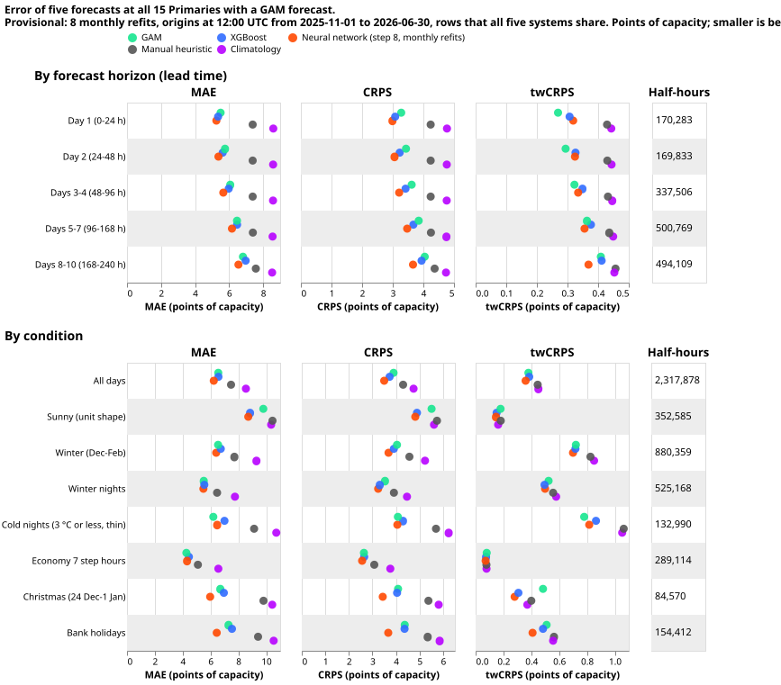
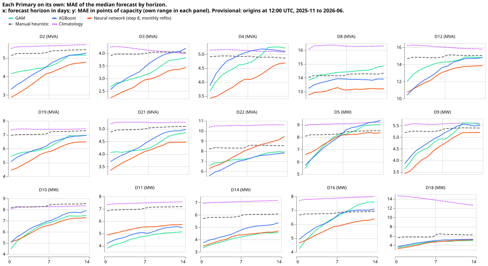
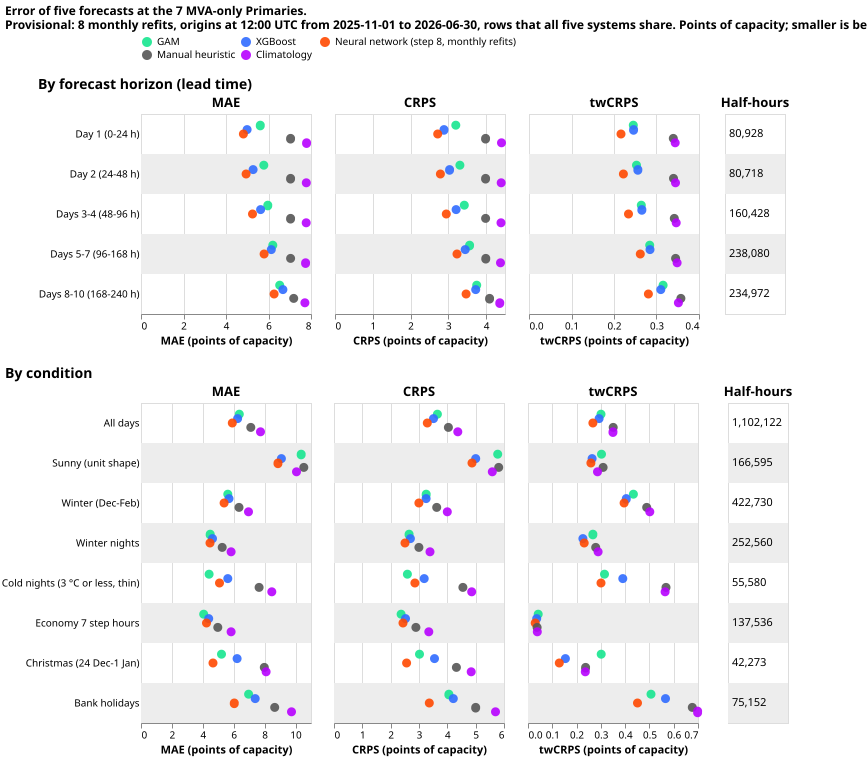

**We asked how long two older forecasting models take to forecast every day 14 days ahead with
monthly refits, and how accurate they are when scored like the neural networks of experiment 677.**
The two models are the GAM, a generalised additive model of demand against weather that experiment
378 calls Primary demand research default 3, and BG2, a blend of five XGBoost models from experiment
87. Both forecast the demand at 16 Primary substations (substations that step 33 kV or 66 kV down to
11 kV). We re-ran each model for one origin month, January 2026, and timed every stage. We then
scored 8 months of daily forecasts, 2025-11 to 2026-06, which come from re-running the GAM and from
the stored XGBoost forecasts. All numbers are provisional, because 4 months of the protocol's year
are missing. The GAM covers 15 Primaries, because D15 has no GAM forecast before 2026-03.

**A year of each model takes hours.** One origin month of the GAM took 887 seconds of single-thread
time, summed over 15 Primaries and the solar-summary replay, which projects to 3.0 hours for 12
months. One origin month of the XGBoost blend took 1,355 seconds of GPU time (6 workers on an RTX
A6000) for its monthly refits and assembly, which projects to 4.5 hours for 12 months. The same
blend with its weekly member refitted weekly projects to about 51 minutes per month and 10.1 hours
for 12 months, on the assumption that a weekly refit takes as long as the monthly refit of the same
member.

## Scores over 8 origin months

**The step 8 neural network scores below both models, and both models score below the manual
heuristic at every forecast day.** The table gives the normalised MAE of the median forecast, in
points of capacity, over every half-hour that all nine arms share, at the 15 Primaries. The XGBoost
blend and its monthly-only variant score the same as the GAM overall (6.57, 6.62, and 6.56).

| Arm | MAE, day 1 | MAE, days 8 to 10 | MAE, all half-hours | CRPS, all half-hours |
|---|---|---|---|---|
| GAM | 5.50 | 6.81 | 6.56 | 3.90 |
| XGBoost blend BG2 (weekly member) | 5.36 | 6.97 | 6.57 | 3.73 |
| XGBoost with monthly refits only | 5.45 | 7.01 | 6.62 | 3.76 |
| Step 5 (quarterly refits) | 5.35 | 6.55 | 6.26 | 3.52 |
| Step 8 (quarterly refits) | 5.45 | 6.59 | 6.31 | 3.55 |
| Step 5 monthly (step 9a) | 5.17 | 6.52 | 6.19 | 3.47 |
| Step 8 monthly (step 9b) | 5.25 | 6.55 | 6.23 | 3.50 |
| Manual heuristic | 7.38 | 7.57 | 7.48 | 4.30 |
| Climatology | 8.60 | 8.53 | 8.54 | 4.74 |

**The GAM scores within 0.1 points of the neural networks at the six signed-MW Primaries, and 0.4 to
0.5 points behind them at the seven MVA-only Primaries.** (Signed-MW Primaries report the sign of
the power flow, and the MVA-only Primaries report apparent power with no sign.) At the six
signed-MW Primaries, the GAM
scores 5.73 against 5.67 for step 8 monthly and 5.85 for step 8 quarterly. At the seven MVA-only
Primaries, it scores 6.36 against 5.91 for step 8 monthly. On day 1 at the six signed-MW Primaries,
the GAM scores 4.21 against 4.72 for step 8 monthly. On cold nights (3 °C or less) at the same
Primaries, it scores 6.71 against 7.17 for step 8 monthly and 7.04 for step 5 monthly.

**The error of every model rises with the forecast day, except climatology's, which stays near 8.5.**
Pooled over the 15 Primaries, the MAE of the GAM rises from 5.42 on day 0 to 7.23 on day 13, and
that of the step 8 neural network with monthly refits rises from 5.19 to 6.91. The manual heuristic
scores 7.29 on day 0 and 7.59 on day 13, so the GAM's lead over it narrows from 1.9 points to 0.4.

**The 90% bands of the two models are closer to nominal than the neural networks' bands.** The share
of readings inside the q05 to q95 band (nominal 0.90) is 0.874 for the GAM, 0.882 for BG2, and 0.887
for the monthly-only XGBoost model, against 0.818 to 0.834 for steps 5 and 8. The share inside the
q01 to q99 band (nominal 0.98) is 0.958, 0.972, and 0.978, against 0.940 to 0.950.

## Timing of one origin month

**The GAM has two cheap stages and one slow one.** The table gives the January 2026 wall time per
Primary, the mean over the 15 Primaries.

| GAM stage | Seconds per Primary (mean) | Notes |
|---|---|---|
| Monthly refit | 0.31 | Maximum 0.36 s; each Primary refits on one CPU thread. |
| Stage 1 forecast | 6.5 | The month's forecast takes 0.37 s and the setup of the filter and the spread table takes the rest. |
| Stage 2 | 3.8 | Maximum 18.1 s at D8, which fits the donor spread. |
| Member solar responses | 14.0 | Both lead bands. |
| Solar summary and blend replay | about 516 s in all | Four single-thread jobs of 1,335 to 2,557 s that replay 15 fold months each. |

A rerun of the GAM on the stored inputs reproduces the stored forecast exactly (largest difference
0.0 at the median of stage 1 and at q95 of stage 2). Run for 8 origin months at once, stage 1 took 16.5
seconds per Primary and stage 2 took 20.5 seconds, on at most 2.0 GB of memory.

**The XGBoost blend needs 5 refits per month.** The refits of
the monthly member M, the analogue member AN, the pooled member PT, and two offset twins took 388,
329, 195, 153, and 156 seconds for 20 series (about 15 seconds per series), and assembling BG2 took
135 seconds on 4.4 GB of memory. The frozen member ST is not refitted. The weekly member W is the
expensive part of the design: it refits 4 or 5 times per month.

**The refit differs from the stored forecast by up to 0.018 of capacity at the median for BG2 and
0.037 for the monthly-only variant,** with a mean difference of 0.0002 and 0.0004. The cause is
probably non-deterministic GPU summation, but the experiment did not test it.

## What 14 days and 12:00 origins needed

- **One code change:** the GAM's forecast window of experiment 377 held 672 half-hours (336 hours),
  3 hours short of a 12:00 UTC origin plus 14 days when the native origin is 09:00 UTC. The module
  `e00700_horizon.py` sets the window to 678 half-hours before experiment 377's modules load.
  Forecast rows at leads of 240 hours or less are unchanged. The last lead band of stage 2 (240 to
  336 hours) is refitted with the extra 3 hours, so its q95 differs from the stored rows by up to 0.8
  points of capacity.
- **A relabel of the origin:** both models forecast from 00:00 UTC ensemble runs, published 9 hours
  later, so their native origin is 09:00 UTC. The files relabel the origin to 12:00 UTC, as
  experiment 667 does, and keep valid times from 12:00 UTC for 14 days. The forecast uses nothing
  after 09:00 UTC.
- **No new weather:** the stored ensemble arrays hold 351 hours of forecast, so 14 days needed no
  download.

## Blockers for the full year

- **The inputs end on 2026-06-30 or 2026-07-01.** The GAM's feature cache and ensemble arrays end on
  2026-06-30, the XGBoost frames end on the same date, and the observed-power rows of experiment 103
  end on 2026-07-01. The ERA5 file ends on 2026-07-31 and the CAMS file on 2026-09-11. The origin
  months 2026-07 to 2026-10 therefore need rebuilt inputs, which includes an ERA5 extension that is
  a download. The ECMWF ensemble archive on the workstation reaches 2026-11-16, so the ensemble
  itself needs no download.
- **D15 has no GAM forecast before 2026-03,** because experiment 377 requires 12 months of history
  before a fold month.
- **The stored GAM file has gaps at 593 of 3,554 Primary-origin pairs,** all in 2026-03 to 2026-06,
  where the stored ECMWF ensemble arrays lack some half-hours. The scorer uses only the rows that
  every arm has.

## Lag inputs

**Both models can rebuild their lag inputs from a shifted copy of the observed power at a cost of
minutes per month, but a score of the shifted-lag bank was not run.** This section is an assessment
from the code, not a measurement.

- **XGBoost:** BG2 has three lag inputs (the newest reading, the reading at the same time yesterday,
  and the reading at the same time last week) and the analogue member's weekly means and medians.
  `origin_lags` and `add_lags` build them from one dense array of observed power over capacity, so
  a shifted copy passed to `prepared_run` replaces them. A refit is needed for the month, because
  the fit script of experiment 87 saves no boosters.
- **GAM:** it has no lag columns. A shift enters through the observed series of the stage 1 residual
  stream and correction filter, and through the `actual` column of the stage 2 recipe R. Rerunning
  stage 1 and stage 2 takes about 10 seconds per Primary, and the fitted coefficients do not
  change.

## Checks

- **The median minus the mean forecast per Primary** is not available, because the stored files hold
  quantiles only.
- **The error of the median beside the quantile scores:** the table above gives both. They agree in
  direction for the neural networks against both models. For BG2 against the GAM, they differ: the
  two models have the same MAE (6.57 and 6.56), and BG2 has the lower CRPS (3.73 against 3.90).
- **Audit triggers:** trigger 1 (a failed control) fired in a weak form, because the refit of the
  XGBoost blend does not reproduce the stored forecast exactly. The mean difference of 0.0002 to
  0.0004 of capacity is small beside the gaps of 0.3 points and more between arms. Trigger 3 fired
  for BG2 against the GAM, as the previous bullet shows. No audit agent has run, and no contrast is
  claimed.
- **Reviews:** no `planned` write-up and no code review preceded the first run, because the run
  followed the maintainer's brief. The code review and the prose review ran after the scores existed.

## Method

**Architecture:**

- **GAM:** Primary demand research default 3 of experiment 378. It is a monthly T-all penalised
  bounded least-squares refit per Primary on a 24-month window (experiment 377), a stage 1 forecast
  from the 51 ensemble members with a correction filter and a spread table, the stage 2 mean
  correction of experiment 155's arm d, and the solar summary and daylight blend of experiment 378.
  Up to 168 hours it uses the solar summary, from 168 to 240 hours the solar summary and blend, and
  beyond 240 hours stage 2 alone.
- **XGBoost:** BG2 of experiment 87, a 5-member quantile blend of a weekly refit (W), a monthly
  refit (M), a monthly refit with weekly analogues (AN), a pooled model (PT), and a frozen model with
  a 14-day correction (ST), with a spread factor of 1.15, monthly causal blend weights, and a solar
  offset at 5 Primaries. The monthly-only variant is experiment 87's arm
  `p_a3_monthly_in_weekly_slot`, which puts M in W's place.
- **No information after the forecast origin:** both models use the 00:00 UTC ensemble run published
  at 09:00 UTC. `e00700_gam_stage1.py` asserts that the origin minus the run date is 9 hours and that
  the maximum lead is at most 339 hours.

**Training regime:**

- **GAM:** one fit per Primary per month, on the 24 months before the cut. The refit reproduced the
  stored coefficients exactly. The solar summary and blend files are experiment 378's stored files.
- **XGBoost:** January's refits used experiment 87's `e00087_fit_demand.py` with 6 workers and 12
  cores. The 8-month scores use the stored arms of experiment 87, relabelled to the 12:00 UTC origin,
  and not a rerun.
- **Compute:** one RTX A6000 for XGBoost and one CPU thread per GAM job.

**Measurement:**

- **Rows:** origins at 12:00 UTC from 2025-11-01 to 2026-06-30 and valid times up to 14 days ahead,
  scored on the half-hours that all arms share, with the cleaned power, the Primary cleaning rules of
  experiment 677, and the effective capacity.
- **Metrics:** the normalised MAE of the median, CRPS, and twCRPS from `studies.eval_protocol.metrics`,
  q05 to q95 and q01 to q99 coverage, and the MAE by forecast day (day 0 is hours 0 to 24 after the
  12:00 UTC origin).
- **References:** the manual heuristic and climatology come from the stored arms `ref_*` of
  experiment 87, relabelled from 09:00 to 12:00 UTC. Steps 5 and 8 come from experiment 677's files
  for the same origins, seeds 0 to 2.
- **No intervals:** the experiment makes no contrast claim, so it computes none.
- **Groups:** the six signed-MW and the seven MVA-only Primaries are experiment 677's groups, and
  D8, D15, and D18 are outside them. The pooled figures cover 15 Primaries.

## Files

- `e00700_horizon.py` lengthens the GAM window from 672 to 678 half-hours.
- `e00700_gam_refit.py`, `e00700_gam_stage1.py`, `e00700_gam_stage2.py`, and `e00700_gam_members.py`
  time the January refit, stage 1, stage 2, and member responses, and merge the new rows into the
  sandbox copy of experiment 377's files. `e00700_gam_year.sh` runs stage 1 and stage 2 for the 8
  origin months.
- `e00700_xgb_run.sh` and `e00700_xgb_chain.sh` time the January refits of experiment 87's members.
- `e00700_export.py` assembles default 3 and the XGBoost arms in the file layout of experiment 677.
  `e00700_ladder_year.py` cuts experiment 677's steps 5 and 8 to the same origins.
- `e00700_protocol.py` and `e00700_extra.py` score every arm; `e00700_report.py` prints every number
  on this page; `e00700_plots.py` draws the figures.
- Data (private, under `data/ml-experiments/00700-timing-run-gam-and-xgboost-14-day-monthly-refit/`):
  `sandbox/` (copies of the folders of experiments 377, 378, and 87's `anchor_preds`, symlinks to the
  rest), `timing/` (one JSON or text file per stage), `backtests/` (the forecast files), `scores/`
  (`protocol_year/rows.parquet` and `scores.csv`), `plots/`, and `report.txt`.
- Earlier experiments read: [experiment 87](../00087-bg2-best-guess-assembled-with-drop-one-ablations/result.md),
  [experiment 377](../00377-demand-v1-first-run-feasibility/result.md),
  [experiment 378](../00378-primary-demand-default-3-at-all-16-primaries-under-demand-v1/result.md),
  [experiment 667](../00667-one-year-backtest-of-the-two-output-demand-network-at-primaries/result.md),
  [experiment 668](../00668-documentation-of-the-one-year-backtest-files-models-training-and-performance/result.md),
  and [experiment 677](../00677-building-up-the-candidate-demand-network-one-component-at-a-time/result.md).
