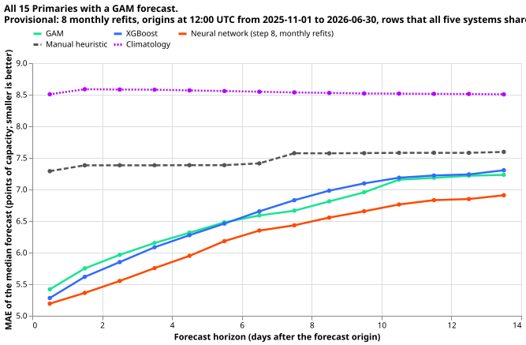
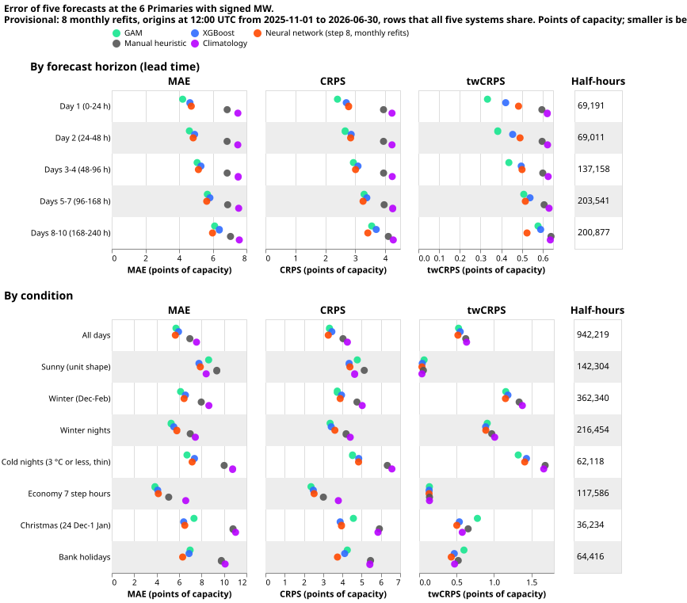

**The GAM takes about 15 minutes per origin month and the XGBoost blend about 23 minutes. Over 8
origin months, both score below the manual heuristic and about 0.3 points of capacity behind step 8
with monthly refits.** An origin month is a month of daily forecast origins, and a forecast origin
is the time at which a forecast is issued (here 12:00 UTC each day, with each forecast covering the
next 14 days).

**We asked how long two forecasting systems take to produce such forecasts with monthly refits
(retraining each system once a month), and how accurate they are.** The two systems predate the
neural networks of [experiment
677](../00677-building-up-the-candidate-demand-network-one-component-at-a-time/result.md). The GAM
is a generalised additive model of demand against weather (Primary demand research default 3 of
[experiment 378](../00378-primary-demand-default-3-at-all-16-primaries-under-demand-v1/result.md)).
BG2 is a blend of five XGBoost models (gradient-boosted decision trees) from [experiment
87](../00087-bg2-best-guess-assembled-with-drop-one-ablations/result.md). Both forecast the demand at
Primary substations.

**We timed each stage for January 2026 and scored 8 origin months, 2025-11 to 2026-06.** The 8
months of GAM forecasts come from re-running the GAM. The 8 months of XGBoost forecasts are the
stored forecasts of experiment 87, with the origin relabelled to 12:00 UTC. The score is the
normalised MAE of the median forecast, in points of capacity (percentage points of a Primary's
capacity). BG2 covers 16 Primaries, and the GAM covers 15, because the Primary with identifier D15
has no GAM forecast before 2026-03. Every table pools the 15 Primaries that all systems cover.

**All numbers are provisional, because 4 of the 12 origin months of the backtest year of experiment
677 are missing.** The inputs of those 4 months do not exist yet (see "Blockers for the full year").

**A year of each system is projected to take hours.** One origin month of the GAM took 887 seconds
of single-thread time, summed over 15 Primaries and the solar-summary replay, which projects to 3.0
hours for 12 months. One origin month of the XGBoost blend took 1,355 seconds of GPU time for its
monthly refits and assembly, which projects to 4.5 hours for 12 months. Refitting the blend's weekly
member weekly is projected to take about 50 minutes per month and 10.1 hours for 12 months, on the
assumption that a weekly refit takes as long as the monthly refit of the same member. Only January
was timed, so the projections are straight multiples of that month.

## Scores over 8 origin months

**Step 8 with monthly refits scores below the GAM and the XGBoost blend on each of the 14 forecast
days, and both score below the manual heuristic on each of those days.** The table gives the
normalised MAE of the median forecast and the continuous ranked probability score (CRPS) in points of
capacity, over every half-hour that all nine arms share, at the 15 Primaries. The XGBoost blend and
the GAM score the same MAE overall (6.57 and 6.56). "Day 1" is the lead slice of 0 to 24 hours after
the origin (open at 0, closed at 24), and "days 8 to 10" is 168 to 240 hours.

| Arm | MAE, day 1 | MAE, days 8 to 10 | MAE, all half-hours | CRPS, all half-hours |
|---|---|---|---|---|
| GAM | 5.50 | 6.81 | 6.56 | 3.90 |
| XGBoost blend BG2 (weekly member) | 5.36 | 6.97 | 6.57 | 3.73 |
| XGBoost with monthly refits only | 5.45 | 7.01 | 6.62 | 3.76 |
| Step 5 (quarterly refits) | 5.35 | 6.55 | 6.26 | 3.52 |
| Step 8 (quarterly refits) | 5.45 | 6.59 | 6.31 | 3.55 |
| Step 5 monthly (step 9a) | 5.17 | 6.52 | 6.19 | 3.47 |
| Step 8 monthly (step 9b) | 5.25 | 6.55 | 6.23 | 3.50 |
| Manual heuristic | 7.38 | 7.57 | 7.48 | 4.30 |
| Climatology | 8.60 | 8.53 | 8.54 | 4.74 |

**The GAM scores within 0.1 points of step 8 with monthly refits at the 6 Primaries that report
signed megawatts, and 0.4 to 0.5 points behind the neural networks at the 7 Primaries that report
apparent power only.** At the 6 signed-MW Primaries (D5, D9, D10, D11, D14, and D16), the GAM scores
5.73 against 5.67 for step 8 monthly and 5.85 for step 8 quarterly. At the 7 MVA-only Primaries (D2,
D3, D4, D12, D19, D21, and D22), the GAM scores 6.36 against 5.91 for step 8 monthly. D8, D15, and
D18 belong to neither group.

**On day 1 at the 6 signed-MW Primaries, and on cold nights at the signed-MW and MVA-only groups,
the GAM scores below every neural network.** At the signed-MW Primaries on day 1, it scores 4.21
against 4.63 to 5.01 for the four neural-network arms. On cold nights at the signed-MW Primaries, it
scores 6.71 against 7.04 to 7.35, and at the MVA-only Primaries 4.41 against 4.94 to 5.31. (Cold
nights are the slice that experiment 677 defines.) At the MVA-only Primaries on day 1, the GAM scores
5.61, behind all four neural-network arms (4.75 to 4.93).

**The error of the GAM, BG2, step 8 monthly, and the manual heuristic rises with the forecast day,
and the error of climatology stays near 8.5.** Pooled over the 15 Primaries, the MAE of the GAM rises
from 5.42 on day 0 to 7.23 on day 13, and the MAE of step 8 with monthly refits rises from 5.19 to
6.91. (Day 0 of this curve is the lead range 0 up to but not including 24 hours, so its values differ
slightly from the "Day 1" column above.) The manual heuristic scores 7.29 on day 0 and 7.59 on day
13, so the GAM's lead over the manual heuristic narrows from 1.9 points to 0.4.

**The 90% bands of the GAM and the XGBoost blend are closer to nominal than the bands of the neural
networks.** The share of readings inside the q05 to q95 band (nominal 0.90) is 0.874 for the GAM,
0.882 for BG2, and 0.887 for the monthly-only XGBoost model, against 0.818 to 0.834 for steps 5 and
8. The share inside the q01 to q99 band (nominal 0.98) is 0.958, 0.972, and 0.978, against 0.940 to
0.950. Coverage is measured on 2,044,341 half-hours per arm, which is the 13 Primaries of the two
groups, and so on fewer half-hours than the 2,317,878 of the table above.

## Timing of one origin month

**The GAM has four quick stages and one slow stage.** The table gives the January 2026 wall time in
seconds, as the mean over the 15 Primaries except in the last row.

| GAM stage | Wall seconds | Notes |
|---|---|---|
| Monthly refit | 0.31 per Primary | Maximum 0.36 s. |
| Stage 1 setup and forecast | 6.5 per Primary | The forecast alone takes 0.37 s. |
| Stage 2 | 3.8 per Primary | Maximum 18.1 s, at D8. |
| Member solar responses | 14.0 per Primary | |
| Solar summary and blend replay | 516 per origin month, for all 15 Primaries | 4 single-thread jobs of 1,335, 2,413, 1,442, and 2,557 s (7,747 s in total) that each replay 15 fold months. |

A rerun of the GAM on the stored January inputs reproduces the stored forecast exactly (largest
difference 0.0). Run for 8 origin months at once, stage 1 took 16.5 seconds per Primary and stage 2
took 20.5 seconds, on at most 2.0 GB of memory. That is far less than 8 times the January time, so
the 3.0 hours for 12 months is a conservative estimate.

**The XGBoost blend needs 5 monthly refits per month, and its weekly member needs more.** The
monthly refits are those of the monthly member M, the analogue member AN, the pooled member PT, and
two offset twins (copies of M and AN that carry a solar offset). Each refit job covers 20 series, as
experiment 87's fit script defines them. The jobs took 388, 329, 195, 153, and 156 seconds (1,220
seconds in total), and assembling BG2 took 135 seconds on 4.4 GB of memory. The frozen member ST is
not refitted. The weekly member W refits about 4.3 times per month, so refitting it weekly is the
slowest part of the design.

**The refit differs from the stored forecast by up to 0.018 of capacity at the median for BG2 and
0.037 for the monthly-only variant,** with a mean difference of 0.0002 and 0.0004. The cause is
probably non-deterministic GPU summation, but the experiment did not test that.

## Changes needed for 14-day forecasts from 12:00 UTC origins

- **One code change:** the GAM's forecast window in experiment 377 held 672 half-hours (336 hours),
  which is 3 hours short of a 12:00 UTC origin plus 14 days when the native origin is 09:00 UTC. The
  module `e00700_horizon.py` sets the window to 678 half-hours before experiment 377's modules load.
  Forecasts at leads of 240 hours or less are unchanged. The last lead band of stage 2 (240 to 336
  hours) is refitted with the extra 3 hours, so its q95 differs from the stored rows by up to 0.78
  points of capacity, only on days 10 to 14.
- **A relabel of the origin:** the GAM and the XGBoost blend forecast from 00:00 UTC ensemble runs,
  published 9 hours later, so their native origin is 09:00 UTC. The files relabel the origin to 12:00
  UTC, as experiment 667 does, and keep valid times from 12:00 UTC for 14 days.
- **No new weather:** the stored ensemble arrays hold 351 hours of forecast, so 14 days needed no
  download.

## Blockers for the full year

- **The inputs end between 2026-06-30 and 2026-09-11.** The GAM's feature cache and ensemble arrays
  end on 2026-06-30, the XGBoost frames end on the same date, and the observed-power rows of
  experiment 103 end on 2026-07-01. The ERA5 file (a reanalysis, which is an estimate of past
  weather) ends on 2026-07-31, and the CAMS file (a reanalysis of atmospheric composition and solar
  radiation) ends on 2026-09-11. The origin months 2026-07 to 2026-10 therefore need rebuilt inputs,
  including an ERA5 extension that is a download. The archive of the ensemble from the European
  Centre for Medium-Range Weather Forecasts on the workstation reaches 2026-11-16, so the ensemble
  needs no download.
- **D15 has no GAM forecast before 2026-03,** and D18 has 180 origins against 241 at each of the
  other 14 Primaries, because a Primary's rows start at the first month of its stored stage 2 file.
  The GAM file holds 3,554 Primary-origin pairs.
- **The GAM file has fewer than 672 half-hours at 593 of those 3,554 pairs,** in the origin months
  2026-03 (216), 2026-04 (72), 2026-05 (83), and 2026-06 (222), where the stored ensemble arrays lack
  some half-hours. The scorer uses only the half-hours that every arm has.

## Rebuilding lag inputs from shifted power

**Both the GAM and the XGBoost blend can rebuild their lag inputs from a shifted copy of the observed
power in minutes per month, but this experiment did not score a shifted-lag bank.** This section is
an assessment from the code.

- **XGBoost blend:** BG2 has three lag inputs (the newest reading, the reading at the same time
  yesterday, and the reading at the same time last week), and the analogue member also uses weekly
  means and medians. `origin_lags` and `add_lags` build the lag inputs from one dense array of
  observed power over capacity, so a shifted copy passed to `prepared_run` replaces them. A refit is
  needed for the month, because experiment 87's fit script saves no boosters.
- **GAM:** the GAM has no lag columns. A shift enters through the observed series of the stage 1
  residual stream and filter, and through the `actual` column of the stage 2 recipe R. Rerunning
  stage 1 and stage 2 takes about 10 seconds per Primary, and the fitted coefficients do not change.

## Checks

- **Median error beside the quantile scores:** the table above gives both. For BG2 against the GAM,
  the two scores differ: BG2 and the GAM have the same MAE (6.57 and 6.56), and BG2 has the lower
  CRPS (3.73 against 3.90).
- **Audit triggers:** trigger 1 (a failed control) fired in a weak form, because the refit of the
  XGBoost blend does not reproduce the stored forecast exactly. The mean difference of 0.0002 to
  0.0004 of capacity is small beside the gaps of 0.3 points and more between arms. Trigger 3 fired
  for BG2 against the GAM, as the first bullet shows. No audit has run, and no contrast is claimed.

## Method

**Architecture:**

- **GAM:** Primary demand research default 3 of experiment 378: a monthly penalised bounded
  least-squares refit per Primary on a 24-month window (experiment 377), a stage 1 forecast from the
  51 ensemble members with a correction filter and a spread table, the stage 2 correction of
  experiment 155's arm d, and the solar summary and daylight blend of experiment 378. Up to 168
  hours the forecast uses the solar summary, from 168 to 240 hours it uses the solar summary and
  blend, and beyond 240 hours it uses stage 2 alone. The hour counts run from the native 09:00 UTC
  origin.
- **XGBoost blend:** BG2 of experiment 87, a 5-member quantile blend of a weekly refit (W), a
  monthly refit (M), an analogue model (AN), a pooled model (PT), and a frozen model (ST), with a
  spread factor of 1.15, monthly causal blend weights, and a solar offset at 5 Primaries. The
  monthly-only variant is experiment 87's arm `p_a3_monthly_in_weekly_slot`, which puts M in W's
  place.
- **No information after the forecast origin:** the GAM and the XGBoost blend use the 00:00 UTC
  ensemble run published at 09:00 UTC.

**Training regime:**

- **GAM:** one fit per Primary per month on the 24 months before the cut. The solar summary and
  blend files are experiment 378's stored files.
- **XGBoost blend:** the January refits used experiment 87's `e00087_fit_demand.py` with 6 workers.
  The 8-month scores use the stored arms of experiment 87, relabelled to the 12:00 UTC origin, and
  not a rerun.

**Measurement:**

- **Rows:** origins at 12:00 UTC from 2025-11-01 to 2026-06-30 and valid times up to 14 days ahead,
  scored on the half-hours that all arms share, with the cleaned power and the Primary cleaning rules
  of experiment 677.
- **Metrics:** the normalised MAE of the median, CRPS, and twCRPS from
  `studies.eval_protocol.metrics`, q05 to q95 and q01 to q99 coverage, and the MAE by forecast day
  (day 0 is the lead range 0 up to but not including 24 hours after the 12:00 UTC origin).
- **References:** the manual heuristic and climatology are the stored arms `ref_manual_heuristic`
  and `ref_climatology` of experiment 87, relabelled from 09:00 to 12:00 UTC. Steps 5 and 8 come
  from experiment 677's files for the same origins, seeds 0 to 2.
- **No intervals:** the experiment makes no contrast claim, so it computes none.
- **Groups:** the 6 signed-MW and the 7 MVA-only Primaries are experiment 677's groups. The pooled
  figures cover 15 Primaries.

## Files

- `e00700_horizon.py` lengthens the GAM window from 672 to 678 half-hours.
- `e00700_gam_refit.py`, `e00700_gam_stage1.py`, `e00700_gam_stage2.py`, and `e00700_gam_members.py`
  time the January refit, stage 1, stage 2, and member responses. `e00700_gam_year.sh` runs stage 1
  and stage 2 for the 8 origin months.
- `e00700_xgb_run.sh` and `e00700_xgb_chain.sh` time the January refits of experiment 87's members.
- `e00700_export.py` assembles the GAM's default 3 and the XGBoost arms in the file layout of
  experiment 677. `e00700_ladder_year.py` cuts experiment 677's steps 5 and 8 to the same origins.
- `e00700_protocol.py` and `e00700_extra.py` score every arm. `e00700_report.py` prints every number
  on this page, and `e00700_plots.py` draws the figures.
- Data (private, under `data/ml-experiments/00700-timing-run-gam-and-xgboost-14-day-monthly-refit/`):
  `sandbox/` (copies of the data of experiments 377, 378, and 87's `anchor_preds`, and symlinks to
  the rest), `timing/`, `backtests/` (the forecast files), `scores/` (`protocol_year/rows.parquet`
  and `scores.csv`), `plots/`, and `report.txt`.
- Earlier experiments read: [experiment
  87](../00087-bg2-best-guess-assembled-with-drop-one-ablations/result.md), [experiment
  377](../00377-demand-v1-first-run-feasibility/result.md), [experiment
  378](../00378-primary-demand-default-3-at-all-16-primaries-under-demand-v1/result.md), [experiment
  667](../00667-one-year-backtest-of-the-two-output-demand-network-at-primaries/result.md),
  [experiment
  668](../00668-documentation-of-the-one-year-backtest-files-models-training-and-performance/result.md),
  and [experiment
  677](../00677-building-up-the-candidate-demand-network-one-component-at-a-time/result.md).
