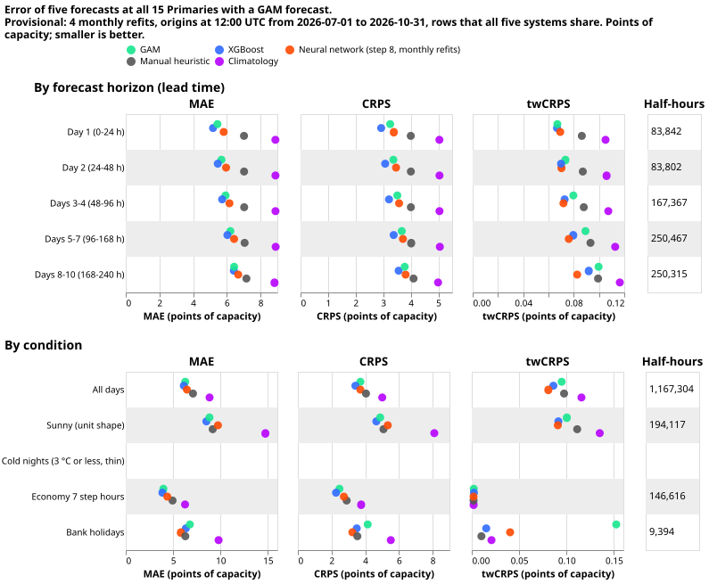
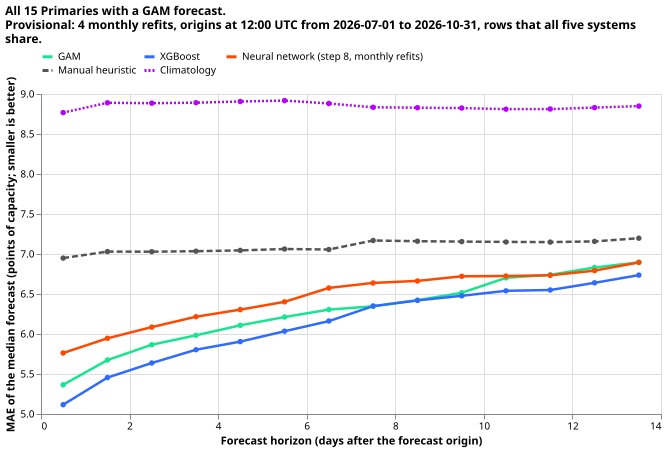
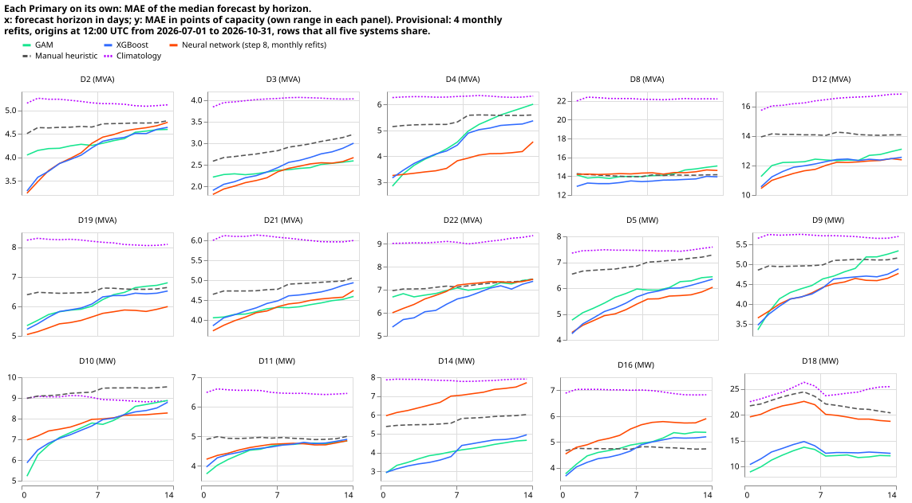
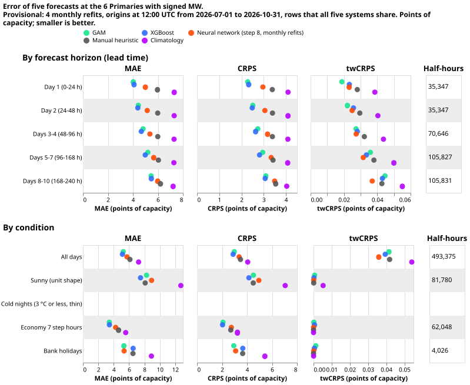
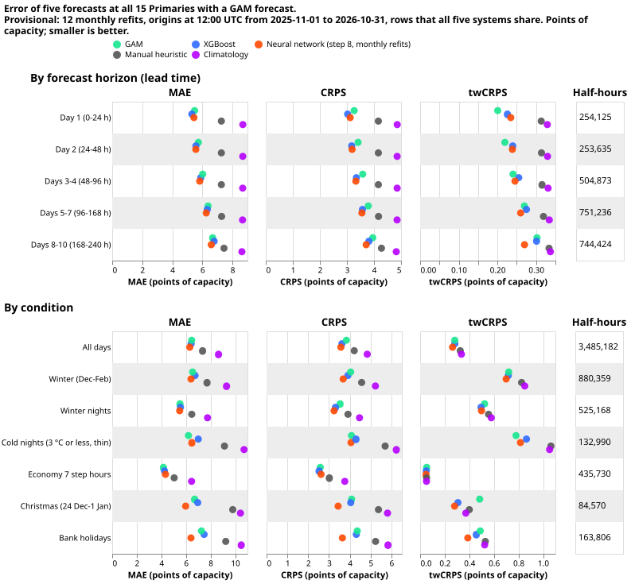

**Over the origin months 2026-07 to 2026-10, the XGBoost blend BG2 and the GAM score below step 8
with monthly refits and below the manual heuristic.** An origin month is a month of daily forecast
origins at 12:00 UTC, and each forecast covers the next 14 days. The pooled MAE of the median
forecast is 6.13 points of capacity for BG2, 6.28 for the GAM, 6.46 for step 8 with monthly refits,
and 7.10 for the manual heuristic. All scores are provisional.

**We extended [experiment 700](../00700-timing-run-gam-and-xgboost-14-day-monthly-refit/result.md)
from the origin months 2025-11 to 2026-06 to 2026-07 to 2026-10.** These 4 months are the final-test
window that [experiment 620](../00620-bakeoff-final-test-demand-networks-at-primaries/result.md)
scored for the neural networks, and for which experiment 620 listed BG2 and the XGBoost arms as absent.
The GAM is a generalised additive model of demand against weather (Primary demand research default 3
of [experiment 378](../00378-primary-demand-default-3-at-all-16-primaries-under-demand-v1/result.md)).
BG2 is a blend of five XGBoost models (gradient-boosted decision trees) from [experiment
87](../00087-bg2-best-guess-assembled-with-drop-one-ablations/result.md). The GAM and BG2
each forecast the demand at Primary substations. The GAM and BG2 were each refitted for the new
months, and neither saw an actual from the months it forecast.

**Two of the three predictions held.** P1 held: the GAM, BG2, and the monthly-only XGBoost variant
score below the manual heuristic on each of the 14 forecast days. P3 held: every extended input
equals the stored input on every shared row (see Checks). P2 failed: step 8 with monthly refits
scores below neither the GAM nor BG2, so the verdict is "partly supported".

## Scores over the final-test months

**BG2 scores lowest of the nine arms on pooled MAE over the 4 months, and the GAM scores below every
neural-network arm.** The table gives the normalised MAE of the median forecast and the continuous
ranked probability score (CRPS) in points of capacity, over the 1,167,304 half-hours that all nine
arms share at the 15 Primaries. "Day 1" is the lead slice of 0 to 24 hours after the origin (open at
0, closed at 24), and "days 8 to 10" is 168 to 240 hours.

| Arm | MAE, day 1 | MAE, days 8 to 10 | MAE, all half-hours | CRPS, all half-hours |
|---|---|---|---|---|
| GAM | 5.44 | 6.43 | 6.28 | 3.71 |
| XGBoost blend BG2 (weekly member) | 5.18 | 6.42 | 6.13 | 3.41 |
| XGBoost with monthly refits only | 5.27 | 6.50 | 6.22 | 3.47 |
| Step 5 (quarterly refits) | 5.91 | 6.74 | 6.53 | 3.73 |
| Step 8 (quarterly refits) | 6.08 | 6.84 | 6.65 | 3.83 |
| Step 5 monthly (step 9a) | 5.69 | 6.60 | 6.37 | 3.64 |
| Step 8 monthly (step 9b) | 5.81 | 6.68 | 6.46 | 3.71 |
| Manual heuristic | 7.02 | 7.16 | 7.10 | 4.05 |
| Climatology | 8.88 | 8.83 | 8.85 | 5.01 |

**The error of every arm except climatology rises with the forecast day, and BG2 is lowest or tied
for lowest on each of the 14 days.** Pooled over the 15 Primaries, the MAE of BG2 rises from 5.12 on
day 0 to 6.74 on day 13, the GAM from 5.36 to 6.90, and step 8 with monthly refits from 5.76 to
6.89. (Day 0 of this curve is the lead range 0 up to but not including 24 hours, so its values
differ slightly from the "Day 1" column above.) The GAM equals BG2 on day 7 (6.35) and on day 8
(6.42). The manual heuristic scores 6.95 on day 0 and 7.20 on day 13, and climatology stays near
8.8.

**At the six Primaries that report signed megawatts, the GAM and BG2 score 0.5 to 0.6 points below
step 8 with monthly refits, and at the seven that report apparent power only, step 8 is 0.2 to 0.3
points ahead.** The signed-MW Primaries are D5, D9, D10, D11, D14, and D16. The MAE of the signed-MW
Primaries over all half-hours is 5.23 for the GAM, 5.14 for BG2, and 5.73 for step 8 monthly. The
MVA-only Primaries are D2, D3, D4, D12, D19, D21, and D22. The MAE of the MVA-only Primaries is 5.89
for the GAM, 5.74 for BG2, and 5.56 for step 8 monthly. D8 and D18 belong to neither group. On day 1
at the signed-MW Primaries, the GAM scores 4.03, BG2 4.09, and step 8 monthly 4.99. No half-hour of
the 4 months meets the cold-night definition of experiment 677, so there is no cold-night row.

**The 90% bands of the GAM and the XGBoost arms are closer to nominal than the bands of the neural
networks.** The share of readings inside the q05 to q95 band (nominal 0.90) is 0.880 for the GAM,
0.911 for BG2, and 0.920 for the monthly-only XGBoost variant, against 0.763 to 0.798 for steps 5 and
8. The share inside the q01 to q99 band (nominal 0.98) is 0.966, 0.978, and 0.989, against 0.902 to
0.925. Coverage is measured on 1,068,491 half-hours per arm. Those half-hours come from the 13
Primaries of the two groups only, so the count is below the 1,167,304 half-hours of the table
above.

## One Primary accounts for much of the neural network's deficit

**At D14, step 8 with monthly refits scores 9.3 and 9.5 points of MAE in July and August, against
5.2 and 2.9 for BG2.** The table gives the MAE of the median forecast at D14 by origin month, and
the same score at the other 14 Primaries pooled. D14 is a signed-MW Primary. We did not find the
cause, and the experiment did not look for it.

| Origin month | D14: GAM | D14: BG2 | D14: step 8 monthly | Other 14 Primaries: GAM | Other 14: BG2 | Other 14: step 8 monthly |
|---|---|---|---|---|---|---|
| 2026-07 | 5.63 | 5.23 | 9.33 | 6.75 | 6.33 | 6.92 |
| 2026-08 | 3.38 | 2.92 | 9.52 | 6.54 | 5.98 | 6.25 |
| 2026-09 | 2.51 | 2.53 | 4.09 | 5.94 | 5.90 | 6.05 |
| 2026-10 | 4.45 | 5.31 | 4.44 | 6.57 | 6.94 | 6.46 |

**Without D14, step 8 with monthly refits still scores above BG2 in July, August, and September, and
below it in October.** In October, step 8 monthly scores 6.46 against 6.94 for BG2 and 6.57 for the
GAM. The ranking of these arms therefore changes from month to month.

## Twelve origin months together

**Over all 12 origin months, step 5 with monthly refits has the lowest pooled MAE, and BG2 is
within 0.2 points of the neural networks.** The rows are experiment 700's 8 months and the 4 months
above, each scored on the half-hours that all nine arms share in its own period. The table pools
them, with 3,485,182 half-hours per arm.

| Arm | MAE, day 1 | MAE, days 8 to 10 | MAE, all half-hours | CRPS, all half-hours |
|---|---|---|---|---|
| GAM | 5.48 | 6.68 | 6.47 | 3.84 |
| XGBoost blend BG2 (weekly member) | 5.30 | 6.79 | 6.42 | 3.62 |
| XGBoost with monthly refits only | 5.39 | 6.84 | 6.49 | 3.66 |
| Step 5 (quarterly refits) | 5.54 | 6.62 | 6.35 | 3.59 |
| Step 8 (quarterly refits) | 5.66 | 6.67 | 6.43 | 3.64 |
| Step 5 monthly (step 9a) | 5.34 | 6.55 | 6.25 | 3.53 |
| Step 8 monthly (step 9b) | 5.44 | 6.59 | 6.31 | 3.57 |
| Manual heuristic | 7.26 | 7.44 | 7.35 | 4.22 |
| Climatology | 8.69 | 8.63 | 8.65 | 4.83 |

**On cold nights over the 12 months, the GAM scores 6.20 and step 5 monthly 6.36, and BG2 scores
7.01.** All cold-night half-hours fall in the first 8 months. The 12-month chart leaves out the
"sunny (unit shape)" row, because that slice is cut separately on each experiment's own rows and
cannot be pooled across the two periods.

## Timing of the 4 months

**Both systems took about as long as experiment 700 projected, with the GAM and the two XGBoost
variants running side by side.** The GAM took 1.3 hours of wall-clock time with 4 processes: its
stage 1, stage 2, and member responses took about 9, 7, and 59 seconds of wall-clock time at D5, and
the 4 replays of the solar summary and blend took between 31 and 60 minutes each. Experiment 700
projected 1 hour for 4 months, in single-thread time. The XGBoost monthly stage (the monthly-only
variant) took 1.5 hours, as projected. The weekly stage, which completes BG2, took another 2.4
hours, so BG2 took 3.9 hours in all against a projection of 3.3. The two systems shared a
workstation with 32 cores, so the times include some waiting for CPU.

## Checks

- **P3, the extended inputs equal the stored inputs on shared data.**
    - **GAM inputs:** the extended rows equal the stored rows on all 1,624,499 shared rows in 13
      columns, with no difference. The extended feature cache is bit-equal to the stored cache, and
      the ensemble-array builder reproduces 10 stored runs at all 15 Primaries bit for bit.
    - **GAM stages:** every stage reproduces experiment 700's June 2026 rows with a largest
      difference of 0.0.
    - **XGBoost inputs:** 15 rebuilt frames of 716,040 rows and 20 columns are bit-equal to the
      stored frames, 12 rebuilt control-member files are bit-equal, and the rebuilt anomaly table
      equals the stored table on all 2,856,435 stored rows.
    - **XGBoost assembly:** assembling the stored arms reproduces the stored BG2 and monthly-only arms
      exactly (4,099,680 rows each, difference 0).
- **Refits are not bit-identical on the GPU.** A June 2026 refit of the base member differs from the
  stored forecast by up to 0.0143 of capacity over all 11 quantile levels (0.0102 at the median),
  and the frozen member by up to 0.0147. Experiment 700 saw up to 0.04.
- **Reference arms:** the climatology is a fixed lookup of 51 quantiles per series, month, half-hour,
  and weekend flag, read off the stored forecasts and fitted on power before 2025-07-01. The lookup is
  12 to 16 months old by the final-test months, and the 12-month climatology arm uses that single
  lookup.
  The manual heuristic is rebuilt from the cleaned power with a largest difference from the stored
  arm of 9.8e-5 of capacity.
- **Audit triggers:** the reversal of the neural networks' lead is surprising, and no audit has run.
  Reviews of the code found no leakage, and the D14 table above does not explain the whole reversal.
- **Review findings not applied:** the numbers review could not find the GPU-refit differences, the
  row counts, and the heuristic difference in `report.txt`. Those figures come from the checking
  scripts' printed output, so they stay. The prose review's requests to expand every acronym and to
  change several counts to words were left for a later pass, because the page's meaning does not
  depend on them.

## Limits

- **Capacity vintages:** the weekly capacity table of experiment 78 ends in the week of 2026-06-22.
  The XGBoost offset at the five offset Primaries holds the last vintage, which moves the scale by
  up to about 6%. The GAM's pinned photovoltaic (PV) capacity ends at the 2026-08-03 vintage, so its
  September and October fits hold that capacity at the seven Primaries of the GAM's control group
  (the six signed-MW Primaries and D18).
- **Switching events:** no hand-labelled switching events exist after 2026-07, so the switching
  mask is empty for the new months in both systems. Load transfers stay in the actuals.
- **Weather:** the ERA5 values for September and October are the preliminary release (ERA5T). They
  enter only the training rows before each month's cut, and the forecast weather comes from the
  ensemble.
- **Missing actuals:** a power outage in the data on 2026-11-04 (08:30 to 14:00 UTC) leaves 128
  half-hours missing at every Primary, and some Primaries have gaps in July and August. The GAM
  file has fewer than 672 half-hours at some Primary-origin pairs (the fewest is 574). The scorer
  uses only the half-hours that every arm and the actuals hold.
- **Climatology and D18:** D18 has no climatology cells for August to October, so D18 enters the
  pooled scores through its other rows.
- **Seeds:** steps 5 and 8 are averages of three seeds, and the GAM and XGBoost arms have one seed
  each.
- **Manual heuristic lags:** the stored manual heuristic holds back its lags by the native lead,
  which is 3 hours more than in experiment 677.
- **D15:** the GAM file has no D15, so every pooled score covers 15 Primaries.
- **Unrun:** the injected-shift scores (copied share and error after a shift ends) were not run.

## Method

**Architecture:**

- **GAM:** Primary demand research default 3 of experiment 378: a monthly penalised bounded
  least-squares refit per Primary on a 24-month window, a stage 1 forecast from the 51 ensemble
  members with a correction filter and a spread table, the stage 2 correction of experiment 155's
  arm d, and the solar summary and daylight blend of experiment 378. Up to 168 hours the forecast
  uses the solar summary, from 168 to 240 hours it uses the solar summary and blend, and beyond 240
  hours it uses stage 2 alone, counted from the native 09:00 UTC origin.
- **XGBoost blend:** BG2 of experiment 87, a 5-member quantile blend of a weekly refit (W), a
  monthly refit (M), an analogue XGBoost model (AN), a pooled XGBoost model (PT), and a frozen
  XGBoost model (ST), with a spread factor of 1.15, monthly causal blend weights, and a solar offset
  at 5 Primaries. The weekly refits ran every 7 days from 2026-06-30 and the monthly refits on
  2026-07-01, 2026-08-01, 2026-09-01, and 2026-10-01. The monthly-only variant is experiment 87's
  arm `p_a3_monthly_in_weekly_slot`.
- **No information after the forecast origin:** both systems use the 00:00 UTC ensemble run
  published at 09:00 UTC. The files relabel that origin to 12:00 UTC and keep valid times from
  12:00 UTC for 14 days (672 half-hours), as experiment 700 does.

**Inputs:** the raw power and the ECMWF ensemble archive on the workstation, and the extended
weather and observed-power tables that [experiment
607](../00607-bakeoff-extend-cached-inputs-to-2026-10-31/result.md) built to 2026-10-31. The scripts
override the end dates of experiments 87 and 377 in memory and edit no stored file.

**Measurement:**

- **Rows:** origins at 12:00 UTC from 2026-07-01 to 2026-10-31, scored on the half-hours that all
  nine arms share, with the cleaned power and the Primary cleaning rules of experiment 677.
- **References:** steps 5 and 8 come from experiment 677's files for the same origins, seeds 0 to
  2. The manual heuristic and climatology are rebuilt for the new months with the production
  package's definitions (see Checks).
- **Metrics:** the normalised MAE of the median, CRPS, and twCRPS from
  `studies.eval_protocol.metrics`, with the holdout date moved in memory to 2026-11-15, plus
  q05 to q95 and q01 to q99 coverage and the MAE by forecast day.
- **No intervals:** the experiment makes no contrast claim, so it computes no confidence intervals.

## Files

- `e00701_gam_extend.py`, `e00701_gam_extend377.py`, `e00701_gam_inputs.py`, `e00701_gam_cache.py`,
  `e00701_gam_sandbox.py`, and `e00701_gam_ens.py` extend the dates and build the extended rows,
  feature cache, and ensemble arrays for the GAM.
- `e00701_gam_refit.py`, `e00701_gam_stage1.py`, `e00701_gam_stage2.py`, `e00701_gam_members.py`,
  `e00701_gam_arms.py`, `e00701_gam_export.py`, and `e00701_gam_run.sh` run and export the GAM.
- `e00701_common.py`, `e00701_build_inputs.py`, `e00701_fit_demand.py`, `e00701_assemble.py`,
  `e00701_export.py`, and `e00701_xgb_run.sh` extend, fit, assemble, and export the XGBoost arms.
- `e00701_refs.py` builds the manual heuristic and climatology. `e00701_ladder.py` cuts experiment
  677's steps 5 and 8. `e00701_protocol.py`, `e00701_extra.py`, `e00701_report.py`, and
  `e00701_plots.py` score the arms, print every number on this page, and draw the figures.
- Data (private, under `data/ml-experiments/00701-gam-and-xgboost-for-the-final-test-months-2026-07-to-2026-10/`):
  `gam/`, `work/`, `refs/`, `backtests/`, `scores/protocol_final/`, `plots/protocol_final/`, and
  `report.txt`.
- Earlier experiments read: [experiment 87](../00087-bg2-best-guess-assembled-with-drop-one-ablations/result.md),
  [experiment 607](../00607-bakeoff-extend-cached-inputs-to-2026-10-31/result.md), [experiment
  620](../00620-bakeoff-final-test-demand-networks-at-primaries/result.md), [experiment
  677](../00677-building-up-the-candidate-demand-network-one-component-at-a-time/result.md), and
  [experiment 700](../00700-timing-run-gam-and-xgboost-14-day-monthly-refit/result.md).
